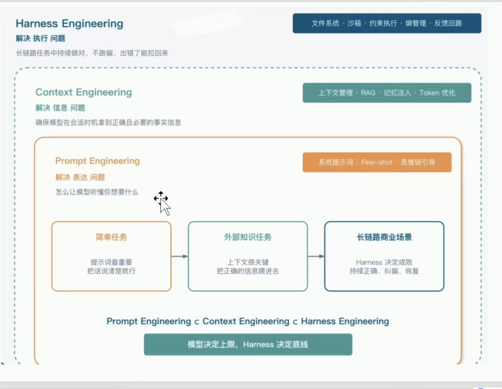

---

## 本项目为纯手搓复现Harness智能体架构  
最后产出 一个可以通用的Harness架构模板，便于集成到各个项目内部。  
最后产出 提供一个详细的API文档

---

## 一、 项目文件结构

|目录|作用|
|:--:|:--:|
|src|所有py源代码|
|sandbox|沙箱镜像构建文件（Dockerfile / setup-runtime.sh）|
|frontend|基于Vue的控制台（可选，接入方可自行实现）|
|test|测试单元|
|docs|API文档、接入示例、踩坑记录等说明性内容|
|main.py|FastAPI 服务启动入口|
|langgraph.json|Agent Protocol 异步子 Agent 的图声明|
|runtime|图表/临时产物目录（运行时按需创建）|
|.env|环境变量配置|
|requirements.txt|python环境所需依赖|

**src 目录结构**

```text
src/
├── agent/
│   ├── config.py              模型、沙箱、PostgreSQL、路径配置
│   ├── schema.py              HarnessContext / Chat / Session 数据模型
│   ├── main_agent.py          主 Agent 组合根（工具、子 Agent、中间件）
│   ├── history_reader.py      只读 checkpoint 恢复
│   ├── backends/              OpenSandbox 适配器、代理、管理器、技能同步
│   ├── memory/                主 Agent system prompt 与 AGENTS.md
│   ├── middlewares/           上下文注入、技能同步、调用保护、记忆更新
│   ├── subagents/             SubAgent 注册、YAML 加载、Agent Protocol 入口
│   ├── skills/                技能目录（main/ 与 subagents/）
│   └── tools/                 HITL、异步任务、技能管理、MCP 工具加载
├── api/
│   ├── agent_loader.py        按用户缓存 Agent、会话索引、异步任务投递
│   ├── chat.py                FastAPI 应用与 SSE 对话接口
│   ├── history.py             会话历史接口
│   ├── async_tasks.py         异步任务轮询接口
│   └── message_utils.py       文本与中断协议转换
├── mcp_server/                FastMCP 服务端（工具注册与 stdio/HTTP 启动）
└── utils/                     可视化等通用工具
```

> 本仓库是**业务无关的模板**：不内置任何行业工具、提示词或子 Agent。
> 接入方只需要补「工具 + 子 Agent YAML + 技能」三样东西，就能得到一个可运行、
> 可中断、可恢复的 Agent 运行时。
>
> 想先看内部原理，直接读 [架构图与核心时序](./docs/架构图与核心时序.md)。

## 二、Harness架构介绍
> 注意：全部是个人的学习笔记，掺有个人的主观理解，仅作参考
### 1. 什么是Harness Engineering （驾驭工程）?
####  1.1 概念
LangChain团队提出了一个公式来介绍Harness  
**Agent = LLM + Harness**  

Harness Engineering 是⼀种以Agent可靠执⾏为⽬标的系统⼯程⽅法。它通过设计模型外部的上下
⽂、⼯具、运⾏时、权限约束、验证反馈和持久状态，将⼤模型的不确定⽣成能⼒转化为可操作、可
控制、可恢复、可审计和可持续改进的任务执⾏能⼒。简而言之，是agent软件工程目前最新的工程范式


####  1.2 在当今Agent开发中的作用和地位


####  1.3 整体架构
如果你去看OpenAI、Anthropic、LangChain、DeepSeekHarness这些做Agent的顶级团队，会发
现⼀件挺有意思的事：他们的产品形态不⼀样、技术栈不⼀样、服务对象也不⼀样，但你把他们的
Harness掀开看内部结构，⾥⾯的组件居然惊⼈地相似。

- 第⼀层：上下⽂精细化ContextRefinement  
上下⽂精细化：过滤与总结，提供精准背景。放到Agent⼯程⾥，它解决的问题是：模型每⼀轮到底应该看到什么信息，不应该看到什么信息，以及历史信息太⻓时怎么压缩和检索。
- 第⼆层：⼴义上的⼯具系统  
Harness ⾥⾯的“⼯具系统”，核⼼不是“给Agent加⼏个函数”，⽽是解决⼀个⼯程问题：skill
⼯具系统不能只看⼯具列表，还要看⼯具运⾏在哪⾥。
Agent 调⽤⼯具，本质上是在让模型间接操作真实环境，所以必须有⼀个受控执⾏后端。当前AI Coding 项⽬的LocalShellBackend可以理解为“本地沙箱”，⽽业务项目⾥的OpenSandbox可以理解为“远程沙箱”。
- 第三层：执⾏编排
Harness 架构⾥的第三层是ExecutionOrchestration，执⾏编排。这⼀层解决的问题是：Agent 不能只是“模型想⼀步做⼀步”，⽽是要把复杂任务拆成可执⾏流程，并在执⾏过程中决定：先做什么、后做什么、什么时候转交SubAgent、什么时候调⽤⼯具、什么时候等待⽤⼾确认、什么时候结束任务。
- 第四层：记忆与状态  
Harness 架构⾥的第四层是Memory&State，记忆与状态。这⼀层解决的问题是：Agent 不能每轮都像第⼀次⻅到⽤⼾和仓库⼀样重新开始。它必须知道当前会话执⾏到哪⾥、⽤⼾上⼀轮确认了什么、仓库过去做过什么、哪些⽅案已经被拒绝、哪些结果已经验证过。
- 第五层：评估与观测  
Harness 架构⾥的第五层是Evaluation&Observability，评估与观测。这⼀层解决的问题是：Agent 不能只看“最后有没有输出”，还要能观察它中间做了什么、为什么这么做、⼯具有没有失败、结果是否符合预期，以及后续如何评估质量。
- 第六层：约束与恢复  
Harness 架构⾥的第六层是Constraint&Recovery，约束与恢复。这⼀层解决的问题是：Agent 不可能永远正确。它可能调⽤错⼯具、传错参数、访问越权路径、陷⼊循环、执⾏失败、测试不通过，甚⾄遇到沙箱不可⽤。⼯程化Agent的关键不是假设它不犯错，⽽是给它设置边界，并在出错后可恢复。

---


### 2. Harness的任务规划(Planning)能力

本项目的规划能力不是单独写一个 `Planner` 类，而是由四层机制组合出来的。这样做的原因是：**规划必须是可执行、可中断、可恢复的**，脱离执行图单独维护一份计划，很快就会和执行状态不一致。

| 层 | 机制 | 代码落点 | 解决的问题 |
|:--:|:--|:--|:--|
| 1 显式待办 | `TodolistMiddleware` 注册 `write_todos` 工具 | DeepAgents 内置 | 让模型把长任务拆成可勾选的条目，计划对用户和模型都可见 |
| 2 隐式循环 | LangGraph 的 `model → tool → model` 循环 | DeepAgents 图 | 每轮根据工具结果决定下一步，不需要预设完整流程 |
| 3 委派 | `task`（同步）与 `start_async_task`（异步） | [main_agent.py](./src/agent/main_agent.py) | 把子任务交给独立上下文窗口，主 Agent 只保留结论 |
| 4 人工断点 | `interrupt` / `interrupt_on` | [hitl_tool.py](./src/agent/tools/hitl_tool.py) | 信息不足或高风险操作时暂停，等待用户补充或审批 |

**规划的执行链路**

```text
用户请求
   ↓
主 Agent 先判断：能否直接回答？
   ├─ 能 → 直接输出，结束
   └─ 不能 → 判断任务形态
        ├─ 需要多步推进 → write_todos 拆解，逐步调用工具
        ├─ 需要独立上下文/耗时 → task 或 start_async_task 委派
        └─ 缺关键信息/高风险 → request_additional_info 或 interrupt_on 暂停
   ↓
每轮工具结果回到模型 → 调整下一步 → 直到完成或触发上限
```

**工程约束**

- 计划不是一次性生成的：`write_todos` 的状态保存在图状态里，恢复会话后仍然存在。
- 循环保护由 `ModelCallLimitMiddleware` 与 `ToolCallLimitMiddleware` 兜底，默认单次 run 模型/工具各 50 次（见 [config.py](./src/agent/config.py)）。
- 长任务优先委派而不是在主上下文里硬跑；上下文压缩由 `compact_conversation` 工具和自动摘要中间件共同承担。
- 任何“等待人”的动作都以 `interrupt` 落地为 checkpoint，不允许用 `sleep` 或阻塞线程等待。

---

### 3. Harness的安全的动态路由的文件系统

Agent 看到的是一套统一的虚拟文件系统（`ls / read_file / write_file / edit_file / glob / grep / execute`），但**同一个路径前缀会落到不同的真实存储**。路由发生在 `CompositeBackend`，而不是在工具里写 `if path.startswith(...)`。

**路由表（本项目的默认装配）**

| 路径前缀 | 目标后端 | 持久性 | 用途 |
|:--|:--|:--|:--|
| `/memories/` | `StoreBackend`（PostgreSQL，namespace=`user_id`） | 跨会话持久 | 用户偏好、近期查询 |
| `/skills/` | `SandboxBackendProxy → OpenSandboxBackend` | 宿主磁盘是权威源，沙箱是运行副本 | 技能文件 |
| `/AGENTS.md` | 同上 | 宿主文件同步到沙箱 | 主 Agent 只读指引 |
| 其余路径 | 同上 | 沙箱生命周期内 | 工作文件、脚本输出、报告 |

代码落点：[main_agent.py](./src/agent/main_agent.py) 中的 `CompositeBackend` 装配。`/memories/` 使用 `lambda runtime: (user_id,)` 作为 Store 命名空间，因此不同用户天然隔离。

**为什么叫“动态路由”**

1. **路由是声明式的**：新增存储介质只需要加一条 `routes` 映射，不改工具实现。
2. **沙箱可热替换**：图里持有的是 `SandboxBackendProxy`，沙箱崩溃/重建时只替换代理内部引用（[sandbox_proxy.py](./src/agent/backends/sandbox_proxy.py)）。
3. **宿主不暴露真实路径**：模型拿到的永远是虚拟路径；真实文件读写由后端翻译成沙箱 SDK 调用。

**安全边界**

- 代理的 `execute / upload_files / download_files` 全程持同一把 `RLock`，替换沙箱是“排空在途操作后替换”，不是打断式替换。
- 技能同步逐文件校验：拒绝符号链接、目录联接、`..`、绝对路径、反斜杠、盘符；清单最后写入，写成功才算同步完成（[skill_sync.py](./src/agent/backends/skill_sync.py)）。
- 技能导出同时做 POSIX 与 Windows 双路径校验（[sandbox_skill_management.py](./src/agent/tools/sandbox_skill_management.py)）。
- 沙箱内只运行项目自带的可信 `runtime.zip`，使用 `python3 -I` 隔离模式。

---

### 4. Harness的Multi-Agent能力（SubAgent委派）

项目提供两种子 Agent，区别不在“是不是多 Agent”，而在**生命周期归属于谁**。

| 形态 | 生命周期 | 上下文 | 适用场景 | 代码落点 |
|:--|:--|:--|:--|:--|
| 同步子 Agent | 跟随主图当前 run | 独立子图，结果回主图 | 短任务、需要共享会话状态 | [loader.py](./src/agent/subagents/loader.py) + `SYNC_SUBAGENTS` |
| 异步子 Agent | 独立 thread + run + status | 完全独立，主 Agent 只拿 task_id | 长任务、耗时分析、报告生成 | [async_registry.py](./src/agent/subagents/async_registry.py) + [async_entry.py](./src/agent/subagents/async_entry.py) |

**同步子 Agent**

- 通过 YAML 声明 `name / description / system_prompt / tools`，`load_subagent` 负责校验工具是否真的加载。
- 主 Agent 通过内置 `task` 工具委派，子 Agent 在自己的上下文里执行，只把最终结果回传。
- 子 Agent 的模型/工具调用预算独立计数，不消耗主 Agent 的本次 run 配额。

**异步子 Agent**

```text
主 Agent
  └─ start_async_task(description, subagent_type)
        ├─ 取当前沙箱 ID
        ├─ 在 Agent Protocol 创建 thread
        ├─ 提交 run（assistant_id = async_subagent）
        └─ 立刻返回 task_id，任务状态写入主图 async_tasks
              ↓
        前端轮询 GET /async-tasks/{task_id}
              ↓
        Agent Protocol 在独立 thread 执行
              ↓
        终态结果幂等写回主会话（固定消息 ID，防重复）
```

关键设计：

1. **只有一个远程图入口** `async_subagent`，具体子 Agent 由 `context["subagent_name"]` 决定。新增子 Agent 不需要改 `langgraph.json`。
2. **共享沙箱，不共享上下文**：异步任务通过 `sandbox_id` 复用用户沙箱，但拥有自己的 thread、run、消息历史和任务状态。
3. **结果投递幂等**：结果以 `async-task-result:<task_id>` 作为固定消息 ID 写回主会话；重复轮询不会产生重复消息。
4. **暂停时拒绝投递**：主会话正在 `interrupt` 等待审批时，异步结果不会通过 `aupdate_state` 覆盖暂停状态，等会话恢复后再投递。

**扩展点**

- 同步子 Agent：在 [main_agent.py](./src/agent/main_agent.py) 的 `SYNC_SUBAGENTS` 中追加 `load_subagent(...)` 的返回值。
- 异步子 Agent：在 [async_registry.py](./src/agent/subagents/async_registry.py) 调用 `register_async_subagent(...)`，并在 `configs/` 下增加 YAML。

---

### 5. Harness的人工介入（HITL）
在[hitl_tool.py](./src/agent/tools/hitl_tool.py)编写人工接入相关工具函数。  
通常在Agent图流程中，如果某些任务明确需要人工介入，则需要在agent的system_promot内明确要求在什么情景时，调用hitl工具。  

使用场景：
- 数据不完整 
- 人工审批某些操作（）


langgraph.types.interrupt函数，可以终端当前会话，保留上下文快照。    
也可以用yaml配置人工介入的出现点  

会话恢复： api/chat.py内部提供检测接口

---

### 6. Harness的SandBox
采用代理模式，支持沙箱的热替换。

**6.1 分层结构（自外向内）**

|层|职责|本项目落点|
|:--:|:--|:--:|
|Agent 图|构建时捕获一次 backend 引用，之后每次工具调用都走它|`create_deep_agent(backend=...)`|
|SandboxBackendProxy|稳定引用 + 原子替换，图内唯一的“可变点”|[sandbox_proxy.py](./src/agent/backends/sandbox_proxy.py)|
|OpenSandboxBackend|适配器：把 SDK 翻译成 `BaseSandbox` 的三个原语 `execute / upload_files / download_files`|[open_sandbox.py](./src/agent/backends/open_sandbox.py)|
|SandboxSync|真实发 HTTP/gRPC 的 SDK 客户端|opensandbox SDK|
|远端沙箱|受控执行环境|OpenSandbox 服务端|

**6.2 为什么必须加代理**
图构建时会把 backend 对象捕获进图。沙箱会崩溃、被回收、被重建、被切换，若图直接持有实例，换沙箱就等于重建整张图——状态丢失、会话中断。代理把“可变点”收拢成唯一一处，因此：**图内引用不变 ≠ 沙箱实例不变**。

**6.3 热替换的准确语义**
- `replace_backend()` 在 `RLock` 内原子替换，并关闭旧客户端（旧后端才是真正被关的那个）。
- `execute / upload_files / download_files` 全程持同一把锁 → 属于“**排空在途操作后替换**”，不是打断式替换。
- 代理是“唯一可变点”，不是“保证实例唯一”。

**6.4 生命周期管理（SandboxManager）**
- 粒度：按 `user_id`。一次会话一个代理，多会话共用同一代理 —— 是**会话级隔离，不是每个 Agent 一个沙箱**。
- 状态：进程内 `_proxies` 缓存代理；LangGraph Store 持久化 `sandbox_id`；每用户一把 `asyncio.Lock` 串行化。
- 取用决策树：缓存健康 → 续期；Store 有 ID 且未确认死亡 → 重连；预热池领取 → 健康检查 → 兜底新建。
- 预热池：只发布“技能已完整同步”的实例；未分配的预热实例可安全丢弃；`close()` 只销毁预热实例，**不销毁用户远端沙箱**。
- 沙箱是可选依赖：无 `OPEN_SANDBOX_API_KEY` 时禁用预热，主 Agent 降级为**无沙箱纯对话模式**（文件工具落到线程状态，禁用技能同步与异步任务），聊天链路照常可用。

---

### 7. Harness的Skill管理与自我进化（渐进式）

**7.1 十条结论（先看这里，再看下面的流程图）**
1. 两类来源：系统自带（`skills/main/`，含受保护的 `skill-management`）+ 运行时下载 / Agent 自写。
2. 唯一归属：`assign` 是**移动语义**，一份技能只存在于 `main/` 或 `subagents/<agent>/` 其一；唯一性落在目录层，不靠数据库标记。
3. 单一权威源：宿主磁盘是持久权威源，沙箱是**运行副本**，Agent 只读沙箱副本。
4. 同步是增量的：以 sha256 清单比对，只传变更、删除已消失文件；**清单最后写入**，写成功才算本次同步完成。
5. 事务快照：操作前两端各留一份可恢复副本（宿主 `.skill-publish-*` 临时区 / 沙箱 `.skill-transactions/<token>/`），提交后删除。
6. 双端事务：两端变更加沙箱 `finish`，成功后才 `release` 清快照；任一步失败两端各自回滚。`release` 失败只告警——两端已提交，不能单边撤销。
7. 删除同样遵守“**先有快照再删**”，不是“先删了再说”。
8. 热加载不是文件 watch，也不是重建图：技能侧靠“每次操作前 `synchronize()`”，沙箱侧靠“代理替换”。
9. 安全边界是防路径穿越 / 越界 / 元数据伪造，**不是查毒**；技能内容在宿主侧不导入、不执行，只作为数据校验。
10. 多技能可并存：`assign` 可多次累积到同一 Agent 目录（当前理解；源码未看完，**技能间“组合/编排”是否存在待确认**）。

**7.2 三个操作的执行序列**

|操作|沙箱侧|宿主侧|失败回滚|
|:--:|:--|:--|:--|
|`download`|下载 → 解压 → 校验 → 落 `main/`，**不建事务**（尚未持久化）|无动作|沙箱自行清理临时目录|
|`assign`|建事务快照 → `move` 到目标目录 → 返回 manifest|逐文件校验 size+sha256 → 旧目录移入临时区 → 发布 → `finish`|沙箱 `rollback` + 宿主快照复位|
|`update`|备份旧版 → 下载新版 → `assign` 到目标|同上（宿主拉取新版本后原子发布）|同上|
|`delete`|同步 → 建快照 → 删除|本地目录移入临时区 → `finish`|同上|
|`release`|删除事务目录|—|仅告警，不回滚|

**7.3 安全校验清单（这是“安全”真正的落点）**

|环节|校验内容|
|:--:|:--|
|URL|仅允许 `http/https`|
|命名|`^[A-Za-z0-9][A-Za-z0-9_-]{0,63}$`；`skill-management` 为保留名|
|ZIP 包|≤2048 文件 / ≤32 MiB；禁绝对路径、`..`、反斜杠、冒号；禁符号链接|
|元数据|`SKILL.md` frontmatter 必含 name/description；`metadata.json` 必须与之完全一致|
|导出|逐文件 size + sha256 复核；POSIX 与 Windows 双路径校验；拒 symlink / junction|
|沙箱内|只允许普通文件与目录；事务 token 必须 32 位 hex|
|执行|只运行可信 `runtime.zip`（两个脚本），`python3 -I` 隔离模式|

```text
【来源 1：系统提供】
  启动时，<project>/skills/main/ 下已有默认技能
  （含受保护的 skill-management）
       ↓
【来源 2：网络下载】
  Agent 调 download_skill(url)
       ↓
  宿主 SandboxSkillManager.run("download")
       ↓ 上传可信 runtime.zip 到沙箱
       ↓ 沙箱内 python3 -I 执行 sandbox_runtime
       ↓ 沙箱内下载、解压、ZIP 成员校验、元数据校验
       ↓ 技能落在沙箱 /skills/main/<skill>/
       ↓ 返回 {skill, directory, files: [{path,size,sha256}]}
       ↓
  ⚠️ 此时宿主持久化磁盘上没有任何变化
       ↓
【持久化：Agent 调 assign_skill(skill, target)】
       ↓
  宿主 SandboxSkillManager.run("assign")
       ↓ ① synchronize()：宿主技能树 → 沙箱（增量）
       ↓ ② 沙箱内：main/<skill> → subagents/<target>/<skill>
       ↓ ③ 沙箱生成新目录的 manifest
       ↓ ④ 宿主下载文件字节，逐文件校验 size + sha256
       ↓ ⑤ 宿主 _local_path 双平台路径校验（POSIX + Windows）
       ↓ ⑥ 宿主 _parse_skill_metadata 再校验元数据
       ↓ ⑦ 双端事务：宿主备份 → 发布 → 沙箱 finish → 沙箱 release
       ↓
  宿主 <project>/skills/subagents/<target>/<skill>/ 持久化完成
  主 Agent 的 main/<skill>/ 已不存在（移动语义）
       ↓
【子 Agent 使用技能】
  子 Agent 在沙箱 /skills/subagents/<target>/<skill>/ 看到技能
  它不"复制"，只是读 Harness 已同步好的文件
```

- 一个子 Agent 能有多个技能吗？ 能，_list_subagent_skills 返回的是列表，目录结构也是多技能，assign 多次累积。

- 唯一持有性是 subagent 复制到沙箱吗？ 不是复制。持久化层是移动（宿主磁盘上唯一一份）；运行时层是 Harness 调 synchronize() 把宿主技能树同步到沙箱，子 Agent 不负责复制，只负责使用。

- 所有 Agent 都在沙箱吗？不需要沙箱的任务呢？ 不是。LLM 推理在宿主，工具执行可路由到沙箱也可走本地（sandbox_backend=None）。异步子 Agent 通过 sandbox_id 复用主沙箱，是用户/会话级隔离，不是每 Agent 一个沙箱。不需要沙箱的任务（纯推理、只读 API）不走沙箱。

--- 

### 8. Harness内的Context Engineering

项目实现  
a. Input Context 输入上下文  
|输入|来源|何时加载|
|:--:|:--:|:--:|
|system_prompt|[prompts.py](./src/agent/memory/prompts.py)|Agent创建时|
|AGENTS.md|本地->沙箱传递上下文时[AGENTS.md](./src/agent/memory/AGENTS.md)|Agent创建时，memory参数|
|用户偏好|/memories/{user_id}/preferences.md|每轮对话前使用read_file|
|技能frontmatter|各SKILL.md的yaml frontmatter （渐进式披露）|Agent 启动时扫描|
|用户上下文|ContextInjectionMiddleware 注入 SystemMessages|每轮before_agent（agent和用户开始交互之前进行注入）|
|子agent返回结果|委派结果|收到返回后|


> 渐进式披露：先只给"够用的最小信息"，把细节留到真正需要时再展开。 它是一种控制"注意力/上下文/认知负担"的策略，在 Agent 技能系统、UX、文档、教学里是同一个思想的不同投影。即，SKILL需要先写一个非常简短的概要，200tk左右即可，详细的后写

b. Compression 压缩上下文
|机制|实现|配置|
|:--:|:--:|:--:|
|自动Offloading（剪裁）|DeepAgents内置，工具结果>20k tk -> 写入文件，上下文只保留文件路径 + 前10行预览|框架默认|
|自动Summarization（摘要）|SummarizationMiddleware,上下文85%窗口 -> 自动压缩历史为摘要，完整历史由框架归档|[tools_summarization.py](./src/agent/middlewares/tools_summarization.py)|
|手动compact_conversation|SummarizationToolMiddleware注册的工具，Agent在收到SubAgent长篇报告/对话超过6轮/用户频繁切换话题时主动调用|[tools_summarization.py](./src/agent/middlewares/tools_summarization.py),  model-deepseek-v4-flash|

c. Isolation 隔离  
analyst(分析者)执行5步分析流程时会产生大量中间结果（MCP返回的结果，Python脚本的输出、图标生成等数据）, 全部隔离在子Agent自己的上下文窗口中。主Agent只收到最终的结构化报告

d. Long-term Memory 长期存储  
|存储|后端|内容|
|:--:|:--:|:--:|
|用户偏好|LangGraph Store（PostgreSQL）|/memories/{user_id}/preferences.md|
|持久化技能|宿主磁盘 `src/agent/skills/`（沙箱是运行副本）|`main/` 与 `subagents/{agent}/` 下的技能文件|
|对话状态|PostgreSQL Checkpointer|Checkpoint：HITL 中断点，支持跨会话重启|
|对话历史|PostgreSQL Checkpointer|完整历史落库；摘要由 SummarizationMiddleware 归档|
|会话索引|LangGraph Store（PostgreSQL）|`("sessions", user_id)` 下的侧边栏元数据|
|异步任务归属|LangGraph Store（PostgreSQL）|`async_tasks` 命名空间中 task_id → 主会话的绑定|

> **存储口径**：本项目统一以 **PostgreSQL** 为准，唯一实现见 [config.py](./src/agent/config.py)（`AsyncPostgresStore` + `AsyncPostgresSaver`）。
> 文件式读写是 DeepAgents 的**虚拟文件系统接口**（按路径前缀路由到不同后端），不等于“用文件替代数据库”。
> `/memories/` 走 Store，普通工作文件走沙箱；两者通过 `CompositeBackend` 路由。


### 9. Harness的用户偏好

**文件位置**：`/memories/{user_id}/preferences.md`。  
虚拟路径由 `CompositeBackend` 路由到 `StoreBackend`（PostgreSQL，namespace=`user_id`），因此不同用户之间天然隔离。

**谁来写**

[memory_update.py](./src/agent/middlewares/memory_update.py) 的 `MemoryUpdateMiddleware` 在每轮 `after_agent` 阶段：

1. 取最后一条有实质内容的用户消息；
2. 用低成本摘要模型提取 `query`（本轮请求摘要）与 `preferred`（用户明确表达的长期偏好）；
3. 合并进已有的 YAML 文件，`recent_queries` 去重置顶并最多保留 5 条；
4. 写回 Store。写失败只告警，不影响本轮回答。

**谁来读**

主 Agent 的 system prompt 要求在每轮开始前用 `read_file` 读取该文件；`ContextInjectionMiddleware` 同时在系统提示词中注入 `user_id` 与偏好文件路径，避免模型猜路径。

**格式**

```yaml
preferred:
  language: zh-CN
  output_style: concise
recent_queries:
  - 统计最近三个月的执行记录
  - 生成一份对比摘要
```

**边界**

- 只记录用户**明确表达**的长期偏好，不从一次性请求或业务数据中推断。
- `preferred` 是开放对象，不预设业务字段；业务字段由接入方在提示词中约定。
- `recent_queries` 是短期辅助信息，不等同于对话历史；完整历史在 checkpoint 中。


### 10. 中间件
> 中间件由Hook函数决定何时使用。Hook由节点式钩子和包裹式钩子。

**节点钩子**
节点钩子在 Agent 执行流的特定时间点触发，像路标一样顺序执行。它们通常用于执行日志记录、状态更新、数据验证等一次性操作。  
|钩子名称|执行时机|典型用途|
|:--:|:--:|:--:|
|before_agent|	Agent 开始执行前，每次调用仅执行一次	|加载记忆、初始化资源、验证初始输入
|before_model|	每次调用模型前|	修改 Prompt、过滤 PII 敏感信息、注入上下文
|after_model|	每次模型返回后，但在工具执行前|	人工介入（HITL）审批、输出验证、内容过滤
|after_agent|	Agent 完成执行后，每次调用仅执行一次	|保存结果、发送通知、清理资源

**缠绕钩子**
缠绕钩子包裹了模型或工具的整个调用过程，让你对执行流有更强的控制力。你可以决定是否调用、调用几次以及如何处理结果。  

|钩子名称|执行时机|典型用途|
|:--:|:--:|:--:|
|wrap_model_call|	包裹每一次模型调用|	实现缓存、重试逻辑、动态修改请求（如切换模型或工具）
|wrap_tool_call|	包裹每一次工具调用|	实现重试、记录日志、检查权限、拦截并修改工具结果


DeepAgent的中间件
| 中间件名称 (Middleware) | 功能/对应工具 (Description) |
| :--- | :--- |
| **TodolistMiddleware** | write_todos 任务管理工具 |
| **MemoryMiddleware** | AGENTS.md 注入到 system prompt |
| **SkillsMiddleware** | 技能渐进式披露 |
| **FilesystemMiddleware** | ls/read/write/edit/glob/grep/execute 工具 |
| **SubAgentMiddleware** | task 子 Agent 调度工具 |
| **SummarizationMiddleware** | 85% 自动摘要保底 |
| **AnthropicPromptCachingMiddleware** | 提示缓存 |
| **PatchToolCallsMiddleware** | 孤儿 tool_call 修复 |

**本项目实际装配的中间件**
| # | 中间件 | 来源 | 使用的钩子 | 职责 |
| :---: | :--- | :--- | :--- | :--- |
| 1 | ContextInjectionMiddleware | 自定义 | wrap_model_call / awrap_model_call | 注入 user_id / username 与偏好文件路径 |
| 2 | SandboxSkillsMiddleware | 自定义（继承 SkillsMiddleware） | abefore_agent | 本地技能增量同步到沙箱，并刷新技能索引 |
| 3 | SummarizationMiddleware | DeepAgents | before_model | 上下文达到阈值时自动摘要 |
| 4 | SummarizationToolMiddleware | DeepAgents | wrap_model_call | 提供 compact_conversation 主动压缩工具 |
| 5 | ModelCallLimitMiddleware | LangChain | before_model / after_model | 单次 run 模型调用超过上限即终止 |
| 6 | ToolCallLimitMiddleware | LangChain | before_agent / after_agent / before_model / after_model / wrap_tool_call | 单次 run 工具调用超过上限即终止 |
| 7 | MemoryUpdateMiddleware | 自定义 | aafter_agent | 提取本轮 query / preferred 写回 `/memories/` |

装配位置见 [main_agent.py](./src/agent/main_agent.py)，调用预算见 [config.py](./src/agent/config.py)。

**内置但本项目未装配（扩展点）**
| 中间件 | 用途 | 建议接入方式 |
| :--- | :--- | :--- |
| SandboxHealthMiddleware | ping 沙箱，失败自动重建 | `before_agent` 调 `proxy.is_healthy()`，失败走 `SandboxManager.get_backend` |
| SandboxCircuitBreakerMiddleware | 连续沙箱错误熔断 | `before_model` 统计错误次数，超阈值 `jump_to=end` |
| UserSkillsRestoreMiddleware | 从 Store 恢复用户技能到沙箱 | `abefore_agent` 配合 `SandboxSkillManager` |
| SkillManagementVisibilityMiddleware | 普通对话隐藏技能管理工具 | `wrap_model_call` 动态裁剪工具 schema |

**故障场景覆盖**
| # | 故障场景 | 当前行为 |
| :---: | :--- | :--- |
| 1 | 沙箱超时 / 容器被销毁 | 每次请求由 `SandboxManager.get_backend` 健康探测；失效则重连或新建，并通过代理热替换 |
| 2 | 沙箱服务宕机（重建也失败） | 请求返回 5xx；已缓存图不会重建。需要快速失败时接入熔断中间件 |
| 3 | 工具调用抛异常 | ToolNode 捕获 → `ToolMessage(status="error")` → Agent 自我纠正 |
| 4 | 上下文溢出 | 自动摘要 + `compact_conversation` 主动压缩 |
| 5 | LLM 陷入循环 | ModelCallLimit 强制终止 |
| 6 | 工具调用风暴 | ToolCallLimit 强制终止 |
| 7 | 用户记忆丢失 | MemoryUpdate 每轮对话后写回 Store |
| 8 | 沙箱丢失技能文件 | 每次 run 前增量同步，manifest 比对后补传 |
| 9 | 用户身份未注入 | ContextInjectionMiddleware 每轮注入系统提示词 |

何时注入？  
在 [main_agent.py](./src/agent/main_agent.py) 的 `create_deep_agent(..., middleware=[...])` 中传参。中间件顺序会改变 `before_*` 与 `after_*` 的实际执行顺序，调整前先确认依赖关系。

DeepAgent官方文档[中间件](https://docs.langchain.com/oss/python/langchain/middleware/built-in#context-editing)内部含有很多的中间件，可以根据自己喜好配置。  


### 11. 异步后台的子智能体（AsyncSubAgent）
**一、核心思想**  
1. 主智能仍然运行在FastAPI中
2. 耗时的子Agent不再由Agent同步等待
3. 后台任务通过一些异步工具投递到本地LangGraph/Agent Protocol Server
4. 子Agent 在后台运行
5. 前端拿到task_id后自动轮询任务状态
6. 任务完成后，前端自动显示结果
**二、为什么需要AsyncSubAgent？**
同步Subagent会阻塞supervisor，异步subagent会立即返回任务ID，superviser可以继续和用户交互。很多人听到AsyncSubAgent，会误认为它只是Python里的：async def xxx()异步函数，但其实不是。AsyncSubAgent的"异步"不是指Python协程，而是指**子Agent的生命周期从主Agent当前请求中脱离出来了**。
他有自己的  
- thread
- run
- state
- message history
- task status
- task id


**Agent Protocol Server**
可以理解为一个"标准化的Agent后台任务服务器"。  
不是普通的PastAPI聊天接口，也不是简单的Python后台线程。他的核心职责是：
- 创建Agent 任务线程，也就是thread
- 启动一次Agent执行，也就是run
- 查询任务状态和上下文
- 保存任务窗台和上下文
- 支持任务取消
- 支持向运行中的任务追加新指令
- 让远程 Agent 可以通过统一协议被调用

**三、本项目落点**

| 环节 | 文件 | 说明 |
|:--|:--|:--|
| 注册 | [async_registry.py](./src/agent/subagents/async_registry.py) | `register_async_subagent` 登记名称、描述、YAML、工具加载器 |
| 配置 | [configs/](./src/agent/subagents/configs/) | 每个子 Agent 一个 YAML；工具必须是已加载对象的名称 |
| 远程图 | [async_entry.py](./src/agent/subagents/async_entry.py) | 唯一入口 `async_subagent_graph`，按 `context.subagent_name` 构建图 |
| 提交工具 | [async_sandbox_tools.py](./src/agent/tools/async_sandbox_tools.py) | `start_async_task` 创建 thread/run，返回 task_id |
| 图声明 | [langgraph.json](./langgraph.json) | 只声明一次 `async_subagent`，新增子 Agent 无需修改 |
| 状态轮询 | [async_tasks.py](./src/api/async_tasks.py) | 查询 run 状态，终态结果幂等写回主会话 |

`context` 需要同时携带：

```json
{"sandbox_id": "用户沙箱 ID", "subagent_name": "已注册的子 Agent 名称"}
```

缺少 `subagent_name` 时远程图会明确失败；缺少 `sandbox_id` 时无法复用用户沙箱。


## 附录A · 术语词典

> 读本仓库代码时，这几个词最容易“看着认识、说着不对”。左列是术语，中列是一句话释义，右列是本项目里的落点。

|术语|一句话释义|本项目落点|
|:--|:--|:--|
|Harness（驾驭工程）|以 Agent 可靠执行为目标的系统工程方法：用上下文、工具、运行时、约束、验证、持久状态六层把模型的**概率性生成**约束成可操作、可恢复、可审计的执行能力|全仓库设计|
|Harness vs Agent 框架|前者是“模型外部的工程约束”，后者是“模型/图编排”。同一框架可配不同 Harness，别把两者混为一谈|DeepAgents 是框架，本仓库是 Harness|
|稳定引用（Reference Stability）|图里只保存一个永不失效的句柄，句柄背后的真实对象可以换|`SandboxBackendProxy`|
|代理模式（Proxy）|在调用者与真实对象之间插一层，转发全部调用，并可替换被代理对象|`sandbox_proxy.py`|
|热替换（Hot Swap）|不重建上层（Agent 图）的前提下更换下层实例（沙箱）|`replace_backend()`|
|排空式替换|先等在途操作结束再替换，而非强行中断；实现方式是同一把锁串起“操作”与“替换”|`RLock` + `transaction()`|
|适配器（Adapter）|把一种 SDK 的 API 翻译成另一种协议要求的原语集合|`OpenSandboxBackend` → `BaseSandbox` 三原语|
|后端路由（Backend Routing）|按路径前缀把文件操作分派到不同后端|`CompositeBackend`|
|虚拟文件系统|给模型一套统一的 `ls/read_file/write_file` 接口，底层存哪由路由决定|DeepAgents `backend=` 参数|
|运行副本 vs 持久副本|沙箱里的是运行副本（可重建），宿主磁盘上的才是持久副本|宿主 `skills/` 与沙箱 `/skills/`|
|单一权威源（SSOT）|同一份数据只允许一个可写权威处，其余都是派生|宿主技能目录|
|移动语义（Move Semantics）|`assign` 不是复制而是移动，源目录随之消失——唯一性由此成立|`shutil.move`|
|增量同步|只传内容变化了的文件，并删除源中已消失的文件|`SandboxSkillSynchronizer.sync()`|
|清单 / 提交标记（Manifest）|记录“路径→摘要”的索引，**最后写入**；写入成功才算本次同步完成|`/.myagent/skills-manifest.json`|
|内容寻址（Content Addressing）|用内容哈希而非文件名判断“是不是同一份”|`sha256`|
|事务快照|操作前对将被改动的目录留一份可恢复副本，提交后删除|`.skill-transactions/<token>/`|
|双端事务|宿主与沙箱各持事务，用 token 协同；两端都提交才算成功|`finish / release / rollback`|
|补偿回滚（Compensation）|失败后按快照反向恢复，而非“重试到成功”|`restore()` / `backup.replace()`|
|幂等（Idempotent）|同一请求重复执行结果一致；本例中重复 `rollback` 不报错|`dispatch()` 对 `rollback` 的处理|
|路径穿越（Path Traversal）|用 `../` 或绝对路径跳出允许目录|路径校验|
|符号链接 / 目录联接|指向别处的“快捷方式”，可被用来绕过路径校验|`is_symlink` / `is_junction` 一律拒绝|
|允许清单（Allowlist）|只接受枚举内的值，其余一律拒绝（而非“拒绝已知坏值”）|子 Agent 名单 `names`|
|隔离执行|让不可信内容只作为**数据**被校验，不作为**代码**被执行|`python3 -I` + `runpy`|
|预热池（Warm Pool）|提前建好空闲实例，领取时省去创建耗时；未分配即可安全丢弃|`SandboxManager._warm_reserve`|
|渐进式披露（Progressive Disclosure）|先给最小可用信息，细节按需展开，控制注意力与上下文开销|`SKILL.md` 先写 ~200tk 摘要|
|上下文卸载（Offloading）|超长工具结果落盘，上下文只留路径 + 预览|>20k token 触发|
|上下文摘要（Summarization）|历史超过阈值时压成摘要，完整历史另存|85% 窗口触发|
|主动压缩（Compaction）|由 Agent 自己判断时机调用压缩工具|`compact_conversation`|
|HITL（Human-in-the-Loop）|在关键节点停下来等人确认，靠 Checkpoint 续跑|`Checkpoint`|
|子 Agent 委派（Delegation）|主 Agent 把子任务交给独立上下文窗口执行，只收最终结果|SubAgent / `task` 工具|


---

## DeepAgent文件后端（Backend）系统
### BackEen概述
后端是Agent文件系统工具的底层实现，它决定了Agent可以访问那些存储介质（如内存，本地磁盘，数据库等等）以及如何访问。  
DeepAgents 通过一套文件系统工具（如ls、read_file、write_file等）为Agent提供与外界存储交互的能力。这些工具并不直接操作存储，而是通过一个可插拔的后端来执行实际的操作。后端是一个遵循待定协议（BackEndProtocal）的组件  

Agent的文件系统工具调用后端，后端再根据配置将操作路由到不同的具体存储实现，DeepAgents提供了多种开箱即用的后端，使用各种场景。如：
- 状态存储(StateBackEnd):存储在LangGraph状态中，单次会话有效
- 本地磁盘(FIleSystembackEnd):访问宿主机的真实文件系统
- 持久化存储(StoreBackEnd):使用LangGraph的BaseStore实现
- 沙盒/本地Shell(Sandbox, LocalShellBackEnd):提供隔离或非隔离的执行环境
- 复合后端(CompositeBackEnd): 作为路由器，将不同路径的请求分发给不同的后端


---
## 学习进度 / 已实现能力

- [x] HITL：中断、恢复、审批与补充信息
- [x] SandBox：代理模式、热替换、按用户生命周期管理、预热池
- [x] Skill 管理：下载、分配、更新、删除与双端事务
- [x] MiddleWare 与钩子：上下文注入、技能同步、摘要压缩、调用上限、记忆更新
- [x] Multi-Agent：同步子 Agent 与异步子 Agent（Agent Protocol）
- [x] MCP：FastMCP 服务端 + stdio/Streamable HTTP 客户端工具加载
- [x] Context Engineering：卸载、自动摘要、主动压缩、记忆隔离
- [x] HTTP/SSE API：对话、流式、恢复、历史、异步任务轮询
- [ ] 评估与观测：trace / 评估集接入（建议优先补 Langfuse 或 LangSmith + DeepEval）
- [ ] 多 worker 部署：会话互斥目前只在单进程内有效


--- 


## 三、拓展开发与对接文档

> 这一节回答两个问题：
> 1. **我要往这个模板里加自己的业务能力，改哪里？**
> 2. **我的 Java / Vue / 其他服务怎么通过 HTTP 接进来？**

### 一、SubAgent 注册模块

| 文件 | 作用 |
|:--|:--|
| [async_registry.py](./src/agent/subagents/async_registry.py) | 异步子 Agent 注册表与委托规则 |
| [configs/__init__.py](./src/agent/subagents/configs/__init__.py) | YAML 配置目录与 `config_path()` helper |
| [async_entry.py](./src/agent/subagents/async_entry.py) | Agent Protocol 远程图入口 |
| [loader.py](./src/agent/subagents/loader.py) | YAML 读取、必填字段与工具校验；`aload_subagent` 支持 MCP |
| [main_agent.py](./src/agent/main_agent.py) | 主 Agent 装配；同步子 Agent 扩展点 `SYNC_SUBAGENTS` / `SYNC_SUBAGENT_CONFIG_FILES` |
| [mcp_client.py](./src/agent/tools/mcp_client.py) | MCP 客户端：stdio / Streamable HTTP 工具加载 |
| [mcp_server/](./src/mcp_server/) | FastMCP 服务端：工具注册与启动 |

#### 1. 同步子 Agent（跟随主图当前 run）

**第一步**：在 `src/agent/subagents/configs/` 新建 YAML。

```yaml
name: my_sync_agent
description: 一句话说明这个子 Agent 能做什么、不能做什么。
tools:
  - my_tool_a
  - my_tool_b

system_prompt: |
  你是……。只处理……任务；信息不足时调用 request_additional_info。
```

必填字段：`name`、`description`、`system_prompt`、`tools`。  
可选字段：`model`、`skills`、`middleware`、`interrupt_on`、`permissions`、`mcp_servers`。

**第二步**：在 [main_agent.py](./src/agent/main_agent.py) 装配。

需要同时加载 MCP 工具时，把 YAML 路径登记到 `SYNC_SUBAGENT_CONFIG_FILES`：

```python
from agent.subagents.configs import config_path

SYNC_SUBAGENT_CONFIG_FILES: list[str | Path] = [
    config_path("my_sync_agent.yaml"),
]
```

如果工具对象已经准备好（不需要 MCP 异步加载），也可以继续使用静态列表：

```python
from agent.subagents.loader import load_subagent

SYNC_SUBAGENTS: list[dict[str, Any]] = [
    load_subagent(
        config_path("my_sync_agent.yaml"),
        [my_tool_a, my_tool_b],   # 必须包含 YAML 中声明的全部工具
    ),
]
```

**规则**

- YAML 中 `tools` 写的是工具对象的 `.name`。缺一个就会在构图时抛 `ValueError`，不会静默降级。
- 子 Agent 与主 Agent 共享沙箱和会话状态，适合短任务。
- YAML 里写 `mcp_servers: [server_name]` 时，必须通过 `SYNC_SUBAGENT_CONFIG_FILES`（内部调用 `aload_subagent`）加载，否则 MCP 工具不会被注入。

#### 2. 异步子 Agent（独立 thread / run / 状态）

**第一步**：新增 YAML，结构同上。

**第二步**：在 `async_registry.py` 注册。

```python
import asyncio

from agent.subagents.async_registry import (
    AsyncSubagentRegistration,
    register_async_subagent,
)
from agent.subagents.configs import config_path


async def _load_my_async_tools() -> list:
    # 这里可以加载 MCP 工具、HTTP 客户端工具等
    return [my_tool_a]


register_async_subagent(
    AsyncSubagentRegistration(
        name="my_async_agent",
        description="一句话说明它能做什么，供主 Agent 判断是否委派。",
        config_path=config_path("my_async_agent.yaml"),
        tool_loader=_load_my_async_tools,
        launch_instruction=(
            "当用户……时，调用 start_async_task，"
            "subagent_type 填 my_async_agent，把原始请求完整写入 description。"
        ),
    )
)
```

**第三步**：启动 Agent Protocol 服务（见本节“四、启动与验收”）。

**不需要改 `langgraph.json`**：所有异步子 Agent 共用 `async_subagent` 这一个远程图，运行时通过 `context.subagent_name` 区分。

**规则**

- `name` 必须唯一；重复注册会立即报错。
- `launch_instruction` 会拼进主 Agent 的 system prompt，写清楚“什么场景用、传什么参数”。
- 异步任务复用主 Agent 的沙箱（`sandbox_id`），但拥有独立的消息历史和状态。
- YAML 可声明 `mcp_servers`，异步入口通过 `aload_subagent` 自动加载对应 MCP 工具。
- 任务终态由前端轮询 `GET /async-tasks/{task_id}` 触发结果回写。

#### 3. 业务工具

- 普通 Python 工具：放在 `src/agent/tools/` 下，用 `@tool` 装饰，确保有 `name` 和 docstring。
- MCP 工具：见下一节；主 Agent 通过 `main_servers` 加载，子 Agent 通过 YAML 的 `mcp_servers` 声明。
- 主 Agent 只保留通用工具（MCP 公共工具、异步任务、HITL、技能管理）。**业务读写工具应只挂到对应子 Agent**，避免主 Agent 越权直接操作。

#### 4. MCP 服务接入（FastMCP）

项目同时提供 MCP 服务端和客户端，支持 `stdio` 与 `streamable_http` 两种传输。

**服务端（把工具暴露给其他 Agent）**

- 工具注册入口：[mcp_server/tools/__init__.py](./src/mcp_server/tools/__init__.py) 的 `register_all_tools`。
- 启动入口：[mcp_server/server_main.py](./src/mcp_server/server_main.py)。
- 默认 Streamable HTTP，监听 `127.0.0.1:18081/mcp`。

```powershell
$env:PYTHONPATH = "$PWD\src"
.\.venv\Scripts\python.exe -m mcp_server.server_main

# stdio 模式
$env:MCP_TRANSPORT = "stdio"
.\.venv\Scripts\python.exe -m mcp_server.server_main
```

**客户端（把 MCP 工具加载给 Agent）**

在项目根目录创建 `mcp_servers.yaml`：

```yaml
main_servers:
  - demo_http

servers:
  demo_http:
    transport: streamable_http
    url: http://127.0.0.1:18081/mcp

  local_stdio:
    transport: stdio
    command: python
    args: ["test/mcp_demo_server.py"]
    cwd: .
```

- `main_servers` 中的工具会在主 Agent 构图时自动加载。
- 子 Agent YAML 增加 `mcp_servers: [demo_http]`，通过 `aload_subagent` 注入。
- 外部 MCP Server 只要能提供 `streamable_http` URL 或 `stdio` 命令，都可以按同样格式接入。
- 配置文件路径可用 `HARNESS_MCP_CONFIG_PATH` 覆盖；文件不存在且未显式指定时，项目按“未接入 MCP”启动。

**验证**

```powershell
.\.venv\Scripts\python.exe test\test_mcp_integration.py
```

测试会在 `test/` 下启动一个业务无关的 FastMCP 服务，验证工具发现与调用，覆盖 stdio 和 HTTP 两种传输。

**安全边界**

- `stdio` 的 `command` 会在本机执行；`mcp_servers.yaml` 必须来自可信来源。
- 不同 Server 的工具同名会直接报错，不会让模型在两个同名工具之间猜。
- MCP 连接失败会让构图失败，而不是悄悄少加载工具。

#### 5. 技能

- 宿主目录：`src/agent/skills/main/`（主 Agent）与 `src/agent/skills/subagents/<agent>/`（子 Agent）。
- 每个技能必须有 `SKILL.md`（含 name/description frontmatter）和 `metadata.json`，两者 name/description 必须一致。
- `assign_skill` 是**移动语义**：技能从 `main/` 移到子 Agent目录，宿主磁盘上只有一份。
- `skill-management` 是受保护技能，不能被分配或删除。
- 技能通过增量同步进入沙箱；宿主是权威源，沙箱是运行副本。

#### 6. 中间件

在 [main_agent.py](./src/agent/main_agent.py) 的 `middleware=[...]` 中追加。顺序有语义：

- `before_*` 按声明顺序执行；
- `after_*` 按反序执行；
- `wrap_model_call` / `wrap_tool_call` 按洋葱模型嵌套。

现有中间件与扩展点见“二、Harness架构介绍 / 10. 中间件”。

---

### 二、HTTP API 对接文档

#### 1. 基本约定

| 项 | 约定 |
|:--|:--|
| Base URL | `http://<host>:<port>`，默认 `http://127.0.0.1:8000` |
| 数据格式 | JSON；流式接口为 `text/event-stream` |
| 认证 | **本模板不内置认证**。生产环境必须由网关完成鉴权，并把可信的 `user_id` / `username` 注入请求，禁止客户端自报身份 |
| 身份模型 | `user_id` = 记忆与沙箱隔离键；`thread_id` = 会话 ID；`username` = 展示名 |
| 时间 | 数据库时间统一 UTC；接口返回 ISO 8601 字符串 |

#### 2. 接口总览

| 方法 | 路径 | 作用 | 是否流式 |
|:--:|:--|:--|:--:|
| GET | `/health` | 存活探针 | 否 |
| POST | `/chat` | 单轮非流式对话 | 否 |
| POST | `/chat/stream` | 单轮流式对话 | SSE |
| POST | `/chat/{thread_id}/resume` | 恢复 HITL 中断 | SSE |
| POST | `/history` | 创建空会话 | 否 |
| GET | `/history` | 会话列表 | 否 |
| GET | `/history/{thread_id}/messages` | 会话消息与待处理中断 | 否 |
| DELETE | `/history/{thread_id}` | 删除会话 | 否 |
| GET | `/async-tasks/{task_id}` | 查询异步任务并回写结果 | 否 |
| GET | `/settings/model` | 读取当前模型配置（API Key 只回传是否已设置） | 否 |
| PUT | `/settings/model` | 更新 .env 并热更新模型（api_key 留空则保留原值） | 否 |

#### 3. `POST /chat` 非流式对话

请求：

```json
{
  "message": "帮我整理这份资料的核心结论",
  "thread_id": null,
  "user_id": "u_1001",
  "username": "张三"
}
```

| 字段 | 必填 | 说明 |
|:--|:--:|:--|
| `message` | 是 | 用户消息，至少 1 个字符 |
| `thread_id` | 否 | 为空则新建会话；传入则续聊，且必须属于该 `user_id` |
| `user_id` | 否 | 默认 `anonymous`；生产环境应由网关覆盖 |
| `username` | 否 | 缺省时退回 `user_id` |
| `name` | 否 | `username` 的兼容字段 |

响应：

```json
{
  "thread_id": "9f0c...",
  "user_id": "u_1001",
  "username": "张三",
  "answer": "核心结论是……",
  "interrupt": null
}
```

如果触发 HITL，`answer` 可能为空，`interrupt` 返回暂停信息（见第 5 节）。

#### 4. `POST /chat/stream` SSE 流式对话

请求体与非流式相同。响应为 `text/event-stream`，每帧格式固定为：

```text
data: {"type":"...", ...}

```

**事件类型**

| `type` | 关键字段 | 说明 |
|:--|:--|:--|
| `token` | `message_id`、`content`、`source` | 助手文本增量 |
| `tool_start` | `tool_call_id`、`tool_name`、`source`、`subagent_name?` | 工具开始调用 |
| `tool_args` | `tool_call_id`、`args`、`source` | 工具参数增量（`args` 是 JSON 字符串） |
| `tool_result` | `tool_call_id`、`tool_name`、`text`、`status` | 工具结果 |
| `tool_end` | `tool_call_id`、`tool_name`、`status` | 工具结束 |
| `interrupt` | `thread_id`、`interrupt_id?`、`interrupt_type`、载荷 | 需要人工介入 |
| `done` | `thread_id`、`user_id`、`username`、`content`、`interrupted` | 本轮结束 |
| `error` | `message`、`status_code?` | 流内错误 |

**典型顺序**

```text
token → tool_start → tool_args → tool_result → tool_end → token → done
```

**前端处理要点**

1. 以 `tool_call_id` 为主键更新工具卡片，`tool_args` 可能分多帧到达。
2. 收到 `interrupt` 后展示表单，并停止本轮 loading；用户提交后调用 resume 接口。
3. 收到 `done` 后关闭连接；`interrupted=true` 时不要当作失败。
4. `error` 事件也会出现在 HTTP 200 的流里，必须按事件处理，不能只看状态码。

#### 5. `POST /chat/{thread_id}/resume` 恢复中断

中断分两类，`resume` 载荷不同。

**A. 补充信息（`information_request`）**

```json
{
  "user_id": "u_1001",
  "resume": {
    "text": "补充的业务信息"
  }
}
```

工具拿到的就是 `resume` 里的对象，具体字段由接入方工具约定。

**B. 工具审批（`hitl_approval`）**

```json
{
  "user_id": "u_1001",
  "resume": {
    "decisions": [
      {"type": "approve"},
      {"type": "edit", "edited_action": {"name": "my_tool", "args": {"id": "123"}}},
      {"type": "reject", "message": "不允许执行该操作"}
    ]
  }
}
```

规则：

- `decisions` 的顺序必须与中断里的 `action_requests` 顺序一致，数量也必须一致。
- `approve`：原样执行。
- `edit`：用 `edited_action.name/args` 替换原调用。
- `reject`：不执行，并把 `message` 作为错误返回给模型。
- `respond`：跳过工具执行，用 `message` 代替工具结果（需要该工具允许 `respond`）。

响应同样是 SSE 流，可能再次触发新的中断。

#### 6. 会话历史

**创建空会话**

```http
POST /history?user_id=u_1001
```

```json
{
  "thread_id": "9f0c...",
  "title": "新会话",
  "created_at": "2026-10-24T08:00:00+00:00",
  "updated_at": "2026-10-24T08:00:00+00:00",
  "message_count": 0
}
```

**会话列表**

```http
GET /history?user_id=u_1001
```

```json
{
  "sessions": [
    {
      "thread_id": "9f0c...",
      "title": "帮我整理这份资料的核心结论",
      "created_at": "2026-10-24T08:00:00+00:00",
      "updated_at": "2026-10-24T08:05:00+00:00",
      "message_count": 6
    }
  ]
}
```

**会话消息**

```http
GET /history/{thread_id}/messages?user_id=u_1001
```

```json
{
  "thread_id": "9f0c...",
  "messages": [
    {"id": "message-0", "role": "user", "content": "帮我整理……", "created_at": "..."},
    {"id": "call_1", "role": "tool", "tool_name": "task", "tool_status": "done", "text": "……", "created_at": "..."},
    {"id": "message-2", "role": "assistant", "content": "核心结论是……", "source": "main", "created_at": "..."}
  ],
  "interrupt": null
}
```

- `role` 取值：`user` / `assistant` / `tool` / `delegation`。
- `delegation` 表示同步或异步子 Agent 委派记录。
- `async_task_id` 出现在 `start_async_task` 的委派记录上，刷新后可继续轮询。

**删除会话**

```http
DELETE /history/{thread_id}?user_id=u_1001
```

```json
{"success": true}
```

#### 7. 异步任务轮询

前端收到 `tool_result`（`tool_name=start_async_task`）后，从文本里提取 UUID 形式的 `task_id`，然后轮询：

```http
GET /async-tasks/{task_id}?user_id=u_1001
```

运行中：

```json
{
  "task_id": "3a7d...",
  "status": "running",
  "done": false,
  "delivered": false,
  "run_id": "run_...",
  "updated_at": "2026-10-24T08:10:00+00:00"
}
```

终态：

```json
{
  "task_id": "3a7d...",
  "status": "success",
  "done": true,
  "delivered": true,
  "result": "任务最终结果文本",
  "error": null,
  "run_id": "run_...",
  "updated_at": "2026-10-24T08:15:00+00:00"
}
```

规则：

- 只有任务属于该 `user_id` 且主会话存在时才可查询。
- 终态结果会**幂等写回主会话**；`delivered=false` 表示主会话正在中断中或写入失败，稍后重试。
- `status` 取值：`pending` / `running` / `success` / `error` / `cancelled` / `timeout` / `interrupted`。
- 前端不要只依赖 `status`：以 `done=true` 作为停止轮询的条件。

#### 8. 错误约定

| HTTP 状态码 | 场景 |
|:--:|:--|
| 404 | 会话不存在、任务不存在或无权访问 |
| 409 | 同一 `thread_id` 正在处理另一轮请求 |
| 422 | 请求体字段校验失败 |
| 500 | Agent 调用失败（非网络类） |
| 502 | 模型/异步任务返回空结果或结果读取失败 |
| 503 | 模型服务不可达 |

SSE 流内错误不会改变 HTTP 状态码，统一通过 `{"type":"error"}` 事件返回。

#### 9. 模型热更新（`/settings/model`）

`PUT /settings/model` 请求体（字段均可选，缺省不改动）：

```json
{
  "model_name": "deepseek-chat",
  "base_url": "https://api.deepseek.com",
  "api_key": "sk-..."
}
```

行为：按键替换 `.env` 中的 `DEEPSEEK_MODEL_NAME / DEEPSEEK_BASE_URL / DEEPSEEK_API_KEY`
（`api_key` 留空则保留原值）→ `reload_model_config()` 重置模型单例 →
`AgentLoader.reset_agents()` 清空用户级图缓存。**下次对话请求即用新模型重建图**，
无需重启服务；沙箱、checkpoint 与持久化数据不受影响。

响应：`{"ok": true, "updated": ["DEEPSEEK_MODEL_NAME", ...], "current": {...}}`。

> 前端 `frontend/HarnessControlPlatform` 的「模型管理」页即基于该接口：
> 选择模型卡片只改本地表单，点击「保存更改」才写 `.env` 并触发热更新。

---

### 三、环境变量

| 变量 | 默认值 | 必填 | 说明 |
|:--|:--|:--:|:--|
| `DEEPSEEK_API_KEY` | 无 | 是 | 模型服务密钥 |
| `DEEPSEEK_BASE_URL` | SDK 默认 | 否 | 模型服务地址 |
| `DEEPSEEK_MODEL_NAME` | `deepseek-v4-flash` | 否 | 主模型与摘要模型名称 |
| `DB_HOST` | `localhost` | 是 | PostgreSQL 地址 |
| `DB_PORT` | `5432` | 是 | PostgreSQL 端口 |
| `DB_NAME` | `fluctuate_db` | 是 | 数据库名 |
| `DB_USER` | `fluctuate_user` | 是 | 数据库用户 |
| `DB_PASSWORD` | 空 | 是 | 数据库密码 |
| `DB_SSLMODE` | `disable` | 否 | 生产建议 `require` 或 `verify-full` |
| `OPEN_SANDBOX_API_KEY` | 空 | 执行 Agent 时是 | OpenSandbox 凭据；为空时服务可启动，但 Agent 执行会失败 |
| `OPEN_SANDBOX_HOST` | `127.0.0.1` | 否 | OpenSandbox 服务地址 |
| `OPEN_SANDBOX_PORT` | `18083` | 否 | OpenSandbox 服务端口 |
| `OPEN_SANDBOX_IMAGE` | `myagent-sandbox:1` | 否 | 新建沙箱使用的镜像 |
| `OPEN_SANDBOX_DEFAULT_TIMEOUT_SECONDS` | `120` | 否 | 单条命令超时 |
| `OPEN_SANDBOX_SANDBOX_TIMEOUT_SECONDS` | `86400` | 否 | 沙箱生命周期 |
| `OPEN_SANDBOX_PREWARM_ENABLED` | `true` | 否 | 是否预热一个空闲沙箱 |
| `OPEN_SANDBOX_USE_SERVER_PROXY` | `true` | 否 | 命令和文件操作是否经 OpenSandbox 服务端代理；Windows / Docker Desktop 建议开启 |
| `HARNESS_ASYNC_AGENT_PROTOCOL_URL` | `http://127.0.0.1:18082` | 使用异步子 Agent 时是 | Agent Protocol 服务地址 |
| `HARNESS_API_HOST` | `127.0.0.1` | 否 | FastAPI 监听地址 |
| `HARNESS_API_PORT` | `8000` | 否 | FastAPI 监听端口 |
| `HARNESS_CORS_ORIGINS` | 空 | 否 | 允许的浏览器来源，逗号分隔；为空时不开启 CORS |
| `HARNESS_MCP_CONFIG_PATH` | `mcp_servers.yaml` | 否 | MCP Server 配置文件路径 |
| `MCP_SERVER_NAME` | `harness-mcp` | 否 | FastMCP 服务端名称 |
| `MCP_HOST` | `127.0.0.1` | 否 | FastMCP HTTP 监听地址 |
| `MCP_PORT` | `18081` | 否 | FastMCP HTTP 监听端口 |
| `MCP_PATH` | `/mcp` | 否 | FastMCP HTTP 路径 |
| `MCP_TRANSPORT` | `streamable-http` | 否 | FastMCP 服务端传输：`streamable-http` 或 `stdio` |

> `.env` 使用 `override=False`：外部环境变量优先，便于容器和 CI 注入；本地开发由 `.env` 补齐。

---

### 四、启动与验收

**1. 安装依赖**

```powershell
uv pip install --python .\.venv\Scripts\python.exe -r requirements.txt
```

**2. 准备 PostgreSQL**

```sql
CREATE USER fluctuate_user WITH PASSWORD 'your-password';
CREATE DATABASE fluctuate_db OWNER fluctuate_user;
```

表结构由 `create_async_persistence()` 在首次启动时自动创建。

**3. 构建沙箱镜像（需要执行 Agent 时）**

```powershell
docker build -t myagent-sandbox:1 sandbox
```

**4. 启动 FastAPI**

```powershell
.\.venv\Scripts\python.exe main.py
```

`main.py` 会自动把 `src/` 加入 `sys.path`，并在 Windows 上切换为 Selector 事件循环。

**5. 启动 Agent Protocol（使用异步子 Agent 时）**

```powershell
$env:PYTHONPATH = "$PWD\src"
.\.venv\Scripts\python.exe -m langgraph_cli dev `
  --config langgraph.json `
  --host 127.0.0.1 --port 18082 `
  --no-browser --no-reload
```

**6. 验收**

```powershell
curl.exe http://127.0.0.1:8000/health
curl.exe -N -X POST http://127.0.0.1:8000/chat/stream `
  -H "Content-Type: application/json" `
  -d '{"message":"你好","user_id":"u_1001"}'
```

更完整的端到端接入流程与踩坑清单见 [接入全流程示例与避坑指南](./docs/接入全流程示例与避坑指南.md)。
