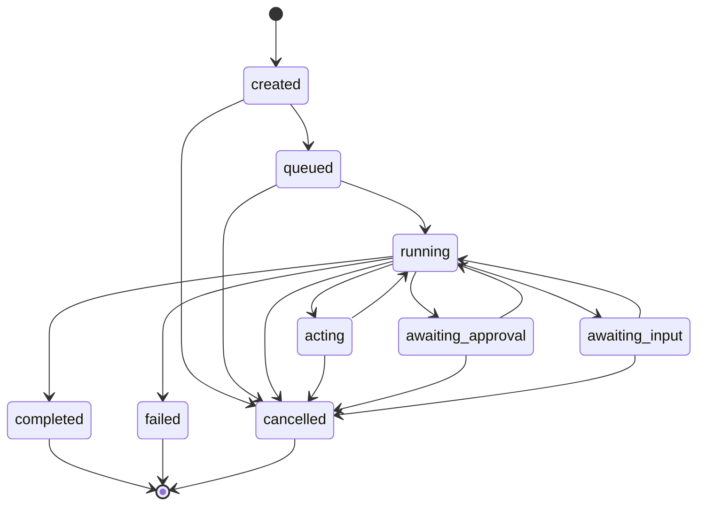

# Harness 内核 · 启动编码指南

> 版本：v0.1（开工基线）
> 适用仓库：`F:\Python\HarnessEngineering\CommonProject`
> 技术栈基线：Python 3.14（`.venv` 已就绪）+ FastAPI + Pydantic v2 + asyncio
> 目标读者：你自己（三个月后回来还能照着写）

---

## 0. 这份文档怎么用

它**不是**架构愿景，而是施工图。读法：

| 你想干什么 | 看哪节 |
|---|---|
| 决定要不要这么设计 | §1 定位、§2 决策记录 |
| 今天开始敲第一行 | §3 运行时模型 → §15 第一条命令 |
| 写某个模块 | §4 模块映射、§5 核心契约、§7 目录职责 |
| 让别人接入你的工程 | §8 接入契约、§9 API 草案 |
| 排期 / 每天干什么 | §10 里程碑、§11 Issue 清单 |
| 防止写成第二个 LangChain | §14 反模式 |

**时间盒**：读完 40 分钟；M0 走通 2 天；可用版本 ≈ 6 周（31 人日）。

**开工前必做**（当前仓库还没有 git）：

```powershell
git init
git add -A; git commit -m "chore: 项目骨架"
```

---

## 1. 一句话定位与三条边界

**定位**：把「Agent 怎么可靠地干活」这件事做成一个**与业务无关的内核 + 一份可被任何语言消费的契约**。别人接入时，只写三样业务侧的东西——**工具、Profile、策略**——就得到一个能跑、能停、能审、能恢复的 Agent 运行时。

要让它"通用"，靠的不是抽象得多，而是**边界切得干净**。三条边界必须在第一周就钉死：

### 边界一：内核不认识业务名词

`kernel/` 里不允许出现 `order`、`invoice`、`erp`、`python`、`vue` 任何一个字。出现即设计错误。

内核只认识：Session / Run / Turn / Step / Event / Tool / Context / Policy / Artifact。
业务语义全部通过 **Profile（装配）+ Tool（能力）** 注入。

> 自检方法：把 `src/harness/` 单独 `pip install` 到一个空项目里，它能不能 import 成功、能不能跑通 echo 工具。能，就说明边界是干净的。

### 边界二：所有副作用只有一个出口

模型能做的事情里，凡是**读写文件、发网络请求、跑命令、改数据库**，一律走 `ToolGateway.execute()`。
工具的 handler 内部**禁止**自己开 shell、自己 `requests.get`、自己 `open()` 写盘——它只能通过 `ToolContext` 拿到受控资源（`ctx.fs`、`ctx.shell`、`ctx.net`、`ctx.secrets`）。

这一条决定了后面权限、审批、审计、沙箱、限流能不能加上去。**破了这条，项目就退化成"会调函数的聊天框"。**

### 边界三：事件是唯一事实源

Run 的状态不靠"内存里的对象"或"表里的 status 字段"决定，而是**由 append-only 的事件流折叠（fold）出来**。
数据库里的 `runs.status`、`turns` 表都只是**投影/索引**，可以随时删掉重建。

好处：崩溃恢复、审计、回放、评估集、调试全部免费。代价：写入要保证 seq 单调 + 幂等，这个在 M3 解决。

---

## 2. 设计决策记录（ADR 摘要）

每条都写清「选了什么 / 否了什么 / 因为什么」。**这些是后面所有代码的前提，改一条要重写一片。**

| # | 决策 | 被否掉的方案 | 理由（关键） |
|---|---|---|---|
| D1 | 内核**手写** asyncio 状态机循环 | 直接用 LangGraph / deepagents 当骨架 | 你的目标是"学会并复现"，套框架会把机制藏在抽象里；且内核只有 ~600 行，可控可调试。LangGraph 留作 M5 的**可选** `OrchestrationBackend` 适配器 |
| D2 | **事件溯源**为唯一事实源，状态是投影 | 直接持久化 Run 对象快照 | 崩溃恢复/审计/回放/eval 共用一套机制，省掉四套代码；投影可重建，改 schema 不怕 |
| D3 | 对外主接口是 **HTTP + SSE**，SDK 只是薄封装 | 只发 Python 包 | "别的项目照着文档就能用"必须语言无关。Python SDK 只做 `httpx` 包装 + 类型提示 |
| D4 | **Pydantic 模型是唯一 IDL**，由它导出 JSON Schema / OpenAPI | 手写 OpenAPI、手写 TS 类型 | 一处定义，处处生成；契约漂移在 CI 里就被抓住 |
| D5 | 默认**单机可跑**（SQLite + 本地受限执行 + 内存队列），生产再切 PG / 容器沙箱 | 一上来就要求 PG + Redis + OpenSandbox | 接入门槛决定通用性。能力探测 + 适配器，让"零依赖跑起来"成为可能 |
| D6 | 权限/审批/预算/审计**全部收敛在 `ToolGateway`** | 每个工具自己判断 | 单点收口才能保证"没有漏网的副作用"；也才能做统一的 dry-run 与审计 |
| D7 | **Token 预算是第一公民**，压缩策略可插拔 | 超长就截断 / 只靠大上下文窗口 | 上下文工程是 Harness 的第一层，也是效果差异最大的一层；不设预算的循环必然在某天炸掉 |
| D8 | 模型调用抽象为 `ModelPort`，带 **record / replay** | 直接 `openai.chat.completions.create` | 没有回放能力，Agent 的单测就只能靠"再花钱跑一遍"，CI 不可用 |

---

## 3. 运行时模型

这是整个工程的"坐标系"。四个层级，一个状态机。

```
Session ──┬── Run ──┬── Turn ──┬── Step (一次 tool call)
          │         │          └── Step
          │         └── Turn
          └── Run (同一会话里的第二次任务)
```

| 层 | 语义 | 生命周期 | 关键字段 |
|---|---|---|---|
| **Session** | 长期对话容器，承载用户偏好、pin、跨 run 的历史 | 天/周 | `session_id`, `profile_id`, `pins[]`, `created_at` |
| **Run** | 一次任务执行 = 一个可独立恢复/取消/审计的单元 | 分钟/小时 | `run_id`, `goal`, `state`, `budget`, `parent_run_id`（子 agent 用） |
| **Turn** | 一次「组装上下文 → 请求模型 → 得到响应」 | 秒 | `turn_index`, `context_plan`, `usage` |
| **Step** | 一次工具调用（含策略判定与审批） | 毫秒/分钟 | `step_id`, `tool`, `args`, `decision`, `result` |

### 3.1 状态机（必须写成显式转移表，不要散落 if）



文字版（记不住图就记这行）：

```
created → queued → running ⇄ acting
                      ├→ awaiting_approval → running   (人批准后回到 running)
                      ├→ awaiting_input    → running   (人补信息后回到 running)
                      └→ completed | failed
任意非终态 → cancelled
```

合法转移表（`kernel/state.py` 里就是这张表，非法转移直接抛 `IllegalTransition`）：

| from | 允许到 |
|---|---|
| `created` | `queued`, `cancelled` |
| `queued` | `running`, `cancelled` |
| `running` | `acting`, `awaiting_approval`, `awaiting_input`, `completed`, `failed`, `cancelled` |
| `acting` | `running`, `failed`, `cancelled` |
| `awaiting_approval` | `running`, `cancelled`, `failed` |
| `awaiting_input` | `running`, `cancelled` |
| `completed` / `failed` / `cancelled` | ——（终态，不可复活；要继续就新开 Run） |

**终态不可复活**是硬规则：恢复执行永远是"新建 Run + 继承父 Run 的上下文"，这样审计链条不会打结。

### 3.2 主循环（伪代码，最终形态就是这个形状）

```python
async def drive(run: Run) -> None:
    while True:
        guard(run)                                   # 预算/步数/时间/循环检测，超了抛
        plan = await context.assemble(run)           # §5.4 上下文计划
        resp = await model.complete(plan, tools=registry.specs(run.profile))
        await events.append(LlmResponse(run, resp))

        if not resp.tool_calls:
            await finish(run, resp.text)             # 终态 completed
            return

        for call in resp.tool_calls:
            decision = await policy.evaluate(call, run)      # allow/deny/approval
            await events.append(PolicyDecision(run, call, decision))
            if decision.kind == "require_approval":
                await suspend(run, "awaiting_approval", call)  # 落 checkpoint 后 return
                return
            if decision.kind == "deny":
                result = ToolResult.denied(decision.reason)    # 结构化错误回给模型
            else:
                result = await gateway.execute(call, run)
            await events.append(ToolResult(run, call, result))
        # 循环下一轮
```

注意三个设计点：
1. **`suspend()` 是"返回"而不是"阻塞等待"**。审批通过后由 `POST /approvals` 触发 `resume()`，从 checkpoint 续跑。这样进程可以随便重启。
2. **deny 不是抛异常**，而是把结构化错误作为 tool result 回给模型，让它自己改道——这是"约束与恢复"这一层的核心手法。
3. **`guard()` 在循环顶部**，不是底部。否则最后一步永远多跑。

---

## 4. 六层架构 → 代码模块映射

你 README 里的六层，落到目录上是这样的。**每层一个包，包内不许反向依赖下层之外的东西**（依赖方向：`server → kernel → ports`，`adapters → ports`，`context/tools/policy → kernel`）。

| 架构层 | 包 | 一句话职责 | 关键不变量 |
|---|---|---|---|
| 上下文精细化 | `context/` | 决定这一轮模型看到什么、花多少 token | 组装结果 ≤ budget；pin 永不丢 |
| 工具系统 | `tools/` | 工具注册、schema 生成、受控执行 | 未注册工具一律拒；副作用只走 gateway |
| 执行编排 | `kernel/` + `orchestration/` | 状态机、主循环、子 agent 派生 | 非法转移报错；终态不复活 |
| 记忆与状态 | `memory/` | 事件日志、checkpoint、投影、长期记忆 | seq 单调；同一 (run, seq) 幂等 |
| 评估与观测 | `observe/` | trace、指标、回放、eval 集 | 每个 step 必有一条 trace |
| 约束与恢复 | `policy/` | 权限、审批、限流、循环检测、降级 | 拒绝必须带 reason 且可被模型理解 |

映射关系要写进 README，评审时按这张表对代码——**有这个表，"通用"才不是口号**。

---

## 5. 核心契约（可直接抄进代码）

下面这些类型是**整个工程的公共语汇**。先写它们，再写实现。建议一次性放进 `kernel/contracts.py`（事件单独放 `kernel/events.py`），并在文件头写 `# STABLE: 改动需同步 docs/02-contracts.md 与 schema 快照`。

### 5.1 基础标识

```python
RunId = str          # "run_" + ulid
SessionId = str      # "ses_" + ulid
StepId = str         # "stp_" + ulid
EventSeq = int       # 每个 run 内从 1 单调递增

class RunState(StrEnum):
    CREATED = "created"; QUEUED = "queued"; RUNNING = "running"
    ACTING = "acting"; AWAITING_APPROVAL = "awaiting_approval"
    AWAITING_INPUT = "awaiting_input"
    COMPLETED = "completed"; FAILED = "failed"; CANCELLED = "cancelled"
```

用 ULID 而不是 uuid4：**可排序**，事件日志按 id 排就是时间序，少一个索引。

### 5.2 Event（唯一事实源）

```python
class Event(BaseModel):
    seq: EventSeq
    run_id: RunId
    type: EventType          # 见下表
    ts: datetime             # UTC
    data: dict[str, Any]     # 按 type 用 discriminated union 校验
    schema_version: int = 1
```

事件类型表（v1 就这些，不要加）：

| type | 何时发 | data 关键字段 |
|---|---|---|
| `run.created` | 建 Run | goal, profile_id, session_id, parent_run_id |
| `run.started` | 开始执行 | model, budget |
| `turn.started` | 每轮开始 | turn_index |
| `context.assembled` | 上下文组装完 | plan（含各段 token 数、压缩动作） |
| `llm.request` | 发模型前 | messages_digest, tools, params |
| `llm.delta` | 流式增量 | text（可丢弃，仅 UI） |
| `llm.response` | 模型返回 | text, tool_calls, usage, finish_reason |
| `policy.decision` | 策略判定 | tool, args_digest, kind, reason, rule_id |
| `approval.requested` | 需人拍板 | approval_id, tool, args, expires_at |
| `approval.resolved` | 人已答复 | approval_id, decision, reason, edited_args |
| `tool.requested` | 开始执行工具 | step_id, tool, args_digest |
| `tool.result` | 工具返回 | step_id, ok, output_digest, error, duration_ms, artifact_refs |
| `artifact.created` | 产出大对象 | artifact_id, kind, size, uri |
| `checkpoint.saved` | 落盘 | checkpoint_id, last_seq |
| `run.completed` / `run.failed` / `run.cancelled` | 终态 | result / error / reason |

> `*_digest` 表示只存哈希+摘要，原文进 artifact。**事件日志要能长期保存而不爆存储**，这一条在 M3 会救你。

### 5.3 Tool 契约

```python
class SideEffect(StrEnum):
    READ = "read"; WRITE = "write"; NETWORK = "network"; EXEC = "exec"

class ToolSpec(BaseModel):
    name: str                       # "fs.read_text"，命名空间用点号
    version: str                    # "1.0"
    description: str                # 给模型看的，必须写清"什么时候用/什么时候别用"
    input_schema: dict[str, Any]    # 由 Pydantic 模型 .model_json_schema() 生成
    output_schema: dict[str, Any]
    side_effect: SideEffect
    idempotent: bool = False        # 决定重试是否安全
    timeout_ms: int = 30_000
    requires_approval: bool = False
    sandbox: Literal["none", "optional", "required"] = "optional"
    tags: list[str] = []
```

Handler 签名统一，**只吃两个参数**：

```python
async def handler(args: BaseModel, ctx: ToolContext) -> ToolResult: ...
```

`ToolContext` 是"受控世界的门把手"，模型能碰到的东西全在这里，别的一律不给：

```python
@dataclass(slots=True)
class ToolContext:
    run_id: RunId
    step_id: StepId
    workspace: Path                 # 唯一可写根，已由沙箱映射
    fs: FileSystemPort              # 读写都过它，做路径逃逸检查
    shell: ShellPort | None         # 沙箱未启用时为 None
    net: NetworkPort | None
    secrets: SecretsPort            # 按 profile 授权，取不到就抛
    progress: Callable[[str], Awaitable[None]]   # 长任务给 UI 报进度
    emit: Callable[[Event], Awaitable[None]]     # 工具想记事件走这里，不直接写库
```

`ToolResult` 必须**结构化**，因为它是模型唯一的反馈通道：

```python
class ToolResult(BaseModel):
    ok: bool
    output: Any | None = None
    error: ToolError | None = None      # code / message / hint / retryable
    artifacts: list[ArtifactRef] = []
    metrics: dict[str, float] = {}      # duration_ms / bytes / tokens
```

`error.hint` 是给模型看的"下一步建议"（例如 `"路径不在 workspace 内，请改用相对路径"`）。**这一行字的效果，比多写三个工具都大。**

### 5.4 Context 契约

```python
class ContextBlock(BaseModel):
    source: str                     # "profile" / "pins" / "memory" / "tool_output" / "history"
    role: Literal["system", "user", "assistant", "tool"]
    content: str
    tokens: int
    priority: int                   # 越小越先被丢
    pinned: bool = False            # True 表示永不压缩
    dedupe_key: str | None = None
    ref: str | None = None          # 被 offload 时指向 artifact

class ContextSource(Protocol):
    async def provide(self, run: Run, budget: Budget) -> list[ContextBlock]: ...

class ContextPlan(BaseModel):
    blocks: list[ContextBlock]
    total_tokens: int
    budget: Budget
    actions: list[str]              # ["dedupe:-3", "offload:tool_output#12", "summarize:history"]
```

压缩流水线（顺序写死，`context/compaction.py`）：

1. `dedupe` —— 相同 `dedupe_key` 只留最新
2. `offload` —— 单个 tool output 超 `offload_threshold` 就存 artifact，正文换成 `摘要 + ref`
3. `summarize` —— 老 turn 按窗口摘要，保留决策与结论，丢掉过程
4. `drop` —— 按 `priority` 从大到小丢，`pinned` 永不丢
5. `verify` —— 组装后仍超预算 → 抛 `BudgetExceeded`（**不要静默截断**，静默截断是最难查的 bug）

### 5.5 Policy 契约

```python
class DecisionKind(StrEnum):
    ALLOW = "allow"; DENY = "deny"; REQUIRE_APPROVAL = "require_approval"

class PolicyDecision(BaseModel):
    kind: DecisionKind
    rule_id: str
    reason: str                     # 人话，会进事件日志
    limits: dict[str, Any] = {}     # 如 {"max_bytes": 1_000_000}

class PolicyRule(Protocol):
    async def evaluate(self, call: ToolCall, run: Run) -> PolicyDecision | None: ...
```

规则求值顺序固定：**硬拒（路径/命令/域名）→ 审批 → 限额 → 默认允许**。
`None` 表示"本条不表态"，交给下一条；第一条非 `None` 生效——**拒绝优先，避免规则顺序带来的绕过**。

### 5.6 Profile（装配单，业务侧唯一要写的东西）

```yaml
# profiles/erp-assistant.yaml
id: erp-assistant
version: 1
model:
  provider: deepseek
  name: deepseek-chat
  temperature: 0.2
  max_output_tokens: 4096
prompt:
  system_file: prompts/erp-assistant.md
tools:
  allow: [fs.*, http.get, mcp.erp.*]     # 支持通配
  deny:  [fs.delete, shell.*]
policy:
  approval: {require_for: [fs.write_text, http.post, mcp.erp.refund]}
  limits:   {max_steps: 40, max_tokens: 300_000, wall_clock_s: 900, max_cost_usd: 1.5}
  paths:    {write: ["workspace/**"], read: ["workspace/**", "docs/**"]}
context:
  budget_tokens: 96_000
  reserve_output_tokens: 8_192
  offload_threshold_tokens: 2_000
  compaction: [dedupe, offload, summarize, drop]
memory:
  session: true
  long_term: none            # M5 再开
sandbox:
  kind: local                # local | opensandbox | none
  network: deny_all
```

Profile 是**声明式**的，且要能 `model_validate` 失败时给出人话报错（第几行、哪个字段、期望什么）。接入体验好不好，八成取决于这个报错。

---

## 6. 端口与适配器

内核只依赖 `Protocol`，实现全部放 `adapters/`。**新增一个模型厂商 = 新增一个文件，不改内核一行。**

| 端口 | 方法（最小集） | v1 适配器 | 说明 |
|---|---|---|---|
| `ModelPort` | `complete(msgs, tools, params) -> ModelResponse` / `stream()` | `deepseek`, `openai`(兼容), `fake`(测试) | `fake` 必须第一个写，M0 靠它跑通 |
| `EventStore` | `append(events)` / `read(run_id, after_seq)` | `sqlite`, `postgres` | append 必须幂等 |
| `CheckpointStore` | `save(cp)` / `load(run_id)` / `latest(run_id)` | 同上 | 存 `state + last_seq` |
| `SandboxPort` | `create(spec)` / `exec(cmd)` / `read/write` / `destroy()` | `local`, `opensandbox`, `null` | `null` 用于纯对话场景 |
| `QueuePort` | `enqueue(run_id)` / `claim()` | `inproc`, `redis` | 单机默认 inproc |
| `SecretsPort` | `get(key)` | `env`, `file` | 按 profile 白名单发放 |
| `Clock` | `now()` / `sleep()` | `real`, `fake` | 测试里冻结时间 |

**能力探测（capability probing）**：启动时探测沙箱/DB/网络是否可用，不可用就降级并在 `/healthz` 里报 `degraded`，而不是崩。这是 D5 的落地方式。

---

## 7. 目录骨架（逐文件职责）

```
src/harness/
├── __init__.py                  # 只导出 Kernel、Profile、ToolSpec 三个入口
├── kernel/
│   ├── contracts.py             # §5 的公共类型（无逻辑）
│   ├── events.py                # EventType + 各事件 data 的 discriminated union
│   ├── state.py                 # RunState + 转移表 + 守卫
│   ├── loop.py                  # §3.2 的 drive()，唯一的主循环
│   ├── run.py                   # Run 聚合根：创建/挂起/恢复/终态
│   └── errors.py                # HarnessError 家族，每个错误带 code + hint
├── context/
│   ├── budget.py                # Budget 分配与校验
│   ├── assembler.py             # 段序编排 + ContextPlan 生成
│   ├── compaction.py            # 五段流水线，每段一个纯函数
│   ├── sources.py               # profile/pins/history/tool_output/memory 五个 source
│   └── tokens.py                # 估算（tiktoken 或 1 字≈1.6 token 的兜底）
├── tools/
│   ├── spec.py                  # ToolSpec + 从 handler 反推 schema
│   ├── registry.py              # 注册/按 profile 过滤/版本共存
│   ├── gateway.py               # ⭐ 唯一执行入口：策略→沙箱→超时→审计→错误归一
│   ├── context.py               # ToolContext 构造
│   └── builtin/
│       ├── fs.py                # read/write/list/glob（全部走 ctx.fs）
│       ├── shell.py             # 仅沙箱可用；命令白名单
│       ├── http.py              # 仅允许 profile 声明的域名
│       └── artifact.py          # 大输出 offload 的读写
├── policy/
│   ├── engine.py                # 规则链，顺序固定
│   ├── rules.py                 # path/command/domain/loop/budget 五类规则
│   ├── approval.py              # 审批请求的创建、超时、resume 挂钩
│   └── limits.py                # 预算与速率
├── memory/
│   ├── store.py                 # EventStore 之上的一层：fold 出 RunView
│   ├── projection.py            # 事件 → runs/turns/steps 表投影
│   ├── checkpoint.py            # 保存/恢复（含 in-flight step 的处理）
│   └── session.py               # 会话级 transcript + pins
├── orchestration/
│   ├── planner.py               # 显式计划（todo 列表）与重规划
│   ├── subagent.py              # 派生 child run：共享 gateway、独立预算
│   └── handoff.py               # 父子结果回传协议
├── observe/
│   ├── tracer.py                # 每 step 一条 span，字段与事件对齐
│   ├── metrics.py               # tokens/cost/steps/latency/deny_count
│   ├── replay.py               # 用事件流 + 录制模型响应重放
│   └── eval.py                  # eval 集：跑 N 次，判定通过率
├── ports/                       # 全部是 Protocol，无实现
├── adapters/
│   ├── models/{fake,deepseek,openai}.py
│   ├── stores/{sqlite,postgres}.py
│   ├── sandboxes/{local,opensandbox,null}.py
│   ├── queues/inproc.py
│   └── secrets/env.py
├── profile/
│   ├── schema.py                # Profile 的 Pydantic 模型（严格模式）
│   ├── loader.py                # yaml → Profile，报错带行号
│   └── registry.py              # 热加载 / 版本化
├── server/
│   ├── app.py                   # FastAPI 工厂：中间件、异常映射、生命周期
│   ├── deps.py                  # 依赖注入容器（app.state 里挂 kernel）
│   ├── sse.py                   # 事件流编码 + Last-Event-ID 续传
│   └── routers/{runs,sessions,profiles,tools,approvals,health}.py
├── sdk/
│   ├── client.py                # HarnessClient：运行/流式/审批/取消
│   ├── decorators.py            # @tool 装饰器（进程内注册）
│   └── testing.py               # 回放夹具、断言助手
└── cli/main.py                  # harness serve / run / replay / eval / doctor
```

**约定**：一个文件一个概念；文件超过 400 行就拆；`__init__.py` 里导出 ≤ 5 个名字。

---

## 8. 接入契约（这篇是"通用"的验收标准）

### 8.1 三种接入方式，按侵入度排序

| 方式 | 适用 | 你需要提供 | 侵入度 |
|---|---|---|---|
| **A. HTTP + SSE**（主打） | 任何语言、任何进程、前端直连 | 一个 Profile + 一个工具服务（MCP 或 HTTP） | 零 |
| **B. Python SDK（进程内）** | 同一个 Python 项目想省一次网络跳转 | `@tool` 装饰的函数 + Profile | 低 |
| **C. 只当"库"用（嵌入式）** | 想自己控制 HTTP 层 | `Kernel` 实例 + 自定义 store | 中 |

**A 是唯一必须做好的**。B/C 是便利层，允许不完美。

### 8.2 接入方 30 分钟 Quickstart（这段直接进 README，也是 M6 的验收脚本）

```bash
# 1. 起服务（零依赖：SQLite + 本地沙箱）
harness serve --profile profiles/erp-assistant.yaml --port 8000

# 2. 跑一个任务，边跑边看事件
curl -N -X POST localhost:8000/v1/runs \
  -H 'content-type: application/json' \
  -d '{"profile_id":"erp-assistant","input":"统计 docs/ 下所有 md 的行数，写进 report.md"}'

# 3. 中途它要审批时，批准
curl -X POST localhost:8000/v1/runs/run_xxx/approvals/apr_yyy \
  -d '{"decision":"approve"}'
```

接入方视角只需要理解 **4 个概念**：`Profile`（我是谁、能用什么）、`Run`（一次任务）、`Event`（发生了什么）、`Approval`（要不要人点头）。
文档里凡是要解释第 5 个概念的段落，都说明抽象漏了。

### 8.3 工具作者视角（这是别人最常写的东西）

```python
from harness.sdk import tool, ToolContext, ToolResult

@tool(name="erp.query_orders", side_effect="read", timeout_ms=10_000)
async def query_orders(args: QueryArgs, ctx: ToolContext) -> ToolResult:
    """按客户名查订单。只在用户明确给出客户名时使用。"""
    async with ctx.http.client(base="https://erp.internal") as c:
        r = await c.get("/orders", params={"customer": args.customer})
    if r.status_code == 404:
        return ToolResult.fail("NOT_FOUND", f"没有客户 {args.customer}",
                               hint="请改用 erp.search_customer 先确认客户名")
    return ToolResult.ok(r.json()["items"])
```

三件事被自动处理：schema 从类型注解生成、超时与重试、错误结构化。**作者不该关心审计和权限，那是 gateway 的事。**

---

## 9. API 草案（v1，冻结后只加不改）

| 方法 | 路径 | 作用 | 关键约定 |
|---|---|---|---|
| POST | `/v1/runs` | 建 Run 并异步执行 | 幂等键 `Idempotency-Key`；返回 `run_id` + `events_url` |
| GET | `/v1/runs/{id}` | 查状态（fold 出来的视图） | 含 `state`、`usage`、`pending_approval` |
| GET | `/v1/runs/{id}/events` | **SSE** 事件流 | 支持 `Last-Event-ID` 续传；`?after_seq=` 亦可 |
| POST | `/v1/runs/{id}/cancel` | 取消 | 幂等；已终态返回 200 + 原状态 |
| POST | `/v1/runs/{id}/approvals/{aid}` | 审批 | `decision: approve/deny/edit`，`edit` 带 `edited_args` |
| POST | `/v1/runs/{id}/inputs` | 补充信息（awaiting_input） | 幂等 |
| GET/POST | `/v1/sessions` `/v1/sessions/{id}` | 会话与 pins | |
| GET | `/v1/profiles` `POST /v1/profiles` | 列举/注册 | 注册时全量校验，失败 422 + 字段路径 |
| GET | `/v1/tools` | 工具清单（含 schema） | 给前端做工具面板 |
| POST | `/v1/tools/{name}:invoke` | 调试单工具 | **走同一个 gateway**，不能开后门 |
| GET | `/healthz` `/metrics` | 存活/指标 | 含 `capabilities` 与 `degraded` 原因 |

SSE 帧格式（固定，别用自定义 JSON 包一层）：

```
id: 42
event: tool.result
data: {"seq":42,"run_id":"run_01H...","ts":"2026-10-22T08:00:00Z","data":{...}}
```

错误统一信封，**`hint` 字段必须有**（人和模型都读它）：

```json
{"error":{"code":"POLICY_DENIED","message":"路径越界","hint":"workspace 内相对路径",
          "rule_id":"paths.write","run_id":"run_01H...","request_id":"req_..."}}
```

---

## 10. 里程碑（每期都有可运行 Demo 和硬验收）

> 原则：**每一期结束都能演示，且不推翻上一期的接口**。做不到就说明上一期抽象错了。

### M0 · Walking Skeleton（2 天）

交付：`fake` 模型 + `echo` 工具 + `POST /v1/runs` + SSE。全程不碰真模型。
DoD：
- `curl` 一次能看到 `run.created → run.started → llm.response → tool.result → run.completed` 五条事件
- 状态机非法转移有单测
- `pytest` 全绿，覆盖率 > 70%（只算 `kernel/`）

### M1 · 真模型 + 工具循环（4 天）

交付：`deepseek` 适配器、`fs.read_text`/`fs.write_text`、`max_steps` 守卫、tool_call 多轮。
DoD：
- 让它"读 workspace 里三个文件，写一份摘要到 `out.md`"，连跑 10 次 ≥ 8 次成功
- 模型返回坏 JSON / 调不存在的工具时，run 不崩，错误进事件
- 单次 run 的 token 与耗时记进 `usage`

### M2 · 上下文工程（5 天）

交付：Budget、五个 ContextSource、四段压缩、pin 机制、`context.assembled` 事件。
DoD：
- 构造一个 20 万 token 的假任务，全程不超窗
- 压缩后仍能正确回答"用户最初的三条约束是什么"（这条专门测 pin 不被丢）
- `actions` 里能看到每次压缩做了什么，可解释

### M3 · 持久化与恢复（5 天）

交付：SQLite EventStore + checkpoint + `resume` + `cancel` + 投影表。
DoD：
- `kill -9` 进程后重启，Run 从断点续跑，**不重复已完成的副作用**
- 同一 `Idempotency-Key` 重复提交只产生一个 Run
- 事件 seq 单调、无空洞，`replay` 出来的 RunView 与在线一致

### M4 · 约束与恢复（5 天）

交付：PolicyEngine 五类规则、审批挂起/恢复、本地沙箱、循环检测、降级。
DoD：
- 越权写被拒，模型收到 `hint` 后能自己改道成功（做 5 个 case 的回归集）
- `fs.write_text` 触发审批 → 挂起 → 批准 → 续跑成功
- 同一 `(tool,args)` 重复 3 次被判定为循环并终止，事件里有 `rule_id`
- 沙箱不可用时 `/healthz` 报 degraded，只读工具仍可用

### M5 · 多 Agent 与 Skill（5 天）

交付：`subagent` 派生（共享 gateway、独立预算、结果回传）、plan/todo 显式计划、skill 目录加载（`SKILL.md` + 按需注入）。
DoD：
- 一个 run 内并行 3 个子 run，父级正确汇总，总预算不超
- 子 run 被拒的操作不会污染父 run 状态
- skill 只在被选中时进上下文（用 `context.assembled` 验证）

### M6 · 对外交付（5 天）

交付：Profile 热注册、OpenAPI/JSON Schema 导出与快照测试、Python SDK、`examples/erp-demo`、eval 集 20 条。
DoD：
- **一个新项目从零接入 ≤ 30 分钟**（找个真实小项目实测，掐表）
- `docs/` 里 API 文档与 `openapi.json` 一致（CI 校验）
- `harness eval` 出通过率报表，能对比两次提交

**总工期 ≈ 31 人日**。如果只有碎片时间，把 M0/M1/M4 做扎实——**约束与恢复才是最不像 demo 的那一层**。

---

## 11. 第一批 Issue（可直接开工，按依赖排序）

| # | 标题 | 产出文件 | 验收 | 估时 |
|---|---|---|---|---|
| 1 | 项目骨架 + pyproject + ruff/mypy/pytest | `pyproject.toml`, `src/harness/__init__.py` | `pytest` 能跑空测试 | 0.5d |
| 2 | 公共契约类型 | `kernel/contracts.py` | 全部 mypy strict 通过 | 0.5d |
| 3 | 事件类型 + discriminated union | `kernel/events.py` | 每类事件能 round-trip | 0.5d |
| 4 | 状态机与转移表 | `kernel/state.py` | 穷举转移的单测 | 0.5d |
| 5 | 错误家族（code+hint） | `kernel/errors.py` | 每种错误有 hint | 0.2d |
| 6 | ToolSpec + schema 反推 | `tools/spec.py` | `@tool` 能生成正确 JSON Schema | 0.5d |
| 7 | 工具注册表 + profile 过滤 | `tools/registry.py` | 通配符匹配单测 | 0.3d |
| 8 | **ToolGateway**（先只做超时+错误归一） | `tools/gateway.py` | 未注册工具被拒 | 1d |
| 9 | fake 模型（可编排脚本化响应） | `adapters/models/fake.py` | 能模拟"调工具→再答" | 0.5d |
| 10 | EventStore(SQLite) + append 幂等 | `adapters/stores/sqlite.py` | 重复 seq 不写两次 | 1d |
| 11 | 主循环 `drive()` | `kernel/loop.py` | M0 五事件跑通 | 1d |
| 12 | SSE 端点 + 续传 | `server/sse.py` | `Last-Event-ID` 不丢事件 | 0.5d |
| 13 | deepseek 适配器 + 流式 | `adapters/models/deepseek.py` | 真模型跑通 M1 | 1d |
| 14 | fs 工具三件套 + 路径逃逸检查 | `tools/builtin/fs.py` | `../` 越界被拒 | 1d |
| 15 | Budget + token 估算 | `context/budget.py` | 超预算抛 `BudgetExceeded` | 0.5d |
| 16 | 压缩流水线四段 | `context/compaction.py` | 每段纯函数 + 快照测试 | 1.5d |
| 17 | checkpoint + resume | `memory/checkpoint.py` | kill 后续跑不重复副作用 | 1.5d |
| 18 | 策略引擎 + 五类规则 | `policy/*.py` | M4 回归集 5/5 | 2d |
| 19 | 审批挂起/恢复 | `policy/approval.py` | 挂起→批准→续跑 | 1d |
| 20 | OpenAPI 导出 + 契约快照测试 | `scripts/export_schema.py` | CI 里 schema 变更会红 | 0.5d |

**建议节奏**：1→5（一天打通地基）→ 6/7/8/9（工具与假模型）→ 10/11/12（M0 收官）。卡住超过 2 小时就砍范围，不要卡在完美设计上。

---

## 12. 测试策略（决定这个工程能否长期活着）

三层，各管一件事：

1. **单元测试**（快，无 IO）：状态机转移、压缩流水线、规则求值、schema 生成。要求 `pytest -q` < 10 秒。
2. **契约测试**（防漂移）：`openapi.json` 与 `ToolSpec` schema 存快照，改了必须显式更新快照——**这一层是"给别人用"的保险丝**。
3. **回放测试**（防回归）：`observe/replay.py` + 录制的模型响应 fixtures。同一事件流必须产出同一结果，否则是内核不确定。

必测的 8 条不变量（写在 `test/invariants/`，每条一个文件）：

- 事件 seq 单调且无空洞
- 同一 `(run_id, seq)` 重复 append 不产生两条
- 非法状态转移抛 `IllegalTransition`
- 终态 Run 不可再 append 非审计事件
- 未注册工具一律 `ToolGateway` 拒绝
- `cancel` 之后不再出现新的 `tool.result`
- 压缩后所有 `pinned` 块仍存在
- resume 后 step 计数与预算从 checkpoint 续，不归零

**混沌测试**（M4 之后，每周跑一次）：模型 429/超时/返回坏 JSON、工具 hang 住、沙箱进程被杀、DB 写入失败。每个都要有确定行为 + 一条事件记录。

---

## 13. 观测与运维

- **一条 run 的可观测性标准**：给你一个 `run_id`，能在 30 秒内回答"它做了什么、为什么、花了多少、卡在哪"。
- 指标最小集：`runs_total{state}`、`tokens_total{kind}`、`tool_calls_total{tool,ok}`、`deny_total{rule_id}`、`run_duration_p95`、`approval_wait_p95`。
- trace 字段与事件字段**同名同义**（`run_id/step_id/tool/rule_id`），否则两边对不上。
- 日志只记 `digest`，不记原文；原文进 artifact。**这是隐私与体积的双重保险**。

---

## 14. 反模式（写之前先看一眼，能省两周）

| 反模式 | 为什么会发生 | 后果 |
|---|---|---|
| 把业务 prompt / 字段名写进内核 | 图快 | 第二个项目接入时内核要 fork |
| 工具 handler 里直接 `open()` / `subprocess` | 图快 | 权限、沙箱、审计全部失效，M4 白做 |
| 用 ORM 对象当 API DTO | 图快 | 契约随数据库漂移，外部接入方天天炸 |
| 一开始就上多 Agent + RAG | 兴奋 | 调试时不知道是检索错、分工错还是模型错 |
| 无预算的 `while True` | 忘了 | 某天账单爆炸，且无法复现 |
| 状态双写（内存对象 + DB） | 自然写法 | 崩溃后两者不一致，且不知道信谁 |
| 静默截断上下文 | 省事 | 模型"失忆"，表现为"不听话"，极难查 |
| 把 `deny` 做成异常抛出 | 直觉 | 模型拿不到结构化反馈，只能反复撞墙 |
| 抽象出 `BaseAgent`/`BaseTool`/`BaseEverything` 继承树 | 学院派 | 接入方要读 2000 行基类才会写一个工具 |

最后一条单独强调：**用组合与 Protocol，不用继承**。接入方的体验是"写一个函数 + 一个 yaml"，不是"实现一个抽象类"。

---

## 15. 文档体系（你要交付的"API 文档"长什么样）

| 文件 | 读者 | 内容 | 完成标志 |
|---|---|---|---|
| `docs/00-启动编码指南.md` | 你 | 本文 | —— |
| `docs/01-架构.md` | 你/评审 | 六层映射、依赖方向、状态机 | 新人 30 分钟能画出模块图 |
| `docs/02-契约.md` | 贡献者 | §5 全部类型 + 不变量 | 与代码逐字对应 |
| `docs/03-API参考.md` | 接入方 | 由 OpenAPI 生成的部分 + 事件类型表 | 每个端点有 curl 示例 |
| `docs/04-接入指南.md` | 接入方 | 30 分钟 Quickstart + 三种方式 + 常见错误 | 外人照做能跑通 |
| `docs/05-工具开发.md` | 业务方 | `@tool` 写法、schema 规则、错误约定 | 能写出第一个工具 |
| `docs/06-运维手册.md` | 运维 | 部署、降级、指标、故障排查 | 有 runbook |
| `docs/07-决策记录.md` | 后人 | §2 的 ADR，一条一页 | 每个"为什么不"都有答案 |

**写作顺序倒过来**：先写 04（接入指南），再写代码。**因为接入指南写不顺，说明抽象还没想清。** 这是本项目最省钱的一条建议。

---

## 16. 今天就能跑的第一条命令

```powershell
cd F:\Python\HarnessEngineering\CommonProject

# 1) 建立包骨架（只建目录和 __init__，不写逻辑）
#    注意：PowerShell 没有 bash 的 {a,b} 花括号展开，必须显式列数组
$dirs = @(
  'kernel','context','tools','tools/builtin','policy','memory','orchestration','observe',
  'ports','adapters','adapters/models','adapters/stores','adapters/sandboxes',
  'profile','server','server/routers','sdk','cli'
)
$dirs | ForEach-Object { New-Item -ItemType Directory -Force "src\harness\$_" | Out-Null }
Get-ChildItem src\harness -Recurse -Directory |
  ForEach-Object { New-Item -ItemType File -Force (Join-Path $_.FullName '__init__.py') | Out-Null }

# 2) 写 pyproject（PEP 621，src 布局）
$content = @'
[project]
name = "harness"
version = "0.0.1"
requires-python = ">=3.12"
dependencies = ["fastapi>=0.115", "pydantic>=2.9", "httpx>=0.27", "pyyaml>=6", "uvicorn>=0.30"]

[project.optional-dependencies]
dev = ["pytest>=8", "pytest-asyncio>=0.24", "ruff>=0.6", "mypy>=1.11"]

[tool.pytest.ini_options]
asyncio_mode = "auto"
testpaths = ["test"]

[tool.mypy]
strict = true
files = ["src"]

[build-system]
requires = ["hatchling"]
build-backend = "hatchling.build"

[tool.hatch.build.targets.wheel]
packages = ["src/harness"]
'@
# 关键：本机是 Windows PowerShell 5.1，`Set-Content -Encoding utf8` 会写 BOM，
# 带 BOM 的 pyproject.toml 会让 tomllib / pip 报 "Invalid statement (at line 1, column 1)"
[System.IO.File]::WriteAllText("$PWD\pyproject.toml", $content, (New-Object System.Text.UTF8Encoding $false))

# 3) 装成可编辑包，验证导入（先确认 python 版本，3.12+ 才用这套语法）
& .\.venv\Scripts\python.exe -V
& .\.venv\Scripts\python.exe -m pip install -e ".[dev]"
& .\.venv\Scripts\python.exe -c "import harness; print('ok', harness.__file__)"
```

然后**立刻写 Issue #2 和 #3**（契约 + 事件），不要先写主循环。
理由：主循环会因为契约没定而改写三遍；契约定了，主循环是水到渠成的 60 行。

---

## 附：一页纸速查

```
定位：通用 Harness 内核 = 机制(内核) + 契约(端口) + 装配(Profile) + 传输(HTTP/SSE)
接入方只写三样：tools、profile.yaml、policy 规则
四层身份：Session → Run → Turn → Step
唯一事实源：append-only Event；状态是投影
唯一出口：ToolGateway（策略→沙箱→超时→审计→错误归一）
唯一主循环：kernel/loop.py::drive()
六层：context / tools / orchestration / memory / observe / policy
硬规则：内核无业务词；工具无直连 IO；deny 不抛异常；终态不复活
验收：新项目 30 分钟接入；kill -9 后不重复副作用；压缩后 pin 还在
```
