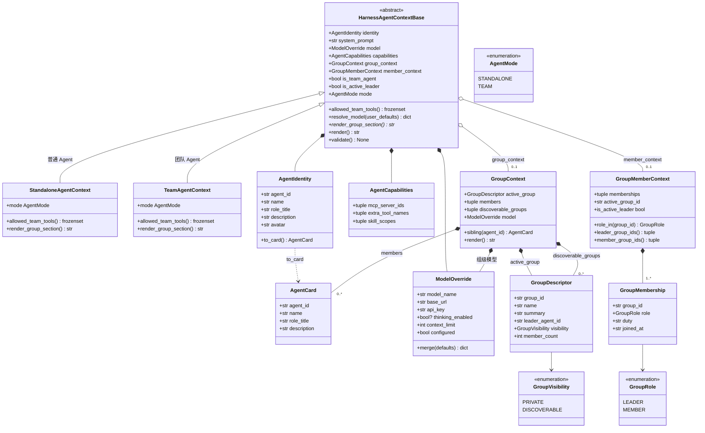
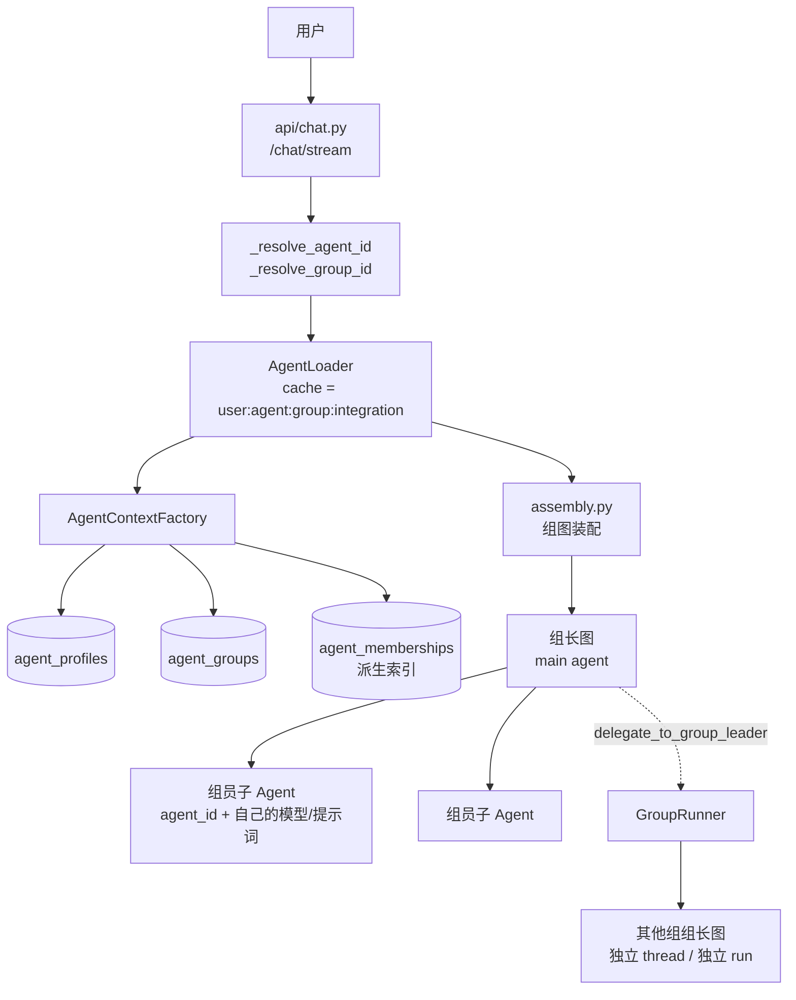
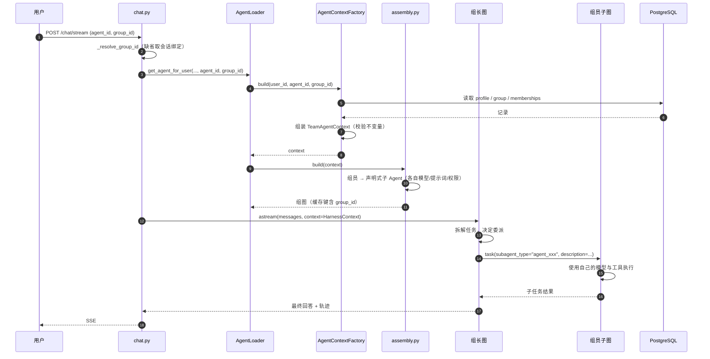
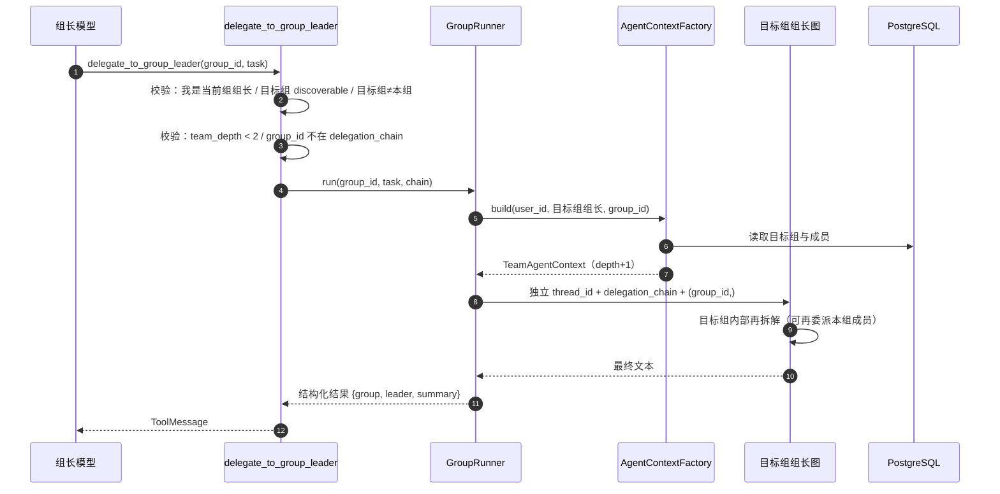

# AgentTeam 设计文档

Time: 2026/11/12

状态：设计评审中（未实现）。实现步骤见 [AgentTeam 开发文档](../../develope/AgentTeam开发文档.md)。

---

## 0. 原始诉求（原文保留）

> 关于 MyAgent 模块，现在的逻辑是：
> 只能选择一个已有的模型作为主模型，那这样其实不适合做出来一个 Agent 团队。
>
> 我希望的一个设计是：
> 用户定义多 Agent 时，Agent 应有以下属性
> 1. 团队组（新概念）
> 2. 名称
> 3. 角色
> 4. 摘要描述：供其他 Agent 发现用，其实就是目前已有的一句话间接
> 5. 提示词
>
> 也就是说，我引入了【组】的这个概念。
>
> ### 如何理解组
> 在操作系统中，一般的操作系统都有用户组的概念，每个用户可以属于多个组，每个组都有各自的权限范围。
>
> 在现实生活中，研究生会有研究小组、企业会有部门小组。每一个组的职责分明、权限也不同。
>
> 将【组】这一概念迁移到 AgentTeam 中：
>
> 1. 组是可以被用户定义的。组应该有以下属性：
>    1. 组名：说明该组的标识，用于唯一区分
>    2. 组概述：针对该组，进行一个简单的概述，该部分将被 Agent 所看到，以便快速定位自己所在一个什么样子的组，从而引导 Agent 的思考方向与多 Agent 合作逻辑。
>    3. 组成员：是组内的所有 Agent 成员，组内所有成员均可以互相发现并合作。
>    4. 组长：组内的一个首要 Agent，被标记为组长的 Agent，将承担起负责统筹组内所有成员的工作，确保组内所有成员的工作能够协调一致的职责。也换句话说，该智能体作为组内的主 Agent；
> 2. 组成员的权限：
>    1. 普通 Agent 成员：仅组内互相调用，接收组长的委派任务，充当子智能体
>    2. 组长 Agent：在组内充当主智能体。拥有发现其他组的能力，也可以委派任务给其他组的组长 Agent。从而实现多个组之间的合作。
>
> 3. 每一个 Agent 应当拥有一个封装。可以在 langchain 架构下的 create_agent 体系中，针对 `context_schema` 这个属性着重设计。
> 比如，使用面向对象的编程思想。
> 定义一个基本抽象类：`HarnessAgentContextBase`
> 然后定义组相关的类：`GroupContext`
> 定义组员相关的类：`GroupMemberContext`，其中拥有区分是否是组长的属性。
>
> 定义一个基本抽象类：`HarnessAgentContextBase` 关联于 `GroupContext`、`GroupMemberContext`，以及 Agent 的其他属性。
>
> `GroupContext` 和 `GroupMemberContext` 若为空，则认为是普通 Agent，没有任何组相关的上下文。

---

## 1. 目标与非目标

### 1.1 目标

| 编号 | 目标 | 验收口径 |
|:--|:--|:--|
| G1 | Agent 有明确的归属：可属于 0..N 个组 | 存储与 API 支持多组归属，且能反查某 Agent 的全部组 |
| G2 | 组内可发现、可委派；组长是组内主 Agent | 组长能把子任务分给组员，且组员无法互相越权委派 |
| G3 | 组长可发现并委派给其他组的组长 | 跨组委派有明确的权限、深度与超时边界 |
| G4 | 每个 Agent 保留独立的人格与模型 | 同一组内不同成员可使用不同模型与提示词 |
| G5 | 普通 Agent 行为完全不变 | 无组归属时，工具集、提示词、模型与现在一致 |
| G6 | 可观测、可评估 | 每次委派都有轨迹节点，可用评估集回放验证 |

### 1.2 非目标（本期明确不做）

- **不做组嵌套**（组中组）。组是扁平结构，层级关系由"组长对组长"表达。
- **不做跨用户 / 跨租户的 Agent 共享**。所有组与成员仍在 `user_id` 隔离域内。
- **不做运行时动态换组**。一次会话绑定一个 `active_group_id`，中途不切换。
- **不做组级模型配置**（理由见 D1）。
- **不把组做成独立服务或独立进程**。组是构图与权限的组织维度，不是部署单元。

### 1.3 关键设计决策

| 编号 | 决策 | 理由 | 代价 |
|:--|:--|:--|:--|
| D1 | **模型按"Agent → 组 → 用户默认"三级继承** | 组可以有统一的模型策略（成本、能力基线），同时保留 Agent 个体覆盖；组级模型只在成员**未配置**模型时生效，避免覆盖个体意图 | 同一 Agent 属于多个组且自身未配模型时，行为会随生效组变化；文档要求在评估与轨迹中记录实际生效模型 |
| D2 | **一个 Agent 可属于多个组，角色按组独立** | 符合原文"每个用户可以属于多个组"的类比；同一 Agent 可在 A 组当组长、在 B 组当组员 | 上下文需要区分"当前生效组"，不能只有一个 `role` 字段 |
| D3 | **执行时必须有一个 active group** | 权限判定必须落在一个确定的组上，避免"同时以组长身份调用两个组的工具" | 会话需要绑定 `group_id`；多组组长需要前端选组 |
| D4 | **组 = 一张图；组长 = 主 Agent，组员 = 子 Agent** | 直接复用 DeepAgents 的 `task` 委派语义与并发能力，不新造调度器 | 组员不能主动发起对话，只能被组长委派 |
| D5 | **组间协作走"组长 → 组长"同步委派（v1）** | 复用现有构图能力，链路短、可观测；异步版本留到 v2 | 跨组委派占用调用方 run 的等待时间 |
| D6 | **普通 Agent 由 `StandaloneAgentContext` 表达，而非到处判空** | 业务层不需要写 `if ctx.group_context is None`，约束在构造期生效 | 多两个类，但换掉了散落的空值判断 |
| D7 | **组成员即子 Agent，子 Agent 名使用 `agent_id`** | `task(subagent_type=...)` 需要稳定、ASCII、唯一的标识；中文名放在 `description` 里 | 模型在委派时要对照描述理解 `agent_xxx` 是谁 |
| D8 | **只做"构建期动态"，不引入动态成员图** | 组员提示词、模型、工具在招募时已固定；运行时变化的只是"谁在组里"，属于配置变化，读库重建图即可。`CompiledSubAgent` 只在需要成员级独立 context/审计时才必要，当前无此需求 | 成员的工具调用在轨迹里记为组长 `agent_id`；将来需要成员级审计时，按 4.7 的备选方案升级 |
| D9 | **团队模式下收窄子 Agent 可见性** | 组长只应看到"本组成员 + 显式允许的通用子 Agent"，否则职责边界模糊、`task` 描述随全局 YAML 膨胀 | 需要维护 `extra_subagent_names`；未勾选时组长找不到通用子 Agent |

---

## 2. 概念模型

### 2.1 概念与关系

| 概念 | 含义 | 是否持久化 | 关键字段 |
|:--|:--|:--|:--|
| `Agent`（档案） | 一个可被对话或委派的智能体 | 是 | `id` / `name` / `role_title` / `description` / `system_prompt` / `model` |
| `Group`（组） | 一组职责相关的 Agent 及其协作边界 | 是 | `group_id` / `name` / `summary` / `leader_agent_id` / `members` / `visibility` / `model` |
| `Membership`（组籍） | Agent 在某个组中的身份 | 是（存于组记录） | `agent_id` / `role` / `duty` |
| `Role`（角色） | 组内的权力等级 | 否（枚举） | `leader` / `member` |
| `ActiveGroup`（生效组） | 本次会话/本次委派中实际生效的组 | 否（运行时） | `active_group_id` |
| `GroupContext` | 生效组的结构视图（谁能被我看到、组用什么模型） | 否（构图时生成） | `active_group` / `members` / `discoverable_groups` / `model` |
| `GroupMemberContext` | 我的全部组籍与角色（我能做什么） | 否（构图时生成） | `memberships` / `active_group_id` |

关系：

```text
User 1 ── N AgentProfile
User 1 ── N Group
Group 1 ── N Membership ── 1 AgentProfile
AgentProfile 1 ── 0..N Membership
Group 1 ── 1 AgentProfile（leader_agent_id，且该 Agent 必须在 members 内）
```

### 2.2 多组归属的语义：为什么需要 active group

一个 Agent 可以同时在多个组，但**一次执行只能以一个组的身份行事**。否则会出现无法判定的情况：

- A 组里我是组长，B 组里我是组员：我能不能调用 `delegate_to_group_leader`？
- 同一次委派同时命中两个组的成员列表，应该用谁的权限？

因此约定：

1. 会话创建时绑定 `group_id`（若该 Agent 是多个组的组长，前端必须让用户选择）。
2. `HarnessContext.group_id` 在整轮 run 内不可变。
3. 所有组相关工具的权限校验，都以 `(agent_id, active_group_id)` 二元组为准。
4. 没有任何组归属时，`group_id` 为空，工具集不包含任何组能力。

### 2.3 角色与权限矩阵

| 能力 | 独立 Agent | 组员 | 组长 |
|:--|:--:|:--:|:--:|
| 使用自己的模型 / 提示词 / MCP | ✓ | ✓ | ✓ |
| 看到组概述与同组成员卡片 | ✗ | ✓（仅本组） | ✓（本组 + 可发现组摘要） |
| 被组长通过 `task` 委派 | ✗ | ✓ | ✓ |
| 主动委派组内成员 | ✗ | ✗ | ✓ |
| 发现其他组（`discover_agent_groups`） | ✗ | ✗ | ✓ |
| 委派其他组组长（`delegate_to_group_leader`） | ✗ | ✗ | ✓ |
| 修改组配置 / 转移组长 | ✗ | ✗ | ✗（仅用户通过 UI/API） |
| 加入 / 退出组 | ✗ | ✗ | ✗（仅用户） |

**原则：Agent 的一切"组织管理"操作都不交给模型。** 模型只能发现与委派，不能改组织结构；否则一次幻觉就可能把组长改掉。

### 2.4 组不拥有什么

这是本设计里最容易做错的部分，明确写死：

- 组**不拥有**执行进程、沙箱、记忆与工具实现：
  - 沙箱仍按 `user_id` 唯一分配，组内成员共享同一个沙箱代理。
  - 长期记忆仍按 `user_id` 存于 `/memories/`。
  - 成员的工具由各自 `AgentProfile.mcp_server_ids` 决定，组只决定"能不能互相委派"。
  - 组内并发仍是同一张图里的多个 `task` 调用。
- 组**拥有模型策略**，但只是继承链中的一层，不是最终决定者（见 2.5）。

### 2.5 模型解析链

```text
AgentProfile.model   （最高优先级；只有配置了 model_name 才算"已配置"）
        ▲ 覆盖
Group.model          （组级默认；成员未配置模型时生效）
        ▲ 覆盖
用户默认模型          （model_settings(user_id)，最终兜底）
```

实现约定：

1. 只有一个 `ModelOverride` 值对象，同时被 Agent 与组使用；`configured` 表示"任一字段被显式配置"，空对象等价于不提供这一层。
2. 合并是**逐字段**的：组只配了 `model_name`、没配 `api_key` 时，继续沿用用户默认的 `api_key`/`base_url`。
3. 解析函数只有一个入口 `HarnessAgentContextBase.resolve_model(user_defaults)`，组长与组员共用，避免两套优先级。
4. 运行时把最终生效的 `model_name` 写进轨迹（`group_id` + `agent_id` + `model_name`），否则"多组同 Agent"的行为差异无法归因。

---

## 3. Context Schema 的面向对象设计（重点）

### 3.1 三层上下文分层

必须先分清三样东西，否则类会设计成一锅粥：

| 层 | 类 | 生命周期 | 数量 | 用途 |
|:--|:--|:--|:--|:--|
| L1 运行期上下文 | `HarnessContext`（已有，扩展） | 一次 run | 1（整张图共享） | 用户、会话、当前生效组、委派链 |
| L2 定义期上下文 | `HarnessAgentContextBase` 及其子类 | 构图时生成，随图缓存 | 每个 Agent 上下文实例 1 个 | 该 Agent 的人格、模型、能力、组归属 |
| L3 组投影 | `GroupContext` / `GroupMemberContext` | 构图时生成 | 挂在 L2 上 | 该 Agent 在生效组里"看到谁"与"能做什么" |

**为什么不能合并成一层**：
- L1 要传给框架 `context_schema`，会被序列化进运行时，**不能放提示词与 API Key**。
- L2 是构图输入，包含完整提示词与模型覆盖，**不应进入 checkpoint**。
- L3 是 L2 的投影，可由 L2 重新计算，**不应单独持久化**。

### 3.2 类清单

| 类 | 类型 | 职责 | 不变量 |
|:--|:--|:--|:--|
| `AgentIdentity` | 值对象 | 身份四要素 + 头像 | `agent_id` 匹配 `^[A-Za-z0-9][A-Za-z0-9_-]{0,63}$` |
| `AgentCard` | 值对象 | 给其他 Agent 看的成员名片 | 不含提示词、模型、凭据 |
| `ModelOverride` | 值对象 | Agent 与组共用的模型覆盖项 | `configured` 为"任一字段显式配置"；`thinking_enabled` 用 `None` 表示未配置、`False` 表示显式关闭 |
| `AgentCapabilities` | 值对象 | MCP 服务、额外工具、技能范围 | 全部去重、保序 |
| `GroupDescriptor` | 值对象 | 组的公开静态描述 | `leader_agent_id` 非空；**不含模型与凭据** |
| `GroupMembership` | 值对象 | 一条组籍 | `group_id` 非空；`role` 合法 |
| `GroupContext` | 聚合 | 生效组的结构视图 + 组级模型策略 | `members` 必须包含组长；仅组长填充 `discoverable_groups`；`model` 不参与 `render()` |
| `GroupMemberContext` | 聚合 | 全部组籍 | `active_group_id` 必须出现在 `memberships` 中 |
| `HarnessAgentContextBase` | 抽象基类 | 定义期上下文契约 + 模板方法 | 组字段要么同时为空，要么同时非空 |
| `StandaloneAgentContext` | 具体类 | 普通 Agent | 组字段恒为 `None` |
| `TeamAgentContext` | 具体类 | 团队 Agent | 组字段强制非空且互相一致 |

### 3.3 UML 类图



**读图要点**

1. `group_context` / `member_context` 在基类上是 `0..1`：都为空就是普通 Agent（原文语义）。
2. 但普通 Agent 不直接实例化基类，而是用 `StandaloneAgentContext`；这样"为空"这件事只在一个地方发生。
3. `AgentCard` 是组内可见的最小信息，**不继承** `HarnessAgentContextBase`：别人只能看到你的名片，看不到你的提示词与凭据。
4. `GroupContext` 是"环境视角"，`GroupMemberContext` 是"自我视角"，两者共同构成组语义；缺一不可。

### 3.4 为什么是"抽象基类 + 两个子类"

| 方案 | 写法 | 优点 | 缺点 |
|:--|:--|:--|:--|
| A：纯 Optional | `HarnessAgentContextBase` 直接实例化，组字段可空 | 类少 | 业务层到处 `if ctx.group_context is None`；空值检查漏一处就是越权 |
| B：抽象基类 + 两子类（本方案） | 构造期由工厂选子类，组字段约束在 `validate()` 里 | 权限/组语义在构造期收敛；工具集由多态给出，不写分支 | 多两个类 |
| C：组合 `TeamContext` | 基类持有 `team: TeamContext | None` | 结构最紧 | 与原文"两个字段为空即普通 Agent"的表述不符，评审时不易对齐 |

选 B。关键收益是 **`allowed_team_tools()` 由多态决定**：
新增一种角色（例如未来的"观察员"）时，只加一个子类，不改任何调用方。

### 3.5 不变量（构造期强制）

`TeamAgentContext.validate()` 必须校验：

1. `group_context` 与 `member_context` 都非空；
2. `member_context.active_group_id == group_context.active_group.group_id`；
3. `member_context.role_in(active_group_id)` 不为 `None`；
4. `group_context.active_group.leader_agent_id` 出现在 `group_context.members` 中；
5. 若 `identity.agent_id` 等于 `leader_agent_id`，则 `role_in(active_group_id) == LEADER`，反之亦然。

`StandaloneAgentContext.validate()` 必须校验：两个组字段都为 `None`。

违反任一条直接抛 `ValueError`，**不允许降级成普通 Agent**——静默降级会让用户以为在组里，实际上没有组权限，是最难排查的一类问题。

### 3.6 渲染契约：组信息如何进入提示词

`render()` 是模板方法，固定顺序：

```text
<AgentProfile.system_prompt>          # 用户定义的人格，最高优先级
<render_group_section()>              # 组信息，由子类实现
<harness_policy>                      # 固定的执行 / 安全 / 并行策略（main_agent 追加）
```

`GroupContext.render()` 输出结构（示例）：

```markdown
## 你所在的组
- 组名：数据分析组（grp_7f3a1c）
- 组概述：负责数据清洗、指标计算与异常归因；不负责最终成稿。
- 你的角色：组长
- 你的职责：统筹组内分工，汇总结论，遇到跨领域问题可向其他组组长求援。
- 组内成员（可直接用 task 委派）：
  - agent_01h...（小张）｜数据清洗员：负责脏数据识别与清洗脚本
  - agent_02k...（小李）｜指标分析师：负责口径定义与 SQL 计算

## 可协作的其他组（仅组长可见）
- 报告组（grp_9c2e10）：负责把结论整理成对外报告；组长 agent_03m...
```

规则：

1. **只渲染名片，不渲染别人的提示词**。成员之间只需知道"找谁做什么"。
2. **成员卡片有上限**（默认 20 张）。超过后只输出计数，并提示用 `get_group_overview` 工具查询，避免提示词随组规模线性膨胀。
3. **普通成员不渲染"可协作的其他组"**：这段内容本身就是权限泄露。
4. 组概述为空时不渲染该行，不输出占位符。

### 3.7 与框架 `context_schema` 的对接

现状：`main_agent.py` 里 `create_deep_agent(..., context_schema=HarnessContext)`。框架要求 `context_schema` 是**一次 run 内不可变的上下文**，会被子 Agent 继承。

因此：

- **L1 `HarnessContext` 继续作为框架的 `context_schema`**，只增加少量运行期字段（见下表），不把 L2/L3 塞进去。
- **L2/L3 在构图前消费完毕**：生成系统提示词、成员子 Agent 列表、工具集；运行时不再需要它们。
- 运行时权限校验只依赖 `(context.agent_id, context.group_id)` 与中间件里固化的 `allowed_team_tools`。

`HarnessContext` 扩展字段：

| 字段 | 类型 | 默认 | 用途 |
|:--|:--|:--|:--|
| `agent_id` | `str` | `"default"` | 本轮入口 Agent（用户直接对话的那个）；用于审计与跨组 run 的标识。注意子 Agent 共享同一份运行时 context，子 Agent 身份由中间件在构造时固化 |
| `group_id` | `str` | `""` | 生效组；空表示独立 Agent |
| `group_role` | `str` | `""` | `leader` / `member`；仅用于审计与展示 |
| `team_depth` | `int` | `0` | 跨组委派深度，用于防环与成本控制 |
| `delegation_chain` | `tuple[str, ...]` | `()` | 已经过的组 ID 链，命中即拒绝 |

新增字段全部带默认值，**向后兼容**：现有调用方不传也能工作。

---

## 4. 执行架构

### 4.1 组 = 一张图



装配规则：

1. **组长**用自己的 `AgentProfile` 构建主 Agent：提示词 = 自身提示词 + `GroupContext.render()` + Harness 固定策略。
2. **组员**转为 DeepAgents 的声明式子 Agent：

```python
{
    "name": member.agent_id,                 # 稳定、ASCII、唯一
    "description": f"{member.name}｜{member.role_title}：{member.description}",
    "system_prompt": member_prompt + member_group_section,
    "tools": member_tools,                   # 来自成员自己的 mcp_server_ids + 基础工具
    "model": build_model(member_model, role="member", user_id=user_id),
    "middleware": [SubagentProgressMiddleware(member.agent_id),
                   TeamPermissionMiddleware(agent_id=member.agent_id,
                                            group_id=group_id,
                                            allowed=frozenset())],
}
```

3. **组员看到的组信息**与组长不同：只包含本组成员名片，**不含** `discoverable_groups`，也不绑定 `delegate_to_group_leader`。
4. **组员名字用 `agent_id`**：`task(subagent_type="agent_01h...")`。中文名放在 `description`，模型靠描述决定委派对象。
5. 静态 YAML 子 Agent（`SYNC_SUBAGENT_CONFIG_FILES`）**在团队模式下默认不注入**，只按组的 `extra_subagent_names` 白名单合并（见 4.5）；独立 Agent 仍全量注入。**名称冲突时直接构图失败**，不静默覆盖。

### 4.2 组内委派时序



**关键点**

- 组图按 `(user_id, agent_id, group_id, integration_server_id)` 缓存；组变更后必须失效（见 6.3）。
- 组员不共享组长的消息历史，但共享同一个沙箱代理。
- 组员的工具调用仍会以 `source=agent_xxx` 的形式进入轨迹，前端已有的子 Agent 节点可直接复用。

### 4.3 跨组委派时序与防环



**边界（必须实现，否则会出现无限递归与成本失控）**

| 边界 | 值 | 行为 |
|:--|:--|:--|
| 最大跨组深度 | 2（本组 → 其他组 → 再其他组） | 超过时工具返回明确错误，不发起新 run |
| 委派链检测 | `delegation_chain` 含目标组 | 立即拒绝，返回"A ↔ B 循环委派" |
| 单次超时 | 默认 300s，可配置 | 超时返回错误，已产生的 token 计入统计 |
| 并发上限 | 每用户 2 个跨组 run | 获取信号量失败时返回"当前跨组委派繁忙" |
| 目标组可见性 | 仅 `discoverable` | `private` 组对外不可见，也不可被委派 |
| 组长自委派 | 禁止 `group_id == active_group_id` | 防止自己调自己 |

### 4.4 组发现

两级发现，避免把全部组塞进提示词：

1. **提示词内**：只渲染最多 10 个 `discoverable` 组的概述（`GroupContext.discoverable_groups`）。
2. **工具内**：`discover_agent_groups(query)` 按关键词搜索，返回最多 20 条，含组名、概述、组长 `agent_id`、成员数。

普通成员两者都没有：工具不绑定，提示词也不渲染。

### 4.5 成员可见性边界（职责隔离）

团队模式下，`task` 可见的子 Agent 不再等于"全局 YAML 全量"，而是由组的白名单决定：

| 执行者 | `task` 可见的子 Agent | 可见组信息 | 能否发起委派 |
|:--|:--|:--|:--:|
| 独立 Agent | 全局 YAML（现状不变） | 无 | ✓（现状） |
| 组长 | 本组成员 + `extra_subagent_names` | 本组名片 + 可发现组摘要 | ✓ |
| 组员 | 无（叶子） | 本组名片 | ✗（框架保证） |

规则：

1. 组记录新增 `extra_subagent_names: string[]`，默认空；只能从全局 YAML 子 Agent 中显式勾选。
2. 团队模式装配：`subagents = 本组成员 + 白名单命中的全局 YAML`；未命中的全局 YAML 既不注入，也不出现在 `task` 描述里。
3. 名称冲突（成员 `agent_id` 与 YAML 的 `name` 相同）直接构图失败，不静默覆盖。
4. 组员永远拿不到 `task`：声明式子 Agent 不挂 `SubAgentMiddleware`，这是框架级保证，不依赖提示词约束。
5. 白名单只决定"可见性"，不改变被允许者的模型与工具：它仍用自己的档案配置。
6. 独立 Agent 路径完全不变，作为回归基线。

**为什么白名单挂在组上而不是 Agent 档案上**：可见性是"组的职责边界"，而不是个人属性。同一个 Agent 在 A 组当组长、在 B 组当组员时，两处的 `task` 清单本来就应不同。

**边界**：白名单为空的组长只能委派本组成员，不能调用 `web_researcher`、`document_reader` 这类通用子 Agent。前端需要在组管理里明确提示这一点，避免用户以为"功能丢了"。

### 4.6 备选方案与取舍

| 方案 | 描述 | 结论 |
|:--|:--|:--|
| A：所有 Agent 平铺成一张大图 | 每个 Agent 都是 main 的 subagent，组只做逻辑标记 | ✗ 无法表达"以组员身份执行"，跨组权限无法收敛 |
| B：每个组一个独立进程/服务 | 组间通过 RPC 协作 | ✗ 部署复杂度与成本远超收益，且与现有多用户单进程模型冲突 |
| C：动态成员图（CompiledSubAgent） | 每个成员编译成独立图，作为预编译子 Agent 挂到 `task` | △ 可行，但本期不实施（D8）；代价见 4.7 |
| **D：组长图 + 声明式组员 + 进程内同步跨组（v1 默认）** | 复用 `create_deep_agent` 与 `task` | ✓ 改动最小、可观测、可逐步演进 |

### 4.7 动态成员图：备选方案（本期不实施）

**本期决策（D8）：不实施，仅作为升级路径保留。**

不做的理由：组员提示词、模型、工具在招募时就固定了；运行时变化的只有"谁在组里"，这属于配置变化，读库重建图即可，不需要预编译成员图。

`CompiledSubAgent` 仍然有用，但只在下面这些需求出现时才升级：

- 轨迹/审计必须区分"是哪个组员执行的"（声明式下所有成员共享父图 `agent_id`）。
- 组员需要自己的 `context_schema` 值（独立凭据、租户、子 Agent 专属状态）。
- 组员需要独立 checkpoint/thread 或独立递归上限。

**实现方式：有，走 `CompiledSubAgent`。**

`create_deep_agent(subagents=[...])` 接受三类 spec：

| 类型 | 形态 | 每个成员的运行期上下文 |
|:--|:--|:--|
| `SubAgent`（声明式） | 一个 TypedDict，由框架统一编译 | **与父图共享同一份 context** |
| `CompiledSubAgent`（动态/预编译） | 一个已编译的 `Runnable` + `name` + `description` | 由调用方自行提供，可做到**每个成员一份** |
| `AsyncSubAgent`（远程） | `graph_id` + `url`，跑在 Agent Protocol 上 | 由远端图自己声明 |

但有一个必须知道的实现细节：DeepAgents 调用预编译子 Agent 时执行的是

```python
result = subagent.invoke(subagent_state, subagent_config)   # 没有 context=
```

也就是说 **`CompiledSubAgent` 不会自动继承父图的 `context`**，其 `runtime.context` 是 `None`。因此动态方案不能只写一个 `CompiledSubAgent` 就结束，必须再包一层 `ContextBoundRunnable`，在每次调用时显式传入该成员的上下文：

```python
class ContextBoundRunnable(Runnable):
    """把成员图与它自己的运行期上下文绑定，供 CompiledSubAgent 使用。"""

    def __init__(self, graph: Runnable, context: Any) -> None:
        self._graph = graph
        self._context = context

    def invoke(self, input, config=None, **kwargs):
        return self._graph.invoke(input, config, context=self._context)

    async def ainvoke(self, input, config=None, **kwargs):
        return await self._graph.ainvoke(input, config, context=self._context)
```

成员 spec 变为：

```python
{
    "name": member.agent_id,
    "description": f"{member.name}｜{member.role_title}：{member.description}",
    "runnable": ContextBoundRunnable(member_graph, member_runtime_context),
}
```

其中 `member_runtime_context` 是 `HarnessContext(agent_id=member_id, group_id=组, team_depth=...)`，`member_graph` 由 `create_deep_agent(..., context_schema=HarnessContext, state_schema=PdcState)` 单独编译。

#### 什么情况下必须用动态方案

| 需求 | 声明式够用 | 需要动态 |
|:--|:--:|:--:|
| 组员只能调用自己的工具（权限白名单） | ✓ | — |
| 组员用不同模型 / 提示词 | ✓（`model` / `system_prompt` 字段） | — |
| 轨迹与审计要区分"哪个组员做的" | ✗（共享 `context.agent_id`） | ✓ |
| 组员需要自己的 `context_schema`（如子 Agent 专属凭据、租户） | ✗ | ✓ |
| 组员需要独立 checkpoint / 独立递归上限 / 独立 thread | ✗ | ✓ |
| 组员内部还要跑完整的 DeepAgents 中间件栈 | 部分 | ✓ |

**本期结论**：不实施。上面的判定表只用于将来评估升级时机——当"成员级审计/独立上下文"成为硬需求时，把 `build_member_subagents` 的返回值从 `SubAgent` 换成 `CompiledSubAgent` 即可，**上层工具与权限模型不变**。

#### 动态方案的代价

1. **不继承父图的 `state_schema`**：成员图必须自己传入 `state_schema=PdcState`，否则看不到 PDCA 等自定义状态字段。
2. **不继承 `interrupt_on`**：HITL 审批要在成员图内部单独配置。
3. **流式与进度需要实测**：`SubagentProgressMiddleware` 依赖 custom stream writer；预编译图作为独立 run 调用时，事件是否能冒泡到父流要在 P1 验证（声明式子图天然可以）。
4. **每成员一图**：图上缓存与内存开销随组规模增长，需要给成员图做 LRU 或只缓存组长图。
5. **上下文一致性**：包装器里传入的 context 必须与构成员图时使用的一致，否则会出现"提示词说自己是 A、运行时身份是 B"的错位。

---

## 5. 数据模型

### 5.1 Store 命名空间

沿用现有 `AgentProfileStore` 的隔离方式，全部以 `user_id` 结尾：

| 命名空间 | Key | 内容 | 说明 |
|:--|:--|:--|:--|
| `("agent_profiles", user_id)` | `agent_id` | Agent 档案 | 已有，字段不变 |
| `("agent_groups", user_id)` | `group_id` | 组记录（含成员、角色与组模型策略） | 新增，**唯一事实来源** |
| `("agent_memberships", user_id)` | `agent_id` | `{"group_ids": [...], "leader_of": [...]}` | 新增，派生索引，可重建 |

**为什么组记录内嵌成员**：一个组通常只有几个到几十个成员，一次读取即可拿到全部结构，避免 N+1；反向查询用派生索引解决。

### 5.2 记录字段

组记录：

```json
{
  "group_id": "grp_7f3a1c",
  "name": "数据分析组",
  "summary": "负责数据清洗、指标计算与异常归因；不负责最终成稿。",
  "leader_agent_id": "agent_01h2x",
  "members": [
    {"agent_id": "agent_01h2x", "role": "leader", "duty": "统筹分工与汇总", "joined_at": "2026-11-12T10:00:00+00:00"},
    {"agent_id": "agent_02k9m", "role": "member", "duty": "脏数据清洗", "joined_at": "2026-11-12T10:02:00+00:00"}
  ],
  "visibility": "discoverable",
  "extra_subagent_names": ["web_researcher"],
  "model": {
    "model_name": "deepseek-v4-flash",
    "base_url": "",
    "api_key": "",
    "thinking_enabled": false,
    "context_limit": 128000
  },
  "created_at": "2026-11-12T10:00:00+00:00",
  "updated_at": "2026-11-12T10:02:00+00:00"
}
```

`model` 语义：

- 空对象 `{}` 表示"组不提供模型策略"，成员直接继承用户默认模型。
- 部分字段（例如只有 `model_name`）合法，其余字段继续向上继承。
- `api_key` 只允许在服务端记录与构图期使用；对外返回统一替换为 `has_api_key: true/false`，与 `public_profile()` 口径一致。

`extra_subagent_names` 语义：

- 默认 `[]`：组长只能委派本组成员。
- 里面的名字必须是全局 YAML 子 Agent（`SYNC_SUBAGENT_CONFIG_FILES`）的 `name`；未知名字在构图时告警并跳过，不阻断整个组。
- 只影响"可见性"，不改变被允许者的模型、工具与提示词。

Agent 档案：**不新增 `group_ids` 字段**。组记录是唯一事实来源，档案里再存一份必然不一致。

### 5.3 不变量与级联规则

| 规则 | 触发点 | 行为 |
|:--|:--|:--|
| 组名同用户唯一 | 创建 / 重命名 | 冲突返回 422 |
| 组长必须在成员列表内 | 创建 / 加成员 / 转移组长 | 违反返回 422 |
| 一个组只有一个组长 | 转移组长 | 旧组长降为 `member`，新组长升级为 `leader`（同一原子写） |
| 同组内一个 Agent 只有一条组籍 | 重复加成员 | 幂等：更新 `duty`，不产生重复项 |
| 组长不能直接移出组 | 移除成员 | 422，要求先转移组长 |
| 删除 Agent 时是某组组长 | 删除档案 | 422，列出所有组长身份，要求先转移 |
| 删除 Agent 时是普通成员 | 删除档案 | 自动从所有组移除，并刷新派生索引 |
| 删除组 | 删除组 | 不影响任何 Agent 档案，只删除索引中的引用 |
| 额外子 Agent 名单 | 创建 / 修改组 / 构图 | 去重保序；构图时未知名称告警并跳过，不阻断组装配 |
| 组写操作并发 | 任意写 | 按 `user_id` 串行（单 worker 部署前提，与现有架构一致） |

### 5.4 迁移

- 老数据不需要迁移：没有组记录时，所有 Agent 自然都是 `StandaloneAgentContext`。
- 可选提供"一键创建默认组"：把用户现有的 N 个 Agent 收进一个组，并指定第一个为组长；仅作为引导，不自动执行。
- 回滚：删除 `agent_groups` 与 `agent_memberships` 两个命名空间即可回到旧行为；`agent_profiles` 未改动。

---

## 6. 契约

### 6.1 Agent 侧工具

| 工具 | 可见角色 | 参数 | 返回 |
|:--|:--|:--|:--|
| `list_my_groups` | 组员 / 组长 | 无 | 我的全部组籍（组名、角色、是否生效组） |
| `get_group_overview` | 组员 / 组长 | `group_id?`（缺省为生效组） | 组概述 + 成员名片（分页） |
| `discover_agent_groups` | 仅组长 | `query?` / `limit` | 可发现组列表（组名、概述、组长、成员数） |
| `delegate_to_group_leader` | 仅组长 | `group_id` / `task` / `expected_output?` | 目标组结论 + 耗时 + 是否被截断 |

组内委派**不新增工具**，直接使用框架的 `task(subagent_type=...)`，减少模型的选择负担。

工具实现约束：

1. 所有工具在闭包里捕获 `TeamAgentContext` 与依赖（store / builder / runner），**不读全局状态**。
2. 工具返回 JSON 字符串（与现有工具一致），错误也返回结构化 JSON，不用异常穿透到模型。
3. 工具描述必须写清"什么时候用 / 什么时候不要用"，这是委派准确率的主要影响因素。

### 6.2 HTTP API

```text
GET    /agent-groups                      列出当前用户的组
POST   /agent-groups                      创建组（可同时指定初始成员）
GET    /agent-groups/{group_id}           组详情（含成员与角色）
PUT    /agent-groups/{group_id}           修改组名 / 概述 / 可见性 / 组模型 / 额外子 Agent 名单
DELETE /agent-groups/{group_id}           删除组
POST   /agent-groups/{group_id}/members   添加成员 {agent_id, duty}
DELETE /agent-groups/{group_id}/members/{agent_id}   移除成员
PUT    /agent-groups/{group_id}/leader    转移组长 {agent_id}
GET    /agents/{agent_id}/groups          反查某 Agent 的全部组
```

对现有接口的最小扩展：

| 接口 | 变化 |
|:--|:--|
| `POST /agents` | 请求体新增 `group_ids: string[]`；创建后按顺序加入组（失败回滚已建组籍） |
| `PUT /agents/{id}` | 请求体新增 `group_ids?: string[]`；传了才做差异同步（加入新增、退出移除） |
| `DELETE /agents/{id}` | 新增 422 分支：该 Agent 是某组组长时拒绝，返回受阻组列表 |
| `POST /chat`、`POST /chat/stream` | 新增 `group_id?: string` |
| `GET /history/.../messages` | 返回会话的 `group_id`，供前端回显选组 |

### 6.3 前端交互

| 页面 | 变化 |
|:--|:--|
| `MyAgentView.vue` | 左侧列表按组分区（未分组 + 各组）；新增「组管理」抽屉：建组、改组名/概述/可见性/**组模型**/**额外通用子 Agent 白名单**、成员增删、转移组长 |
| 招募弹窗 | 新增「加入组（可多选）」，并标注"加入后作为普通成员，组长需在组管理中指定" |
| `ChatView.vue` | 选择 Agent 后，若该 Agent 是多个组的组长，强制弹出组选择；会话头部展示当前组 |
| `stores/agents.ts` / `api/agents.ts` | 新增组的 CRUD 与成员操作；`AgentProfile` 增加 `groups: {group_id, name, role}[]` 只读回显 |
| `api/chat.ts` | 请求体增加 `group_id` |

缓存失效：任何组写操作（建组、改成员、转移组长、删组）成功后，调用 `agent_loader.reset_user_agents(user_id)`，保证下一次请求重建图。

---

## 7. 风险与边界

| 风险 | 表现 | 缓解 |
|:--|:--|:--|
| 提示词膨胀 | 组越大，成员卡片越多，首轮 token 越高 | 卡片上限 20 + 超限走工具查询；组概述限制 500 字 |
| 递归委派失控 | A→B→C→A，token 爆炸 | 深度上限 2 + 委派链检测 + 单次超时 + 每用户并发信号量 |
| 权限绕过 | 模型伪造 `group_id` 调用跨组工具 | 三重防线：工具不绑定 → 中间件过滤 → 执行前按运行时 context 拒绝 |
| 组变更后用了旧图 | 成员已移出组，模型还能委派 | 所有组写操作后立即 `reset_user_agents` |
| 单 worker 假设 | 多进程部署时组写锁失效 | 与现有会话锁一致，文档明确"当前只支持单 worker" |
| 成本不可归因 | 不知道是哪个组/成员消耗的 token | 轨迹中记录 `group_id`、`agent_id`、`team_depth`、`model_name`；TokenUsageMiddleware 按 agent 汇总 |
| 多组模型漂移 | 同一 Agent 在 A、B 组因未配自身模型而使用不同组模型，行为不一致 | 继承链只对"未配置 model 的成员"生效；前端在招募页显式提示"该成员未配置模型，将继承组模型"；轨迹记录最终 `model_name` |
| 职责越界 | 组长把任务委派给组外的全局子 Agent | 团队模式默认不注入全局 YAML；只有 `extra_subagent_names` 显式勾选才可见 |
| 能力"看起来丢了" | 白名单为空时组长找不到 `web_researcher` 等通用子 Agent | 组管理抽屉里显式提供"额外通用子 Agent"多选，并在空态给出说明 |

**明确不承诺的能力**：

- 组员不能主动给用户发消息（没有主动对话通道）。
- 组员之间不能横向调用（组员 A 不能委派组员 B），只能由组长编排。
- 不支持一个会话里切换多个组；换组等于换会话绑定。

---

## 8. 演进路线

| 阶段 | 内容 | 验收 |
|:--|:--|:--|
| P0 | 数据模型 + 上下文类 + 工厂（不接图） | 单元测试覆盖不变量与渲染 |
| P1 | 组长图装配 + 组员子 Agent + 权限中间件 | E1/E2/E3 评估用例通过 |
| P2 | 跨组发现与委派 + 防环 | E4/E5 通过，deep=2 时正确拒绝 |
| P3 | API + 前端组管理 | 招募时可选组，会话可绑定组 |
| P4（可选） | 异步跨组（复用 Agent Protocol） | 跨组 > 60s 不再阻塞调用方 |
| 不排期 | 动态成员图（CompiledSubAgent + 上下文绑定） | 仅在成员级审计/独立上下文成为硬需求时再评估 |

---

## 9. 一页纸总结

1. **组是组织维度，不是部署单元**：不新增进程、不新增沙箱、不新增存储引擎。
2. **三层上下文**：运行期 `HarnessContext`（进框架）/ 定义期 `HarnessAgentContextBase`（构图）/ 组投影 `GroupContext` + `GroupMemberContext`（注入提示词）。
3. **OOP 核心**：抽象基类 + `StandaloneAgentContext` / `TeamAgentContext`；"两字段为空即普通 Agent"只在一个地方落地。
4. **一个 Agent 多组、角色按组独立**：执行时必须绑定 `active_group_id`。
5. **权限三重防线**：不绑定 → 过滤 → 运行时拒绝；组织管理永远不交给模型。
6. **模型三级继承**：`Agent.model → Group.model → 用户默认`，只对未配置模型的成员生效。
7. **跨组只走组长对组长**，深度 2、有链检测、有超时、有并发上限。
8. **普通 Agent 路径保持不变**：没有组就是现在的行为，这是所有改造的回归基线。
9. **本期只做构建期动态**：组配置读库、重建图、失效缓存；动态成员图（`CompiledSubAgent`）仅作为未来备选保留（4.7 / D8）。
10. **团队模式的子 Agent 可见性由组白名单收窄**：组长只见本组成员 + 显式允许的通用子 Agent（4.5 / D9）。
