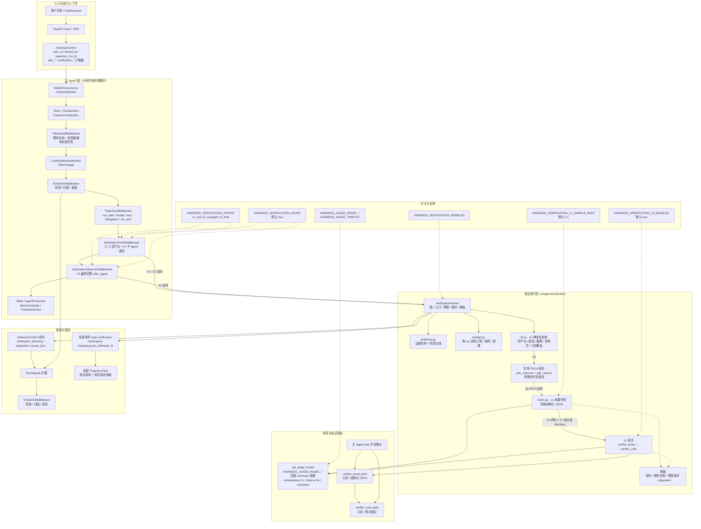
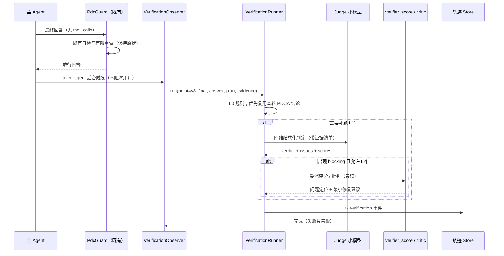

# Agent 验证策略设计

| 项目 | 内容 |
| :-- | :-- |
| 文档版本 | v2（设计稿） |
| 文档状态 | 待评审，未实现（纯观测方案） |
| 更新日期 | 2026-11-16 |
| 适用范围 | 主链路三个验证点：工具产出 → 子 Agent 返回 → 最终回答 |
| 关联代码 | `src/agent/verification.py`、`src/agent/middlewares/pdc_guard.py`、`src/agent/evolution/{judge,verifiers}.py`、`src/agent/middlewares/trajectory.py`、`src/agent/evolution/{reward,attribution,experience,eval_sets}.py` |
| 关联文档 | [上下文管理与压缩评估设计](../上下文管理与压缩评估设计.md)、[AgentTeam设计](../AgentTeam设计.md)、[任务流模块设计](../任务流模块设计.md) |

---

## 1. 摘要

当前 Agent 只在**最终回答前**做一次自检：规则检查 + 一个结构化 L1 判官 + 两个可选的确定性验证器。它能拦住"空回答、明显自相矛盾、缺计划项"，但拦不住三类更高频的偏差：

1. 过程偏差：工具结果被误读、子 Agent 结论被夸大、检索证据没进结论；
2. 判官偏差：判官与求解器共用同一套模型配置，容易"当局者迷"；
3. 不可积累：验证结论只活在一次 run 里，没有变成可回放的证据、评估用例或经验。

本文把验证从"终点自检"改成**贯穿主链路的三个验证点**，并给出与现有模块一一对应的落地方案：

- **V1 工具产出**：关键工具返回后做确定性检查，标记"证据可疑"；
- **V2 子 Agent 返回**：委派结果做结构 + 轻量评分，拦截"越权、空结论、答非所问"；
- **V3 最终回答**：复用现有自检结论 + 后台补跑规则与轻量判官 → 按需委派验证子 Agent，结论只落轨迹与信号。

同时明确三条边界：判官用小模型就够；验证**纯观测**——只内部记录，不阻断、不改写、不驱动重做，现有 PDCA 行为保持不变；七个维度不全量自动，按"核心自动 + 其余分层"落地。

---

## 2. 现状与差距

| 能力 | 现状 | 位置 | 差距 |
| :-- | :-- | :-- | :-- |
| 规则检查 | 非空 + 最小长度 | `verification.rule_check` | 只有长度约束，没有格式 / Schema / 数值断言之外的检查 |
| 样例对照 | 摘要模型对照样例检查格式与结构 | `verification.review_against_example` | 只用于任务流步骤，主链路最终回答不使用 |
| 最终回答自检 | `complete / grounded / contradiction / needs_verification / plan_covered` 五个布尔 | `evolution.judge.SelfJudge` + `middlewares.pdc_guard` | 无分项、无证据引用、无问题清单；判官与主模型同源 |
| 确定性验证器 | `schema`、`numeric_range` 两个 | `evolution.verifiers` | 注册表固定，依赖请求透传配置，主链路默认不启用 |
| 子 Agent 审查 | `reviewer` 只读子 Agent | `subagents/configs/reviewer.yaml` | 输出自由文本，无法被程序消费；不会自动触发 |
| 过程观测 | 轨迹事件、Token、上下文占用、反馈账本、奖励账本 | `trajectory.py`、`feedback_store.py`、`evolution/reward.py` | 没有"验证结论"这一事件类型，验证结果无法回放或聚合 |
| 评估 | 评估用例存储、训练数据导出 | `evolution/eval_sets.py` | 没有"失败 trace 自动转用例"，也没有回放执行器 |
| 任务流校验 | 流程定义级 Pass 注册表 | `task_flow/validators` | 校验的是流程结构，不是 Agent 产出质量 |

结论：不是"没有验证"，而是**验证只发生在终点、结论不可复用、判官不够独立**。

---

## 3. 设计立场与非目标

### 3.1 立场

| 立场 | 落地表现 |
| :-- | :-- |
| 把自我怀疑放进闭环，而不是放在终点 | V1/V2/V3 三个验证点，每个结论都有证据引用 |
| 判官不必比求解器强 | 判官独立配置、默认走轻量模型；只做局部比对，不做二次生成 |
| 验证结论是数据 | 统一 `VerificationRecord` 落轨迹；失败可转评估用例、经验与归因信号 |
| 只观测，不干预 | 验证不阻断、不改写、不驱动重做；现有 PDCA 保持现状，本机制不参与放行决策 |
| 失败不能拖垮主流程 | 所有验证旁路执行；超时、解析失败、预算耗尽一律降级为"记录 + 放行" |
| 不给虚假确定性 | 证据不足时结论是 `warn` 或 `fail`，**不向用户展示分数与标注**，只内部留痕并进入信号 |

### 3.2 非目标

- **不做在线阻断，也不加"未验证"标注，也不驱动重做**：按已确认决策，验证结论一律内部记录，用户可见回答不因验证而改变。现有 `PdcGuardMiddleware` 的自检与重做是既有能力，保持原状，不接入本机制。
- **不做七维全量自动评分**：正确性 / 完整性 / 一致性 / 可解释性自动；可用性用规则；细节性用清单抽检；稳定性本期不做。
- **不做模型权重训练**：与 `evolution` 模块既有边界一致，只保留数据导出。
- **不做稳定性批量验证**：成本高、收益偏研究性质，本期不进入自动链路。
- **不改任务流与异步任务链路**：本期只覆盖主链路的三个验证点。
- **不做离线回放、评估看板、评估用例转化**：按已确认决策，评估流程只在轨迹展示，不建设独立实验与看板。
- **不新增对外验证 API/页面**：结果只写轨迹与内部信号，供内部 Agent 与演进模块消费；用户除轨迹外感知不到验证能力。

---

## 4. 验证模型

### 4.1 三个验证点

| 验证点 | 触发位置 | 检查对象 | 默认强度 | 不通过时 |
| :-- | :-- | :-- | :-- | :-- |
| **V1 工具产出** | 主 Agent `awrap_tool_call` 返回后 | 高风险工具、外部数据工具的结果 | L0（规则） | 记录"证据可疑"，作为 V3 的证据输入 |
| **V2 子 Agent 返回** | `task` / 异步提交工具返回后 | 子 Agent 的最终产出 | L0 + L1（轻量判官） | 记录问题，作为 V3 的证据输入 |
| **V3 最终回答** | 最终回答放行后（后台），或复用本轮已有的 PDCA 自检结论 | 最终回答 + 计划 + 证据清单 | L0 → L1 → L2（T1 起自动） | 只记录结论，不改变回答 |

**关键工具名单**（用于 V1 关键工具筛选与 V3 风险分级）：

| 类别 | 工具 | 检查重点 |
| :-- | :-- | :-- |
| 副作用 | `write_file`、`edit_file`、`host_write_file`、`host_execute`、`publish_to_project`、`run_in_sandbox`、`compile_project` | 返回是否为空、是否报错、是否被截断、路径是否越界 |
| 外部数据 | `search_web`、`fetch_web`、`knowledge_search` | 结果条数、来源字段、是否只有空壳摘要 |
| 计算 / 时间 | `get_current_time`、`date_diff`、`calculate` | 数值是否可解析、单位是否存在 |
| 委派 | `task`、异步任务提交工具 | 子 Agent 产出是否为空、是否越权（声称写文件/执行命令） |

> 说明：V1 默认只做零模型成本检查。外部数据工具的 L1 质量判断（"证据是否足以支撑结论"）放到 V3，避免每个工具都调用一次模型。

### 4.2 三级验证强度

| 级别 | 执行者 | 单次成本 | 适用场景 | 降级 |
| :-- | :-- | :-- | :-- | :-- |
| **L0 规则** | 本地代码 | 0 模型调用 | Schema、必填字段、空结果、数值区间、计划项覆盖、路径与越权 | 无 |
| **L1 轻量判官** | 独立小模型，单次结构化输出 | 1 次小模型调用 | 最终回答的四维判断、子 Agent 产出与任务的匹配度 | 超时 / 解析失败 → `degraded`，只记录 |
| **L2 委派验证** | `verifier_score` / `verifier_critic` 子 Agent | 1~2 次多轮调用 | L1 判定 `fail` 且问题涉及多文件 / 多步骤，需要读证据再判断 | 超时 / 预算耗尽 → 回退到 L1 结论 |

**级别的默认分配**：

- V1：只允许 L0；
- V2：L0 必跑；L1 按 `HARNESS_VERIFICATION_L1_SAMPLE_RATE`（默认 10%）抽样；空产出、错误状态、越权声明始终进入 L1，不受抽样限制；
- V3：优先复用本轮 PDCA 的 `JudgeVerdict`（零额外成本）；PDCA 未启用或风险等级低于阈值时，才在后台补跑 L0 / L1；达到 `HARNESS_VERIFICATION_L2_RISK_TIER`（默认 `t1`）时自动跑一次 L2 深评。

### 4.3 七个验证维度的落位

| 验证维度 | 重点要问的问题 | 常见失败表现 | 自动级别 | 合格判断方式 | 在线 / 离线 |
| :-- | :-- | :-- | :-- | :-- | :-- |
| 正确性 | 输出是否满足任务目标 | 内容错误、计算错误、规则误判 | L1 + L2 | 判官对照任务与证据；数值类用 L0 断言 | 在线 |
| 完整性 | 必须完成的步骤是否遗漏 | 漏字段、漏操作、漏结论 | L0 + L2 | 对照 `create_work_plan` 的工作项与任务流步骤逐项检查 | 在线 |
| 一致性 | 前后是否自洽 | 状态冲突、描述矛盾、版本混乱 | L1 | 输入输出映射、同一事实在回答内是否前后一致 | 在线 |
| 可用性 | 结果能否直接进入下一步 | 格式不兼容、信息不足、不可执行 | L0 | JSON Schema、必填字段、下游解析器实收一次 | 在线 |
| 稳定性 | 多次执行是否相近 | 同任务结果波动大 | 不做 | 本期不纳入自动评分，也不做离线回放 | — |
| 可解释性 | 结果是否可解释 | 逻辑错误、假设错误、凭空捏造 | L1 + L2 | 关键结论必须能映射到证据清单；无证据即视为编造 | 在线 |
| 细节性 | 是否把握住细节任务 | 小遗漏、整体对但细节错、UI 该居中的没居中、条件判断缺分支 | L2 + 人工 | 用细节清单逐项核对（见 7.5），不在 L1 做自由发挥 | 在线抽检 |

**分数使用原则**：内部保留分项分用于排序与趋势，但**判定以条目为主**——每条 rubric 只能给 `pass / warn / fail`，避免 0–100 分带来的虚假精度和阈值漂移。

### 4.4 四个能力如何被满足

| 能力 | 落点 |
| :-- | :-- |
| 系统知道成功意味着什么 | 成功标准来自 `create_work_plan` 的工作项、任务流步骤、请求里的 `output_schema` / `numeric_ranges`，统一转成验证清单 |
| 系统能证明一次运行发生了什么 | 每个验证点写一条 `verification` 轨迹事件，带证据引用与判官信息；与工具、委派、HITL 事件同一时间线 |
| 系统能量化结果有多可靠、代价有多高 | 轨迹里可聚合：阻断问题率、问题分布、判官调用次数与 Token、P95 延迟、降级率 |
| 系统能标记虚假确定性（内部） | 判官结论可以是 `warn` / `fail`；不追加可见结论，但会进入信号与评估集，阻止"把不确定说成确定"沉淀为经验 |

---

## 5. 总体架构



**图例与边界**：

| 元素 | 含义 |
| :-- | :-- |
| 实线 | 执行或数据流向 |
| 虚线 | 开关控制、降级或后台信号 |
| `PdcGuardMiddleware` | 既有自检与有限重做，独立运行；验证模块只读取它写入 `context` 的结论 |
| `VerificationPointMiddleware` | 工具返回后同步观测；V2 的 L1 抽样调用放后台，不拖慢委派返回 |
| `VerificationObserverMiddleware` | 回答放行后触发 V3；默认后台任务，不占用户等待时间 |
| `RUNNER` | 唯一执行入口；无论哪个验证点，都走同一套预算、降级与落库逻辑 |
| `TE` | 不新增数据库表，验证结论作为轨迹事件落库 |
| `UI` | 只展示结论与证据，不展示单一总分，也不改变回答 |

**设计要点**：

- `VerificationRunner` 是唯一入口，所有验证点共用同一套预算、超时、降级与落库逻辑，避免出现四套规则漂移。
- `verifier_score` / `verifier_critic` 既可由 `runner` 在 L2 阶段按 YAML 提示词调用，也可由主 Agent 通过 `task` 手动委派；两条入口产出同一个 `VerificationRecord`。
- 验证是纯旁路：`runner` 只返回结论，不修改工具结果、不拼装用户可见文本、不触发重做；现有 PDCA 独立运行，二者互不依赖。

---

## 6. 执行流程

### 6.1 V3 最终回答（后台观测）



### 6.2 V1 / V2

| 阶段 | 动作 | 是否影响主流程 |
| :-- | :-- | :-- |
| V1 工具返回 | 读结果状态、长度、是否截断、是否为空、路径是否越界；生成 `evidence_ref = tool:<name>#<tool_call_id>` | 否，只记录与标记 |
| V2 委派返回 | 检查子 Agent 产出非空、是否包含结论段、是否声称执行了被禁动作；按抽样率跑 L1 匹配度 | 否；V2 的 blocking 只作为 V3 的证据输入 |
| 证据汇总 | 把 V1 / V2 的证据引用合并成 V3 的证据清单（上限 20 条，每条 300 字） | 否 |

### 6.3 失败与降级路径

| 失败 | 处理 |
| :-- | :-- |
| 判官超时 / 连接失败 | `verdict=degraded`，只记录 `degraded=true`，不影响回答 |
| 判官输出不可解析 | 尝试一次 JSON 提取；仍失败则 `degraded`，记录原始输出摘要 |
| 判官预算耗尽 | 跳过 L1/L2，写一条 `skipped` 记录 |
| L2 子 Agent 失败 | 回退到 L1 结论，不重复调用 |
| 轨迹写入失败 | 只告警（沿用 `TrajectoryMiddleware` 的旁路保护） |
| V3 后台任务异常 | 只告警，不重试；本轮验证记录标记 `degraded` |

---

## 7. 判官与验证 SubAgent 设计

### 7.1 判官轻量化

| 项 | 设计 |
| :-- | :-- |
| 模型 | 独立配置 `HARNESS_JUDGE_MODEL_*`；未配置时回退 `get_summary_model()`，保证开箱可用 |
| 与求解器的关系 | 独立客户端实例；默认允许使用不同模型；即使同模型也不同系统提示与不同上下文 |
| 温度 | 0.1，`max_tokens` 800，`timeout` 6s |
| 流式 | 必须打 `TAG_NOSTREAM`，禁止进入 SSE 用户可见流（项目硬约束） |
| 输入 | 任务、产出、计划、证据清单；**不传主 Agent 的思考过程与历史轮次**，避免被判官"跟着走" |
| 输出 | 严格 JSON；解析失败按 `degraded` 处理，不猜测 |
| 成本 | 每 run L1 上限 3 次（可通过配置调整）；V1 不调用模型 |

**判官输出 Schema**：

```json
{
  "verdict": "pass | warn | fail",
  "scores": {
    "correctness": 0.0,
    "completeness": 0.0,
    "consistency": 0.0,
    "interpretability": 0.0
  },
  "issues": [
    {
      "dimension": "correctness | completeness | consistency | usability | interpretability | detail",
      "severity": "blocking | major | minor",
      "message": "一句话说明问题",
      "evidence_ref": "tool:search_web#call_123 或 file:report.md 或 plan:item_2（无证据时为空串）",
      "suggestion": "最小修复动作"
    }
  ],
  "confidence": 0.0,
  "needs_deeper_review": true
}
```

判定规则：

- `verdict=fail` 只允许出现在存在 `blocking` 问题时；
- 关键结论无法映射到证据清单 → `interpretability/blocking`；
- 证据清单之外的引用一律视为"编造"，不给"可能是记忆"的豁免；
- 无法判断时输出 `warn`，并在 `confidence` 中体现，不允许猜。

### 7.2 评分 SubAgent（`verifier_score`）

| 项 | 设计 |
| :-- | :-- |
| 定位 | 结构化评分与问题清单；不负责改写 |
| 输入 | 任务原文、计划项、产出、证据清单、rubric 条目 |
| 输出 | 与 7.1 相同的 JSON Schema |
| 工具 | 只读：`get_current_time`、`format_json`；禁止写文件与执行 |
| 触发 | V3 风险等级 ≥ T1 自动触发；其它验证点出现 blocking 时触发；或主 Agent 主动 `task` |
| 典型用途 | 多文件改动后的整体复核、长文档的完整性核对、复杂数据结论的证据链核对 |

### 7.3 批判 SubAgent（`verifier_critic`）

| 项 | 设计 |
| :-- | :-- |
| 定位 | 针对已发现的问题给出"错在哪、最小怎么修、需要补什么证据" |
| 输入 | 低分项 / blocking issue 列表、产出、证据清单 |
| 输出 | 纯文本 + 结构化块：每条问题一段，包含位置、原因、修复动作、需补证据 |
| 工具 | 只读；允许读取产出中引用的文件，不允许执行命令 |
| 触发 | 评分 SubAgent 返回 `fail` 后自动触发一次；或主 Agent 主动 `task` |
| 典型用途 | 为内部复盘与评估集生成精确问题定位，不参与在线回答生成 |

### 7.4 子 Agent 配置骨架

```yaml
# src/agent/subagents/configs/verifier_score.yaml
name: verifier_score
description: |
  结构化验证 SubAgent。判断产出是否满足任务目标、是否遗漏必需步骤、
  是否与证据自洽、是否存在无证据结论。只读，不修改文件、不执行命令。
  同一时间只评审一个产出，输入必须包含任务、产出与证据清单。

tools:
  - get_current_time
  - format_json

deny_tools:
  - write_file
  - edit_file
  - execute
  - publish_to_project
  - run_in_sandbox

system_prompt: |
  你是「评分验证员」。只根据输入中的任务、产出和证据清单判断，不补充外部知识。

  ## 判断顺序
  1. 完整性：任务要求与计划项是否逐项覆盖；缺失项标 completeness/blocking。
  2. 正确性：结论是否与证据一致；计算与单位是否自洽。
  3. 一致性：同一事实在产出内是否前后一致；是否与工具结果冲突。
  4. 可解释性：每个关键结论能否映射到证据清单；没有证据的结论标 interpretability/blocking。

  ## 输出
  只输出 7.1 规定的 JSON，不输出寒暄、过程或改写后的正文。
  无法判断时 verdict 用 warn，confidence 如实填写。
```

```yaml
# src/agent/subagents/configs/verifier_critic.yaml
name: verifier_critic
description: |
  批判 SubAgent。针对已验证出的问题，给出具体错误位置、影响和最小修复动作，
  以及需要补充的证据。只读，不修改文件、不执行命令。

tools:
  - get_current_time
  - format_json

deny_tools:
  - write_file
  - edit_file
  - execute
  - publish_to_project
  - run_in_sandbox

system_prompt: |
  你是「批判者」。输入已经包含问题清单，不要重新打分，也不要整体重写产出。

  对每条问题输出：
  - 位置：章节 / 文件 / 计划项 / 工具证据引用
  - 错误：事实错误、逻辑缺口或遗漏
  - 影响：会导致什么错误结论
  - 最小修复：需要补哪一步证据或改哪一句
  - 待验证：无法确认的点，明确标出

  按严重程度排序，不输出与问题无关的建议。
```

### 7.5 判官提示词骨架

```text
你是严格的质量验证员。只根据「任务」「产出」「证据清单」判断，不使用外部知识。

【任务】
{task}

【计划项】
{plan_items}

【产出】
{answer}

【证据清单】
- tool:search_web#call_123 | status=ok | 结果摘要：...
- file:report.md | 写入成功 | 1200 字
- plan:item_2 | 负责人=researcher | 状态=done
- subagent:researcher | 结论：...

【细节清单】（仅 L2 使用）
- 是否覆盖每个计划项的完成标准
- 是否给出结论而不只是过程
- 数字是否有单位与来源
- 是否出现"应该 / 大概 / 可能"等不确定措辞承担确定结论

规则：
1. 关键结论必须能对应到证据清单；对不上即判 interpretability/blocking。
2. 只有过程没有结论、或只给结论没有证据，都算 fail。
3. 无法判断时输出 warn，不得猜测。
4. 输出只允许 JSON，字段见文档 7.1。
```

### 7.6 触发与预算

| 触发条件 | 动作 | 预算 |
| :-- | :-- | :-- |
| 本轮无 PDCA 结论，且风险等级 ≥ 阈值 | L1 判官（后台） | 每 run ≤ 3 次 |
| V3 风险等级 ≥ `HARNESS_VERIFICATION_L2_RISK_TIER`（默认 t1），或任意验证点 `fail` | L2 自动深评（verifier_score） | 每 run ≤ 1 次 |
| 评分返回 `fail` 且存在 blocking | L2 批判（verifier_critic） | 计入同一次委派 |
| V2 抽样命中，或命中强制项（空产出 / 错误状态 / 越权声明） | L1 委派产出匹配度 | 计入同一预算 |
| 预算耗尽 | 只记录 `skipped` | — |

---

## 8. 数据模型与落库

### 8.1 `VerificationRecord`

```python
@dataclass
class VerificationIssue:
    dimension: str          # correctness / completeness / consistency / usability / interpretability / detail
    severity: str           # blocking / major / minor
    message: str
    evidence_ref: str = ""
    suggestion: str = ""


@dataclass
class VerificationRecord:
    verification_id: str
    run_id: str
    thread_id: str
    point: str              # v1_tool / v2_subagent / v3_final
    level: str              # l0 / l1 / l2
    target: str             # 工具名 / 子 Agent 名 / final_answer
    verdict: str            # pass / warn / fail / degraded / skipped
    issues: list[VerificationIssue]
    scores: dict[str, float]
    evidence_refs: list[str]
    judge_model: str
    latency_ms: int
    tokens: dict[str, int]
    source: str = "async"   # async / reuse_pdc / manual
    created_at: str = ""
```

### 8.2 轨迹事件

不新增数据库表。验证记录以 `type=verification` 的轨迹事件写入现有命名空间 `("trajectory", user_id, thread_id)`，与工具、委派、HITL 事件共用同一条时间线：

```json
{
  "id": "ver_01J...",
  "run_id": "run_...",
  "parent_id": "tool_event_id",
  "type": "verification",
  "label": "验证最终回答：1 个阻断问题（完整性）",
  "status": "done",
  "start": "2026-11-16T10:00:00+00:00",
  "end": "2026-11-16T10:00:02+00:00",
  "duration_ms": 2100,
  "context": {"tokens": {"input": 1800, "output": 120}},
  "result": "未覆盖计划项 item_3：缺少部署步骤",
  "summary": {
    "point": "v3_final",
    "level": "l1",
    "verdict": "fail",
    "issues": [
      {
        "dimension": "completeness",
        "severity": "blocking",
        "message": "计划项 item_3 未出现在回答中",
        "evidence_ref": "plan:item_3",
        "suggestion": "补充部署步骤或说明为何跳过"
      }
    ],
    "scores": {"correctness": 0.8, "completeness": 0.4, "consistency": 0.9, "interpretability": 0.7},
    "judge_model": "deepseek-chat",
    "degraded": false
  }
}
```

聚合查询直接用轨迹接口按 `type=verification` 过滤；V3 在回答放行后执行，写入时使用 `update_trajectory_event` 补写同一 run 的验证事件。需要长期趋势时再考虑物化视图，不在本期建表。

### 8.3 信号、奖励与经验

| 落点 | 改动 |
| :-- | :-- |
| `RunSignals` | 新增 `verification_issues: list[dict]`、`verification_blocking: int`、`verification_degraded: bool` |
| `evolution.attribution` | blocking 问题且归因为 `HARNESS` 时，允许作为归因输入（限 `harness / tool_router` 两层，不直接改 Prompt） |
| `evolution.reward` | 每条 blocking 记一次负奖励（`-0.1`，confidence 0.7）；同一 `verification_id` 只记一次，避免重复计分 |
| `evolution.experience` | 失败经验只从 `fail` + 有 `suggestion` 的记录中抽取；`degraded` 不进入经验提取 |
| 任务流 | 本期不改；`review_against_example` 保持现状 |

### 8.4 结果消费（不做离线回放）

- 验证结论只写轨迹事件与内部信号，不写评估集、不做离线回放、不做评估看板；
- 内部消费方：`RunSignals` → 演进模块的经验 / 归因；`reward` → 阻断问题记一次负奖励；
- 用户可见面只有「轨迹」页；不注入对话上下文，避免用户在回答里感知验证过程。

---

## 9. 模块落点与改动清单

| 文件 | 类型 | 改动 |
| :-- | :-- | :-- |
| `src/agent/verification/__init__.py` | 新增包 | 对外 facade，继续导出 `rule_check` / `review_against_example`，保持既有 import 不变 |
| `src/agent/verification/types.py` | 新增 | `VerificationPoint`、`VerificationLevel`、`VerificationIssue`、`VerificationRecord`、`VerificationRequest` |
| `src/agent/verification/l0.py` | 新增 | L0 确定性检查与按验证点注册（空产出 / 错误 / 截断 / 检索空结果 / 计划覆盖） |
| `src/agent/verification/legacy.py` | 新增 | 保留 `rule_check` / `review_against_example` 的旧实现 |
| `src/agent/verification/evidence.py` | 新增 | 从本轮消息提取工具调用、结果状态、文件路径、计划项、子 Agent 结论；裁剪到预算内 |
| `src/agent/verification/rubric.py` | 新增 | 四维 rubric + 细节清单模板；L1 / L2 共用 |
| `src/agent/verification/budget.py` | 新增 | 每 run 的判官调用次数、Token、超时、抽样率 |
| `src/agent/verification/runner.py` | 新增 | 统一执行入口：选级别、调判官、委派 L2、降级、写轨迹 |
| `src/agent/middlewares/verification_points.py` | 新增 | V1 / V2 的 `awrap_tool_call` 观测；只读，不修改工具结果 |
| `src/agent/middlewares/verification_observer.py` | 新增 | V3 的 `aafter_agent` 后台观测；复用 PDCA 结论或补跑 rubric，不阻塞回答 |
| `src/agent/middlewares/pdc_guard.py` | 不改 | 既有自检与重做保持原状；验证模块只读取其写入 `context` 的结论，避免重复调用判官 |
| `src/agent/evolution/judge.py` | 改造 | `SelfJudge` 保留为 runner 的 L1 实现；新增独立判官模型构造 |
| `src/agent/evolution/verifiers.py` | 改造 | `Verifier` Protocol 增加 `points` / `level`；`build_default_verifiers` 改为适配器，避免破坏现有调用 |
| `src/agent/subagents/configs/verifier_score.yaml` | 新增 | 评分子 Agent |
| `src/agent/subagents/configs/verifier_critic.yaml` | 新增 | 批判子 Agent |
| `src/agent/main_agent.py` | 改造 | 注册两个 YAML；装配 `VerificationPointMiddleware` 与 `VerificationObserverMiddleware` |
| `src/agent/config.py` | 改造 | 新增验证与判官配置项（见第 10 节） |
| `src/agent/schema.py` | 改造 | `HarnessContext` 增加验证相关的进程内字段（`verification_degraded`、`verification_blocking`） |
| `src/agent/evolution/types.py` | 改造 | `RunSignals` 增加验证字段 |
| `src/api/evolution.py` | 可选（P2） | 增加 `GET /evolution/verifications`，按轨迹事件过滤返回 |

**目录结构**：

```text
src/agent/verification/
├── __init__.py        # facade：rule_check / review_against_example / runner
├── types.py           # VerificationRequest / Record / Issue
├── evidence.py        # 证据清单与风险分级
├── rubric.py          # L1 提示词与 JSON 解析
├── l0.py              # L0 确定性检查 + 注册表
├── budget.py          # 每 run 预算与抽样
├── runner.py          # 统一入口：复用 PDCA / L1 / L2 / 降级 / 落库
└── legacy.py          # 旧接口实现，避免破坏既有 import
```

---

## 10. 配置项

| 变量 | 默认 | 说明 |
| :-- | :-- | :-- |
| `HARNESS_VERIFICATION_ENABLED` | `true` | 总开关；关闭后所有验证点短路 |
| `HARNESS_VERIFICATION_POINTS` | `v1_tool,v2_subagent,v3_final` | 逗号分隔：`v1_tool,v2_subagent,v3_final` |
| `HARNESS_VERIFICATION_ASYNC` | `true` | V3 后台执行；关闭时在 `after_agent` 内同步执行（仅调试用） |
| `HARNESS_VERIFICATION_L2_ENABLED` | `true` | 自动 L2 深评开关；V3 达到风险阈值时自动触发 |
| `HARNESS_VERIFICATION_L2_RISK_TIER` | `t1` | 只有达到该风险等级的最终产出才自动跑 L2 |
| `HARNESS_VERIFICATION_MAX_LEVEL` | `l2` | 允许的最高级别 |
| `HARNESS_VERIFICATION_L1_SAMPLE_RATE` | `0.1` | V1 / V2 的 L1 抽样率；L0 规则始终全量执行，不受抽样影响 |
| `HARNESS_JUDGE_MODEL_NAME` | 空 | 判官模型；为空时回退摘要模型 |
| `HARNESS_JUDGE_BASE_URL` | 空 | 判官服务地址 |
| `HARNESS_JUDGE_API_KEY` | 空 | 判官凭据；为空时回退主配置 |
| `HARNESS_JUDGE_TEMPERATURE` | `0.1` | 判官温度 |
| `HARNESS_JUDGE_MAX_TOKENS` | `800` | 判官输出上限 |
| `HARNESS_JUDGE_TIMEOUT` | `6` | 单次判官超时（秒） |
| `HARNESS_JUDGE_THINKING` | `false` | 判官是否启用思考模式；默认关闭以控成本 |
| `HARNESS_VERIFICATION_MAX_JUDGE_CALLS` | `3` | 每 run L1 调用上限 |
| `HARNESS_VERIFICATION_MAX_DELEGATIONS` | `1` | 每 run L2 委派上限 |
| `HARNESS_VERIFICATION_BLOCKING_SCORE` | `0.6` | 分项低于该值视为 blocking 候选 |

配置原则：**三个验证点默认全开，且只做观测**。V1 只跑 L0（零模型），V2 的 L1 默认 10% 抽样，V3 优先复用 PDCA 结论并在 T1 起自动跑一次 L2；判官默认关闭思考。任何配置都不改变用户可见行为。既有 `HARNESS_PDCA_ENABLED` / `HARNESS_PDCA_MAX_ROUNDS` 保持原语义，本机制不读取。

---

## 11. 预算、超时与降级

| 控制项 | 默认 | 行为 |
| :-- | :-- | :-- |
| 每 run L1 调用 | ≤ 3 | 超出后写 `skipped`，不排队 |
| 每 run L2 委派 | ≤ 1 | 超出后回退 L1 结论 |
| 单次判官超时 | 6s | 超时即 `degraded`，只记录 |
| 单次 L2 超时 | 18s | 超时回退 L1 结论 |
| 证据条数 | ≤ 20 条 | 每条 ≤ 300 字；按"最近 + 高风险工具"优先 |
| L1 抽样 | V1 0% / V2 10% | 只作用于 L1；L0 全量；强制项不受抽样限制 |
| 输入长度 | 任务 / 产出 / 计划各 ≤ 4000 字 | 超出截断并标注 |
| Token 预算 | 每 run ≤ 8000（判官侧） | 超出跳过后续验证 |

> 成本参考：求解器用主模型时，判官换成轻量模型单 Token 成本通常低一个量级。本设计把"判官不追求强模型"写进配置默认值，而不是写死在代码里。

---

## 12. 兼容与迁移

| 对象 | 处理 |
| :-- | :-- |
| `agent.verification.rule_check` / `review_against_example` | 由新包 facade 原样导出，`pdc_guard`、`task_flow` 的 import 不需要改 |
| `evolution.verifiers.build_default_verifiers` | 保留签名，内部改为返回注册表中的 L0 验证器，避免现有调用失效 |
| `SelfJudge.judge_l1` / `judge_l2` | 原样保留；`PdcGuard` 不改造。验证模块复用其结论，不重复调用 |
| SSE 事件 | `pdc_verified` / `pdc_revision` 协议不变；验证结论只写轨迹，不新增 SSE 事件 |
| 流式输出 | 判官与子 Agent 调用必须带 `nostream` 标签，禁止拼进用户回答 |
| 团队模式 | 验证子 Agent 属于系统级只读角色，`runner` 直接调用，不占组成员名额；若要允许主 Agent 手动 `task` 委派，需加入组配置 `extra_subagent_names` |
| 任务流 / 异步任务 | 本期不接入；`review_against_example` 与任务流步骤校验保持现状 |
| 失败保护 | 所有验证逻辑外层 `try/except`，Store 写入失败只告警（沿用轨迹中间件约定） |

---

## 13. 验收与度量

### 13.1 在线指标

| 指标 | 计算 | 目标（首版） |
| :-- | :-- | :-- |
| 验证点覆盖率 | 有 `verification` 事件的 run / 应验证 run | V3 ≥ 95% |
| 阻断问题率 | `fail` 且含 blocking 的 run / 已验证 run | 用于观察，不设硬阈值 |
| 问题命中率 | 有 blocking 问题的 run / 已验证 run | 用于观察，不设硬阈值 |
| 判官成本 | 每 run 判官 Token / 主链路 Token | L1 ≤10%；L2 每 run 至多 1 次 |
| 判官延迟 | L1 P95 | ≤ 3s |
| 降级率 | `degraded` + `skipped` / 验证次数 | ≤ 5% |

### 13.2 人工抽样复核（可选）

| 项目 | 做法 |
| :-- | :-- |
| 误报率 | 抽样 50 条 `fail` 记录，人工复核；误报率 ≤ 15% 才允许把结论接入归因与奖励 |
| 漏报率 | 抽样 50 条 `pass` 记录，人工复核；记录漏报类型，作为 rubric 迭代依据 |

> 不建设离线回放与评估看板；以上复核只在内部按需执行。

### 13.3 验收条件

1. V3 观察期一周：轨迹有完整记录，回答内容无变化（后台执行为前提）；
2. L1 P95 ≤ 3s；L2 后台完成 ≤ 18s，不阻塞回答；
3. 人工抽样误报率 ≤ 15%，且没有"关键结论被误判为通过"的漏报；
4. 验证记录与既有 PDCA 结论的一致率可量化；不一致样本能解释原因；
5. 阻断结论只进内部信号与奖励账本，不出现在用户回答或其他页面。

---

## 14. 分阶段落地

| 阶段 | 内容 | 在线行为变更 |
| :-- | :-- | :-- |
| **P0 观测** | `verification` 包、runner、V3 后台观测（复用 PDCA 结论）、轨迹事件、独立判官配置（回退 summary） | 无 |
| **P1 链路** | V1 / V2 观测点、证据清单、预算与降级、两个验证子 Agent YAML | 无 |
| **P2 回流** | V3 自动 L2（默认 T1 起）、奖励 / 信号接入、判官轻量化（默认关思考） | 无 |
| **P3 收敛** | 仅保留轨迹可见面；取消离线回放、评估看板与评估用例转化 | 无 |

---

## 15. 风险与边界

| 风险 | 影响 | 缓解 |
| :-- | :-- | :-- |
| 判官偏见 / 噪声 | 误报污染归因与经验 | 独立模型、只给证据、抽样人工复核、观察期先量化 |
| 自评偏差 | 判官跟随主 Agent 的错误假设 | 不传思考过程；输入只保留任务、产出、证据；必要时双判官抽样 |
| 成本失控 | 每轮多一次模型调用 | V1 零模型、V2 抽样、V3 复用 PDCA 且只在 T1 起跑一次 L2；判官默认关思考 |
| 延迟 | 用户等待变长 | V3 在 `aafter_agent` 后台执行；判官超时 6s；不参与回答放行 |
| 提示注入 | 工具结果里的指令影响判官 | 证据只作为数据块传入，rubric 与规则只来自系统提示 |
| 误伤正常回答 | 验证结论被误当成放行依据 | 文档与代码都明确：本机制只写轨迹与信号，不参与放行；既有 PDCA 独立运行 |
| 验证结论被当成"绝对正确" | 团队把判官分数当 KPI | 文档与接口都只暴露"问题 + 证据 + 置信度"，不对外展示单一总分 |
| 团队模式可见性 | 主 Agent 手动委派验证子 Agent 失败 | 默认由 runner 直接调用；需要手动委派时显式加入 `extra_subagent_names` |

**明确不承诺的**：验证不能替代人工验收；判官不保证 100% 召回；不稳定任务（开放式创作、模糊需求）的 `warn` 结论只用于内部观察。

---

## 16. 附录：参考设计模式与项目映射

### 16.1 评分-回环（独立 LLM + 结构化 rubric）

原始思路：独立 LLM 按结构化评分标准给求解器输出打分，超过阈值放行，低于阈值重试。

项目映射：

- 判官部分 → `evolution.judge` 的 L1（扩展为 7.1 的 JSON；未扩展时直接复用现有五个布尔字段）；
- 阈值部分 → `HARNESS_VERIFICATION_BLOCKING_SCORE`，但**只用于筛选 blocking 候选**，最终判定以 issue 条目为准；
- 放行 / 重试 → 属于既有 `PdcGuardMiddleware` 的职责，本机制不接入；
- 与原模式的差异：本项目不把平均分直接当结论，避免"总分 7.2 但漏了关键项"被放行。

```python
# 参考骨架（非最终实现）
JUDGE_PROMPT = """你是严格的质量验证员。
只根据任务、产出和证据清单判断，输出 7.1 规定的 JSON。"""

async def judge_output(task: str, answer: str, evidence: list[dict]) -> dict:
    response = await judge_model.ainvoke(
        build_prompt(task=task, answer=answer, evidence=evidence),
        config={"tags": [TAG_NOSTREAM]},
    )
    return parse_verification_json(response)
```

### 16.2 Reflexion（求解 → 批评 → 带反馈重试）

原始思路：求解器生成回答，批评者给出文字反馈，求解器带着反馈重试，最多 N 轮。

项目映射：**不采用在线 Reflexion 重做，也不做离线回放**。验证只做观测，回答不在验证结论驱动下改写。`verifier_critic` 保留为手动 `task` 可委派的只读角色，用于内部复盘时定位问题，不进入在线回答生成链路。

### 16.3 判官不必是最贵的模型

验证在本质上比生成简单：生成需要知识、创造与整合，核查只需要聚焦、局部的比对。因此：

- 求解器用强模型时，判官可以用轻量模型，单 Token 成本通常低一个量级；
- 但"小模型 + 精细 rubric"优先于"大模型 + 空泛提示"；
- 真正需要强模型的是 L2 批判（需要理解跨文件上下文），所以 V3 在 T1 起自动触发一次 L2，其他验证点只在 `fail` 时触发；它只影响内部结论，不影响用户回答。

---

## 17. 待确认事项（评审时收敛）

| 编号 | 问题 | 当前倾向 |
| :-- | :-- | :-- |
| Q1 | V2 的 L1 抽样率默认值 | 先 10%，观察期看成本后再调 |
| Q2 | 判官是否允许与主模型同厂商同模型 | 允许，但必须是独立实例与独立提示；有独立配置时优先独立模型 |
| Q3 | 验证记录保留期 | 跟随轨迹保留期，不单独设置 |
| Q4 | 是否把 `verifier_score` 暴露给团队组配置 | P3 再评估；默认只由 runner 调用 |
