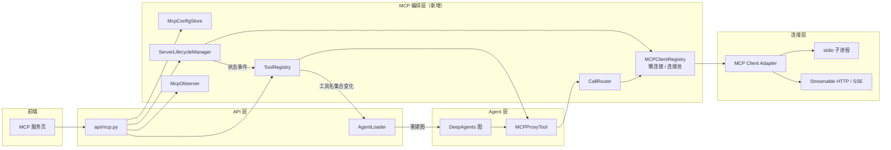
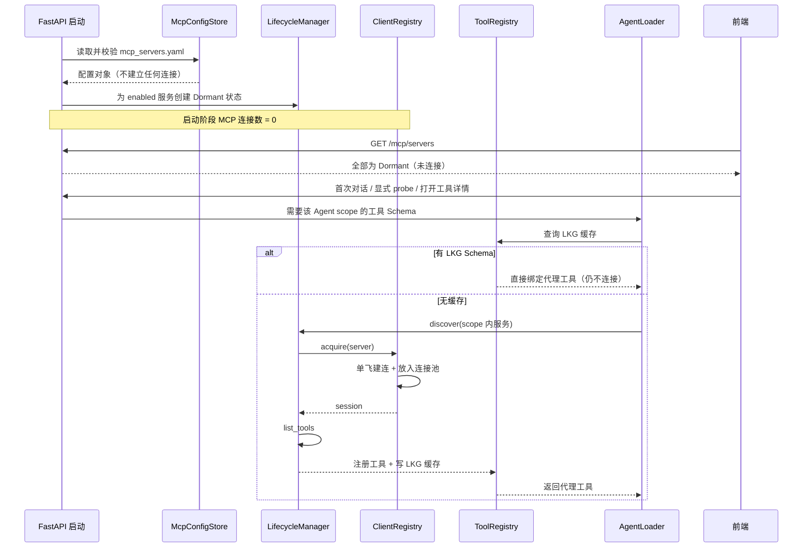
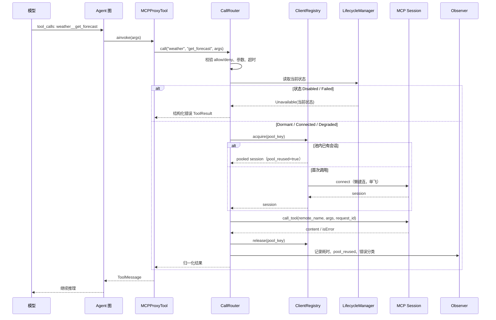
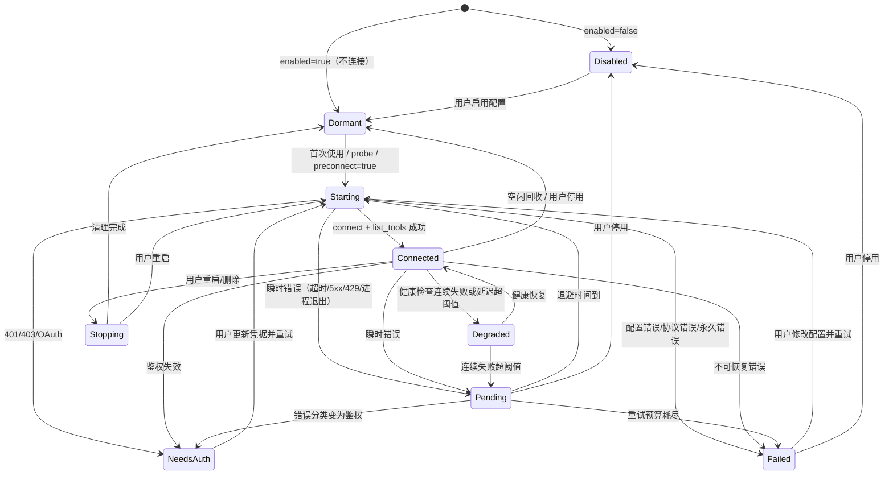
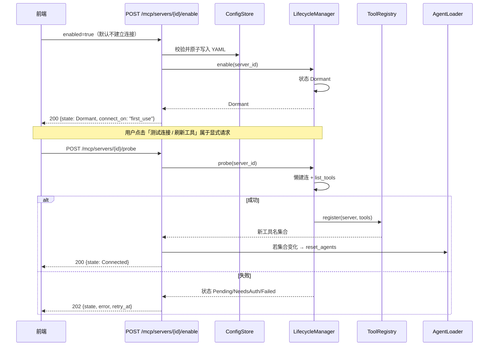

# Harness MCP 服务编排开发文档

> 文档定位：本文是 Harness Agent 平台 MCP（Model Context Protocol）模块的开发设计基线。
> 它同时描述**当前已经落地的实现**、**存在的缺口**，以及**后续要开发的目标架构**。
> 阅读后应能回答：服务如何接入、如何启停、失败如何回退、工具如何暴露给 Agent、前后端如何协作。

| 项目 | 内容 |
|:--|:--|
| 文档版本 | v2.0 |
| 文档状态 | 开发设计基线（可据此拆任务） |
| 适用代码 | `src/agent/tools/mcp_client.py`、`src/agent/tools/mcp_hub.py`、`src/api/agent_loader.py`、`src/agent/subagents/loader.py`、前端 MCP 页面 |
| 配置事实源 | `mcp/servers.json`（统一 JSON 文件，可用 `HARNESS_MCP_CONFIG_PATH` 覆盖） |
| 最后更新 | 2026-10-31 |

---

## 范围声明（先读）

**本文讨论的是 Harness 作为 MCP Host / MCP Client 的“服务编排与管理模块”，不是把 Harness 后端开发成 FastMCP Server。**

- Harness 不实现、不托管、不对外暴露 MCP Server 端点；
- 不开发 Tools / Prompts / Resources 的 Server 侧装饰器与协议服务；
- 只负责：用户在前端手动选择/录入第三方 MCP 服务 → 写入配置 → 按需建立客户端连接 → 发现工具 → 暴露给 Agent → 启停、重试、降级、审计；
- 被接入的 MCP Server 可以是 stdio 子进程、远程 Streamable HTTP 或 SSE 服务，来源由用户或管理员提供；
- 平台对第三方 Server 的能力与安全只做隔离、校验和告警，不承诺其实现质量。

因此后文出现的「MCP Server」均指**被 Harness 管理的第三方服务端**；「MCP 模块」均指 **Harness 内的客户端编排层**。

---


## 0. 摘要

Harness 当前的 MCP 接入已经具备「配置声明 + 代理工具 + 文件监听热更新」的基础能力，但启动阶段会一次性连接全部已启用服务，且还缺少三项生产级能力：

1. **懒连接与连接池**：当前启动预热会拉起所有 `stdio` 子进程；目标是启动时不连接任何 Server，首次被请求时才建立连接，并按连接签名复用客户端实例。
2. **失败回退**：没有错误分类、重试、熔断与降级，连接失败时工具会被直接清空。
3. **动态开关**：只能改 YAML 里的 `enabled`，没有后端 API 与前端开关，无法在运行期安全启停单个服务。
4. **可观测与可运维**：没有服务状态、工具清单、调用耗时、错误原因和操作审计。

本文给出的目标架构由五个核心组件组成：

- **McpConfigStore**：`mcp/servers.json` 的唯一读写入口，负责校验、原子写入与敏感信息脱敏。
- **ServerLifecycleManager**：每个 MCP Server 一个状态机，负责按需连接、健康检查、重试、熔断、启停。
- **MCPClientRegistry**：懒连接与连接池。首次被请求时才创建客户端；按连接签名复用同一实例；相同 URL/命令的多个逻辑服务共享底层会话。
- **ToolRegistry**：全局工具注册表，工具是否对 Agent 可见严格绑定服务状态，并解决同名冲突。
- **CallRouter**：负责命名空间解析、工具白名单、超时、取消与错误归一化。

Agent 侧继续使用「稳定代理工具（MCPProxyTool）」模式：图里绑定的是代理对象，真实实现由注册表在调用时解析。工具**名字集合**发生变化时才重建 Agent 图；仅状态变化（如 Connected → Pending）由代理在调用时拦截，避免频繁重建图。

---

## 1. 背景、目标与非目标

### 1.1 现状问题

当前 MCP 模块的问题不是「不能接」，而是「接上之后不可运营」：

| 问题 | 当前表现 | 影响 |
|:--|:--|:--|
| 无错误分类 | 所有异常统一 `RuntimeError` 或告警跳过 | 瞬时故障不会重试，鉴权失败可能被反复重连 |
| 无状态模型 | 只有「加载成功 / 未加载」 | 用户看不到 Pending、NeedsAuth、Failed、Degraded |
| 无动态开关 | 只能手工编辑 YAML 的 `enabled` | 前端无法启停，运营成本高 |
| 刷新失败即清空 | `MCPToolHub.refresh` 失败时 `_apply_server(name, [])` | 一次网络抖动会让整组工具消失 |
| 无命名空间 | 跨 Server 同名工具直接报错 | 多 Server 场景无法共存 |
| 无健康检查 | 只在加载时连接一次 | 进程退出、HTTP 会话失效后仍显示「已连接」 |
| 无调用超时/取消 | 依赖底层客户端默认行为 | 单个工具卡死会拖住整轮对话 |
| 无 API/UI | 前端「MCP服务」仍是占位页 | 无法查看状态、工具、日志 |

### 1.2 目标

1. **纯客户端编排**：Harness 只作为 MCP Host / Client 管理用户选择的第三方 MCP 服务，不开发 FastMCP Server。
2. **懒连接与连接池**：进程启动阶段不建立任何 MCP 连接；首次被请求时按需连接；相同连接签名的请求复用同一个客户端实例。
3. **可热插拔**：运行期新增、删除、启用、停用单个 MCP Server，无需重启后端。
4. **可回退**：按错误类型执行重试、熔断、降级或立即失败；任何失败都要给出结构化原因。
5. **状态可见**：每个 Server 有明确生命周期状态，前端能实时看到状态、工具数、延迟与错误。
6. **工具安全暴露**：只有处于可用状态的服务，其工具才会出现在 Agent 的可用工具列表。
7. **冲突可控**：跨服务同名工具通过命名空间隔离，且兼容模型供应商对工具名的限制。
8. **可审计**：配置变更、启停、连接失败、工具调用都有结构化日志与操作记录。

### 1.3 非目标

- **不开发、不部署、不托管 MCP Server**；不实现 FastMCP 的 `@mcp.tool()` / `@mcp.prompt()` / `@mcp.resource()` 服务端能力。
- **不对外暴露 MCP 协议端点**；Harness 的 `/mcp` 是管理 REST API，不是 MCP Server 的传输端点。
- 不在本阶段实现 MCP Prompts / Resources 的完整编排（先聚焦第三方 Server 的 Tools）。
- 不在本阶段实现多租户级 MCP 配置隔离（当前仍是单用户/单实例）。
- 不在本阶段实现 OAuth 授权码交互的完整前端流程（先支持静态 Token / Header）。
- 不承诺第三方 MCP Server 的合法性、安全性与稳定性；平台只负责隔离与告警。

### 1.4 设计原则

1. **配置是唯一事实源**：磁盘 YAML 决定「存在什么、是否启用」；运行期状态只反映「此刻是否可用」。
2. **启动零连接**：服务启动只加载配置，不启动任何 stdio 子进程、不发任何 HTTP 连接。
3. **按需连接、用完复用**：连接池按连接签名复用；逻辑 Server 与物理连接解耦。
4. **失败不静默**：任何降级、跳过、重试都必须留下结构化记录。
5. **先保旧，再更新**：刷新失败时保留上一次可用（Last Known Good）的工具与 Schema。
6. **结构变更才重建图**：工具名集合不变时，通过代理与状态门控，不重建 Agent 图。
7. **对模型友好**：工具名、描述、错误信息必须能被模型正确理解，且不泄露密钥。
8. **最小权限**：UI 不能直接执行任意命令；stdio 命令、HTTP 地址、工具白名单都要经过校验。

---

## 2. 现状盘点（基于当前代码）

### 2.1 已实现能力

| 能力 | 实现位置 | 说明 |
|:--|:--|:--|
| YAML 配置解析与校验 | `mcp_client.load_mcp_config` | 支持 `main_servers`、`servers`、`enabled`、`optional` |
| 传输方式 | `mcp_client` | `stdio`、`streamable_http`、`sse` |
| 启动预热（当前实现，待移除） | `AgentLoader.initialize` | 启动时 `mcp_hub.refresh(force=True)`，会一次性连接全部已启用服务；与目标「懒连接」冲突 |
| 代理工具 | `mcp_hub.MCPProxyTool` | 图里持有稳定代理，真实工具从注册表解析 |
| 差量刷新 | `mcp_hub.refresh` | 按服务配置指纹只重载变化的服务 |
| 文件监听 | `mcp_hub.watch` + `AgentLoader` | 每 2 秒检测 `mcp_servers.yaml` 的 mtime/size |
| 结构变更重建图 | `AgentLoader._on_mcp_structure_change` | 工具名集合变化时清空 Agent 缓存 |
| 主/子 Agent 绑定 | `main_agent`、`subagents.loader` | 主 Agent 读 `main_servers`；子 Agent YAML 通过 `mcp_servers` 绑定整服务工具 |
| 同名冲突检测 | `mcp_client._ensure_unique_tool_names` | 跨 Server 同名直接抛错 |
| 连接池 | 无 | 没有客户端复用；每次加载由 `MultiServerMCPClient` 自行管理 |

### 2.2 差距清单

| 编号 | 缺口 | 当前行为 | 目标行为 |
|:--|:--|:--|:--|
| G1 | 无生命周期状态 | 只有加载成功/失败 | 8 状态状态机（含 Dormant），可查询、可推送 |
| G2 | 无失败分类 | 全部异常一刀切 | Transient / Permanent / Auth / Config / Tool |
| G3 | 无重试与熔断 | 无 | 指数退避 + 抖动 + 预算 + 熔断 |
| G4 | 刷新失败清空工具 | `_apply_server(name, [])` | 保留 LKG，标记 Degraded/Unavailable |
| G5 | 无动态开关 API | 只能改 YAML | `POST /mcp/servers/{id}/enable` |
| G6 | 无健康检查 | 只有首次连接 | stdio 进程检测 + HTTP ping（仅对已连接实例） |
| G7 | 无命名空间 | 同名直接报错 | `server__tool` 暴露，逻辑名 `server.tool` |
| G8 | 无调用超时/取消 | 依赖底层默认 | 强制超时 + cancellation |
| G9 | 无工具白名单 | 整服务全部暴露 | allow/deny list |
| G10 | 无前端页面 | `/mcp` 为占位 | 状态列表 + 工具 + 日志 + 启停 |
| G11 | 无审计 | 只有普通日志 | 配置与启停审计记录 |
| G12 | 启动全量连接 | 启动 `refresh(force=True)` 拉起全部服务 | 启动零连接；首次请求按连接签名懒加载并复用 |

---

## 3. MCP 协议边界

### 3.1 三种能力

| 能力 | 用途 | Harness 当前范围 | 后续范围 |
|:--|:--|:--|:--|
| Tools | 执行操作、调用 API | **已接入** | 重点完善 |
| Prompts | 标准化提示模板 | 未接入 | P2 评估客户端消费 |
| Resources | 静态/动态数据 | 未接入 | P2 评估客户端消费 |

> 本文中的「MCP 服务编排」默认指 **Tools 的发现、注册、调用与生命周期管理**。

### 3.2 传输方式

| transport | 客户端行为 | 清理方式 | 适用场景 |
|:--|:--|:--|:--|
| `stdio` | 启动子进程并通过 stdin/stdout 通信 | 关闭 stdin → 等待退出 → 超时 terminate/kill | 本地 CLI 型 MCP Server |
| `streamable_http` | 连接已启动的 HTTP Server | HTTP DELETE（带 Mcp-Session-Id） | 远程/容器化服务 |
| `sse` | 长连接事件流 | 关闭 SSE 连接 | 兼容旧版 HTTP Server |

### 3.3 平台职责边界

Harness 是 **MCP Host / MCP Client**，不是 MCP Server。它不实现第三方 Server 的内部逻辑，只负责：

- 让用户在前端手动选择、录入、启停第三方 MCP 服务；
- 配置解析与校验；
- 按需建立连接、连接池复用与清理；
- 状态机与健康检查；
- 工具发现、命名空间、注册与路由；
- 超时、重试、熔断、错误归一化；
- 对 Agent 暴露工具；
- 对前端提供状态与操作 API。

---

## 4. 总体架构

### 4.1 组件图



### 4.2 组件职责

| 组件 | 职责 | 不负责 |
|:--|:--|:--|
| `McpConfigStore` | 读取/校验/原子写入 YAML；敏感字段脱敏；版本迁移 | 连接 MCP |
| `ServerLifecycleManager` | 每个 Server 的状态机、按需连接、断开、健康检查、重试、熔断 | 工具命名与注册细节 |
| `MCPClientRegistry` | 懒连接与连接池；按连接签名复用客户端；引用计数、空闲回收、单飞建连 | 状态决策与工具命名 |
| `ToolRegistry` | 按服务状态注册/注销工具；命名空间；allow/deny；代理对象复用 | 发起连接 |
| `CallRouter` | 解析 `server__tool`；校验白名单；超时；取消；错误归一化 | 状态决策 |
| `McpObserver` | 结构化日志、指标、审计、状态事件推送 | 修改状态 |
| `AgentLoader` | 工具名集合变化时重建 Agent 图 | 管理连接 |

### 4.3 唯一事实源

| 事实 | 唯一来源 | 说明 |
|:--|:--|:--|
| 存在哪些 Server、是否启用 | `mcp_servers.yaml` | 磁盘配置为准，运行期状态不能反向覆盖配置 |
| 当前是否可用 | `ServerLifecycleManager` 内存状态 | 进程重启后按配置重新计算 |
| 物理连接是否存在 | `MCPClientRegistry` | 池内实例按连接签名复用，空闲可回收 |
| 哪些工具可用 | `ToolRegistry` | 只包含「状态可用 + 未被 allow/deny 过滤」的工具 |
| Agent 绑定哪些工具 | `AgentLoader` 构建的图 | 工具名集合变化才重建 |

### 4.4 启动与首次使用时序（懒连接）



### 4.5 懒连接与连接池

#### 4.5.1 三级懒加载

| 层级 | 触发时机 | 行为 |
|:--|:--|:--|
| L1 进程启动 | FastAPI 启动 | 只加载/校验配置；**默认不建立任何 MCP 连接**，显式 `preconnect: true` 的服务除外 |
| L2 Scope 首次使用 | 某用户首次构图、前端 probe、打开工具详情 | 只连接该 Agent scope 声明的服务（如 `main_servers`），不连接全部配置 |
| L3 工具调用 | 模型真正调用工具 | 从连接池取已有 session；不存在才建连 |

> 目标实现中，`AgentLoader.initialize` 不再调用 `mcp_hub.refresh(force=True)`。启动阶段只创建状态机与工具 Schema 缓存索引。

#### 4.5.2 连接池键（pool key）

逻辑 Server 与物理连接解耦。连接池按「连接签名」而不是 `server_id` 复用：

| transport | pool key 组成 |
|:--|:--|
| `stdio` | `stdio + command + args + cwd + env 指纹` |
| `streamable_http` | `http + 规范化 url + headers 指纹（Token 做哈希）` |
| `sse` | `sse + 规范化 url + headers 指纹` |

规则：

1. 相同 pool key 的多个逻辑 Server 共享同一个底层客户端/会话；
2. 不同 pool key 即使 `server_id` 相同也不复用；
3. 配置变更导致 pool key 变化时，旧连接进入 `Stopping`，新连接按需创建；
4. Header/Env 中的密钥只参与哈希，不写入日志与缓存文件名。

#### 4.5.3 引用计数与空闲回收

```text
acquire(pool_key) -> 引用计数 +1；不存在则单飞建连
release(pool_key) -> 引用计数 -1
idle_ttl_ms 到期且引用计数为 0 -> 关闭连接并从池移除
```

默认：

| 参数 | 默认 | 说明 |
|:--|:--|:--|
| `idle_ttl_ms` | 300000（5 分钟） | 空闲连接回收时间 |
| `max_idle_per_key` | 1 | 每个 pool key 最多保留的连接数 |
| `max_pool_size` | 32 | 全局空闲连接上限，超出按 LRU 回收 |
| `connect_singleflight` | true | 同一 pool key 并发请求只建一次连接 |

#### 4.5.4 单飞建连与并发

- 同一 pool key 的并发 `acquire` 共享同一个 `asyncio.Future`；
- 建连失败时，所有等待者收到同一结构化错误；
- 失败后进入退避，不在同一时刻重复拉起 stdio；
- 引用计数归零不代表立即断开：优先等待 `idle_ttl_ms`，避免频繁抖动。

**实现约束（v1）**：MCP SDK 的 stdio/HTTP 会话基于 AnyIO cancel scope，必须在创建它的同一个 task 内退出。因此每个物理连接由一个**常驻 worker task**持有：

```text
pool_key -> worker task
              ├ 建立 ClientSession
              ├ 等待 request queue
              ├ 执行 list_tools / call_tool / ping / close
              └ 在同一个 task 内关闭会话
```

v1 的 worker 串行处理请求，即每个物理会话同一时刻只执行一个调用；`max_concurrent_per_key` 暂作为后续并发扩展字段保留。这样做牺牲少量并发，换取会话生命周期绝对正确。

#### 4.5.5 与工具 Schema 的关系

- 有 LKG Schema：构图时直接绑定代理，不建连；第一次工具调用才建连；
- 无 LKG：首次构图或显式 probe 时才 discovery，获取 Schema 后写入缓存；
- 这保证「启动不连接」与「模型能看到工具」两者兼容。

#### 4.5.6 与 `langchain-mcp-adapters` 的适配约束

当前项目使用 `MultiServerMCPClient` 完成工具发现。要真正实现连接池，适配层必须满足：

1. **发现与调用分离**：`get_tools()` 只用于 discovery，可以是短连接；不要把 `get_tools()` 返回的默认工具直接当作池化工具。
2. **会话常驻**：`MCPClientRegistry` 持有底层 `ClientSession` / stdio 子进程，`CallRouter` 通过池内 session 执行 `call_tool`。
3. **代理工具自己路由**：`MCPProxyTool` 不直接持有 `langchain-mcp-adapters` 生成的 tool 对象，而是调用 `CallRouter.call(server_id, remote_name, args)`。
4. **Schema 更新**：discovery 成功后把 `description` / `args_schema` 写回代理，不重建 Agent 图。
5. **禁止默认 per-call session**：如果底层每次调用都新建 session，则连接池形同虚设，必须显式管理 session 生命周期。

### 4.6 一次工具调用时序




---

## 5. 配置模型

### 5.1 JSON v2 示例

所有 MCP 服务统一维护在 `mcp/servers.json`（源码模式）或
`%LOCALAPPDATA%/CommonHarness/mcp/servers.json`（打包模式），
可用 `HARNESS_MCP_CONFIG_PATH` 覆盖。旧版 `mcp_servers.yaml` 只在 JSON
不存在时做一次性迁移。

```json
{
  "version": 2,
  "defaults": {
    "connect_timeout_ms": 15000,
    "call_timeout_ms": 120000,
    "retry": {
      "max_attempts": 4,
      "base_delay_ms": 1000,
      "max_delay_ms": 30000,
      "jitter": 0.2,
      "retry_on": ["timeout", "connection", "rate_limit", "server_error"]
    },
    "health_check": {
      "interval_ms": 30000,
      "timeout_ms": 5000,
      "failure_threshold": 3,
      "success_threshold": 1
    },
    "namespace": { "mode": "prefix", "separator": "__" },
    "pool": {
      "idle_ttl_ms": 300000,
      "max_pool_size": 32,
      "connect_singleflight": true
    },
    "allow_tools": [],
    "deny_tools": []
  },
  "servers": {
    "weather": {
      "description": "天气查询服务",
      "transport": "stdio",
      "command": "uvx",
      "args": ["mcp-server-weather"],
      "env": { "WEATHER_API_KEY": "${WEATHER_API_KEY}" },
      "enabled": true,
      "preconnect": false,
      "criticality": "optional",
      "namespace": "weather",
      "allow_tools": ["get_forecast", "search_city"],
      "call_timeout_ms": 60000,
      "health_check": { "interval_ms": 60000 },
      "tags": ["weather", "public"]
    },
    "docs": {
      "description": "内部文档检索",
      "transport": "streamable_http",
      "url": "https://mcp.example.com/mcp",
      "headers": { "Authorization": "Bearer ${DOCS_TOKEN}" },
      "enabled": true,
      "preconnect": false,
      "criticality": "required",
      "namespace": "docs",
      "allow_tools": [],
      "deny_tools": ["admin_delete"]
    }
  },
  "main_servers": ["weather"]
}
```

> 懒连接是全局默认策略。`preconnect: true` 仅用于极少数「首轮对话必须立即可用」的关键服务；平台不允许一键预热全部服务。

### 5.2 前端粘贴导入（厂商 JSON）

前端不再要求用户逐字段手填，而是直接粘贴 MCP 服务厂商提供的 JSON：

```json
{
  "mcpServers": {
    "weather": {
      "command": "npx",
      "args": ["-y", "@modelcontextprotocol/server-weather"],
      "env": { "WEATHER_API_KEY": "${WEATHER_API_KEY}" }
    },
    "remote-docs": {
      "type": "streamable_http",
      "url": "https://mcp.example.com/mcp",
      "headers": { "Authorization": "Bearer ${DOCS_TOKEN}" }
    }
  }
}
```

后端 `POST /mcp/preflight` 会解析 JSON 并检查：

- stdio 服务：`command`/`args` 推导所需的 `npx` / `node` / `uvx` / `python`，
  逐个探测是否存在及版本是否满足，缺失时返回下载链接与安装提示；
- 网络传输服务：未提供 `Authorization` 等认证头时提示可能需要 API Key；
- 解析失败或缺少 `command`/`url` 的服务会返回明确错误，不写入配置文件。

`POST /mcp/import` 在校验通过后一次性写入 `servers.json`，工具、提示词与
资源由 MCP 服务自己上报，前端不再手填。

### 5.3 字段说明

| 字段 | 类型 | 默认 | 说明 |
|:--|:--|:--|:--|
| `version` | int | 1 | 缺省视为 v1，按旧语义加载 |
| `description` | string | "" | 展示给前端，不传给传输层 |
| `transport` | string | - | `stdio` / `streamable_http` / `sse` |
| `command` / `args` / `env` / `cwd` | - | - | 仅 `stdio`；`env` 支持 `${VAR}` 占位 |
| `url` / `headers` | - | - | 仅 HTTP/SSE；`headers` 支持 `${VAR}` 占位 |
| `enabled` | bool | true | 配置级开关；false 时不连接、不注册 |
| `preconnect` | bool | **false** | 是否在加载配置后立即连接该服务；默认关闭，禁止全量预热 |
| `criticality` | string | optional | required：失败在 UI/日志高亮；optional：允许静默跳过 |
| `optional` | bool | false | v1 兼容字段，映射到 `criticality`；true → optional |
| `namespace` | string | server id | 工具前缀；为空时使用 server id |
| `allow_tools` | list | [] | 为空表示全部允许；非空则只允许列出的远端工具 |
| `deny_tools` | list | [] | 在 allow 基础上排除；deny 优先 |
| `connect_timeout_ms` | int | 15000 | 建立连接与首次 `list_tools` 的超时 |
| `call_timeout_ms` | int | 120000 | 单次工具调用硬超时 |
| `retry` | object | defaults | 连接/健康检查的重试策略 |
| `health_check` | object | defaults | 健康检查策略；只对已连接实例生效 |
| `pool` | object | defaults | 连接池空闲回收与单飞策略 |
| `tags` | list | [] | 前端筛选 |

### 5.4 校验规则

启动与保存配置时必须校验：

1. `version` 只能是 1 或 2。
2. `servers` 必须是对象；`main_servers` 必须是字符串数组，且引用的服务必须存在。
3. `stdio` 必须有非空 `command`，`args` 必须是字符串数组。
4. `streamable_http` / `sse` 必须有 `http(s)` 的 `url`。
5. `enabled: false` 时允许缺少连接参数（支持「先声明后安装」）。
6. `criticality` 只能是 `required` / `optional`。
7. `namespace` 必须满足 `[A-Za-z0-9_-]{1,32}`。
8. 服务名必须唯一；跨服务最终工具名必须唯一。
9. 允许字段之外的多余字段不传给传输层（`MCP_LOCAL_KEYS` 需扩展为：`description`、`enabled`、`optional`、`criticality`、`preconnect`、`namespace`、`allow_tools`、`deny_tools`、`connect_timeout_ms`、`call_timeout_ms`、`retry`、`health_check`、`pool`、`tags`）。
10. 配置加载阶段不得建立任何 MCP 连接；校验只做语法、字段与引用检查。
11. 任何校验失败都必须**不修改原文件**，返回结构化错误。

### 5.5 写入与原子性

配置写入只允许通过 `McpConfigStore`：

```text
读取旧配置 → 深拷贝 → 应用变更 → 完整校验
→ 写临时文件 mcp_servers.yaml.tmp
→ fsync → os.replace 原子替换
→ 保留最近一份 .bak
→ 触发 LifecycleManager.refresh(diff)
```

并发要求：

- 同一进程内用 `asyncio.Lock` 串行化写入；
- 前端两个请求同时改同一服务时，后到者返回 `MCP_CONFLICT`；
- 文件监听读到变化后，必须比较内容指纹，避免 API 写入触发二次刷新。

### 5.6 敏感信息

- `env` / `headers` 中的值支持 `${ENV_NAME}` 占位，真实值从进程环境读取。
- `GET /mcp/servers` 不得返回真实 Token/Key；返回 `has_auth: true` 或掩码。
- 日志与审计中禁止打印完整 Header、命令参数中的密钥。
- 未来支持密钥存储到系统凭据管理器；本期从环境变量注入。

---

## 6. 生命周期状态机

### 6.1 状态定义

| 状态 | 含义 | 工具是否对 Agent 可见 | 是否自动重试 |
|:--|:--|:--|:--|
| `Dormant` | 已配置但尚未建立连接（启动后的默认状态） | 有 LKG 时可见（软可用）；无 LKG 时不可见 | 否 |
| `Disabled` | 用户主动关闭 / `enabled=false` | 否 | 否 |
| `Starting` | 正在建立连接、拉取工具 | 否（或短暂保留旧工具） | 进行中 |
| `Connected` | 连接正常、工具已注册 | 是 | - |
| `Degraded` | 可用但健康检查/延迟不达标 | 是（带告警标记） | 继续观察 |
| `Pending` | 瞬时失败，等待退避重试 | 否；保留 LKG 工具但调用返回不可用 | 是 |
| `NeedsAuth` | 401/403/OAuth 未授权 | 否 | **否**，等待用户处理 |
| `Failed` | 配置错误/不可恢复故障 | 否 | 否，配置变更后重置 |
| `Stopping` | 正在断开/清理 | 否 | 否 |

### 6.2 状态转换



### 6.3 转换约束

1. **鉴权失败禁止自动重试**：避免账号被锁定；只允许用户显式「重试」或更新凭据。
2. **用户停用优先**：任何进行中的重试在收到 `disable` 后必须取消，不得把状态改回 Connected。
3. **启动零连接（默认）**：除非服务显式配置 `preconnect: true`，进程启动、配置加载、文件监听、`GET /mcp/servers` 都不得主动建立连接；禁止全量预热。
4. **Dormant 不主动探测**：健康检查只针对池内已有连接；空闲回收后状态回到 Dormant。
5. **世代号（epoch）**：每次启停/重启使 `epoch += 1`；异步连接结果返回时必须校验 epoch，过期结果丢弃，防止旧连接覆盖新状态。
6. **重试预算**：每个 Pending 周期有最大次数与最大时长；耗尽后进入 Failed，并保留错误原因。
7. **Stopping 必须可重入**：重复 stop 只执行一次清理，后续调用等待同一个 future。

### 6.4 状态持久化范围

| 数据 | 存储 | 说明 |
|:--|:--|:--|
| `enabled` / 配置 | YAML | 持久化 |
| 当前状态、错误、延迟 | 内存 | 进程重启后重新计算 |
| LKG 工具 Schema | 磁盘缓存 `.mcp-cache/<server>/tools.json` | 刷新失败时复用 |
| 状态变更历史 / 审计 | 可选 DB / 日志 | P1 起落地 |

---

## 7. 错误分类与失败回退

### 7.1 错误分类

| 类别 | 典型场景 | 默认处理 | 是否重试 |
|:--|:--|:--|:--|
| `Transient` | 连接超时、网络抖动、HTTP 502/503/504、429、stdio 进程意外退出 | 退避重试；保留 LKG | 是 |
| `Permanent` | 400 参数错误、404 工具不存在、协议解析失败、Schema 非法 | 直接失败；返回结构化错误 | 否 |
| `Auth` | 401、403、OAuth 未授权、Token 过期 | 进入 `NeedsAuth`，等待用户 | 否 |
| `Config` | `transport` 非法、缺少 `command`、URL 非法、配置引用不存在 | 进入 `Failed`，提示修改配置 | 否（配置变更后重置） |
| `Tool` | 工具执行返回 `isError=true`、业务校验失败 | 不传输重试；把结构化错误交给 Agent | 否 |
| `Degraded` | 调用成功但耗时超过阈值、健康检查延迟 | 标记 Degraded，继续服务 | 观察 |

### 7.2 重试公式

```text
delay = min(max_delay, base_delay * 2^(attempt - 1))
delay = delay * (1 + random(-jitter, +jitter))
```

默认：

- `base_delay_ms = 1000`
- `max_delay_ms = 30000`
- `max_attempts = 4`
- `jitter = 0.2`

对 `429`：

- 如果响应带 `Retry-After`，优先遵循服务端值；
- 否则使用指数退避；
- 超过预算进入 `Pending` 的冷却期，不阻塞其他服务。

### 7.3 熔断器

每个 Server 独立熔断：

| 参数 | 默认 | 说明 |
|:--|:--|:--|
| `failure_threshold` | 5 | 连续失败次数达到阈值后打开 |
| `open_duration_ms` | 60000 | 打开期间不再自动重连 |
| `half_open_probes` | 1 | 冷却结束后允许 1 次探测 |
| `half_open_success_threshold` | 1 | 探测成功则闭合 |

熔断打开时：

- 状态保持 `Pending` / `Failed`；
- 工具仍在注册表中（保留 LKG）但调用直接返回 `MCP_CIRCUIT_OPEN`；
- 前端显示「熔断中，剩余 Ns」。

### 7.4 首次发现 / 刷新失败时的回退

当前实现（`mcp_hub.refresh`）在单个服务刷新失败时会清空其工具。目标行为：

1. 连接/发现失败但已有 LKG：
   - 保留旧代理工具与 Schema；
   - 状态改为 `Pending` 或 `Failed`；
   - 调用时返回结构化错误，而不是让工具「凭空消失」。
2. 首次加载失败且无 LKG：
   - 不注册工具；
   - 状态为 `Failed` / `NeedsAuth`；
   - `criticality=required` 时在 UI 顶部提示。
3. 配置删除：
   - 立即注销工具；
   - 引用计数归零后由连接池回收连接；用户显式删除则强制释放；
   - 若工具名集合变化，触发布局重建。
4. 首次 discovery 失败：
   - 不阻塞对话；
   - 该 scope 暂时没有该服务的工具；
   - 按错误分类进入 Pending / NeedsAuth / Failed，并保留下次重试能力。

### 7.5 结构化错误协议

所有 MCP 工具返回给 Agent 的错误统一为：

```json
{
  "ok": false,
  "error": {
    "code": "MCP_TIMEOUT",
    "message": "MCP Server weather 调用超时（60000ms）",
    "server": "weather",
    "tool": "get_forecast",
    "category": "transient",
    "retryable": false,
    "state": "Degraded",
    "request_id": "..."
  }
}
```

约束：

- 不返回堆栈、Token、完整命令；
- `category` 与 `retryable` 让 Agent/前端能做后续决策；
- 同一请求 ID 贯穿日志、轨迹与前端展示。

---

## 8. 工具注册表与命名空间

### 8.1 注册表数据模型

```text
ToolRegistry
├── servers
│   └── server_id
│       ├── state
│       ├── epoch
│       ├── namespace
│       ├── tools
│       │   ├── remote_name
│       │   ├── exposed_name     # 暴露给模型
│       │   ├── description
│       │   ├── args_schema
│       │   └── allowlisted
│       └── last_known_good
└── index
    └── exposed_name -> (server_id, remote_name, epoch)
```

### 8.2 注册/注销规则

- 状态进入 `Connected` / `Degraded`：注册或刷新该服务工具。
- 状态为 `Dormant` 且存在 LKG：注册为「软可用」代理；首次调用时建连。
- 状态为 `Dormant` 且无 LKG：不注册，等待首次 discovery。
- 状态离开可用状态：
  - 工具名集合不变：保留代理，标记 `unavailable`；
  - 服务被删除/停用：注销工具，删除索引。
- 注册时执行：
  1. allow/deny 过滤；
  2. 生成 `exposed_name`；
  3. 检查全局唯一；
  4. 比较旧 Schema，原地更新代理的 `description` / `args_schema`。

### 8.3 命名空间策略

逻辑名：

```text
<namespace>.<remote_tool_name>
```

实际暴露给模型的工具名：

```text
<namespace>__<remote_tool_name>
```

原因：部分 OpenAI 兼容端点对函数名有严格限制（常见要求为字母/数字/下划线/短横线），点号可能被拒绝。因此：

- 内部路由与 UI 使用 `weather.get_forecast`；
- 模型可见名为 `weather__get_forecast`；
- 映射表由注册表维护。

长度限制：

- 暴露名总长度不得超过 64；
- `namespace` 建议 ≤ 16；
- 超长时拒绝注册，并提示缩短 `namespace` 或工具名。

冲突处理顺序：

1. `namespace` 已配置：按配置；
2. 未配置：使用 server id；
3. 仍冲突：拒绝该工具注册，记录 `MCP_TOOL_NAME_CONFLICT`，并在前端展示；
4. `namespace.mode=legacy` 时保留远端原名，但要求跨服务同名直接失败（兼容旧行为）。

### 8.4 与内置工具冲突

内置工具（如 `read_word_document`）、技能工具、异步任务工具的名称视为保留字。MCP 暴露名与保留字冲突时：

- 优先保留内置工具；
- MCP 工具注册失败并提示修改 namespace。

### 8.5 代理工具

继续使用 `MCPProxyTool`：

- 图里绑定代理，工具名与对象生命周期稳定；
- 每次 `_arun` 从注册表解析当前实现；
- 若服务已停用/删除，返回 `MCP_TOOL_UNAVAILABLE` 结构化错误；
- 代理的 `description` / `args_schema` 可原地更新，避免刷新时重建图。

### 8.6 动态 schema 优化（P2）

全量 Schema 会占用大量 Token。可选策略：

1. 静态缓存 + `tools/list_changed` 通知刷新；
2. 工具搜索接口：只暴露 `search_mcp_tools`，Agent 命中后再拉取具体 Schema。

本期先实现静态缓存；动态发现列为 P2。

---

## 9. 调用路由、超时与取消

### 9.1 路由流程

```text
Agent 调用 exposed_name
→ CallRouter 解析 namespace
→ 校验服务状态
→ 校验工具白名单
→ 合并默认参数 / 校验必填项
→ 申请并发槽位
→ 发起 call_tool（携带 request_id）
→ 硬超时
→ 归一化 content / isError
→ 记录日志、指标、轨迹
→ 返回 ToolMessage
```

### 9.2 超时

| 层级 | 默认 | 说明 |
|:--|:--|:--|
| 连接超时 | 15s | 建立连接 + 首次 `list_tools` |
| 工具调用超时 | 120s | 服务级可覆盖 |
| 全局上限 | 300s | 防止配置误填 |
| 取消等待 | 5s | 发送 cancellation 后等待 |

超时后：

1. 发送 `notifications/cancelled`（附带 request ID）；
2. 停止等待；
3. 返回 `MCP_TIMEOUT`；
4. 记录 `request_id` 与耗时。

### 9.3 并发与限流

- 每个 Server 默认最大并发调用数：4；
- 超限时排队，队列上限：32；
- 排队超时（默认 10s）返回 `MCP_BUSY`；
- 每个 Server 可选 `max_qps`，防止触发第三方限流。

### 9.4 取消

- 用户中止对话（`AbortController`）时，SSE 断开，后端取消当前 run；
- CallRouter 监听取消信号，向 MCP Client 发送 cancellation；
- 若底层不支持取消，至少停止等待并标记 `cancelled=true`；
- 有副作用的工具取消后可能仍执行完成，需要在结果中标明。

### 9.5 副作用与 HITL

MCP 工具可能执行写操作。设计要求：

- 服务配置可声明 `requires_approval: true`（P1）；
- 对高风险工具通过现有 HITL `interrupt_on` 机制插入审批；
- 审批拒绝时不调用 MCP，返回结构化取消结果；
- 幂等性无法保证时，禁止自动重试工具调用，仅重试连接。

---

## 10. 健康检查与自动恢复

> 健康检查只针对**连接池中已存在**的实例。`Dormant` / `Disabled` 状态不主动连接、不主动 ping。

### 10.1 stdio

- 检查子进程 `poll()` 是否退出；
- 对池内活跃连接每 `interval_ms` 发送 `ping`；
- 连续 `failure_threshold` 次失败：
  - 先关闭 stdin；
  - 等待 `terminate_timeout`；
  - `terminate`；
  - 仍不退出则 `kill`；
  - 状态转 `Pending`，进入退避重试。

### 10.2 HTTP / SSE

- 对池内活跃连接每 `interval_ms` 发送 `ping`；
- 连续失败进入 `Pending`；
- 会话失效（404/410/session expired）触发重新初始化；
- 401/403 直接进入 `NeedsAuth`。

### 10.3 延迟降级

- 记录最近 N 次调用耗时；
- 当 P95 超过 `degraded_latency_ms`（默认 `call_timeout_ms` 的 80%）：
  - 状态转 `Degraded`；
  - 工具仍可用；
  - 前端展示警告；
- 连续成功恢复后回到 `Connected`。

### 10.4 进程重启策略

- `stdio` 服务异常退出时允许自动重启；
- 重启次数计入重试预算；
- 多次重启仍失败则进入 `Failed`，等待用户处理；
- 用户手动「重启」会重置预算与熔断状态。

---

## 11. 热插拔与动态开关

### 11.1 触发源

| 触发源 | 场景 | 处理 |
|:--|:--|:--|
| 启动 | 服务启动 | 只读取/校验配置，所有服务进入 `Dormant`；**不建立任何连接** |
| 首次使用 | 首次构图 / 首次工具调用 / 前端 probe | 按连接签名懒建连，只连接该 scope 需要的服务 |
| 文件监听 | 手工编辑 YAML | 指纹变化后差量更新配置；不自动连接新增服务 |
| REST API | 前端新增/编辑/启停/删除 | 校验 → 原子写入；启停默认只改状态，连接由 probe/首次使用触发 |
| 健康检查 | 运行时故障 | 只对池内活跃实例检查，必要时重连 |
| 进程重启 | 崩溃恢复 | 重新读取配置，全部回到 `Dormant` |

### 11.2 启用 / 停用



启用语义：

- `enable` 只改变配置与状态（`Disabled → Dormant`），**不强制连接**；
- 工具 Schema 有 LKG 缓存时，Agent 可以直接绑定；
- 需要立即验证时，前端调用 `probe`，连接由这次显式请求触发；
- 只有 `preconnect: true` 的服务会在配置加载后连接（默认不使用）。

停用时：

1. 状态转 `Stopping`；
2. 取消正在进行的重试；
3. 注销工具；
4. 引用计数归零后由连接池按 `idle_ttl_ms` 回收（不立即 kill，避免抖动）；
5. 用户显式「立即释放」或删除时，立即关闭连接/子进程；
6. 写入 `enabled=false`；
7. 若工具名集合变化，重建 Agent 图；
8. 进行中的工具调用：
   - 允许完成（推荐）；
   - 或标记 `cancelled` 并停止等待；需在实现中二选一并保持一致。

### 11.3 新增 / 删除

- 新增：写入配置 → 状态 `Dormant` → 不连接；首次使用或 probe 时才 discovery。
- 删除：
  - 先从配置移除；
  - 注销工具；
  - 清理 LKG 缓存；
  - 引用计数归零后回收连接（或强制释放）；
  - 若工具名集合变化，重建 Agent 图。

### 11.4 配置变更的差量刷新

`refresh` 按服务配置指纹比较：

- 指纹不变：跳过；
- 连接参数变化：旧连接进入回收队列，新连接等下一次使用时按需建立；
- 仅描述/标签变化：更新注册表元信息，不重连；
- 服务删除：注销工具；
- 工具名集合变化：`structure_changed=true` → `reset_agents()`；
- 配置加载与差量刷新阶段不主动建立任何新连接。

### 11.5 Agent 图重建规则

| 变化 | 是否重建图 |
|:--|:--|
| 新增/删除 Server | 是 |
| 工具增删、allow/deny 变化 | 是 |
| 服务状态 Connected ↔ Pending ↔ Dormant | 否（代理门控） |
| 工具 Schema/描述变化 | 否（代理原地更新） |
| 仅连接参数变化（工具名不变） | 否 |
| 无 LKG 且首次 discovery 后工具名变化 | 是 |

### 11.6 刷新失败策略

- 单服务失败：保留 LKG，状态 `Pending`，不影响其他服务；
- 配置文件整体非法：拒绝写入/刷新，保留旧的完整配置与工具集；
- 启动时配置非法：
  - `criticality=required`：应用仍启动，但 MCP 页面显示 Failed；
  - `criticality=optional`：只记录警告；
- 启动阶段不因任何 MCP 连接失败而阻塞：因为启动阶段不建立连接。

---

## 12. 后端 API 设计

统一前缀：`/mcp`。

> 注意：`/mcp` 是 Harness 的**管理 REST API**（给前端配置第三方 MCP 服务用），不是 MCP 协议的 Server 端点，也不是 FastMCP 的挂载路径。

### 12.1 服务管理

| 方法 | 路径 | 用途 |
|:--|:--|:--|
| GET | `/mcp/servers` | 列表（支持状态、关键词、分页） |
| GET | `/mcp/servers/{server_id}` | 详情 |
| POST | `/mcp/servers` | 新增 |
| PATCH | `/mcp/servers/{server_id}` | 编辑 |
| DELETE | `/mcp/servers/{server_id}` | 删除 |
| POST | `/mcp/servers/{server_id}/enable` | 启用 / 停用配置；默认只改状态，不强制连接 |
| POST | `/mcp/servers/{server_id}/restart` | 立即释放旧连接并允许下次按需重建 |
| POST | `/mcp/servers/{server_id}/probe` | 显式测试连接，触发懒建连，不落配置 |
| GET | `/mcp/servers/{server_id}/tools` | 工具清单；默认读 LKG，`?discover=true` 才触发连接 |
| POST | `/mcp/servers/{server_id}/tools/{tool}/test` | 测试调用，首次调用按需建连 |
| GET | `/mcp/servers/{server_id}/logs` | 最近日志 |
| GET | `/mcp/events` | SSE 状态推送（P2） |

### 12.2 数据结构

`GET /mcp/servers` 响应（不会触发任何连接）：

```json
{
  "items": [
    {
      "server_id": "weather",
      "description": "天气查询服务",
      "transport": "stdio",
      "enabled": true,
      "preconnect": false,
      "criticality": "optional",
      "state": "Dormant",
      "namespace": "weather",
      "pool_key": "stdio:sha256:...",
      "connected": false,
      "tool_count": 3,
      "tool_source": "lkg_cache",
      "latency_ms": null,
      "last_error": null,
      "retry_at": null,
      "epoch": 7,
      "has_secret": true
    }
  ],
  "total": 2,
  "page": 1,
  "page_size": 20,
  "pages": 1
}
```

`POST /mcp/servers/{id}/enable` 请求：

```json
{ "enabled": true }
```

响应（默认不连接）：

```json
{
  "server_id": "weather",
  "state": "Dormant",
  "connect_on": "first_use",
  "tool_count": 3,
  "structure_changed": false,
  "warning": null
}
```

`POST /mcp/servers/{id}/probe` 响应：

```json
{
  "server_id": "weather",
  "state": "Connected",
  "connected": true,
  "tool_count": 3,
  "connect_ms": 820,
  "pool_reused": false,
  "warning": null
}
```

失败响应示例：

```json
{
  "detail": {
    "code": "MCP_AUTH_REQUIRED",
    "message": "weather 需要重新授权",
    "server_id": "weather",
    "state": "NeedsAuth"
  }
}
```

### 12.3 错误码

| code | HTTP | 含义 |
|:--|:--|:--|
| `MCP_CONFIG_INVALID` | 422 | 配置校验失败 |
| `MCP_SERVER_NOT_FOUND` | 404 | 服务不存在 |
| `MCP_SERVER_EXISTS` | 409 | 同名服务已存在 |
| `MCP_TOOL_NAME_CONFLICT` | 409 | 工具名冲突 |
| `MCP_CONNECT_FAILED` | 502 | 连接失败（瞬时） |
| `MCP_AUTH_REQUIRED` | 401 | 需要鉴权 |
| `MCP_STATE_CONFLICT` | 409 | 并发启停冲突 |
| `MCP_TOOL_BLOCKED` | 403 | 被 allow/deny 拦截 |
| `MCP_TOOL_NOT_FOUND` | 404 | 工具不存在 |
| `MCP_TIMEOUT` | 504 | 调用超时 |
| `MCP_BUSY` | 429 | 并发/队列超限 |
| `MCP_CIRCUIT_OPEN` | 503 | 熔断中 |
| `MCP_UNAVAILABLE` | 503 | 当前状态不可用 |

### 12.4 权限

- 本期沿用当前无登录的单用户模式；
- 未来接入登录后：
  - 查看：普通用户；
  - 新增/编辑/删除/启停：管理员；
  - `stdio.command` 修改：超级管理员；
  - 所有变更写审计。

---

## 13. 前端设计（MCP 服务页）

当前 `/mcp` 为占位页，目标替换为 `McpView.vue`。

### 13.1 页面结构

```text
┌────────────────────────────────────────────────────────────┐
│ MCP 服务                                      [新增服务 +] │
│ [搜索框] [状态筛选] [transport 筛选]                        │
├────────────────────────────────────────────────────────────┤
│ ● weather   stdio    Dormant    3 个工具   --      [开关]  │
│ ● docs      http     Connected  5 个工具   85ms    [开关]  │
├────────────────────────────────────────────────────────────┤
│ 分页                                                        │
└────────────────────────────────────────────────────────────┘
```

> 启动后列表默认全部为 `Dormant`。前端不主动批量连接服务，只有用户点击「测试连接」或第一次实际调用时才连接。

### 13.2 列表字段

- 服务名与描述；
- transport 标签；
- 状态徽章（颜色区分 Dormant / Connected / Pending / NeedsAuth / Failed / Disabled / Degraded）；
- 工具数量与来源（`lkg_cache` / `live_discovery`）；
- 最近延迟；
- 最近错误摘要；
- 是否复用连接池（`pool_reused`）；
- 启用开关；
- 更多操作（详情、测试连接、重启、删除）。

### 13.3 详情抽屉

- 基本信息：transport、command/url（脱敏）、namespace、criticality、`preconnect`；
- 状态与错误：状态、最近错误、重试时间、epoch、pool key 摘要；
- 工具列表：远端名、暴露名、描述、Schema 预览、是否被 allow/deny、来源缓存还是实时发现；
- 测试调用：参数 JSON 输入、执行、显示结果/错误；
- 日志：最近 200 行，支持复制；
- 操作：测试连接、刷新工具、重启、启停、删除、编辑配置。

### 13.4 新增/编辑 Dialog

分页展示三种方式（与技能管理的交互一致）：

1. **stdio**：command、args、env、工作目录；
2. **HTTP / SSE**：URL、headers、超时；
3. **导入 YAML 片段**（高级）。

交互要求：

- 保存**不强制连接**，保存后服务进入 `Dormant`；
- 提供可选「测试连接」按钮，用户显式触发时才建连；
- 测试失败不阻止保存，但返回结构化错误并在列表中展示；
- 保存后立即刷新列表，不批量探测其他服务。

### 13.5 状态更新

- 页面打开时每 5 秒轮询 `/mcp/servers`；该接口不触发连接；
- P2 接入 SSE `/mcp/events`，状态变更即时推送；
- 开关操作后先展示「处理中」，再以服务端返回状态为准；
- 失败时展示结构化错误，不清空列表。

### 13.6 安全交互

- 删除、停用、修改 stdio 命令需要二次确认；
- 不显示完整 Token/Key；
- 工具测试调用的参数不记录到前端历史。

---

## 14. 与 Agent / 子 Agent 的集成

### 14.1 主 Agent

- 只读取 `main_servers` 声明的服务；
- 优先使用 LKG Schema 绑定代理，`Dormant` 状态也可以软可见；
- 没有 LKG 时，首次构图只对 `main_servers` 做一次 discovery，不连接其他配置；
- 未被 allow/deny 过滤的工具才可绑定；
- 工具名集合变化时 `AgentLoader.reset_agents()`。

### 14.2 子 Agent

- 子 Agent YAML 通过 `mcp_servers` 声明服务；
- 语义保持「声明服务即绑定该服务全部可用工具」；
- `optional_tools` 仍然用于本地工具的「有则绑定」；
- 子 Agent 与主 Agent 共享同一个 `ToolRegistry` 与连接池；
- 若子 Agent 声明了未启用服务，跳过并记录警告；
- 子 Agent 的 MCP 工具 discovery 也只针对它声明的服务，不做全量连接。

### 14.3 工具描述与提示词

- 暴露给模型的工具描述前追加：

```text
[MCP server: weather]
<原描述>
```

- 系统提示词中不枚举全部 MCP 工具，避免上下文膨胀；
- 对于高风险工具，在描述中标注「执行前需要人工确认」；
- 不把「服务当前 Dormant」写进工具描述，避免模型误判工具不可用；可用性由调用结果表达。

### 14.4 轨迹与审计

- MCP 工具调用沿用现有 `TrajectoryMiddleware` 的 `tool` 事件；
- 事件额外字段：`mcp_server`、`mcp_transport`、`request_id`、`retry_count`、`pool_reused`；
- 失败调用记录 `error_category` 与 `state`；
- 前端轨迹树可直接展示服务名与错误分类。

### 14.5 Scope 级懒发现

- `main` scope：`main_servers`。
- 子 Agent scope：该 YAML 的 `mcp_servers`。
- 首次需要某 scope 的工具 Schema 时，只 discovery 该 scope 的服务。
- discovery 结果写入 LKG；后续构图优先读缓存，避免重复连接。
- 若某 scope 无 LKG 且 discovery 失败，允许该 scope 暂时没有 MCP 工具，不阻塞整个对话。

---

## 15. 安全设计

### 15.1 配置可信性

- `mcp_servers.yaml` 只允许来自可信来源；
- `stdio.command` 会执行本地程序，UI 修改必须经过管理员权限；
- 后端维护命令白名单：`HARNESS_MCP_ALLOWED_COMMANDS`；
- 禁止通过 URL、工具参数注入 shell 命令。

### 15.2 网络与 SSRF

- 只允许 `http(s)`；
- 默认禁止访问回环、私网、链路本地地址；
- 需要访问内网时显式配置 `allow_private_network: true`；
- 重定向每一跳都重新校验；
- 限制响应体大小与超时。

### 15.3 工具白名单

- `allow_tools` 为空表示全部允许；
- `deny_tools` 优先；
- 路由层再次校验，避免仅依赖注册表；
- UI 显示「已拦截 N 个工具」。

### 15.4 密钥

- `${ENV}` 占位，不落盘明文；
- API 返回掩码；
- 日志脱敏；
- 未来支持系统凭据库。

### 15.5 进程与资源

- stdio 进程使用最小环境变量；
- 限制输出大小，避免 stdout 洪泛；
- 设置进程组/子进程清理，防止孤儿进程；
- Windows 使用 `terminate` 后 `kill` 的兜底策略。

---

## 16. 可观测性

### 16.1 日志事件

统一 JSON 结构化日志：

```json
{
  "event": "mcp.call",
  "server_id": "weather",
  "tool": "get_forecast",
  "request_id": "req-...",
  "duration_ms": 132,
  "outcome": "ok",
  "error_category": null,
  "retry_count": 0,
  "state": "Connected"
}
```

事件类型：

- `mcp.config.write`
- `mcp.connect`
- `mcp.disconnect`
- `mcp.health`
- `mcp.retry`
- `mcp.circuit_open`
- `mcp.pool_acquire`
- `mcp.pool_release`
- `mcp.pool_evict`
- `mcp.call`
- `mcp.tool_blocked`
- `mcp.state_change`

### 16.2 指标

| 指标 | 类型 | 说明 |
|:--|:--|:--|
| `mcp_server_state` | Gauge | 按 server + state |
| `mcp_connect_total` | Counter | 连接次数 |
| `mcp_connect_failures_total` | Counter | 按错误分类 |
| `mcp_call_total` | Counter | 按 server/tool/outcome |
| `mcp_call_duration_ms` | Histogram | 调用耗时 |
| `mcp_retry_total` | Counter | 重试次数 |
| `mcp_circuit_open_total` | Counter | 熔断次数 |
| `mcp_tools_registered` | Gauge | 注册工具数 |
| `mcp_pool_size` | Gauge | 连接池当前连接数 |
| `mcp_pool_hit_total` | Counter | 连接池复用次数 |
| `mcp_pool_evict_total` | Counter | 空闲回收次数 |
| `mcp_connect_duration_ms` | Histogram | 建连耗时 |

### 16.3 审计

记录：

- 谁（user_id / 管理员）；
- 何时；
- 对哪个 Server；
- 做了什么（新增/编辑/启停/删除/测试调用）；
- 变更前后的非敏感字段；
- 结果与错误码。

---

## 17. 兼容性与迁移

### 17.1 v1 → v2

- 无 `version` 的旧配置按 v1 语义加载；
- `enabled` / `optional` / `main_servers` 保持兼容；
- 新字段默认值由 `defaults` 补齐；
- 旧代码不认识的字段在传输前剔除。

### 17.2 工具名迁移

- 默认 `namespace.mode=legacy`，保持现有工具名；
- 新服务建议 `prefix`；
- 提供 `HARNESS_MCP_NAMESPACE=legacy|prefix` 环境变量；
- 切换为 `prefix` 时，Agent 图必然重建；
- 前端展示「远端名 → 暴露名」映射，避免用户困惑。

### 17.3 多进程部署

当前 `MCPToolHub` 是**进程内单例**。若同时运行 HTTP API 与 gRPC/Agent Protocol 进程：

- 每个进程各自维护状态与注册表；
- 配置文件共享，文件监听会同时触发；
- 启停操作只影响发起请求的进程；
- 生产部署建议：
  - 单写进程负责配置变更；
  - 或引入集中式 MCP 管理器（P2）。

本期明确：**默认单进程部署**；多进程属于后续扩展。

---

## 18. 实施计划

### 18.1 P0：可用与可回退

1. 配置 v2 模型、校验、原子写入（`McpConfigStore`）。
2. **移除启动预热**：`AgentLoader.initialize` 只加载配置，不调用 `refresh(force=True)`。
3. `MCPClientRegistry`：懒连接、连接池、单飞建连、引用计数与空闲回收。
4. `ServerLifecycleManager` 基础状态机（Dormant / Disabled / Starting / Connected / Pending / NeedsAuth / Failed）。
5. **Scope 级 discovery**：只对当前 Agent scope 的服务拉取工具；有 LKG 优先用缓存。
6. 错误分类与结构化错误协议。
7. 重试与退避（不含熔断）。
8. 刷新失败保留 LKG，不再清空工具。
9. `POST /mcp/servers/{id}/enable` 动态启停（默认只改配置，不强制连接）。
10. `POST /mcp/servers/{id}/probe` 显式测试连接。
11. 结构化日志与基础状态列表 API。

### 18.2 P1：可运维

1. 健康检查（stdio 进程 + HTTP ping）。
2. 熔断器与半开探测。
3. 命名空间与 allow/deny。
4. `McpView.vue` 前端页面（列表、详情、工具、测试调用、启停、删除）。
5. 轨迹/审计补充 MCP 字段。

### P2：增强

1. SSE 状态推送。
2. 动态 Schema / 工具搜索。
3. 交互式 OAuth。
4. 多进程集中管理。
5. MCP Prompts / Resources 的**客户端消费**评估（不是服务端开发）。

### 文件级改造建议

```text
src/agent/mcp/
├── types.py              # ServerConfig / RuntimeState / ToolMeta / McpError
├── config_store.py       # YAML v1/v2 解析、校验、原子写入、脱敏
├── client_registry.py    # 懒连接、连接池、单飞建连、引用计数、空闲回收
├── lifecycle.py          # 状态机、重试、熔断、健康检查
├── registry.py           # ToolRegistry、命名空间、LKG
├── router.py             # 调用路由、超时、取消、错误归一化
├── observer.py           # 日志、指标、审计、事件
└── runtime.py            # 对外门面：load_config / discover / probe / enable / disable / call

src/agent/tools/mcp_client.py   # 保留为传输适配器与兼容入口
src/agent/tools/mcp_hub.py      # 保留为兼容门面，内部委托 runtime
src/api/mcp.py                  # REST API
src/api/agent_loader.py         # 启动只加载配置；结构变更时重建 Agent
frontend/.../api/mcp.ts
frontend/.../stores/mcp.ts
frontend/.../views/McpView.vue
```

---

## 19. 验收标准

### 19.1 功能与懒连接

- [ ] 未配置 `preconnect: true` 时，后端启动后 MCP 连接数为 0，日志中没有任何 MCP Server 连接记录。
- [ ] 首次对话只连接该 Agent scope 声明的 MCP Server，不连接配置中的其他服务。
- [ ] 两个逻辑 Server 使用相同连接签名时，复用同一个连接池实例。
- [ ] 空闲超过 `idle_ttl_ms` 且引用计数为 0 的连接被回收。
- [ ] 运行期启用一个 stdio Server 后，状态为 Dormant；首次调用时才建连。
- [ ] 运行期停用服务后，下一轮对话不再出现其工具。
- [ ] 删除服务后，配置、工具、缓存、连接均被清理。
- [ ] 两个 Server 存在同名工具时，可通过命名空间共存。
- [ ] 工具测试调用可以从 UI 发起并返回结果。
- [ ] 前端能查看工具 Schema 与最近日志。
- [ ] `GET /mcp/servers` 不会触发任何连接。

### 19.2 失败回退

- [ ] 服务 A 连接失败不影响服务 B 的工具加载。
- [ ] 瞬时失败按指数退避重试，并在前端显示 `retry_at`。
- [ ] 401/403 进入 NeedsAuth，不自动重试。
- [ ] 配置错误进入 Failed，不反复重试。
- [ ] 刷新失败时旧工具仍可见，调用返回结构化 `MCP_UNAVAILABLE`。
- [ ] 熔断打开后拒绝调用并提示剩余时间。
- [ ] 工具调用超时后返回 `MCP_TIMEOUT` 并发送 cancellation。

### 19.3 安全

- [ ] API 不返回明文密钥。
- [ ] allow/deny 生效，被拦截工具不出现在 Agent 工具列表。
- [ ] 非法 transport/command/url 被拒绝。
- [ ] 日志无 Token、无完整命令。
- [ ] stdio 子进程退出后无孤儿进程。

### 19.4 兼容

- [ ] 旧 v1 `mcp_servers.yaml` 可直接启动。
- [ ] 现有主 Agent / 子 Agent 绑定方式不破坏。
- [ ] `MCPProxyTool` 在服务重启后仍可调用新实现。

---

## 20. 测试矩阵

| 场景 | 类型 | 预期 |
|:--|:--|:--|
| 启动后连接数 | 集成 | 0；无 stdio 子进程、无 HTTP 请求 |
| 首次对话 scope discovery | 集成 | 只连接 `main_servers`，不连接其他配置 |
| 两个逻辑 Server 相同 URL | 集成 | 共用连接池实例，`pool_reused=true` |
| 空闲连接回收 | 集成 | 超过 `idle_ttl_ms` 后关闭并移出池 |
| enable 操作 | 集成 | 状态 Dormant，不建连 |
| probe 操作 | 集成 | 建连并 registered，返回 connect_ms |
| 正常 stdio 连接 | 集成 | Connected，工具注册 |
| stdio 进程立即退出 | 集成 | Pending → Failed，保留 LKG |
| HTTP 503 | 集成 | 重试，状态 Pending |
| HTTP 401 | 集成 | NeedsAuth，不重试 |
| 429 + Retry-After | 集成 | 按服务端时间退避 |
| 工具不存在 | 集成 | `MCP_TOOL_NOT_FOUND`，不重试 |
| 工具返回 isError | 集成 | 结构化错误交给 Agent |
| 调用超时 | 集成 | `MCP_TIMEOUT` + cancellation |
| 两个服务同名工具 | 单元 | 命名空间隔离 |
| allow/deny | 单元 | 工具过滤正确 |
| 配置写入中断 | 单元 | 原文件不损坏 |
| 启停并发 | 单元 | epoch 保证最后一次生效 |
| 刷新失败 | 单元 | LKG 保留 |
| Agent 图重建 | 集成 | 工具名集合变化才重建 |
| 前端启停 | E2E | 状态与工具数更新 |
| 密钥脱敏 | 单元 | 响应与日志无明文 |

---

## 21. 风险与开放问题

| 编号 | 风险 / 问题 | 当前建议 |
|:--|:--|:--|
| R1 | 工具名长度与字符限制因供应商而异 | 默认 `namespace__tool`，总长 ≤ 64；必要时缩短 namespace |
| R2 | 多进程状态不一致 | 本期单进程；后续集中式管理器 |
| R3 | stdio 命令执行权限过大 | 管理员白名单；后续接入沙箱/容器 |
| R4 | 第三方工具副作用不可逆 | 高风险工具接入 HITL 审批 |
| R5 | 刷新频率过高导致反复拉起进程 | 配置指纹 + 最小刷新间隔 + 单飞锁 |
| R6 | LKG Schema 与新版本不一致 | 调用前校验参数；失败返回 schema mismatch |
| R7 | 前端轮询开销 | P1 轮询 5s；P2 改 SSE |
| R8 | 工具结果过大撑爆上下文 | 结果截断 + `truncated` 标记，沿用 `HARNESS_TRAJECTORY_MAX_TEXT` 思路 |
| R9 | MCP Server 协议版本不兼容 | 连接时校验 protocol version，失败归为 Config/Permanent |
| R10 | 密钥轮换 | 支持重启服务重新读取 `${ENV}`；P2 凭据管理 |
| R11 | 连接池 key 泄露密钥 | 只保存哈希；日志与缓存文件名使用摘要 |
| R12 | 懒连接导致首轮延迟 | 使用 LKG Schema 预绑定；首次调用可接受一次建连耗时，并在 UI 显示 connect_ms |

### 待确认

1. 工具名默认使用 `prefix` 还是继续 `legacy`？
2. `criticality=required` 的服务首次 discovery 失败时，是否需要阻止该 scope 进入对话？
3. 停用时对进行中的工具调用是「等待完成」还是「立即取消」？
4. 配置变更是否需要审批流？
5. 前端「新增服务」是否允许直接填写 `command`，还是仅允许预置模板？

---

## 附录 A：参考实现取舍

| 参考 | 可借鉴点 | 不直接采用的原因 |
|:--|:--|:--|
| `xylent-mcp-python` | 懒连接、按 URL 的连接池、错误分类、指数退避 | 注册表偏静态，缺少用户驱动的显式增删 API；本项目在其思路上增加管理 API 与状态机 |
| Claude Code `MCPServer` | Connected / Pending / NeedsAuth / Disabled / Failed 状态模型 | 状态机需结合本项目 Agent 图重建机制改造，并增加 Dormant 懒连接态 |
| `easymcp ClientManager` | 动态添加/移除服务器 | 工具注册与 LangGraph 工具表需自行适配 |
| Anthropic 工具搜索 | 按需拉取 Schema，降低 Token | 本期先做 LKG 静态缓存，P2 再评估 |

---

## 附录 B：现有代码索引

| 文件 | 作用 |
|:--|:--|
| `src/agent/tools/mcp_client.py` | 配置解析、传输适配、工具加载 |
| `src/agent/tools/mcp_hub.py` | 代理工具、差量刷新、文件监听 |
| `src/api/agent_loader.py` | 当前启动预热；目标改为启动只加载配置 + 结构变更重建 Agent |
| `src/agent/main_agent.py` | 主 Agent 绑定 `main_servers` |
| `src/agent/subagents/loader.py` | 子 Agent 通过 YAML `mcp_servers` 绑定 |
| `mcp/servers.json` | 唯一配置事实源（统一 JSON 文件） |
| `frontend/.../views/PlaceholderView.vue` | 当前 `/mcp` 占位页 |
| `src/agent/middlewares/trajectory.py` | 工具调用轨迹记录 |

---

## 附录 C：术语

| 术语 | 含义 |
|:--|:--|
| MCP Host | 承载 MCP 客户端的宿主应用；本项目即 Harness |
| MCP Server | 第三方提供的 Tools/Prompts/Resources 服务端，**由 Harness 接入，不由 Harness 开发** |
| MCP Client | Harness 内部与 Server 建立会话的客户端 |
| Dormant | 已配置但尚未建立连接；启动后的默认状态 |
| Pool Key | 连接签名；决定多个逻辑 Server 是否复用同一个物理连接 |
| Scope | 一组 MCP 服务声明，如主 Agent 的 `main_servers` 或某子 Agent 的 `mcp_servers` |
| Lifecycle | 单个 Server 从 Dormant/启用，到可用、降级、停用、失败的状态流转 |
| LKG | Last Known Good，最近一次成功发现的工具与 Schema |
| 结构变更 | 工具名集合发生增删，必须重建 Agent 图 |
| 软不可用 | 工具仍绑定在图中，但调用时返回结构化不可用错误 |
| 硬不可用 | 工具从模型可见列表中移除，需要重建图 |
| 命名空间 | 用于隔离跨 Server 同名工具的前缀 |
| epoch | 每次启停/重启递增的世代号，用于丢弃过期异步结果 |

---

> 本文替代原《MCP 可热插拔服务设计》中的讨论稿内容。
> 本模块的边界是 **MCP Host / Client 编排与管理**，不包含 FastMCP Server 开发。
> 后续实现以本文的组件边界、状态机、懒连接与错误分类为准；若实现与文档冲突，应先更新本文再改代码。
