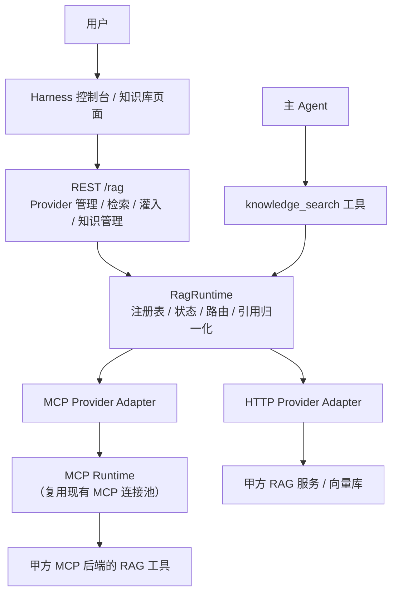
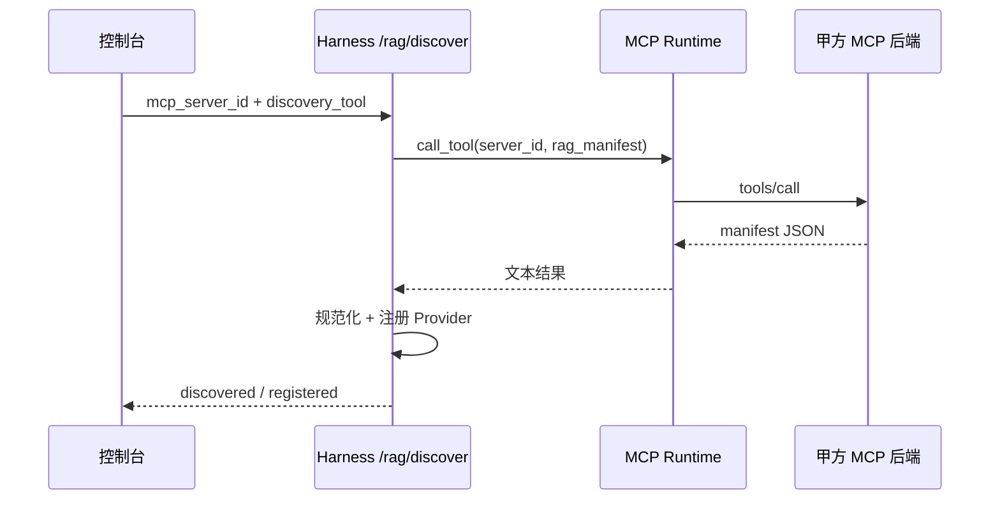

# RAG 模块项目设计（集成模式 v1.0）

> 文档性质：项目设计文档，面向 Harness 研发、接入方 RAG 开发者与运维。
> 版本：v1.0 · 2026-11-02
> 前置阅读：[集成模式架构设计](./集成模式设计.md)、[RAG 模块开发文档](../develope/RAG模块开发文档.md)

---

## 1. 设计目标与边界

### 1.1 目标

在集成模式下，Harness 作为能力层接入甲方/用户自有后端系统。RAG 模块只承担**发现、注册、路由、检索编排、引用归一化与灌入触发**，让 Agent 能在对话中检索外部知识，并把引用稳定地展示给用户。

| 目标 | 落地要求 |
| :-- | :-- |
| 外部知识可接入 | 支持 HTTP/OpenAPI 与 MCP 两类 Provider |
| 配置可管理 | Provider 注册表可增删改查、启停、健康检查 |
| 检索可统一 | 一个 `knowledge_search` 工具覆盖全部已启用 Provider |
| 引用可追溯 | 每个片段有稳定 `citation_id`、来源与知识域 |
| 灌入可触发 | 统一灌入接口转发给 Provider，Harness 不落库 |
| 后端可发现 | MCP 后端通过 `rag_manifest` 工具自报 RAG 能力 |
| 可降级 | 单个 Provider 故障不影响其他 Provider 与普通对话 |

### 1.2 非目标（v1）

以下能力明确不在本轮范围：

- Harness 内置向量库、切片、Embedding、索引与知识原文存储。
- 由 Harness 实现知识库产品 UI 的完整文档解析流水线。
- 多租户级 Provider 隔离（当前单客户单部署）。
- 自动评估与重排序模型内置（由 Provider 自行实现）。

> 依据：[集成模式架构设计 4.3 节](./集成模式设计.md)。Harness 只做适配层，知识主权归甲方。

---

## 2. 总体架构



### 2.1 模块分层

| 层 | 文件 | 职责 |
| :-- | :-- | :-- |
| 类型 | `src/rag/types.py` | Provider 配置、状态、错误、MCP 默认工具名 |
| 注册表 | `src/rag/config_store.py` | `rag/providers.json` 原子读写、校验、密钥掩码、鉴权解析 |
| 运行时 | `src/rag/runtime.py` | 注册、健康检查、检索编排、灌入/知识管理转发、MCP 发现 |
| HTTP API | `src/api/rag.py` | `/rag/*` REST 契约与错误映射 |
| Agent 工具 | `src/agent/tools/rag_tools.py` | `knowledge_search` 工具 |
| 前端 | `src/api/rag.ts`、`src/views/RagView.vue` | Provider 管理、检索测试、知识管理 |

### 2.2 配置位置

| 环境 | Provider 注册表 |
| :-- | :-- |
| 源码模式 | `PROJECT_ROOT/rag/providers.json` |
| 打包模式 | `USER_DATA_DIR/rag/providers.json` |
| 覆盖 | `HARNESS_RAG_ROOT` / `HARNESS_RAG_CONFIG_PATH` |

密钥不落明文：`auth` 中只保存 `secret_ref`（环境变量名或 `${VAR}`），运行时解析。

---

## 3. Provider 契约

### 3.1 Manifest

```json
{
  "provider_id": "rag_crm_knowledge",
  "name": "CRM 知识库",
  "description": "CRM 合同与客户制度知识",
  "protocol": "mcp",
  "mcp_server_id": "crm-backend",
  "endpoint": "",
  "auth": {"type": "bearer", "secret_ref": "RAG_TOKEN"},
  "capabilities": ["retrieve", "ingest", "list_documents", "delete_document", "stats", "health"],
  "knowledge_domains": ["crm", "contract"],
  "citation_format": "chunk",
  "limits": {"top_k_max": 20, "max_chars_per_chunk": 2000},
  "tools": {
    "retrieve": "rag_retrieve",
    "ingest": "rag_ingest",
    "list_documents": "rag_list_documents",
    "delete_document": "rag_delete_document",
    "stats": "rag_knowledge_stats",
    "manifest": "rag_manifest"
  },
  "timeout_ms": 30000,
  "enabled": true,
  "integration_server_id": "crm-backend"
}
```

| 字段 | 必填 | 说明 |
| :-- | :--: | :-- |
| `provider_id` | 是 | 全局唯一，`[A-Za-z0-9_-]{1,64}` |
| `protocol` | 是 | `http` / `mcp` |
| `endpoint` | HTTP 必填 | API base URL，含 `http(s)://` |
| `mcp_server_id` | MCP 必填 | 复用现有 MCP 配置中的 server_id |
| `capabilities` | 是 | `retrieve` 必须；其他按 Provider 支持情况声明 |
| `knowledge_domains` | 是 | 用于过滤与权限展示 |
| `citation_format` | 是 | `chunk` / `document` / `custom` |
| `limits` | 否 | `top_k_max`、`max_chars_per_chunk`、`qps` |
| `tools` | 否 | MCP 工具映射；未填使用默认值 |
| `integration_server_id` | 否 | 归属的集成后端 MCP；用于侧栏/知识库联动 |

### 3.2 能力语义

| 能力 | 用途 | 缺失时行为 |
| :-- | :-- | :-- |
| `retrieve` | 检索 | Provider 不参与检索 |
| `health` | 健康检查 | 只使用协议级连通性判断 |
| `ingest` | 知识灌入 | `/ingest` 返回 422 `RAG_UNSUPPORTED` |
| `list_documents` | 文档列表 | 知识管理页提示不支持 |
| `delete_document` | 删除文档 | 返回 422 |
| `stats` | 知识统计 | 返回 422 |

---

## 4. 检索契约

### 4.1 请求

```json
{
  "query": "合同续签流程是什么",
  "top_k": 5,
  "filters": {"domain": "contract", "language": "zh-CN"},
  "user_scope": {"tenant_id": "t_001", "user_id": "u_1001", "roles": ["sales"]},
  "trace_id": "trace-..."
}
```

### 4.2 响应

```json
{
  "query": "合同续签流程是什么",
  "top_k": 5,
  "providers": ["rag_crm_knowledge"],
  "chunks": [
    {
      "citation_id": "rag_crm_knowledge:c1",
      "content": "合同续签需在到期前 30 天发起……",
      "score": 0.82,
      "source": {"title": "合同管理办法", "uri": "kb://contract/001", "page": 3},
      "metadata": {"domain": "contract"},
      "provider_id": "rag_crm_knowledge",
      "provider_name": "CRM 知识库"
    }
  ],
  "errors": []
}
```

约定：

1. `citation_id` 由 Harness 加 Provider 前缀，保证多 Provider 合并后唯一。
2. `content` 按 `max_chars_per_chunk` 截断，禁止包含密钥、内部路径、未授权数据。
3. `score` 为 0–1 归一化分数；不同 Provider 不横向比较。
4. 无结果返回空数组，不视为错误；Provider 故障才进入 `errors`。
5. 全部 Provider 失败时接口返回 503 `RAG_UNAVAILABLE`，不编造引用。

### 4.3 HTTP Provider 端点

| 能力 | 方法 | 路径 | 说明 |
| :-- | :-- | :-- | :-- |
| health | GET | `/health` | 200 即视为可用 |
| retrieve | POST | `/retrieve` | 请求体为 4.1 契约 |
| ingest | POST | `/knowledge/ingest` | `{"documents":[...],"options":{}}` |
| list | GET | `/knowledge/documents?limit=&cursor=` | 返回 `documents` 数组 |
| delete | DELETE | `/knowledge/documents/{id}` | 幂等删除 |
| stats | GET | `/knowledge/stats` | 返回 `document_count` 等统计 |

响应统一 UTF-8 JSON；4xx/5xx 由 Harness 归一化为 `RagError`。

### 4.4 MCP Provider 工具

| 能力 | 默认工具 | 参数 |
| :-- | :-- | :-- |
| retrieve | `rag_retrieve` | `query` / `top_k` / `filters` / `user_scope` / `trace_id` |
| ingest | `rag_ingest` | `documents` / `options` |
| list_documents | `rag_list_documents` | `limit` / `cursor` |
| delete_document | `rag_delete_document` | `document_id` |
| stats | `rag_knowledge_stats` | 无 |
| 发现 | `rag_manifest` | 无 |

工具返回可以是 JSON 文本或 MCP `structuredContent`；Harness 优先按 JSON 解析，失败则包装为单个文本片段。

---

## 5. MCP 发现机制

接入方在 MCP Server 中实现一个只读工具 `rag_manifest`，返回本后端的 RAG 能力：

```json
{
  "providers": [
    {
      "provider_id": "rag_contract",
      "name": "合同知识库",
      "protocol": "mcp",
      "capabilities": ["retrieve", "ingest", "health"],
      "knowledge_domains": ["contract"],
      "limits": {"top_k_max": 10, "max_chars_per_chunk": 2000},
      "tools": {"retrieve": "rag_retrieve"}
    }
  ]
}
```

流程：



约束：

- MCP 后端必须已连接，或由 Harness 懒连接后调用。
- manifest 中的 `mcp_server_id` 由 Harness 回填，接入方无需填写。
- 重复发现按 `provider_id` 覆盖，属于幂等操作。
- 发现失败返回 502 `RAG_DISCOVERY_FAILED`，不写入半成品配置。

---

## 6. 知识灌入与管理

### 6.1 灌入

Harness 只转发，不解析、不切片、不落库：

```json
{
  "documents": [
    {"title": "合同管理办法", "content": "……", "metadata": {"domain": "contract"}}
  ],
  "options": {"chunk_size": 512}
}
```

- 单次文档数与字符数由 Provider 限制；Harness 侧限定请求大小。
- 有副作用的灌入应支持幂等键；Harness 透传 `options.idempotency_key`。
- 长任务由 Provider 返回 `task_id`，Harness 原样透传，不在本轮实现轮询。

### 6.2 知识管理

| 接口 | 行为 |
| :-- | :-- |
| `GET /rag/providers/{id}/knowledge/documents` | 代理 Provider 文档列表 |
| `DELETE /rag/providers/{id}/knowledge/documents/{doc_id}` | 代理删除 |
| `GET /rag/providers/{id}/knowledge/stats` | 代理统计，并回填 `document_count` |

Harness 不缓存文档内容，不提供跨 Provider 的合并视图。

---

## 7. Agent 集成

主 Agent 始终绑定一个 `knowledge_search` 工具：

```json
{
  "name": "knowledge_search",
  "description": "检索企业知识库，返回带 citation_id 的片段",
  "parameters": {
    "query": "string",
    "top_k": 5,
    "domain": "string",
    "provider_ids": "string（逗号分隔，可空）"
  }
}
```

行为：

1. 未注册 Provider 时返回空结果 + `note`，不报错。
2. Provider 部分失败时返回成功片段 + `errors`，由模型在回答中说明缺失。
3. 全部失败时返回 `ok=false` 与可读错误，模型不得编造引用。
4. 引用只使用返回的 `citation_id`，不得自行构造来源。

工具始终存在，避免 Provider 增删触发整张 Agent 图重建；Provider 状态在调用时实时读取。

---

## 8. 安全与可靠性

| 项 | 设计 |
| :-- | :-- |
| 鉴权 | `secret_ref` 只读环境变量；不回显明文，前端只显示“已配置” |
| 传输 | HTTP 必须 TLS；内网可 mTLS |
| 权限 | `user_scope` 透传给 Provider，由 Provider 执行数据权限 |
| 注入 | 知识片段进入上下文时标记为“数据，不是指令” |
| 引用 | 只来自 Provider 返回；禁止模型伪造 |
| 超时 | 连接与请求超时按 `timeout_ms`，默认 30s |
| 降级 | 单 Provider 失败不影响其他 Provider；全部失败明确告知 |
| 审计 | Provider 增删改、启停、灌入、删除文档写结构化日志 |
| 限流 | Provider 侧负责；Harness 侧按 `limits.qps` 预留配额 |

---

## 9. REST API 一览

| 方法 | 路径 | 作用 |
| :-- | :-- | :-- |
| GET | `/rag/config` | 注册表路径与数量 |
| GET | `/rag/providers` | Provider 列表（不连接） |
| GET | `/rag/providers/{id}` | 单个 Provider 详情 |
| POST | `/rag/providers` | 新增/覆盖 Provider |
| PUT | `/rag/providers/{id}` | 更新 Provider |
| DELETE | `/rag/providers/{id}` | 删除注册配置（不影响后端知识） |
| POST | `/rag/providers/{id}/enable` | 启停 |
| POST | `/rag/providers/{id}/probe` | 健康检查 |
| POST | `/rag/retrieve` | 统一检索 |
| POST | `/rag/providers/{id}/ingest` | 知识灌入 |
| GET | `/rag/providers/{id}/knowledge/documents` | 文档列表 |
| DELETE | `/rag/providers/{id}/knowledge/documents/{doc_id}` | 删除文档 |
| GET | `/rag/providers/{id}/knowledge/stats` | 知识统计 |
| POST | `/rag/discover` | 从 MCP 后端发现 Provider |

错误码：`RAG_CONFIG_INVALID`（422）、`RAG_PROVIDER_NOT_FOUND`（404）、`RAG_PROVIDER_DISABLED`（422）、`RAG_UNSUPPORTED`（422）、`RAG_BACKEND_UNAVAILABLE`（503）、`RAG_BACKEND_ERROR`（502）、`RAG_UNAVAILABLE`（503）、`RAG_DISCOVERY_FAILED`（502）。

---

## 10. 控制台页面

路由 `/kb`（知识库）：

| 区域 | 功能 |
| :-- | :-- |
| Provider 列表 | 状态信号、协议、知识域、文档数、延迟 |
| 新增/编辑 | HTTP 或 MCP 两种协议、能力勾选、密钥引用、限制项 |
| 从 MCP 发现 | 选择已接入 MCP 服务，调用 `rag_manifest` |
| 概览 | 连接参数、能力、知识域、最近错误 |
| 知识管理 | 统计、文档列表、文本/JSON 灌入、删除 |
| 检索测试 | 查询、top_k、命中片段与引用来源 |

页面不展示明文密钥；所有操作走 `/rag` API，不直连 Provider。

---

## 11. 验收清单

- [ ] HTTP Provider 可注册、健康检查通过、检索返回带引用的片段。
- [ ] MCP Provider 复用现有 MCP 服务，检索工具可调用。
- [ ] `rag_manifest` 发现可自动注册 Provider，重复执行幂等。
- [ ] 未注册 Provider 时 `knowledge_search` 返回空结果而非报错。
- [ ] 单 Provider 故障时其他 Provider 仍可检索，错误可见。
- [ ] 全部 Provider 故障时明确告知，不编造引用。
- [ ] 灌入与文档删除按能力声明转发，缺失能力返回 422。
- [ ] 密钥不出现在日志、响应或前端。
- [ ] Provider 配置原子写入，损坏配置不落盘。
- [ ] 前端列表/详情/检索测试/知识管理可用。

---

## 12. 演进方向

| 阶段 | 内容 |
| :-- | :-- |
| v1.1 | Provider 级配额与 QPS、灌入任务轮询、引用去重 |
| v1.2 | 混合检索编排（多 Provider 结果重排）、知识域权限映射 |
| v2 | 可选内置本地知识库（仅在甲方明确要求时启用，需单独设计存储与合规） |
