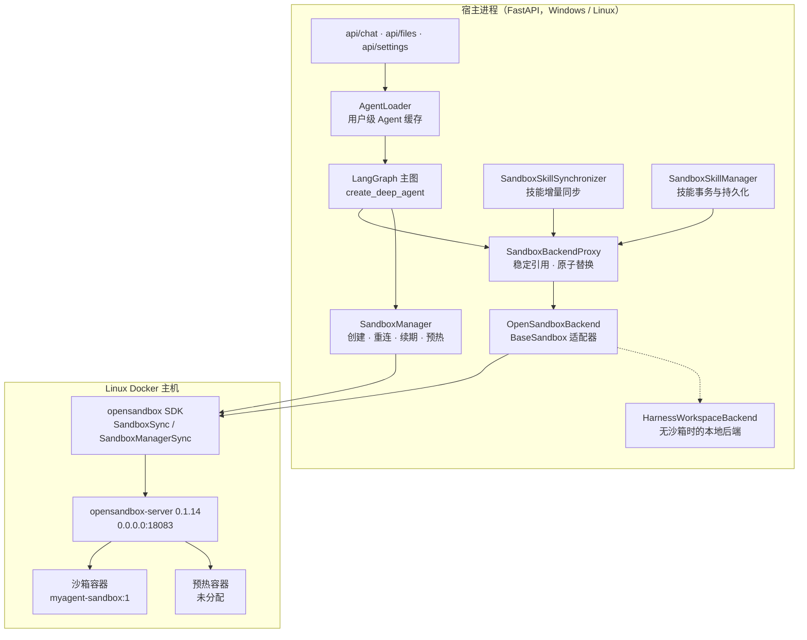
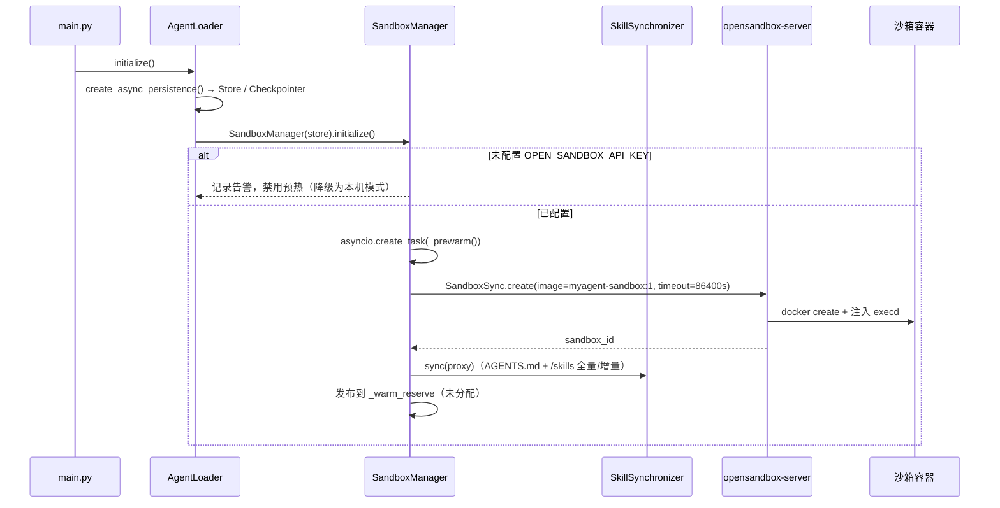
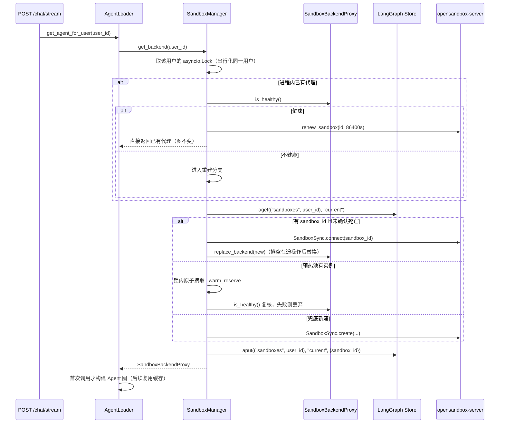
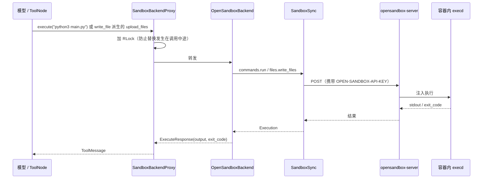
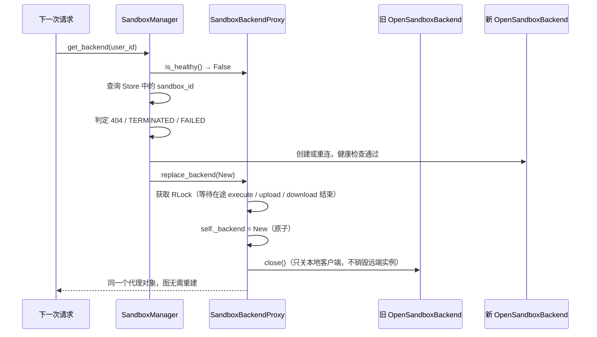
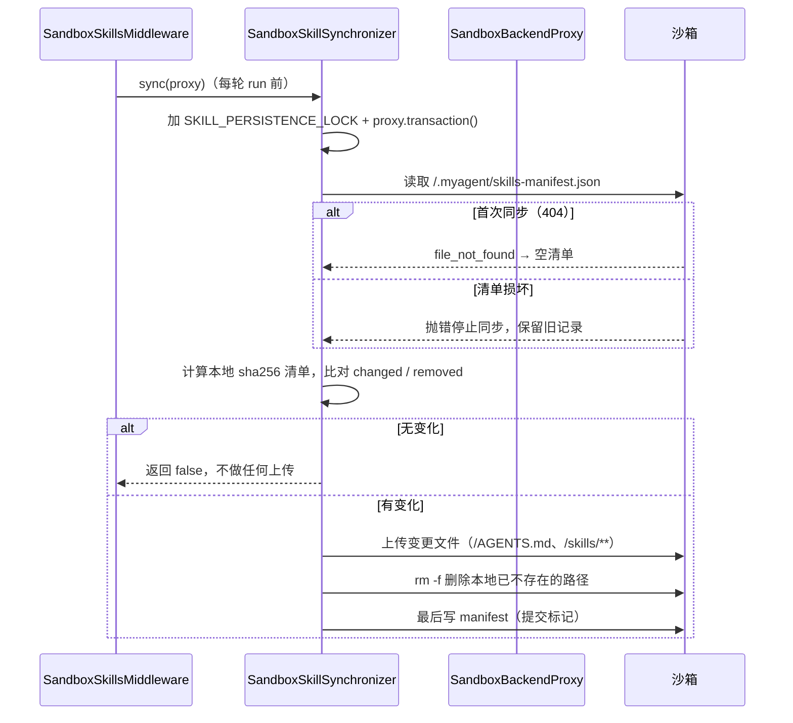
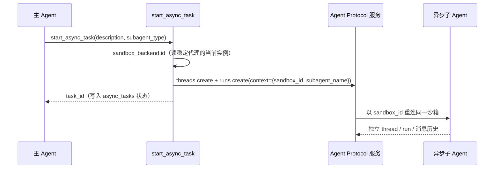

# 该文档详细介绍本项目SandBox服务的设计与实现

使用opensandbox SDK 二次开发 , 做了与deepagent的backend 沙箱后端的适配  
同时包含沙箱预热机制、沙箱热替换机制

---

## 沙箱服务启动

> 本项目开发时，采用本地沙箱服务，后续会考虑采用云沙箱服务

### 本地沙箱
使用Linux Docker部署。
首先在linux的opt目录下，mkdir opensandbox/sandbox/

然后将该项目的./sandbox/下的Dockerfile与setup-runtime.sh 复制到opensandbox/sandbox/目录下。  

在linux中，cd opt/opensandbox  
然后执行    
```bash
docker build -t myagent-sandbox:1 sandbox
```

等待镜像构建完毕...（可能在10min左右，网络好的话会快些，因为需要安装python3.12, go, java, npm 这些环境）

确保Linux内有uv环境,如果没有，就先：
```bash
curl -LsSf https://astral.sh/uv/install.sh | sh

# 根据提示，配置环境变量
source $HOME/.local/bin/env
```
然后 cd opt/opensandbox  
```bash
# 1. 装服务端，必须锁 0.1.14 —— 你的客户端是 opensandbox 0.1.16
uv tool install 'opensandbox-server==0.1.14'
# 已装过的话先看一眼： opensandbox-server --version

# 2. 生成配置（docker 运行时模板）
opensandbox-server init-config /opt/opensandbox/sandbox.toml --example docker

# 3. 只改 [server] 段，其余默认
#   [server]
#   host = "0.0.0.0"                              ← 写 127.0.0.1 的话 Windows 永远连不上
#   port = 18083
#   api_key = "sk-harness-local-7c1a9e4b2d8f6a35" ← 与 .env 完全一致

# 4. 启动
opensandbox-server --config /opt/opensandbox/sandbox.toml
```
启动后会报错
```text
SECURITY WARNING: server.api_key is empty; API authentication is disabled. Type 'YES' to continue startup without API key. Strongly recommend setting server.api_key. See: https://github.com/alibaba/OpenSandbox/issues/750 : ERROR:    2026-11-01 01:29:37+0800 [-] opensandbox_server.main: API key startup confirmation failed: Startup aborted: confirmation timed out waiting for YES. Strongly recommend setting server.api_key. See: https://github.com/alibaba/OpenSandbox/issues/750
```

这是因为没有修改toml文件的api_key，导致启动失败。  

打开sandbox.toml文件，修改api_key为sk-harness-local-7c1a9e4b2d8f6a35  

> 注意：这里的api_key 是与 .env 完全一致。是自定义的，可以是任意值

 

加下来进行检验
```bash
curl http://127.0.0.1:18083/health          # → {"status":"healthy"}
curl -H "OPEN-SANDBOX-API-KEY: sk-harness-local-7c1a9e4b2d8f6a35" \
     http://127.0.0.1:18083/v1/sandboxes    # → []  而不是 401
```
如果出现windows连接Linux超时的情况，需要在linux放行防火墙
```bash
sudo firewall-cmd --state
sudo firewall-cmd --list-ports          # 看看有没有 18083/tcp

sudo firewall-cmd --permanent --add-port=18083/tcp
sudo firewall-cmd --reload
sudo firewall-cmd --list-ports          # 确认 18083/tcp 在列表里
```

---

## 一、总体设计

### 1.1 设计目标

| 目标 | 落地方式 |
| :-- | :-- |
| Agent 的代码执行必须离开宿主机 | 命令与文件操作全部路由到远端容器 |
| 沙箱可以失效、可以换，而 Agent 图不重建 | 稳定代理 `SandboxBackendProxy` + 原子热替换 |
| 首次对话不要被“建沙箱”拖慢 | 启动时预热一个空闲实例，按需领取 |
| 同一个用户的多个会话复用同一环境 | 按 `user_id` 管理沙箱，`sandbox_id` 持久化到 Store |
| 技能与指令始终与宿主源码一致 | sha256 清单增量同步，清单最后提交 |
| 没有沙箱也不能瘫痪 | 未配置凭据时降级为本机执行，聊天链路照常可用 |

### 1.2 分层架构



### 1.3 各层职责

| 层 | 职责 | 代码位置 |
| :-- | :-- | :-- |
| Agent 图 | 构建时捕获一次 backend 引用，之后所有工具调用都走它 | `create_deep_agent(backend=...)` |
| `CompositeBackend` | 按路径分流：`/memories/` 落 PostgreSQL，其余落沙箱或本地 | [main_agent.py](../src/agent/main_agent.py) |
| `SandboxBackendProxy` | 图内唯一的“可变点”，持有可替换的真实后端 | [sandbox_proxy.py](../src/agent/backends/sandbox_proxy.py) |
| `OpenSandboxBackend` | 把 SDK 翻译成 `BaseSandbox` 的 `execute / upload_files / download_files` 三原语 | [open_sandbox.py](../src/agent/backends/open_sandbox.py) |
| `SandboxManager` | 按用户管理生命周期：创建、重连、续期、预热、关闭 | [sandbox_manager.py](../src/agent/backends/sandbox_manager.py) |
| `SandboxSkillSynchronizer` | 宿主技能目录 → 沙箱的增量镜像 | [skill_sync.py](../src/agent/backends/skill_sync.py) |
| `opensandbox SDK` | 真正发 HTTP 请求的客户端 | 第三方包 |
| `opensandbox-server` | 生命周期服务，负责起容器、注入 execd、代理命令与文件 | 独立部署 |

### 1.4 为什么必须加一层代理

`create_deep_agent` 在构图时会把 backend 对象捕获进图。沙箱会被回收、崩溃、重建，如果图直接持有实例，换沙箱就等于重建整张图：状态丢失、正在跑的会话中断、HITL 卡片失效。代理把“可变点”收拢成唯一一处，因此得到一条关键结论：

> **图内引用不变 ≠ 沙箱实例不变。**

### 1.5 三原语适配

`BaseSandbox` 只要求实现三个原语，其余文件系统能力（读、写、列目录、glob、grep）都由基类在上述原语之上派生。因此适配层极小：

| 原语 | SDK 调用 | 说明 |
| :-- | :-- | :-- |
| `execute` | `SandboxSync.commands.run(cmd, RunCommandOpts(timeout))` | 合并 stdout/stderr，保留 exit_code |
| `upload_files` | `SandboxSync.files.write_files([WriteEntry(...)])` | 逐文件上传，单个失败不掩盖其他结果 |
| `download_files` | `SandboxSync.files.read_bytes(path)` | 二进制安全；404 → `file_not_found`，403 → `permission_denied` |

---

## 二、核心流程（时序）

### 2.1 服务启动与预热



预热是**后台任务**，不阻塞 FastAPI 启动；预热失败只记一条告警，退回按需创建。

### 2.2 一次对话的沙箱取用（决策树）



判定“确认死亡”严格限定：只有生命周期查询返回 **404**，或状态为 `TERMINATED` / `FAILED`，才允许换新沙箱；传输超时、execd 503 都只当作临时不可用，保留原实例与标识。

### 2.3 工具调用怎么落到容器里



`use_server_proxy=true` 时，命令与文件走生命周期服务端代理，宿主只连 `18083`，不直连容器 IP —— 这正是 Windows / Docker Desktop / 远程 Linux 场景能用的前提。

### 2.4 沙箱失效与热替换



### 2.5 技能与指令同步



顺序上的硬约束：**manifest 必须最后写**。先写清单再传文件，一旦中途失败，下一次会认为“已同步”而跳过，导致沙箱长期缺文件。

### 2.6 异步子 Agent 复用同一个沙箱



共享的是**执行环境**，不是上下文：异步子 Agent 有自己的 thread、run 与消息历史，只是文件系统落在同一个容器里。

---

## 三、亮点机制

### 3.1 稳定代理 + 排空式热替换

- 图里只保存一个永不失效的句柄，替换发生在句柄内部。
- `execute / upload_files / download_files` 全程持同一把 `RLock`，因此语义是“**排空在途操作后替换**”，不是打断式替换。
- `replace_backend` 只在被替换对象不是自己时才 `close()`，避免把新后端关掉。

### 3.2 按用户持久化 + 预热池

- `sandbox_id` 写入 LangGraph Store：进程重启后仍能 `SandboxSync.connect` 回原实例，工作区不丢。
- 进程内 `_proxies` 缓存用户代理，多会话共享，避免每次对话重建客户端。
- 预热池只有一个空闲实例，但它是“**技能已完整同步**”后才发布的；领取时再做一次健康复核，失败可直接丢弃（此时尚未写库、未绑定用户）。

### 3.3 失败判定保守

“沙箱没了”是一个不可逆判断，因此只在 404 / `TERMINATED` / `FAILED` 时触发换新；任何超时、连接异常、execd 503 都保留原标识。这条策略避免了“网络抖一下就换沙箱、工作区全丢”。

### 3.4 技能同步是“可重放”的

- 以内容哈希而非 mtime 判断变更，跨机器、跨时区都一致。
- 清单里每条路径都要通过白名单校验（`/AGENTS.md` 或 `/skills/**`），防止沙箱侧伪造清单做路径穿越。
- 宿主侧拒绝符号链接、目录联接与越界路径；沙箱侧删除用 `rm -f --` 并校验退出码。

### 3.5 可降级

`OPEN_SANDBOX_API_KEY` 为空时：禁用预热与技能同步、`/memories/` 仍走 Store、其余文件落 `HarnessWorkspaceBackend`（按 `thread_id` 隔离的本地目录，且禁止脚本类后缀）。聊天、历史、只读接口全部可用，前端会显示“本地执行”的安全提示。

### 3.6 配置热更新

`PUT /settings/sandbox` 只做三件事：写 `.env` → `reload_sandbox_config()` 刷新模块属性 → `agent_loader.reload_sandbox()` 重建管理器并清空用户图缓存。旧管理器**排空在途操作后关闭客户端，但不销毁远端沙箱**；新配置在下次请求按需生效。

### 3.7 文件语义：系统注入 vs Agent 产出

会话文件列表为每条记录标注 `origin`：

| origin | 判定 | 前端表现 |
| :-- | :-- | :-- |
| `system` | `/AGENTS.md`、`/skills/**`、`/.myagent/**`、`/root/.` 开头的隐藏文件 | 打「系统」标签，可一键过滤 |
| `agent` | 其余路径（含 `/root/xxx` 这类非隐藏产物） | 打「Agent」标签，默认展示 |

配合新增的 `GET /threads/{id}/files/download`（按原始字节返回，`Content-Disposition` 走 RFC 5987 以支持中文名），docx / pdf 这类不可预览的文件也能直接下载，不必先点开预览。

### 3.8 并发与线程模型

- SDK 是同步阻塞的，全部经 `asyncio.to_thread` 包装，并用 `asyncio.shield` 保护：调用方取消不会遗弃工作线程与它的返回值。
- 每用户一把 `asyncio.Lock` 串行化“查库 → 重连 → 替换 → 写库”，同用户的并发请求不会打出多个沙箱；不同用户互不阻塞。
- `close()` 先停止接纳新请求，再排空已接纳操作，只销毁未分配的预热实例。

### 3.9 工具级只读约束

deepagents 的 `FilesystemPermission` 只作用于文件工具，`execute` 是 shell，`cat` / `rm` / 重定向都能绕过路径规则，因此框架对“支持执行的 backend + permissions”组合直接拒绝构图。本项目改为在工具调用层拒绝：子 Agent 的 `deny_tools` 声明被转成 `DeniedToolsMiddleware`，既从模型可见工具中移除，也在执行前返回错误结果。硬约束落在工具名上，不依赖 shell 自觉。

---

## 四、不足与边界

| # | 不足 | 影响 | 改进方向 |
| :--: | :-- | :-- | :-- |
| 1 | 只支持单 worker | `_proxies`、用户锁、`close()` 都是进程内状态；多 worker 会重复建沙箱并失去互斥 | 代理状态与锁迁到 Redis/Postgres 咨询锁 |
| 2 | 隔离粒度是 `user_id`，不是会话 | 同一用户的不同会话共享一个文件系统，A 会话的产物对 B 可见 | 会话级子目录约定，或按 `thread_id` 建沙箱 |
| 3 | 文件列表靠容器内遍历 | `os.walk('/')` 有 500 条 / 5MB 截断，深目录与大仓库会漏 | 由 Agent 显式登记产物清单，或用 inotify 增量索引 |
| 4 | 没有执行级权限 | `execute` 可读写任意路径，只读子 Agent 靠工具黑名单 | 给 `execute` 增加命令白名单 / 只读挂载 / 独立低权用户 |
| 5 | 预热池容量固定为 1 | 多用户同时首聊仍需现建（秒级），且 `execd` 首次拉取更慢 | 预热池做成可配置容量与 LRU 淘汰 |
| 6 | 缺少熔断 | 沙箱服务整体宕机时，每个请求都会重试一遍重连/新建 | 接入熔断中间件（README 已列出扩展点） |
| 7 | 无资源配额与审计 | 单容器 CPU/内存/磁盘未限制，无操作审计与留存 | 在服务端 toml 限制资源，另加轨迹级审计 |
| 8 | 无沙箱快照/迁移 | 换机器只能重建，工作区内容依赖同步逻辑补齐 | 定期导出关键目录，或使用服务端快照能力 |
| 9 | 版本强耦合 | 客户端 `opensandbox==0.1.16` 必须配服务端 `0.1.14` 线 | 升级前先做接口兼容回归 |
| 10 | 无沙箱时降级为本机执行 | 具备读本机文件、执行高风险命令的能力，仅适合可信环境 | 默认拒绝写类工具，或在 UI 强制二次确认 |
| 11 | 首建容器有一次性延迟 | `execd:v1.0.16` 首次需拉镜像（实测约 28s） | 部署阶段预拉 `docker pull opensandbox/execd:<ver>` |

运维排查三个高频点：

1. **跨机超时**（不是拒绝）→ Linux 防火墙未放行 18083，或服务端绑在 `127.0.0.1`。
2. **401** → toml 的 `server.api_key` 与 `.env` 的 `OPEN_SANDBOX_API_KEY` 不一致，或改完没重启 server。
3. **版本错配** → 客户端 0.1.x 对服务端 1.x，会在会话接口报协议错误；按上文锁定版本。

---

## 五、API 与内部数据结构

### 5.1 后端 REST 接口

| 方法 | 路径 | 参数 | 说明 |
| :--: | :-- | :-- | :-- |
| GET | `/threads/{thread_id}/files` | `user_id` | 列文件，返回 `source` + `files[]`，每条带 `origin` |
| GET | `/threads/{thread_id}/files/content` | `user_id`, `path` | 读文本内容；二进制返回 `415` |
| PUT | `/threads/{thread_id}/files/content` | `user_id` + body `{path, content}` | 覆盖写入；本地模式禁止脚本后缀 |
| GET | `/threads/{thread_id}/files/download` | `user_id`, `path` | 按原始字节下载，`Content-Disposition: attachment` |
| GET | `/settings/sandbox` | - | 沙箱配置、执行模式、本机运行时探测、存储路径 |
| GET | `/settings/sandbox/status` | - | 轻量返回当前执行模式（沙箱 / 本地） |
| PUT | `/settings/sandbox` | body：host / port / api_key / image / 超时 / 预热 / 代理开关 | 写 `.env` 并重建沙箱管理器 |
| POST | `/settings/sandbox/check` | `host`, `port` | 仅 TCP 连通性探测，**不代表凭据有效** |

### 5.2 沙箱服务端接口（opensandbox-server）

| 方法 | 路径 | 用途 |
| :--: | :-- | :-- |
| GET | `/health` | 健康检查，无需鉴权 |
| GET | `/v1/sandboxes` | 列出实例（含 `image.uri`、`status.state`、`expiresAt`） |
| POST | `/v1/sandboxes` | 创建实例（image / timeout / metadata） |
| POST | `/v1/sandboxes/{id}/renew-expiration` | 续期 |
| DELETE | `/v1/sandboxes/{id}` | 销毁实例 |

除 `/health`、`/version`、`/docs`、`/openapi.json` 外，所有请求都要带 `OPEN-SANDBOX-API-KEY` 头。

### 5.3 关键内部数据结构

**Store 中的沙箱绑定**

```json
{
  "namespace": ["sandboxes", "<user_id>"],
  "key": "current",
  "value": { "sandbox_id": "099b7f5a-4b1d-43d3-9fae-4fe34e487d71" }
}
```

**文件列表项（`FileMeta`）**

| 字段 | 类型 | 说明 |
| :-- | :-- | :-- |
| `path` | string | 沙箱内绝对路径，如 `/notes.md` |
| `size` | int | 字节数 |
| `modified_at` | string \| null | ISO8601（UTC） |
| `origin` | `"system"` \| `"agent"` | 系统注入 / Agent 产出 |

**技能清单（`/.myagent/skills-manifest.json`）**

```json
{
  "/AGENTS.md": "<sha256>",
  "/skills/main/xlsx/SKILL.md": "<sha256>"
}
```

只允许这两类路径；清单最后提交，读到 404 视为首次同步，读到损坏内容则停止同步以保留旧记录。

**适配层返回对象**

| 结构 | 字段 | 来源 |
| :-- | :-- | :-- |
| `ExecuteResponse` | `output`, `exit_code` | `BaseSandbox` 协议 |
| `FileUploadResponse` | `path`, `error` | 同上 |
| `FileDownloadResponse` | `path`, `content`, `error` | 同上，错误归一为 `file_not_found` / `permission_denied` / `download_failed` |

**`SandboxManager` 进程内状态**

| 字段 | 用途 |
| :-- | :-- |
| `_proxies[user_id]` | 用户级稳定代理缓存 |
| `_user_locks[user_id]` | 同用户串行化 |
| `_warm_reserve` | 未分配的预热实例 |
| `_operations` | 已接纳请求集合，关闭时排空 |
| `_connection` | `ConnectionConfigSync(api_key, domain=host:port, use_server_proxy)` |

### 5.4 配置项

| 变量 | 默认 | 说明 |
| :-- | :-- | :-- |
| `OPEN_SANDBOX_API_KEY` | 空 | 与 server 端 `server.api_key` 一致；为空则降级本地模式 |
| `OPEN_SANDBOX_HOST` | `127.0.0.1` | 服务端地址，远程部署填 Linux 主机 IP |
| `OPEN_SANDBOX_PORT` | `18083` | 服务端端口，与 toml `server.port` 一致 |
| `OPEN_SANDBOX_IMAGE` | `myagent-sandbox:1` | 每个沙箱使用的镜像，必须在服务端主机上构建 |
| `OPEN_SANDBOX_DEFAULT_TIMEOUT_SECONDS` | `120` | 单条命令超时 |
| `OPEN_SANDBOX_SANDBOX_TIMEOUT_SECONDS` | `86400` | 实例生命周期，每次访问续期 |
| `OPEN_SANDBOX_PREWARM_ENABLED` | `true` | 启动时预热一个空闲实例 |
| `OPEN_SANDBOX_USE_SERVER_PROXY` | `true` | 命令与文件经服务端代理；跨机部署必须开启 |

---

## 六、缺陷补充与待商讨问题

> 第四节「不足与边界」列了 11 条结构性不足；这里补充**实现细节层面的缺陷**，以及需要产品/架构一起拍板的**开放问题**。

### 6.1 已知缺陷（补充）

| # | 缺陷 | 现状（代码依据） | 影响 | 建议 |
| :--: | :-- | :-- | :-- | :-- |
| 1 | 生命周期对用户不可见 | 创建时带 24h TTL，`get_backend` 调 `renew_sandbox` 续期，但续期失败只 `logger.warning` | 用户不知道沙箱何时到期，到期后工作区文件直接消失 | `/settings/sandbox/status` 返回 `expires_at`；设置页展示倒计时，到期前提示导出 |
| 2 | 关键路径上有两次远程探测 | 每次 `get_backend` 都 `is_healthy()` + `renew_sandbox()` | 每轮首 token 前多两次 HTTP/gRPC 往返 | 本地加短 TTL 缓存（如 30s 内跳过探测），只在异常/重启时强探测 |
| 3 | 用户级共享 + 单把锁 | `_proxies[user_id]` 共享后端；`SandboxBackendProxy.execute/upload/download` 都持同一把 `RLock` | 同一用户多会话并发时命令**串行排队**；文件系统与已安装运行时互相污染 | 按 `thread_id` 建沙箱子目录 / 拆分执行锁（读操作可并行） |
| 4 | 只有 TTL，没有空闲回收 | 过期只看创建/续期时间，不看“是否在用” | 用户不再使用但容器仍占用最多 24h | 增加空闲阈值：先销毁 execd，再从归档导出工作区 |
| 5 | 观测缺口 | 只记录 `ExecuteResponse`（输出、退出码）与耗时；错误统一压缩成“沙箱暂时不可用” | 无法区分“镜像慢”“execd 挂”“网络抖动” | 采集容器 CPU/内存/磁盘/PID + 冷启动耗时；错误分类细化（镜像/传输/进程/超时） |
| 6 | “半死”状态无降级 | `is_healthy()` 失败时保留原沙箱（不替换）；只有 `TERMINATED/FAILED/404` 才换新 | execd 挂了但容器还在时，用户会反复超时 | 连续健康失败 N 次后标记 `Degraded` 并触发重建 |
| 7 | 技能同步是单向的 | `SandboxSkillSynchronizer` 只从宿主推到沙箱；Agent 在沙箱里改 `/skills` 不回写 | 沙箱内新增/修改的技能在换沙箱后丢失 | 增加显式“导出到宿主技能库”的工具/审批流 |
| 8 | 网络默认放通 | 验证表已确认容器内可联网；没有出口白名单与审计 | 提示注入可把数据外泄到任意域名 | 服务端网络策略（断网/域名白名单/代理审计），按 MCP 与服务分级 |
| 9 | 降级模式没有强制开关 | 缺少 `OPEN_SANDBOX_API_KEY` 时静默切到 `HarnessWorkspaceBackend`（本机 shell） | 生产环境误配即变成“Agent 直接操作宿主机” | 增加 `HARNESS_REQUIRE_SANDBOX=true`：缺凭据时拒绝执行类工具，只允许只读对话 |
| 10 | 建连无并发保护 | `_user_locks` 只串行同一用户；不同用户首次访问会并发创建实例 | 多用户冷启动可能打爆服务端创建接口 | 服务端侧限流 + 客户端全局信号量（如最多同时创建 4 个） |
| 11 | 三层版本耦合 | 客户端 `opensandbox 0.1.16` ↔ 服务端 `0.1.14` ↔ `execd:v1.0.16` 镜像 | 任一层升级都可能破坏会话协议 | 版本矩阵写进部署文档，升级前跑一遍沙箱回归用例 |

### 6.2 待商讨的问题（需要拍板）

| # | 问题 | 可选方向 | 当前倾向 / 说明 |
| :--: | :-- | :-- | :-- |
| 1 | 沙箱粒度 | A. 按 `user_id`（现状）<br/>B. 按 `thread_id`<br/>C. 按项目/工作区 | 短期保留 user 级 + 会话子目录约定；长期按 thread 更安全，但容器数量与成本上升 |
| 2 | 工作区要不要持久化 | A. 不持久（现状，随容器销毁）<br/>B. 定期导出到对象存储<br/>C. 挂载持久卷 / 容器快照 | 建议先做 B（低成本、可恢复关键产物），再评估 C |
| 3 | 资源配额 | CPU / 内存 / 磁盘 / PID 上限与超卖比例 | 需要与服务端部署规格一起定；至少给每容器加内存与磁盘上限 |
| 4 | 网络策略 | A. 默认断网<br/>B. 域名白名单<br/>C. 全放通 + 审计（现状） | 建议默认白名单（包源 + MCP 域名），既保可用性也控外泄 |
| 5 | 多 worker 部署 | A. 分布式锁 + 共享沙箱绑定（Redis 租约）<br/>B. 每 worker 独立沙箱，不做跨进程共享 | 先用 A 的简化版（Postgres advisory lock），再评估 B 的成本 |
| 6 | 只读 / 低权子 Agent | 容器内低权用户、seccomp、命令白名单、只读挂载 | 现状靠工具黑名单，不是真隔离；至少给只读子 Agent 单独的低权用户 |
| 7 | 成本模型 | 常驻容器（现状） vs 按需冷启动（serverless sandbox） | 需要统计“活跃用户数 × 在线时长”，再决定是否引入冷启动池 |
| 8 | SLI 与告警 | 连接成功率、命令执行 P95、冷启动 P95、健康失败率 | 建议先落这 4 个指标，再谈自动扩缩容 |
| 9 | 后端选型 | OpenSandbox（现状） / E2B / 自建 Docker + gVisor | 若未来要多后端，需要先抽象 `SandboxBackend` 的能力边界（文件、命令、快照） |
| 10 | 会话删除时的清理 | 只删 Store 绑定 / 同时导出再销毁容器 / 保留 N 天 | 建议“删除会话 = 导出归档 + 销毁容器”，否则容器里会残留用户数据 |

