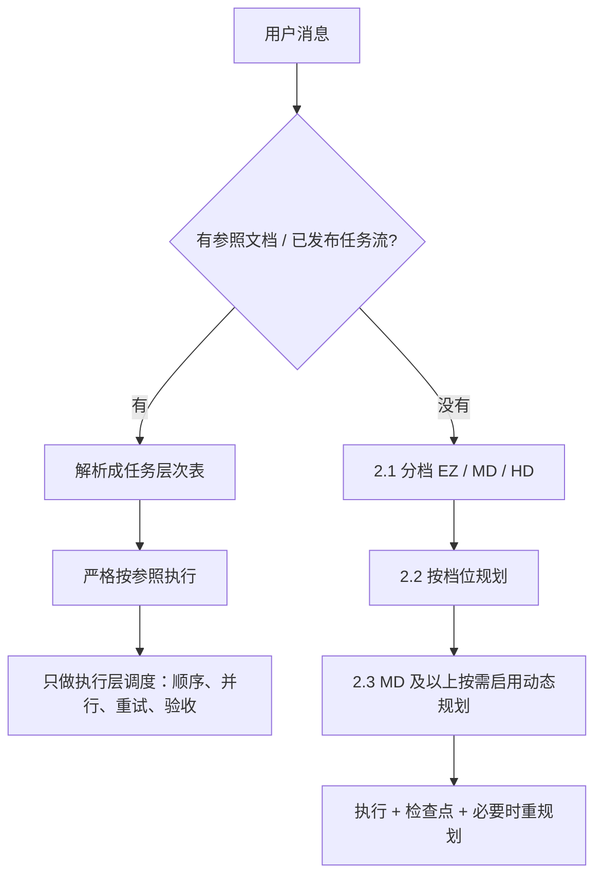

# 任务调度模块（Scheduler）设计

> 文档性质：模块级设计文档，尚未落地。
> v0.2 按「三档策略 + (S, R, D) 三元组 + 检查点打分」重写，去掉了 v0.1 里的五档阶梯、MCPP、储备曲线等内容。
> 原来的资料与思考稿见 [任务调度策略设计](./任务调度策略设计.md)。

| 项目 | 内容 |
| :-- | :-- |
| 文档版本 | v0.2（简化版） |
| 日期 | 2026-11-13 |
| 计划模块路径 | `src/scheduler/` |
| 关联文档 | [任务调度策略设计](./任务调度策略设计.md)、[任务调度策略开发文档](./任务调度策略开发文档.md)、[分档函数标定实验报告](./任务调度分档函数标定实验报告.md)、[任务流模块设计](../任务流模块设计.md)、[AgentTeam设计](../AgentTeam设计.md) |
| 一句话 | 先分档，再规划；执行中按检查点打分决定要不要重规划；已完成部分默认冻结，重做必须人工确认 |

---

## 0. 核心结论

1. **只用三档**：`EZ` 直接 ReAct，`MD` 用 TODO / 任务层次表，`HD` 用 HTN + 层次表。档位越高，计划越显式、检查点越密。
2. **执行路径只有两条**：用户给了参照（阶段划分、开发文档、已发布任务流）就严格照做；没给参照才走"分档 → 规划 → 按需动态规划"。
3. **动态规划的状态是 `(S, R, D)`**：`S` 是已完成事实，`R` 是剩余计划，`D` 是运行时扰动（`d1–d5`）。`D` 才是不可预测的部分。
4. **重规划不改历史**：已完成节点默认冻结；只有 `d3` 人工标记 + `d4` 明确要求时才评估重做，影响大的必须 HITL。
5. **检查点打分不交给 LLM 算总分**：LLM 只给离散等级和理由，权重与总分由系统算，不可逆性是一票否决的硬开关。

---

## 1. 三档调度策略

| | `EZ` | `MD` | `HD` |
| :-- | :-- | :-- | :-- |
| 典型任务 | 单点问答、一次查询、单文件小改 | 多步骤但结构清晰，如"调研并写一页结论" | 目标模糊或长链路，如"重构一个模块并补齐测试" |
| 计划产物 | 无 | TODO List 或任务层次表（`P0…PN` → `Pi.j`） | HTN 任务网络 + 任务层次表 |
| 执行主体 | 主 Agent ReAct 循环 | 主 Agent + 按需 SubAgent | 调度器 + 节点执行器 + SubAgent |
| 并行 | 无 | 同阶段内可并行 | 按依赖波次并行 |
| 检查点 | 无（只有最终回答自检） | 每个 `Pi` 完成时 | 每个节点 + 阶段门 |
| 动态规划 | 不启用 | 按需（阶段边界或异常时） | 默认启用 |
| 失败处理 | 重试 / 换工具 | 局部重排或重拆当前阶段 | 换 method / 局部重规划 / 必要时人工 |

### 1.1 EZ

目标明确、步骤不超过 3 步、无跨文件或跨系统依赖、结果可逆。不建计划表，直接走现有主 Agent 循环。**不要为了"看起来有调度"而给 EZ 加计划**，那只会增加一次无用的模型调用。

### 1.2 MD

子目标 3–8 个，依赖关系清晰但存在先后顺序。两种计划形态按情况选：

- **TODO List**：步骤基本线性，前后强依赖，如"读代码 → 改实现 → 跑测试"。
- **任务层次表**：能先分阶段再细化，如"阶段 `P0` 调研、`P1` 方案、`P2` 实现、`P3` 验证"，每阶段再拆 `Pi.1…Pi.n`。

MD 的关键不是拆得细，而是**只细化当前阶段**：`P0` 的 `P0.j` 可以展开，`P1` 之后先只写阶段目标。这样执行中拿到的新信息才用得上。

### 1.3 HD

满足任一条件即进入 HD：

- 子目标超过 8 个，或开始前无法列全；
- 跨资源域（代码 + 数据 + 外部服务）；
- 存在不可逆操作；
- 预计需要后台执行或跨多轮对话；
- 同类的历史任务一次通过率明显偏低。

HD 用 HTN 规划（见第 4 节），执行时按依赖波次调度，节点级检查点，阶段边界做验收门。HD 不是"更努力的 MD"，它的区别是**允许在执行中重新选择方法**，而不是把初始计划执行到底。

### 1.4 分档函数

分档不做硬阈值 if-else，也不做线性加权后卡阈值，而是：

> **归一化特征 → 非线性聚合得到复杂度标量 `S` → 有序 logistic 平滑分档 → argmax + 滞回 + 低置信度升档 + 硬规则覆盖。**

这样保留"阈值分档"的语义，同时连续、可校准、边界不抖。分档要满足五个性质：单调性、非线性聚合、平滑阶跃、有序性（EZ < MD < HD）、可解释且可兜底。

#### 1.4.1 输入特征归一化

| 维度 | 含义 | 归一化方式 |
| :-- | :-- | :-- |
| `x1` 复杂度 | 子目标数量、需要推理的环节数 | 计数饱和 `1-exp(-c/c0)` |
| `x2` 不确定性 | 目标模糊度、方案是否唯一 | 离散等级 / 3 |
| `x3` 影响范围 | 涉及文件、模块、外部系统的数量 | 计数饱和 |
| `x4` 任务规模 | 预计轮次、节点数 | 历史分位数裁剪到 `[0,1]` |
| `x5` 依赖深度 | 依赖链最长路径 / 关键路径长度 | 计数饱和 |
| `x6` 工具多样性 | 需要调用的工具类别数 | 计数饱和 |
| `x7` 验收严格度 | 是否有可判定验收、测试、发布门 | 离散等级 / 3 |

得到 `x = (x1…xn) ∈ [0,1]^n`。**归一化之后权重要重新校准**，不能把原始量纲下的权重直接搬过来。

#### 1.4.2 聚合：加权几何平均

```
S = exp( Σ wi·ln(xi + ε) / Σ wi ),  ε = 1e-3
```

`wi = 1` 时就是几何平均 `(Π xi)^(1/n)`，是 `D = C·I·R·N_t` 乘积型的归一化版本：

- 任一维度趋近 0 时 `S` 平滑下降，但不会像裸乘积那样直接归零；
- 对量纲不敏感，比算术加权和更符合"短板效应"；
- 不使用裸乘积，避免 0 值敏感和阈值难调。

实现时只在**已观测维度**上归一（`Σ wi` 只累加已观测项）。把结构性缺失维度按 0.5 代入并保留权重，等价于把 `S` 往 0.5 拉：P0 有 3 维没有数据源时，所有任务会被压进 `0.3–0.45`，分档失去区分度。缺失维度仍写入特征向量供审计，但不参与 `S`。

#### 1.4.3 有序 logistic 平滑分档

设两个边界 `θ1 < θ2`（EZ/MD、MD/HD），陡峭度 `α > 0`：

```
p_HD = σ( α(S - θ2) )
p_MD = σ( α(S - θ1) ) - σ( α(S - θ2) )
p_EZ = 1 - σ( α(S - θ1) )
```

由于 `θ1 < θ2` 且 `σ` 单调，三者非负且和为 1。`α` 控制过渡带宽度：越大越接近硬阈值，越小过渡越宽、越保守。

`α` 不能随意取小：中间档要被 argmax 选中，必须满足 `α·(θ2-θ1)/2 > ln(2)`，即：

```
α > 2·ln(2) / (θ2 - θ1)
```

低于这个下限时 `p_MD` 永远赢不了 argmax，模型实际退化成二分类。这是实测中 `α` 从 12 调到 16 才恢复三档的直接原因。

另有一个容易踩的偏差：`θ1/θ2` 是隶属度参数，**不是 argmax 的真实分界**。两档概率相等的位置需要数值求解，实测 `b1 > θ1`、`b2 < θ2`。滞回必须围绕 `b1/b2` 设置，否则边界附近永远不会拦截。P0 实现中由 `decision_boundaries()` 二分求解，并有单测锁定。

#### 1.4.4 决策规则

```
1. 硬规则覆盖：用户指定档位 / 不可逆操作 / 强约束 → 直接定档，跳过概率
2. tier = argmax(p_EZ, p_MD, p_HD)
3. 若 max(p) < τ（默认 0.6）→ 保守升一档；连续两次升档 → HITL
4. 滞回：当前档只在跨过外扩边界后才切换
   θ_up = θ + δ, θ_down = θ - δ
   当前 EZ，需 S > θ1 + δ 才升 MD；当前 MD，需 S < θ1 - δ 才降 EZ
```

低置信度默认升档，因为**低估复杂度的代价高于高估**：高估只多花一点计划成本，低估会导致中途重规划甚至任务失败。

#### 1.4.5 参数

| 参数 | 定法 | 基线值 |
| :-- | :-- | :-- |
| 权重 `wi` | 冷启动专家先验；有标注后用有序 logistic 拟合 | 专家先验（真实数据集无 7 维特征，暂不能拟合） |
| 边界 `θ1, θ2` | **按自有 `S` 的分位数对齐**，不跨特征空间复制 | `θ1 = 32.7% 分位`、`θ2 = 84.0% 分位` |
| 陡峭度 `α` | 真实数据拟合，且满足 `α > 2·ln2/(θ2-θ1)` | `7.2` |
| 置信阈值 `τ` | 准确率与严重低估率的权衡 | `0.55`（平衡）/ `0.60`（保守） |
| 滞回宽度 `δ` | 由同一任务重复评估的波动幅度估计 | `0.02–0.04` |
| `ε` | 只防 `log(0)` | `1e-3` |

以上参数已用合成数据 + 真实数据集（`regolo/brick-complexity-extractor`）标定，拟合过程、对比实验与抖动数据见 [分档函数标定实验报告](./任务调度分档函数标定实验报告.md)。真实标注积累后需要在其上重新拟合。

两条必须遵守的工程约束：

1. **边界按分位对齐，不搬绝对值**：文本模型拟合出的 `θ=0.265/0.759` 只属于文本分数空间，7 维 `S` 的分布不同，直接复制会系统性错档。
2. **`α` 先过下限再调**：真实数据拟合值约 `7.2`，合成数据因为特征几乎无重叠会推到 `59.7`；后者不代表真实场景。

#### 1.4.6 与检查点触发函数的关系

分档函数和检查点触发函数是**两个函数，不合并**：

| | 分档函数 | 触发函数 |
| :-- | :-- | :-- |
| 作用对象 | 整个任务 | 单个检查点事件 |
| 输入 | 任务静态/半静态特征 | `(S, R, D)` + 事件 |
| 输出 | EZ/MD/HD 隶属度 | 重规划概率 `P(replan)` |
| 形式 | 几何聚合 + 有序 logistic | 归一化线性 + logistic + 硬门控 |

分档结果是触发函数的**条件变量**：EZ 档阈值高、HD 档阈值低（见 §7.3）。

#### 1.4.7 参数的适用边界

这组参数（`α=7.2`、`θ=0.265/0.759`）只对**同一个文本分数空间**成立，不能理解成"拿用户文本套公式就能分档"。

| 情况 | 能否直接套 | 说明 |
| :-- | :-- | :-- |
| 完整复刻同一 TF-IDF + LR | 可以，但只分 query 难度 | 换领域、换语言、换模型版本后必须重新标定 |
| 使用调度器自己的 7 维 `S` | **不能套 `θ`**，只借 `α` 与分位法 | `θ` 取自有 `S` 的 32.7% / 84.0% 分位 |
| 只给一段用户文本 | 不够 | 7 维里只有 3 维能部分从文本推断 |

文本能覆盖的维度：复杂度、不确定性、验收严格度（部分）。文本拿不到的：影响范围、依赖深度、工具多样性，必须从会话、仓库和当前工具集读取。

典型反例：同一句"把登录逻辑改一下"，单文件可回滚时是 MD；跨三个服务、动数据库、不可逆时是 HD。文本一样，档位不同。

冷启动顺序：

1. 规则覆盖 + LLM 对 7 维打低/中/高，算 `S`，按分位分档；
2. 文本模型只作为 `x` 的辅助信号，不做唯一入口；
3. 积累 100 条带结果的样本后再拟合 `wi`。

所以：**公式存在，但它的输入是 7 维特征，不是一段文本。**

### 1.5 主动学习：让执行过程产生训练数据

参数不能一次拍死。每次执行都顺带产出样本，让分档模型在使用中变准，且不明显增加用户负担。

#### 1.5.1 每条样本记什么

| 字段 | 说明 |
| :-- | :-- |
| `features` | 7 维归一化特征 `x` |
| `task_kind` | 任务类型（哈希后的粗分类，不存原文） |
| `tier_chosen` | 本次选择的档位 |
| `outcome` | 成功 / 降级 / 重规划次数 / 是否 HITL / 实际成本 |
| `label_source` | `user` / `outcome` / `llm` |
| `label_confidence` | 对应置信度 |

只存归一化特征与结果，不存原始对话。

#### 1.5.2 标签的三种来源

| 来源 | 获取方式 | 置信度 | 用途 |
| :-- | :-- | :-- | :-- |
| 用户纠正 | 用户手动改档，或说"太重了 / 不够细" | 1.0 | 强标签，优先使用 |
| 结果反推 | 一次通过 → 档位不低于实际所需；触发重规划或失败 → 档位可能偏低 | 0.6 | 弱标签，只做下界/成对约束 |
| LLM 复核 | 灰区或低置信度时判档 | 0.4 | 银标签，仅用于扩充样本 |

必须去偏：成功不能证明档位选对（可能高估），失败也不一定是档位问题。所以弱标签只作为"档位下界"和成对比较，不直接当多分类标签用。

#### 1.5.3 采样策略

- **不确定性采样**：`max(p) < τ` 的样本信息量最大，优先送 LLM 复核或向用户确认；
- **边界采样**：`S` 落在 `θ ± δ` 内的样本；
- **分层采样**：三档各保留最低比例，避免 HD 样本稀少导致模型系统性偏低；
- **去重降权**：同 `task_kind` 且特征距离过近的样本降权，防止单一场景刷爆训练集。

#### 1.5.4 重标定节奏

- 每积累 100 条样本或每周一次，重新拟合 `w / θ / α`；
- 留出集上比较新旧模型：主指标是**严重低估率**（真实 HD 被判成 EZ），次指标是 ordinal MAE；
- 新模型需同时满足"严重低估率不升"且"准确率提升 ≥ 1pp"才允许上线；
- 权重版本化，保留上一版可回滚；冷启动阶段继续使用专家先验；
- 漂移检测：连续两个窗口严重低估率上升超过 5pp，回退专家先验并告警。

#### 1.5.5 与系统对接

- 样本写进现有轨迹/用量存储的扩展表，不新建数据库；
- 用户在 HITL 里改档就是最强的标注入口；
- 重标定是离线任务，不进入在线请求链路。

---

## 2. 两条执行路径



### 2.1 有参照

参照的优先级从高到低：用户本轮给的阶段划分 → 已发布的任务流 → 会话中约定的开发文档 → 用户历史偏好。

- 参照文档是**目标层和执行层都不改**，Agent 只负责执行层调度：哪些能并行、失败了怎么重试、每步怎么验收。
- 如果参照本身有冲突或缺失，先局部推断补齐，把推断结果标注为"补全项"，不静默改写用户的分阶段。
- 只有在执行中发现参照与事实冲突（比如文档里的文件已不存在），才向用户报告并请求确认，不自行重构阶段。

### 2.2 无参照

1. **分档**：按 §1.4，得到 `EZ / MD / HD` 与理由。
2. **规划**：EZ 不产出计划；MD 产出 TODO 或两级任务层次表；HD 产出 HTN 任务网络。
3. **启用动态规划**：MD 及以上，把计划、进度、扰动装入 `(S, R, D)`，在检查点决定是否重规划。

### 2.3 两条路径的共同约束

- 计划一旦落盘就有版本号，重规划只能新增版本，不能覆盖历史。
- 任何"跳过未完成节点直接做后面"的行为都要显式记录原因。
- 用户随时可以打断；打断后从最近检查点恢复，并从用户新要求重新计算 `d4`。

---

## 3. 任务层次表

MD 和 HD 共用的计划载体。

```
P0 调研
├── P0.1 读现有实现
├── P0.2 确认依赖边界
└── P0.3 输出约束清单
P1 方案
├── P1.1 设计接口
└── P1.2 标注风险点
P2 实现（未展开）
P3 验证（未展开）
```

| 字段 | 说明 |
| :-- | :-- |
| `phase_id` | `P0…PN`，阶段级里程碑 |
| `item_id` | `Pi.j`，阶段内的可执行项 |
| `goal` | 一句话目标，不是步骤描述 |
| `depends_on` | 依赖项，决定顺序与并行 |
| `executor` | `main` / `subagent:<角色>` / `auto` |
| `acceptance` | 可判定验收条件，不能是"看起来对" |
| `status` | `pending / running / done / skipped` |
| `expanded` | 是否已细化；未展开的 `Pi` 只保存目标 |

规则：

- 只展开当前阶段与下一个阶段，后面的阶段保持未展开。这是"迟分解"，用执行中得到的真实信息替代开工前的猜测。
- `skipped` 必须在最终产出里显式声明，不能当作 `done`。
- TODO List 视为只有一层、每项都是 `P0.j` 的退化层次表，不另建模型。

---

## 4. HD 的 HTN 规划

HTN 在这里只保留最小可用的部分，不引入完整的规划器：

| 概念 | 含义 | 在本系统里 |
| :-- | :-- | :-- |
| 复合任务 | 还需要继续拆的任务 | 层次表里的 `Pi`，未展开 |
| 原子任务 | 可以直接执行的任务 | `Pi.j`，对应一次节点执行 |
| 方法（Method） | 完成复合任务的一种做法 | 一个 `Pi` 下的一组候选拆分方案 |
| 前置条件 | 方法可用的条件 | 依赖是否满足、预算是否够、工具是否可用 |

执行语义：

- **AND**：子任务全部完成才算完成，按 `depends_on` 排序。
- **OR**：多种方法选一种，由 `scheduler_planner` 选择并记录理由；失败后可以换下一个方法，而不是从头重来。
- 方法的展开仍然遵守"只展开当前阶段"。

重规划在 HTN 里的含义很具体：**换方法，不重写整个任务网络**。已完成叶子节点保留，只替换未展开的复合任务。如果所有方法都不可用，才向上冒泡到父任务重新选方法。

映射到现有结构：

| 现有结构 | 映射 |
| :-- | :-- |
| `TaskFlow.Step` | 原子任务，直接作为 `Pi.j` |
| `TaskFlow` 的 fork | AND 关系中的并行子任务 |
| `create_work_plan` 的 `WorkItem` | 原子任务（`owner → executor`，`depends_on` 保留） |
| SubAgent YAML | 原子任务的 `executor` |

---

## 5. 动态规划状态：`(S, R, D)`

| 分量 | 含义 | 谁写 | 是否可变 |
| :-- | :-- | :-- | :-- |
| `S` | 已完成任务的简要总结：做了什么、产出是什么、验收结论 | 执行器在节点完成时追加 | 只增不改 |
| `R` | 剩余未完成任务的描述，来自当前版本的计划 | 规划 / 重规划写入 | 可整体重写 |
| `D` | 现有任务进度与扰动 | 每轮检查点刷新 | 每轮替换 |

三者边界必须清楚，否则实现时会把同一份信息存三遍：

- `S` 是**事实账本**，只回答"已经发生了什么"。
- `R` 是**计划视图**，只回答"原计划还要做什么"。
- `D` 是**实测视图 + 扰动**，回答"现在实际情况和计划差多少、有没有外部变化"。

### 5.1 `D` 的五个分量

| 分量 | 含义 | 典型来源 | 更新时机 |
| :-- | :-- | :-- | :-- |
| `d1` 已完成进度现状 | 已完成项的实际质量、耗时、是否达标 | 检查点验收结果 | 每个节点完成 |
| `d2` 剩余内容现状 | 重新核对后真正还剩什么（可能与 `R` 不一致） | 执行器对未完成项的复核 | 每个检查点 |
| `d3` 人工介入标记 | 用户打断、接管、要求重做、临时跳过 | 对话事件 | 用户动作发生时 |
| `d4` 用户新增要求 | 本轮新增或变更的需求 | 用户消息解析 | 用户消息到达时 |
| `d5` 资源预算 | token、时间、重试次数、并发余量的剩余情况 | 运行时统计 | 每个节点完成 |

`d1/d2` 是对 `R` 的重新测量：计划说还剩 5 项，实际可能只剩 3 项、或者多出 1 项。**两者不一致时以实测为准，并触发一次重规划**。

`d5` 不做复杂的储备曲线，只记四件事：已用 token / 预算、已用时间 / 上限、剩余重试次数、当前可用并发。低于 20% 时进入"收尾模式"：只做剩余项中优先级最高的，不再展开新阶段。

### 5.2 `D` 与 v0.1 的 `D` 不是同一个东西

v0.1 里的 `D = C·I·R·N_t` 是**任务难度**，用来选档；这里的 `D` 是**运行时扰动向量**，用来决定要不要重规划。文档和代码里必须分开命名（建议前者叫 `difficulty`，后者叫 `delta`），否则一定混。

### 5.3 版本

每次重规划生成 `plan_version + 1`，保存 `(S, R_new, D_trigger)`。`S` 不随版本回滚；回滚计划只回滚 `R`。

---

## 6. 已完成部分默认冻结

这是硬规则，不是建议：

> 已完成的任务不可回退重做，除非人工介入标记（`d3`）且用户明确表达"已完成的部分不符合需求"（`d4`）。

### 6.1 允许重做的唯一入口

必须同时满足：

1. `d3` 有明确的人工标记（用户说"重做""前面的不对""换个方向"）；
2. `d4` 能定位到具体受影响的范围；
3. Agent 已完成影响评估。

只有用户抱怨但没说清范围时，先问清楚范围，不直接开工。

### 6.2 影响评估三项

| 项 | 怎么算 |
| :-- | :-- |
| 影响范围 | 受影响已完成节点数、下游未完成节点数、涉及文件/资源数 |
| 重做成本 | 需要重跑的节点预算之和，占总预算比例 |
| 可逆性 | 重做是否会覆盖不可逆产出（已发布、已外部写入、已删除） |

### 6.3 分级处理

| 情况 | 处理 |
| :-- | :-- |
| 只影响 1 个已完成节点，且产出可局部修补 | Agent 自动修补，记录 `revision`，在最终产出里说明 |
| 影响 ≤2 个已完成节点，且全部可逆 | Agent 决定是否重做，做完后告知，不阻塞 |
| 需要重构、影响 ≥3 个节点，或涉及不可逆操作 | **必须 HITL**：给出为什么重做、影响清单、不重做的替代方案，由用户决定 |

HITL 的提问必须是决策型的，例如"重做 `P1` 会让已完成的 3 个文件失效，是否继续？替代方案是只修 `P1.2`，是否可接受？"，而不是"要不要重做？"

### 6.4 重做时的保护

- 原产出保留快照，新产出写新版本，不做原地覆盖。
- 重做节点的 `S` 记录追加一条 `revised`，不删除原记录。
- 重做完成后，下游所有节点必须重新验收，不能默认继承旧结论。

---

## 7. 检查点打分

检查点不是"每个节点都评估一遍"，那样成本高于收益。做法是：**先用规则过滤，只对软触发点打分**。

### 7.1 维度与判定方式

| 维度 | LLM 是否擅长 | 判定方式 | 取值 |
| :-- | :-- | :-- | :-- |
| 影响范围 | 中等 | LLM 初判 + 依赖图/任务表校验 | 低 / 中 / 高 |
| 不确定性 | 中等 | LLM 给离散等级 + 置信度，不给小数 | 低 / 中 / 高 |
| 不可逆性 | 弱 | **必须由规则/工具判定**（删除、发布、付款、外部写） | 是 / 否 |
| 用户新增要求 | 强 | LLM 做语义解析和影响初判 | 无 / 局部 / 全局 |
| 调度成本 | 弱 | **系统算**：token、时间、重试、预算比例 | 比例值 |
| 风险解释 | 强 | LLM 生成理由和证据，只用于审计 | 文本 |

两条硬规则：

1. **不可逆性不参与加权**，命中即视为硬触发，直接进入 HITL 或强制门。
2. **LLM 不输出总分**。它只输出等级（低/中/高），等级到分数的映射、权重、阈值全部在代码里。

### 7.2 触发函数：`P(replan)`

五个维度归一化后组成 `z`，用 logistic 输出重规划概率，而不是先搓一个 0–1 分数再卡阈值：

```
z_impact      = 低 0 / 中 0.5 / 高 1
z_uncertainty = 低 0 / 中 0.5 / 高 1
z_user_delta  = 无 0 / 局部 0.5 / 全局 1
z_cost        = 已用预算 / 预算上限，截断到 1

P = σ( β·z + b_tier )
```

- `β` 冷启动取专家权重 `[0.35, 0.25, 0.20, 0.20]`，有标注后拟合；
- `b_tier` 是档位条件项（EZ `-0.8` / MD `0` / HD `+0.5`），实现"EZ 阈值高、HD 阈值低"；
- LLM 只提供离散等级和理由，不输出 `P`，也不参与权重校准。

### 7.3 阈值与动作

| 条件 | 动作 |
| :-- | :-- |
| `不可逆 == 是` | 硬触发：执行前 HITL，不进入概率判断 |
| `P ≥ 0.70` | 触发重规划（见第 9 节） |
| `0.45 ≤ P < 0.70` | 记录，允许一次轻量重排（只调剩余顺序） |
| `P < 0.45` | 继续执行，不打断 |
| 连续 2 次 `P ≥ 0.70` | 重规划后仍无进展，进入 HITL |

### 7.4 什么时候不打分

- EZ 档全程不打分。
- 已完成且验收通过的节点不打分。
- 同一阶段已经触发过重规划，且没有新的 `d4`，不重复打分。
- 低风险可逆的中间节点不打分，只在阶段边界打。

### 7.5 可解释性

每次评分落盘：五维原始等级、规则命中项、最终分数、动作、理由文本。事后能回答"为什么在这次检查点重规划了"。理由文本由 LLM 写，但不参与决策。

---

## 8. 里程碑触发时机

调度决策的触发源分三类，先分类再决定要不要打分。

| 类别 | 触发源 | 是否打分 | 动作 |
| :-- | :-- | :-- | :-- |
| 硬触发 | 不可逆操作前（删除、发布、外部写、付款） | 否 | HITL |
| 硬触发 | 用户新增要求 / 用户打断 | 否 | 立即刷新 `d4`，进入重规划 |
| 硬触发 | 预算剩余 < 10% | 否 | 收尾模式或请求扩容 |
| 硬触发 | 同一节点失败重试耗尽 | 否 | 局部重规划 |
| 软触发 | 阶段 `Pi` 完成 | 是 | 按分数决定 |
| 软触发 | 依赖波次边界 | 是 | 按分数决定 |
| 软触发 | 关键路径节点完成 | 是 | 按分数决定 |
| 软触发 | 执行中发现新依赖 | 是 | 按分数决定 |
| 不触发 | EZ 全程、可逆的中间节点 | 否 | 继续 |

节流规则（防震荡）：

- 同一阶段最多触发 1 次重规划；
- 两次重规划之间至少间隔 2 个完成节点；
- 连续 2 次重规划没有新增完成节点 → 升级为 HITL，不再自动重规划；
- 单次执行重规划总次数上限 3。

---

## 9. 重新规划怎么做

### 9.1 先定范围，再谈内容

| 范围 | 适用 | 改什么 |
| :-- | :-- | :-- |
| 重排（reorder） | 只是顺序不优，目标与拆分不变 | 只改 `depends_on` 与优先级 |
| 局部重拆（subtree） | 某个 `Pi` 的方法不可行，或 `d2` 与 `R` 偏差大 | 只替换该 `Pi` 下的子任务 |
| 整体重规划（root） | 目标本身变了，或参照冲突 | 重建未完成部分，已完成部分不动 |

默认从最小范围开始：能重排就不重拆，能重拆就不重规划。

### 9.2 六步流程

1. **对齐事实**：用 `S` 刷新 `d1`，重新核对未完成项得到 `d2`。
2. **判定范围**：按 §9.1 选 reorder / subtree / root。
3. **生成候选**：最多 3 个，例如"保持并补一项""替换当前阶段方法""缩小范围先交付"。
4. **评估**：规则算成本与影响，LLM 只给风险等级和理由。
5. **提交新版本**：`plan_version + 1`，已完成节点原样保留，未完成节点迁移或重拆。
6. **告知**：发事件 + 阶段性摘要；涉及冻结节点时转 HITL。

### 9.3 各档位的差异

| 档位 | 重规划范围 | 典型做法 |
| :-- | :-- | :-- |
| EZ | 不重规划 | 换工具、换参数、直接重试 |
| MD | reorder / subtree | 调整剩余 `Pi.j`，必要时重拆当前阶段 |
| HD | subtree / root | 换 HTN 方法；目标变化时重建未完成部分 |

### 9.4 重规划后的通知

用户不需要看到完整的新计划。只给三样：**为什么改、改了什么、下一步做什么**。阶段级的细节放在执行卡片里，用户想下钻再看。

---

## 10. 角色分工

不新增常驻 Agent，全部按需调用，能用一个工具解决的就不起子 Agent。

| 角色 | 职责 | 何时调用 | 输出 |
| :-- | :-- | :-- | :-- |
| 主 Agent | 执行 EZ；决定是否交给调度器 | 每轮入口 | 直接产出或调度请求 |
| `scheduler_planner` | 分档、生成 TODO / 层次表 / HTN 网络 | 无参照的入口；整体重规划 | 计划 + 理由 |
| `scheduler_evaluator` | 检查点五维打分、风险等级、理由 | 软触发点 | 等级 + 理由，**不给总分** |
| `verification_expert` | 可判定验收 + 必要的语义复核 | 节点完成、阶段门 | 通过 / 不通过 + 证据 |
| `replan_advisor` | 影响评估、候选方案、重做成本 | 需要重拆或重做时 | ≤3 个候选 + 影响清单 |

约束：

- `scheduler_evaluator` 不参与执行，避免"自己评自己"。
- `verification_expert` 的验收标准必须来自计划里的 `acceptance`，不能临场发挥。
- 四个角色都可以先用现有 SubAgent 装载机制注册，不新增运行时概念。

---

## 11. 与现有机制的对接

| 现有机制 | 接入方式 | 注意 |
| :-- | :-- | :-- |
| `task_flow` | 有参照路径直接消费 `TaskFlow`，`Step` 落为原子任务 | 现有注入式执行保留为降级路径 |
| `create_work_plan` | 作为 MD 的计划载体，扩展 `parent_id` 支持两级 | 现有波次与写冲突检测直接复用 |
| `task_flow_step_update` | 作为进度上报工具，增加 `checkpoint_score` 字段 | 增加"跳步必须带原因"的校验 |
| SubAgent 装载 | 注册规划/评估/验证/重规划建议四个角色 | 不常驻 |
| `RunSupervisor` | 负责节点内瞬时异常重试 | 调度器管"是否重试"，避免重试叠乘 |
| `ContextBudget` | 管上下文窗口；`d5` 管任务总预算 | 两者独立，任一不满足都不派发 |
| checkpointer | 继续管会话状态 | 调度检查点另存，不塞进对话状态 |
| HITL | 复用 `request_user_choice` / `request_additional_info` | 重做授权必须用决策型选项 |
| 事件流 | 新增 `scheduler_progress`，风格对齐 `task_flow_progress` | 前端复用任务流执行卡片 |
| 异步任务 | HD 长任务走现有 Agent Protocol | 提交后仍需检查点 |
| `PdcGuard` | 最终回答级自检 | 调度器不重复语义自检 |

---

## 12. 最小数据结构

```python
class Tier(str, Enum):
    EZ = "EZ"
    MD = "MD"
    HD = "HD"

class PlanMode(str, Enum):
    REFERENCE = "reference"   # 严格按参照执行
    DYNAMIC = "dynamic"       # 分档 + 规划 + 动态调度

class Item(BaseModel):
    item_id: str                  # P0.1
    phase_id: str                 # P0
    title: str
    executor: str = "main"
    depends_on: list[str] = []
    acceptance: list[Acceptance] = []
    status: Literal["pending", "running", "done", "skipped"] = "pending"

class Phase(BaseModel):
    phase_id: str                 # P0
    goal: str
    items: list[Item] = []
    expanded: bool = False

class Plan(BaseModel):
    version: int
    tier: Tier
    mode: PlanMode
    phases: list[Phase]

class Delta(BaseModel):
    d1_progress: list[ProgressRecord]      # 已完成实测
    d2_remaining: list[str]                # 复核后的剩余项
    d3_human_flags: list[HumanFlag]        # 打断 / 接管 / 重做
    d4_requirements: list[str]             # 新增要求
    d5_budget: BudgetUsage                 # 剩余预算

class CheckpointScore(BaseModel):
    impact: Level                          # low / mid / high
    uncertainty: Level
    irreversibility: bool
    user_delta: Level
    cost_ratio: float
    score: float                           # 系统计算
    action: Literal["continue", "reorder", "replan", "hitl"]
    reasons: list[str]                     # LLM 生成，仅审计
```

---

## 13. 事件

沿用现有 custom stream 风格，新增 `scheduler_progress`：

| `event` | 关键字段 |
| :-- | :-- |
| `tier_selected` | `tier`、`reason`、`mode` |
| `plan_created` | `version`、`phase_count`、`item_count` |
| `checkpoint_scored` | `item_id`、五维等级、`score`、`action` |
| `replan_started` | `scope`、`trigger`、`from_version` |
| `replan_done` | `to_version`、`changed_items`、`frozen_items` |
| `hitl_requested` | `reason`、`impact`、`options` |
| `item_done` | `item_id`、`status`、`duration_ms` |
| `budget_update` | `used`、`remaining` |
| `done` | `status`、`degraded`（是否有 skipped） |

---

## 14. 分期落地

### P0：MD 闭环

- 分档规则 + `scheduler_planner` 三选一兜底；
- TODO / 两级任务层次表，扩展 `create_work_plan` 的父子关系；
- 检查点打分（规则项 + LLM 等级）、reorder / subtree 两种重规划；
- 事件与控制台日志，默认关闭开关。

验收：同一输入分档结果稳定；打分可复现（同等级同分数）；重规划不改 `S`；关闭开关后现有链路无变化。

### P1：HD + HTN + 检查点持久化

- HTN 方法选择与换方法重规划；
- 节点级检查点与恢复前验收；
- 不可逆操作硬门、HITL 重做授权。

验收：kill 进程后可续跑；脏检查点会回退；重做必须经过 HITL；所有不可逆操作有拦截记录。

### P2：角色与前端

- 四个内置角色注册为 SubAgent；
- 前端执行卡片展示阶段、检查点分数、重规划原因；
- 指标统计：分档分布、重规划次数、HITL 比例、一次通过率。

---

## 15. 边界与待定

1. **分档一定会有误判**：所以宁可初始偏低，用执行中的升档兜底，不要一开始就 HD。
2. **迟分解牺牲并行度**：后面的阶段不提前展开，就少了一些并行机会，这是有意的取舍。
3. **LLM 只给等级**：任何"让模型输出 0.73 分"的设计都应拒绝；等级 + 理由足够，分数由系统算。
4. **重做成本高**：冻结原则会让"早期错误"更难纠正，所以阶段门的验收要严，而不是事后靠重做补。
5. **`d2` 与 `R` 的偏差**是重规划的主要信号，实现时必须真的去复核，不能直接复制 `R`。
6. **与 v0.1 的关系**：v0.1 的五档、储备曲线、MCPP 候选评估暂不实现；如果后续出现明确的预算失控或长任务并发现象，再单独引入。

---

## 附录：术语

| 术语 | 含义 |
| :-- | :-- |
| `EZ / MD / HD` | 三档调度策略 |
| 任务层次表 | `P0…PN` 阶段 + `Pi.j` 可执行项的两级计划 |
| HTN | 分层任务网络，复合任务通过方法展开为子任务 |
| `(S, R, D)` | 已完成事实 / 剩余计划 / 运行时扰动 |
| `d1–d5` | 进度、剩余现状、人工标记、新增要求、预算 |
| 检查点打分 | 五维评分决定继续 / 重排 / 重规划 / HITL |
| 冻结 | 已完成节点默认不可回退修改 |
