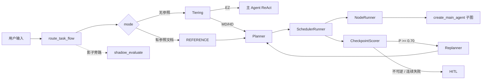

# 任务调度策略开发文档

| 项目 | 内容 |
| :-- | :-- |
| 版本 | v0.2 |
| 日期 | 2026-11-14 |
| 关联设计 | [任务调度模块设计](./任务调度模块设计.md)、[分档函数标定实验报告](./任务调度分档函数标定实验报告.md) |
| 目标读者 | 负责调度模块实现的工程师 |
| 当前状态 | P0 影子模式已实现，默认关闭 |

---

## 1. 目标与非目标

### 1.1 目标

1. 把"分档 → 计划 → 执行 → 检查点 → 重规划"做成可观测、可回放的模块。
2. 分档与检查点触发用可标定的数学模型，不靠提示词里的形容词。
3. 与现有 `task_flow`、`create_work_plan`、`RunSupervisor`、HITL、事件流复用，不另起 Agent 运行时。

### 1.2 非目标

- 不实现通用工作流引擎（DAG 只覆盖 fork/join + 依赖）。
- 不做跨用户的全局优先级队列与抢占。
- P0 不引入训练管线，只落影子数据。
- 不把 Brick 数据集或其模型接入在线链路（非商用许可 + 领域不匹配）。

---

## 2. 现状与改造点

| 能力 | 现状 | 改造 |
| :-- | :-- | :-- |
| 任务划分 | `create_work_plan` 产出工作项与波次，最多 24 项 | 新增两级 `Phase/Item` 计划，保留原工具不动 |
| 静态流程 | `task_flow` 编译出 `ExecutionPlan` | 新增 `REFERENCE` 模式，映射为调度计划 |
| 执行 | `ExecutionPlan` 无消费者，靠模型自觉 | 新增 `SchedulerRunner` 按依赖就绪顺序驱动 |
| 检查点 | 只有步骤状态上报，无评分 | 新增 `checkpoints.py` 输出重规划概率与范围 |
| 重规划 | 无 | 新增 `replanner.py`，支持 reorder / subtree / full |
| 分档 | 6 特征硬规则 + LLM 三选一 | 7 维几何聚合 + 有序 logistic |
| 观测 | 无调度层指标 | 新增 `scheduler_*` 事件与影子日志 |

---

## 3. 架构



### 3.1 模块划分

```
src/scheduler/
├── __init__.py
├── models.py        # 特征 / 分档 / 计划 / 运行 / 检查点模型
├── features.py      # 7 维特征抽取（确定性启发式）
├── tiering.py       # 几何聚合 + 有序 logistic + 滞回
├── shadow.py        # P0 影子评估与 JSONL 落盘
├── config.py        # HARNESS_SCHEDULER_* 配置与校验
├── planner.py       # P1：两级计划生成、拓扑波次、写冲突串行化
├── checkpoint.py    # P1：检查点打分与时机
├── replanner.py     # P1：reorder / subtree / full
├── runner.py        # P1：波次执行、重试、检查点、事件、落库
└── store.py         # P1：四张表的 Postgres 持久化

src/agent/tools/scheduler_tools.py   # P1：scheduler_plan / scheduler_replan
```

拓扑与写冲突直接实现在 `planner.py`，不再单独建 `graph.py`；`events.py` 未落地，事件由 runner 的回调直接写入 `stream_writer`。

---

## 4. 数据模型

```python
class Tier(str, Enum):
    EZ = "EZ"; MD = "MD"; HD = "HD"

TIER_ORDER = (Tier.EZ, Tier.MD, Tier.HD)


class FeatureVector(BaseModel):
    complexity: float = 0.5
    uncertainty: float = 0.5
    impact: float = 0.5
    scale: float = 0.5
    dep_depth: float = 0.5
    tool_diversity: float = 0.5
    acceptance: float = 0.5
    missing: list[str] = []
    # 结构性缺失：当前阶段没有数据源，不是该任务信息不足
    structural_missing: list[str] = []
    source: dict[str, str] = {}
    evidence: dict[str, str] = {}


class TierDecision(BaseModel):
    tier: Tier
    s: float
    probs: dict[str, float]
    rule_override: str | None = None
    upgraded: bool = False
    reason: str = ""


class ShadowRecord(BaseModel):
    run_id: str
    user_id: str
    mode: str                 # reference / dynamic
    flow_id: str | None
    # raw_tier 是纯 argmax；tier 是叠加滞回 / 升档 / 缺失兜底后的最终档位
    raw_tier: Tier
    tier: Tier
    upgraded: bool = False
    reason: str = ""
    s: float
    probs: dict[str, float]
    features: FeatureVector
    message_sha256: str
    message_len: int
    message_preview: str      # 默认只留 80 字，可配置为 0
```

P1 再引入 `Phase`、`Item`、`SchedulePlan`、`Budget`、`Delta`、`SchedulerState`（定义见设计文档 §4）。

---

## 5. 分档器

### 5.1 接口

```python
def decide_tier(
    x: FeatureVector,
    cfg: TierConfig,
    prev_tier: Tier | None = None,
    hard_override: Tier | None = None,
) -> TierDecision: ...
```

### 5.2 特征与归一化

| 维度 | P0 来源 | 归一化 |
| :-- | :-- | :-- |
| `complexity` | 任务流步骤数 / 文本子句数 | `1 - exp(-n/5)` |
| `uncertainty` | 有无参照 + 模糊词 + 问号 + 短文本 | 基准 0.15/0.45 叠加 |
| `impact` | **结构性缺失** | 不参与聚合 |
| `scale` | 任务流步骤数 / 文本子句数 | `1 - exp(-n/8)` |
| `dep_depth` | 执行计划嵌套深度 | `1 - exp(-depth/4)` |
| `tool_diversity` | **结构性缺失** | 不参与聚合 |
| `acceptance` | 检查点比例 + 约束词 / 文本验收词 | 线性叠加 |

缺失处理：

- 聚合只在**已观测维度**上按权重归一，缺失维度不代入 0.5。P0 实测：若把 3 个结构性缺失维度按 0.5 连同权重一起代入，所有任务会被压到 `S≈0.3–0.45`，分档失去区分度。
- `missing` 与 `structural_missing` 分开记录：`impact`、`tool_diversity` 在 P0 没有数据源，`dep_depth` 在无执行计划时同样没有数据源，全部属于结构性缺失。
- 只有**非结构性缺失**达到 3 维才触发「不允许 EZ」。否则 P0 动态路径永远出不了 EZ，影子数据无法用于校准。
- 缺失维度仍填 0.5 写入 `FeatureVector`，只用于审计与后续模型特征，不参与 `S` 计算。

### 5.3 聚合与隶属度

```python
def complexity_score(x, w, eps=1e-3):
    values = x.as_dict()
    keys = [k for k in w if k not in set(x.missing)] or list(w)
    total_w = sum(w[k] for k in keys)
    num = sum(w[k] * math.log(max(values[k], eps) + eps) for k in keys)
    return math.exp(num / total_w)


def memberships(s, theta1, theta2, alpha):
    s1 = sigmoid(alpha * (s - theta1))
    s2 = sigmoid(alpha * (s - theta2))
    return {"EZ": 1 - s1, "MD": s1 - s2, "HD": s2}
```

配置校验：

- `0 <= theta1 < theta2 <= 1` 且间距 ≥ 0.05；
- `alpha > 2·ln2/(theta2-theta1)`，否则中间档不可选；
- 权重非负、和为正、维度必须是 7 个。

**关键偏差**：`θ` 是隶属度参数，不是 argmax 的真实分界。真实分界需数值求解：

```python
@lru_cache(maxsize=128)
def decision_boundaries(theta1, theta2, alpha) -> tuple[float, float]:
    # 二分查找 argmax 首次变为 MD / 首次变为 HD 的 S
```

实测 `b1 > θ1`、`b2 < θ2`。滞回必须围绕 `b1/b2`，否则永远不会触发——P0 第一版踩过这个坑，已有单测锁定。

### 5.4 决策顺序

```
1. hard_override → 直接返回
2. tier = argmax(probs)
3. prev_tier 存在且相邻：越过 b1/b2 ± delta 才允许切换，否则维持
4. max(probs) < tau → 升一档（风险偏好，不受滞回限制）
5. 非结构性缺失 >= 3 且 tier == EZ → MD
```

### 5.5 参数

| 参数 | P0 默认 | 说明 |
| :-- | :-- | :-- |
| `weights` | `complexity .20 / uncertainty .18 / impact .18 / scale .14 / dep_depth .10 / tool_diversity .08 / acceptance .12` | 专家先验，待拟合 |
| `theta1` | `0.40` | 冷启动值；上线后按影子 `S` 的 32.7% 分位替换 |
| `theta2` | `0.65` | 冷启动值；按 84.0% 分位替换 |
| `alpha` | `7.2` | 真实数据拟合 |
| `tau` | `0.55` | 平衡；保守场景 0.60 |
| `delta` | `0.03` | 抖动抑制 |

校准函数 `suggest_theta(scores)` 与 `summarize_shadow(path)` 已提供，可直接对影子数据算建议边界。

**P0 实测提醒**：只按文本 + 已观测 4 维聚合时，`S` 主要落在 `0.20–0.50`，默认 `θ1=0.40 / θ2=0.65` 会让绝大多数任务落在 EZ 一侧，靠低置信度升档才进入 MD，HD 基本不可达。这属于预期内的冷启动偏差，处理方式：

1. 先开影子模式收集 30 条真实任务；
2. 用 `summarize_shadow()` 输出的 `s_p327` / `s_p840` 替换 `HARNESS_SCHEDULER_THETA1/2`；
3. 重新观察分布，再决定是否引入 `impact` / `tool_diversity` 探针扩宽上界。

在完成上述校准前，不要用影子档位直接驱动执行。

---

## 6. 计划与执行

### 6.1 REFERENCE 模式

触发：`route_task_flow` 命中已发布 `TaskFlow` 且 `schema_hash` 一致。

| TaskFlow | SchedulePlan |
| :-- | :-- |
| `Step` | `Item` |
| 子流 `Subflow` | `Phase` |
| `parallel` | 同波次，受并发上限约束 |
| `checkpoint=True` | 强制检查点 |

只做结构转换，不做语义改写。

### 6.2 DYNAMIC 模式

- EZ：不进调度器，直接主 Agent ReAct。
- MD：只展开 `P0`、`P1` 两个阶段，其余留在 `pending_phases`。
- HD：完整两级表，允许跨阶段依赖，阶段边界强制检查点。

约束：两级合计 ≤ 32 项；同波次 `writes` 不得重叠；依赖无环，深度 > 6 时提示重新划分。

### 6.3 执行器

```python
class SchedulerRunner:
    async def run(self, plan, state) -> RunResult: ...
    async def _run_wave(self, items) -> None:
        sem = asyncio.Semaphore(self.cfg.max_parallel)
        await asyncio.gather(*(self._run_item(i, sem) for i in items))
```

节点执行：

- 通过 `create_main_agent` 构造独立子图，`thread_id = f"{run_id}:{item.id}"`；
- **不复用同一编译图跨线程**，P1 前必须验证 LangGraph 并发假设；
- 单节点重试交给 `RunSupervisor`，调度器只决定"是否重试 / 重试哪个节点"；
- 节点结束写 `scheduler_node` 与 `scheduler_checkpoint`，再推进游标。

P0 不执行计划；P1 先 `max_parallel=1`。

---

## 7. 状态、检查点与恢复

### 7.1 表结构（P1）

```sql
CREATE TABLE scheduler_run (
    run_id TEXT PRIMARY KEY, user_id TEXT NOT NULL, mode TEXT NOT NULL,
    tier TEXT NOT NULL, status TEXT NOT NULL, state JSONB NOT NULL,
    created_at TIMESTAMPTZ DEFAULT now(), updated_at TIMESTAMPTZ DEFAULT now()
);

CREATE TABLE scheduler_plan (
    run_id TEXT NOT NULL, version INT NOT NULL, plan JSONB NOT NULL,
    created_at TIMESTAMPTZ DEFAULT now(), PRIMARY KEY (run_id, version)
);

CREATE TABLE scheduler_checkpoint (
    id BIGSERIAL PRIMARY KEY, run_id TEXT NOT NULL, item_id TEXT,
    plan_version INT NOT NULL, score REAL NOT NULL, scope TEXT,
    decision JSONB NOT NULL, created_at TIMESTAMPTZ DEFAULT now()
);

CREATE TABLE scheduler_sample (
    id BIGSERIAL PRIMARY KEY, run_id TEXT NOT NULL, features JSONB NOT NULL,
    tier_chosen TEXT NOT NULL, outcome JSONB NOT NULL, label_source TEXT,
    label_confidence REAL, created_at TIMESTAMPTZ DEFAULT now()
);
```

P0 用 JSONL 代替 `scheduler_sample`，避免在请求链路里引入 DB 依赖；P1 再切表。

### 7.2 检查点时机

| 时机 | 是否评分 |
| :-- | :-- |
| Phase 完成 | 是，强制 |
| Item 完成且 `writes` 非空或 `attempt>0` | 是 |
| 用户新消息 | 是，只算 `d3/d4` |
| 节点失败 | 是，附 `irreversible` |
| 每 3 个条目 | 兜底评分 |

节流：两次评分至少间隔 1 个节点，单 run `replan_count ≤ 3`。

### 7.3 恢复

```
load state → 校验 plan_version → 重算就绪集合 → 校验最后 checkpoint 的 acceptance
→ 通过则继续；不通过则标记该节点 FAILED 并局部重规划
```

`S` 只追加；`R` 由 `plan_version` 重建；`D` 从最后 checkpoint 还原。

---

## 8. 检查点打分

```python
z = [
    {"low": 0.0, "mid": 0.5, "high": 1.0}[impact],
    {"low": 0.0, "mid": 0.5, "high": 1.0}[uncertainty],
    0.0 if not user_delta else (0.5 if scope == "local" else 1.0),
    min(1.0, budget_used_ratio),
]
p = sigmoid(dot(beta, z) + bias[tier])
```

- `beta = [0.35, 0.25, 0.20, 0.20]`，`bias = {EZ: -0.8, MD: 0, HD: 0.5}`；
- 硬门控：`irreversible` → HITL；`scope=global` → full replan；
- `p >= 0.70` 重规划；`0.45 <= p < 0.70` 只允许 reorder；
- 连续两次触发且计划无变化 → HITL。

---

## 9. 重规划

### 9.1 范围

| 条件 | 范围 |
| :-- | :-- |
| 用户要求影响目标/验收 | `full` |
| 单节点失败或有写冲突 | `subtree`（节点及其下游） |
| 仅顺序不合理 | `reorder` |

### 9.2 候选与选择

候选固定五种：保持、合并、拆分、换执行者、推迟。确定性打分：

```
cost = 预计剩余 tokens / 剩余预算
risk = 下游节点数 * 不可逆系数
gain = 解除阻塞的节点数
```

选 `gain` 最大、`cost + risk` 最小者，不做蒙特卡洛采样。

### 9.3 提交

- `plan_version += 1`，保留旧版本；
- 发 `plan_revised`，带 `changed_items` 与理由；
- 不重置已完成节点；
- HITL 等待 `accept / modify / abort`，超时按 `abort`。

---

## 10. 与现有系统的接入点

| 位置 | 用途 | 改动 |
| :-- | :-- | :-- |
| `src/task_flow/router.py:FlowRouter.route` | 任务流路由 | 只读 |
| `src/task_flow/agent_bridge.py:route_task_flow` | **P0 影子入口** | 新增 `_shadow_tier` 旁路 |
| `src/task_flow/compiler.py:compile` | 生成 `ExecutionPlan` | 只读，REFERENCE 消费 |
| `src/task_flow/store.py:TaskFlowStore` | 任务流存储 | 只读，复用连接方式 |
| `src/agent/tools/planning_tools.py` | 波次与冲突算法 | 复用 `_topological_waves`，不改签名 |
| `src/agent/tools/task_flow_tools.py:_emit` | 事件格式 | P2 新增 `scheduler_progress` |
| `src/api/chat.py` | 事件分发 | P2 增加分支 |
| `src/agent/runtime/supervisor.py` | 节点内重试 | 直接复用 |
| `src/agent/tools/hitl_tool.py` | `request_user_choice` | 复用 |
| `src/agent/agent_team/runner.py` | 并发信号量 | 参考其上限与忙则拒绝 |
| `frontend/HarnessControlPlatform/src/stores/chat.ts` | 事件展示 | P2 增加调度卡片 |

新增工具（P1）：`scheduler_plan`、`scheduler_replan`。不修改 `create_work_plan` 的 schema。

---

## 11. 配置项

| 环境变量 | 默认 | 说明 |
| :-- | :-- | :-- |
| `HARNESS_SCHEDULER_ENABLED` | `0` | 总开关 |
| `HARNESS_SCHEDULER_SHADOW` | `1` | 影子模式；P0 必须为 1 |
| `HARNESS_SCHEDULER_THETA1` | `0.40` | EZ/MD 隶属度参数 |
| `HARNESS_SCHEDULER_THETA2` | `0.65` | MD/HD 隶属度参数 |
| `HARNESS_SCHEDULER_ALPHA` | `7.2` | 陡峭度 |
| `HARNESS_SCHEDULER_TAU` | `0.55` | 低置信度阈值 |
| `HARNESS_SCHEDULER_DELTA` | `0.03` | 滞回宽度 |
| `HARNESS_SCHEDULER_SHADOW_PATH` | `.harness/scheduler_shadow.jsonl` | 影子日志 |
| `HARNESS_SCHEDULER_PREVIEW_CHARS` | `80` | 原文预览长度，0 表示不落 |
| `HARNESS_SCHEDULER_EXEC` | `0` | **P1 执行总开关**；关闭时不注册调度工具 |
| `HARNESS_SCHEDULER_MAX_ITEMS` | `32` | 计划条目上限 |
| `HARNESS_SCHEDULER_MAX_PARALLEL` | `1` | 同波次并发节点数 |
| `HARNESS_SCHEDULER_MAX_REPLAN` | `3` | 单次运行重规划上限 |
| `HARNESS_SCHEDULER_MAX_ATTEMPTS` | `2` | 单节点尝试次数 |
| `HARNESS_SCHEDULER_NODE_TIMEOUT` | `900` | 单节点超时（秒） |
| `HARNESS_SCHEDULER_CHECKPOINT_EVERY` | `3` | 每 N 条兜底检查点 |
| `HARNESS_SCHEDULER_P_REPLAN` | `0.70` | 重规划阈值 |
| `HARNESS_SCHEDULER_P_REORDER` | `0.45` | 仅重排阈值 |
| `HARNESS_SCHEDULER_WAVE_DEPTH_WARN` | `6` | 依赖深度告警 |

启动时校验：θ 顺序与间距、`alpha` 下限、`tau` 范围、权重维度与非负性。

---

## 12. 事件协议

```json
{
  "type": "scheduler_progress",
  "event": "planned | item_started | item_done | item_failed | item_skipped | item_needs_hitl | checkpoint | plan_revised | run_started | run_finished",
  "run_id": "run_...",
  "goal": "本轮总目标",
  "tier": "MD",
  "mode": "dynamic",
  "plan_version": 1,
  "item_id": "p0.2",
  "phase": "P0",
  "status": "done",
  "score": 0.72,
  "scope": "subtree",
  "reason": "检查点得分 0.72 >= 0.70，局部重规划",
  "plan_items": [
    {
      "id": "p0.2",
      "title": "整理数据源清单",
      "phase_id": "P0",
      "phase_title": "准备",
      "status": "done",
      "depends_on": []
    }
  ]
}
```

事件只从主图的调度工具发出；子图事件被 `api/chat.py` 过滤。`planned` / `plan_revised` / `run_finished` 携带完整的 `plan_items` 快照，前端据此渲染带序号的规划条目；`item_*` 事件只带 `item_id`，用于更新单条状态。

---

## 13. 测试与验收

### 13.1 单元测试（P0 已落地 17 项）

| 用例 | 断言 |
| :-- | :-- |
| 概率合法 | 三者非负、和为 1 |
| 单调性 | 任一维增大，`S` 不下降 |
| `alpha` 下限 | 低于 `2ln2/(θ2-θ1)` 启动失败 |
| 中间档可达 | 中点处 MD 概率最大 |
| 真实边界 | `b1 > θ1`、`b2 < θ2`、`b1 < b2` |
| 滞回 | 未越过 `b1+δ` 维持 EZ，越过才升 MD |
| 低置信度 | `max(p) < τ` 升一档 |
| 缺失兜底 | 非结构性缺 3 维不允许 EZ；结构性缺失不拦截 |
| 缺失归一化 | 缺失维度不参与聚合，全部观测为 0.2 时 `S≈0.2` |
| 特征 | 有参照时不确定性下降、验收严格度上升 |
| 影子写盘 | JSONL 一行、预览截断、不含原文；同时落 `raw_tier` |

P1 新增 17 项单测，覆盖计划器、检查点、重规划与执行器：

| 用例 | 断言 |
| :-- | :-- |
| MD 展开 | 只保留前两个阶段，其余进 `pending_phases` |
| HD 展开 | 全部阶段展开 |
| EZ 拒绝 | EZ 直接要求走 ReAct，不建计划 |
| 写冲突 | 同波次写重叠自动串行化并记录 |
| 环依赖 | 抛 `PlanError` |
| 条目上限 | 超限拒绝 |
| REFERENCE | 主流 + 并行子流映射为阶段与条目 |
| 检查点硬门控 | 不可逆 → HITL；全局新需求 → full |
| 检查点阈值 | 高风险重规划、低风险继续 |
| 子树重规划 | 保留已完成，重置失败与下游 |
| MD 阶段推进 | 完成后自动展开下一阶段 |
| 执行顺序 | 按依赖波次执行并落库 |
| 重试 | 首次失败、第二次成功 |
| 失败传播 | 依赖失败的下游被跳过 |
| 阶段推进执行 | 展开后继续执行到完成 |

运行：

```powershell
.\.venv\Scripts\python.exe -m unittest discover -s tests -p "test_scheduler_*.py" -v
```

### 13.2 集成测试（P1 起）

1. REFERENCE 映射与 `TaskFlow` 一一对应；
2. DYNAMIC-MD 只展开两个阶段，条目 ≤ 32；
3. 同波次写冲突自动串行化并记录；
4. 杀进程后从 `scheduler_plan` 最新版本恢复，不重复执行；
5. 注入全局新要求后 `plan_version` 增加；
6. 不可逆节点必须先 HITL。

### 13.3 验收指标

| 指标 | 目标 |
| :-- | :-- |
| 档位重复评估稳定性 | ≥ 95% |
| 严重低估率（HD→EZ） | ≤ 5% |
| 重规划率 | 10%–25% |
| 调度额外 token 占比 | ≤ 15% |
| 与人工档位一致率 | ≥ 80%（30 条真实任务） |

Brick 数据集只用于离线校准，不进入在线评测。

---

## 14. 实现状态

### 14.1 P0 影子模式（已交付）

| 文件 | 作用 |
| :-- | :-- |
| `src/scheduler/models.py` | 7 维特征、决策结果、影子记录 |
| `src/scheduler/config.py` | 环境变量、默认权重、参数校验 |
| `src/scheduler/features.py` | 文本 + 任务流确定性特征，缺失标记 |
| `src/scheduler/tiering.py` | 几何聚合、有序 logistic、真实边界、滞回 |
| `src/scheduler/shadow.py` | 影子评估、JSONL 落盘、数据摘要 |
| `src/scheduler/__init__.py` | 对外导出 |
| `src/task_flow/agent_bridge.py` | `_shadow_tier` 旁路，异常全吞 |
| `tests/test_scheduler_tiering.py` | 17 项单测 |

### 14.2 P1 计划与执行（已交付，默认关闭）

| 文件 | 作用 |
| :-- | :-- |
| `src/scheduler/planner.py` | 两级计划、拓扑波次、写冲突自动串行化、REFERENCE 映射 |
| `src/scheduler/checkpoint.py` | 检查点时机与 `β·z + bias[tier]` 打分、硬门控 |
| `src/scheduler/replanner.py` | reorder / subtree / full / 阶段展开，已完成不回退 |
| `src/scheduler/runner.py` | 波次执行、并发上限、重试、超时、检查点、事件、落库 |
| `src/scheduler/store.py` | `scheduler_run/plan/checkpoint/sample` 四表 |
| `src/agent/tools/scheduler_tools.py` | `scheduler_plan` / `scheduler_replan`，每节点独立子图 |
| `src/agent/pdc_state.py` | 图状态新增 `scheduler` 快照，按 `plan_version` 合并 |
| `src/api/chat.py` | 放行主图 `scheduler_progress` 事件 |
| `tests/test_scheduler_p1.py` | 17 项单测 |

启用方式：

```powershell
$env:HARNESS_SCHEDULER_ENABLED="1"   # P0 影子
$env:HARNESS_SCHEDULER_EXEC="1"      # P1 才注册 scheduler_plan / scheduler_replan
```

行为约束：

- 工具被显式调用才进入调度；未调用时与 P0 完全一致；
- 节点子图 `thread_id = run_id:item_id`，并禁用调度工具，避免递归；
- 子图返回 `__interrupt__` 时节点标记 `needs_hitl`，由主对话确认后 `scheduler_replan`；
- 所有落库失败只记日志，不阻断执行。

### 14.3 P2 前端展示与样本采集（已交付）

| 文件 | 作用 |
| :-- | :-- |
| `src/agent/tools/scheduler_tools.py` | `planned` / `plan_revised` 事件带 `plan_items` 快照；运行结束写 `scheduler_sample` |
| `src/scheduler/runner.py` | `plan_revised` / `run_finished` 事件同步最新计划快照 |
| `frontend/.../src/stores/chat.ts` | `scheduler_progress` 状态机，运行规划卡的生命周期与归档 |
| `frontend/.../src/components/scheduler/SchedulerPlanCard.vue` | 规划卡片：编号、逐条展开、完成/失败/跳过标记、阶段分组、进度条 |
| `frontend/.../src/views/ChatView.vue` | 执行中固定在滚动区顶部；结束/中断后归档到本轮轨迹底部；恢复执行重新置顶 |

卡片行为：

- `planned` 到达即创建卡片，条目按 55ms 间隔逐条出现；
- `item_started / item_done / item_failed / item_skipped / item_needs_hitl` 只更新对应条目；
- `plan_revised` 用新快照整体替换条目并递增版本号；
- `run_finished` 后卡片离开顶部，落到本轮轨迹最底部，`at` 更新为完成时间；再次收到该 `run_id` 的 `run_started` / `plan_revised` 时重新置顶。

### 14.4 下一步（验收与联调）

1. 用 30 条真实任务跑影子，比较人工档位与 `tier`；
2. 用 `summarize_shadow()` 看 `S` 分布，按 32.7% / 84.0% 分位替换 `theta1/theta2`；
3. 在本地 Postgres 执行 `SchedulerStore.setup()`，验证四表写入与恢复；
4. 用一个 3–5 条目的真实任务跑通 `scheduler_plan` 全链路，检查卡片置顶 / 归档 / 恢复置顶与事件顺序。

---

## 15. 风险与回滚

| 风险 | 影响 | 应对 |
| :-- | :-- | :-- |
| 同图多 `thread_id` 并发不符合 LangGraph 假设 | 状态串扰 | 已改为每节点独立子图，`max_parallel` 默认 1 |
| 特征抽取成本 | 入口延迟 | P0 只用确定性启发式，不调 LLM |
| 计划过度细化 | token 增加 | 两级上限 + 额外 token 监控 |
| 重规划抖动 | 反复改计划 | 滞回 + `max_replan=3` + 连续触发转 HITL |
| 数据集许可 | 合规 | 仅离线，不进入生产 |
| 新模块影响现有流程 | 回归 | 默认关闭 + 影子旁路 + 异常吞掉 |

回滚：`HARNESS_SCHEDULER_EXEC=0` 即不再注册调度工具，恢复原有执行路径；`HARNESS_SCHEDULER_ENABLED=0` 同时关闭影子。四张表与影子日志保留，不影响 `task_flow`。
