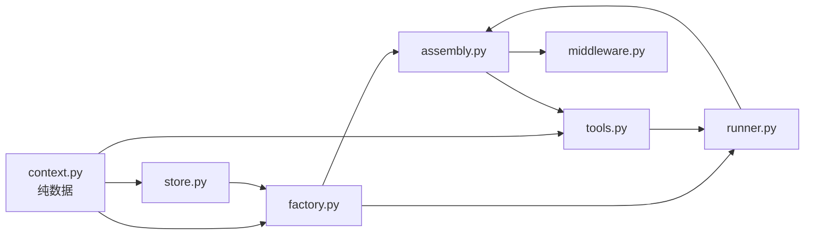

# AgentTeam 开发文档

Time: 2026/11/12

配套设计：[AgentTeam 设计文档](../core_design/notdone/AgentTeam设计.md)

本文只讲**怎么落地**：模块划分、类实现骨架、逐文件改造点、API/前端、迁移、测试与评估。设计动机与取舍不在这里重复。

---

## 0. 实现前必须知道的 6 个事实

1. `create_deep_agent(..., context_schema=HarnessContext)` 的 `context_schema` 是**一次 run 的不可变上下文**，会被所有子 Agent 继承；不能用来放"每个 Agent 各不相同的定义"。
2. 声明式子 Agent（`SubAgent` TypedDict）支持 `name / description / system_prompt / tools / model / middleware / skills / permissions / interrupt_on`，**不支持**单独的 `context_schema`。
3. `AgentLoader` 的缓存键目前是 `"{agent_id}:{integration_server_id}"`，必须扩展为包含 `group_id`。
4. 子 Agent 默认**没有** `task` 工具（`SubAgentMiddleware` 只挂在主 Agent 上），所以组员天然无法横向委派。
5. 子 Agent 与父图**共享同一份运行时 context**，因此"当前是哪个子 Agent"不能靠 `runtime.context.agent_id` 判断，必须由中间件在构造时固化。
6. 预编译子 Agent（`CompiledSubAgent`）在 `task` 里被调用时**不会收到 `context`**（deepagents 只传 `input` 与 `config`），所以它的 `runtime.context` 是 `None`；要在未来启用动态成员图，必须自己包一层 `ContextBoundRunnable` 显式传 context（见 5.6）。**本期不实施，只保留为升级路径。**

第 5、6 点是最容易踩的坑：前者会导致组员工具全被判越权，后者会导致成员图里的身份/组信息全部丢失。

---

## 1. 模块与目录

```
src/agent/agent_team/
├─ __init__.py        # 导出上下文类与工厂
├─ context.py         # 上下文对象模型（纯数据 + 不变量，无 IO）
├─ store.py           # AgentGroupStore：组的持久化与派生索引
├─ factory.py         # AgentContextFactory：Store 记录 → 上下文对象
├─ assembly.py        # 组图装配：提示词 / 成员子 Agent / 工具 / 中间件
├─ middleware.py      # TeamPermissionMiddleware：团队工具可见性与硬拒绝
├─ tools.py           # 团队工具：发现、组概览、跨组委派
└─ runner.py          # GroupRunner：跨组同步委派（构图 + 独立 thread + 超时）
```

依赖方向（禁止反向依赖）：



`context.py` 不允许 import `store` / `factory` / `assembly`，保证它可以被单元测试直接实例化。

---

## 2. `context.py`：上下文对象实现

下面这份骨架可以直接落地，包含全部不变量与渲染逻辑。

```python
"""AgentTeam 定义期上下文。

这一层只做三件事：
1. 描述一个 Agent 是谁（身份、提示词、模型、能力）；
2. 描述它在组里看到什么（GroupContext）；
3. 描述它在组里能做什么（GroupMemberContext）。
不读数据库、不建模型、不碰 LangGraph。
"""

from __future__ import annotations

from abc import ABC, abstractmethod
from dataclasses import dataclass, field
from enum import Enum
from typing import Any, Mapping

MAX_MEMBER_CARDS = 20
MAX_DISCOVERABLE_CARDS = 10


# ============================================================
# 枚举
# ============================================================

class GroupRole(str, Enum):
    LEADER = "leader"
    MEMBER = "member"


class GroupVisibility(str, Enum):
    PRIVATE = "private"            # 仅组内可见
    DISCOVERABLE = "discoverable"  # 组长可发现，可接收跨组委派


class AgentMode(str, Enum):
    STANDALONE = "standalone"
    TEAM = "team"


# ============================================================
# 值对象
# ============================================================

@dataclass(frozen=True, slots=True)
class AgentIdentity:
    agent_id: str
    name: str
    role_title: str = ""
    description: str = ""
    avatar: str = "A"

    def to_card(self) -> "AgentCard":
        return AgentCard(self.agent_id, self.name, self.role_title, self.description)


@dataclass(frozen=True, slots=True)
class AgentCard:
    """给其他 Agent 看的名片：不含提示词、模型与凭据。"""

    agent_id: str
    name: str
    role_title: str = ""
    description: str = ""

    def as_prompt_line(self) -> str:
        role = f"｜{self.role_title}" if self.role_title else ""
        desc = f"：{self.description}" if self.description else ""
        return f"- {self.agent_id}（{self.name}）{role}{desc}"


@dataclass(frozen=True, slots=True)
class ModelOverride:
    """模型覆盖项；Agent 与组共用。merge() 只覆盖显式配置过的字段。"""

    model_name: str = ""
    base_url: str = ""
    api_key: str = ""
    # None 表示"未配置"，False 表示"显式关闭思考"，两者必须区分
    thinking_enabled: bool | None = None
    context_limit: int = 0

    @property
    def configured(self) -> bool:
        """任一字段被显式配置即视为已配置；空对象等价于不提供。"""
        return bool(
            self.model_name
            or self.base_url
            or self.api_key
            or self.thinking_enabled is not None
            or self.context_limit
        )

    def merge(self, defaults: Mapping[str, Any]) -> dict[str, Any]:
        merged = dict(defaults)
        if self.model_name:
            merged["model_name"] = self.model_name
        if self.base_url:
            merged["base_url"] = self.base_url
        if self.api_key:
            merged["api_key"] = self.api_key
        if self.thinking_enabled is not None:
            merged["thinking_enabled"] = self.thinking_enabled
        if self.context_limit:
            merged["context_limit"] = self.context_limit
        return merged

    @classmethod
    def from_profile(cls, raw: Mapping[str, Any] | None) -> "ModelOverride":
        data = dict(raw or {})
        thinking = data.get("thinking_enabled")
        return cls(
            model_name=str(data.get("model_name") or ""),
            base_url=str(data.get("base_url") or ""),
            api_key=str(data.get("api_key") or ""),
            thinking_enabled=None if thinking is None else bool(thinking),
            context_limit=int(data.get("context_limit") or 0),
        )


@dataclass(frozen=True, slots=True)
class AgentCapabilities:
    mcp_server_ids: tuple[str, ...] = ()
    extra_tool_names: tuple[str, ...] = ()
    skill_scopes: tuple[str, ...] = ()

    @classmethod
    def from_profile(cls, profile: Mapping[str, Any]) -> "AgentCapabilities":
        def _tuple(values: Any) -> tuple[str, ...]:
            seen: list[str] = []
            for item in list(values or []):
                value = str(item or "").strip()
                if value and value not in seen:
                    seen.append(value)
            return tuple(seen)

        return cls(
            mcp_server_ids=_tuple(profile.get("mcp_server_ids")),
            extra_tool_names=_tuple(profile.get("extra_tool_names")),
            skill_scopes=_tuple(profile.get("skill_scopes")),
        )


@dataclass(frozen=True, slots=True)
class GroupDescriptor:
    group_id: str
    name: str
    summary: str = ""
    leader_agent_id: str = ""
    visibility: GroupVisibility = GroupVisibility.PRIVATE
    member_count: int = 0


@dataclass(frozen=True, slots=True)
class GroupMembership:
    group_id: str
    role: GroupRole
    duty: str = ""
    joined_at: str = ""


# ============================================================
# 组投影
# ============================================================

@dataclass(frozen=True, slots=True)
class GroupContext:
    """当前生效组的结构视图：我在这个组里能看到谁、组用什么模型。

    ``model`` 只参与模型解析，不参与 ``render()``：组模型可能含凭据，
    绝不能渲染进提示词或日志。
    """

    active_group: GroupDescriptor
    members: tuple[AgentCard, ...] = ()
    discoverable_groups: tuple[GroupDescriptor, ...] = ()
    model: ModelOverride = field(default_factory=ModelOverride)

    def sibling(self, agent_id: str) -> AgentCard | None:
        return next((c for c in self.members if c.agent_id == agent_id), None)

    def render(self, *, self_agent_id: str = "", role: GroupRole | None = None, duty: str = "") -> str:
        group = self.active_group
        lines = ["## 你所在的组", f"- 组名：{group.name}（{group.group_id}）"]
        if group.summary:
            lines.append(f"- 组概述：{group.summary}")
        if role is not None:
            label = "组长" if role is GroupRole.LEADER else "组员"
            lines.append(f"- 你的角色：{label}")
        if duty:
            lines.append(f"- 你的职责：{duty}")

        shown = self.members[:MAX_MEMBER_CARDS]
        if shown:
            lines.append("- 组内成员（组长可直接用 task 委派）：")
            for card in shown:
                marker = "（你）" if card.agent_id == self_agent_id else ""
                lines.append(f"  {card.as_prompt_line()}{marker}")
        hidden = len(self.members) - len(shown)
        if hidden > 0:
            lines.append(f"  - ……其余 {hidden} 名成员请用 get_group_overview 查询")

        discover = self.discoverable_groups[:MAX_DISCOVERABLE_CARDS]
        if discover:
            lines.append("")
            lines.append("## 可协作的其他组（仅组长可见）")
            for item in discover:
                summary = item.summary or "无概述"
                lines.append(
                    f"- {item.name}（{item.group_id}）：{summary}；组长 {item.leader_agent_id}"
                )
        return "\n".join(lines)


@dataclass(frozen=True, slots=True)
class GroupMemberContext:
    """我的全部组籍：我在哪些组、分别是什么角色。"""

    memberships: tuple[GroupMembership, ...]
    active_group_id: str

    def __post_init__(self) -> None:
        if not self.memberships:
            raise ValueError("GroupMemberContext 至少需要一条组籍")
        if self.role_in(self.active_group_id) is None:
            raise ValueError(f"生效组不在组籍内: {self.active_group_id}")

    def role_in(self, group_id: str) -> GroupRole | None:
        for item in self.memberships:
            if item.group_id == group_id:
                return item.role
        return None

    def duty_in(self, group_id: str) -> str:
        for item in self.memberships:
            if item.group_id == group_id:
                return item.duty
        return ""

    @property
    def leader_group_ids(self) -> tuple[str, ...]:
        return tuple(m.group_id for m in self.memberships if m.role is GroupRole.LEADER)

    @property
    def member_group_ids(self) -> tuple[str, ...]:
        return tuple(m.group_id for m in self.memberships if m.role is GroupRole.MEMBER)

    @property
    def is_active_leader(self) -> bool:
        return self.role_in(self.active_group_id) is GroupRole.LEADER


# ============================================================
# 抽象基类与两个具体实现
# ============================================================

@dataclass(frozen=True, slots=True)
class HarnessAgentContextBase(ABC):
    """Agent 定义期上下文的抽象基类。

    组字段同时为空 ⇒ 普通 Agent；同时非空 ⇒ 团队 Agent。
    具体由 StandaloneAgentContext / TeamAgentContext 表达，
    业务代码不应直接实例化本类。
    """

    identity: AgentIdentity
    system_prompt: str
    model: ModelOverride = field(default_factory=ModelOverride)
    capabilities: AgentCapabilities = field(default_factory=AgentCapabilities)
    group_context: GroupContext | None = None
    member_context: GroupMemberContext | None = None

    def __post_init__(self) -> None:
        self.validate()

    # ---------- 多态能力 ----------

    @property
    @abstractmethod
    def mode(self) -> AgentMode:
        ...

    @abstractmethod
    def allowed_team_tools(self) -> frozenset[str]:
        """该 Agent 允许看到的团队工具名集合。"""

    @abstractmethod
    def render_group_section(self) -> str:
        """注入系统提示词的组信息段；普通 Agent 返回空串。"""

    # ---------- 公共能力 ----------

    @property
    def is_team_agent(self) -> bool:
        return self.group_context is not None and self.member_context is not None

    @property
    def is_active_leader(self) -> bool:
        return bool(self.member_context and self.member_context.is_active_leader)

    def resolve_model(self, user_defaults: Mapping[str, Any]) -> dict[str, Any]:
        """模型三级继承：Agent → 组 → 用户默认。

        逐字段合并：某一级只配了 model_name 时，其余字段继续沿用下一级。
        """
        resolved = dict(user_defaults)
        group_model = self.group_context.model if self.group_context else None
        if group_model is not None and group_model.configured:
            resolved = group_model.merge(resolved)
        if self.model.configured:
            resolved = self.model.merge(resolved)
        return resolved

    def render(self) -> str:
        """角色提示词 + 组信息段。固定的 Harness 策略由 assembly 追加。"""
        sections = [self.system_prompt.strip(), self.render_group_section().strip()]
        return "\n\n".join(part for part in sections if part)

    def validate(self) -> None:
        if (self.group_context is None) != (self.member_context is None):
            raise ValueError("group_context 与 member_context 必须同时为空或同时非空")
        if self.group_context is None or self.member_context is None:
            return
        if self.group_context.active_group.group_id != self.member_context.active_group_id:
            raise ValueError("GroupContext 与 GroupMemberContext 的生效组不一致")


@dataclass(frozen=True, slots=True)
class StandaloneAgentContext(HarnessAgentContextBase):
    """普通 Agent：没有任何组相关上下文。"""

    @property
    def mode(self) -> AgentMode:
        return AgentMode.STANDALONE

    def allowed_team_tools(self) -> frozenset[str]:
        return frozenset()

    def render_group_section(self) -> str:
        return ""

    def validate(self) -> None:
        super().validate()
        if self.group_context is not None or self.member_context is not None:
            raise ValueError("普通 Agent 不应携带组上下文")


@dataclass(frozen=True, slots=True)
class TeamAgentContext(HarnessAgentContextBase):
    """团队 Agent：在生效组里以组长或组员身份工作。"""

    @property
    def mode(self) -> AgentMode:
        return AgentMode.TEAM

    def allowed_team_tools(self) -> frozenset[str]:
        common = {"list_my_groups", "get_group_overview"}
        if self.is_active_leader:
            return frozenset(common | {"discover_agent_groups", "delegate_to_group_leader"})
        return frozenset(common)

    def render_group_section(self) -> str:
        assert self.group_context is not None and self.member_context is not None
        active = self.member_context.active_group_id
        return self.group_context.render(
            self_agent_id=self.identity.agent_id,
            role=self.member_context.role_in(active),
            duty=self.member_context.duty_in(active),
        )

    def validate(self) -> None:
        super().validate()
        group, member = self.group_context, self.member_context
        if group is None or member is None:
            raise ValueError("团队 Agent 必须同时提供 group_context 与 member_context")

        leader_id = group.active_group.leader_agent_id
        member_ids = {card.agent_id for card in group.members}
        if leader_id and leader_id not in member_ids:
            raise ValueError("组长不在成员列表中")

        role = member.role_in(member.active_group_id)
        if role is None:
            raise ValueError("生效组不在组籍中")
        if (self.identity.agent_id == leader_id) != (role is GroupRole.LEADER):
            raise ValueError("组长标记与组籍角色不一致")
```

**注意**：`slots=True` + 零参 `super()` 在 Python 3.12 以下有已知问题；本项目运行在 3.14，可以放心用。若需兼容 3.11，把 `super().validate()` 改成 `HarnessAgentContextBase.validate(self)`。

---

## 3. `store.py`：组的持久化

### 3.1 命名空间与键

```python
GROUP_NAMESPACE_PREFIX = ("agent_groups",)
MEMBERSHIP_INDEX_PREFIX = ("agent_memberships",)
MAX_MEMBERS_PER_GROUP = 50
```

| 命名空间 | Key | Value |
|:--|:--|:--|
| `("agent_groups", user_id)` | `group_id` | 组记录（含 `members`） |
| `("agent_memberships", user_id)` | `agent_id` | `{"group_ids": [...], "leader_of": [...]}` 派生索引 |

### 3.2 核心实现

```python
"""AgentTeam 组的持久化。

组记录是唯一事实来源；agent_memberships 只是反向查询索引，
任何时候都可以由组记录全量重建。
"""

from __future__ import annotations

import asyncio
import re
import uuid
from datetime import datetime, timezone
from typing import Any

from agent.agent_profiles import normalize_model
from agent.agent_team.context import GroupRole, GroupVisibility

GROUP_NAMESPACE_PREFIX = ("agent_groups",)
MEMBERSHIP_INDEX_PREFIX = ("agent_memberships",)
GROUP_ID_PATTERN = re.compile(r"^grp_[A-Za-z0-9]{4,32}$")
MAX_MEMBERS_PER_GROUP = 50
MAX_GROUPS_PER_USER = 100


def _now() -> str:
    return datetime.now(timezone.utc).isoformat()


def _normalize_names(raw: Any) -> list[str]:
    """去重保序的子 Agent 名单；未知名字留到构图时告警，不在写库阶段阻断。"""
    names: list[str] = []
    for item in list(raw or []):
        value = str(item or "").strip()[:64]
        if value and value not in names:
            names.append(value)
    return names


class AgentGroupStore:
    """按用户读写组；写操作在进程内串行。"""

    def __init__(self, store: Any, user_id: str) -> None:
        self._store = store
        self._user_id = user_id
        self._groups_ns = (*GROUP_NAMESPACE_PREFIX, user_id)
        self._index_ns = (*MEMBERSHIP_INDEX_PREFIX, user_id)

    # ---------- 读 ----------

    async def list(self) -> list[dict[str, Any]]:
        items = await self._store.asearch(self._groups_ns, limit=MAX_GROUPS_PER_USER)
        groups = [dict(item.value) for item in items]
        groups.sort(key=lambda g: (g.get("name", ""), g.get("group_id", "")))
        return groups

    async def get(self, group_id: str) -> dict[str, Any] | None:
        if not GROUP_ID_PATTERN.fullmatch(str(group_id or "")):
            return None
        item = await self._store.aget(self._groups_ns, group_id)
        return dict(item.value) if item is not None else None

    async def groups_of(self, agent_id: str) -> list[dict[str, Any]]:
        """反查某 Agent 的全部组；索引缺失时回退全量扫描并修复。"""
        item = await self._store.aget(self._index_ns, agent_id)
        ids = list((dict(item.value) if item else {}).get("group_ids") or [])
        groups = []
        for group in await self.list():
            if group["group_id"] in ids or any(
                m["agent_id"] == agent_id for m in group.get("members", [])
            ):
                groups.append(group)
        if not item:
            await self._refresh_index([agent_id])
        return groups

    async def leader_groups_of(self, agent_id: str) -> list[dict[str, Any]]:
        return [g for g in await self.groups_of(agent_id) if g.get("leader_agent_id") == agent_id]

    # ---------- 写 ----------

    async def create(self, payload: dict[str, Any]) -> dict[str, Any]:
        name = str(payload.get("name") or "").strip()[:80]
        if not name:
            raise ValueError("组名不能为空")
        leader_id = str(payload.get("leader_agent_id") or "").strip()
        if not leader_id:
            raise ValueError("必须指定组长")

        members: list[dict[str, Any]] = []
        seen: set[str] = set()
        for item in payload.get("members") or []:
            agent_id = str(item.get("agent_id") or "").strip()
            if not agent_id or agent_id in seen:
                continue
            seen.add(agent_id)
            members.append(
                {
                    "agent_id": agent_id,
                    "role": GroupRole.LEADER.value if agent_id == leader_id else GroupRole.MEMBER.value,
                    "duty": str(item.get("duty") or "")[:200],
                    "joined_at": _now(),
                }
            )
        if leader_id not in seen:
            members.insert(0, {"agent_id": leader_id, "role": GroupRole.LEADER.value, "duty": "组长", "joined_at": _now()})
        if len(members) > MAX_MEMBERS_PER_GROUP:
            raise ValueError(f"组成员超过上限 {MAX_MEMBERS_PER_GROUP}")

        await self._assert_name_unique(name)
        group = {
            "group_id": f"grp_{uuid.uuid4().hex[:8]}",
            "name": name,
            "summary": str(payload.get("summary") or "")[:500],
            "leader_agent_id": leader_id,
            "members": members,
            "visibility": str(payload.get("visibility") or GroupVisibility.PRIVATE.value),
            # 团队模式下允许额外看到的全局 YAML 子 Agent；空表示只见本组成员
            "extra_subagent_names": _normalize_names(payload.get("extra_subagent_names")),
            # 组级模型策略：空 dict 表示不提供；字段与 AgentProfile.model 完全一致
            "model": normalize_model(payload.get("model")),
            "created_at": _now(),
            "updated_at": _now(),
        }
        await self._store.aput(self._groups_ns, group["group_id"], group, index=False)
        await self._refresh_index([m["agent_id"] for m in members])
        return group

    async def add_member(self, group_id: str, agent_id: str, duty: str = "") -> dict[str, Any]:
        group = await self._require(group_id)
        members = list(group.get("members") or [])
        if any(m["agent_id"] == agent_id for m in members):
            return group  # 幂等
        if len(members) >= MAX_MEMBERS_PER_GROUP:
            raise ValueError("组成员已达上限")
        members.append(
            {
                "agent_id": agent_id,
                "role": GroupRole.MEMBER.value,
                "duty": str(duty or "")[:200],
                "joined_at": _now(),
            }
        )
        return await self._save_members(group, members)

    async def remove_member(self, group_id: str, agent_id: str) -> dict[str, Any]:
        group = await self._require(group_id)
        if group.get("leader_agent_id") == agent_id:
            raise ValueError("组长不能直接移出组，请先转移组长")
        members = [m for m in group.get("members") or [] if m["agent_id"] != agent_id]
        return await self._save_members(group, members)

    async def transfer_leader(self, group_id: str, agent_id: str) -> dict[str, Any]:
        group = await self._require(group_id)
        members = list(group.get("members") or [])
        if not any(m["agent_id"] == agent_id for m in members):
            raise ValueError("新组长必须是组内成员")
        for member in members:
            member["role"] = (
                GroupRole.LEADER.value if member["agent_id"] == agent_id else GroupRole.MEMBER.value
            )
        group["leader_agent_id"] = agent_id
        return await self._save_members(group, members)

    async def update_group(self, group_id: str, patch: dict[str, Any]) -> dict[str, Any]:
        """修改组名 / 概述 / 可见性 / 组模型；成员与组长另有专用方法。"""
        group = await self._require(group_id)
        updated = dict(group)
        if "name" in patch:
            name = str(patch.get("name") or "").strip()[:80]
            if not name:
                raise ValueError("组名不能为空")
            await self._assert_name_unique(name, exclude=group_id)
            updated["name"] = name
        if "summary" in patch:
            updated["summary"] = str(patch.get("summary") or "")[:500]
        if "visibility" in patch:
            updated["visibility"] = str(patch.get("visibility") or GroupVisibility.PRIVATE.value)
        if "extra_subagent_names" in patch:
            updated["extra_subagent_names"] = _normalize_names(patch.get("extra_subagent_names"))
        if "model" in patch:
            # 前端回传空对象表示"取消组模型，成员回落到用户默认模型"
            updated["model"] = normalize_model(patch.get("model"))
        updated["updated_at"] = _now()
        await self._store.aput(self._groups_ns, group_id, updated, index=False)
        return updated

    # ---------- 内部 ----------

    async def _require(self, group_id: str) -> dict[str, Any]:
        group = await self.get(group_id)
        if group is None:
            raise ValueError(f"组不存在: {group_id}")
        return group

    async def _save_members(self, group: dict[str, Any], members: list[dict[str, Any]]) -> dict[str, Any]:
        updated = dict(group)
        updated["members"] = members
        updated["updated_at"] = _now()
        await self._store.aput(self._groups_ns, updated["group_id"], updated, index=False)
        await self._refresh_index([m["agent_id"] for m in members])
        return updated

    async def _assert_name_unique(self, name: str, exclude: str = "") -> None:
        for group in await self.list():
            if group["name"] == name and group["group_id"] != exclude:
                raise ValueError(f"组名已存在: {name}")

    async def _refresh_index(self, agent_ids: list[str]) -> None:
        """按组记录重建受影响 Agent 的派生索引（幂等）。"""
        groups = await self.list()
        for agent_id in {a for a in agent_ids if a}:
            joined = [g["group_id"] for g in groups if any(m["agent_id"] == agent_id for m in g.get("members", []))]
            leader_of = [g["group_id"] for g in groups if g.get("leader_agent_id") == agent_id]
            await self._store.aput(
                self._index_ns,
                agent_id,
                {"group_ids": joined, "leader_of": leader_of, "updated_at": _now()},
                index=False,
            )
```

### 3.3 并发与级联

**前置重构（1 行）**：把 `agent_profiles.py` 里的私有函数 `_normalize_model` 改名为公开的 `normalize_model`，供组与档案共用；它只做白名单字段裁剪与类型转换，不含业务语义。

```python
# agent_profiles.py
def normalize_model(raw: Any) -> dict[str, Any]:
    """裁剪模型配置字段；Agent 档案与组模型共用同一套白名单。"""
    ...
```

- 写操作按 `user_id` 串行：在 `AgentGroupStore` 外部由 API 层持有一把 `asyncio.Lock`（单 worker 前提，与现有会话锁一致）。
- `AgentProfileStore.delete` 需要新增级联逻辑：

```python
async def delete(self, agent_id: str) -> bool:
    cleaned = _clean_id(agent_id)
    if not cleaned or cleaned == DEFAULT_AGENT_ID:
        raise ValueError("默认 Agent 不可删除")
    # 新增：组长身份校验由 API 层传入 group_store 完成
    ...
```

推荐把级联放在 API 层而不是 Store 里，避免 `agent_profiles` 反向依赖 `agent_team`：

```python
# api/agents.py::delete_agent
groups = await AgentGroupStore(store, uid).leader_groups_of(agent_id)
if groups:
    raise HTTPException(
        status_code=422,
        detail=f"该 Agent 是 {len(groups)} 个组的组长，请先转移组长：{[g['name'] for g in groups]}",
    )
for group in await AgentGroupStore(store, uid).groups_of(agent_id):
    await AgentGroupStore(store, uid).remove_member(group["group_id"], agent_id)
await store.delete(agent_id)
```

---

## 4. `factory.py`：记录 → 上下文

```python
"""把 Store 记录装配成上下文对象。所有不变量在这里被触发。"""

from __future__ import annotations

from typing import Any

from agent.agent_profiles import DEFAULT_AGENT_ID, AgentProfileStore
from agent.agent_team.context import (
    AgentCapabilities,
    AgentCard,
    AgentIdentity,
    ModelOverride,
    GroupContext,
    GroupDescriptor,
    GroupMemberContext,
    GroupMembership,
    GroupRole,
    GroupVisibility,
    HarnessAgentContextBase,
    StandaloneAgentContext,
    TeamAgentContext,
)
from agent.agent_team.store import AgentGroupStore
from agent.memory.prompts import system_prompt as CODE_DEFAULT_AGENT_PROMPT


class GroupNotFoundError(LookupError):
    pass


class NotGroupMemberError(PermissionError):
    pass


def _identity(profile: dict[str, Any]) -> AgentIdentity:
    return AgentIdentity(
        agent_id=str(profile["id"]),
        name=str(profile.get("name") or profile["id"]),
        role_title=str(profile.get("role_title") or ""),
        description=str(profile.get("description") or ""),
        avatar=str(profile.get("avatar") or "A"),
    )


def _descriptor(group: dict[str, Any]) -> GroupDescriptor:
    return GroupDescriptor(
        group_id=str(group["group_id"]),
        name=str(group["name"]),
        summary=str(group.get("summary") or ""),
        leader_agent_id=str(group.get("leader_agent_id") or ""),
        visibility=GroupVisibility(str(group.get("visibility") or "private")),
        member_count=len(group.get("members") or []),
    )


def _memberships(agent_id: str, groups: list[dict[str, Any]]) -> tuple[GroupMembership, ...]:
    result = []
    for group in groups:
        for member in group.get("members") or []:
            if member["agent_id"] == agent_id:
                result.append(
                    GroupMembership(
                        group_id=str(group["group_id"]),
                        role=GroupRole(str(member.get("role") or "member")),
                        duty=str(member.get("duty") or ""),
                        joined_at=str(member.get("joined_at") or ""),
                    )
                )
    return tuple(result)


class AgentContextFactory:
    def __init__(self, store: Any, user_id: str) -> None:
        self._profiles = AgentProfileStore(store, user_id)
        self._groups = AgentGroupStore(store, user_id)
        self._user_id = user_id

    # ---------- 旧路径：不读组 ----------

    @staticmethod
    def from_profile(profile: dict[str, Any] | None) -> HarnessAgentContextBase:
        data = dict(profile or {})
        # 兼容没有任何档案的构图路径（如内部调用只给了默认模型）：
        # 身份仅用于日志与团队工具，缺失时给一个稳定的默认身份。
        identity = (
            _identity(data)
            if data.get("id")
            else AgentIdentity(agent_id="default", name="默认主 Agent", role_title="通用任务执行者")
        )
        return StandaloneAgentContext(
            identity=identity,
            system_prompt=str(data.get("system_prompt") or "").strip()
            or CODE_DEFAULT_AGENT_PROMPT.strip(),
            model=ModelOverride.from_profile(data.get("model")),
            capabilities=AgentCapabilities.from_profile(data),
        )

    # ---------- 新路径：带生效组 ----------

    async def build(self, agent_id: str, active_group_id: str | None) -> HarnessAgentContextBase:
        profile = await self._resolve_profile(agent_id)
        if not active_group_id:
            return self.from_profile(profile)

        group = await self._groups.get(active_group_id)
        if group is None:
            raise GroupNotFoundError(active_group_id)
        return await self.build_within(profile, group)

    async def build_within(
        self,
        profile: dict[str, Any],
        group: dict[str, Any],
        *,
        discoverable: list[dict[str, Any]] | None = None,
    ) -> TeamAgentContext:
        """在给定组内构建上下文；装配成员子 Agent 时复用，避免重复读 Store。"""
        agent_id = str(profile["id"])
        groups_of_agent = await self._groups.groups_of(agent_id)
        memberships = _memberships(agent_id, groups_of_agent)
        role = next((m.role for m in memberships if m.group_id == group["group_id"]), None)
        if role is None:
            raise NotGroupMemberError(f"{agent_id} 不在组 {group['group_id']} 中")

        # 成员名片需要真实姓名/角色；档案缺失时回退到 agent_id
        cards = await self._enrich_cards(group)
        context = GroupContext(
            active_group=_descriptor(group),
            members=cards,
            discoverable_groups=(
                tuple(_descriptor(g) for g in discoverable or [])
                if role is GroupRole.LEADER
                else ()
            ),
            # 组级模型策略：空对象表示不提供，成员直接继承用户默认
            model=ModelOverride.from_profile(group.get("model")),
        )
        return TeamAgentContext(
            identity=_identity(profile),
            system_prompt=str(profile.get("system_prompt") or "").strip()
            or CODE_DEFAULT_AGENT_PROMPT.strip(),
            model=ModelOverride.from_profile(profile.get("model")),
            capabilities=AgentCapabilities.from_profile(profile),
            group_context=context,
            member_context=GroupMemberContext(
                memberships=memberships, active_group_id=str(group["group_id"])
            ),
        )

    async def _resolve_profile(self, agent_id: str) -> dict[str, Any]:
        profile = await self._profiles.get(agent_id)
        if profile is None or not bool(profile.get("enabled", True)):
            profile = await self._profiles.get(DEFAULT_AGENT_ID)
        if profile is None:
            raise ValueError("用户没有任何可用 Agent")
        return profile

    async def _enrich_cards(self, group: dict[str, Any]) -> tuple[AgentCard, ...]:
        """用档案补全成员姓名与角色；档案被删时回退到 agent_id。"""
        profiles = {p["id"]: p for p in await self._profiles.list()}
        cards = []
        for member in group.get("members") or []:
            agent_id = str(member["agent_id"])
            profile = profiles.get(agent_id) or {}
            cards.append(
                AgentCard(
                    agent_id=agent_id,
                    name=str(profile.get("name") or agent_id),
                    role_title=str(profile.get("role_title") or ""),
                    description=str(profile.get("description") or member.get("duty") or ""),
                )
            )
        return tuple(cards)
```

**实现提示**

- `AgentProfileStore.list()` 上限 500，足够覆盖一个用户的组成员；不要为每个成员单独 `get()`。
- 成员档案被删除但组记录残留脏数据时，`_enrich_cards` 回退到 `agent_id`，同时 `build_within` 会因为成员不在组籍而正常；装配层要跳过"档案不存在"的成员并记录 warning。

---

## 5. `assembly.py` + `main_agent.py`：组图装配

### 5.1 最小侵入策略

**不新建一套构图流程**。保留 `create_main_agent` 作为唯一组合根，只增加一个可选参数 `agent_context`，把"角色提示词 / 模型 / MCP / 团队成员 / 团队工具 / 权限中间件"替换为上下文驱动。

```python
# main_agent.py
async def create_main_agent(
    config: RunnableConfig,
    *,
    store: Any,
    checkpointer: Any,
    sandbox_backend: SandboxBackendProxy | None,
    integration_server_id: str | None = None,
    agent_profile: dict[str, Any] | None = None,
    agent_context: HarnessAgentContextBase | None = None,   # 新增
) -> Any:
```

### 5.2 替换点 1：模型与提示词

```python
    # 原逻辑
    # profile = agent_profile or {}
    # effective_model = AgentProfileStore.merge_model(profile, model_settings(user_id))
    # role_prompt = str(profile.get("system_prompt") or "").strip() or CODE_DEFAULT_AGENT_PROMPT

    # 新逻辑
    context = agent_context or AgentContextFactory.from_profile(agent_profile)
    # 模型三级继承：Agent → 组 → 用户默认
    effective_model = context.resolve_model(model_settings(user_id))
    model = build_model(effective_model, role="main", user_id=user_id)
    summary_model = build_model(effective_model, role="summary", user_id=user_id)
    role_prompt = context.render()          # 已包含组信息段
    full_system_prompt = f"{role_prompt}\n\n{harness_policy}" if role_prompt else harness_policy
```

### 5.3 替换点 2：MCP 与团队成员

```python
    mcp_server_ids = list(context.capabilities.mcp_server_ids) or None

    member_subagents: list[dict[str, Any]] = []
    if context.mode is AgentMode.TEAM:
        # 团队模式：成员 + 组白名单里的全局 YAML；其余全局 YAML 不注入
        sync_subagents = await build_team_subagents(
            context=context,
            store=store,
            user_id=user_id,
            sandbox_backend=sandbox_backend,
            local_tools=[*get_basic_tools(), read_word_document],
            load_global_subagents=lambda: _load_sync_subagents(extra_local_tools=...),
        )
    else:
        # 独立 Agent：行为与改造前完全一致
        sync_subagents = await _load_sync_subagents(extra_local_tools=...)
    _assert_unique_subagent_names(sync_subagents)   # 名称冲突直接失败
```

### 5.4 成员子 Agent 构建

```python
# agent_team/assembly.py
"""组图装配：成员子 Agent、团队工具与权限中间件。"""

from __future__ import annotations

import logging
from collections.abc import Awaitable, Callable
from typing import Any

from agent.agent_profiles import AgentProfileStore
from agent.agent_team.context import AgentMode, HarnessAgentContextBase, TeamAgentContext
from agent.agent_team.factory import AgentContextFactory
from agent.agent_team.middleware import TeamPermissionMiddleware
from agent.config import build_model
from agent.middlewares.subagent_progress import SubagentProgressMiddleware
from agent.user_data import model_settings

logger = logging.getLogger(__name__)


async def build_member_subagents(
    *,
    context: TeamAgentContext,
    store: Any,
    user_id: str,
    sandbox_backend: Any,
    local_tools: list[Any],
) -> list[dict[str, Any]]:
    """把组成员转换为 DeepAgents 声明式子 Agent。"""
    group = context.group_context.active_group
    member_ids = [c.agent_id for c in context.group_context.members]
    profiles = {p["id"]: p for p in await AgentProfileStore(store, user_id).list()}
    factory = AgentContextFactory(store, user_id)

    # 目标组的完整记录（用于构造每个成员的 GroupContext）
    from agent.agent_team.store import AgentGroupStore

    group_record = await AgentGroupStore(store, user_id).get(group.group_id)
    if group_record is None:
        return []

    subagents: list[dict[str, Any]] = []
    for agent_id in member_ids:
        # 组长就是当前主 Agent，不能把自己再注册成子 Agent
        if agent_id == context.identity.agent_id:
            continue
        profile = profiles.get(agent_id)
        if profile is None or not bool(profile.get("enabled", True)):
            logger.warning("组成员档案缺失或停用，已跳过：%s", agent_id)
            continue
        member_context = await factory.build_within(profile, group_record)
        subagents.append(
            {
                # 子 Agent 名用 agent_id：稳定、ASCII、task 工具可直接使用
                "name": agent_id,
                "description": (
                    f"{profile.get('name')}｜{profile.get('role_title')}："
                    f"{profile.get('description') or '组成员'}"
                ),
                "system_prompt": (
                    f"{member_context.render()}\n\n"
                    "## 委派边界\n"
                    f"- 你只服务于组「{group.name}」，任务来自组长。\n"
                    "- 不要向其他成员横向委派，也不要尝试管理组结构。\n"
                    "- 完成后直接给出结论，不要输出过程性思考。\n"
                ),
                "tools": await _member_tools(profile, local_tools),
                "model": build_model(
                    member_context.resolve_model(model_settings(user_id)),
                    role="member",
                    user_id=user_id,
                ),
                "middleware": [
                    SubagentProgressMiddleware(agent_id),
                    # 组员没有任何团队工具；中间件负责"看不见 + 调不动"
                    TeamPermissionMiddleware(
                        agent_id=agent_id,
                        group_id=group.group_id,
                        allowed=frozenset(),
                    ),
                ],
            }
        )
    return subagents


async def _member_tools(profile: dict[str, Any], local_tools: list[Any]) -> list[Any]:
    """成员工具 = 自己的 MCP 服务工具 + 基础本地工具。"""
    tools = list(local_tools)
    server_ids = [str(item) for item in (profile.get("mcp_server_ids") or []) if item]
    if server_ids:
        from agent.mcp.runtime import mcp_runtime

        tools.extend(await mcp_runtime.tools_for_servers(server_ids))
    return tools


def _assert_unique_subagent_names(subagents: list[dict[str, Any]]) -> None:
    """组成员与 YAML 子 Agent 合并后必须全局唯一，冲突直接失败。"""
    names = [str(item.get("name") or "") for item in subagents]
    duplicates = sorted({name for name in names if names.count(name) > 1})
    if duplicates:
        raise RuntimeError(f"子 Agent 名称重复: {duplicates}")


async def build_team_subagents(
    *,
    context: TeamAgentContext,
    store: Any,
    user_id: str,
    sandbox_backend: Any,
    local_tools: list[Any],
    load_global_subagents: Callable[[], Awaitable[list[dict[str, Any]]]],
) -> list[dict[str, Any]]:
    """团队模式的子 Agent 清单 = 本组成员 + 组白名单命中的全局 YAML。

    这是"职责边界"的落点：未勾选的全局 YAML 不会进入 task 描述，
    组长无法把任务委派给组外的人。
    """
    from agent.agent_team.store import AgentGroupStore

    group_record = await AgentGroupStore(store, user_id).get(
        context.member_context.active_group_id
    )
    allowed = set((group_record or {}).get("extra_subagent_names") or [])

    globals_ = await load_global_subagents()
    known = {str(item.get("name") or "") for item in globals_}
    unknown = sorted(name for name in allowed if name and name not in known)
    if unknown:
        # 只告警不阻断：YAML 可能被临时移除，整个组不应因此不可用
        logger.warning("组 %s 配置了未知子 Agent，已忽略：%s", context.identity.agent_id, unknown)

    extras = [item for item in globals_ if str(item.get("name") or "") in allowed]
    members = await build_member_subagents(
        context=context,
        store=store,
        user_id=user_id,
        sandbox_backend=sandbox_backend,
        local_tools=local_tools,
    )
    return [*members, *extras]


def team_runtime_middleware(context: HarnessAgentContextBase) -> list[Any]:
    """主 Agent 的团队权限中间件；普通 Agent 不挂。"""
    if context.mode is not AgentMode.TEAM:
        return []
    assert context.member_context is not None
    return [
        TeamPermissionMiddleware(
            agent_id=context.identity.agent_id,
            group_id=context.member_context.active_group_id,
            allowed=context.allowed_team_tools(),
        )
    ]
```

### 5.5 替换点 3：团队工具与中间件

```python
    deps = TeamDeps(
        store=store,
        checkpointer=checkpointer,
        sandbox_backend=sandbox_backend,
        user_id=user_id,
        username=str(configurable.get("username") or user_id),
        integration_server_id=integration_server_id,
    )
    team_tools = (
        create_team_tools(context, deps) if context.mode is AgentMode.TEAM else []
    )
    main_tools = [*main_tools, *team_tools]

    return create_deep_agent(
        ...
        tools=main_tools,
        subagents=[*sync_subagents, *async_subagents],
        middleware=[
            ContextInjectionMiddleware(),
            *team_runtime_middleware(context),     # 团队权限放在靠前位置
            ...
        ],
        context_schema=HarnessContext,
    )
```

`deps` 是一个小的依赖容器，避免工具闭包直接抓全局：

```python
# agent_team/runner.py
@dataclass(frozen=True)
class TeamDeps:
    store: Any
    checkpointer: Any
    sandbox_backend: Any
    user_id: str
    username: str
    integration_server_id: str | None = None
```

### 5.6 备选（本期不实施）：动态成员图（CompiledSubAgent）

> D8 决策：本期只做"构建期动态"，不引入动态成员图。本节保留实现路径，仅在"成员级审计/独立上下文"成为硬需求时启用。

声明式成员与父图共享 `runtime.context`，做工具白名单够用；一旦需要**成员级审计、独立上下文或独立 thread**，就换成预编译成员图。DeepAgents 调用预编译子 Agent 时不会传 `context`，所以必须自己包一层。

```python
# agent_team/assembly.py（动态版）
from deepagents import create_deep_agent
from langchain_core.runnables import Runnable, RunnableConfig

from agent.pdc_state import PdcState
from agent.schema import HarnessContext


class ContextBoundRunnable(Runnable):
    """把成员图与它自己的运行期上下文、thread 命名空间绑定。

    DeepAgents 的 task 工具调用预编译子 Agent 时只传 input/config，
    不会传 context，因此这里必须自己补上，并隔离 checkpoint 命名空间。
    """

    def __init__(self, graph: Runnable, context: Any, agent_id: str) -> None:
        self._graph = graph
        self._context = context
        self._agent_id = agent_id

    def _scoped_config(self, config: RunnableConfig | None) -> RunnableConfig:
        scoped = dict(config or {})
        configurable = dict(scoped.get("configurable") or {})
        parent = str(configurable.get("thread_id") or "detached")
        # 不让成员图复用组长会话的 checkpoint 命名空间
        configurable["thread_id"] = f"{parent}::member::{self._agent_id}"
        scoped["configurable"] = configurable
        return scoped

    def invoke(self, input, config=None, **kwargs):
        return self._graph.invoke(input, self._scoped_config(config), context=self._context, **kwargs)

    async def ainvoke(self, input, config=None, **kwargs):
        return await self._graph.ainvoke(input, self._scoped_config(config), context=self._context, **kwargs)


async def build_member_compiled_subagents(
    *,
    context: TeamAgentContext,
    store: Any,
    user_id: str,
    sandbox_backend: Any,
    local_tools: list[Any],
) -> list[dict[str, Any]]:
    """与 build_member_subagents 同签名，只是返回 CompiledSubAgent。"""
    from agent.agent_team.store import AgentGroupStore

    group = context.group_context.active_group
    group_record = await AgentGroupStore(store, user_id).get(group.group_id)
    if group_record is None:
        return []
    profiles = {p["id"]: p for p in await AgentProfileStore(store, user_id).list()}
    factory = AgentContextFactory(store, user_id)

    specs: list[dict[str, Any]] = []
    for card in context.group_context.members:
        profile = profiles.get(card.agent_id)
        if profile is None or not bool(profile.get("enabled", True)):
            logger.warning("组成员档案缺失或停用，已跳过：%s", card.agent_id)
            continue
        member = await factory.build_within(profile, group_record)
        graph = create_deep_agent(
            model=build_model(
                member.resolve_model(model_settings(user_id)), role="member", user_id=user_id
            ),
            system_prompt=member.render(),
            tools=await _member_tools(profile, local_tools),
            middleware=[
                SubagentProgressMiddleware(card.agent_id),
                TeamPermissionMiddleware(
                    agent_id=card.agent_id,
                    group_id=group.group_id,
                    allowed=frozenset(),
                ),
            ],
            state_schema=PdcState,      # 预编译图不继承父图 state_schema
        )
        specs.append(
            {
                "name": card.agent_id,
                "description": f"{card.name}｜{card.role_title}：{card.description}",
                "runnable": ContextBoundRunnable(
                    graph,
                    HarnessContext(
                        user_id=user_id,
                        username=user_id,
                        agent_id=card.agent_id,
                        group_id=group.group_id,
                        group_role="member",
                        team_depth=0,
                    ),
                    card.agent_id,
                ),
            }
        )
    return specs
```

切换方式：把 `main_agent.py` 里的

```python
member_subagents = await build_member_subagents(...)
```

改成

```python
member_subagents = await build_member_compiled_subagents(...)
```

其余（团队工具、权限矩阵、跨组 runner、API）全部不变。

**必须验证的三件事**

1. `state_schema=PdcState` 是否覆盖成员实际用到的状态键（预编译图不继承父图）。
2. 自定义流事件（`subagent_progress`）能否从预编译图冒泡到父 SSE；不能的话，改用 callback handler 上报。
3. 成员图不要复用父图 checkpointer；若必须持久化，使用包装器里隔离后的 `thread_id`。

---

## 6. `middleware.py`：运行时权限

```python
"""团队工具的可见性与硬拒绝。

注意：声明式子 Agent 与父图共享同一份 runtime context，
因此这里不使用 runtime.context.agent_id 判身份，
身份在实例化中间件时固化。
"""

from __future__ import annotations

import json
from collections.abc import Awaitable, Callable
from typing import Any

from langchain.agents.middleware.types import (
    AgentMiddleware,
    ModelRequest,
    ModelResponse,
)
from langchain_core.messages import ToolMessage
from langgraph.prebuilt.tool_node import ToolCallRequest
from langgraph.types import Command

TEAM_TOOL_NAMES: frozenset[str] = frozenset(
    {
        "list_my_groups",
        "get_group_overview",
        "discover_agent_groups",
        "delegate_to_group_leader",
    }
)


def _tool_name(tool: Any) -> str:
    if isinstance(tool, dict):
        return str(tool.get("name") or "")
    return str(getattr(tool, "name", "") or "")


class TeamPermissionMiddleware(AgentMiddleware):
    def __init__(self, *, agent_id: str, group_id: str, allowed: frozenset[str]) -> None:
        super().__init__()
        self._agent_id = agent_id
        self._group_id = group_id
        self._allowed = frozenset(allowed)

    def _denied(self, name: str) -> bool:
        return name in TEAM_TOOL_NAMES and name not in self._allowed

    def _filter(self, tools: list[Any]) -> list[Any]:
        return [tool for tool in tools if not self._denied(_tool_name(tool))]

    def wrap_model_call(
        self,
        request: ModelRequest[Any],
        handler: Callable[[ModelRequest[Any]], ModelResponse[Any]],
    ) -> Any:
        return handler(request.override(tools=self._filter(list(request.tools))))

    async def awrap_model_call(
        self,
        request: ModelRequest[Any],
        handler: Callable[[ModelRequest[Any]], Awaitable[ModelResponse[Any]]],
    ) -> Any:
        return await handler(request.override(tools=self._filter(list(request.tools))))

    def _rejection(self, request: ToolCallRequest) -> ToolMessage | None:
        name = str(request.tool_call.get("name", ""))
        if not self._denied(name):
            return None
        return ToolMessage(
            content=json.dumps(
                {
                    "ok": False,
                    "error": "permission_denied",
                    "detail": f"{name} 需要组长权限；当前 Agent={self._agent_id} group={self._group_id}",
                },
                ensure_ascii=False,
            ),
            tool_call_id=request.tool_call.get("id") or "",
            name=name,
            status="error",
        )

    def wrap_tool_call(
        self,
        request: ToolCallRequest,
        handler: Callable[[ToolCallRequest], ToolMessage | Command],
    ) -> ToolMessage | Command:
        return self._rejection(request) or handler(request)

    async def awrap_tool_call(
        self,
        request: ToolCallRequest,
        handler: Callable[[ToolCallRequest], Awaitable[ToolMessage | Command]],
    ) -> ToolMessage | Command:
        return self._rejection(request) or await handler(request)
```

**三重防线**

| 防线 | 位置 | 作用 |
|:--|:--|:--|
| 1 | `create_team_tools` 只创建角色允许的工具 | 模型根本看不到不该用的工具 |
| 2 | `TeamPermissionMiddleware` 过滤 + 硬拒绝 | 防止工具描述被拼接或模型幻觉调用 |
| 3 | 工具内部校验 `runtime.context.group_id` | 防止旧图/旧闭包在错误组上被复用 |

---

## 7. `tools.py` + `runner.py`：团队工具与跨组委派

### 7.1 工具工厂

```python
"""团队工具：发现组、查看组、跨组委派。"""

from __future__ import annotations

import json
from typing import Any

from langchain.tools import ToolRuntime, tool

from agent.agent_team.context import GroupRole, TeamAgentContext
from agent.agent_team.runner import GroupRunner, TeamDeps


def create_team_tools(context: TeamAgentContext, deps: TeamDeps) -> list[Any]:
    assert context.member_context is not None
    member = context.member_context
    active_group = context.group_context.active_group

    @tool("list_my_groups")
    def list_my_groups() -> str:
        """列出你所属的全部组、角色与当前生效组。切换组需要用户操作，你不能自行切换。"""
        items = [
            {
                "group_id": m.group_id,
                "role": m.role.value,
                "duty": m.duty,
                "active": m.group_id == member.active_group_id,
            }
            for m in member.memberships
        ]
        return json.dumps({"ok": True, "active_group_id": member.active_group_id, "items": items}, ensure_ascii=False)

    @tool("get_group_overview")
    def get_group_overview(group_id: str = "") -> str:
        """查看指定组（缺省为当前生效组）的概述与成员名片。只能查看你所属的组。"""
        target = group_id or member.active_group_id
        if member.role_in(target) is None:
            return json.dumps({"ok": False, "error": "not_member", "detail": "只能查看自己所属的组"}, ensure_ascii=False)
        group = context.group_context if target == member.active_group_id else None
        if group is None:
            return json.dumps({"ok": False, "error": "not_supported", "detail": "跨组详情请在组内查看"}, ensure_ascii=False)
        return json.dumps(
            {
                "ok": True,
                "group": {
                    "group_id": group.active_group.group_id,
                    "name": group.active_group.name,
                    "summary": group.active_group.summary,
                },
                "members": [
                    {
                        "agent_id": c.agent_id,
                        "name": c.name,
                        "role_title": c.role_title,
                        "description": c.description,
                    }
                    for c in group.members
                ],
            },
            ensure_ascii=False,
        )

    tools: list[Any] = [list_my_groups, get_group_overview]
    if not member.is_active_leader:
        return tools

    @tool("discover_agent_groups")
    async def discover_agent_groups(query: str = "", limit: int = 10) -> str:
        """搜索可协作的其它组（仅组长可用）。返回组名、概述、组长和成员数，不返回成员细节。"""
        groups = await deps.group_store.list()
        keyword = query.strip().lower()
        items = [
            {
                "group_id": g["group_id"],
                "name": g["name"],
                "summary": g.get("summary", ""),
                "leader_agent_id": g.get("leader_agent_id", ""),
                "member_count": len(g.get("members") or []),
            }
            for g in groups
            if g.get("visibility") == "discoverable"
            and g["group_id"] != active_group.group_id
            and (
                not keyword
                or keyword in str(g.get("name", "")).lower()
                or keyword in str(g.get("summary", "")).lower()
            )
        ][: max(1, min(int(limit or 10), 20))]
        return json.dumps({"ok": True, "items": items}, ensure_ascii=False)

    @tool("delegate_to_group_leader")
    async def delegate_to_group_leader(
        group_id: str,
        task: str,
        expected_output: str = "",
        runtime: ToolRuntime = None,  # type: ignore[assignment]
    ) -> str:
        """把一段边界清晰的子任务委派给其它组的组长，并等待其返回结论。

        使用条件：你是当前组组长；目标组存在且对组长可见；目标组不是当前组；
        跨组深度不超过 2；同一组不能在委派链中重复出现。
        """
        ctx = getattr(runtime, "context", None) if runtime is not None else None
        if str(getattr(ctx, "group_id", "") or "") != member.active_group_id:
            return json.dumps(
                {"ok": False, "error": "stale_context", "detail": "工具实例的组上下文与运行时不一致"},
                ensure_ascii=False,
            )
        runner = GroupRunner(deps)
        depth = int(getattr(ctx, "team_depth", 0) or 0)
        chain = tuple(getattr(ctx, "delegation_chain", ()) or ())
        return json.dumps(
            await runner.delegate(
                context, group_id, task, expected_output, depth=depth, chain=chain
            ),
            ensure_ascii=False,
        )

    tools.extend([discover_agent_groups, delegate_to_group_leader])
    return tools
```

### 7.2 跨组执行器

```python
"""跨组同步委派。

v1 不做异步任务：调用方等待目标组组长返回结论。
所有防护（深度、链、超时、并发、可见性）都在这里收口。
"""

from __future__ import annotations

import asyncio
import json
import logging
from dataclasses import dataclass
from typing import Any
from uuid import uuid4

from agent.agent_team.context import TeamAgentContext
from agent.agent_team.factory import AgentContextFactory
from agent.agent_team.store import AgentGroupStore

logger = logging.getLogger(__name__)

MAX_TEAM_DEPTH = 2
DELEGATION_TIMEOUT_SECONDS = 300
MAX_CONCURRENT_PER_USER = 2

_SEMAPHORE: dict[str, asyncio.Semaphore] = {}


@dataclass(frozen=True)
class TeamDeps:
    store: Any
    checkpointer: Any
    sandbox_backend: Any
    user_id: str
    username: str
    integration_server_id: str | None = None

    @property
    def group_store(self) -> AgentGroupStore:
        return AgentGroupStore(self.store, self.user_id)


class GroupRunner:
    def __init__(self, deps: TeamDeps) -> None:
        self._deps = deps

    async def delegate(
        self,
        caller: TeamAgentContext,
        target_group_id: str,
        task: str,
        expected_output: str = "",
        *,
        depth: int = 0,
        chain: tuple[str, ...] = (),
    ) -> dict[str, Any]:
        caller_group = caller.group_context.active_group
        if not caller.is_active_leader:
            return _error("permission_denied", "只有组长可以发起跨组委派")
        if target_group_id == caller_group.group_id:
            return _error("self_delegation", "不能委派给自己所在的组")
        if target_group_id in chain:
            return _error("circular_delegation", "目标组已在委派链中，拒绝循环委派")
        if depth + 1 > MAX_TEAM_DEPTH:
            return _error("depth_exceeded", f"跨组委派深度超过 {MAX_TEAM_DEPTH}")

        group = await self._deps.group_store.get(target_group_id)
        if group is None:
            return _error("group_not_found", f"组不存在: {target_group_id}")
        if group.get("visibility") != "discoverable":
            return _error("group_not_visible", "目标组未开放跨组协作")

        leader_id = str(group.get("leader_agent_id") or "")
        if not leader_id:
            return _error("group_invalid", "目标组没有组长")

        semaphore = _SEMAPHORE.setdefault(self._deps.user_id, asyncio.Semaphore(MAX_CONCURRENT_PER_USER))
        # 用 acquire(blocking=False) 实现"忙则拒绝"，不要用 locked() 判断后 await
        if not semaphore.acquire(blocking=False):
            return _error("busy", "当前跨组委派繁忙，请稍后重试")

        try:
            return await asyncio.wait_for(
                self._run(
                    leader_id,
                    target_group_id,
                    task,
                    expected_output,
                    group,
                    depth=depth + 1,
                    chain=(*chain, target_group_id),
                ),
                timeout=DELEGATION_TIMEOUT_SECONDS,
            )
        except asyncio.TimeoutError:
            return _error("timeout", f"目标组超过 {DELEGATION_TIMEOUT_SECONDS}s 未返回")
        finally:
            semaphore.release()

    async def _run(
        self,
        leader_id: str,
        group_id: str,
        task: str,
        expected_output: str,
        group: dict[str, Any],
        *,
        depth: int,
        chain: tuple[str, ...],
    ) -> dict[str, Any]:
        factory = AgentContextFactory(self._deps.store, self._deps.user_id)
        context = await factory.build(leader_id, group_id)

        # 延迟导入避免循环依赖：runner -> main_agent -> assembly -> tools -> runner
        from agent.main_agent import create_main_agent

        # 每次跨组委派使用独立 thread_id：不复用调用方的 checkpoint，
        # 也不让目标组的中间过程污染主会话历史。
        thread_id = f"team-{uuid4().hex}"
        graph = await create_main_agent(
            {"configurable": {"thread_id": thread_id, "user_id": self._deps.user_id,
                              "username": self._deps.username}},
            store=self._deps.store,
            checkpointer=self._deps.checkpointer,
            sandbox_backend=self._deps.sandbox_backend,
            integration_server_id=self._deps.integration_server_id,
            agent_context=context,
        )
        prompt = task if not expected_output else f"{task}\n\n期望产出：{expected_output}"
        result = await graph.ainvoke(
            {"messages": [{"role": "user", "content": prompt}]},
            config={"configurable": {"thread_id": thread_id}},
            context=build_delegation_context(
                self._deps, group_id, leader_id, depth=depth, chain=chain
            ),
        )
        answer = _last_ai_text(result)[:8000]
        return {
            "ok": True,
            "group": {"group_id": group_id, "name": group["name"]},
            "leader_agent_id": leader_id,
            "summary": answer,
            "truncated": len(_last_ai_text(result)) > 8000,
        }


def _error(code: str, detail: str) -> dict[str, Any]:
    return {"ok": False, "error": code, "detail": detail}


def _last_ai_text(result: Any) -> str:
    messages = list((result or {}).get("messages", []) or [])
    for message in reversed(messages):
        if getattr(message, "type", "") == "ai":
            return str(getattr(message, "content", "") or "")
    return ""


def build_delegation_context(
    deps: TeamDeps,
    group_id: str,
    agent_id: str,
    *,
    depth: int,
    chain: tuple[str, ...],
) -> Any:
    """跨组 run 的运行时上下文：深度 + 委派链随链路累加。"""
    from agent.schema import HarnessContext

    return HarnessContext(
        user_id=deps.user_id,
        username=deps.username,
        agent_id=agent_id,
        group_id=group_id,
        group_role="leader",
        team_depth=depth,
        delegation_chain=chain,
    )
```

> `depth` 与 `delegation_chain` 必须由工具层从 `runtime.context` 透传，否则深度限制与防环形同虚设；上面的工具实现已经透传。

### 7.3 跨组成本控制

| 控制项 | 默认值 | 落点 |
|:--|:--|:--|
| 最大深度 | 2 | `MAX_TEAM_DEPTH` |
| 单次超时 | 300s | `asyncio.wait_for` |
| 每用户并发 | 2 | `_SEMAPHORE` |
| 返回截断 | 8000 字符 | `summary` 截断并标记 `truncated` |
| 委派链 | `delegation_chain` | 命中即拒绝 |

---

## 8. 改造点清单（逐文件）

| # | 文件 | 改动 | 风险 |
|:--|:--|:--|:--|
| 1 | `src/agent/agent_team/*`（新增） | 上述 8 个模块 | 低 |
| 2 | `src/agent/schema.py` | `HarnessContext` 加 `agent_id/group_id/group_role/team_depth/delegation_chain`；`ChatRequest.group_id`；`Session.group_id` | 低（全部有默认值） |
| 3 | `src/agent/main_agent.py` | `create_main_agent` 增加 `agent_context` 参数；模型/提示词/MCP/子 Agent/工具/中间件改为上下文驱动；**团队模式按组白名单收窄子 Agent 清单** | 中：这是组合根，必须保证无 `agent_context` 时行为完全不变 |
| 4 | `src/api/agent_loader.py` | `get_agent_for_user` 增加 `group_id`；缓存键改为 `agent:group:integration`；构建上下文并传入 factory | 中：缓存键变化会让旧缓存失效一次，可接受 |
| 5 | `src/api/agents.py` | `AgentPayload/UpdatePayload` 加 `group_ids`；删除时级联校验组长；`GET /agents/{id}/groups` | 低 |
| 6 | `src/api/agent_groups.py`（新增） | 组的 CRUD、成员/组长操作、组模型、额外子 Agent 白名单（对外隐藏 `api_key`） | 低 |
| 7 | `src/api/chat.py` | `_resolve_group_id`；两处 `HarnessContext(...)` 填充新字段；SSE 事件可带 `group_id` | 中：两处上下文构造点都要改，漏一处会出现"有组但工具不生效" |
| 8 | `src/api/history.py` | 会话消息返回 `group_id` | 低 |
| 9 | `src/agent/agent_profiles.py` | `_normalize_model` 改为公开 `normalize_model`，供组模型复用 | 低 |
| 10 | `frontend/.../api/agents.ts` | `AgentProfile` 加 `groups` 只读字段；新增 `group_ids` 入参 | 低 |
| 11 | `frontend/.../api/agentGroups.ts`（新增） | 组 CRUD、成员操作、组模型读写 | 低 |
| 12 | `frontend/.../stores/agents.ts` | 组列表与当前选中组状态 | 低 |
| 13 | `frontend/.../views/MyAgentView.vue` | 组分区、组管理抽屉（含组模型）、招募时选组 | 中：交互细节最多 |
| 14 | `frontend/.../views/ChatView.vue` | 多组组长强制选组；会话头部显示组与生效模型 | 中 |
| 15 | `docs/core_design/README.md` | 可补充设计文档索引 | 无 |

**改动的安全检查顺序**（每步都可独立回滚）：

1. 先加 `schema` 字段与 `agent_team` 模块，不接线 → 全部单测通过。
2. 再接 `factory` 与 `assembly`，但 `main_agent` 默认走旧路径 → 回归不受影响。
3. 最后接 `AgentLoader` 与 `chat`，用开关 `HARNESS_AGENT_TEAM_ENABLED` 控制；关闭时 `group_id` 一律忽略。

建议增加配置项：

```python
# agent/config.py
AGENT_TEAM_ENABLED = _env_flag("HARNESS_AGENT_TEAM_ENABLED", True)
AGENT_TEAM_MAX_DEPTH = int(os.getenv("HARNESS_AGENT_TEAM_MAX_DEPTH", "2"))
AGENT_TEAM_DELEGATION_TIMEOUT = float(os.getenv("HARNESS_AGENT_TEAM_TIMEOUT", "300"))
AGENT_TEAM_MEMBER_CARDS = int(os.getenv("HARNESS_AGENT_TEAM_MEMBER_CARDS", "20"))
```

---

## 9. API 与前端

### 9.1 新增路由

```python
# src/api/agent_groups.py
router = APIRouter(prefix="/agent-groups", tags=["myagent"])


class GroupModelPayload(BaseModel):
    """与 AgentModelPayload 同构；组模型是可选的继承层。"""
    model_name: str | None = Field(None, max_length=120)
    base_url: str | None = Field(None, max_length=300)
    api_key: str | None = Field(None, max_length=300)
    thinking_enabled: bool | None = None
    context_limit: int | None = Field(None, ge=16000, le=2_000_000)


class GroupPayload(BaseModel):
    name: str = Field(..., min_length=1, max_length=80)
    summary: str = Field("", max_length=500)
    leader_agent_id: str = Field(..., min_length=1, max_length=64)
    visibility: Literal["private", "discoverable"] = "private"
    members: list[MemberPayload] = Field(default_factory=list)
    # 团队模式下额外可见的全局 YAML 子 Agent；空表示只见本组成员
    extra_subagent_names: list[str] = Field(default_factory=list)
    model: GroupModelPayload | None = None


def public_group(group: dict[str, Any]) -> dict[str, Any]:
    """对外隐藏模型密钥；与 public_profile 口径一致。"""
    data = dict(group)
    model = dict(data.get("model") or {})
    model["has_api_key"] = bool(model.pop("api_key", ""))
    data["model"] = model
    return data


@router.get("")
async def list_groups(user_id: str = Query("", max_length=64)) -> dict[str, Any]: ...

@router.post("", status_code=201)
async def create_group(body: GroupPayload, user_id: str = Query("", max_length=64)) -> dict[str, Any]: ...

@router.put("/{group_id}")
async def update_group(group_id: str, body: GroupUpdatePayload, ...) -> dict[str, Any]: ...

@router.delete("/{group_id}")
async def delete_group(group_id: str, ...) -> dict[str, bool]: ...

@router.post("/{group_id}/members", status_code=201)
async def add_member(group_id: str, body: MemberPayload, ...) -> dict[str, Any]: ...

@router.delete("/{group_id}/members/{agent_id}")
async def remove_member(group_id: str, agent_id: str, ...) -> dict[str, Any]: ...

@router.put("/{group_id}/leader")
async def transfer_leader(group_id: str, body: LeaderPayload, ...) -> dict[str, Any]: ...
```

`GroupUpdatePayload` 中 `model` 的语义：

- 不传：保持原组模型；
- 传 `{}`：清空组模型，成员回落到用户默认；
- 传字段：逐字段覆盖，未传字段继续沿用用户默认。

所有写操作成功后调用 `await agent_loader.reset_user_agents(uid)`。

然后在 `src/api/chat.py` 里注册：

```python
from api.agent_groups import router as agent_groups_router
app.include_router(agent_groups_router)
```

### 9.2 会话选组

```python
# api/chat.py
async def _resolve_group_id(
    user_id: str,
    thread_id: str,
    requested: str | None,
    agent_id: str,
) -> str:
    if requested:
        return requested
    session = await agent_loader.get_session(user_id, thread_id) if thread_id else None
    if session and session.get("group_id"):
        return str(session["group_id"])
    groups = await AgentGroupStore(agent_loader.store, user_id).leader_groups_of(agent_id)
    if len(groups) == 1:
        return groups[0]["group_id"]
    if len(groups) > 1:
        logger.warning("Agent %s 是多个组的组长但未指定 group_id，回退为无组执行", agent_id)
    return ""
```

把 `group_id` 写进两处 `HarnessContext(...)`，并传给 `agent_loader.get_agent_for_user(..., group_id=group_id)`。

`AgentLoader` 侧的最小改动：

```python
# api/agent_loader.py
async def get_agent_for_user(
    self,
    user_id: str,
    username: str,
    thread_id: str,
    agent_id: str = "default",
    group_id: str = "",              # 新增
) -> Any:
    ...
    resolved_group_id = str(group_id or "").strip()
    # 缓存键必须包含组：同一 Agent 在不同组是不同的人格/模型/成员视图
    cache_key = f"{resolved_agent_id}:{resolved_group_id}:{integration_server_id}"

    agent = group.agents.get(cache_key)
    if agent is None:
        from agent.agent_team.factory import AgentContextFactory

        context = await AgentContextFactory(self._store, user_id).build(
            resolved_agent_id, resolved_group_id or None
        )
        agent = await self._agent_factory(
            self.create_config(thread_id=thread_id, user_id=user_id, username=username),
            store=self._store,
            checkpointer=self._checkpointer,
            sandbox_backend=sandbox_backend,
            integration_server_id=integration_server_id or None,
            agent_profile=profile,
            agent_context=context,        # 新增
        )
        group.agents[cache_key] = agent
    return agent
```

异常映射：`GroupNotFoundError` → 404，`NotGroupMemberError` → 403；**不要**静默回退到无组，否则用户会以为在组里。

### 9.3 前端状态

```ts
// api/agentGroups.ts
export interface AgentGroupModel {
  model_name?: string
  base_url?: string
  api_key?: string
  has_api_key?: boolean
  thinking_enabled?: boolean
  context_limit?: number
}

export interface AgentGroup {
  group_id: string
  name: string
  summary: string
  leader_agent_id: string
  visibility: 'private' | 'discoverable'
  model: AgentGroupModel
  extra_subagent_names: string[]
  members: { agent_id: string; role: 'leader' | 'member'; duty: string }[]
}

export async function fetchAgentGroups(): Promise<{ items: AgentGroup[] }> { ... }
export async function createAgentGroup(payload: {...}): Promise<AgentGroup> { ... }
export async function updateAgentGroupModel(groupId: string, model: AgentGroupModel): Promise<AgentGroup> { ... }
```

`MyAgentView.vue` 的结构建议：

````text
MyAgent
├─ 左侧：组树
│   ├─ 未分组
│   └─ 组 A / 组 B ...（点击筛选成员；组名右侧显示组模型简称）
├─ 中间：Agent 列表（当前组内的 Agent 高亮角色徽标）
├─ 右侧：Agent 编辑面板
└─ 顶部按钮：招募 Agent / 组管理
````

组管理抽屉的字段：

| 区块 | 字段 | 说明 |
|:--|:--|:--|
| 基本信息 | 组名 / 概述 / 可见性 | 概述会进入成员提示词，限制 500 字 |
| 组模型 | 模型名 / Base URL / API Key / 思考模式 / 上下文上限 | 留空表示"组不提供模型"；占位文案写明继承顺序 `Agent → 组 → 用户默认` |
| 组成员 | 成员列表 / 职责 / 移除 | 组长单独徽标；移除组长需先转移 |
| 组长 | 转移组长 | 只能选组内成员 |
| 额外通用子 Agent | 多选（来自 `SYNC_SUBAGENT_CONFIG_FILES` 的 name + description） | 默认空；空态提示"组长只能委派本组成员" |

招募弹窗新增字段：

```text
加入组（可多选）：[组 A（模型：deepseek-v4-flash）] [组 B（未配置组模型）] ...
说明：加入后为普通成员；未单独配置模型的成员将使用所选组的组模型；
      如需指定组长，请到「组管理」中设置。
```

`ChatView.vue`：Agent 选择器选中后，若 `groups.filter(role === 'leader').length > 1`，弹出组选择；否则自动带唯一组长组；不是组长则不传 `group_id`。

---

## 10. 迁移与兼容

| 场景 | 行为 |
|:--|:--|
| 老用户、无任何组 | `AgentContextFactory.build(agent_id, None)` 返回 `StandaloneAgentContext`，行为与现在完全一致 |
| 老会话（无 `group_id` 字段） | `Session.group_id` 默认 `None`，读取时按空处理 |
| 组数据被删 | 图缓存通过 `reset_user_agents` 失效；下次请求回到独立 Agent |
| 开关关闭 | `HARNESS_AGENT_TEAM_ENABLED=false` 时忽略 `group_id`，不加载任何组工具 |
| 成员档案被删 | 装配时跳过该成员并告警；组记录保留脏数据，前端显示"已失效成员" |

可选的一次性迁移脚本（放在 `useless/`，不提交生产）：

```python
# 为每个用户创建一个「默认协作组」，把其 Agent 全部加入，default 为组长
# 仅用于演示与引导，不做自动执行
```

---

## 11. 测试与评估

### 11.1 单元测试（无网络、无数据库可用内存 Store 替身）

沿用 `test/` 下的脚本式风格：`assert` + `main()`，运行 `python test/agent_team/test_context.py`。

| 用例 | 断言 |
|:--|:--|
| `test_context.py` | `StandaloneAgentContext` 赋组字段 → `ValueError`；`TeamAgentContext` 缺组 → `ValueError`；组长标记与组籍不一致 → `ValueError`；`render()` 输出包含组名与成员卡片 |
| `test_member_context.py` | 多组归属下 `leader_group_ids` / `member_group_ids` 正确；`active_group_id` 不在组籍 → `ValueError` |
| `test_store.py` | 组名唯一；组长必须在成员内；转移组长原子生效；移除组长被拒；重复加成员幂等；派生索引可重建 |
| `test_factory.py` | 非成员请求 `build(agent, group)` → `NotGroupMemberError`；组长上下文含 `discoverable_groups`，组员为空 |
| `test_permissions.py` | 组员的 `allowed_team_tools()` 不含 `delegate_to_group_leader`；中间件 `wrap_tool_call` 返回 `permission_denied` |
| `test_model_resolution.py` | 三级继承：成员配置 > 组配置 > 用户默认；组只配 `model_name` 时 `api_key`/`base_url` 继续继承用户默认；组模型为空对象时等价于不配置 |
| `test_visibility.py` | 团队模式下未勾选全局 YAML 时不进入子 Agent 清单；勾选后进入；未知名单项告警但不阻断；成员与 YAML 重名时构图失败 |

### 11.2 轨迹级评估（有模型、有沙箱）

放在 `test/agent_team/eval/`，复用 `src/agent/trajectory_store.py` 的结构化轨迹：

| 编号 | 场景 | 通过条件 |
|:--|:--|:--|
| E1 | 独立 Agent 回归 | 轨迹中不出现任何 `list_my_groups` / `task` 之外的新工具；回答质量与基线一致 |
| E2 | 组内委派 | 组长至少一次 `task(subagent_type=<组员 agent_id>)`；被委派者与任务领域匹配；最终回答引用了组员结论 |
| E3 | 越权拒绝 | 组员上下文中 `delegate_to_group_leader` 从未出现；若强制注入调用，返回 `permission_denied` |
| E4 | 跨组委派 | `discover_agent_groups` → `delegate_to_group_leader` 链路完整；返回结果包含目标组名 |
| E5 | 防环 | A 委派 B、B 再试图委派 A 时返回 `circular_delegation` 或 `depth_exceeded` |
| E6 | 组变更 | 把成员移出组后，下一次请求的 `task` 工具描述中不再出现该成员 |
| E7 | 模型继承 | 组配 A 模型、组员甲不配模型、组员乙配 B 模型：轨迹中甲的实际 `model_name` = A，乙 = B；把组模型清空后甲回到用户默认 |
| E8 | 可见性边界 | 团队模式组长图的 `task` 描述只含本组成员；把某个 YAML 子 Agent 加入 `extra_subagent_names` 后重新请求才出现；独立 Agent 仍看到全部 YAML |

指标口径：

| 指标 | 计算 | 门禁 |
|:--|:--|:--|
| 委派正确率 | 正确委派次数 / 应委派次数 | ≥ 85% |
| 越权拦截率 | 被拒绝的越权调用 / 越权尝试 | 100% |
| 跨组成功率 | 成功返回的跨组委派 / 发起次数 | ≥ 90% |
| 平均 token 增幅 | 团队场景 / 独立场景 | ≤ 30% |
| P95 首轮延迟 | SSE 首 token | 增幅 ≤ 20% |

### 11.3 回归基线

任何 `main_agent.py` 改动后，必须跑：

```powershell
python test/test_feedback.py
python test/test_pdc.py
python test/test_build_tools.py
python test/test_host_access.py
python test/agent_team/test_context.py
```

---

## 12. 分阶段实施

| 阶段 | 交付 | 完成标志 |
|:--|:--|:--|
| P0 | `context.py` + `store.py` + `factory.py` + 单测（含模型三级继承） | 上述单测全绿；不接线，主链路零影响 |
| P1 | `assembly.py` + `middleware.py` + `main_agent` 接线 + `AgentLoader` 缓存键 | E1/E2/E3 通过；独立 Agent 回归无损 |
| P2 | `tools.py` + `runner.py` + 防环与限流 | E4/E5/E6 通过；跨组超时行为可观测 |
| P3 | `api/agent_groups.py`（含组模型、额外子 Agent 白名单）+ `chat` 选组 + 前端组管理 | 招募可选组、组模型可配、可见性边界可配、会话可绑定组、组变更即时生效 |
| P4（可选） | 跨组异步化（复用 `async_registry`） | 跨组 > 60s 不再阻塞调用方 |
| 不排期 | 动态成员图（`CompiledSubAgent` + `ContextBoundRunnable`） | 仅在成员级审计/独立上下文成为硬需求时再评估（D8） |

---

## 13. 排障对照表

| 现象 | 可能原因 | 排查 |
|:--|:--|:--|
| 组长看不到 `task` 的成员列表 | 成员 subagent 名称冲突或档案停用被跳过 | 查构图日志中的 `组成员档案缺失或停用`；检查 `SYNC_SUBAGENT_CONFIG_FILES` 是否重名 |
| 组员调用 `delegate_to_group_leader` 没被拦住 | 中间件没挂到子 Agent 上 | 检查 `build_member_subagents` 的 `middleware` 列表 |
| 组员所有工具都被拒 | 中间件用了 `runtime.context.agent_id` 判身份 | 改成实例化时固化 `agent_id`，见第 6 节 |
| 改了组但行为没变 | 图缓存未失效 | 组写操作后是否调用了 `reset_user_agents` |
| 跨组委派一直 `busy` | 信号量未释放 | 确认 `async with semaphore` 覆盖全部异常路径；超时也要释放 |
| 跨组委派递归到超时 | 未校验 `delegation_chain` | 检查工具层是否把 `runtime.context.team_depth` 传入 runner |
| 提示词里出现"可协作的其他组"但组员也能看到 | `discoverable_groups` 未按角色裁剪 | `build_within` 只在 `role is LEADER` 时填充 |
| 招募时选组失败 | `POST /agents` 未做回滚 | 先建档案再逐个加组；任一失败要删除已建档案 |
| 删除 Agent 报 500 | 组长身份未提前校验 | 按 3.3 的 API 层级联逻辑处理 |
| 组员模型没按组配置生效 | 成员档案里残留了旧的 `model.model_name`，优先级高于组 | 检查成员档案 `model`；前端在招募/编辑页标注"已单独配置模型，不继承组模型" |
| 组模型改了但行为没变 | 图缓存未失效，或组记录未写入 | 组写操作后 `reset_user_agents`；确认 `update_group` 收到的是完整 `model` 对象 |
| 组长找不到 `web_researcher` 等通用子 Agent | 团队模式默认不注入全局 YAML，组白名单为空 | 在组管理里勾选"额外通用子 Agent"；查 `extra_subagent_names` |
| 独立 Agent 也看不到 YAML 子 Agent 了 | 团队/独立分支写反 | 独立分支必须仍走 `_load_sync_subagents` 全量 |
| 动态成员图报 `context` 为 `None` | 仅当启用 5.6 备选方案时出现：`CompiledSubAgent` 未包 `ContextBoundRunnable` | 本期不实施；若启用，按 5.6 绑定 context |

---

## 14. 验收清单

**功能**

- [ ] 可创建组、改名、改概述、改可见性、组模型、额外子 Agent 白名单、删除组
- [ ] 模型按 `Agent → 组 → 用户默认` 生效，轨迹记录最终 `model_name`
- [ ] 团队模式组长只看到本组成员 + 白名单内的通用子 Agent
- [ ] 独立 Agent 仍能看到全部全局 YAML 子 Agent
- [ ] 可在招募 Agent 时选择多个组
- [ ] 可转移组长；组长不能直接移出组
- [ ] 删除组长 Agent 时返回 422 并列出受阻组
- [ ] 会话可绑定组；多组组长必须先选组
- [ ] 组长可委派组员、可发现并委派其他组组长
- [ ] 组员看不到、也调不动跨组工具

**非功能**

- [ ] 独立 Agent 的提示词、工具、模型与改造前逐字节一致（可用快照测试）
- [ ] 组变更后下一次请求生效（无旧图残留）
- [ ] 跨组超时、深度、并发、环形均有明确错误码
- [ ] 轨迹中可看到 `group_id` / `agent_id` / `team_depth`
- [ ] 关闭开关后完全回到旧行为
