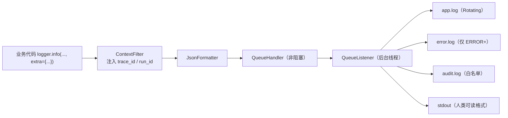

# 日志设计（开发文档）

> 文档性质：基础设施设计 + 落地开发指南。面向 Harness 后端研发、排障与运维。
> 本文以**当前实现**为基线（日志只有 `logging.basicConfig`），给出可直接实施的分层、字段、事件与落盘规范。
> 关联文档：[运行时异常捕获与重启机制设计开发](./运行时异常捕获与重启机制设计开发.md)、[架构图与核心时序](../core_design/架构图与核心时序.md)

| 项目 | 内容 |
| :-- | :-- |
| 文档版本 | v1.1 |
| 日期 | 2026-11-11 |
| 涉及模块 | `main.py`、`src/api/*`、`src/agent/*`、`src/task_flow/*`、`src/utils/*` |
| 实现状态 | 未落地（当前仅有 `basicConfig`）。P0 的运行时监督者已按本文的 `event=agent.run.*` 命名输出纯文本日志，结构化改造待 P1 |
| 一句话结论 | 日志解决的是**开发者能否在 1 分钟内还原一次失败**；它与轨迹（给用户看）是两套产物，靠 `run_id` 关联，不能互相替代 |

---

## 1. 现状盘点

### 1.1 代码事实

| 项 | 当前 | 位置 |
| :-- | :-- | :-- |
| 配置方式 | `logging.basicConfig(level=INFO, format="%(asctime)s \| %(levelname)s \| %(name)s \| %(message)s")` | `main.py` L32-L35 |
| 输出目标 | 仅 stdout（由 Electron / 终端捕获） | 同上 |
| 落盘 | 无 | — |
| 轮转 | 无 | — |
| 结构化 | 无（纯文本拼接） | — |
| 关联 ID | 无（没有 trace_id / run_id） | — |
| 级别控制 | 全局 INFO，无环境变量 | — |
| 日志调用点 | 各模块 `logger.info / warning / exception`，logger 名为模块名 | `api.chat`、`agent.mcp.runtime`、`task_flow.*` 等 |

### 1.2 具体痛点（都来自真实排障）

1. **只有堆栈，没有上下文**。`Agent 流式调用异常` 后面跟着一段 traceback，但不知道是哪个 `thread_id`、哪次 run、在哪个节点、第几次尝试。
2. **异常日志与用户可见结果断裂**。前端只显示「Agent 调用失败」，日志里没有对应的 `run_id` 可供反查。
3. **无落盘 = 事后不可追**。进程重启或窗口关闭后，stdout 缓冲丢失；用户报障时无法回溯。
4. **噪音与信号同级**。上下文压缩心跳、MCP 状态机、token 增量与真正的 ERROR 混在同一个流里。
5. **轨迹不是日志**。`TrajectoryMiddleware` 写的是面向用户的因果链（给「轨迹」页渲染），字段是展示向的，不适合作为开发者排障的权威记录。

### 1.3 与轨迹的边界

| 维度 | 轨迹（Trajectory） | 日志（Log） |
| :-- | :-- | :-- |
| 消费者 | 最终用户 / 产品 | 研发 / 运维 |
| 内容 | 做了什么（工具、推理、委派、结论） | 为什么失败（异常类、指纹、节点、尝试次数） |
| 载体 | LangGraph Store，`(user_id, thread_id)` | 本机文件 + stdout |
| 保留 | 随会话生命周期 | 7 / 30 天滚动 |
| 可否含堆栈 | 否 | 是（仅 ERROR 及以上） |
| 关联键 | `run_id` | `run_id` |

设计原则：**同一 `run_id` 在两套产物里可互查**；用户界面只暴露"发生了什么"，不暴露堆栈与内部类名。

---

## 2. 目标与非目标

### 2.1 目标

1. 给定一个时间点或一条用户反馈，能在 1 分钟内定位到：哪一轮对话、哪个 run、哪个节点、哪个工具、什么异常。
2. 异常日志与前端提示一一对应（用户看到"内部异常，执行重试机制"，日志里能查到对应 `agent.run.retry`）。
3. 日志写入不阻塞事件循环，不影响 Agent 首 token 延迟。
4. 敏感信息（密钥、令牌、用户隐私正文）零泄漏。
5. 单机部署零外部依赖（不引入 ELK/Loki 也能用）。

### 2.2 非目标

- 不做分布式追踪后端（不接 Jaeger/OTel Collector）；`trace_id`/`span_id` 只保留字段位，便于后续接入。
- 不记录完整 prompt 与完整工具输出（只在 DEBUG + 显式开关下采样）。
- 不把日志当审计（审计单独一路，见 3.2）。

---

## 3. 日志分层

### 3.1 三类产物

| 类别 | 消费者 | 载体 | 级别范围 | 保留 |
| :-- | :-- | :-- | :-- | :-- |
| **运行日志** | 研发 | `logs/app.log` + stdout | DEBUG~CRITICAL | 7 天 / 50MB×10 |
| **错误日志** | 研发 / 运维 | `logs/error.log` | ERROR~CRITICAL（含堆栈） | 30 天 / 20MB×10 |
| **审计日志** | 安全 / 产品 | `logs/audit.log` + 可选入库 | INFO（仅白名单事件） | 180 天 |
| 轨迹 | 用户 | LangGraph Store | — | 会话生命周期 |

审计事件白名单（只有这些进 audit）：

- `hitl.approved` / `hitl.rejected`（宿主能力、编译审批）
- `host.execute`（本机命令）
- `tool.denied`（权限守卫拦截）
- `mcp.connect` / `mcp.auth`（外部后端接入）
- `task_flow.publish` / `task_flow.delete`（流程定义变更）

### 3.2 管道结构



要点：

- **必须用 `QueueHandler + QueueListener`**：`RotatingFileHandler` 是同步磁盘 I/O，直接挂在事件循环上的 logger 会阻塞首 token。
- stdout 保留人类可读格式（开发态友好），文件一律 JSON Lines（便于 `jq`、便于后续采集）。

---

## 4. 关联标识

### 4.1 标识体系

| 标识 | 生成位置 | 生命周期 | 用途 |
| :-- | :-- | :-- | :-- |
| `trace_id` | HTTP 入口（每个请求） | 单次请求 | 串联一次 `/chat/stream` 的全部日志 |
| `run_id` | 每次图运行（含每次重试 attempt 同一 run_id，`attempt` 区分） | 单次 run | 与轨迹、前端 `runtime_notice` 关联 |
| `attempt` | 监督者 | 每次重试 | 区分首发与重试 |
| `thread_id` | 会话 | 会话 | 定位会话时间线 |
| `user_id` | 请求 | 请求 | 定位用户 |
| `agent_id` | 请求/会话绑定 | 请求 | 区分 MyAgent 档案 |
| `project_id` | 项目上下文 | 请求 | 定位工作区 |
| `node` | 图内中间件 | 节点执行 | 定位崩溃节点 |
| `tool_call_id` | 模型工具调用 | 单次调用 | 定位工具与重放副作用 |
| `step_id` | 任务流步骤 | 单步 | 定位任务流卡点 |

### 4.2 注入方式：contextvars

```python
# src/utils/log_context.py（新增）
from contextvars import ContextVar

_trace_id: ContextVar[str] = ContextVar("trace_id", default="-")
_run_id: ContextVar[str] = ContextVar("run_id", default="-")
_attempt: ContextVar[int] = ContextVar("attempt", default=1)

def bind_run(trace_id: str, run_id: str, attempt: int = 1) -> None:
    _trace_id.set(trace_id)
    _run_id.set(run_id)
    _attempt.set(attempt)
```

`ContextFilter` 在 `record` 上补齐字段，`JsonFormatter` 只读 `record`，业务代码无需传参。

**关键约束**：`contextvars` 在 `asyncio` 协程间自动继承，但**不会自动跨线程**。这从侧面印证了「把 Agent 挪到线程池执行」的代价：所有关联上下文都要手工 `copy_context()` 搬运，且任何一个遗漏都会让日志断链。

---

## 5. 字段规范

### 5.1 通用字段（每条日志都有）

| 字段 | 类型 | 必填 | 说明 |
| :-- | :-- | :-- | :-- |
| `ts` | ISO8601 | ✅ | 带时区，毫秒精度 |
| `level` | string | ✅ | DEBUG/INFO/WARNING/ERROR/CRITICAL |
| `logger` | string | ✅ | 模块名，如 `api.chat` |
| `event` | string | ✅ | 见第 6 章事件字典，缺失时记 `msg.raw` |
| `msg` | string | ✅ | 单行摘要，不含换行 |
| `trace_id` / `run_id` / `attempt` | string/int | 条件 | 图相关日志必填 |
| `thread_id` / `user_id` | string | 条件 | 会话相关日志必填 |
| `duration_ms` | int | 条件 | 有耗时的操作必填 |
| `error_class` | string | 条件 | 异常类名（不含模块路径） |
| `error_fingerprint` | string | 条件 | 异常归一化指纹，见 5.2 |
| `retryable` | bool | 条件 | 分类结果 |
| `stack` | string | 条件 | 仅 ERROR+，换行转义 |
| `detail_ref` | string | 条件 | 指向详细证据的键（如轨迹 key） |

### 5.2 异常指纹

同一处代码反复失败时，指纹必须稳定，否则"无进展检测"会失效。

```
fingerprint = sha1(exc_type + "|" + normalize(exc_msg) + "|" + node)
normalize: 去掉内存地址 0x… 、去掉引号内可变 ID、截断 200 字符
```

示例：`InvalidUpdateError|At key 'task_flow': Can receive only one value per step|tools`

### 5.3 截断与体积

| 字段 | 上限 | 处理 |
| :-- | :-- | :-- |
| `msg` | 500 字符 | 超出截断并追加 `…` |
| `args_digest` | 300 字符 | 工具参数只记摘要（键名 + 值类型 + 长度） |
| `stack` | 8000 字符 | 保留首尾 |
| 用户正文 | 80 字符 | 仅 DEBUG 开关开启时记录，默认只记长度 |
| 工具输出 | 200 字符 | 与现有 `_preview` 语义一致 |

---

## 6. 事件字典

命名规则：`域.对象.动作`，全小写，点分隔。新增事件必须登记在本表。

### 6.1 Agent 运行

| event | 级别 | 必填字段 | 说明 |
| :-- | :-- | :-- | :-- |
| `agent.run.start` | INFO | run_id, thread_id, user_id, agent_id, attempt | 一次图运行开始 |
| `agent.run.retry` | WARNING | run_id, attempt, error_class, error_fingerprint, retryable, backoff_ms | 触发重试（与前端 `runtime_notice` 一一对应） |
| `agent.run.recovered` | WARNING | run_id, attempts, duration_ms | 重试后成功 |
| `agent.run.failed` | ERROR | run_id, attempts, error_class, error_fingerprint, stack | 重试耗尽或确定性失败 |
| `agent.run.cancelled` | INFO | run_id, reason | 客户端断开 / 服务停机 |
| `agent.node.start` / `.end` | DEBUG | run_id, node, duration_ms | 节点级耗时 |
| `agent.interrupt` | INFO | run_id, hitl_id, kind | 进入 HITL 暂停 |

### 6.2 模型与工具

| event | 级别 | 必填字段 | 说明 |
| :-- | :-- | :-- | :-- |
| `llm.call.start` | DEBUG | run_id, model, node | 模型调用开始 |
| `llm.call.end` | INFO | run_id, model, input_tokens, output_tokens, duration_ms | 用量与耗时 |
| `llm.call.error` | WARNING/ERROR | run_id, model, error_class, retryable | 模型侧失败 |
| `tool.call.start` | DEBUG | run_id, tool, tool_call_id, args_digest | 工具开始 |
| `tool.call.end` | INFO | run_id, tool, tool_call_id, status, duration_ms, result_bytes | 工具结束 |
| `tool.call.error` | WARNING | run_id, tool, tool_call_id, error_class, error_fingerprint | 工具异常 |
| `tool.call.timeout` | WARNING | run_id, tool, timeout_s | 超时 |
| `tool.denied` | WARNING | run_id, tool, reason | 权限守卫拦截（同时进 audit） |

### 6.3 任务流

| event | 级别 | 必填字段 | 说明 |
| :-- | :-- | :-- | :-- |
| `taskflow.route.hit` | INFO | flow_id, score, kind | 命中任务流 |
| `taskflow.route.miss` | DEBUG | message_len | 未命中 |
| `taskflow.route.error` | WARNING | error_class | 路由异常降级 |
| `taskflow.step.update` | INFO | flow_id, step_id, status | 步骤上报 |
| `taskflow.execution.saved` / `.save_failed` | INFO / ERROR | execution_id, flow_id | 执行记录落库 |

### 6.4 基础设施

| event | 级别 | 必填字段 | 说明 |
| :-- | :-- | :-- | :-- |
| `http.request` / `http.error` | INFO / ERROR | path, method, status, duration_ms | 接入层 |
| `checkpoint.write.fail` | ERROR | thread_id, run_id, error_class | 检查点写入失败（严重，可能丢进度） |
| `mcp.connect` / `mcp.fail` | INFO / ERROR | server_id, duration_ms | MCP 运行时 |
| `sandbox.exec` | INFO | sandbox_id, command_digest, duration_ms | 沙箱执行 |
| `persistence.init` / `.fail` | INFO / CRITICAL | — | 启动期资源 |
| `integrity.low` | CRITICAL | level, hint | 进程完整性过低 |

---

## 7. 级别策略

| 级别 | 使用场景 | 是否进 error.log |
| :-- | :-- | :-- |
| DEBUG | token 增量、完整 prompt、节点进出、路由打分 | ❌ |
| INFO | run 生命周期、工具摘要、模型用量、任务流步骤 | ❌ |
| WARNING | 可重试异常、降级、重试成功、MCP 重连 | ❌ |
| ERROR | 重试耗尽、确定性异常、落库失败、检查点写入失败 | ✅ |
| CRITICAL | 启动失败、数据库不可用、完整性过低、磁盘只读 | ✅ |

约定：

1. **可恢复的不算 ERROR**。重试成功的瞬时异常记 `WARNING`，否则告警会被噪音淹没。
2. **ERROR 永不采样**。
3. 异常必须带 `stack`，但只在 `error.log` 与 `CRITICAL/ERROR` 的 JSON 中；stdout 人类可读格式打印完整堆栈。

---

## 8. 落盘与轮转

### 8.1 目录与文件

```
logs/
  app.log        # INFO+，JSON Lines
  error.log      # ERROR+，JSON Lines，含 stack
  audit.log      # 审计白名单，JSON Lines
```

### 8.2 配置项（`.env`）

| 变量 | 默认 | 说明 |
| :-- | :-- | :-- |
| `HARNESS_LOG_DIR` | `./logs` | 日志目录 |
| `HARNESS_LOG_LEVEL` | `INFO` | 控制台与 app.log 级别 |
| `HARNESS_LOG_JSON` | `true` | 文件输出 JSON；false 时退化为文本 |
| `HARNESS_LOG_MAX_BYTES` | `52428800` | 单文件上限（50MB） |
| `HARNESS_LOG_BACKUPS` | `10` | 轮转保留份数 |
| `HARNESS_LOG_ERROR_BACKUPS` | `10` | 错误日志保留份数（30 天口径） |
| `HARNESS_LOG_DEBUG_PAYLOAD` | `false` | 是否记录 prompt / 用户正文（默认关） |
| `HARNESS_LOG_SAMPLE_RATE` | `1.0` | DEBUG 级采样率 |

### 8.3 实现骨架

```python
# src/utils/logging_setup.py（新增）
import logging, logging.handlers, os
from queue import SimpleQueue

def configure_logging() -> logging.handlers.QueueListener | None:
    """替换 main.py 里的 basicConfig：stdout 人类可读 + 文件 JSON + 异步队列。"""
    level = os.getenv("HARNESS_LOG_LEVEL", "INFO").upper()
    log_dir = os.getenv("HARNESS_LOG_DIR", "./logs")
    os.makedirs(log_dir, exist_ok=True)

    root = logging.getLogger()
    root.setLevel(logging.DEBUG)          # 由各 handler 自己过滤
    root.handlers.clear()

    queue: SimpleQueue = SimpleQueue()
    root.addHandler(logging.handlers.QueueHandler(queue))

    console = logging.StreamHandler()
    console.setLevel(level)
    console.setFormatter(HumanFormatter())

    app = logging.handlers.RotatingFileHandler(
        os.path.join(log_dir, "app.log"), maxBytes=int(os.getenv("HARNESS_LOG_MAX_BYTES", 50 * 1024 * 1024)),
        backupCount=int(os.getenv("HARNESS_LOG_BACKUPS", 10)), encoding="utf-8",
    )
    app.setLevel(level)
    app.setFormatter(JsonFormatter())
    app.addFilter(ContextFilter())

    err = logging.handlers.RotatingFileHandler(
        os.path.join(log_dir, "error.log"), maxBytes=20 * 1024 * 1024,
        backupCount=int(os.getenv("HARNESS_LOG_ERROR_BACKUPS", 10)), encoding="utf-8",
    )
    err.setLevel(logging.ERROR)
    err.setFormatter(JsonFormatter())
    err.addFilter(ContextFilter())

    listener = logging.handlers.QueueListener(queue, console, app, err, respect_handler_level=True)
    listener.start()
    return listener
```

> `QueueListener` 需要在进程退出时 `stop()`，挂到 FastAPI `shutdown` 事件里。

---

## 9. 脱敏规则

| 对象 | 规则 |
| :-- | :-- |
| 密钥 / 令牌 | 正则匹配 `sk-[A-Za-z0-9]{8,}`、`Bearer\s+\S+`、`api[_-]?key=...` → `***` |
| 请求头 | 只记录头名，不记录值 |
| 连接串 | 只保留 `host:port/db`，抹掉 user/password |
| 用户正文 | 默认只记 `len` 与前 80 字符（需 `HARNESS_LOG_DEBUG_PAYLOAD=true`） |
| 工具参数 | 只记键名 + 值类型 + 长度（`args_digest`） |
| 文件路径 | 保留项目内相对路径；项目外路径只记 basename |
| 沙箱命令 | 保留命令本体，抹去内联 `export KEY=...` |
| 图片/二进制 | 只记 MIME 与字节数 |

脱敏在 `JsonFormatter` 内统一执行，禁止各调用点自行处理（避免漏点）。

---

## 10. 排障手册

| 现象 | 第一步查什么 | 期望看到 |
| :-- | :-- | :-- |
| 前端「Agent 调用失败」 | `grep '"level":"ERROR"' logs/error.log | tail -5`，取 `run_id` | `agent.run.failed` + `error_class` + `node` |
| 任务流执行中断 | `grep '"flow_id"' logs/app.log` | `taskflow.step.update` 最后一条的 `step_id` |
| 用户说"卡住了" | `grep '"tool.call.start"'` 找没有对应 `.end` 的 `tool_call_id` | 定位到具体工具与耗时 |
| HITL 卡片不出现 | `grep '"event":"agent.interrupt"'`；若无，再查 `tool.call.error` | 若工具报错且无 interrupt，说明 `GraphBubbleUp` 被吞 |
| 重试没有生效 | `grep '"event":"agent.run.retry"'` | 若无，说明异常被分类为 deterministic，查看 `error_class` |
| 同一问题反复出现 | `grep '"error_fingerprint":"<指纹>"'` | 统计次数与首次出现时间 |
| MCP 工具消失 | `grep '"event":"mcp.fail"'` | 服务端 ID 与失败原因 |
| 上下文异常膨胀 | `grep '"event":"llm.call.end"'` 看 `input_tokens` 曲线 | 是否压缩未触发 |

> 所有排查入口都以 `run_id` 为锚点；前端 `error` 事件应携带 `run_id`（见异常文档 3.8），让用户报障时可直接提供。

---

## 11. 落地改造清单

| # | 文件 | 改动 |
| :-- | :-- | :-- |
| 1 | `src/utils/logging_setup.py`（新增） | `configure_logging()`、`JsonFormatter`、`HumanFormatter`、`ContextFilter` |
| 2 | `src/utils/log_context.py`（新增） | `trace_id` / `run_id` / `attempt` 的 contextvars 与 `bind_run()` |
| 3 | `main.py` | 用 `configure_logging()` 替换 `basicConfig`；注册 `shutdown` 时 `listener.stop()` |
| 4 | `src/api/chat.py` | 请求入口生成 `trace_id`，run 入口生成 `run_id` 并 `bind_run`；`except` 分支补 `agent.run.failed` |
| 5 | `src/agent/runtime/supervisor.py`（新增，见异常文档） | 输出 `agent.run.start/retry/recovered/failed` |
| 6 | `src/agent/middlewares/trajectory.py` | 复用 `run_id`，保证轨迹事件与日志可互查 |
| 7 | `src/agent/tools/task_flow_tools.py` | 补 `taskflow.step.update` 日志（含 `flow_id` / `step_id` / `status`） |
| 8 | `.env.example` | 增加第 8.2 节的 `HARNESS_LOG_*` 配置 |
| 9 | `.gitignore` | 忽略 `logs/` |

### 11.1 验收标准

1. 触发一次确定性失败，用 `run_id` 能在 `error.log` 中定位到 `error_class` + `node` + `stack`。
2. 触发一次瞬时失败并重试成功，`app.log` 中出现成对的 `agent.run.retry` 与 `agent.run.recovered`，且 `error.log` 无记录。
3. 日志写入不阻塞：压测下单轮首 token 延迟与改造前差异 < 5%。
4. `grep -i "sk-\|Bearer\|password" logs/` 无命中。
5. 文件轮转生效：单文件不超过配置上限，历史份数正确。
6. 进程退出后 `logs/` 中内容完整（`QueueListener` 已 flush）。

---

## 12. 风险与取舍

| 风险 | 说明 | 缓解 |
| :-- | :-- | :-- |
| 磁盘增长 | INFO 级在长任务下量级不小 | 轮转 + 保留期；DEBUG 默认关闭 |
| 性能开销 | JSON 序列化 + 磁盘 I/O | `QueueHandler` 异步化；格式化只在监听线程做 |
| 改造期格式混用 | 新旧日志同时存在 | 统一走 `logger.xxx(event=..., extra=...)`，旧调用点渐进替换；`HumanFormatter` 兼容无 `event` 的记录 |
| 过度记录隐私 | 用户正文进日志 | 默认只记长度；脱敏集中在 Formatter |
| 关联断链 | 子进程 / 线程未继承 contextvars | 子进程通过任务参数显式传递 `run_id`（这也是拒绝"挪线程"方案的现实理由之一） |

---

## 附录 A：一条理想日志长什么样

```json
{"ts":"2026-11-11T21:57:14.240+08:00","level":"ERROR","logger":"api.chat",
 "event":"agent.run.failed","msg":"Agent 运行失败：确定性异常，未重试",
 "trace_id":"tr_9f2c1a","run_id":"run_ab12","attempt":1,
 "thread_id":"thread-df6ba7","user_id":"anonymous","agent_id":"default",
 "node":"tools","error_class":"InvalidUpdateError",
 "error_fingerprint":"9c1d…","retryable":false,
 "duration_ms":8421,
 "detail_ref":"trajectory:anonymous/thread-df6ba7",
 "stack":"…"}
```

对应前端：轨迹内一行 `内部异常，已停止自动重试，已记录日志`，底部 `error` 事件携带 `run_id=run_ab12`。
