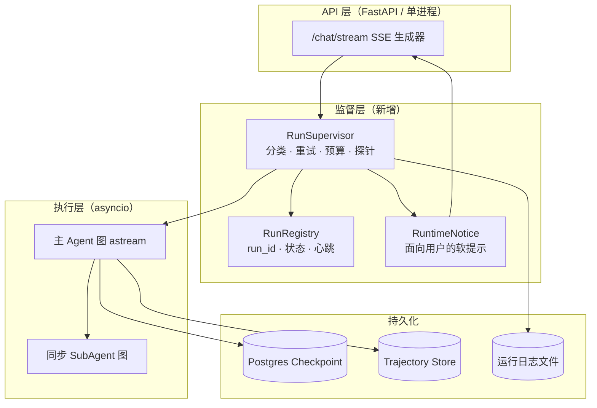
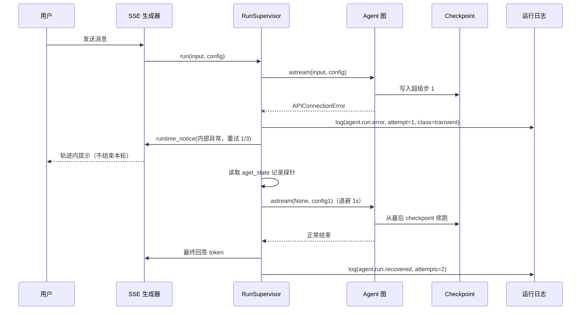
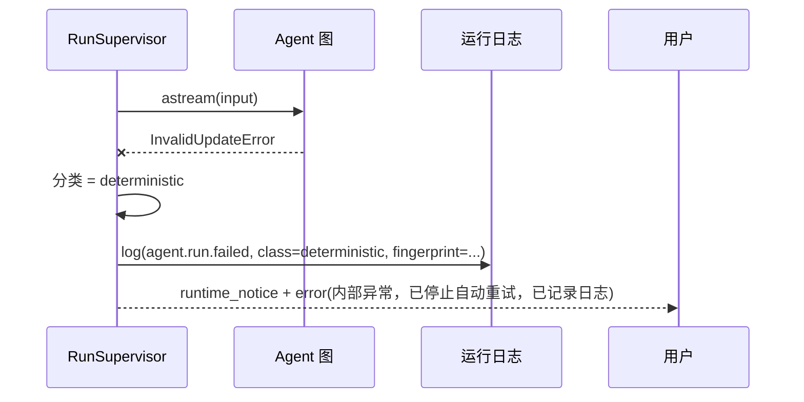
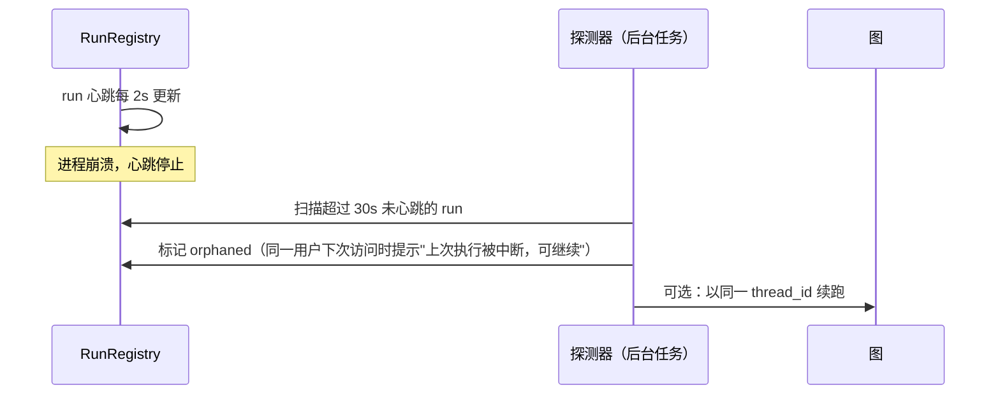

# 运行时异常捕获与重启机制设计（开发文档）

> 文档性质：模块级设计 + 落地开发指南，面向 Harness 后端研发与运维。
> 本文以**当前实现**为基线，先给出对「线程池托管 Agent 执行」这一设想的可行性验证，再给出可直接落地的方案。
> 关联文档：[日志设计开发](./日志设计开发.md)、[架构图与核心时序](../core_design/架构图与核心时序.md)、[任务流模块设计](../core_design/任务流模块设计.md)

| 项目 | 内容 |
| :-- | :-- |
| 文档版本 | v1.1 |
| 日期 | 2026-11-11 |
| 涉及模块 | `src/api/chat.py`、`src/api/agent_loader.py`、`src/agent/config.py`、`src/agent/runtime/`、`src/agent/trajectory_store.py` |
| 实现状态 | **P0 已落地**（`src/agent/runtime/{errors,supervisor}.py` + 流式接入 + `runtime_notice` 事件与前端轨迹提示），P1/P2 待实施 |
| 一句话结论 | **设想的意图正确，但"线程池 + 挪线程"的机制不可行**；正确做法是「进程内 asyncio 监督者 + 检查点续跑 + 错误分类」，需要硬隔离时再上「独立 worker 进程」，而不是线程池 |

---

## 1. 问题从哪里来

### 1.1 现场案例

用户让 Agent 执行任务流，中途后端抛出：

```
langgraph.errors.InvalidUpdateError: At key 'task_flow':
Can receive only one value per step. Use an Annotated key to handle multiple values.
```

调用栈落在 `langgraph/pregel/_algo.py: apply_writes`，外层被 `api/chat.py` 的流式异常兜底捕获，前端只看到一句「Agent 调用失败」。

根因：任务流步骤上报工具在同一超级步内被调用两次，两个 `Command` 都写 `task_flow` 键，而该键在 `PdcState` 中是默认的 Latest-only 通道，不允许一步多写。修复方式是在 `src/agent/pdc_state.py` 给该键加 reducer（按步骤 id 合并状态）。**该缺陷已修复**，此处作为「确定性异常」的典型样本。

这个案例暴露了三个独立问题，本文只解决前两个（第三个属于日志文档）：

1. **异常不可恢复**：任何异常都直接终止本轮，用户进度停留在崩溃前，无法续跑。
2. **异常不分级**：确定性的状态错误和网络抖动被同等对待，前端只显示一句无信息量的「Agent 调用失败」。
3. 异常上下文缺失：日志里只有堆栈，没有 run/thread/步骤上下文。

### 1.2 当前运行时现状

| 环节 | 当前实现 | 位置 |
| :-- | :-- | :-- |
| 执行入口 | FastAPI 路由内直接 `agent.astream(...)`，在事件循环上流式消费 | `api/chat.py` `_stream_response_unlocked` |
| 并发控制 | 进程内 `_active_threads` 集合，同会话并发直接 409 | `api/agent_loader.py` `thread_operation` |
| 状态持久化 | `AsyncPostgresSaver`，按 `thread_id` 落 checkpoint（每个超级步一次） | `agent/config.py` `create_async_persistence` |
| 异常处理 | `except Exception` → 记录 `logger.exception` → SSE 发 `error` 事件 | `api/chat.py` L1437 |
| 前端呈现 | `case 'error'` → 插入一条 `⚠ 消息` 系统提示并停止流式 | `stores/chat.ts` |
| 轨迹 | `TrajectoryMiddleware` 异步写 Store，namespace 为 `(user_id, thread_id)` | `agent/middlewares/trajectory.py` |
| 部署形态 | 单进程单 worker（注释已明确：多 worker 前必须补分布式协调） | `api/agent_loader.py` 文件头 |

关键事实：**checkpoint 已经是可续跑的**，缺的不是持久化，而是「谁来发现异常、如何决定重试、如何把重试讲给用户听」。

---

## 2. 对设想的可行性验证

你的设想可以拆成五条断言，逐条判定：

| # | 断言 | 判定 | 原因 |
| :-- | :-- | :-- | :-- |
| 1 | 用线程池托管主 Agent / 同步 SubAgent 的执行 | **不可行（按原样）** | Agent 执行是 `async` 协程，与事件循环强绑定；协程不能被"迁移"到另一个 OS 线程 |
| 2 | 加锁把各 Agent 的 Current 线程切换成各自的 Worker 线程 | **不可行** | Python 没有协程/线程迁移原语。`contextvars` 可以复制到新线程，但 `asyncio.Task`、`Future`、`Selector` 都在原 loop 上，跨线程只会得到 `attached to a different loop` |
| 3 | 线程抛出未捕获异常后可销毁该线程 | **部分可行、但无实际隔离价值** | Python 线程不能被强杀；只能"让 worker 函数捕获后退栈退出"，属于正常回收。真正卡死的线程（阻塞 C 调用、死循环）无法处理 |
| 4 | 任务进度保留在库中，异常探测器发现 worker 异常退出后释放锁并重试 | **可行，且是正确方向** | 进度确实在 Postgres checkpoint 里；但"探测器"应基于心跳 + run 注册表，而不是线程存活状态 |
| 5 | 重试期间 UI 只显示「内部异常，执行重试机制…」 | **可行，且强烈推荐** | 这是体验层面的正确判断：把"系统自愈"与"需要人看"分开 |

### 2.1 为什么"挪线程"走不通

当前一次对话轮次的资源，全部绑在**当前事件循环**上：

- `AsyncPostgresSaver` / `AsyncPostgresStore`：psycopg3 异步连接，连接内持有 loop 的读写事件。
- LangGraph 的 `StreamWriter`（任务的 custom 事件通道）、`interrupt()` 依赖的 scratchpad：均为 per-run 上下文对象。
- MCP 客户端（`langchain-mcp-adapters`）内部用 anyio TaskGroup，绑定 loop。
- SSE 生成器本身就在 loop 上 `yield`。

把协程搬到线程池，等价于在另一个 loop 里重建以上全部资源——这不是"借线程"，而是"另起一个运行时"。收益为零，成本极高。

### 2.2 线程 vs 进程：隔离能力的真实边界

| 能力 | 线程池 | 独立进程 |
| :-- | :-- | :-- |
| 捕获普通 `Exception` | ✅ | ✅ |
| 恢复内存泄漏 | ❌ | ✅（进程退出即回收） |
| 处理死循环 / 阻塞调用 | ❌（无法强杀） | ✅（`kill -9` / `TerminateProcess`） |
| 隔离 C 扩展段错误 | ❌（整进程一起崩） | ✅ |
| 迁移现有异步栈 | ❌ | 需重建（但可由子进程自行建连） |

结论：**要"扛住不可处理异常"，隔离单位必须是进程**；线程最多只能做"超时看门狗 + 协程取消"，而这在 asyncio 里本来就有（`asyncio.wait_for`）。

### 2.3 更关键的坑：重试会放大副作用

两个必须正视的事实：

1. **确定性异常重试必然复现**。像 `InvalidUpdateError`、状态 schema 不匹配、工具返回类型错误，重试 100 次也是同一处崩溃。盲目重试 = 烧钱 + 让用户多等。
2. **重试不是"从失败点继续"，而是"从上一个 checkpoint 重跑节点"**。LangGraph 的恢复粒度是节点/任务：`apply_writes` 失败时 checkpoint 没有推进，下次恢复会重跑同一个节点。这意味着最后一次模型调用、甚至最后一次工具调用可能被重复执行。

因此重试机制必须同时具备：**错误分类、进展探针（防毒丸）、副作用幂等约束**。

---

## 3. 优化后的方案

### 3.1 结论先行

| 阶段 | 方案 | 解决的问题 | 复杂度 |
| :-- | :-- | :-- | :-- |
| **P0（必做）** | 进程内 `RunSupervisor`：错误分类 + 有界重试 + 检查点续跑 + 前端"重试中"提示 | 90% 的瞬时故障自愈；用户不再看到裸的「调用失败」 | 低，纯 Python，无部署变化 |
| **P1（推荐）** | 结构化运行日志 + run 注册表 + 心跳 | 能定位"为什么重试"；孤儿 run 可被发现 | 中 |
| **P2（按需）** | 独立 worker 进程执行整轮 Agent Run，API 只做事件转发 | 真正的崩溃隔离、可横向扩容、可强制回收 | 高，需要队列与事件回放 |

本文件把 P0/P1 写成可直接实施的规格，P2 给出边界与触发条件。

### 3.2 分层结构



### 3.3 组件职责

| 组件 | 职责 | 不做什么 |
| :-- | :-- | :-- |
| `RunSupervisor` | 包住一次 `astream`，捕获异常、分类、决定是否重试、控制预算与退避 | 不修改图内部状态，不重写业务异常 |
| `RunRegistry` | 记录进行中的 run（run_id、thread_id、user_id、状态、心跳、重试次数） | 不存业务数据 |
| `RuntimeNotice` | 把"内部异常 / 正在重试 / 已降级"转成前端可渲染的轨迹提示 | 不向用户暴露堆栈、类名、路径 |
| `ErrorClassifier` | 把异常映射到 `transient / deterministic / fatal / cancelled` | 不吞异常，分类失败默认 `fatal` |

### 3.4 错误分类矩阵

| 类别 | 典型异常 | 是否重试 | 处理 |
| :-- | :-- | :-- | :-- |
| `transient` | `APIConnectionError`、`ConnectError`、`ReadTimeout`、`OpenAIConnectionError`、模型 429/5xx、MCP 传输中断、psycopg `OperationalError`（连接类） | ✅ | 指数退避重试，从 checkpoint 续跑 |
| `deterministic` | `InvalidUpdateError`、`GraphRecursionError`、`TypeError`/`AttributeError`（工具内部）、状态 schema 校验失败、参数校验失败 | ❌（首次直接失败） | 立即终止并告警；同一签名二次出现时也直接终止 |
| `fatal` | 配置缺失、`RuntimeError`（环境级）、数据库不可用、磁盘只读、进程完整性过低 | ❌ | 终止，错误文案透传（现有 `RuntimeError` 分支保留） |
| `cancelled` | `GraphInterrupt`/`GraphBubbleUp`（**不是错误**）、`asyncio.CancelledError`、客户端断开 | 不重试 | 原样冒泡 / 静默收尾 |
| `user` | `HTTPException`（409 会话忙、404 会话不存在） | ❌ | 原样返回 |

`GraphBubbleUp` 必须单列：它承担 HITL 暂停语义。此前 `compile_project` 的审批异常就是被 `except Exception` 吞掉，导致审批卡片永远不出现——同样的错误不能在监督层重演。

### 3.5 重试策略

| 参数 | 默认值 | 说明 |
| :-- | :-- | :-- |
| `MAX_ATTEMPTS` | 3（首次 + 2 次重试） | 与 `FlowExecutor` 的历史语义对齐，避免心智分裂 |
| `BACKOFF` | 1s、3s（±20% 抖动） | 瞬时抖动场景足够，避免长任务被拖太久 |
| `RETRY_BUDGET` | 单 run 累计 2 次 | 防止"每次都在不同地方失败"的无限循环 |
| `NO_PROGRESS_LIMIT` | 2 | 连续两次重试后 checkpoint 的 `step` 与消息数都没变 ⇒ 判定毒丸，停止重试 |
| `RETRY_TIMEOUT` | 单次尝试不额外限时 | 沿用图内 `MAIN_AGENT_MODEL_RUN_LIMIT` / 工具超时 |

**进展探针（关键）**：每次尝试前后读取 `agent.aget_state(config)`，记录 `(checkpoint_id, len(messages), 已完成节点数)`。三元组完全一致即视为"无进展"。

### 3.6 续跑语义

```text
首次执行：  astream({"messages":[...], "task_flow":{...}}, config)
重试执行：  astream(None, config)          # 不带新输入，从最后 checkpoint 续跑
```

- `config` 中的 `thread_id` 必须保持不变，否则会读到另一个会话的 checkpoint。
- 不带 `None` 而重新传首条用户消息，会导致用户消息重复入队，必须禁止。
- 若当前 checkpoint 处于 HITL 中断（`state.interrupts` 非空），**不重试**，交给用户恢复（与 `append_thread_messages` 的现有判断保持一致）。

### 3.7 副作用与幂等

重试可能重复执行"崩溃前最后一个节点"。约束如下：

| 工具类型 | 例子 | 重试处理 |
| :-- | :-- | :-- |
| 只读 | 读文件、检索、查询 | 可安全重放 |
| 幂等写 | 覆盖写文件、`upsert` | 可重放 |
| 非幂等 | `publish_to_project`、`host_execute`、外部下单类 MCP 写操作 | 重试前检查轨迹里是否已有该 `tool_call_id` 的成功记录；已有则跳过（`ToolMessage` 直接回放结论） |

实现落点：`RunSupervisor` 在重试前读取轨迹事件，构造 `skip_tool_call_ids`，注入到本轮 `HarnessContext`，由工具守卫中间件短路。

### 3.8 前端契约

新增 SSE 事件（与现有 `task_flow_progress` 同属 custom 通道，前端按 `type` 分发）：

```json
{
  "type": "runtime_notice",
  "thread_id": "…",
  "run_id": "run_ab12",
  "level": "warn",
  "code": "INTERNAL_RETRY",
  "message": "内部异常，执行重试机制（第 1/3 次）…",
  "attempt": 1,
  "max_attempts": 3,
  "retryable": true
}
```

呈现规则：

| 场景 | 轨道内提示 | 是否终态 |
| :-- | :-- | :-- |
| 瞬时异常 + 将重试 | `内部异常，执行重试机制（1/3）` | 否 |
| 重试成功 | 不额外提示，正常输出最终回答 | 是 |
| 重试耗尽 / 确定性异常 | 轨道内 `内部异常，已停止自动重试，已记录日志` + `error` 事件 | 是 |
| HITL 中断 | 现有 `interrupt` 卡片 | 否 |

原则：**用户看到的是"系统在自愈"；开发者看到的是"必须看日志"**。因此 `runtime_notice` 只给结论与轮次，不给堆栈；堆栈只进日志与轨迹明细（`detail_ref` 指向 run_id）。

### 3.9 并发与锁

| 场景 | 现状 | 改造后 |
| :-- | :-- | :-- |
| 同会话并发请求 | `_active_threads` 直接 409 | 保持不变；重试占用同一把"会话锁"，不释放后重新竞争，避免其他请求插入 |
| 重试期间新消息 | 已被 409 挡住 | 同上 |
| 多 worker 部署 | 不支持 | 需要 Redis/PG 分布式锁（P2 的前置条件） |

> 注意：设想里"释放锁 → 重新借 worker"在单进程内是**危险**的。锁一旦释放，用户的新消息可能插到重试之前，造成"旧 run 重放覆盖新回答"。正确做法是**锁不释放，重试在同一临界区内完成**。

---

## 4. 关键时序

### 4.1 瞬时异常自动重试



### 4.2 确定性异常直接终止



### 4.3 进程崩溃后的孤儿 run



P0 阶段不做自动续跑，只做**标记 + 提示**；自动续跑放到 P2（需要确认无副作用风险）。

---

## 5. 落地改造清单（P0 + P1）

| # | 文件 | 改动 | 说明 |
| :-- | :-- | :-- | :-- |
| 1 | `src/agent/runtime/errors.py`（新增） | `ErrorClassifier`：异常 → 类别 + 指纹（`type + 关键字段归一化`） | 纯函数，可单测 |
| 2 | `src/agent/runtime/supervisor.py`（新增） | `RunSupervisor.stream()`：包装 `agent.astream`，产出 `(event, notice)` | 复用现有 `_create_sse_message` 的语义，不侵入图 |
| 3 | `src/api/chat.py` | `_stream_response_unlocked` 内改为 `async for ... in supervisor.stream(...)`；原 `except` 退化为"监督者放弃后的终态兜底" | 保留现有 token/tool/interrupt 事件路径 |
| 4 | `src/api/chat.py` | 新增 `runtime_notice` 事件透传（`_get_custom_event` 放行） | 与 `task_flow_progress` 同一处理方式 |
| 5 | `src/stores/chat.ts`（前端） | `case 'runtime_notice'`：插入轨迹提示行，不结束流式 | 复用轨迹 `system` 行样式 |
| 6 | `src/agent/runtime/registry.py`（新增） | `RunRegistry`：`begin/heartbeat/finish/orphans` | P1，进程内字典即可，后续可换 Redis |
| 7 | `src/agent/config.py` | 新增配置：`RUNTIME_MAX_ATTEMPTS`、`RUNTIME_BACKOFF_MS`、`RUNTIME_RETRY_BUDGET`、`RUNTIME_NO_PROGRESS_LIMIT` | 走现有 `.env` 机制 |
| 8 | `src/api/agent_loader.py` | `thread_operation` 增加 `defer` 之外的"重试不释放"说明与断言 | 防止后续误改 |
| 9 | `src/agent/pdc_state.py` | **已完成**：`task_flow` 增加 reducer | 修复本次 `InvalidUpdateError` |

### 5.1 验收标准

1. 构造瞬时异常（mock 模型首次抛 `APIConnectionError`）：本轮不出现 `error` 事件，轨迹内出现一次重试提示，最终回答正常。
2. 构造确定性异常（例如临时移除 reducer）：只尝试一次，轨迹提示"已停止自动重试"，`error` 事件带可读文案。
3. 重试耗时 < 5s（两次退避合计）。
4. 重试期间同一会话的新请求返回 409，不出现并发写入。
5. HITL 中断轮不触发重试。
6. 前端刷新后，重试提示不落库（与"聊天卡片不持久化"的现有约定一致）。

---

## 6. 边界与风险

| 风险 | 说明 | 缓解 |
| :-- | :-- | :-- |
| 重放副作用 | 节点级重跑可能重复调用写类工具 | 轨迹去重 + `skip_tool_call_ids` |
| 毒丸异常 | 同签名反复失败 | 指纹 + 无进展探针 + 预算三重刹车 |
| 成本翻倍 | 每次重试都可能重复一次长上下文请求 | 只对 `transient` 重试，预算 2 次 |
| 内存泄漏无法自愈 | 线程池方案处理不了 | 明确交给 P2 的进程隔离 |
| 多 worker | 现有锁是进程内的 | 上分布式锁前不允许部署多 worker |
| 提示语义 | "重试中"可能掩盖真实失败 | 终态必须明确写"已停止自动重试"，并落 `error` 事件 |

---

## 7. P2：进程级隔离（什么时候才需要）

触发条件（满足任意两条再启动）：

- 出现必须靠重启进程才能恢复的故障（内存持续增长、C 扩展段错误）。
- 需要多实例横向扩容。
- 需要"强制回收卡死任务"。

形态建议：复用仓库里已有的 Agent Protocol 异步服务模式（`ASYNC_AGENT_PROTOCOL_URL`），而不是自建线程池：

| 环节 | 做法 |
| :-- | :-- |
| 提交 | API 写入 `run` 表（`run_id/thread_id/user_id/input_hash/status`），投递到队列 |
| 执行 | worker 进程拉取，自行建 `AsyncPostgresSaver` 连接，执行 `astream`，事件写 `run_event` 表 |
| 回放 | API 按 `run_event` 游标推 SSE（与现有 `async_tasks` 的轮询模式一致） |
| 心跳 | worker 每 2s `update run set heartbeat=now()` |
| 回收 | 探测器把 `heartbeat` 超时的 run 置 `orphaned`，由新 worker 以同一 `thread_id` 续跑 |

代价：事件持久化、游标回放、跨进程锁、部署编排。**在没有上述触发条件前不要提前做**。

---

## 附录 A：本次缺陷复盘

| 项 | 内容 |
| :-- | :-- |
| 现象 | 任务流执行中 `InvalidUpdateError`，本轮直接失败 |
| 触发链路 | `task_flow_step_update` 返回 `Command(update={"task_flow": …})`，模型一次输出两个该工具调用 → 同一超级步两次写同键 |
| 根因 | `PdcState.task_flow` 未声明 reducer，LangGraph 按 Latest-only 通道处理 |
| 修复 | `merge_task_flow`：标量取后写、`current_step` 空值不回退、步骤按 id 取推进更靠后的状态 |
| 验证 | 同一超级步两次写入后通道合并成功，`steps` 保留 `done` 与 `running` 两条最新状态 |
| 教训 | 「新增图状态键」必须同时决定合并语义；否则在并发工具调用下必然踩坑 |
