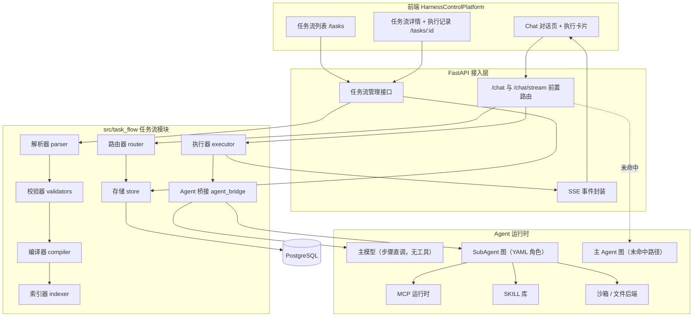
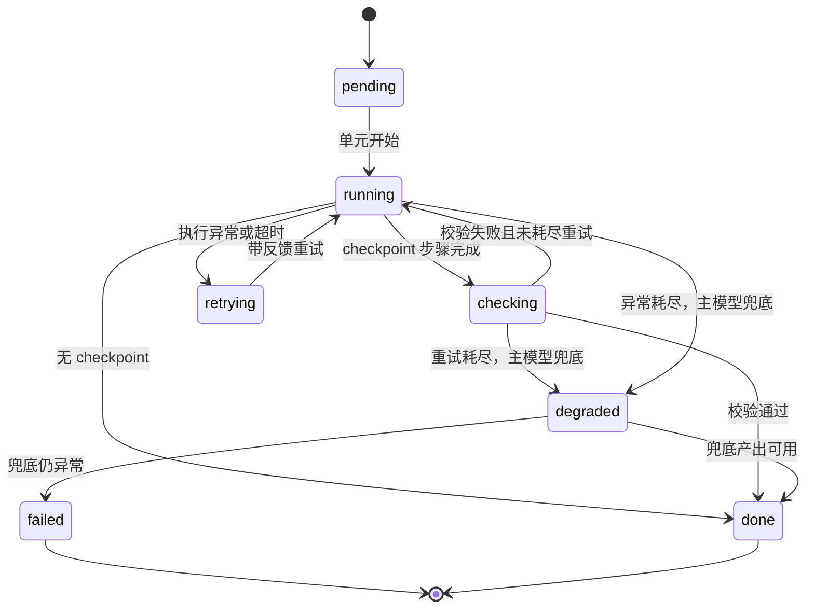
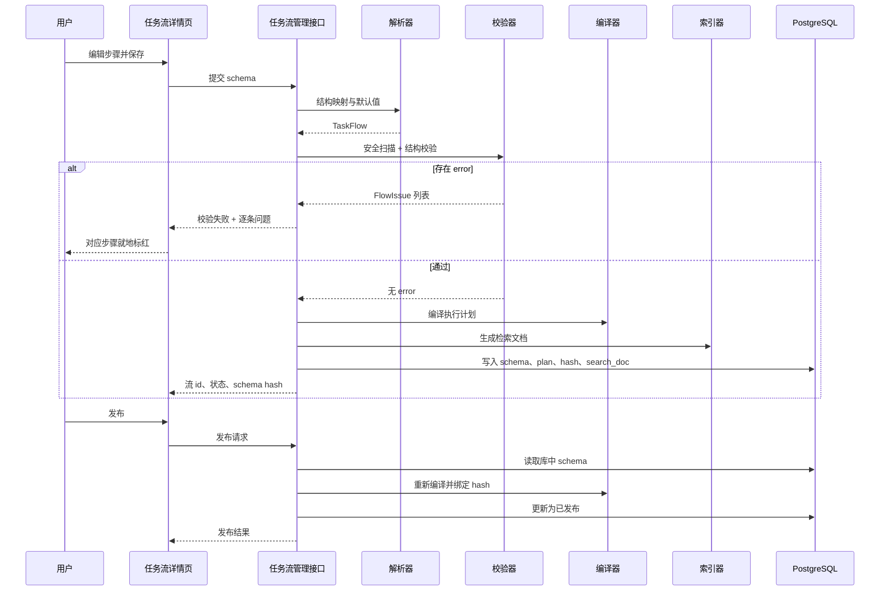
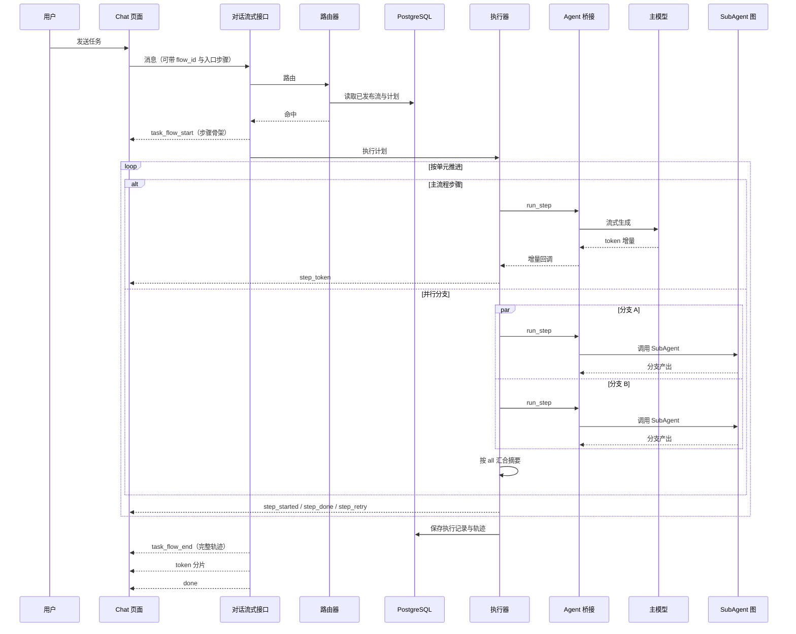
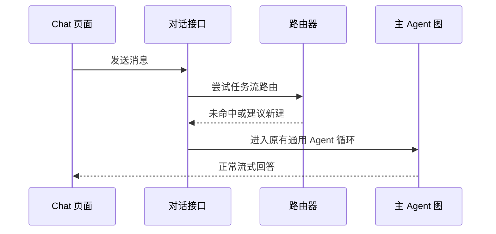
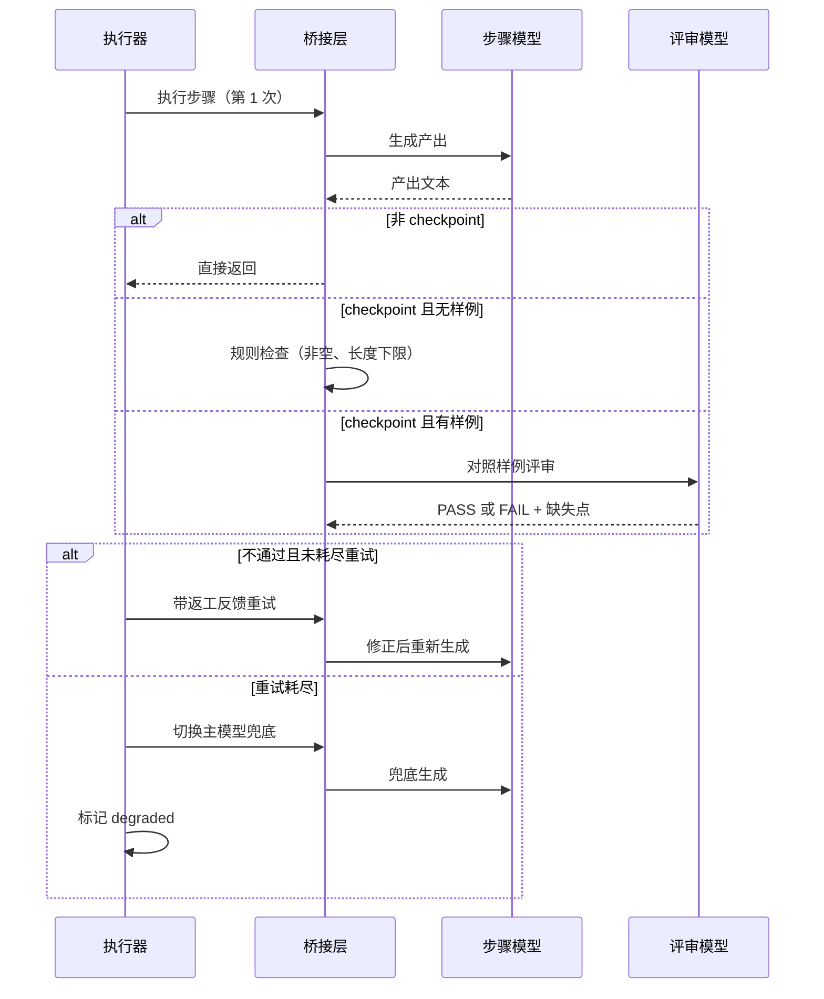
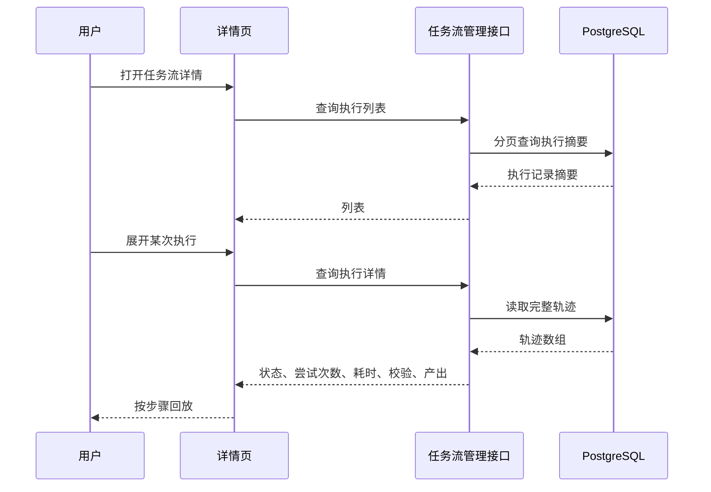

# 任务流（TaskFlow）模块设计

> 文档性质：模块级设计文档，面向 Harness 研发、任务流维护者与接入方。
> 本文以**当前实现**为准，不描述尚未落地的能力；早期设计稿中未实现的部分统一收进「第 10 章 当前实现边界」与「附录 A」。

| 项目 | 内容 |
| :-- | :-- |
| 文档版本 | v1.0 |
| 日期 | 2026-11-08 |
| 模块路径 | `src/task_flow`、`src/api/task_flow.py`、`src/api/chat.py`（前置路由）、`frontend/HarnessControlPlatform/src`（任务流页面与 Chat 卡片） |
| 关联文档 | [任务流模块开发文档](../develope/任务流模块开发文档.md)、[架构图与核心时序](./架构图与核心时序.md)、[宿主能力与HITL审批设计](./宿主能力与HITL审批设计.md) |
| 默认结论 | 任务流是**对话前置的确定性编排层**：命中则按预定义步骤执行并留下可回放轨迹，未命中完全退回主 Agent 通用循环 |

---

## 1. 模块概述

### 1.1 解决什么问题

1. **同类任务执行发散**：同一类任务每次执行时步骤、深度、产出结构都不稳定，用户难以验收。
2. **多智能体委派率低**：主 Agent 倾向单线程串行完成所有工作，SubAgent 很少被真正使用，长任务耗时不可控。
3. **过程不可见**：即使 Agent 做完了，用户也只能看到一个最终回答，无法判断"它到底做了哪几步、哪一步返工了"。

任务流的手段不是继续堆系统提示词，而是把**执行方法本身**变成可保存、可校验、可复用的数据：用户提前定义步骤、执行者、限制条件与验收样例，Agent 命中后按统一流程执行。

### 1.2 模块定位

任务流位于**用户消息进入主 Agent 图之前的决策点**：

- 命中任务流：由任务流执行器接管本轮任务，逐步执行并输出轨迹；本轮不进入主 Agent 图。
- 未命中任务流：完全退回原有主 Agent 通用循环，对主链路零侵入。
- 任务流管理：独立页面完成创建、编辑、校验、发布、复制与执行记录回放。

因此它的系统角色是「**可选的前置编排层**」，而不是主 Agent 的替代品。

### 1.3 两类任务流

| 类型 | 来源 | 存储 | 可编辑性 | 用途 |
| :-- | :-- | :-- | :-- | :-- |
| 内置流（builtin） | 随代码仓库发布，位于 `src/task_flow/builtin/*.json` | PostgreSQL，归属 `__builtin__` | 只读，可复制为"我的任务流"后编辑 | 提供开箱即用的通用方法（如深度研究报告、代码审查与修复） |
| 用户流（user） | 用户在 UI 创建 | PostgreSQL，按用户隔离 | 可编辑、可发布、可删除 | 固化个人或团队的重复性工作方法 |

两类流共用同一套解析、校验、编译、索引、路由与执行逻辑，差异只在来源、归属与可编辑性。

### 1.4 术语表

| 术语 | 含义 |
| :-- | :-- |
| 任务流（TaskFlow） | 一条可复用的任务执行流程定义 |
| 步骤（Step） | 流程基本单位：名称、自然语言指令、技能引用、执行者、限制条件、验收样例、是否校验点 |
| 并行子流（Subflow） | 从主流分叉出的并行执行线，拥有独立步骤序列 |
| 执行者（Executor） | `main` 主模型 / `auto` 运行时决定 / `subagent:<角色名>` 指定 SubAgent |
| 执行计划（ExecutionPlan） | schema 的编译产物，执行器直接消费的单元数组 |
| 执行单元（Unit） | 执行计划中的一项，只有 `step` 与 `fork` 两种类型 |
| 执行记录（Execution） | 一次任务流运行的完整轨迹，用于验收、回放与问题定位 |
| 校验点（Checkpoint） | 步骤完成后追加一次质量校验，不通过则带反馈返工 |
| 中途接管（Takeover） | 用户已完成部分工作，从中间步骤接入执行，已有产出作为上游状态注入 |

### 1.5 模块组成

| 层 | 位置 | 职责 |
| :-- | :-- | :-- |
| 数据模型 | `src/task_flow/models.py` | schema、执行计划、执行记录、校验问题的强类型定义 |
| 编译期 | `parser.py` / `validators/` / `compiler.py` / `indexer.py` | 解析 → 校验 → 编译 → 生成检索文档 |
| 运行期 | `router.py` / `executor.py` / `agent_bridge.py` | 选流 → 逐步执行 → 委派 SubAgent / 校验步骤 |
| 存储 | `store.py` | PostgreSQL 两张表：流定义与执行记录 |
| 内置流 | `builtin/loader.py` + `builtin/*.json` | 启动时加载、校验并注册内置流 |
| 管理接口 | `src/api/task_flow.py` | CRUD、发布、复制、执行记录查询 |
| 对话接入 | `src/api/chat.py` | 在 `/chat` 与 `/chat/stream` 入口前置路由；命中后走任务流 SSE |
| 前端 | `views/TaskFlowListView.vue`、`views/TaskFlowDetailView.vue`、`components/taskflow/*`、`stores/taskflow.ts`、`stores/chat.ts` | 列表、详情编辑、简图、执行记录回放、Chat 执行卡片 |

---

## 2. 设计理念

| 理念 | 具体落地 | 代价与边界 |
| :-- | :-- | :-- |
| **编译期确定性优先** | 保存/发布时完成解析、安全扫描、结构校验、编译与索引；能静态发现的问题绝不拖到运行期 | 校验规则需要持续维护；过严会阻碍保存，过松会把问题留给运行时 |
| **流程是机制，不是提示词** | 步骤、执行者、并行分支、校验点都是结构化字段，由执行器解释，而不是让模型自由发挥 | 灵活性低于纯对话；不适合目标本身高度不确定的任务 |
| **最小步骤上下文** | 每个步骤只注入：步骤指令、限制条件、验收样例、上一步产出、返工反馈 | 跨步骤的深层上下文需要靠上游产出摘要逐级传递，信息有损 |
| **并行即委派** | fork 分支的 `auto` 步骤默认委派通用 SubAgent；分支之间用协程并发执行 | 并行收益取决于任务可拆分程度；同一执行内并发上限为 4 |
| **每一步可验收** | 每次执行产出结构化轨迹：状态、尝试次数、耗时、输入/输出摘要、完整产出、校验结论 | 轨迹真实性依赖执行器埋点；聊天卡片不是持久化载体 |
| **失败可见、可降级** | 重试不超过 2 次，随后由主模型兜底一次并标记 `degraded`；兜底仍失败才标记 `failed` | `degraded` 不是成功，验收时需要区分 |
| **依赖注入、可独立单测** | 执行器不直接调用 LLM；`run_step` / `check_step` / `event_sink` 全部由桥接层注入 | 桥接层成为能力边界，步骤能用到什么工具由它决定 |
| **只读内置、复制扩展** | 内置流不可改、不可删，只能复制为用户流 | 内置流升级会覆盖旧版本，用户副本不会自动跟随 |
| **前置路由、零侵入主链路** | 命中才接管，未命中直接返回 `None` 并走原主 Agent 流程 | 任务流不可用时不阻断普通对话，但也意味着问题只能通过日志发现 |

---

## 3. 系统架构

### 3.1 总览

### 3.2 两条执行路径

| 维度 | 命中任务流 | 未命中任务流 |
| :-- | :-- | :-- |
| 入口 | `/chat`、`/chat/stream` 消息进入主 Agent 图之前 | 同一位置返回空决策 |
| 执行主体 | `FlowExecutor` + `agent_bridge` | 主 Agent 图（LangGraph / DeepAgents） |
| 工具能力 | 主模型步骤无工具；SubAgent 步骤仅用 YAML 声明的工具 | 主 Agent 全量工具（MCP、技能、沙箱等） |
| 输出 | SSE 进度事件 + 最终回答；执行记录落库 | 原有流式回答 |
| 会话落盘 | 执行完成后把本轮问答写入 checkpoint | 原有写入逻辑 |
| 失败影响 | 只影响本轮任务流执行，可降级或在记录中定位 | 原有错误处理 |

### 3.3 与系统其他能力的交互

| 系统能力 | 交互方式 | 设计意图 |
| :-- | :-- | :-- |
| 主 Agent | 前置路由命中时**不进入**主 Agent 图；未命中时无感 | 避免两套编排同时争夺控制权 |
| SubAgent | 按 YAML 角色加载独立图；同一角色可被多个分支并发调用 | 把并行工作量从主 Agent 卸载到子智能体 |
| SKILL | schema 中声明技能名，编译期校验存在性；执行期由子 Agent 的图自行发现技能 | 流程只声明"用哪个技能"，不复制技能内容 |
| MCP | 子 Agent YAML 的 `mcp_servers` 决定绑定哪些工具；流级 `mcp_services` 目前只做声明与校验 | 工具连接复用主进程 MCP 运行时与连接池 |
| 沙箱 / 文件 | SubAgent 由图内文件中间件提供读写能力 | 长材料、检索结果可落盘，避免全文反灌上下文 |
| 会话与记忆 | 任务流执行完成后把本轮问答写入 checkpoint；执行轨迹单独落 PostgreSQL | 聊天记录与执行记录职责分离 |
| 可观测 | 执行记录是权威轨迹；SSE 是实时视图 | 刷新后以执行记录为准，不依赖前端缓存 |

### 3.4 命中后主 Agent 图的可见性

明确结论：**任务流命中时，主 Agent 图不参与本轮执行，也看不到任务流本身。**

执行期：

- `/chat` 与 `/chat/stream` 在进入主 Agent 图**之前**完成路由；命中后直接返回任务流响应或任务流 SSE，主 Agent 图的**本轮调用**被跳过（仅在执行结束后为写 checkpoint 构建一次图对象）。
- 主 Agent 图不会收到执行计划、步骤列表、分支信息、工具状态或中间产出；任务流也不会读取或修改主 Agent 图的运行状态。
- 因此不存在"把任务流图传给主 Agent 看"这一步，两套编排在本轮是互斥的。

事后：

- 执行完成后，任务流把本轮问答以一条 `HumanMessage` + 一条 `AIMessage` 写入 checkpoint（`append_thread_messages` → `aupdate_state`）。
- 写入前会调用一次 `get_agent_for_user` 获取图对象，但这只是"建图写状态"，不是"执行图"。
- 若会话处于 HITL 中断或待执行节点（`state.next` / `state.interrupts` 非空），跳过写入，避免破坏后续恢复。

可见性对照：

| 对象 | 主 Agent 图在后续轮次是否可见 | 说明 |
| :-- | :-- | :-- |
| 用户原始消息 | 可见 | 作为普通 `HumanMessage` 写入 |
| 任务流最终回答 | 可见 | 作为普通 `AIMessage` 写入，来源标记为主 Agent |
| 命中流 id / 流名称 | 不可见 | 只存在于执行记录与前端卡片 |
| 执行计划、步骤、分支 | 不可见 | 不进入消息状态 |
| 步骤产出、重试、降级、校验结论 | 不可见 | 只在执行记录 `step_traces` 中 |
| 执行 id / trace id | 不可见 | 仅在执行记录与日志中 |

设计代价：主 Agent 上下文保持干净，不会被步骤细节污染；反过来，后续轮次无法引用"上次任务流某一步的产出"。若需要主 Agent 感知任务流，应在写入 checkpoint 时额外注入一段执行摘要系统消息，或在请求中显式引导用户引用；当前未实现。

---

## 4. 数据模型与编译期

### 4.1 任务流 schema

| 字段 | 类型 | 说明 |
| :-- | :-- | :-- |
| `schema_version` | 字符串 | 当前为 `1.0` |
| `id` | 字符串 | 流唯一标识；UI 新建时由解析器生成 |
| `name` / `description` | 字符串 | 名称用于检索与展示；描述参与召回 |
| `source` | 枚举 | `builtin` / `user` |
| `status` | 枚举 | `draft` / `published`；只有 `published` 可被路由命中 |
| `trigger_examples` | 字符串数组 | 触发示例，参与召回与 LLM 终选 |
| `mcp_services` | 字符串数组 | 流级 MCP 服务声明；编译期校验是否已注册 |
| `steps` | 步骤数组 | 流程主体 |

步骤字段：

| 字段 | 类型 | 说明 |
| :-- | :-- | :-- |
| `id` | 字符串 | 全流唯一（含子流），供轨迹与前端定位 |
| `name` | 字符串 | 全流唯一，展示与检索用 |
| `instruction` | 自然语言 | 该步骤要做什么 |
| `skills` | `"auto"` 或字符串数组 | Agent 自选或显式指定技能 |
| `executor` | 字符串 | `main` / `auto` / `subagent:<角色名>` |
| `constraints` | 自然语言 | 不该做什么，注入步骤上下文 |
| `checkpoint` | 布尔 | 是否在该步骤后插入质量校验 |
| `example` | 字符串，可选 | 期望产出的格式/结构示例，同时作为校验对照基准 |
| `parallel` | 子流数组，可选 | 存在时该步骤变为 fork 单元 |

### 4.2 执行计划

执行器不直接消费 schema，而消费编译产物：

| 字段 | 说明 |
| :-- | :-- |
| `plan_version` | 执行计划版本，当前 `1.0` |
| `flow_id` | 对应任务流 id |
| `schema_hash` | schema 的 canonical JSON 哈希；schema 变化必然导致 hash 变化 |
| `units` | 执行单元数组，顺序即执行顺序 |

执行单元只有两种：

| 类型 | 内容 | 执行语义 |
| :-- | :-- | :-- |
| `step` | `seq`、`ref`、`executor`、`checkpoint` | 执行单个步骤 |
| `fork` | `seq`、`ref`、`branches`（每条分支内嵌单元数组）、`join` | 分支并发执行，`join=all` 后汇合 |

设计取舍：v1 不引入 DAG、基本块或通用图运行时。任务流的真实形态是"线性 + 少量并行分叉"，用扁平单元数组即可表达，执行器也更容易测试与推理。

### 4.3 编译期四阶段

| 阶段 | 组件 | 输入 → 输出 | 是否调用模型 |
| :-- | :-- | :-- | :-- |
| ① 结构解析 | `parser` | UI JSON → `TaskFlow`；缺省 id 自动生成；结构错误转为逐条校验问题 | 否 |
| ② 数据校验 | `validators` | `TaskFlow` → `FlowIssue[]`；存在 error 级问题时中断 | 否 |
| ③ 流编译 | `compiler` | `TaskFlow` → `ExecutionPlan`；纯函数、同输入同输出 | 否 |
| ④ 流程索引 | `indexer` | `TaskFlow` → `search_doc`；名称、描述、触发示例、步骤摘要 | 否 |

整个编译期是确定性的：同样的输入必然产出同样的计划与 hash，便于回归测试与版本绑定。

### 4.4 校验 Pass

校验 Pass 通过注册表管理，可单独开关、可单测。引用存在性检查通过注入的解析器完成，解析器返回三种结果：存在、不存在、无法确认；**无法确认时降级为 warning**，不阻断保存。

| Pass | 检查内容 | 级别 |
| :-- | :-- | :-- |
| `safety.injection` | 提示注入模式：覆盖指令、伪装系统角色、套取系统提示词 | error |
| （安全扫描内分组） | 危险指令：删库、格式化、关停服务等 | error |
| （安全扫描内分组） | 越权诱导：访问他人数据、泄露凭据、绕过鉴权 | error |
| `structure.steps` | 至少一个步骤；步骤 id 与名称在全流（含子流）唯一 | error |
| `structure.refs` | SKILL、SubAgent 角色、MCP 服务引用存在；注册表不可用降级 warning | error / warning |
| `structure.parallel` | 子流嵌套层级不超过 2；每条分支至少 1 步；分支数量不设下限 | error |
| `structure.length` | 名称 ≤ 50、指令 ≤ 2000、示例 ≤ 4000、描述 ≤ 2000 字符 | error |
| `structure.acyclic` | 当前为占位：子流内联定义、不可引用主流，天然无环 | — |

### 4.5 存储模型

| 表 | 关键内容 | 说明 |
| :-- | :-- | :-- |
| `task_flow` | `id`、`user_id`、`name`、`status`、`source`、`schema`、`plan`、`schema_hash`、`search_doc`、时间戳 | 一条流一行；`schema` 与 `plan` 均为 JSONB |
| `task_flow_execution` | `id`、`flow_id`、`user_id`、`thread_id`、`schema_hash`、`entry_step`、`status`、`step_traces`、`trace_id`、时间戳 | 一次运行一行；轨迹为 JSONB 数组 |

存储策略要点：

- 使用独立的 PostgreSQL 连接，不与 LangGraph checkpoint 表耦合。
- 连接惰性建立，进程级复用；DDL 在建连后逐条执行。
- 列表查询同时返回内置流与当前用户流，按更新时间倒序。
- 发布与保存都重新跑编译管线，避免绕过 UI 直接改库造成 schema 与 plan 不一致。

---

## 5. 运行期设计

### 5.1 流程路由

路由输出四种决策：

| 决策 | 含义 | 当前对话入口的处理 |
| :-- | :-- | :-- |
| `hit` | 命中已发布流，从头执行 | 接管本轮 |
| `takeover` | 命中并从中途步骤接入 | 接管本轮，注入用户已有产出 |
| `miss` | 无候选或显式指定无效 | 退回主 Agent |
| `suggest` | 有候选但未达阈值/未被选中 | 当前按未命中处理，退回主 Agent |

路由顺序：

1. **显式指定优先**：请求带 `flow_id` 时直接加载；流不存在或未发布则记录日志并降级到检索。
2. **召回**：取当前用户与内置的已发布流，对检索文档做字符 bigram 重合度打分，取前 3。
3. **终选**：默认用 top-1 分数与阈值 0.35 判定；预留 LLM 判别器接口，当前对话入口未注入。
4. **接管识别**：消息命中"已做完/从第 N 步/接着做"等模式，或请求显式给入口步骤，则决策为 `takeover`。

稳定性设计：路由过程中任何异常都返回"未命中"，不允许因为任务流不可用而阻断普通对话。

### 5.2 步骤状态机

语义约定：

- 重试上限为 2 次，即最多 3 次正常尝试；之后追加 1 次主模型兜底。
- 兜底成功标记 `degraded`，不算失败，但验收时应单独统计。
- 非 checkpoint 步骤不做质量校验，只处理执行异常与超时。
- 单次尝试超时 600 秒；超时按执行异常处理，进入重试。
- 步骤轨迹中的状态取值：`done` / `degraded` / `failed` / `skipped`。`skipped` 只出现在中途接管时被跳过的前置单元。

### 5.3 fork-join

| 规则 | 当前实现 |
| :-- | :-- |
| 分支并发 | 所有分支用协程并发执行，同一执行内共享并发信号量，上限 4 |
| 分支内部 | 分支内步骤严格串行 |
| 分支默认执行者 | 分支内 `auto` 步骤默认委派 `general_purpose` SubAgent |
| 汇合策略 | 仅 `all`：全部分支完成后汇合 |
| 汇合产物 | 每条分支取最后一步产出，按 `【分支名】前 500 字` 拼接，作为下一单元上游状态 |
| 失败传播 | 步骤级重试与兜底耗尽后分支才失败；任一分支失败则整个 fork 失败，停止后续单元 |
| 轨迹顺序 | 先记录各分支步骤轨迹，再记录 fork 单元自身的汇总轨迹 |

设计意图：fork 是**唯一**的并行来源。主干步骤之间始终串行，避免隐式并发导致状态竞争；分支之间没有共享可变状态，只通过最终汇合产物交换信息。

#### 5.3.1 fork 失败与重试策略

先给结论：**fork 有步骤级重试与主模型兜底，但没有分支级重试，也没有 fork 级重试。失败判定是"一票否决"。**

| 层级 | 是否重试 | 策略 |
| :-- | :-- | :-- |
| 步骤内 | 是 | 最多重试 2 次，共 3 次正常尝试；执行异常、超时、校验不通过都会触发 |
| 步骤兜底 | 是，仅一次 | 重试耗尽后把执行者切换为主模型兜底；成功记 `degraded`，仍异常才记 `failed` |
| 分支级 | 否 | 分支内某步最终 `failed` 后立即返回，该分支剩余步骤不再执行 |
| fork 级 | 否 | 所有分支结束后，只要有一个失败就整个 fork 失败，后续执行单元不再执行 |

关键行为：

1. **兄弟分支不会被取消**：失败分支返回后，其他分支仍会继续跑完（并发汇合等待全部结束），只是结果不参与最终汇合。
2. **成功分支的轨迹会保留**：执行记录中能看到哪些分支成功、哪些失败，但成功分支的产出不会进入下游单元。
3. **兜底是主模型，不是原 SubAgent 重跑**：分支步骤失败后 `executor` 被改写为 `main`，兜底由主模型直接生成。
4. **超时按单次尝试计算**：单次尝试 600 秒；fork 整体没有独立超时，耗时上限由分支步骤数与重试次数共同决定。
5. **失败可定位**：轨迹中保留失败分支名、步骤 id、尝试次数、最后产出与校验结论。

取舍：当前语义适合"所有分支都是必要证据"的流程；一个分支的瞬时故障会否决整个任务流。若业务允许部分成功，需要补可选分支、部分汇合（`any` / `quorum`）或 fork 级重试，这些都属于拓展点。

### 5.4 SubAgent 委派规则

| 步骤位置 | `executor` | 实际执行者 | 是否流式 |
| :-- | :-- | :-- | :-- |
| 主流程 | `main` | 主模型直接生成文本 | 是，按 token 回调节点推送 |
| 主流程 | `auto` | 主模型直接生成文本 | 是 |
| 主流程 | `subagent:<角色>` | 按角色加载 SubAgent 图 | 否，一次性返回 |
| fork 分支 | `auto` | `general_purpose` SubAgent | 否 |
| fork 分支 | `subagent:<角色>` | 指定角色 SubAgent | 否 |
| fork 分支 | `main` | 主模型直接生成文本 | 是 |

关键约束：

- 主模型步骤**不挂任何工具**，只做纯文本生成；需要读写文件、联网、执行命令时，必须由声明了相应工具的 SubAgent 步骤完成。
- SubAgent 图按角色名在进程内缓存，MCP 工具绑定只发生一次；同一角色可被多个分支并发调用，每次调用相互独立。
- SubAgent 返回的是图的最后一条助手消息文本；图内中间消息不会进入步骤产出。
- 步骤上下文由桥接层统一组装：步骤名、指令、限制条件、验收样例、上游产出、返工反馈。

### 5.5 中途接管

| 环节 | 行为 |
| :-- | :-- |
| 入口确定 | 请求显式指定入口步骤，或由消息中的接管意图信号推断 |
| 前置单元 | 入口之前的单元记录为 `skipped`，不执行、不补校验 |
| 上游状态 | 用户已有产出作为初始上游状态注入；该阶段轨迹标记 `state_source=user_provided` |
| 状态切换 | 入口单元执行完成后，后续轨迹恢复标记 `state_source=step` |
| 入口不存在 | 当前实现会把全部单元跳过并最终标记完成；调用方必须保证入口步骤存在于计划中 |

### 5.6 流式事件契约

对话流式接口在任务流命中后推送三类事件：

| 事件 | 触发时机 | 关键载荷 | 前端用途 |
| :-- | :-- | :-- | :-- |
| `task_flow_start` | 路由命中、执行开始前 | 流 id、流名称、展开后的步骤列表（含分支名） | 先渲染执行卡片骨架 |
| `task_flow_progress` | 执行器每个进度事件 | 状态、步骤 id、分支名、尝试次数、token 增量、错误信息 | 更新步骤状态与实时产出 |
| `task_flow_end` | 执行完成或失败 | 执行 id、最终状态、完整步骤轨迹 | 卡片收尾，展示轨迹摘要 |

`task_flow_progress.status` 取值：`step_started`、`step_retry`、`step_token`、`step_done`、`step_degraded`、`step_failed`。

流式策略说明：

- **步骤级**：只有主模型执行的步骤产生 `step_token`；SubAgent 步骤只有开始与结束事件。
- **回答级**：任务流结束后，最终回答按 160 字符分片以 `token` 事件推送，最后发送 `done`。这不是模型实时流，而是执行完成后的回放式分片。
- **顺序**：先发 `task_flow_start`，再发若干 `task_flow_progress`，然后 `task_flow_end`，最后 `token` 与 `done`。
- **失败**：执行异常时发 `task_flow_end(status=failed)` 与 `error` 事件，不发送 `done`。

### 5.7 执行记录与回放

执行记录字段：

| 字段 | 说明 |
| :-- | :-- |
| `id` | 执行唯一标识 |
| `flow_id` / `schema_hash` | 绑定具体流版本 |
| `user_id` / `thread_id` | 归属与来源会话 |
| `entry_step` | 中途接管入口，可为空 |
| `status` | `running` / `done` / `failed` / `aborted` |
| `step_traces` | 步骤轨迹数组 |
| `trace_id` | 预留的外部可观测平台关联 id |
| `created_at` / `finished_at` | 时间戳 |

步骤轨迹字段：

| 字段 | 说明 |
| :-- | :-- |
| `seq` / `step_id` / `branch` | 顺序、步骤、所属分支 |
| `status` / `attempts` | 完成状态与尝试次数 |
| `input_summary` / `output_summary` | 各前 200 字，用于列表与卡片 |
| `output` | 完整产出，落库上限 20000 字符 |
| `duration_ms` | 耗时 |
| `check_result` | 校验结论或返工反馈 |
| `state_source` | `step` 或 `user_provided` |

回放链路：详情页只拉执行列表摘要，用户展开某条记录时才按需拉取完整轨迹；轨迹按步骤展示状态、分支、尝试次数、耗时、校验结论与完整产出。**执行记录是验收"是否按流执行"的唯一权威来源**。

### 5.8 失败与降级矩阵

| 场景 | 处理方式 | 用户可见性 |
| :-- | :-- | :-- |
| 路由异常 | 返回未命中，走主 Agent | 无感 |
| 显式 flow 不存在或未发布 | 记录日志，降级检索 | 无感 |
| 消息带附件 | 跳过任务流路由 | 走主 Agent，附件可正常处理 |
| 步骤异常或超时 | 重试 ≤ 2 次，仍失败则主模型兜底 | 轨迹中可查 |
| checkpoint 校验不通过 | 带反馈重试 ≤ 2 次，仍不通过则兜底 | 轨迹中有校验结论 |
| 校验评审模型不可用 | 记录日志，按通过处理 | 不阻断流程 |
| 某分支最终失败（步骤重试与兜底已耗尽） | 无分支级/fork 级重试，整个 fork 失败并停止后续单元；成功分支轨迹保留但产出不参与汇合 | 执行状态为失败，可在轨迹中定位失败分支 |
| 执行记录落库失败 | 只记录日志，本轮结果不丢 | 聊天可看到回答，执行记录缺失 |
| 会话正在处理中 | 拒绝并发请求 | 返回明确冲突提示 |
| SSE 执行异常 | 发送失败事件与错误事件 | 卡片标记失败 |

---

## 6. 时序图

### 6.1 保存与发布

### 6.2 命中并执行（含并行分支）

### 6.3 未命中降级

### 6.4 校验、返工与兜底

### 6.5 执行记录回放

---

## 7. 规范与约束

### 7.1 schema 规范

1. 步骤 id 在全流范围内唯一，包括所有并行子流；名称同样要求全流唯一。
2. `skills` 为 `"auto"` 时不校验具体技能；为数组时逐项校验存在性。
3. `executor` 为 `subagent:<角色>` 时，角色必须能在子 Agent 配置目录找到对应 YAML。
4. 只有 `status=published` 的流参与路由召回；草稿可以保存与编译，但不会被命中。
5. fork 步骤自身的 `instruction`、`constraints`、`skills`、`example`、`executor` **不参与执行**；实际执行的是其分支内的步骤。fork 步骤的 `name` 仅用于展示与轨迹标识。
6. 流转为 draft 后重新编辑不会影响已在使用的已发布计划，重新发布才替换。

### 7.2 结构约束

| 约束 | 阈值/规则 |
| :-- | :-- |
| 并行分支数量 | 至少 1 条，不设上限 |
| 每条分支步骤数 | 至少 1 步 |
| 子流嵌套层级 | 不超过 2（顶层 fork + 一层子 fork）；超过即在校验期报错 |
| 流名称 / 步骤名称 | ≤ 50 字符 |
| 步骤指令 | ≤ 2000 字符 |
| 步骤示例 | ≤ 4000 字符 |
| 流描述 | ≤ 2000 字符 |
| 条件分支 | v1 不支持；需要分支时拆成多条流或走通用 Agent 循环 |

### 7.3 上下文预算

| 项 | 当前策略 |
| :-- | :-- |
| 步骤提示词 | 只含当前步骤指令、限制条件、样例、上游产出、返工反馈 |
| 普通步骤上游 | 注入上一单元产出**全文**，未做字符截断 |
| fork 汇合 | 每条分支只注入前 500 字 |
| 执行记录完整产出 | 单步最多存 20000 字符 |
| 轨迹摘要 | 输入/输出摘要各前 200 字 |
| 技能内容 | 不在提示词中重复；由 SubAgent 图按需加载 |

### 7.4 并发与时序约束

1. 同一执行内所有 fork 分支共享一个并发信号量，上限 4；超出的分支排队。
2. 同一会话同一时刻只允许一个任务执行；冲突请求直接拒绝。
3. 主流程单元严格串行；分支内部严格串行；只有 fork 分支之间并发。
4. 同步 SubAgent 会阻塞**调用它的协程**，但不会阻塞同进程内的其他分支协程；因此"同步"不等于"全局串行"，并行能力取决于是否处在 fork 分支中。
5. SubAgent 图在进程内按角色缓存；并发调用同一角色时各自独立运行，不共享检查点。

### 7.5 安全约束

| 面 | 约束 |
| :-- | :-- |
| 输入 | 保存/发布时扫描提示注入、危险指令、越权诱导 |
| 执行 | 主模型步骤不挂工具，天然限制破坏面 |
| 工具 | SubAgent 只能用 YAML 声明的工具，工具集即权限集 |
| 越权 | 流级 MCP 声明在编译期校验；运行期绑定以子 Agent 配置为准 |
| 人工介入 | schema 不暴露审批配置；系统级强制审批沿用现有 HITL 契约 |
| 数据 | 用户流按用户隔离；内置流只读；删除仅限本人 |

### 7.6 版本与兼容

| 项 | 约束 |
| :-- | :-- |
| schema 版本 | 当前 `1.0`；新增字段必须向后兼容 |
| 计划版本 | 当前 `1.0`；执行器按版本解释 |
| 版本绑定 | 计划与 `schema_hash` 绑定；schema 变化必须重新编译 |
| 内置流更新 | 按文件内容覆盖；hash 未变则跳过写入 |
| 历史执行记录 | 保留当时的 `schema_hash`，不随流更新而漂移 |

---

## 8. 运行策略

### 8.1 路由策略

- **显式优先**：请求指定流时跳过检索，直接加载；加载失败才回退检索。
- **宽召回、严命中**：召回前 3 条，默认只有 top-1 分数达到 0.35 才命中；宁可退回主 Agent，也不错误接管。
- **失败静默降级**：路由任何异常都不影响主链路。
- **附件例外**：带附件的消息跳过任务流，避免步骤无法消费附件内容。

### 8.2 调度策略

| 参数 | 值 | 说明 |
| :-- | :-- | :-- |
| 最大重试 | 2 次 | 加上首次与兜底，单步最多 4 次模型调用 |
| 单步超时 | 600 秒 | 按单次尝试计时 |
| 最大并发 | 4 | 同一执行内的 fork 分支 |
| 汇总截断 | 每分支 500 字 | fork 汇合注入 |
| 落库产出上限 | 20000 字符 | 单步完整产出 |

### 8.3 上下文策略

1. 步骤之间只传递"上一单元产出"，不携带完整历史，避免上下文随步骤数线性膨胀。
2. fork 汇合只传摘要，长材料建议由 SubAgent 落盘并在产出中给出路径。
3. 返工反馈作为独立段落注入，避免与原始指令混淆。
4. 验收样例同时用于生成与校验，保证"写成什么样"和"检查什么"一致。

### 8.4 校验策略

- 先做零成本规则检查（非空、最短长度 20 字符），再决定是否调用评审模型。
- 只有提供 `example` 的步骤才做模型评审，避免无基准的主观评审。
- 评审只关注格式、结构、关键要素，不评价内容优劣，降低评审模型能力对流程的影响。
- 评审模型不可用时按通过处理，保证流程可继续，同时留日志。

### 8.5 存储策略

- 保存即编译，保证库里永远有一份可通过管线复现的计划。
- 发布是状态翻转 + 重新编译，不是"信任前端提交的内容"。
- 执行记录在**执行结束后一次性落库**，不做事中增量写入；实时性由 SSE 提供，持久性由执行记录提供。
- 执行记录落库失败不回滚本轮执行结果。

### 8.6 观测与评估策略

| 观测对象 | 数据来源 | 用途 |
| :-- | :-- | :-- |
| 路由命中率 | 路由决策日志 + 执行记录 | 判断触发示例与阈值是否合理 |
| 步骤一次通过率 | 轨迹 `attempts=1` 且状态 `done` | 判断步骤指令是否清晰 |
| 重试/降级率 | 轨迹状态与尝试次数 | 发现脆弱步骤 |
| 分支失败率 | fork 轨迹 | 评估并行拆分是否合理 |
| 单步耗时 | 轨迹耗时 | 发现慢步骤与超时风险 |
| 执行总耗时 | 执行记录时间戳 | 验收任务流整体收益 |

当前只落数据，未做看板；`trace_id` 字段为外部可观测平台预留，尚未与具体平台接通。

### 8.7 成本策略

- 主流程 `auto` 步骤走主模型，保证质量；无工具调用，Token 主要用于生成。
- 校验评审走摘要模型，成本低、输出稳定。
- fork 分支使用 SubAgent，可独立配置模型；适合把检索、整理、批处理等低成本工作分流。
- 并行上限 4 是成本与收益的折中：再高会放大模型并发费用与限流风险。

---

## 9. 拓展点

| 拓展点 | 落点 | 做法 | 影响面 |
| :-- | :-- | :-- | :-- |
| 新增校验规则 | `validators/` | 注册新的 Pass；需要外部注册表时通过 `ValidationContext` 注入解析器 | 只影响保存/发布 |
| 新增引用解析器 | `resolvers.py` | 返回存在/不存在/无法确认三态；异常必须降级为"无法确认" | 只影响编译期 |
| 新增内置流 | `builtin/*.json` | 放入 JSON 即可，启动时走同一套编译管线 | 无代码改动 |
| 新增执行者类型 | `agent_bridge.run_step` | 扩展 `executor` 前缀分发；新角色只需补 YAML | 影响步骤执行 |
| 新增 SubAgent 角色 | `agent/subagents/configs/` | 新增 YAML，`subagent:<角色>` 自动可用；角色存在性校验自动生效 | 影响委派 |
| 接入 LLM 终选 | `router.FlowRouter` | 构造时注入判别器，输入消息与候选检索文档，输出流 id | 影响命中率与成本 |
| 启用向量召回 | `router` + `store` | 持久化 embedding，召回改为向量相似度；需确认 pgvector 可用 | 影响召回质量 |
| 流级 MCP 注入 | `agent_bridge` | 把 `flow.mcp_services` 解析为工具并绑定到步骤/子 Agent | 影响工具能力与安全边界 |
| fork 级校验 | `executor._run_fork` | 汇合后追加一次校验；需要定义汇合产物的验收基准 | 影响并行流程质量 |
| 条件分支 / 更多汇合策略 | `models` + `compiler` + `executor` | 引入分支条件与 `any`/`quorum` 汇合；会显著增加执行器复杂度 | 影响计划格式与执行语义 |
| 中途取消 | `executor` + `chat` | 增加取消信号与 `aborted` 状态写入路径 | 影响运行时与 UI |
| 外部可观测接入 | `trace_id` 字段与桥接层 | 在步骤执行与子 Agent 调用处创建 span，把 trace id 写入执行记录 | 影响观测与排障 |
| 执行记录增量落库 | `executor` + `store` | 每单元完成后 upsert 一次，支持进程中断后回放 | 影响写入频率 |
| 多租户 | `store` + 鉴权层 | 当前用户标识目前固定为匿名用户，需要接入真实身份 | 影响数据隔离 |
| 新 SSE 事件 / 卡片样式 | `chat.py` + `stores/chat.ts` | 事件按 `type` 扩展；前端按事件更新卡片模型 | 影响前后端契约 |

拓展原则：

1. 编译期新增能力优先做成 Pass 或解析器，不要塞进执行器。
2. 运行期新增能力优先做成桥接层的回调或执行者类型，保持执行器与 LLM 解耦。
3. 任何改变执行语义的拓展都必须同步升级计划版本，并在执行记录中可区分。

---

## 10. 当前实现边界

以下是**已确认存在、需要在使用与二次开发时注意**的边界。它们不是设计目标，而是当前版本的取舍或待补项。

| 边界 | 当前行为 | 影响与建议 |
| :-- | :-- | :-- |
| 主 Agent 看不到任务流过程 | 命中时主 Agent 图不参与执行；执行完成后只把用户消息与最终回答写入 checkpoint | 后续轮次无法引用步骤产出；需要感知时补执行摘要注入 |
| fork 无级联重试 | 步骤级重试与主模型兜底耗尽后，分支与 fork 都不会整体重跑 | 瞬时故障可能导致整个流程失败；需要部分成功时补可选分支或部分汇合 |
| 主模型步骤无工具 | `main` 与主流程 `auto` 只是纯文本生成 | 需要落盘、联网、执行命令的步骤应交给 SubAgent；否则"保存到工作区"等指令无法真正执行 |
| 任务流 SubAgent 不继承主 Agent 沙箱 | 桥接层独立创建子 Agent 图，未注入主 Agent 的沙箱代理 | 需要沙箱能力的角色应在 YAML 中声明对应工具；否则走图默认文件后端 |
| 流级 MCP 未真正绑定 | `mcp_services` 只参与校验，不注入执行 | 实际工具能力以子 Agent YAML 的 `mcp_servers` 为准 |
| fork 级配置不生效 | fork 步骤自身的指令、样例、执行者、校验点均不参与执行 | 并行分叉只作为结构容器使用；不要在其上配置验收逻辑 |
| fork 的 checkpoint 未实现 | 执行器不校验 fork 汇合产物 | 需要校验时放到分支最后一步，或等待 fork 级校验拓展 |
| 普通步骤上游注入全文 | 未按字符截断 | 长产出会持续占用上下文；建议步骤约束产出长度 |
| 最终回答非实时流 | 执行完成后按 160 字符分片回放 | 用户在执行期间看到的是步骤级 token，不是最终回答的实时流 |
| 执行记录只在结束后落库 | 进程中断会丢失本轮轨迹 | 需要强审计时补增量落库 |
| 聊天卡片不持久化 | 刷新后对话只保留最终回答，执行卡片消失 | 轨迹以详情页执行记录为准 |
| `aborted` 状态未产生 | 无取消路径 | 取消能力属于拓展点 |
| 入口步骤不校验存在性 | 入口找不到时全部单元被跳过并标记完成 | 调用方必须保证入口合法；建议后续补校验 |
| LLM 终选与向量召回未启用 | 当前为关键词 bigram + 阈值 | 触发示例与描述的措辞会直接影响命中率 |
| 会话用户固定匿名 | 管理接口使用固定用户标识 | 多用户部署前必须接入真实身份 |
| 子 Agent 图缓存无失效机制 | 角色配置变更需重启进程才生效 | 调参阶段注意重启；或补缓存失效接口 |

---

## 11. 验收与回归清单

### 11.1 编译期

- 空步骤、重复 id、重复名称、超长字段均能返回逐条问题，并带 `step_id`。
- 安全扫描能命中提示注入、危险指令、越权诱导三类文本。
- 引用解析器不可用时降级为 warning，不阻断保存。
- 相同 schema 两次编译得到相同 `schema_hash` 与相同计划。
- 内置流文件损坏时跳过该文件，不阻断服务启动。

### 11.2 路由

- 显式指定已发布流直接命中。
- 显式指定草稿或不存在流时降级检索，不报错。
- 无候选时返回未命中，主 Agent 正常工作。
- 接管信号能识别"已做完/从第 N 步/接着做"等表达。
- 路由内部异常不影响普通对话。

### 11.3 执行

- 线性流程按顺序执行，上游产出正确传入下一步。
- checkpoint 不通过时带反馈重试，超过上限后 `degraded`。
- 普通步骤异常时重试，最终兜底；兜底失败标记 `failed`。
- fork 分支并发启动，汇合产物包含每条分支摘要。
- 任一分支失败，整个 fork 失败且后续单元不再执行。
- 分支步骤失败只触发步骤级重试与主模型兜底；分支与 fork 都不会整体重跑。
- 失败分支的兄弟分支仍会跑完，成功分支轨迹保留但不参与最终汇合。
- 中途接管时前置单元标记 `skipped`，入口单元开始执行。
- 同会话并发请求被拒绝。

### 11.4 流式与前端

- `task_flow_start` 先于任何进度事件到达，卡片先渲染骨架。
- `step_token` 只出现在主模型步骤；SubAgent 步骤只有开始/结束。
- 重试时旧产出被清空，不出现两轮文本拼接。
- `task_flow_end` 携带完整轨迹，卡片状态与执行记录一致。
- 执行完成后收到分片 `token` 与 `done`，最终回答完整。
- 刷新后执行记录可在详情页回放，聊天记录只保留最终回答。

### 11.5 存储与版本

- 保存草稿不会影响已发布计划的路由结果。
- 发布时使用库中 schema 重新编译，手工改库无法绕过校验。
- 内置流复制后成为用户草稿，原内置流不受影响。
- 执行记录保留当时的 `schema_hash`，流更新后历史记录不漂移。
- 任务流命中后主 Agent 图不参与本轮；后续轮次只可见用户消息与最终回答，不可见步骤轨迹。

---

## 附录 A：与早期设计稿的差异

早期设计稿（`src/task_flow/README.md`）与开发文档（`docs/develope/任务流模块开发文档.md`）描述的是目标形态；当前实现有以下关键差异，阅读旧文档时需以本文为准：

| 主题 | 早期稿 | 当前实现 |
| :-- | :-- | :-- |
| 执行形态 | 执行器作为主 Agent 图内的子图节点 | 对话入口前置路由；命中后**不进入**主 Agent 图 |
| fork 汇合上下文 | 各分支产出摘要注入 | fork 注入每分支前 500 字；普通步骤注入上一步全文 |
| fork 校验 | fork 单元的 checkpoint 生效 | fork 级 checkpoint 未实现 |
| 流级 MCP | 流级配置、步骤继承 | 仅声明与校验，未注入执行 |
| 路由终选 | LLM 判别器 | 预留接口，当前未注入 |
| 召回 | embedding + 关键词 | 关键词 bigram 打分 |
| 执行记录 | 落数据并关联可观测平台 | 落 PostgreSQL；`trace_id` 预留，未接平台 |
| 步骤执行者 | 主 Agent 或 SubAgent | 主模型直调（无工具）或 SubAgent 图；主 Agent 图不参与步骤执行 |
