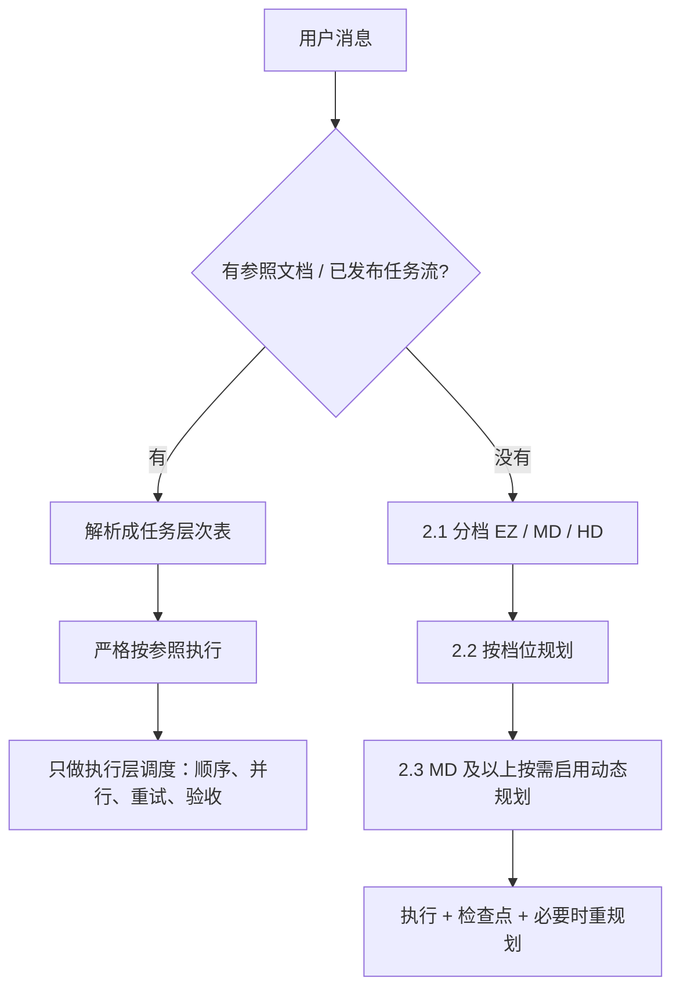

# 任务调度模块（Scheduler）设计

> 文档性质：模块级设计文档。**P0 已落地；P1 只落地结构层**——HTN（§4）与 `(S, R, D)` 闭环（§5）仍是目标态。
> v0.2 按「三档策略 + (S, R, D) 三元组 + 检查点打分」重写，去掉了 v0.1 里的五档阶梯、MCPP、储备曲线等内容。
> v0.3 不改设计，只做对齐：新增 §0.1（实现现状）与 §16（待实现清单），并在各节标注实现状态。
> v0.4 记录 §16.1 落地结果（2026-11-16）：不可逆前置硬门、`d3/d4/d5` 写入、恢复语义、reorder 语义。
> v0.5 记录 §16.2 #6 落地（2026-11-16）：`S` 改为结构化 `FactRecord` 账本。
> v0.6 记录四项收尾（2026-11-16）：Phase 挂 Method 的 HTN 最小模型、换方法与失败冒泡、节流规则、四个按需角色（验收已接入 runner）。
> v0.7 记录 acceptance 结构化（2026-11-17）：条件列表 + 可选机检，机检能定案时不调用模型。
> v0.8 记录五维实测（2026-11-17）：impact 与 uncertainty 改为按依赖图与执行历史计算。
> v0.9 记录事实级冻结快照（2026-11-17）：重开前保留旧摘要与旧事实，随 `RunState.revisions` 落库。
> v1.0 记录前端卡片字段（2026-11-17）：验收结论、检查点分数/动作、执行期事件与降级警告可见。
> 原来的资料与思考稿见 [任务调度策略设计](./任务调度策略设计.md)。

| 项目     | 内容                                                                                                                                                                  |
| :----- | :------------------------------------------------------------------------------------------------------------------------------------------------------------------ |
| 文档版本   | v1.0                                                                                                                                                                |
| 日期     | 2026-11-16                                                                                                                                                          |
| 实现模块路径 | `src/scheduler/`                                                                                                                                                    |
| 关联文档   | [任务调度策略设计](./任务调度策略设计.md)、[任务调度策略开发文档](../develope/任务调度策略开发文档.md)、[分档函数标定实验报告](./notdone/任务调度分档函数标定实验报告.md)、[任务流模块设计](./任务流模块设计.md)、[AgentTeam设计](./AgentTeam设计.md) |
| 一句话    | 先分档，再规划；执行中按检查点打分决定要不要重规划；已完成部分默认冻结，重做必须人工确认                                                                                                                        |

***

## 0. 核心结论

1. **只用三档**：`EZ` 直接 ReAct，`MD` 用 TODO / 任务层次表，`HD` 用 HTN + 层次表。档位越高，计划越显式、检查点越密。
2. **执行路径只有两条**：用户给了参照（阶段划分、开发文档、已发布任务流）就严格照做；没给参照才走"分档 → 规划 → 按需动态规划"。
3. **动态规划的状态是 `(S, R, D)`**：`S` 是已完成事实，`R` 是剩余计划，`D` 是运行时扰动（`d1–d5`）。`D` 才是不可预测的部分。
4. **重规划不改历史**：已完成节点默认冻结；只有 `d3` 人工标记 + `d4` 明确要求时才评估重做，影响大的必须 HITL。
5. **检查点打分不交给 LLM 算总分**：LLM 只给离散等级和理由，权重与总分由系统算，不可逆性是一票否决的硬开关。

***

## 0.1 实现现状与差距（2026-11-16）

### 结论

- **P0 已完成**：分档（7 维聚合 + 有序 logistic + 滞回 + 低置信度升档）与影子评估已落地。
- **P1 结构层 + §16.1 修复 + `S` 结构化 + HTN 最小模型已完成**：两级任务表、依赖 DAG、拓扑波次、检查点打分、四表落库；不可逆前置硬门、`d3/d4/d5` 写入、中断恢复、`FactRecord` 事实账本；Phase 挂 Method、换方法、方法耗尽冒泡、节流规则、四个按需角色。
- **仍缺**：调度指标统计（分档分布、重规划次数、HITL 比例、一次通过率）；`R` 没有独立计划树，`d1/d2` 仍与 `R` 同源；快照只到事实层，不含沙箱文件副本。
- 统计（26 项）：**✅ 19 / ⚠️ 7 / ❌ 0**。

准确的能力描述是：**两级任务表 + 依赖 DAG + 拓扑波次 + 检查点打分**，不是 HTN。

### 逐项对照

| #  | 文档要求                           | 代码落点                                                                    | 状态 | 差距说明                                                                                                                                      |
| :- | :----------------------------- | :---------------------------------------------------------------------- | :- | :---------------------------------------------------------------------------------------------------------------------------------------- |
| 1  | §1.4 分档函数                      | `tiering.py`、`features.py`、`config.py`                                  | ✅  | 边界为冷启动值 `0.40/0.65`，尚未按自有 `S` 分布重取分位                                                                                                      |
| 2  | §1.5 主动学习样本                    | `store.py::add_sample`、`scheduler_tools.py::_record_sample`             | ⚠️ | 只采集，不消费：恒写 `label_source="auto"`、`confidence=0.0`，无采样/去重/重标定                                                                              |
| 3  | §2.1 有参照 → 计划                  | `planner.py::build_reference_plan`                                      | ✅  | `Step` 落为 `P0` 条目，并行子流落为 `P*.n` 阶段                                                                                                        |
| 4  | §2.2 无参照 → 分档 + 规划             | `scheduler_tools.py::scheduler_plan`                                    | ✅  | EZ 直接返回 guidance，不建计划                                                                                                                     |
| 5  | §3 两级层次表 + 迟分解                 | `planner.py::build_plan`、`SchedulePlan.pending_phases`                  | ✅  | MD 只展开前两个阶段；同波次写冲突自动串行化（文档要求报错，实现选择串行）                                                                                                    |
| 6  | §3 `acceptance` 为可判定条件         | `models.py::AcceptanceItem/AcceptanceCheck`                             | ✅  | 每条条件带 text，可选机检 `file_exists / field_equals / regex / command_exit0`；机检能定案时不再调模型                                                          |
| 7  | §4 HTN：复合/原子任务、method、operator | `models.py::PlanMethod`、`planner.py::_normalize_phase`                  | ✅  | Phase 是复合任务、PlanItem 是原子任务、PlanMethod 是拆法；operator 暂不单列，执行体仍为子图                                                                           |
| 8  | §4 换 method、方法全失败向父任务冒泡        | `replanner.py::switch_method`、`runner.py::_switch_or_bubble`            | ✅  | 失败先换未试方法，已完成叶子保留；多方法阶段耗尽则暂停等人工                                                                                                            |
| 9  | §5 `S` 已完成事实账本                 | `RunState.facts: list[FactRecord]`                                      | ✅  | 结构化事实已落库；`verdict` 由 `verification_expert` 在节点完成时判定，没有 `acceptance` 时保持 `unverified`                                                      |
| 10 | §5 `R` 剩余计划                    | `RunState.remaining` + `PlanItem.status`                                | ⚠️ | 无独立剩余计划树，与 `S` 共用同一份 `phases`                                                                                                             |
| 11 | §5.1 `d1` 已完成进度现状              | `delta.d1_progress: float`                                              | ⚠️ | 文档要求进度记录，代码退化为 `done/total` 比例                                                                                                            |
| 12 | §5.1 `d2` 剩余内容复核               | `delta.d2_remaining: int`                                               | ⚠️ | 文档要求复核后的剩余项，代码是 `pending` 计数，与 `R` 同源，不是「重新测量」                                                                                            |
| 13 | §5.1 `d3` 人工介入                 | `scheduler_tools.py::scheduler_replan`                                  | ⚠️ | 每次重规划工具调用写 True；尚无其他人工介入入口                                                                                                                |
| 14 | §5.1 `d4` 用户新增要求               | `scheduler_replan(new_requirement=...)`                                 | ⚠️ | 非空时写 True，检查点消费后清空，避免连续整盘重规划                                                                                                              |
| 15 | §5.1 `d5` 上下文占用                | `ItemOutcome.context_ratio` → `delta.d5_budget_ratio`                   | ✅  | 语义改为上下文窗口占用；达到 `wrapup_ratio` 时不再展开新阶段                                                                                                    |
| 16 | §6 已完成冻结                       | `replanner.py::revise`、`runner.py::_snapshot`                           | ✅  | 重开前落事实级快照 `RevisionRecord`（旧摘要 + 旧事实 + 版本 + 原因），重做追加 `revised`，下游重新验收；不含沙箱文件副本                                                            |
| 17 | §7.1 五维 + 不可逆规则判定              | `checkpoint.py::measure_dimensions`                                     | ✅  | impact 由依赖图算未完成下游 + 资源体积；uncertainty 由重试次数与验收结论算；user\_delta 随 `d4`、成本随 `d5`                                                              |
| 18 | §7.2 `P = σ(β·z + b_tier)`     | `checkpoint.py` + `TierConfig.beta/bias`                                | ✅  | 输入是散装标量，不是完整的 `Delta` 五元组                                                                                                                 |
| 19 | §7.3 不可逆 = 执行前 HITL            | `runner.py::_execute_item`                                              | ✅  | 派发前拦截并暂停；`scheduler_replan(approve=[...])` 解冻后才调用执行器                                                                                      |
| 20 | §8 节流规则                        | `runner.py::_throttle_ok`、`config.py`                                   | ✅  | 同阶段次数、最小节点间隔、连续无进展均生效；命中发 `replan_blocked`                                                                                                |
| 21 | §9.1 reorder 轻量重排              | `replanner.py::reorder`                                                 | ✅  | 手动调用把指定条目提前到波次最前；自动 mid 档只记录，不改计划                                                                                                         |
| 22 | §9.1 subtree / full            | `replanner.py`                                                          | ✅  | 结构变换成立，但语义不是 HTN 换方法                                                                                                                      |
| 23 | §10 四个按需角色                     | `configs/{verification_expert,scheduler_evaluator,replan_advisor}.yaml` | ✅  | `verification_expert` 已接入 runner 判 verdict；评估与顾问角色注册后按需委派                                                                                 |
| 24 | §11 落库四表                       | `store.py`、`scheduler_tools.py`                                         | ✅  | 2026-11-16 修正 store 混用：调度四表曾误用 Agent 的 `AsyncPostgresStore`，写入全部静默失败；改为独立 `SchedulerStore` 后实测落库通过                                        |
| 25 | §13 事件契约                       | `runner.py::_event`、`scheduler_tools.py::emit`                          | ⚠️ | 已补 `method_switched/phase_failed/verification_failed/replan_blocked/scheduler_error/revision_snapshot`；仍缺 `tier_selected`、`budget_update` |
| 26 | §14 P1 验收「kill 后可续跑」           | `runner.py::run` 入口                                                     | ✅  | 恢复时 `running` 回退为 `pending`，保留 `attempts`，不再判 `skipped`                                                                                   |

### §16.1 已修复的 4 处「存在但不生效」（2026-11-16）

1. **不可逆硬门**（#19）：改到 `_execute_item` 派发前拦截，`needs_hitl` 时执行器不会被调用；`scheduler_replan(approve=[...])` 解冻后才执行。
2. **`full` 重规划不可达**（#13/#14）：`scheduler_replan` 写 `d3`，`new_requirement` 写 `d4`，检查点据此触发 `global_scope`；`d4` 消费后清空，避免连续整盘重规划。
3. **`reorder` no-op**（#21）：改为「指定条目提前到波次最前」；自动 mid 档只记录 `reorder`，不再空增版本号。
4. **恢复丢节点**（#26）：`run()` 入口把 `running` 回退为 `pending`，`attempts` 保留。

链路级用例见 `tests/test_scheduler_p1.py`（新增 8 条），不再只测纯函数。

### 端到端验证记录（2026-11-16）

用 `POST /chat/stream` 发一条三阶段自然语言任务，主 Agent 自行调用 `scheduler_plan`：

| 观察点  | 结果                                                                                                                                                  |
| :--- | :-------------------------------------------------------------------------------------------------------------------------------------------------- |
| 分档   | `MD`，`dynamic`                                                                                                                                      |
| 初始计划 | 2 条目（P0/P1），P2 留在 `pending_phases`                                                                                                                  |
| 事件序列 | `planned → run_started → item_started/item_done ×2 → plan_revised(expand, v2) → item_done → checkpoint(reorder, 0.5002) → run_finished(done 3/0/0)` |
| 事实账本 | `scheduler_run.state.facts` 3 条，含 `goal / acceptance / output_ref / duration_ms / verdict=unverified`                                               |
| 落库   | `scheduler_run` 1 行（v2, done）；`scheduler_plan` v1+v2；`scheduler_checkpoint` 1 行                                                                     |

未覆盖：项目代码读取。本次走的是 API 直连，沙箱 `/workspace/sessions/<thread>` 为空，子节点读不到仓库文件；真实项目任务需要先绑定项目目录（前端「打开已有项目」）。

***

## 1. 三档调度策略

|      | `EZ`             | `MD`                               | `HD`                     |
| :--- | :--------------- | :--------------------------------- | :----------------------- |
| 典型任务 | 单点问答、一次查询、单文件小改  | 多步骤但结构清晰，如"调研并写一页结论"               | 目标模糊或长链路，如"重构一个模块并补齐测试"  |
| 计划产物 | 无                | TODO List 或任务层次表（`P0…PN` → `Pi.j`） | HTN 任务网络 + 任务层次表         |
| 执行主体 | 主 Agent ReAct 循环 | 主 Agent + 按需 SubAgent              | 调度器 + 节点执行器 + SubAgent   |
| 并行   | 无                | 同阶段内可并行                            | 按依赖波次并行                  |
| 检查点  | 无（只有最终回答自检）      | 每个 `Pi` 完成时                        | 每个节点 + 阶段门               |
| 动态规划 | 不启用              | 按需（阶段边界或异常时）                       | 默认启用                     |
| 失败处理 | 重试 / 换工具         | 局部重排或重拆当前阶段                        | 换 method / 局部重规划 / 必要时人工 |

### 1.1 EZ

目标明确、步骤不超过 3 步、无跨文件或跨系统依赖、结果可逆。不建计划表，直接走现有主 Agent 循环。**不要为了"看起来有调度"而给 EZ 加计划**，那只会增加一次无用的模型调用。

### 1.2 MD

子目标 3–8 个，依赖关系清晰但存在先后顺序。两种计划形态按情况选：

- **TODO List**：步骤基本线性，前后强依赖，如"读代码 → 改实现 → 跑测试"。
- **任务层次表**：能先分阶段再细化，如"阶段 `P0` 调研、`P1` 方案、`P2` 实现、`P3` 验证"，每阶段再拆 `Pi.1…Pi.n`。

MD 的关键不是拆得细，而是**只细化当前阶段**：`P0` 的 `P0.j` 可以展开，`P1` 之后先只写阶段目标。这样执行中拿到的新信息才用得上。

### 1.3 HD

满足任一条件即进入 HD：

- 子目标超过 8 个，或开始前无法列全；
- 跨资源域（代码 + 数据 + 外部服务）；
- 存在不可逆操作；
- 预计需要后台执行或跨多轮对话；
- 同类的历史任务一次通过率明显偏低。

HD 用 HTN 规划（见第 4 节），执行时按依赖波次调度，节点级检查点，阶段边界做验收门。HD 不是"更努力的 MD"，它的区别是**允许在执行中重新选择方法**，而不是把初始计划执行到底。

### 1.4 分档函数

分档不做硬阈值 if-else，也不做线性加权后卡阈值，而是：

> **归一化特征 → 非线性聚合得到复杂度标量 `S` → 有序 logistic 平滑分档 → argmax + 滞回 + 低置信度升档 + 硬规则覆盖。**

这样保留"阈值分档"的语义，同时连续、可校准、边界不抖。分档要满足五个性质：单调性、非线性聚合、平滑阶跃、有序性（EZ < MD < HD）、可解释且可兜底。

#### 1.4.1 输入特征归一化

| 维度         | 含义               | 归一化方式               |
| :--------- | :--------------- | :------------------ |
| `x1` 复杂度   | 子目标数量、需要推理的环节数   | 计数饱和 `1-exp(-c/c0)` |
| `x2` 不确定性  | 目标模糊度、方案是否唯一     | 离散等级 / 3            |
| `x3` 影响范围  | 涉及文件、模块、外部系统的数量  | 计数饱和                |
| `x4` 任务规模  | 预计轮次、节点数         | 历史分位数裁剪到 `[0,1]`    |
| `x5` 依赖深度  | 依赖链最长路径 / 关键路径长度 | 计数饱和                |
| `x6` 工具多样性 | 需要调用的工具类别数       | 计数饱和                |
| `x7` 验收严格度 | 是否有可判定验收、测试、发布门  | 离散等级 / 3            |

得到 `x = (x1…xn) ∈ [0,1]^n`。**归一化之后权重要重新校准**，不能把原始量纲下的权重直接搬过来。

#### 1.4.2 聚合：加权几何平均

```
S = exp( Σ wi·ln(xi + ε) / Σ wi ),  ε = 1e-3
```

`wi = 1` 时就是几何平均 `(Π xi)^(1/n)`，是 `D = C·I·R·N_t` 乘积型的归一化版本：

- 任一维度趋近 0 时 `S` 平滑下降，但不会像裸乘积那样直接归零；
- 对量纲不敏感，比算术加权和更符合"短板效应"；
- 不使用裸乘积，避免 0 值敏感和阈值难调。

实现时只在**已观测维度**上归一（`Σ wi` 只累加已观测项）。把结构性缺失维度按 0.5 代入并保留权重，等价于把 `S` 往 0.5 拉：P0 有 3 维没有数据源时，所有任务会被压进 `0.3–0.45`，分档失去区分度。缺失维度仍写入特征向量供审计，但不参与 `S`。

#### 1.4.3 有序 logistic 平滑分档

设两个边界 `θ1 < θ2`（EZ/MD、MD/HD），陡峭度 `α > 0`：

```
p_HD = σ( α(S - θ2) )
p_MD = σ( α(S - θ1) ) - σ( α(S - θ2) )
p_EZ = 1 - σ( α(S - θ1) )
```

由于 `θ1 < θ2` 且 `σ` 单调，三者非负且和为 1。`α` 控制过渡带宽度：越大越接近硬阈值，越小过渡越宽、越保守。

`α` 不能随意取小：中间档要被 argmax 选中，必须满足 `α·(θ2-θ1)/2 > ln(2)`，即：

```
α > 2·ln(2) / (θ2 - θ1)
```

低于这个下限时 `p_MD` 永远赢不了 argmax，模型实际退化成二分类。这是实测中 `α` 从 12 调到 16 才恢复三档的直接原因。

另有一个容易踩的偏差：`θ1/θ2` 是隶属度参数，**不是 argmax 的真实分界**。两档概率相等的位置需要数值求解，实测 `b1 > θ1`、`b2 < θ2`。滞回必须围绕 `b1/b2` 设置，否则边界附近永远不会拦截。P0 实现中由 `decision_boundaries()` 二分求解，并有单测锁定。

#### 1.4.4 决策规则

```
1. 硬规则覆盖：用户指定档位 / 不可逆操作 / 强约束 → 直接定档，跳过概率
2. tier = argmax(p_EZ, p_MD, p_HD)
3. 若 max(p) < τ（默认 0.6）→ 保守升一档；连续两次升档 → HITL
4. 滞回：当前档只在跨过外扩边界后才切换
   θ_up = θ + δ, θ_down = θ - δ
   当前 EZ，需 S > θ1 + δ 才升 MD；当前 MD，需 S < θ1 - δ 才降 EZ
```

低置信度默认升档，因为**低估复杂度的代价高于高估**：高估只多花一点计划成本，低估会导致中途重规划甚至任务失败。

#### 1.4.5 参数

| 参数          | 定法                             | 基线值                             |
| :---------- | :----------------------------- | :------------------------------ |
| 权重 `wi`     | 冷启动专家先验；有标注后用有序 logistic 拟合    | 专家先验（真实数据集无 7 维特征，暂不能拟合）        |
| 边界 `θ1, θ2` | **按自有 `S` 的分位数对齐**，不跨特征空间复制    | `θ1 = 32.7% 分位`、`θ2 = 84.0% 分位` |
| 陡峭度 `α`     | 真实数据拟合，且满足 `α > 2·ln2/(θ2-θ1)` | `7.2`                           |
| 置信阈值 `τ`    | 准确率与严重低估率的权衡                   | `0.55`（平衡）/ `0.60`（保守）          |
| 滞回宽度 `δ`    | 由同一任务重复评估的波动幅度估计               | `0.02–0.04`                     |
| `ε`         | 只防 `log(0)`                    | `1e-3`                          |

以上参数已用合成数据 + 真实数据集（`regolo/brick-complexity-extractor`）标定，拟合过程、对比实验与抖动数据见 [分档函数标定实验报告](./任务调度分档函数标定实验报告.md)。真实标注积累后需要在其上重新拟合。

两条必须遵守的工程约束：

1. **边界按分位对齐，不搬绝对值**：文本模型拟合出的 `θ=0.265/0.759` 只属于文本分数空间，7 维 `S` 的分布不同，直接复制会系统性错档。
2. **`α` 先过下限再调**：真实数据拟合值约 `7.2`，合成数据因为特征几乎无重叠会推到 `59.7`；后者不代表真实场景。

#### 1.4.6 与检查点触发函数的关系

分档函数和检查点触发函数是**两个函数，不合并**：

|      | 分档函数               | 触发函数                   |
| :--- | :----------------- | :--------------------- |
| 作用对象 | 整个任务               | 单个检查点事件                |
| 输入   | 任务静态/半静态特征         | `(S, R, D)` + 事件       |
| 输出   | EZ/MD/HD 隶属度       | 重规划概率 `P(replan)`      |
| 形式   | 几何聚合 + 有序 logistic | 归一化线性 + logistic + 硬门控 |

分档结果是触发函数的**条件变量**：EZ 档阈值高、HD 档阈值低（见 §7.3）。

#### 1.4.7 参数的适用边界

这组参数（`α=7.2`、`θ=0.265/0.759`）只对**同一个文本分数空间**成立，不能理解成"拿用户文本套公式就能分档"。

| 情况                 | 能否直接套                   | 说明                             |
| :----------------- | :---------------------- | :----------------------------- |
| 完整复刻同一 TF-IDF + LR | 可以，但只分 query 难度         | 换领域、换语言、换模型版本后必须重新标定           |
| 使用调度器自己的 7 维 `S`   | **不能套 `θ`**，只借 `α` 与分位法 | `θ` 取自有 `S` 的 32.7% / 84.0% 分位 |
| 只给一段用户文本           | 不够                      | 7 维里只有 3 维能部分从文本推断             |

文本能覆盖的维度：复杂度、不确定性、验收严格度（部分）。文本拿不到的：影响范围、依赖深度、工具多样性，必须从会话、仓库和当前工具集读取。

典型反例：同一句"把登录逻辑改一下"，单文件可回滚时是 MD；跨三个服务、动数据库、不可逆时是 HD。文本一样，档位不同。

冷启动顺序：

1. 规则覆盖 + LLM 对 7 维打低/中/高，算 `S`，按分位分档；
2. 文本模型只作为 `x` 的辅助信号，不做唯一入口；
3. 积累 100 条带结果的样本后再拟合 `wi`。

所以：**公式存在，但它的输入是 7 维特征，不是一段文本。**

### 1.5 主动学习：让执行过程产生训练数据

参数不能一次拍死。每次执行都顺带产出样本，让分档模型在使用中变准，且不明显增加用户负担。

#### 1.5.1 每条样本记什么

| 字段                 | 说明                               |
| :----------------- | :------------------------------- |
| `features`         | 7 维归一化特征 `x`                     |
| `task_kind`        | 任务类型（哈希后的粗分类，不存原文）               |
| `tier_chosen`      | 本次选择的档位                          |
| `outcome`          | 成功 / 降级 / 重规划次数 / 是否 HITL / 实际成本 |
| `label_source`     | `user` / `outcome` / `llm`       |
| `label_confidence` | 对应置信度                            |

只存归一化特征与结果，不存原始对话。

#### 1.5.2 标签的三种来源

| 来源     | 获取方式                               | 置信度 | 用途            |
| :----- | :--------------------------------- | :-- | :------------ |
| 用户纠正   | 用户手动改档，或说"太重了 / 不够细"               | 1.0 | 强标签，优先使用      |
| 结果反推   | 一次通过 → 档位不低于实际所需；触发重规划或失败 → 档位可能偏低 | 0.6 | 弱标签，只做下界/成对约束 |
| LLM 复核 | 灰区或低置信度时判档                         | 0.4 | 银标签，仅用于扩充样本   |

必须去偏：成功不能证明档位选对（可能高估），失败也不一定是档位问题。所以弱标签只作为"档位下界"和成对比较，不直接当多分类标签用。

#### 1.5.3 采样策略

- **不确定性采样**：`max(p) < τ` 的样本信息量最大，优先送 LLM 复核或向用户确认；
- **边界采样**：`S` 落在 `θ ± δ` 内的样本；
- **分层采样**：三档各保留最低比例，避免 HD 样本稀少导致模型系统性偏低；
- **去重降权**：同 `task_kind` 且特征距离过近的样本降权，防止单一场景刷爆训练集。

#### 1.5.4 重标定节奏

- 每积累 100 条样本或每周一次，重新拟合 `w / θ / α`；
- 留出集上比较新旧模型：主指标是**严重低估率**（真实 HD 被判成 EZ），次指标是 ordinal MAE；
- 新模型需同时满足"严重低估率不升"且"准确率提升 ≥ 1pp"才允许上线；
- 权重版本化，保留上一版可回滚；冷启动阶段继续使用专家先验；
- 漂移检测：连续两个窗口严重低估率上升超过 5pp，回退专家先验并告警。

#### 1.5.5 与系统对接

- 样本写进现有轨迹/用量存储的扩展表，不新建数据库；
- 用户在 HITL 里改档就是最强的标注入口；
- 重标定是离线任务，不进入在线请求链路。

***

## 2. 两条执行路径



### 2.1 有参照

参照的优先级从高到低：用户本轮给的阶段划分 → 已发布的任务流 → 会话中约定的开发文档 → 用户历史偏好。

- 参照文档是**目标层和执行层都不改**，Agent 只负责执行层调度：哪些能并行、失败了怎么重试、每步怎么验收。
- 如果参照本身有冲突或缺失，先局部推断补齐，把推断结果标注为"补全项"，不静默改写用户的分阶段。
- 只有在执行中发现参照与事实冲突（比如文档里的文件已不存在），才向用户报告并请求确认，不自行重构阶段。

### 2.2 无参照

1. **分档**：按 §1.4，得到 `EZ / MD / HD` 与理由。
2. **规划**：EZ 不产出计划；MD 产出 TODO 或两级任务层次表；HD 产出 HTN 任务网络。
3. **启用动态规划**：MD 及以上，把计划、进度、扰动装入 `(S, R, D)`，在检查点决定是否重规划。

### 2.3 两条路径的共同约束

- 计划一旦落盘就有版本号，重规划只能新增版本，不能覆盖历史。
- 任何"跳过未完成节点直接做后面"的行为都要显式记录原因。
- 用户随时可以打断；打断后从最近检查点恢复，并从用户新要求重新计算 `d4`。

***

## 3. 任务层次表

MD 和 HD 共用的计划载体。

```
P0 调研
├── P0.1 读现有实现
├── P0.2 确认依赖边界
└── P0.3 输出约束清单
P1 方案
├── P1.1 设计接口
└── P1.2 标注风险点
P2 实现（未展开）
P3 验证（未展开）
```

| 字段           | 说明                                   |
| :----------- | :----------------------------------- |
| `phase_id`   | `P0…PN`，阶段级里程碑                       |
| `item_id`    | `Pi.j`，阶段内的可执行项                      |
| `goal`       | 一句话目标，不是步骤描述                         |
| `depends_on` | 依赖项，决定顺序与并行                          |
| `executor`   | `main` / `subagent:<角色>` / `auto`    |
| `acceptance` | 可判定验收条件，不能是"看起来对"                    |
| `status`     | `pending / running / done / skipped` |
| `expanded`   | 是否已细化；未展开的 `Pi` 只保存目标                |

规则：

- 只展开当前阶段与下一个阶段，后面的阶段保持未展开。这是"迟分解"，用执行中得到的真实信息替代开工前的猜测。
- `skipped` 必须在最终产出里显式声明，不能当作 `done`。
- TODO List 视为只有一层、每项都是 `P0.j` 的退化层次表，不另建模型。

***

## 4. HD 的 HTN 规划

> **实现状态（2026-11-16，已落地最小模型）。** 映射：`PlanPhase` = 复合任务，`PlanItem` = 原子任务，`PlanMethod` = 方法（含 `precondition` / `reason` / items 蓝图），`operator` 不单列（执行体仍是节点子图）。未提供 `methods` 时自动合成 `Px.m0`，与旧计划兼容。
>
> 展开与换法：`planner._normalize_phase` 取第一个方法物化为 `phase.items`；失败时 `replanner.switch_method` 换下一个未试方法，已完成叶子保留、失败条目被替换；`runner._switch_or_bubble` 在多方法阶段方法耗尽时暂停并请求人工。`subtree` 仍是「重置失败节点」，与换方法是两条路径。

HTN 在这里只保留最小可用的部分，不引入完整的规划器：

| 概念         | 含义          | 在本系统里               |
| :--------- | :---------- | :------------------ |
| 复合任务       | 还需要继续拆的任务   | 层次表里的 `Pi`，未展开      |
| 原子任务       | 可以直接执行的任务   | `Pi.j`，对应一次节点执行     |
| 方法（Method） | 完成复合任务的一种做法 | 一个 `Pi` 下的一组候选拆分方案  |
| 前置条件       | 方法可用的条件     | 依赖是否满足、预算是否够、工具是否可用 |

执行语义：

- **AND**：子任务全部完成才算完成，按 `depends_on` 排序。
- **OR**：多种方法选一种，由 `scheduler_planner` 选择并记录理由；失败后可以换下一个方法，而不是从头重来。
- 方法的展开仍然遵守"只展开当前阶段"。

重规划在 HTN 里的含义很具体：**换方法，不重写整个任务网络**。已完成叶子节点保留，只替换未展开的复合任务。如果所有方法都不可用，才向上冒泡到父任务重新选方法。

映射到现有结构：

| 现有结构                            | 映射                                       |
| :------------------------------ | :--------------------------------------- |
| `TaskFlow.Step`                 | 原子任务，直接作为 `Pi.j`                         |
| `TaskFlow` 的 fork               | AND 关系中的并行子任务                            |
| `create_work_plan` 的 `WorkItem` | 原子任务（`owner → executor`，`depends_on` 保留） |
| SubAgent YAML                   | 原子任务的 `executor`                         |

***

## 5. 动态规划状态：`(S, R, D)`

> **实现状态（2026-11-16，§16.1 + `S` 结构化后）。** `S` 已是 `RunState.facts: list[FactRecord]`，唯一来源；`summary` 只是渲染视图，节点 prompt 与完整重规划的 `_carry_done` 都读 facts。仍是「字段近似」：`score_checkpoint` 收散装标量而非 `Delta`；`d1/d2` 仍是对同一份 `phases` 的重算；`R` 没有独立计划树。

| 分量  | 含义                         | 谁写                                      | 是否可变  |
| :-- | :------------------------- | :-------------------------------------- | :---- |
| `S` | 已完成任务的简要总结：做了什么、产出是什么、验收结论 | 执行器在节点完成时追加 `FactRecord`；重做追加 `revised` | 只增不改  |
| `R` | 剩余未完成任务的描述，来自当前版本的计划       | 规划 / 重规划写入                              | 可整体重写 |
| `D` | 现有任务进度与扰动                  | 每轮检查点刷新                                 | 每轮替换  |

三者边界必须清楚，否则实现时会把同一份信息存三遍：

- `S` 是**事实账本**，只回答"已经发生了什么"。
- `R` 是**计划视图**，只回答"原计划还要做什么"。
- `D` 是**实测视图 + 扰动**，回答"现在实际情况和计划差多少、有没有外部变化"。

### 5.1 `D` 的五个分量

| 分量           | 含义                       | 典型来源               | 更新时机    |
| :----------- | :----------------------- | :----------------- | :------ |
| `d1` 已完成进度现状 | 已完成项的实际质量、耗时、是否达标        | 检查点验收结果            | 每个节点完成  |
| `d2` 剩余内容现状  | 重新核对后真正还剩什么（可能与 `R` 不一致） | 执行器对未完成项的复核        | 每个检查点   |
| `d3` 人工介入标记  | 用户打断、接管、要求重做、临时跳过        | 对话事件               | 用户动作发生时 |
| `d4` 用户新增要求  | 本轮新增或变更的需求               | 用户消息解析             | 用户消息到达时 |
| `d5` 上下文占用   | 节点执行后的上下文窗口占用比例          | 节点回传的近似 token / 窗口 | 每个节点完成  |

`d1/d2` 是对 `R` 的重新测量：计划说还剩 5 项，实际可能只剩 3 项、或者多出 1 项。**两者不一致时以实测为准，并触发一次重规划**。

`d5` 只记一件事：**上下文窗口占用比例**。其余资源（时间、token 预算、并发）Agent 都拿不到可信读数，硬造出来只会误导决策；上下文满会触发压缩，是唯一能稳定观测的资源。占用达到 `wrapup_ratio`（默认 `0.80`）时进入"收尾模式"：不再展开 `pending_phases` 里的新阶段。

### 5.2 `D` 与 v0.1 的 `D` 不是同一个东西

v0.1 里的 `D = C·I·R·N_t` 是**任务难度**，用来选档；这里的 `D` 是**运行时扰动向量**，用来决定要不要重规划。文档和代码里必须分开命名（建议前者叫 `difficulty`，后者叫 `delta`），否则一定混。

### 5.3 版本

每次重规划生成 `plan_version + 1`，保存 `(S, R_new, D_trigger)`。`S` 不随版本回滚；回滚计划只回滚 `R`。

***

## 6. 已完成部分默认冻结

这是硬规则，不是建议：

> 已完成的任务不可回退重做，除非人工介入标记（`d3`）且用户明确表达"已完成的部分不符合需求"（`d4`）。

### 6.1 允许重做的唯一入口

必须同时满足：

1. `d3` 有明确的人工标记（用户说"重做""前面的不对""换个方向"）；
2. `d4` 能定位到具体受影响的范围；
3. Agent 已完成影响评估。

只有用户抱怨但没说清范围时，先问清楚范围，不直接开工。

### 6.2 影响评估三项

| 项    | 怎么算                         |
| :--- | :-------------------------- |
| 影响范围 | 受影响已完成节点数、下游未完成节点数、涉及文件/资源数 |
| 重做成本 | 需要重跑的节点预算之和，占总预算比例          |
| 可逆性  | 重做是否会覆盖不可逆产出（已发布、已外部写入、已删除） |

### 6.3 分级处理

| 情况                      | 处理                                      |
| :---------------------- | :-------------------------------------- |
| 只影响 1 个已完成节点，且产出可局部修补   | Agent 自动修补，记录 `revision`，在最终产出里说明       |
| 影响 ≤2 个已完成节点，且全部可逆      | Agent 决定是否重做，做完后告知，不阻塞                  |
| 需要重构、影响 ≥3 个节点，或涉及不可逆操作 | **必须 HITL**：给出为什么重做、影响清单、不重做的替代方案，由用户决定 |

HITL 的提问必须是决策型的，例如"重做 `P1` 会让已完成的 3 个文件失效，是否继续？替代方案是只修 `P1.2`，是否可接受？"，而不是"要不要重做？"

### 6.4 重做时的保护

- 原产出保留快照，新产出写新版本，不做原地覆盖。
- 重做节点的 `S` 记录追加一条 `revised`，不删除原记录。
- 重做完成后，下游所有节点必须重新验收，不能默认继承旧结论。

> **实现状态（2026-11-17，事实级）。** 重开前写 `RevisionRecord`：旧状态、旧摘要、旧事实、`plan_version` 与原因；`RunState.revisions` 随 JSONB 落库，最多保留 100 条。沙箱文件不复制，真正的文件级回滚需要执行器配合，暂不做。

***

## 7. 检查点打分

检查点不是"每个节点都评估一遍"，那样成本高于收益。做法是：**先用规则过滤，只对软触发点打分**。

### 7.1 维度与判定方式

| 维度     | LLM 是否擅长 | 判定方式                         | 取值          |
| :----- | :------- | :--------------------------- | :---------- |
| 影响范围   | 中等       | LLM 初判 + 依赖图/任务表校验           | 低 / 中 / 高   |
| 不确定性   | 中等       | LLM 给离散等级 + 置信度，不给小数         | 低 / 中 / 高   |
| 不可逆性   | 弱        | **必须由规则/工具判定**（删除、发布、付款、外部写） | 是 / 否       |
| 用户新增要求 | 强        | LLM 做语义解析和影响初判               | 无 / 局部 / 全局 |
| 调度成本   | 弱        | **系统算**：token、时间、重试、预算比例     | 比例值         |
| 风险解释   | 强        | LLM 生成理由和证据，只用于审计            | 文本          |

两条硬规则：

1. **不可逆性不参与加权**，命中即视为硬触发，直接进入 HITL 或强制门。
2. **LLM 不输出总分**。它只输出等级（低/中/高），等级到分数的映射、权重、阈值全部在代码里。

> **实现状态（2026-11-17，规则实测）。** `impact = 未完成下游条目数 + min(写入路径数 + 不可逆, 2)`，阈值 2/5 分低中高；`uncertainty` 按失败、重试次数、最新验收结论判定；`irreversible` 在派发前拦截；`user_delta` 随 `d4`；`cost` 随 `d5`。检查点事件与落库都会带上实测的 `impact/uncertainty`。

### 7.2 触发函数：`P(replan)`

五个维度归一化后组成 `z`，用 logistic 输出重规划概率，而不是先搓一个 0–1 分数再卡阈值：

```
z_impact      = 低 0 / 中 0.5 / 高 1
z_uncertainty = 低 0 / 中 0.5 / 高 1
z_user_delta  = 无 0 / 局部 0.5 / 全局 1
z_cost        = 已用预算 / 预算上限，截断到 1

P = σ( β·z + b_tier )
```

- `β` 冷启动取专家权重 `[0.35, 0.25, 0.20, 0.20]`，有标注后拟合；
- `b_tier` 是档位条件项（EZ `-0.8` / MD `0` / HD `+0.5`），实现"EZ 阈值高、HD 阈值低"；
- LLM 只提供离散等级和理由，不输出 `P`，也不参与权重校准。

### 7.3 阈值与动作

| 条件                | 动作                   |
| :---------------- | :------------------- |
| `不可逆 == 是`        | 硬触发：执行前 HITL，不进入概率判断 |
| `P ≥ 0.70`        | 触发重规划（见第 9 节）        |
| `0.45 ≤ P < 0.70` | 记录，允许一次轻量重排（只调剩余顺序）  |
| `P < 0.45`        | 继续执行，不打断             |
| 连续 2 次 `P ≥ 0.70` | 重规划后仍无进展，进入 HITL     |

> **实现状态（2026-11-16，§16.1 后）：首行已落地。** 不可逆条目在 `_execute_item` 派发前拦截，返回 `needs_hitl` 并暂停整条 run；用户确认后由 `scheduler_replan(approve=[item_id])` 解冻再执行，执行器此时才被调用。`0.70 / 0.45` 两个阈值与 `max_replan=3` 已生效；`0.45 ≤ P < 0.70` 目前只记录 `reorder`，不改计划。

### 7.4 什么时候不打分

- EZ 档全程不打分。
- 已完成且验收通过的节点不打分。
- 同一阶段已经触发过重规划，且没有新的 `d4`，不重复打分。
- 低风险可逆的中间节点不打分，只在阶段边界打。

### 7.5 可解释性

每次评分落盘：五维原始等级、规则命中项、最终分数、动作、理由文本。事后能回答"为什么在这次检查点重规划了"。理由文本由 LLM 写，但不参与决策。

***

## 8. 里程碑触发时机

> **实现状态（2026-11-16，节流已落地）。** `_throttle_ok` 覆盖：总次数 `max_replan`、同阶段 `phase_replan_limit`、间隔 `replan_min_nodes`、连续无进展 2 次；命中发 `replan_blocked` 并继续执行。硬触发里「不可逆」改在派发前拦截（§7.3），「预算」用 `d5` 上下文占用代替，「失败耗尽」由换方法与阶段暂停处理。

调度决策的触发源分三类，先分类再决定要不要打分。

| 类别  | 触发源                  | 是否打分 | 动作              |
| :-- | :------------------- | :--- | :-------------- |
| 硬触发 | 不可逆操作前（删除、发布、外部写、付款） | 否    | HITL            |
| 硬触发 | 用户新增要求 / 用户打断        | 否    | 立即刷新 `d4`，进入重规划 |
| 硬触发 | 预算剩余 < 10%           | 否    | 收尾模式或请求扩容       |
| 硬触发 | 同一节点失败重试耗尽           | 否    | 局部重规划           |
| 软触发 | 阶段 `Pi` 完成           | 是    | 按分数决定           |
| 软触发 | 依赖波次边界               | 是    | 按分数决定           |
| 软触发 | 关键路径节点完成             | 是    | 按分数决定           |
| 软触发 | 执行中发现新依赖             | 是    | 按分数决定           |
| 不触发 | EZ 全程、可逆的中间节点        | 否    | 继续              |

节流规则（防震荡）：

- 同一阶段最多触发 1 次重规划；
- 两次重规划之间至少间隔 2 个完成节点；
- 连续 2 次重规划没有新增完成节点 → 升级为 HITL，不再自动重规划；
- 单次执行重规划总次数上限 3。

***

## 9. 重新规划怎么做

### 9.1 先定范围，再谈内容

| 范围            | 适用                              | 改什么                                  |
| :------------ | :------------------------------ | :----------------------------------- |
| 重排（reorder）   | 只是顺序不优，目标与拆分不变                  | 同波次内顺序：把指定条目提前到该波次最前；不改 `depends_on` |
| 局部重拆（subtree） | 某个 `Pi` 的方法不可行，或 `d2` 与 `R` 偏差大 | 只替换该 `Pi` 下的子任务                      |
| 整体重规划（root）   | 目标本身变了，或参照冲突                    | 重建未完成部分，已完成部分不动                      |

默认从最小范围开始：能重排就不重拆，能重拆就不重规划。

### 9.2 六步流程

1. **对齐事实**：用 `S` 刷新 `d1`，重新核对未完成项得到 `d2`。
2. **判定范围**：按 §9.1 选 reorder / subtree / root。
3. **生成候选**：最多 3 个，例如"保持并补一项""替换当前阶段方法""缩小范围先交付"。
4. **评估**：规则算成本与影响，LLM 只给风险等级和理由。
5. **提交新版本**：`plan_version + 1`，已完成节点原样保留，未完成节点迁移或重拆。
6. **告知**：发事件 + 阶段性摘要；涉及冻结节点时转 HITL。

### 9.3 各档位的差异

| 档位 | 重规划范围             | 典型做法                  |
| :- | :---------------- | :-------------------- |
| EZ | 不重规划              | 换工具、换参数、直接重试          |
| MD | reorder / subtree | 调整剩余 `Pi.j`，必要时重拆当前阶段 |
| HD | subtree / root    | 换 HTN 方法；目标变化时重建未完成部分 |

### 9.4 重规划后的通知

用户不需要看到完整的新计划。只给三样：**为什么改、改了什么、下一步做什么**。阶段级的细节放在执行卡片里，用户想下钻再看。

***

## 10. 角色分工

> **实现状态（2026-11-16，角色已注册）。** `verification_expert` 由 `scheduler_tools.make_verifier` 直接调用（复用 YAML 提示词，一次模型调用出 `verdict`）；`scheduler_evaluator` 与 `replan_advisor` 已注册为可按需委派的 SubAgent，runner 暂不自动调用。主 Agent 仍承担 EZ 与入口判断。

不新增常驻 Agent，全部按需调用，能用一个工具解决的就不起子 Agent。

| 角色                    | 职责                        | 何时调用         | 输出               |
| :-------------------- | :------------------------ | :----------- | :--------------- |
| 主 Agent               | 执行 EZ；决定是否交给调度器           | 每轮入口         | 直接产出或调度请求        |
| `scheduler_planner`   | 分档、生成 TODO / 层次表 / HTN 网络 | 无参照的入口；整体重规划 | 计划 + 理由          |
| `scheduler_evaluator` | 检查点五维打分、风险等级、理由           | 软触发点         | 等级 + 理由，**不给总分** |
| `verification_expert` | 可判定验收 + 必要的语义复核           | 节点完成、阶段门     | 通过 / 不通过 + 证据    |
| `replan_advisor`      | 影响评估、候选方案、重做成本            | 需要重拆或重做时     | ≤3 个候选 + 影响清单    |

约束：

- `scheduler_evaluator` 不参与执行，避免"自己评自己"。
- `verification_expert` 的验收标准必须来自计划里的 `acceptance`，不能临场发挥。
- 四个角色都可以先用现有 SubAgent 装载机制注册，不新增运行时概念。

***

## 11. 与现有机制的对接

| 现有机制                    | 接入方式                                                 | 注意                |
| :---------------------- | :--------------------------------------------------- | :---------------- |
| `task_flow`             | 有参照路径直接消费 `TaskFlow`，`Step` 落为原子任务                   | 现有注入式执行保留为降级路径    |
| `create_work_plan`      | 作为 MD 的计划载体，扩展 `parent_id` 支持两级                      | 现有波次与写冲突检测直接复用    |
| `task_flow_step_update` | 作为进度上报工具，增加 `checkpoint_score` 字段                    | 增加"跳步必须带原因"的校验    |
| SubAgent 装载             | 注册规划/评估/验证/重规划建议四个角色                                 | 不常驻               |
| `RunSupervisor`         | 负责节点内瞬时异常重试                                          | 调度器管"是否重试"，避免重试叠乘 |
| `ContextBudget`         | 管上下文窗口；`d5` 管任务总预算                                   | 两者独立，任一不满足都不派发    |
| checkpointer            | 继续管会话状态                                              | 调度检查点另存，不塞进对话状态   |
| HITL                    | 复用 `request_user_choice` / `request_additional_info` | 重做授权必须用决策型选项      |
| 事件流                     | 新增 `scheduler_progress`，风格对齐 `task_flow_progress`    | 前端复用任务流执行卡片       |
| 异步任务                    | HD 长任务走现有 Agent Protocol                             | 提交后仍需检查点          |
| `PdcGuard`              | 最终回答级自检                                              | 调度器不重复语义自检        |

***

## 12. 最小数据结构

```python
class Tier(str, Enum):
    EZ = "EZ"
    MD = "MD"
    HD = "HD"

class PlanMode(str, Enum):
    REFERENCE = "reference"   # 严格按参照执行
    DYNAMIC = "dynamic"       # 分档 + 规划 + 动态调度

class Item(BaseModel):
    item_id: str                  # P0.1
    phase_id: str                 # P0
    title: str
    executor: str = "main"
    depends_on: list[str] = []
    acceptance: list[Acceptance] = []
    status: Literal["pending", "running", "done", "skipped"] = "pending"

class Phase(BaseModel):
    phase_id: str                 # P0
    goal: str
    items: list[Item] = []
    expanded: bool = False

class Plan(BaseModel):
    version: int
    tier: Tier
    mode: PlanMode
    phases: list[Phase]

class FactRecord(BaseModel):          # 已落地：src/scheduler/models.py
    item_id: str
    phase_id: str = ""
    goal: str = ""                    # 节点目标
    output_ref: str = ""              # 产出引用：run_id:item_id 子图线程号
    output_digest: str = ""           # 执行器回传的产出摘要，截断 500 字
    acceptance: str = ""              # 验收条件快照
    verdict: Literal["unverified", "passed", "failed", "waived"] = "unverified"
    evidence: list[str] = []          # 证据：写入路径等
    attempts: int = 1
    duration_ms: int = 0
    finished_at: str = ""
    revised: bool = False             # 重做后追加的新事实

class AcceptanceItem(BaseModel):     # 已落地：src/scheduler/models.py
    text: str                         # 一条可判定的验收条件
    check: Optional[AcceptanceCheck] = None

class AcceptanceCheck(BaseModel):
    kind: Literal["file_exists", "field_equals", "regex", "command_exit0"]
    target: str = ""                  # 文件路径；command_exit0 时为命令
    expect: str = ""                  # regex 用正则；field_equals 用 "key=value"

class Delta(BaseModel):
    d1_progress: list[ProgressRecord]      # 已完成实测
    d2_remaining: list[str]                # 复核后的剩余项
    d3_human_flags: list[HumanFlag]        # 打断 / 接管 / 重做
    d4_requirements: list[str]             # 新增要求
    d5_budget: BudgetUsage                 # 剩余预算

class CheckpointScore(BaseModel):
    impact: Level                          # low / mid / high
    uncertainty: Level
    irreversibility: bool
    user_delta: Level
    cost_ratio: float
    score: float                           # 系统计算
    action: Literal["continue", "reorder", "replan", "hitl"]
    reasons: list[str]                     # LLM 生成，仅审计
```

***

## 13. 事件

沿用现有 custom stream 风格，统一包裹为 `{"type": "scheduler_progress", "event": ...}`。

**实际事件（2026-11-16，前端已按此消费）**：

| `event`               | 关键字段                                                                           | 发出位置                                 |
| :-------------------- | :----------------------------------------------------------------------------- | :----------------------------------- |
| `planned`             | `run_id`、`goal`、`tier`、`mode`、`plan_version`、`item_count`、`waves`、`plan_items` | `scheduler_tools.py::scheduler_plan` |
| `run_started`         | `run_id`、`tier`、`plan_version`、`item_count`                                    | `runner.py::run`                     |
| `item_started`        | `run_id`、`item_id`、`phase`、`plan_version`                                      | `runner.py::_execute_item`           |
| `item_done`           | `run_id`、`item_id`、`status`、`plan_version`、`attempts`                          | `runner.py::run`                     |
| `item_failed`         | `run_id`、`item_id`、`error`、`attempts`                                          | 同上                                   |
| `item_skipped`        | `run_id`、`item_id`、`reason`                                                    | 同上                                   |
| `item_needs_hitl`     | `run_id`、`item_id`、`reason`                                                    | 同上                                   |
| `checkpoint`          | `run_id`、`item_id`、`score`、`action`、`scope`、`reason`、`plan_version`            | 同上                                   |
| `replan_blocked`      | `run_id`、`phase_id`、`reason`                                                   | `runner.py::_throttle_ok`            |
| `verification_failed` | `run_id`、`item_id`、`evidence`                                                  | `runner.py::run`                     |
| `method_switched`     | `run_id`、`phase_id`、`item_ids`、`reason`、`plan_version`                         | `runner.py::_switch_or_bubble`       |
| `phase_failed`        | `run_id`、`phase_id`、`reason`                                                   | 同上                                   |
| `scheduler_error`     | `run_id`、`code`、`message`                                                      | 验收异常 / 落库失败等降级上报                     |
| `revision_snapshot`   | `run_id`、`item_ids`、`plan_version`、`reason`                                    | 重开前的事实级快照                            |
| `plan_revised`        | `run_id`、`scope`、`plan_version`、`item_ids`、`reason`、`plan_items`               | `runner.py` / `scheduler_replan`     |
| `run_finished`        | `run_id`、`status`、`plan_version`、`done`、`failed`、`skipped`                     | `runner.py::run`                     |

与最初设计的差异：`tier_selected`、`plan_created`、`checkpoint_scored`、`budget_update` 未使用；`replan_started/replan_done` 合并为 `plan_revised`；新增 `method_switched / phase_failed / verification_failed / replan_blocked` 四个执行期事件。

***

## 14. 分期落地

### P0：MD 闭环

> **状态：已完成**（除 §1.5 主动学习闭环外，样本只采集不消费）。

- 分档规则 + `scheduler_planner` 三选一兜底；
- TODO / 两级任务层次表，扩展 `create_work_plan` 的父子关系；
- 检查点打分（规则项 + LLM 等级）、reorder / subtree 两种重规划；
- 事件与控制台日志，默认关闭开关。

验收：同一输入分档结果稳定；打分可复现（同等级同分数）；重规划不改 `S`；关闭开关后现有链路无变化。

### P1：HD + HTN + 检查点持久化

> **状态：基本完成。** HTN 换方法、节流规则、不可逆硬门、断点续跑、验收角色均已落地；剩余 `acceptance` 结构化与重做快照保护。

- HTN 方法选择与换方法重规划；
- 节点级检查点与恢复前验收；
- 不可逆操作硬门、HITL 重做授权。

验收：kill 进程后可续跑；脏检查点会回退；重做必须经过 HITL；所有不可逆操作有拦截记录。

### P2：角色与前端

> **状态：部分。** 四个角色已注册、验收已接入 runner；前端卡片已展示验收结论、检查点分数/动作、执行期事件与降级警告；指标统计未开始。

- 四个内置角色注册为 SubAgent；
- 前端执行卡片展示阶段、检查点分数、重规划原因；
- 指标统计：分档分布、重规划次数、HITL 比例、一次通过率。

***

## 15. 边界与待定

1. **分档一定会有误判**：所以宁可初始偏低，用执行中的升档兜底，不要一开始就 HD。
2. **迟分解牺牲并行度**：后面的阶段不提前展开，就少了一些并行机会，这是有意的取舍。
3. **LLM 只给等级**：任何"让模型输出 0.73 分"的设计都应拒绝；等级 + 理由足够，分数由系统算。
4. **重做成本高**：冻结原则会让"早期错误"更难纠正，所以阶段门的验收要严，而不是事后靠重做补。
5. **`d2` 与 `R` 的偏差**是重规划的主要信号，实现时必须真的去复核，不能直接复制 `R`。
6. **与 v0.1 的关系**：v0.1 的五档、储备曲线、MCPP 候选评估暂不实现；如果后续出现明确的预算失控或长任务并发现象，再单独引入。

***

## 16. 待实现清单（按优先级）

排序原则：先让已声称的能力真的生效，再补文档承诺的语义，最后做角色与前端。每一批都要有链路级用例，不能只测纯函数。

### 16.1 第一批：修「存在但不生效」（已完成，2026-11-16）

> **状态：5 项全部完成**，链路级用例见 `tests/test_scheduler_p1.py`。#5 的取舍：自动 mid 档只记录不改计划，手动 reorder 把目标条目提前到波次最前。#3 的口径：`d5` 记上下文窗口占用，不用 token/时间估算。

| #  | 项                                                                | 落点                                               | 验收                                                      |
| :- | :--------------------------------------------------------------- | :----------------------------------------------- | :------------------------------------------------------ |
| 1  | 不可逆条目改为派发前硬门：`irreversible=True` 在进入重试与概率判断之前就返回 `needs_hitl`    | `runner.py::_execute_item`                       | 单测：`needs_hitl` 时执行器未被调用                                |
| 2  | 补 `d3/d4` 写入：HITL 结论写 `d3`，用户消息解析写 `d4`，进入检查点前刷新                 | `scheduler_tools.py`、`runner.py`                 | 单测：注入 `d4` 后 `global_scope=True`，走 `full`               |
| 3  | 补 `d5` 写入：节点回传上下文占用比例，检查点直接消费；达到 `wrapup_ratio` 不再展开新阶段          | `runner.py`、`checkpoint.py`、`scheduler_tools.py` | 单测：`context_ratio` 写入 `d5`；占用 0.9 时不展开 `pending_phases` |
| 4  | 恢复语义：入口把 `running` 条目回退为 `pending` 并保留 `attempts`，不再被判 `skipped` | `runner.py::run`                                 | 集成：模拟中断后续跑，条目数不丢                                        |
| 5  | `reorder` 明确语义：手动调用把指定条目提前到波次最前；自动 mid 档只记录不改计划                  | `replanner.py`、`runner.py`                       | 单测：波次顺序变化；mid 档不递增 `plan_version`                       |

### 16.2 第二批：补设计承诺的语义

> **状态：#6 / #7 / #8 已完成（2026-11-16），#9 五维实测与 #10 冻结保护待做。** HTN 方法选择可直接以 `RunState.facts` 为评估输入；节流已覆盖同阶段次数、最小间隔与连续无进展。

| #  | 项                                                                                           | 落点                                      | 验收                           |
| :- | :------------------------------------------------------------------------------------------ | :-------------------------------------- | :--------------------------- |
| 6  | `S` 结构化：节点完成写 `FactRecord`（目标 / 产出引用 / 验收结论 / 证据），重规划读 `S` 快照                               | `models.py`、`runner.py`                 | 单测：重规划输入含 `S`，且 `done` 不被改写  |
| 7  | HTN 最小模型：`CompositeTask` / `AtomicTask` / `Method`，方法带前置条件与选择理由；`subtree` 改为换方法，方法全失败向父任务冒泡 | `models.py`、`planner.py`、`replanner.py` | 单测：换方法只替换该复合任务下未完成叶子，已完成叶子保留 |
| 8  | §8 节流：同阶段最多 1 次、两次之间隔 2 个完成节点、连续 2 次无进展转 HITL                                               | `runner.py`                             | 单测：连续触发升级为 HITL，不再自动重规划      |
| 9  | §7.1 五维改实测：`impact` 由依赖图算受影响节点数，`uncertainty` 由该节点失败/重试历史算                                  | `checkpoint.py`                         | 单测：同条目在不同历史下得分不同             |
| 10 | 冻结保护：重做前落产出快照，`S` 追加 `revised`，下游重新验收                                                       | `runner.py`、`store.py`                  | 单测：重做后下游不继承旧结论               |

### 16.3 第三批：角色与前端

> **状态：#11 已完成（2026-11-16），#12 卡片字段已完成（2026-11-17）、指标统计待做。** 三个 YAML 角色已注册，`verification_expert` 由 runner 直接调用；卡片已展示 `verdict`、检查点分数、`method_switched / replan_blocked / phase_failed / revision_snapshot` 与降级警告。

| #  | 项                                                                                                            | 落点                 | 验收                     |
| :- | :----------------------------------------------------------------------------------------------------------- | :----------------- | :--------------------- |
| 11 | 三个按需角色注册：`scheduler_evaluator`（只给等级）、`verification_expert`（按 `acceptance` 判定）、`replan_advisor`（≤3 候选 + 影响清单） | SubAgent 装载        | 单测：角色缺失时降级为纯规则打分，不阻断执行 |
| 12 | 前端补检查点分数、重规划原因与 `budget_update` 展示；指标：分档分布、重规划次数、HITL 比例、一次通过率                                               | 前端 + `store.py` 查询 | 单测/手工：一次完整 HD 任务可回放全过程 |

依赖关系：#7 依赖 #6（方法评估要用 `S`）；#9 依赖 #2/#3（实测信号先要有写入点）；#11 的 `verification_expert` 依赖 §3 的 `acceptance` 结构化（§0.1 #6）。

***

## 附录：术语

| 术语             | 含义                            |
| :------------- | :---------------------------- |
| `EZ / MD / HD` | 三档调度策略                        |
| 任务层次表          | `P0…PN` 阶段 + `Pi.j` 可执行项的两级计划 |
| HTN            | 分层任务网络，复合任务通过方法展开为子任务         |
| `(S, R, D)`    | 已完成事实 / 剩余计划 / 运行时扰动          |
| `d1–d5`        | 进度、剩余现状、人工标记、新增要求、预算          |
| 检查点打分          | 五维评分决定继续 / 重排 / 重规划 / HITL    |
| 冻结             | 已完成节点默认不可回退修改                 |
