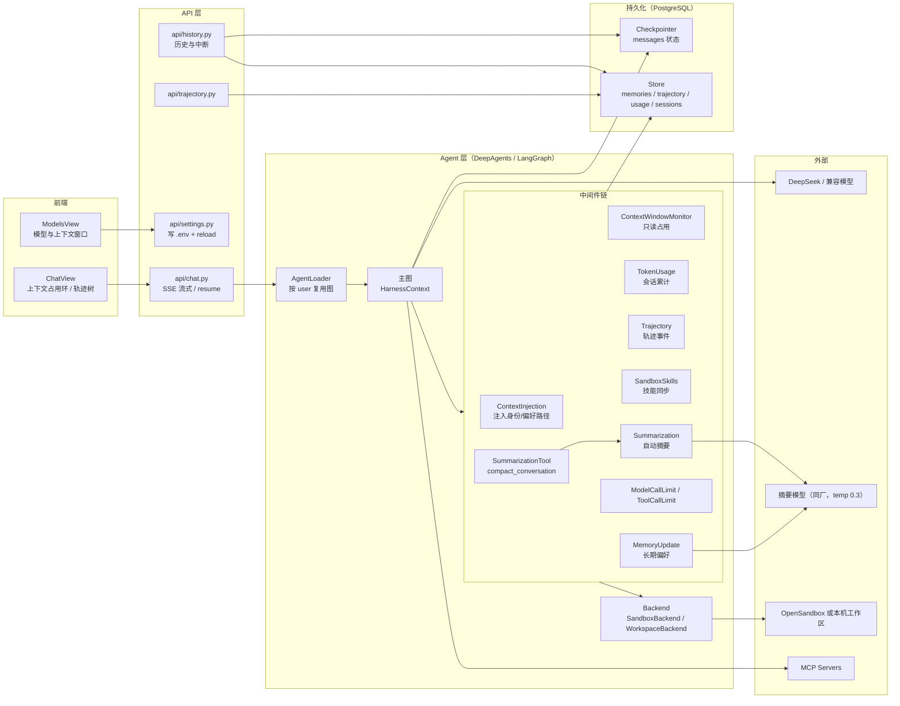
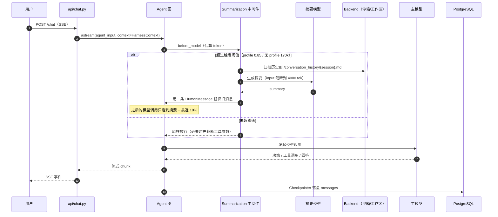
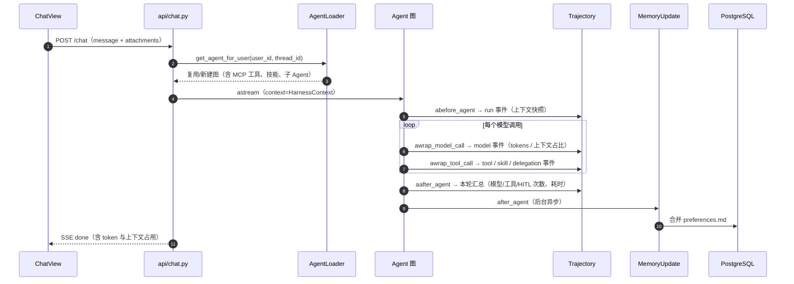
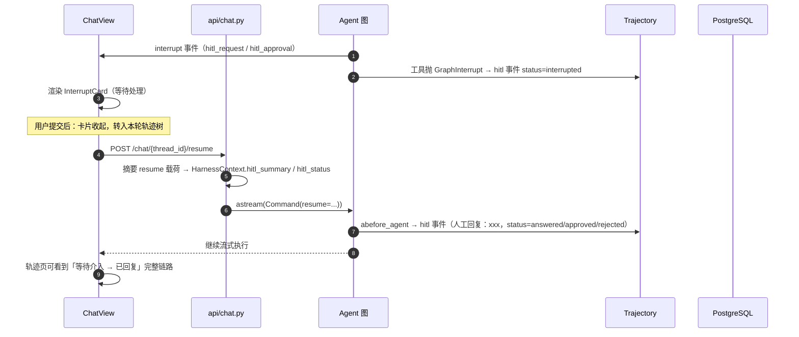

# 介绍本系统的上下文工程设计

Time: 2026/11/1 14.29

本文描述当前 Harness 在「上下文工程（Context Engineering）」上的完整实现：上下文窗口里放什么、超限了怎么压、长期记忆怎么沉淀、每一步怎么观测，以及已知的缺口。

---

## 一、设计目标与约束

| 目标 | 做法 | 代价 |
| :-- | :-- | :-- |
| 单会话可以长期跑下去，不被上下文窗口打断 | 自动摘要 + 手动压缩 + 参数截断 | 摘要会丢细节，需要靠“保留关键 ID”的提示词兜底 |
| 跨会话记住用户偏好 | StoreBackend 存 `/memories/{user_id}/preferences.md` | 每轮多一次摘要模型调用（默认后台异步） |
| 上下文占用可解释 | `ContextWindowMonitor` + `TokenUsageMiddleware` + 轨迹里的 context 快照 | 只观测、不干预，需要人工判断何时压 |
| 压缩过程可回放 | 历史归档到 `/conversation_history/{session_id}.md` | 归档文件本身占沙箱磁盘 |
| 不同模型可切换 | 上下文窗口通过 `HARNESS_MODEL_CONTEXT_LIMIT` 配置，模型页可改并热更新 | 与模型真实窗口可能不一致（见第十节） |

---

## 二、总体架构

分层职责：

1. **API 层**：只负责请求编排（SSE、HITL 恢复、写 `.env` 热更新），不直接拼上下文。
2. **Agent 层**：DeepAgents 图持有中间件链，所有“往上下文里加东西 / 从上下文里减东西”的动作都在中间件里。
3. **持久化层**：Checkpointer 存“消息历史”（会话可恢复），Store 存“跨会话的长期数据”（偏好、轨迹、用量、会话索引）。
4. **执行层**：文件与命令都走 Backend 抽象，有沙箱走沙箱，无沙箱降级本机工作区。

---

## 三、上下文窗口的组成

一次模型调用实际看到的上下文，按下面的顺序拼装：

| # | 区块 | 来源 | 生命周期 | 谁负责裁剪 |
| :--: | :-- | :-- | :-- | :-- |
| 1 | System Prompt | `agent/memory/prompts.py` + `AGENTS.md` 摘要 | 每次构图固定 | 人工维护 |
| 2 | 运行时身份注入 | `ContextInjectionMiddleware`：`user_id` + 偏好文件路径 | 每次模型调用 | 不裁剪 |
| 3 | 技能索引 | DeepAgents 从 `/skills/main/*/SKILL.md` 渐进式读取 | 按需加载 | 技能描述要短 |
| 4 | 长期偏好 | `/memories/{user_id}/preferences.md`（Store） | 跨会话 | `MemoryUpdateMiddleware` 限制条数 |
| 5 | 会话消息 | Checkpointer 里的 `messages` | 单会话 | 摘要 + 参数截断 |
| 6 | 工具结果 | 当轮 tool 返回 | 单轮 | 后端 `max_output_bytes=100_000`、MCP 文本化 |
| 7 | 当前用户输入 / 附件文本 | `build_user_content` | 单轮 | 附件解析有大小限制 |

前 4 项是“几乎每轮都要付的固定成本”，第 5/6 项是“随会话增长的成本”，压缩主要打第 5、6 项。

---

## 四、压缩与摘要链路

### 4.1 自动摘要（主力）

实现来自 DeepAgents：`create_summarization_middleware(summary_model, backend)`，在 [agent_protection.py](../src/agent/middlewares/agent_protection.py) 里装配。

- **触发阈值**：取决于模型 profile。
  - `deepseek-v4-flash` 在 `langchain_deepseek` 的 profile 里 `max_input_tokens = 1,000,000` → 触发条件 `fraction 0.85`（约 85 万 token），保留最后 `10%`。
  - 没有 profile 的模型 → 回退到固定值：`170,000 tokens` 触发、保留最后 `6` 条消息。
- **摘要模型**：`get_summary_model()`，默认同厂商模型、`temperature=0.3`，并要求“摘要稳定、少发挥”。
- **摘要产物**：一条注入回消息列表的 `HumanMessage`（summary message），被摘掉的历史消息不再进入上下文。
- **历史归档**：被压缩的消息归档到 Backend 的 `/conversation_history/{session_id}.md`；内嵌图片/音视频转存到 `/conversation_history/media/`，原块替换成 `<image url="..." />` 路径引用，模型需要时可用 `read_file` 再看。
- **摘要输入上限**：`trim_tokens_to_summarize` 默认 4000 token，避免压缩本身把上下文撑爆。

### 4.2 手动压缩（模型主动）

主 Agent 额外挂载 `SummarizationToolMiddleware`，暴露 `compact_conversation` 工具。系统提示词规定：完成一段长任务、消化完子 Agent 长报告、准备进入新阶段时主动压缩；摘要必须保留

- 已确认的结论
- 审批 / 补充信息的状态
- 异步 `task_id`
- 关键资源 ID（文件路径、MCP 工具名、会话 ID）
- 未完成事项

手动与自动共用**同一个摘要实例**和同一归档位置，所以不会出现“手动压了、自动又压一遍”的重复归档。

### 4.3 参数级截断（比整段压缩更轻）

DeepAgents 的 `truncate_args_settings` 会在同一阈值下，先截断历史 `AIMessage.tool_calls` 里 `write_file` / `edit_file` 的 `args`——这些参数往往是大段文件内容，占 token 但不影响理解。顺序是：

1. 先截断历史工具参数（保留调用记录与结果）
2. 还不够再触发整段摘要压缩

### 4.4 一轮对话的压缩时序

---

## 五、长期记忆与个性化

| 组件 | 时机 | 行为 |
| :-- | :-- | :-- |
| `MemoryUpdateMiddleware` | 每轮 `after_agent` | 用摘要模型提取“本轮查询摘要 + 明确偏好”，合并写入 `/memories/{user_id}/preferences.md`；默认后台异步（`HARNESS_MEMORY_UPDATE_ASYNC=1`） |
| `ContextInjectionMiddleware` | 每次模型调用前 | 把 `user_id`、`username`、偏好文件路径注入 system prompt，要求模型先读偏好 |
| `recent_queries` | 记忆更新时 | 新摘要置顶、去重、限制条数，避免偏好文件无限增长 |
| `StoreBackend` 路由 | 文件读写时 | `/memories/` 前缀的文件不落沙箱，直接写 PostgreSQL Store（命名空间 `(user_id,)`） |

这条链保证“跨会话的稳定信息”不会随摘要压缩消失；会话内的一次性信息（工具结果、思考过程）则交给摘要。

---

## 六、观测与可观测性

| 能力 | 实现 | 落点 |
| :-- | :-- | :-- |
| 上下文占用 | `ContextWindowMonitorMiddleWare`：`count_tokens_approximately` + 进度条日志，超过 `CONTEXT_ALERT_THRESHOLD`（0.85）告警 | 应用日志 |
| Token 用量 | `TokenUsageMiddleware`：累计写入 `usage_store`，会话级 input/output/total；被摘要压缩后仍保留历史累计 | Store |
| 轨迹 | `TrajectoryMiddleware`：run / model / tool / skill / delegation / **hitl** 事件，单字段截断 `TRAJECTORY_MAX_TEXT=4000` | Store `("trajectory", user, thread)` |
| 前端展示 | 输入框右侧的上下文占用环（`context_window` / `context_used`）、`TrajectoryView` 时间轴与事件详情 | ChatView / TrajectoryView |
| HITL 回复 | resume 请求把用户回复摘要写进 `HarnessContext.hitl_summary`，轨迹中间件落一条 `hitl` 事件（status = answered / approved / rejected） | Store 轨迹 + 轨迹页 |

注意：监控是**只读**的——告警不会自动压缩，压缩只由第 4 节的中间件触发。这是有意设计：避免观测层变成会改写上下文的故障点。

---

## 七、关键时序

### 7.1 一次普通对话（含记忆与轨迹）

### 7.2 HITL 中断 → 回复 → 轨迹留痕

---

## 八、数据落点

| 数据 | 存储 | 命名空间 / 键 | 生命周期 |
| :-- | :-- | :-- | :-- |
| 会话消息（上下文主体） | Checkpointer（Postgres） | `thread_id` 对应的 checkpoint | 与会话同生命周期 |
| 长期偏好 | Store | `(user_id,)` + `/memories/{user_id}/preferences.md` | 永久（直到用户清理） |
| 轨迹事件 | Store | `("trajectory", user_id, thread_id)` + `<run_id>:<start>:<event_id>` | 与会话同生命周期 |
| Token 用量 | Store（`usage_store`） | 按 user / thread | 与会话同生命周期 |
| 归档历史 | Backend | `/conversation_history/{session_id}.md` + `media/` | 与沙箱 / 会话目录同生命周期 |
| 上下文窗口配置 | `.env` | `HARNESS_MODEL_CONTEXT_LIMIT` | 持久，模型页可改 |

---

## 九、配置项

| 变量 | 默认 | 作用 |
| :-- | :-- | :-- |
| `HARNESS_MODEL_CONTEXT_LIMIT` | `128000` | 上下文监控分母、轨迹快照的 limit；模型管理页可改并热更新 |
| `HARNESS_CONTEXT_ALERT_THRESHOLD` | `0.85` | 占用告警阈值（只写日志） |
| `HARNESS_TRAJECTORY_MAX_TEXT` | `4000` | 轨迹单字段最大字符数 |
| `HARNESS_MEMORY_UPDATE_ASYNC` | `1` | 记忆更新是否后台异步 |
| `MAIN_AGENT_MODEL_RUN_LIMIT` / `MAIN_AGENT_TOOL_RUN_LIMIT` | `50` / `50` | 单 run 模型/工具调用上限，防死循环 |
| `SUBAGENT_*` | `50` / `50`、异步工具 `32` | 子 Agent 独立预算 |

摘要触发阈值不在 `.env` 里，来自模型 profile（见 4.1）。

---

## 十、已知问题与下一步

1. **上下文窗口与 profile 不一致**：监控分母默认 128K，但 `deepseek-v4-flash` 的 profile 是 1M → 监控在 ~108K 就告警，而摘要要到 ~850K 才触发。现在模型管理页可以直接改 `HARNESS_MODEL_CONTEXT_LIMIT`，但更彻底的做法是给 `ChatDeepSeek` 覆写 `profile["max_input_tokens"]`，让“告警阈值”和“压缩触发”用同一基准。
2. **触发点偏晚**：85% 触发 + 只保留 10%，工具密集任务容易一次砍掉太多细节。建议把 trigger 降到 0.6~0.7，或在阶段边界强制调用 `compact_conversation`。
3. **缺少结构化交接**：目前靠摘要提示词保留关键 ID，没有独立的“任务状态 / 待办清单”产物。可以增加 `session_state.md`（写入 `/memories/` 或会话目录），压缩前先更新它。
4. **压缩质量没有评估**：没有评估集衡量“摘要后任务成功率”，改动上下文策略只能靠体感。建议从线上失败 trace 沉淀 20~30 条用例，用 DeepEval 的 G-Eval 自定义维度（关键 ID 保留、待办不丢）挂到 CI。
5. **监控不干预**：目前只告警。若要做自动降级，需要先有第 4 条的评估，否则容易“越压越差”。
