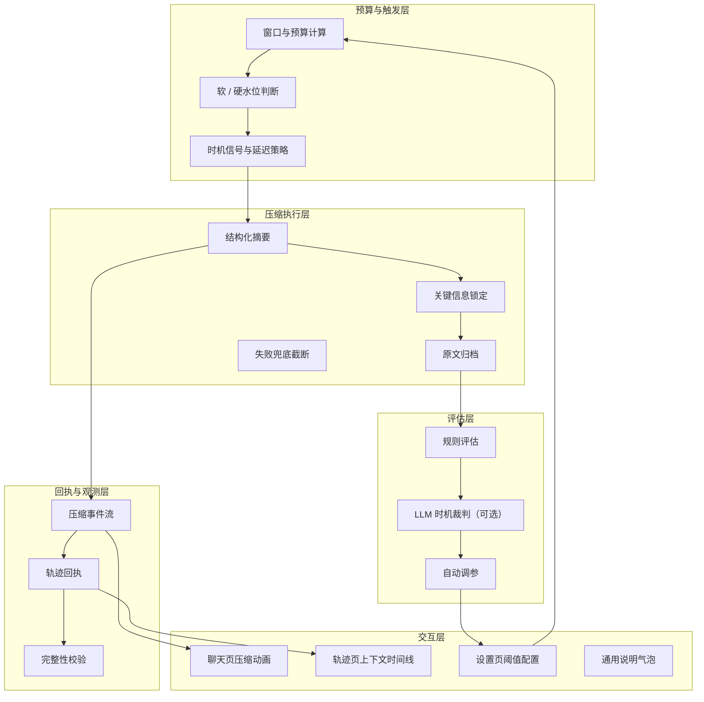
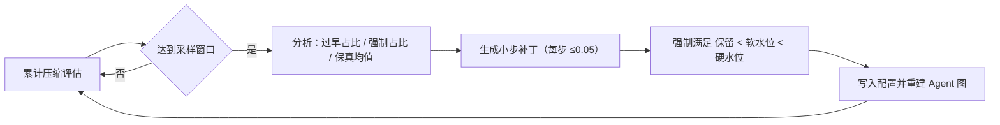
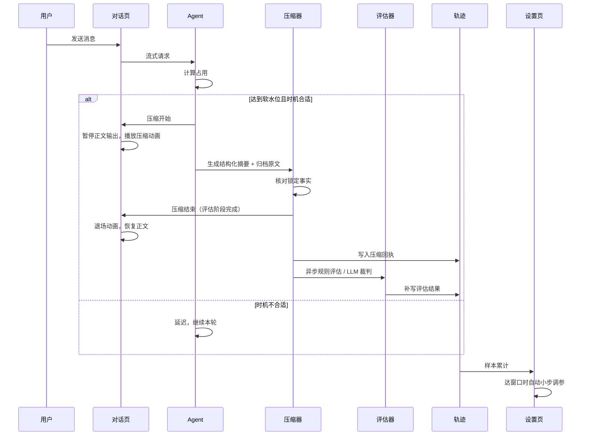
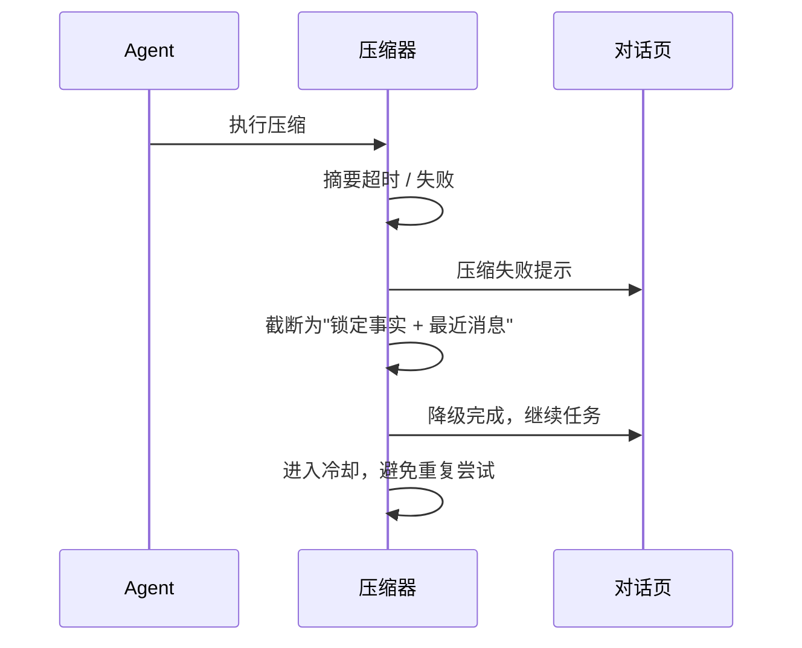
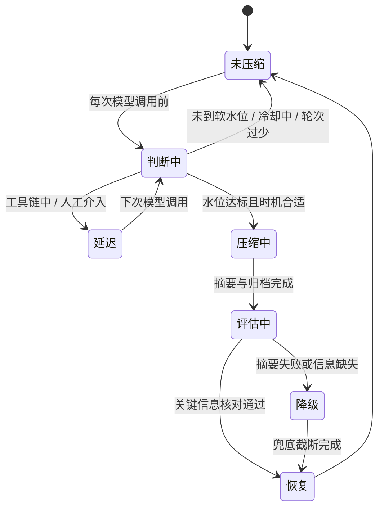

# 上下文管理与压缩评估设计

> 文档定位：本文是 Harness 上下文工程能力的**建设归档文档**，记录"做出来了什么、为什么这样做、效果如何"。
> 不展开代码实现细节，重点描述机制、原理、边界与结果，供后续维护、评审与对外说明使用。

| 项目 | 内容 |
|:--|:--|
| 文档版本 | v1.0（归档） |
| 文档状态 | 已完成并验收 |
| 归档日期 | 2026-11-06 |
| 关联设计稿 | [`notdone/上下文管理与压缩设计.md`](./notdone/上下文管理与压缩设计.md)（过程稿，含实现细节与任务拆分） |
| 适用范围 | 个人模式与集成模式的 Agent 运行时、对话控制台、轨迹页 |

---

## 1. 摘要

上下文工程从"有摘要组件但永远不触发、压缩过程不可见、压缩质量不可评估"的状态，升级为一套完整闭环：

1. **会判断时机**：按模型真实窗口计算软/硬水位，结合人工介入、工具调用链、冷却与延迟上限决定何时整理；
2. **会整理内容**：结构化摘要 + 关键信息锁定 + 原文归档，压缩后可回查细节；
3. **会证明结果**：每次压缩留下可校验回执，包含前后占用、节省空间、关键信息保留率、时机评价与回溯成本；
4. **会自我调整**：根据累计评估结果小步调整软/硬水位与保留预算，并在设置页可人工覆盖；
5. **用户看得见**：聊天页有"压缩 → 评估 → 退场"两阶段动画，轨迹页有可交互的上下文时间线与压缩详情。

一句话：Agent 不再"等上下文炸掉"，而是**在合适的时机主动整理、整理得可验证、再根据结果调整自己的策略**。

---

## 2. 要解决的问题

| 问题 | 现象 | 根因 |
|:--|:--|:--|
| 压缩永不触发 | 会话已到 118,629 / 128,000（约 93%），仍不整理 | 摘要组件按模型标称的 1,000,000 窗口计算，85% 触发点约 850,000；与项目展示的 128,000 完全脱钩 |
| 压缩产物不可用 | 一旦触发，保留预算按模型窗口的 10%（约 100,000）计算，压缩几乎没有收益 | 阈值与保留预算都用错了分母 |
| 压缩过程黑盒 | 用户只看到回答突然中断或变慢 | 没有压缩事件、没有进度、没有前端状态 |
| 压缩质量不可评估 | 不知道是否丢了关键约束、是否压得太早 | 没有回执、没有指标、没有基线 |
| 失败不可控 | 摘要模型失败时直接丢历史或报错 | 没有降级路径与超时保护 |

---

## 3. 设计理念

| 理念 | 含义 | 落到实处的表现 |
|:--|:--|:--|
| 先可观测，再谈优化 | 没有轨迹与评估的改动都是盲改 | 每次压缩都有事件、回执、可查询的轨迹 |
| 先锚点，后摘要 | 先确定必须存活的事实，再让模型写摘要 | 任务目标、路径、命令、错误码、编号、HITL 回复逐字锁定 |
| 原文不删除 | 摘要只负责"让上下文变轻"，不负责"销毁证据" | 被压缩内容完整归档，摘要带定位符，随时可回查 |
| 压缩不改变控制状态 | 待审批、异步任务、人工介入不能因压缩丢失 | 这些信息进入锁定层，压缩后仍有效 |
| 评估不阻塞主流程 | 压缩是同步的，评估是异步的 | 规则评估零成本；LLM 裁判后台执行，失败只降级 |
| 小步自适应 | 不做激进调参，避免阈值震荡 | 每次调整 ≤0.05，且强制满足"保留 < 软水位 < 硬水位" |
| 用户可感知 | 不能让对话毫无解释地停住 | 两阶段动画 + 进度心跳 + 断线提示 |
| 失败必须可继续 | 摘要失败不能等于任务失败 | 超时/失败后走"关键信息 + 最近消息"的兜底截断 |
| 边界优先 | 不是所有场景都该压 | 人工介入、不可逆工具、需求刚变更等场景主动延迟或禁止 |

---

## 4. 总体架构

### 4.1 分层视图

### 4.2 组件职责

| 层 | 组件 | 职责 |
|:--|:--|:--|
| 预算与触发 | 预算计算器 | 由真实窗口推导可用预算、软/硬水位与保留预算 |
| 预算与触发 | 触发策略器 | 结合占用、人工介入、工具链深度、冷却与延迟次数决定压缩或推迟 |
| 压缩执行 | 摘要器 | 生成结构化摘要，并在末尾追加确定性的锁定事实块 |
| 压缩执行 | 锚点登记器 | 压缩前提取关键事实，压缩后逐条核对 |
| 压缩执行 | 归档器 | 把被压缩原文写入会话归档，供后续回查 |
| 压缩执行 | 兜底器 | 摘要超时/失败时保留关键信息与最近消息，保证任务继续 |
| 评估 | 规则评估器 | 保真度、时机标签、成本与回溯成本，零模型调用 |
| 评估 | 时机裁判 | 可选，异步让模型回看压缩时机 |
| 评估 | 自动调参器 | 累计样本后小步调整阈值并自动生效 |
| 回执与观测 | 事件投射器 | 把压缩阶段、进度、结果投射到对话流 |
| 回执与观测 | 轨迹记录器 | 写入压缩回执并支持后续补写评估结果 |
| 回执与观测 | 完整性校验 | 稳定字段指纹，可选签名，查询时重算 |
| 交互 | 聊天页 | 暂停输出、展示两阶段动画、退场后恢复流式 |
| 交互 | 轨迹页 | 上下文曲线、阈值线、压缩节点与详情 |
| 交互 | 设置页 | 在线调整阈值与评估开关 |

---

## 5. 机制详解

### 5.1 双水位触发：从"固定阈值"改为"按真实预算"

**作用**：保证压缩发生在窗口溢出之前，且不会过于频繁。

**工作方式**：

- 以模型真实窗口为唯一分母，先扣除输出预留与安全余量，得到可用预算；
- 软水位用于提前整理，硬水位用于强制兜底；
- 保留预算决定"整理后还留多少最近对话"。

**当前参数（以 128,000 窗口为例）**：

| 量 | 数值 | 占原始窗口 |
|:--|--:|--:|
| 原始窗口 | 128,000 | 100% |
| 可用预算 | 112,640 | 88.0% |
| 软水位 | 78,848 | 61.6% |
| 硬水位 | 99,123 | 77.4% |
| 保留预算 | 28,160 | 22.0% |

**结果**：原来 118,629 token 仍不整理的情况，现在会在约 78,848 时开始整理，最迟 99,123 强制执行。

### 5.2 时机信号与延迟：不是到了水位就立刻压

**作用**：避免在推导中途、工具调用链中或等待人工确认时压缩，导致关键中间结果丢失。

**判断顺序**：

1. 人工介入等待中 → 禁止压缩；
2. 未到软水位 → 不压缩；
3. 达到硬水位 → 强制压缩；
4. 处于多步工具链 → 延迟，最多延迟若干次；
5. 距上次压缩不足冷却次数 → 不再压缩；
6. 会话轮次过少 → 首次不压缩。

**结果**：压缩不会打断正在进行的工具链，也不会在用户刚改完需求时立刻折叠上下文。

### 5.3 结构化摘要与关键信息锁定

**作用**：压缩后仍能继续任务，而不是"摘要正确但推理链断了"。

**摘要结构**：任务目标、已完成、关键结论、锁定事实、工具与原文引用、未完成与下一步、风险与待确认。

**锁定事实包括**：

- 用户目标与任务相关的用户消息；
- 文件路径、命令、错误码；
- 任务 ID、审批 ID、会话标识；
- 人工介入回复与未完成事项。

锁定事实由系统在摘要末尾**确定性追加**，不依赖模型自由发挥；压缩后逐条核对是否存活。

### 5.4 原文归档与回查

**作用**：摘要负责变轻，归档负责可追溯。

- 被压缩原文完整写入会话归档文件；
- 摘要中写入归档位置；
- 之后模型需要细节时，可重新读取归档；
- 归档与会话同生命周期。

**结果**：压缩不再意味着信息永久丢失，而是"从上下文搬到文件柜"。

### 5.5 失败兜底

**作用**：摘要失败不影响任务继续。

| 故障 | 行为 |
|:--|:--|
| 摘要超时 | 使用"锁定事实 + 最近消息"继续本轮 |
| 摘要模型报错 | 同上，并记录降级状态 |
| 内容仍超窗口 | 进一步缩短保留消息，仍失败则明确提示拆分会话 |

失败后进入冷却，避免每次模型调用都重复尝试摘要。

### 5.6 压缩回执

**作用**：让每次压缩可复查、可解释、可对比。

回执包含：触发原因、压缩前后占用、节省空间、消息范围、归档位置、关键信息保留统计、耗时、评估结论、完整性指纹。

回执写入轨迹后，可在轨迹页直接查看，也可供后续评估与调参使用。

### 5.7 评估机制

**规则评估（每次压缩，零额外成本）**

| 维度 | 指标 | 回答的问题 |
|:--|:--|:--|
| 信息保真 | 关键信息保留率 | 该留的是否留住了 |
| 时机质量 | 正常 / 延迟 / 强制 / 手动 | 这次压得是不是时候 |
| 成本收益 | 节省 token、摘要消耗、耗时 | 值不值得 |
| 回溯成本 | 压缩后回查归档的次数与 token | 摘要够不够用 |

**LLM 时机裁判（可选，默认关闭）**

- 压缩完成后异步回看：这次整理是"合适 / 过早 / 偏晚"；
- 结果覆盖规则时机，规则标签保留用于对比；
- 不阻塞对话，不改变压缩结果。

### 5.8 回溯成本与完整性校验

- **回溯成本**：查询轨迹时扫描压缩后对归档文件的读取，统计次数与额外 token。数字越小，说明摘要越自足。
- **完整性校验**：对回执稳定字段生成指纹；配置密钥时追加签名；查询时重算并标记"校验通过 / 未通过 / 旧记录无指纹"。

### 5.9 评估驱动自动调参

**作用**：让系统根据真实压缩表现小幅修正自己的阈值，而不是长期依赖人工拍脑袋。

**调参规则**：

- 过早压缩占比 ≥ 30%：提高保留预算、降低软水位；
- 强制触发占比 ≥ 50%：提前软/硬水位；
- 平均保真度 < 90%：提高保留预算；
- 每累计 20 次评估触发一次，可在设置页关闭。

### 5.10 前端交互

**聊天页两阶段动画**：

| 阶段 | 用户看到 | 系统行为 |
|:--|:--|:--|
| 压缩历史 | 双环旋转 + 进度轨道 + 扫描条 | 生成摘要、归档原文 |
| 评估锚点 | 轨道填充、阶段高亮切换 | 核对关键信息 |
| 退场 | 淡出并收起 | 恢复被中断的正文输出 |

- 压缩提示是临时消息，任务结束从聊天记录移除，只保留在轨迹；
- 摘要期间定期心跳，长时间无进度提示连接可能已断开。

**轨迹页上下文视图**：

- 占用曲线、软/硬水位线、窗口上限线；
- 压缩节点标记压缩前/后位置；
- 鼠标悬停显示定位虚线、当前点数据卡、阈值说明；
- 右侧压缩详情逐行解释，并提供通用说明气泡。

**设置页**：

- 可在线调整压缩开关、软/硬水位、保留预算、轮次/冷却/延迟/超时/心跳、评估与裁判开关；
- 保存后重建 Agent 图，下一轮按新配置运行。

---

## 6. 运行原理

### 6.1 正常压缩时序

### 6.2 失败降级时序

### 6.3 压缩状态机

---

## 7. 做出来了什么

### 7.1 用户视角的能力

| 能力 | 用户可感知的表现 |
|:--|:--|
| 自动整理 | 长会话不再突然"失忆"或直接失败 |
| 压缩可见 | 看到"正在压缩并评估上下文"的完整动画，之后正常续写 |
| 结果可查 | 轨迹页能看到每次压缩的前后占用、节省、保留率与判断结论 |
| 细节可回查 | 压缩掉的原文有保存位置，助手可以自己回去查 |
| 阈值可控 | 设置页可以直接改软/硬水位、保留预算与评估开关 |
| 自我调整 | 系统按累计表现小幅调整阈值，不需要人工长期盯参数 |
| 记录可信 | 压缩回执带指纹校验，旧记录会明确标注"无指纹" |

### 7.2 系统视角的能力

| 能力 | 说明 |
|:--|:--|
| 窗口一致性 | 压缩、监控、前端展示使用同一窗口口径 |
| 分层节奏 | 提前整理、强制兜底、延迟与冷却组合，避免压缩抖动 |
| 结构化产物 | 摘要不是一段散文，而是带锁定事实与归档引用的可执行材料 |
| 控制状态保护 | 人工介入、审批、异步任务信息不因压缩丢失 |
| 双轨评估 | 规则评估随压缩即时产出；LLM 裁判可选、异步 |
| 闭环调参 | 评估 → 建议 → 自动应用 → 再评估 |
| 全链路观测 | 事件流、轨迹回执、聊天动画、轨迹可视化四处一致 |

---

## 8. 结果与验证

### 8.1 已验证项

| 验证项 | 结果 |
|:--|:--|
| 预算计算 | 128,000 窗口推导出软 78,848 / 硬 99,123 / 保留 28,160，边界用例通过 |
| 触发策略 | 未到水位、软水位、硬水位、工具链延迟、延迟上限、人工介入、冷却均按预期判断 |
| 压缩时序 | 流程测试确认顺序为"开始 → 摘要阶段 → 评估阶段 → 结束 → 主模型生成"，消息数由 8 条压缩为 2 条 |
| 锚点保真 | 锁定事实注入后逐条核对，测试用例保真率 100% |
| 完整性指纹 | 评估结果变化不影响回执指纹，校验逻辑稳定 |
| 自动调参 | 过早占比高时提高保留预算并降低软水位，且始终满足"保留 < 软 < 硬" |
| 前端构建 | 类型检查与生产构建通过 |

### 8.2 设计目标（用于后续基线实测）

| 指标 | 目标 |
|:--|:--|
| 触发及时率 | 长会话在达到软水位后 2 次模型调用内触发 ≥ 95% |
| 压缩后占用 | ≤ 0.40 可用预算（约 45,000 token） |
| 关键信息保留 | ≥ 95% |
| 评估产出率 | 每次压缩均有评估结果 ≥ 98% |
| 前端提示时延 | 压缩开始到动画出现 ≤ 500ms |
| 任务成功率回归 | 10–20 条长任务基线与关闭压缩相比不下降 |

> 说明：基线回放脚本与 10 条脱敏长任务已准备好，但尚未在真实模型环境完整执行；上表为目标值，后续以回放结果校准。

### 8.3 前后变化对比

| 维度 | 改造前 | 改造后 |
|:--|:--|:--|
| 触发点 | 约 850,000（永不触发） | 约 78,848 提前触发，99,123 强制 |
| 保留预算 | 约 100,000（压了等于没压） | 28,160 |
| 压缩可见性 | 无 | 聊天动画 + 进度心跳 + 断线提示 |
| 压缩产物 | 不可查 | 结构化摘要 + 锁定事实 + 原文归档 |
| 质量评估 | 无 | 规则评估 + 可选 LLM 裁判 + 回溯成本 |
| 参数调整 | 改环境变量重启 | 设置页在线修改；评估驱动自动小步调整 |
| 失败处理 | 丢历史或报错 | 兜底截断，任务继续 |
| 记录可信度 | 无 | 指纹校验 + 可选签名 |

---

## 9. 明确没有做的事

| 项 | 状态 | 原因 |
|:--|:--|:--|
| 分层配额（系统提示 / 工具描述 / 记忆各自预算） | 未做 | 会改动工具绑定与上下文拼装，风险高，留待下一阶段 |
| 工具描述惰性加载与裁剪 | 未做 | 同上 |
| 多模型差异化窗口 | 未做 | 当前按单一模型窗口运行，后续需要按模型分别配置 |
| 向量检索式回溯 | 未做 | 项目定位不内置向量库，回查仍走文件归档 |
| 压缩回执密码学签名 | 只做可选 HMAC | 默认只做指纹，签名需要显式配置密钥 |

---

## 10. 参考文献与设计理念来源

### 10.1 项目内参考

- 《上下文工程参考方案》：提出由 Agent 自行判断压缩时机、分层预算、结构化可回溯产物与"时机质量"评估。
- 《上下文工程优化方案》：提出从信息层、推理层、任务层、资源层评估压缩，以及保真 / 可用 / 稳定 / 成本 / 边界五维判断顺序。
- 《上下文管理与压缩设计》（notdone 过程稿）：本文的机制来源与任务拆分依据。

### 10.2 外部研究与工程实践

| 来源 | 借鉴点 |
|:--|:--|
| SelfCompact（NeurIPS 2025） | 压缩时机应与轨迹阶段相关；在子任务收敛后压缩，避免推导中途丢弃结果 |
| SCOPE（ACL 2026） | 上下文可按层分配预算，而不是所有内容抢同一条水位线 |
| Cat（ACL 2026 Findings） | 把上下文管理做成可主动调用的能力，由 Agent 判断何时整理 |
| Claude Code 的分层清除与焦点压缩 | 工具结果优先压缩，关键片段保留 |
| Cursor 的历史引用思路 | 压缩后保留指向原始内容的定位符，降低压缩频率 |
| OpenAI compact 的服务端阈值实践 | 阈值必须与真实窗口绑定，否则等于没有压缩 |
| IETF Ephemeral Context Compaction Receipt 草案 | 每次有损压缩应留下可审计回执（本项目做了轻量版：指纹 + 可选签名） |

### 10.3 设计理念总结

1. **先可观测，再优化**：没有轨迹和评估的调参都是猜测。
2. **压缩时机与压缩质量同等重要**：一次时机错误的完美摘要，可能比不压缩更糟。
3. **结构化优于散文**：摘要必须能直接指导下一步动作，而不是"读起来很顺"。
4. **原文可回溯**：压缩是搬移，不是销毁。
5. **评估驱动、小步自适应**：让系统根据真实表现微调，而不是依赖一次性拍参数。
6. **失败优先于完美**：摘要失败时，任务能继续比"摘要好看"更重要。

---

## 11. 归档说明

- 本文为**结果归档**，只描述机制、原理与效果；实现级细节、接口字段、任务拆分保留在 [`notdone/上下文管理与压缩设计.md`](./notdone/上下文管理与压缩设计.md)。
- 后续如新增"分层配额"或"工具描述惰性加载"，应另立设计文档，并在本文"明确没有做的事"中同步更新状态。
- 本文引用的数值（窗口、水位、保留预算）以当前默认配置为准；修改配置后需重新执行基线回放并更新第 8 章。
