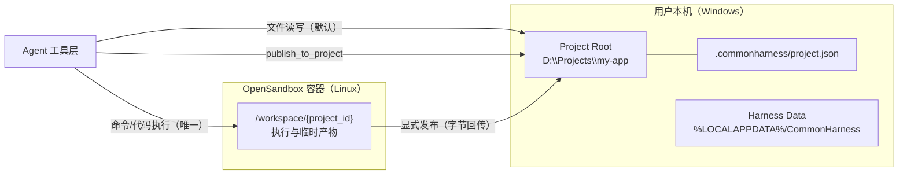
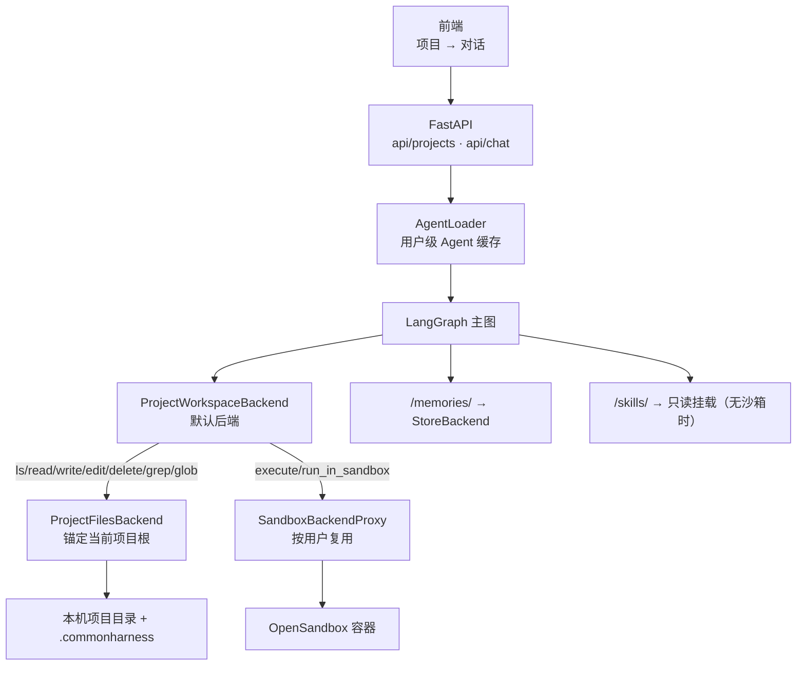
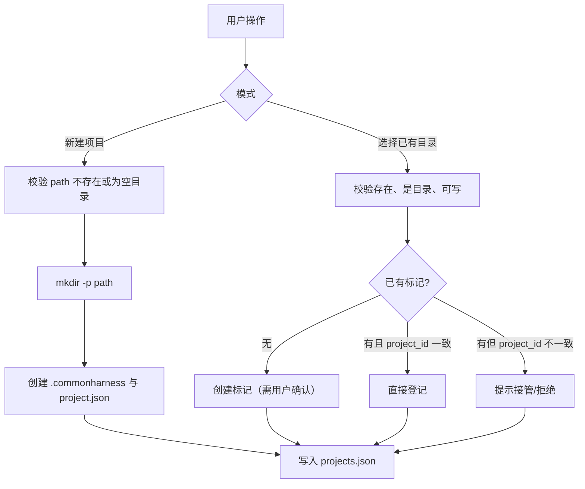
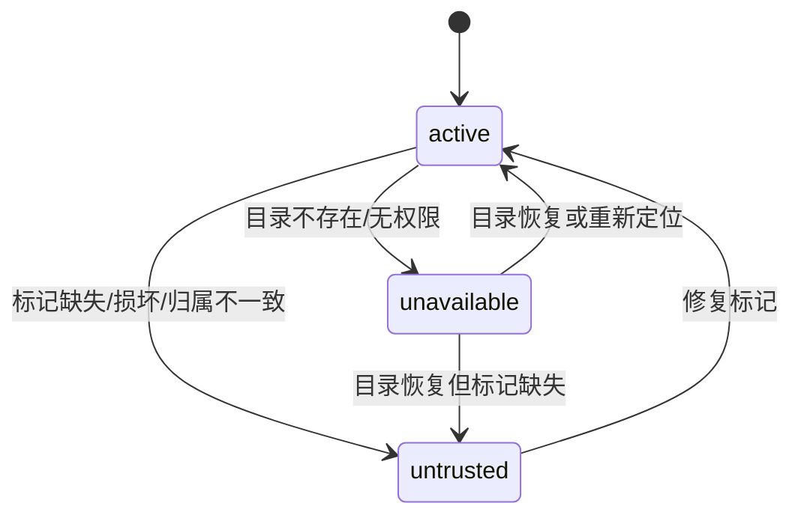
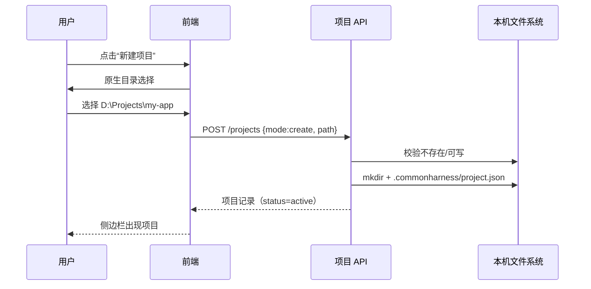
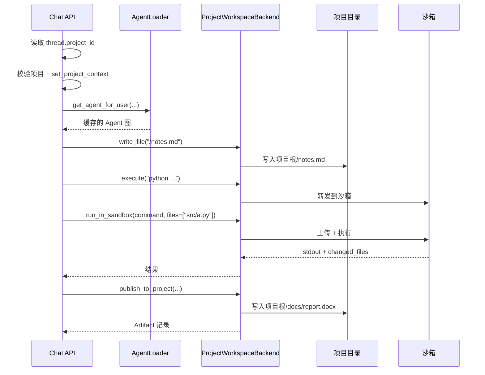
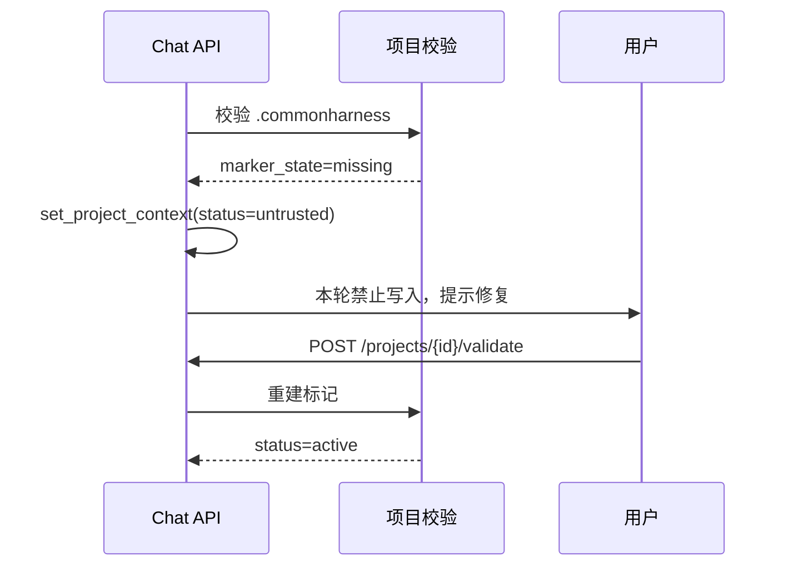

# 项目工作区设计

> 状态：草案，待校验
> 适用范围：`src/agent/backends`、`src/api/workspace.py`、`src/api/files.py`、`src/api/chat.py`、`frontend/HarnessControlPlatform`
> 关联文档：[SandBox服务设计.md](./SandBox服务设计.md)、[架构图与核心时序.md](./架构图与核心时序.md)、[上下文工程设计.md](./上下文工程设计.md)

---

## 1. 设计目标

项目工作区（Project Workspace）回答一个核心问题：**Agent 在用户本机上，到底可以在哪个目录里写东西？**

| 目标 | 落地方式 |
| :-- | :-- |
| 项目是本机真实目录，不是沙箱目录 | `Project.path` 指向 Windows 本机绝对路径，Agent 文件工具默认落在这里 |
| 项目目录可被信任 | 目录内必须存在 `.commonharness/` 标记目录，缺失即不可托管 |
| 文件可写、可执行隔离 | 项目目录允许写入任意类型文件；**所有命令执行只允许在沙箱**，宿主永不执行 |
| 多项目互相隔离 | 每个会话绑定一个项目，每次 run 解析项目根，文件工具不跨项目 |
| 沙箱产物按上下文回传 | Agent 判断产物是否需要落到本机，显式调用 `publish_to_project` |
| UI 只展示项目与对话 | 不做目录树；右侧只读文件抽屉展示沙箱文件，产物以对话内卡片与发布记录呈现 |

### 非目标

- 不做项目目录的版本控制、Git 集成。
- 不做项目目录的实时文件监听与同步。
- 不提供浏览器内的文件管理器、目录树控件。
- 不保证沙箱内的文件长期持久化；沙箱是执行环境，不是存储。
- 不做多机同步；项目只在本机生效。

---

## 2. 名词与文件域

| 名词 | 定义 |
| :-- | :-- |
| Project（项目） | 用户登记的本机目录，含 `.commonharness/` 标记，是 Agent 文件写入的根 |
| Conversation（对话） | 归属于某个项目的会话；`thread_id` 是会话主键 |
| Project Workspace（项目工作区） | 项目目录本身，本机文件域 |
| Sandbox Workspace（沙箱工作区） | OpenSandbox 容器内的文件域，按用户复用的执行域 |
| Harness Data（数据区） | `%LOCALAPPDATA%/CommonHarness`，存配置、索引、日志，不面向用户 |
| Artifact（产物） | 从沙箱发布到项目的文件记录，含来源、目标、大小、时间 |
| Marker（标记） | `.commonharness/` 目录及其 `project.json`，表示「此目录由本应用托管」 |

### 2.1 三层文件域



| 文件域 | 物理位置 | 谁能读写 | 能否执行 |
| :-- | :-- | :-- | :-- |
| 项目工作区 | 用户本机 `Project.path` | Agent 文件工具、后端 API | **否，永不执行** |
| 沙箱工作区 | OpenSandbox 容器 `/workspace/{project_id}` | Agent 的 shell/代码工具 | **是，唯一执行域** |
| Harness 数据区 | `%LOCALAPPDATA%/CommonHarness` | 后端自身 | 否 |

---

## 3. 需求对照与现状差距

| 需求 | 现状 | 差距 | 本设计的做法 |
| :-- | :-- | :-- | :-- |
| 1. 选中目录为项目 / 新建项目 | 只能登记已存在目录，无新建目录 | 缺 `create` 模式 | `POST /projects` 支持 `create` 与 `attach` |
| 2. 项目是本机目录，与沙箱区分 | 有沙箱时 Agent 文件全落沙箱；全局单 `root` 与项目无关 | 项目路径未进入运行时 | 项目上下文注入 + 文件后端锚定项目 |
| 3. `.commonharness` 标记 | 完全缺失 | 无信任边界 | 标记目录 + `project.json` + 运行前校验 |
| 4. 可写文件、不可执行；产物回传 | 宿主可执行命令；写文件黑名单禁止代码 | 安全模型相反；无法写真实代码仓库 | 任意文件可写、执行只走沙箱、显式发布 |
| 5. UI 不展示文件树 | 存在「会话文件」面板，列全局工作区树 | 与需求冲突且串台 | 删除目录树；恢复只读沙箱文件抽屉，只列当前会话沙箱目录 |

现有代码依据：

- 全局工作区配置与项目登记混合在 `workspace.json`：[config.py L403-517](file:///f:/Python/HarnessEngineering/CommonProject/src/agent/config.py#L403-L517)
- 项目仅作为登记表：[workspace.py L205-270](file:///f:/Python/HarnessEngineering/CommonProject/src/api/workspace.py#L205-L270)
- 有沙箱时默认后端是沙箱：[main_agent.py L177-182](file:///f:/Python/HarnessEngineering/CommonProject/src/agent/main_agent.py#L177-L182)
- 宿主可执行命令：[workspace_backend.py L152-154](file:///f:/Python/HarnessEngineering/CommonProject/src/agent/backends/workspace_backend.py#L152-L154)
- 会话文件面板读取全局目录树：[files.py L83-130](file:///f:/Python/HarnessEngineering/CommonProject/src/api/files.py#L83-L130)

---

## 4. 总体架构



关键原则：

1. **Agent 图按用户缓存，不按项目重建。** 项目根通过 `ContextVar` 在每次 run 时解析，避免切换项目就重建图。
2. **文件操作与执行操作在同一个后端内分流。** 文件走本机，`execute` 走沙箱，二者不在一个文件系统里。
3. **沙箱是可选能力。** 未配置沙箱时，Agent 仍能读写项目文件，但所有执行请求必须被明确拒绝，不允许降级到本机执行。

---

## 5. 项目目录与标记

### 5.1 目录布局

```text
D:\Projects\my-app\                  ← Project.path（用户目录，原样保留）
├── .commonharness\                  ← 标记目录，后端专用
│   └── project.json                 ← 项目元数据与策略
├── src\
├── docs\
└── ...                              ← 用户已有内容，不做改造、不迁移
```

规则：

- `.commonharness/` 由后端创建和维护，Agent 工具**禁止**读写该目录。
- 项目根下不额外创建任何隐藏文件（写探针文件也从 `tempfile` 目录进行，不落项目目录）。
- `.commonharness/` 必须是项目根内的**真实目录**，不允许是符号链接/junction，防止写操作被重定向。

### 5.2 `project.json`

```json
{
  "schema_version": 1,
  "project_id": "8f3a2c1d",
  "name": "my-app",
  "created_by": "CommonHarness",
  "created_at": "2026-11-01T10:00:00+08:00",
  "host": {
    "platform": "windows",
    "root": "D:\\Projects\\my-app"
  },
  "policy": {
    "agent_write": true,
    "agent_execute": false,
    "agent_deny_paths": [".commonharness"]
  }
}
```

字段约束：

| 字段 | 说明 |
| :-- | :-- |
| `schema_version` | 当前为 `1`；后端只接受已知版本，未知版本标记 `invalid` |
| `project_id` | 与全局项目登记表的 `id` 必须一致 |
| `host.root` | 创建时的项目根，用于检测目录被移动/复制 |
| `policy.agent_execute` | 固定 `false`，仅作为声明；真正的执行限制由后端强制 |

### 5.3 项目创建与附着



失败处理：

| 情况 | 结果 |
| :-- | :-- |
| 目录不可写，无法创建标记 | 登记失败，返回 `marker_create_failed`，不产生项目记录 |
| 目录已有标记但 `schema_version` 未知 | 登记失败，返回 `marker_unsupported` |
| 目录已有标记且 `project_id` 与登记表冲突 | 需显式 `adopt=true` 才能接管，否则拒绝 |
| 新建时目录已存在且有内容 | 拒绝 `create`，提示改用 `attach` |

### 5.4 运行前校验

每次对话 run 开始时校验，结果写入项目状态：

| 校验项 | 通过条件 | 失败状态 |
| :-- | :-- | :-- |
| 路径存在 | `Path.exists()` 且 `is_dir()` | `unavailable` |
| 路径可写 | 在临时目录写探针，不在项目目录留痕 | `untrusted` |
| 标记存在 | `.commonharness/` 是真实目录 | `untrusted` |
| 标记可解析 | `project.json` 可读、`schema_version` 已知 | `untrusted` |
| 标记归属一致 | `project_id` 与登记表一致 | `untrusted` |
| 根路径一致 | `host.root` 与当前 `Project.path` 相同（Windows 用 `normcase`） | `untrusted` |

状态机：



运行时的降级策略：

- `active`：文件工具可用，`publish_to_project` 可用。
- `untrusted`：本次 run **禁止**写入项目，文件工具返回明确错误；对话仍可继续（只读上下文）。
- `unavailable`：本次 run 禁止读写项目；项目已被删除的会话按自由会话运行，文件落沙箱。

### 5.5 禁止登记的目录（denylist）

必须在创建/附着前拒绝：

- 盘符根目录：`C:\`、`D:\`
- Windows 系统目录：`C:\Windows`、`C:\Program Files`、`C:\ProgramData`
- 用户数据区自身：`%LOCALAPPDATA%/CommonHarness`
- UNC 根与网络盘根（`\\server\share` 本身）
- 包含 `.commonharness` 作为目标目录本身的路径
- 目标 `.commonharness` 为符号链接/junction 的路径

denylist 是防御性约束，不追求穷尽所有危险目录；信任边界仍是「用户显式选择 + 标记存在」。

---

## 6. Agent 运行时设计

### 6.1 项目上下文

新增进程内上下文，替代现有 `set_workspace_thread(thread_id)`：

```python
@dataclass(frozen=True)
class ProjectContext:
    id: str
    name: str
    root: Path
    status: Literal["active", "untrusted", "unavailable"]

_CURRENT_PROJECT: ContextVar[ProjectContext | None]

def set_project_context(project: ProjectContext) -> Token: ...
def current_project() -> ProjectContext: ...  # 缺失时抛 ProjectContextMissing
```

绑定时机：`api/chat.py` 在进入一轮对话前，从会话索引读取 `project_id`，解析项目记录并校验，然后 `set_project_context`。一轮结束 `reset`。

与现有实现的关系：

- 移除 `set_workspace_thread` / `thread_workspace` 在 chat 链路中的使用。
- `thread_workspace` 仅作为历史遗留目录的只读兼容，不再参与新写入。
- Agent 图仍然按用户缓存；项目切换只改变 ContextVar，不重建图。

### 6.2 后端路由

当前 `CompositeBackend(default=sandbox | workspace_files, routes={"/memories/": ..., "/skills/": ...})` 的问题是：

- `default` 只能二选一，无法「文件本地、执行沙箱」。
- `CompositeBackend.execute()` 只委托 `default`（[composite.py L814-850](file:///f:/Python/HarnessEngineering/CommonProject/.venv/Lib/site-packages/deepagents/backends/composite.py#L814-L850)）。

目标结构：

```text
CompositeBackend(
  default = ProjectWorkspaceBackend(sandbox=SandboxBackendProxy | None)
  routes  = {
    "/memories/" : StoreBackend(...),
    "/skills/"   : ReadOnlyFilesystemBackend(...)   # 仅无沙箱时
  }
)
```

`ProjectWorkspaceBackend` 需要同时满足：

1. 继承/实现 `SandboxBackendProtocol`，使 `execute` 工具被注册（deepagents 只对实现该协议的后端注册 execute）。
2. 文件方法委托给 `ProjectFilesBackend`，其根为 `current_project().root`，随 run 动态解析。
3. `execute` 只委托沙箱；无沙箱时抛出策略错误。

```python
class ProjectFilesBackend(FilesystemBackend):
    """锚定当前项目根的文件后端，无执行能力。"""

    @property
    def cwd(self) -> Path:
        return current_project().root

    # write/edit 不做扩展名黑名单；只做路径越界与保留目录校验


class ProjectWorkspaceBackend(SandboxBackendProtocol):
    """文件走项目目录，执行走沙箱的默认后端。"""

    def __init__(self, sandbox: SandboxBackendProxy | None) -> None: ...

    # ls/read/write/edit/delete/grep/glob/upload_files/download_files
    #   → self._files（ProjectFilesBackend）

    def execute(self, command: str, *, timeout: int | None = None) -> ExecuteResponse:
        if self._sandbox is None:
            raise ProjectExecutionDisabled(
                "当前未配置沙箱，按安全策略禁止在本机执行任何命令。"
            )
        return self._sandbox.execute(command, timeout=timeout)
```

保留目录与路径规则：

| 规则 | 行为 |
| :-- | :-- |
| 虚拟路径以 `/` 开头 | 相对于项目根解析 |
| 含 `..` 或 NUL | 拒绝，`invalid_path` |
| 解析后不在项目根内 | 拒绝，`permission_denied` |
| 目标位于 `/.commonharness/` | 拒绝，`reserved_path` |
| 伪绝对路径（`C:\...`） | 拒绝，`invalid_path` |
| 写入任意扩展名 | 允许（含 `.py`、`.bat`、`.exe`） |
| 执行 | 永远不由文件后端执行 |

说明：允许写入 `.exe`/`.bat` 不等于允许执行。Agent 的工具链中不存在「用项目目录里的文件启动进程」的能力；双击运行是用户自己的行为，不在 Agent 权限范围。

### 6.3 执行域

| 场景 | 工具 | 行为 |
| :-- | :-- | :-- |
| 无需项目文件的命令 | 内置 `execute` | 经 `ProjectWorkspaceBackend.execute` 转发到沙箱 |
| 需要项目文件作为输入 | 新增 `run_in_sandbox` | 先把指定项目文件上传到 `/workspace/{project_id}/`，再执行 |
| 未配置沙箱 | 以上两种 | 返回明确错误，不降级本机 |

`run_in_sandbox` 建议签名：

```python
run_in_sandbox(
    command: str,
    files: list[str] = [],          # 项目内相对路径，上传到沙箱工作目录
    timeout: int = 120,
) -> {
    "ok": bool,
    "exit_code": int,
    "stdout": str,
    "stderr": str,
    "sandbox_dir": "/workspace/{project_id}",
    "changed_files": [...],          # 执行前后 mtime/size 差异，供发布决策
}
```

`changed_files` 只作为提示，不自动发布。发布必须由模型显式调用 `publish_to_project`。

沙箱目录约定：

- 每个项目在用户级沙箱内使用独立子目录 `/workspace/{project_id}/`，避免跨项目文件名冲突。
- 沙箱重建后子目录可能丢失，项目文件才是事实来源；需要时由 `run_in_sandbox` 重新上传。

### 6.4 沙箱产物回传

工具改名：`publish_to_workspace` → `publish_to_project`，目标根从全局 `agent_workspace_root()` 改为 `current_project().root`。

```json
{
  "files": [
    {
      "source_path": "/workspace/8f3a2c1d/report.docx",
      "target_path": "docs/report.docx",
      "reason": "用户要求把最终报告保存到项目"
    }
  ]
}
```

校验：

- `source_path` 必须是沙箱内绝对路径。
- `target_path` 必须是项目内相对路径，禁止 `..`、绝对路径、`/.commonharness/`。
- 任意扩展名允许（与项目写入策略一致）。
- 单文件 50MB、单次 200MB 上限（沿用现有限制）。
- 同名文件覆盖，结果标记 `overwritten`。
- 写入成功后记录 Artifact；写入失败返回 `rejected` 原因。

上下文判定策略（写入 System Prompt）：

1. 用户明确说「保存到本机」「下载」「生成文件放进项目」「放到 xxx 目录」→ 发布。
2. 本轮交付物是文档/表格/PDF/图片等最终成品 → 发布最终成品。
3. 中间脚本、日志、测试夹具、缓存 → 默认不发布，除非用户要求。
4. 发布前在回复中说明目标路径；发布后报告结果。
5. 同一个文件重复发布时说明覆盖行为。

工具层不强制解析自然语言，判定主体是模型；工具只负责安全边界与审计。

### 6.5 System Prompt 约束（替换现有 execution_policy）

```markdown
## 文件与执行环境
- 项目根目录是用户本机真实目录，文件工具中的 `/` 即项目根。
- 你可以在项目内创建任意类型文件（包括代码与脚本），但绝不能执行项目内的文件。
- 所有命令、脚本、代码必须在隔离沙箱中执行；当前没有沙箱时执行会被拒绝。
- 需要项目文件参与执行时，使用 run_in_sandbox 并显式列出要上传的文件。
- 沙箱产物只有在你判断需要落到本机时才调用 publish_to_project；
  中间产物不要发布。
- 禁止读写 `/.commonharness/`，它是系统保留目录。
- 不要假设项目目录可以跨项目访问；当前项目之外的文件一律不可见。
```

删除现有文案：`allow_host_control` 相关分支、`publish_to_workspace` 提示、"工作区只允许文档类文件"。

---

## 7. 数据模型

### 7.1 Project

存储：`%LOCALAPPDATA%/CommonHarness/users/{user_id}/projects.json`（原子写入，进程内缓存）。默认项目目录为同级的 `users/{user_id}/workspaces/default`。

```json
{
  "schema_version": 2,
  "updated_at": "2026-11-01T10:00:00+08:00",
  "projects": [
    {
      "id": "8f3a2c1d",
      "name": "my-app",
      "path": "D:\\Projects\\my-app",
      "pinned": false,
      "marker_state": "ok",
      "status": "active",
      "created_at": "...",
      "updated_at": "...",
      "last_opened_at": "..."
    }
  ]
}
```

约束：

- `id` 不可变；`path` 变更视为「重新定位」，必须重新校验标记。
- `default` 项目保留 ID，不可删除、不在侧边栏展示。
- `status`/`marker_state` 是运行态缓存，启动和每次校验时刷新，不依赖手工维护。
- 登记表按 `user_id` 分层；首次启动时只让第一个真实用户（`console_user`/`anonymous`）继承旧机器级 `workspace.json`，后续用户保持独立。

### 7.2 Conversation

延用现有会话索引，`project_id` 字段成为运行时必需字段：

| 字段 | 说明 |
| :-- | :-- |
| `thread_id` | 会话主键 |
| `project_id` | 归属项目；空值表示自由会话，运行时文件落沙箱会话目录 |
| `title` / `pinned` / `created_at` / `updated_at` | 保持不变 |

会话的项目归属在创建时固定：自由会话不能加入项目，项目会话也不能移出。`PATCH /history/{thread_id}` 只允许改标题与置顶。

### 7.3 Artifact

存储：LangGraph Store，命名空间 `("artifacts", user_id, project_id)`。

```json
{
  "id": "art_...",
  "thread_id": "...",
  "project_id": "8f3a2c1d",
  "source_path": "/workspace/8f3a2c1d/report.docx",
  "target_path": "docs/report.docx",
  "size": 123456,
  "sha256": "...",
  "overwritten": false,
  "reason": "用户要求保存最终报告",
  "created_at": "..."
}
```

用途：

- 对话内产物卡片的数据源。
- 审计与问题排查（谁在什么时候把什么写到了哪里）。
- 可选：项目产物统计，不做文件树。

---

## 8. API 设计

### 8.1 项目管理

| 方法 | 路径 | 说明 |
| :-- | :-- | :-- |
| `GET` | `/projects` | 项目列表，含 `status`、`marker_state`、`conversation_count` |
| `POST` | `/projects` | 新建（`mode=create`）或附着（`mode=attach`） |
| `POST` | `/projects/validate` | 只校验路径与标记，不改状态 |
| `POST` | `/projects/{id}/validate` | 重新校验并修复标记（可重建 `project.json`） |
| `PATCH` | `/projects/{id}` | 重命名、置顶 |
| `DELETE` | `/projects/{id}` | 仅移出登记，不删除磁盘内容 |
| `GET` | `/projects/{id}/conversations` | 该项目下对话列表 |
| `GET` | `/projects/{id}/artifacts` | 产物记录（分页，默认 200 条） |

`POST /projects` 请求：

```json
{
  "mode": "create",
  "name": "my-app",
  "path": "D:\\Projects\\my-app"
}
```

```json
{
  "mode": "attach",
  "path": "D:\\Projects\\existing",
  "adopt": false
}
```

响应错误码（`422` `detail.code`）：

`path_not_absolute`、`path_not_found`、`path_not_dir`、`path_not_writable`、`path_forbidden`、`path_exists`、`marker_create_failed`、`marker_unsupported`、`marker_conflict`、`project_exists`。

### 8.2 对话与文件

| 变更 | 说明 |
| :-- | :-- |
| `POST /history?project_id=` | 创建会话：带 `project_id` 为项目会话，不带为自由会话；归属创建后不可修改 |
| `PATCH /history/{thread_id}` | 仅允许标题 / 置顶；显式传 `project_id` 返回 422 |
| `POST /chat` | 运行时根据会话 `project_id` 注入项目或自由会话上下文 |
| `GET /threads/{id}/files` | 列出会话沙箱文件：自由会话为 `/workspace/sessions/{thread_id}/`，项目会话为 `/workspace/{project_id}/` |
| `GET /threads/{id}/files/content` | 只读预览沙箱文件文本内容 |
| `GET /threads/{id}/files/download` | 下载沙箱文件原始字节 |

保留一个桌面端桥接能力：

- Electron `project:reveal-in-folder(path)`：调用 `shell.openPath`，只允许当前已登记项目的路径。

### 8.3 移除的设置

| 现有设置 | 处理 |
| :-- | :-- |
| `GET/PUT /settings/workspace` 的 `root` | 删除；项目路径由项目自身承担 |
| `allow_host_control` | 删除；宿主执行永久禁用 |
| `POST /settings/workspace/check` | 迁移为 `/projects/validate` |

---

## 9. 前端设计

### 9.1 信息架构

```text
左侧栏
├── 新建项目（+）
├── 项目 A（可展开）
│   ├── 对话 1
│   ├── 对话 2
│   └── 在该项目下新建对话
├── 项目 B
└── 对话
    └── 自由会话（运行时文件落沙箱会话目录）
```

默认工作区只在运行时存在，不在侧边栏展示；自由会话统一归入「对话」组，文件保留在沙箱。

- 项目行展示名称、状态徽标（正常/需修复/目录丢失）、对话数。
- 项目菜单：新建对话、重命名、置顶、在资源管理器中打开、复制路径、移出项目。
- **不提供目录树**；只提供右侧只读文件抽屉，列出当前会话的沙箱文件。

### 9.2 交互

| 场景 | 交互 |
| :-- | :-- |
| 新建项目 | 原生目录选择器 → 若目录不存在则提示“将创建目录与标记” → 确认 |
| 选择已有目录 | 原生选择器 → 校验 → 无标记时提示“将创建 `.commonharness` 标记” → 确认 |
| 标记冲突 | 提示“该目录已被另一个项目登记”，提供接管或取消 |
| 目录丢失 | 项目行显示“目录不可用”，提供“重新定位” |
| 发布产物 | 对话内卡片显示目标路径、大小、覆盖状态、打开所在文件夹按钮 |
| 查看项目文件 | 本机项目文件用“在资源管理器中打开”；沙箱文件用右侧只读抽屉 |
| 查看沙箱文件 | 右侧文件抽屉列出会话沙箱目录，支持预览与下载 |

### 9.3 文件抽屉（只读）

- `components/chat/FilePanel.vue`：恢复，只读预览 + 下载，不做编辑。
- `stores/files.ts`：恢复，对接 `/threads/{id}/files*`。
- `ChatView.vue`：恢复“文件”按钮与抽屉挂载。
- `src/api/session_files.py`：沙箱文件列表 / 预览 / 下载接口。
- 不展示本机项目目录树，避免与“UI 不做文件管理器”的约束冲突。

---

## 10. 关键时序

### 10.1 新建项目



### 10.2 一轮对话的文件与执行



### 10.3 标记失效



---

## 11. 安全边界

| 威胁 | 防护 |
| :-- | :-- |
| Agent 写到项目外 | 路径解析后必须 `is_relative_to(project.root)`；拒绝 `..`、伪绝对路径 |
| Agent 通过 `.commonharness` 篡夺信任 | 保留目录拒绝读写；标记只由后端创建 |
| 符号链接把写操作引到别处 | `.commonharness` 必须是真实目录；项目根解析后校验 |
| Agent 在本机执行代码 | 后端无本机执行实现；`execute` 无沙箱直接报错；删除 `allow_host_control` |
| 沙箱产物路径穿越 | 发布目标校验项目相对路径与保留目录 |
| 跨项目串台 | 每次 run 设置项目上下文；文件后端根随上下文变化；不使用全局 `root` |
| 项目目录丢失/被移动 | 每次 run 校验；`untrusted`/`unavailable` 降级为只读或拒绝 |
| 恶意本地用户伪造标记 | 标记不是安全凭证，只防误操作；威胁模型不覆盖已取得本机控制权的用户 |

### 11.1 项目审计

审计文件：`{项目根}/.commonharness/audit.jsonl`，追加写入、逐行 JSON。只记录低频且有长期价值的事件，不记录每次文件读写。

| 事件 | 记录内容 |
| :-- | :-- |
| `project.created` | user_id、project_id、name、path |
| `project.attached` | user_id、project_id、name、path |
| `project.marker_repair` | user_id、project_id |
| `project.unregistered` | user_id、project_id、name、path |
| `project.validate_failed` | user_id、project_id、原因（目录不可用/标记异常/不可写） |
| `artifact.published` | user_id、project_id、thread_id、source、target、size、sha256、overwritten、reason、artifact_id |

约束：

- 审计写入失败只记录告警，不阻断项目操作与产物落盘。
- 不做项目体积配额；保留现有单次发布 50MB/200MB 安全上限。
- 不审计 `ls/read/grep/glob`，避免日志膨胀；如需审计 Agent 每次写文件，另行评估轮转策略。

补充约束：

- Agent 的 `delete` 工具不得删除项目根，也不得删除 `.commonharness`。
- 单次发布大小限制沿用 50MB/200MB；不设置项目级体积配额。
- 文件工具对超大目录默认忽略 `.git`、`node_modules`、`.venv`、`dist`、`build`、`__pycache__`，避免搜索/列举被拖垮。

---

## 12. 迁移与兼容

| 旧数据 | 处理 |
| :-- | :-- |
| `workspace.json` 的 `root` | 转为默认项目的 `path`；若无效则用 `users/{user_id}/workspaces/default` |
| `workspace.json` 的 `projects[]` | 迁移到 `users/{user_id}/projects.json`；逐个校验，可写则补建标记，否则标记 `untrusted` |
| `allow_host_control` | 丢弃，不再读取 |
| `USER_DATA_DIR/{thread_id}/` 旧会话目录 | 保留为历史只读目录，不再写入；不迁移、不展示 |
| 旧全局工作区文件 | 若成为默认项目路径，则原地保留；否则留在磁盘，不自动搬移 |
| 旧 `publish_to_workspace` 调用记录 | 不影响；新工具名替换后旧会话历史仍可回放 |
| 旧 `GET /threads/{id}/files` | 接口恢复为只读沙箱文件列表；旧的全局工作区树与写回接口不再保留 |

启动迁移流程：

1. 读取旧 `workspace.json`，备份为 `workspace.json.bak`。
2. 计算默认项目路径（旧 root 或用户级默认）。
3. 校验/创建默认项目标记。
4. 迁移项目登记，逐个校验。
5. 写入 `users/{user_id}/projects.json`（`schema_version: 2`）。
6. 只有第一个真实用户继承旧机器级配置；后续用户独立初始化。
7. 旧会话的 `project_id` 原样保留；无效 project_id 在运行时回落到默认项目。

---

## 13. 实施计划与验收

### 13.1 阶段拆分

| 阶段 | 内容 | 产出 |
| :-- | :-- | :-- |
| P0 基础能力 | 项目上下文、`ProjectFilesBackend`、`ProjectWorkspaceBackend`、标记模块、`projects.json` | Agent 文件落项目、执行只走沙箱 |
| P1 接口与运行时 | 项目 API 重构、chat 注入上下文、移除 `allow_host_control`、移除全局 root、`publish_to_project` | 端到端可用的项目工作区 |
| P2 前端与产物 | 项目创建/附着对话、移除文件面板与树、Artifact 卡片、打开目录桥接 | UI 符合需求 5 |
| P3 加固 | 忽略规则、路径边界测试、审计、trace 标签、迁移脚本 | 可观测、可回归 |

### 13.2 验收清单

| 编号 | 用例 | 期望 |
| :-- | :-- | :-- |
| A1 | 新建目录项目 | 目录与 `.commonharness/project.json` 同时创建，项目为 `active` |
| A2 | 选择已有目录且无标记 | 确认后创建标记并登记 |
| A3 | 选择只读目录 | 登记失败，不产生项目 |
| A4 | 项目内写 `.py`/`.bat` | 允许写入 |
| A5 | 项目内写 `/.commonharness/` | 拒绝 `reserved_path` |
| A6 | 写 `../outside.txt` | 拒绝 |
| A7 | 有沙箱时执行命令 | 在沙箱执行，项目目录无进程 |
| A8 | 无沙箱时执行命令 | 返回明确错误，不本机执行 |
| A9 | 项目文件参与执行 | `run_in_sandbox` 上传后执行，返回 `changed_files` |
| A10 | 发布沙箱产物 | 目标必须落在当前项目，生成 Artifact |
| A11 | 项目 A 的会话访问项目 B 文件 | 不可见、不可写 |
| A12 | 运行中删除标记 | 本轮后续写入被拒绝 |
| A13 | 自由会话 | 文件落沙箱会话目录，项目归属为空，不能加入项目 |
| A14 | 前端 | 无目录树；右侧只读文件抽屉可查看/下载沙箱文件 |

### 13.3 可观测与评估

- Trace 标签：`project_id`、`project_status`、`backend_route`（`project`/`sandbox`）、`publish_result`。
- 指标：项目校验失败率、写入拒绝率、执行拒绝次数、发布成功率、平均产物大小。
- 评估集：A1-A14 转为集成测试；线上失败 trace 回灌为回归用例。
- Harness 变更（后端路由、Prompt、发布策略）必须先在评估集上对比再上线。

---

## 14. 代码落点

| 模块 | 变更 |
| :-- | :-- |
| `src/agent/backends/project_backend.py` | 新增：`ProjectFilesBackend`、`ProjectWorkspaceBackend`、路径守卫 |
| `src/agent/project_context.py` | 新增：`ProjectContext`、ContextVar、绑定/重置 |
| `src/agent/project_store.py` | 新增：`projects.json` 读写、迁移、默认项目 |
| `src/agent/project_marker.py` | 新增：标记创建/校验/修复、denylist |
| `src/agent/project_audit.py` | 新增：`.commonharness/audit.jsonl` 审计写入 |
| `src/api/projects.py` | 新增：项目管理 API |
| `src/api/workspace.py` | 已删除 |
| `src/api/files.py` | 已删除；文件抽屉改由 `src/api/session_files.py` 提供只读沙箱接口 |
| `src/agent/tools/workspace_tools.py` | 替换为 `publish_to_project` + `run_in_sandbox` |
| `src/agent/backends/workspace_backend.py` | 已删除（宿主执行与后缀黑名单） |
| `src/agent/backends/workspace_files_backend.py` | 已删除，由 `ProjectFilesBackend` 取代 |
| `src/agent/main_agent.py` | 后端装配改为项目后端；重写 execution policy |
| `src/api/chat.py` | 注入项目上下文，移除 thread workspace |
| `src/api/agent_loader.py` | 增加 `resolve_project` / `list_artifacts` |
| `frontend/.../components/chat/FilePanel.vue` | 恢复为只读沙箱文件抽屉 |
| `frontend/.../stores/files.ts` | 恢复为沙箱文件列表/预览/下载 |
| `frontend/.../stores/workspace.ts` | 改为项目状态、创建/附着、校验、移出 |
| `frontend/.../components/chat/SessionPanel.vue` | 项目状态、创建/附着、移除本地伪造 |
| `frontend/.../views/SettingsView.vue` | 已移除全局工作区路径与宿主控制设置 |
| `frontend/.../views/HomeView.vue` | 项目统计与创建/打开入口改用新 API |
| `frontend/Desktop/.../main/index.ts` | 增加 `project:reveal-in-folder` |

---

## 15. 已确认决策与待定项

### 15.1 已确认

| 决策 | 结论 |
| :-- | :-- |
| 项目目录写入类型 | 任意类型可写（含 `.py`/`.bat`/`.exe`），但绝不执行；不加额外 UI 警告 |
| 文件落点 | 项目会话写本机项目；自由会话写沙箱会话目录；命令始终走沙箱；项目会话产物显式发布 |
| 沙箱粒度 | 按用户一个沙箱，多项目复用，沙箱内按项目子目录隔离 |
| UI 文件面板 | 移除目录树与全局工作区列表；恢复只读沙箱文件抽屉 |
| 默认项目可见性 | 侧边栏隐藏，仅运行时存在；未归属会话归入「对话」组 |
| 项目删除语义 | 只移出登记，永不删除磁盘内容；不提供高危清空入口 |
| 用户隔离 | 现在就按 `users/{user_id}/projects.json` 分层 |
| 沙箱项目子目录 | 使用 `/workspace/{project_id}/`，已确认可用 |
| 大目录忽略 | 只使用内置清单 `.git`、`node_modules`、`.venv`、`dist`、`build`、`__pycache__`；暂不做用户自定义忽略 |
| 旧文件接口 | 前端移除后立即下线，不保留兼容版本 |
| 配额与审计 | 不设项目体积配额；保留单次发布 50MB/200MB 安全上限；写入 `.commonharness/audit.jsonl`，范围见 11.1 |

### 15.2 后续可选

1. **Agent 每次写文件是否审计**：默认不记录；若需要，先设计日志轮转与保留策略。
2. **用户自定义忽略目录**：后续可在 `project.json` 增加 `ignore` 字段，当前不做。
3. **沙箱清理策略验证**：需在实际镜像上确认 `/workspace/{project_id}/` 不会被生命周期回收策略提前清理。
