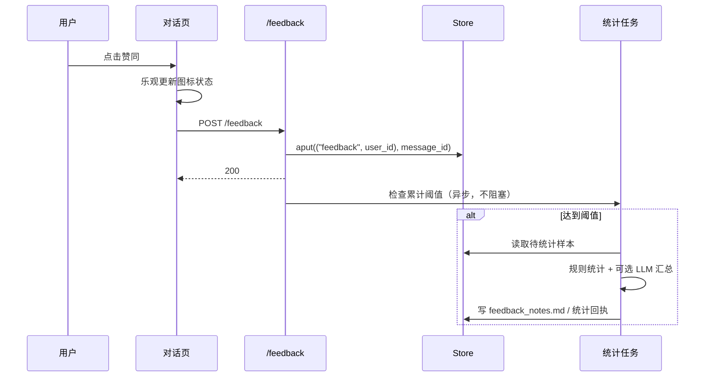
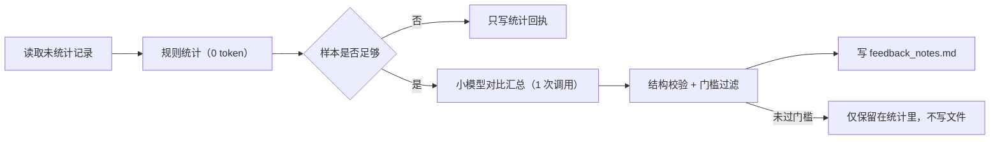
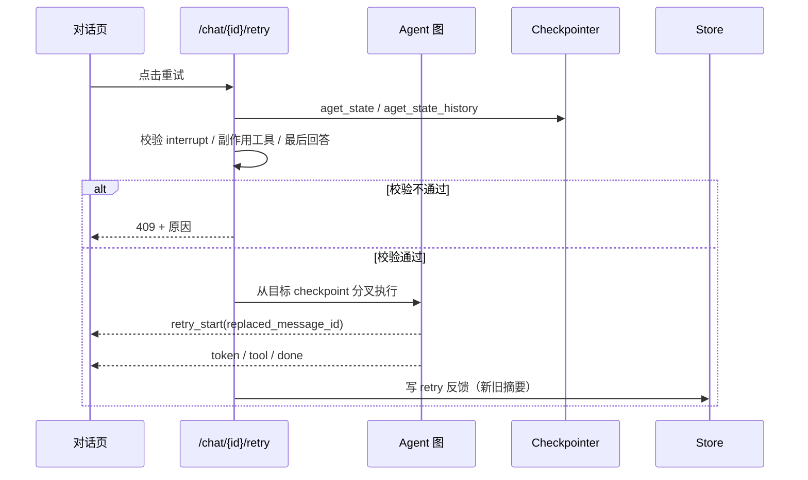

# 消息级反馈与重试设计

> 文档定位：实现设计稿。本文把概念稿《[赞同与拉踩](./赞同与拉踩.md)》落成可执行的工程方案，重点回答四个问题：**是否进入上下文、消耗多少 Token、是否作为记忆、以什么形式实现**。
> 概念与动机不重复展开，只保留结论与取舍。

| 项目   | 内容                                                          |
| :--- | :---------------------------------------------------------- |
| 文档版本 | v0.1（设计稿，待评审）                                               |
| 日期   | 2026-11-08                                                  |
| 关联文档 | [赞同与拉踩.md](./赞同与拉踩.md)、[上下文管理与压缩评估设计.md](./上下文管理与压缩评估设计.md) |
| 适用范围 | 对话控制台（`ChatView`）、`/chat` 流式接口、会话历史、长期记忆                    |
| 默认结论 | 小功能：反馈只做账本与离线统计，点击零模型调用；不做多版本分支                             |

***

## 0. 结论先行

一句话：**三个按钮里只有"重试"会立刻影响输出；赞同与拉踩只是往账本里记一个比特，累计到阈值后再离线做一次语义统计，稳定结论才进入低信任度的行为偏好文件。**

| 设计问题     | 结论                                                                           | 理由                            |
| :------- | :--------------------------------------------------------------------------- | :---------------------------- |
| 是否进入上下文  | **不进入**。反馈不写 `messages`，不产生 system message                                   | 单次点击信息率极低，进入上下文只会污染窗口并诱发过度迎合  |
| Token 消耗 | 点击 **0 token**；每累计约 20 条反馈才触发 **1 次**小模型统计（约 2–4k input）                     | 与现有每轮记忆抽取错开，避免"点一次就多一次模型调用"   |
| 是否作为记忆   | **是，但分层**：原始账本 → `feedback_notes.md`（中信任、按需读）→ 仅极稳定结论才考虑提升进 `preferences.md` | 用户说的偏好与行为推出来的偏好，可靠度不同，不能混写    |
| 实现形式     | 前端四个按钮 + 一个轻量 Store 命名空间 + 一个离线统计任务 + 一个覆盖式重试接口                              | 不引入新框架、不引入分支状态机               |
| 重试语义     | 仅最后一条最终回答可重试；回滚到该轮之前重新生成，**覆盖**旧回答                                           | 会话保持单线，上下文不膨胀；历史中间回答重试会丢弃后续轮次 |

与概念稿的**一处有意偏离**：概念稿提出"用户点赞时 Agent 内部立刻做一次分析"。本设计改为**批量、异步、有门槛**的统计。原因是逐次归因的成本随点击线性增长，而单次点击的归因置信度并不高，容易被一次情绪化点击带偏。

***

## 1. 目标与非目标

### 1.1 目标

1. 每条最终回答下方提供四个操作：复制、赞同、不赞同、重试。
2. 赞同/不赞同可切换、可取消，刷新后状态保持。
3. 重试能在原位置重新生成最后一条回答，且不增加后续上下文负担。
4. 反馈数据可积累、可统计、可清理，并在长期上**轻微**影响 Agent 的风格与表达。
5. 整个功能有开关，关闭后不产生任何网络与模型开销。

### 1.2 非目标

| 不做              | 原因                           |
| :-------------- | :--------------------------- |
| 多版本回答分支（1/2 切换） | 需要分支模型与切换接口，改动面远大于收益         |
| 每次点击即时 LLM 归因   | 成本线性增长，单次信号噪声大               |
| 拉踩原因弹窗          | 已确认采用纯按键 + 阈值触发语义统计，避免增加操作负担 |
| 反馈直接影响本轮/下一轮生成  | 违背"单次信号权重不应过高"，也浪费上下文        |
| 记录"复制"为强信号      | 复制多用于外发/粘贴，语义不纯，默认只在前端计数     |

***

## 2. 代码现状与约束

设计必须贴着现有结构走，以下是从代码中确认的事实。

### 2.1 前端

- 最终回答气泡下已有一行 `.msg-meta`，内含复制按钮（[ChatView.vue](../../frontend/HarnessControlPlatform/src/views/ChatView.vue) 约 1192–1204 行），样式 `.copy-mini` 约 1804 行起。
- 图标走自绘线性图标集（[AppIcon.vue](../../frontend/HarnessControlPlatform/src/components/console/AppIcon.vue) + [icons.ts](../../frontend/HarnessControlPlatform/src/components/console/icons.ts)），没有点赞/点踩图标，需要新增 3 条 path。
- 消息状态集中在 [chat.ts](../../frontend/HarnessControlPlatform/src/stores/chat.ts) 的 `ThreadChat.messages`，渲染按 `turns` 分组。

### 2.2 消息 ID：必须先补一个稳定契约

这是本功能最容易踩的坑：

- 流式期间，最终回答的 `message_id` 由后端临时生成：`assistant-<uuid4>`（[chat.py](../../src/api/chat.py) 第 1024–1025 行）。
- 刷新后，历史接口返回的是 checkpoint 中 `AIMessage.id`（[history.py](../../src/api/history.py) 第 167 行），两者**并不相等**。
- 但 `done` 事件里的 `usage` 来自 `TokenUsageMiddleware`，其 `message_id` 就是持久化的 `AIMessage.id`（[token\_usage.py](../../src/agent/middlewares/token_usage.py) 第 55 行）。

**结论**：反馈主键必须使用 `done.usage.message_id`（或后端在 `done` 中显式补 `final_message_id`），前端在收到 `done` 时把气泡的临时 ID 归一到稳定 ID。否则用户点赞后刷新，反馈会挂在一个不存在于历史里的 ID 上。

### 2.3 存储与生命周期

- 持久化统一走 PostgreSQL：正文在 checkpointer，附属数据在 Store 命名空间。
- 已有命名空间：`("trajectory", user_id, thread_id)`、`("reward", user_id, thread_id)`、`("usage", user_id, thread_id)`、`("experience", user_id)`。
- 会话删除会同时清理 checkpoint、会话索引、轨迹与用量（[agent\_loader.py](../../src/api/agent_loader.py) 第 710–724 行）。反馈也必须挂进同一生命周期。

### 2.4 记忆现状

- 每轮结束，`MemoryUpdateMiddleware` 异步调用一次摘要模型，抽取 `recent_queries` 与用户**明确说出**的偏好，写入 `preferences.md`（[memory\_update.py](../../src/agent/middlewares/memory_update.py)）。
- `_serialize_preferences` 只写 `preferred` 与 `recent_queries` 两个顶层键，**任何额外的顶层字段都会在下一轮被覆盖**。
- 因此反馈推导出的偏好不能直接塞进 `preferences.md`，需要独立文件。

### 2.5 上下文与压缩

- 软水位约 61.6%、硬水位约 77.4%，压缩会替换消息但不会销毁 checkpoint（见上下文归档文档）。
- 反馈账本以 `message_id` 为锚，不依赖消息是否仍在上下文中；即使被压缩掉，账本仍可统计。

### 2.6 重试现状

- 当前没有重试/重新生成接口，只有 `/chat`、`/chat/stream`、`/chat/{thread_id}/resume`。
- 图由 deepagents + LangGraph checkpointer 构建，具备按历史 checkpoint 分叉的能力，但 messages 使用 DeltaChannel（见 [history\_reader.py](../../src/agent/history_reader.py)），重放与删除语义需要一次技术验证。

***

## 3. 信号模型

### 3.1 四种动作

| 动作  | 语义             |   权重 | 是否即时生效  | 主要用途      |
| :-- | :------------- | ---: | :------ | :-------- |
| 复制  | 弱正向；也可能只是外发    |  0 | 否       | 默认不落库     |
| 赞同  | 风格、观点或表达方式被认可  | +1.0 | 否       | 风格/表达候选证据 |
| 不赞同 | 内容、风格、深度或边界出问题 | -1.5 | 否       | 纠偏候选；强负向  |
| 重试  | 本轮未达预期，但仍愿意继续  | -0.5 | 是（重新生成） | 新旧回答的对比样本 |

权重只用于离线聚合，不参与在线打分，也不作为工具或经验库的准入依据。

### 3.2 单次信号不得生效

| 信号组合        | 允许的最小生效条件                     |
| :---------- | :---------------------------- |
| 赞同 → 风格偏好   | 同主题 ≥ 3 次，且跨 ≥ 2 个会话          |
| 不赞同 → 规避规则  | 同主题 ≥ 2 次，且跨 ≥ 2 个会话          |
| 不赞同 → 冒犯/越界 | 单次即可进入"强负向"，但只约束表达边界，不改变人格与立场 |
| 重试 → 偏好对比   | 只作为对比样本，不单独形成规则               |

这是概念稿"人的喜好是流动的、离散出现的"的直接落地：**一次点击只能成为证据，不能成为结论**。

***

## 4. 数据模型

### 4.1 记录结构

```jsonc
{
  "message_id": "assistant-...",   // 稳定 AIMessage.id，主键
  "thread_id": "...",
  "user_id": "...",
  "action": "like",                // like | dislike | none
  "created_at": "2026-11-08T10:00:00+00:00",
  "updated_at": "2026-11-08T10:00:00+00:00",
  "user_excerpt": "<=200 字符",
  "answer_excerpt": "<=400 字符",
  "meta": {
    "source": "main",              // 仅最终回答
    "tools": ["read_file"],        // 本轮用到的工具名（去重，<=8）
    "answer_chars": 1830,
    "risk_tier": "T1",             // 复用自检风险分级（可选）
    "mode": "chat"                 // chat | taskflow | resume
  },
  "history": [                     // 状态切换轨迹，最多 5 条
    {"action": "dislike", "at": "..."},
    {"action": "like", "at": "..."}
  ]
}
```

设计取舍：

- **只存摘要，不存全文**。全文在 checkpoint 里，账本只保留统计所需的片段，既控体积也降低隐私面。
- **excerpt 由前端提交、服务端强制截断**。避免每次点击都读一次 checkpoint；代价是需按不可信输入处理（见 10.3）。
- **不存用户消息 ID**。历史接口里用户消息是索引 ID（`message-{index}`），刷新后会变，不可作为锚点。

### 4.2 命名空间与幂等

```
("feedback", user_id) -> key: message_id
```

- 选用户级而非会话级，因为统计要跨会话；会话删除时按 `thread_id` 字段扫描清理（单用户反馈量小，成本可接受）。
- 同一 `message_id` 多次点击是**覆盖式更新**：`like → dislike` 直接改 `action` 并追加 `history`；再次点击同一动作视为取消，写 `none` 或删除记录。
- 前端无需去重，后端天然幂等。

### 4.3 容量与保留

| 项        | 估算                                     |
| :------- | :------------------------------------- |
| 单条记录     | 约 0.6–1.2 KB                           |
| 重度用户每日反馈 | 10–30 条                                |
| 一年体量     | 约 4k–11k 条，5–12 MB                     |
| 保留策略     | 180 天或每用户 20,000 条，超出按 `updated_at` 归档 |

***

## 5. 写入链路

### 5.1 接口

```
POST /feedback
{
  "user_id": "u_1",
  "thread_id": "t_1",
  "message_id": "assistant-...",
  "action": "like" | "dislike" | "none",
  "user_excerpt": "...",
  "answer_excerpt": "...",
  "meta": { "tools": ["read_file"], "answer_chars": 1830 }
}
→ 200 { "message_id": "...", "action": "like" }
```

校验与限流：

1. 会话归属校验（复用 `agent_loader.get_session`），归档会话返回 409。
2. `message_id` 非空、长度上限；excerpt 服务端截断。
3. 单用户每日写入上限 500 条，超出返回 429 并只记日志。
4. 写入失败返回 5xx，前端回滚乐观状态。

### 5.2 历史回显

- `serialize_messages` 为每条 assistant 消息附加 `feedback` 字段（`like` / `dislike` / null）。
- 一次请求批量读取该会话的反馈记录后在内存里做映射，避免逐条查询。
- 压缩后仍存在但已不在消息列表中的记录自然不再展示，保留在账本中。

### 5.3 前端状态

- `ThreadChat` 增加 `feedbackByMessage: Record<string, 'like' | 'dislike'>`。
- 点击先本地更新（乐观 UI），再发请求；失败回滚并给一次轻提示。
- 300ms 内的重复点击直接忽略，避免连点产生无意义切换。

### 5.4 写入时序



***

## 6. 批量语义统计

这是整个功能唯一会调用模型的地方，也是"日积月累后产生作用"的关键。

### 6.1 触发条件

满足任一即触发，单日若有多次触发条件满足，触发次数不得超过2次。

| 条件     | 阈值             |
| :----- | :------------- |
| 新增任意反馈 | ≥ 20 条         |
| 新增不赞同  | ≥ 5 条          |
| 距上次统计  | ≥ 7 天且新增 ≥ 5 条 |

### 6.2 三步流程



**第一步：规则统计（零成本）**

按维度分组，输出比值而不是结论：

- 回答长度区间 vs 赞同率（短 / 中 / 长）；
- 是否使用列表、是否以问句结尾 vs 赞同率；
- 工具调用数量与重试率；
- 一天中的时段分布（只做观察，不轻易下结论）；
- 任务流回答与普通回答的反馈差异。

**第二步：小模型对比汇总（每次 1 次调用）**

输入不是"所有反馈"，而是**最多 10 组对照**：每组包含一条不赞同（或高权重负向）样本与一条同场景的赞同样本，各自只带用户摘要与回答摘要。要求输出严格 JSON：

```json
{
  "themes": [
    {
      "dimension": "style | depth | content | safety",
      "pattern": "用户更偏好先给结论、再展开细节",
      "evidence_count": 6,
      "contrast": "被否定的回答通常先铺垫三段背景",
      "confidence": 0.78
    }
  ]
}
```

约束：

- `dimension=content`（事实/立场分歧）**不写用户画像**。一次事实错误不代表用户不喜欢某种风格，写进去只会造成错误泛化。
- `dimension=safety`（冒犯、越界、过度揣测）可以直接形成硬规避规则，属于唯一允许单次生效的例外。
- 输出必须通过 schema 校验，解析失败整批丢弃，不重试、不降级猜测。

**第三步：门槛过滤**

| 条件                     | 要求                                        |
| :--------------------- | :---------------------------------------- |
| 写入 `feedback_notes.md` | `confidence ≥ 0.7` 且 `evidence_count ≥ 3` |
| 跨会话                    | 证据需来自 ≥ 2 个 `thread_id`                   |
| 单文件上限                  | 最多 8 条主题，超出按权重淘汰                          |
| 主题去重                   | 归一化文本后哈希去重，同义不重复写                         |

### 6.3 写入位置：独立文件，不碰 preferences.md

原因见 2.4：`_serialize_preferences` 每次只写两个顶层键，任何附加字段都会被下一轮覆盖。

```
/memories/{user_id}/feedback_notes.md
```

格式：

```yaml
# 由反馈统计自动生成，低置信度，仅在风格相关任务中参考
feedback_derived:
  - id: fb_style_01
    dimension: style
    rule: "先给结论，再展开细节；避免三段式背景铺垫"
    evidence_count: 6
    confidence: 0.78
    first_seen: 2026-11-01
    last_confirmed: 2026-11-08
    ttl_days: 90
```

- **不自动注入**。现有 `ContextInjectionMiddleware` 在每个模型调用前拼 prompt，而一轮可能有多次模型调用（工具循环），把这段内容放进去会被重复计费。系统提示里只增加一句"如存在 `/memories/{user_id}/feedback_notes.md`，处理风格敏感任务时可读取"，不读也不影响任务。
- **带 TTL 与确认时间**。90 天无新证据自动降权或移除，避免把半年前的偏好当成永久人设。
- **不提升进** **`preferences.md`**。提升意味着与用户明确表达过的偏好等价，目前没有足够证据支持自动化这一步；如确需提升，走人工确认（P3）。

***

## 7. 记忆分层与上下文策略

### 7.1 四层记忆

| 层      | 位置                            | 信任度 | 进入上下文的方式       | 生命周期         |
| :----- | :---------------------------- | :-- | :------------- | :----------- |
| 显式偏好   | `preferences.md`              | 高   | 每轮由 Agent 自行读取 | 会话长期         |
| 行为偏好   | `feedback_notes.md`           | 中   | 仅在风格敏感任务中按需读取  | 90 天衰减       |
| 原始反馈账本 | Store `("feedback", user_id)` | 低   | 永不进入           | 180 天 / 2 万条 |
| 运行期奖励  | Store `("reward", ...)`       | 中   | 不进入            | 与会话同生命周期     |

### 7.2 上下文管理结论

1. 反馈事件**不写 checkpoint**，不触发压缩评估，不影响窗口水位。
2. 重试走正常图执行，消耗与普通一轮相同；因为覆盖旧回答，head 中的消息数不增加。
3. 压缩后消息可能消失，账本不受影响；统计只依赖 excerpt，不回读 checkpoint。
4. 默认**不做任何 in-context 注入**。即时纠偏优先交给用户的自然语言与重试，这比系统偷偷改提示更可控。

***

## 8. 重试

### 8.1 语义边界

| 场景                | 是否允许重试 | 说明                            |
| :---------------- | :----- | :---------------------------- |
| 最后一条最终回答          | 允许     | 覆盖式重新生成                       |
| 历史中间回答            | 不允许    | 会丢弃其后的所有轮次，破坏会话               |
| 包含副作用工具的轮次        | 默认不允许  | 写文件、执行命令、发布等操作重放风险高           |
| 等待人工确认（interrupt） | 不允许    | 应走 `/resume`，不是重新生成           |
| 任务流回答             | 默认不允许  | 流程有独立状态与产物，先保持只读反馈            |
| 会话正在运行            | 不允许    | `thread_operation` 已提供 409 互斥 |

副作用工具集合直接复用 [self\_judge.py](../../src/agent/middlewares/self_judge.py) 中的 `HIGH_RISK_TOOLS`（`write_file`、`edit_file`、`host_write_file`、`host_execute`、`publish_to_project`、`run_in_sandbox`），避免两套定义漂移。

### 8.2 接口与实现

```
POST /chat/{thread_id}/retry
{ "user_id": "...", "message_id": "assistant-..." }
→ text/event-stream
```

流程：

1. `thread_operation(thread_id)` 互斥；校验会话存在、未归档。
2. `head = agent.aget_state(config)`；`head.interrupts` 非空则返回 409。
3. 从 head 回溯到最后一条人类消息 H，确认其后存在最终回答 A（无 `tool_calls` 且有文本）。
4. 检查 H 之后所有工具调用是否命中 `HIGH_RISK_TOOLS`，命中则 409 并说明原因。
5. 取"H 已写入、A 尚未生成"的 checkpoint 作为分叉点。
6. 从该 checkpoint 继续执行，复用现有 SSE 事件投影。
7. 首个事件发 `retry_start { replaced_message_id }`，随后照常发 `token` / `tool_*` / `done`。
8. 完成后写一条 `retry` 反馈：`{ old_message_id, old_excerpt, new_message_id }`，作为后续对比样本。

**待验证的技术点**：第 5–6 步有两种实现路径，需先做一次最小验证再定稿。

| 方案    | 做法                                                             | 风险                                      |
| :---- | :------------------------------------------------------------- | :-------------------------------------- |
| A（优先） | 以历史 checkpoint 的 `checkpoint_id` 分叉，`ainvoke(None, config)` 继续 | deepagents 的 DeltaChannel 对分叉重放的兼容性需要实测 |
| B（兜底） | 用 `RemoveMessage` 删除 A 及其工具消息，再从当前 head 继续                     | 删除语义在 DeltaChannel 下是否彻底，需要实测；删除后不可恢复   |

无论 A/B，都必须验证三件事：新回答写入后 head 只保留新版本、工具调用不重复执行、`usage` 统计不重复计数。



### 8.3 前端交互

- 重试按钮只在最后一条最终回答、非流式、非归档、无 interrupt 时出现。
- 点击后：按钮区禁用，保留旧内容直到新回答第一段 token 到达，再原地清空并流式渲染。
- 失败且未产生任何新内容时，恢复旧气泡并提示；已产生部分新内容时不回滚，提示可再次重试。
- 连续重试 3 次仍无新反馈时，插入一条系统提示："希望我在哪方面调整？"把隐式信号转成显式表达（对应概念稿的防滥用设计）。计数只在前端本地维护。

### 8.4 代价

| 维度    | 影响                                          |
| :---- | :------------------------------------------ |
| 上下文   | 不增长，旧回答被移出 head                             |
| Token | 约等于普通一轮生成                                   |
| 存储    | 每次重试在 Postgres 多留一个 checkpoint 分支；随会话删除一起清理 |
| 可观测   | 轨迹页可看到该轮的第二次执行；反馈账本保留新旧摘要                   |

***

## 9. UI 规范

### 9.1 布局

最终回答气泡正下方一行，沿用 `.msg-meta`：

```
[复制图标（不要写文本，就放一个能代表COPY的图标）]  [👍]  [👎]  [↻]
```

- 复制保留现有文字按钮与"已复制"反馈。
- 三个新按钮为纯图标，`title` 提供文案：`赞同` / `不赞同` / `重新回答`。
- 高度、字号、间距沿用 `.copy-mini`（22px / 10px），不新增第二行。
- 图标加入 `icons.ts`：`thumbUp`、`thumbDown`、`refresh`，保持 24×24 线性描边风格。

### 9.2 状态

| 状态   | 表现                |
| :--- | :---------------- |
| 未选中  | 线性图标，次要文字色        |
| 已赞同  | 主色描边 + 12% 主色填充背景 |
| 已不赞同 | 同上，使用警示色而非主色      |
| 处理中  | 按钮禁用，保留当前状态       |
| 请求失败 | 回到上一状态，页面级轻提示     |

- 赞同与不赞同互斥；再次点击同一项视为取消。
- `aria-pressed` 与 `aria-label` 必须同步，键盘可聚焦、可触发。

### 9.3 可见性矩阵

| 场景             |  复制 | 赞同/不赞同 |  重试 |
| :------------- | :-: | :----: | :-: |
| 最后一条最终回答       |  是  |    是   |  是  |
| 历史最终回答         |  是  |    是   |  否  |
| 流式输出中          |  否  |    否   |  否  |
| 等待人工确认         |  是  |    否   |  否  |
| 归档会话           |  是  |  否（只读） |  否  |
| 子 Agent / 工具卡片 |  否  |    否   |  否  |
| 任务流回答          |  是  |    是   |  否  |

***

## 10. 失败模式与边界

### 10.1 失败处理

| 故障           | 行为                     |
| :----------- | :--------------------- |
| Store 写入失败   | 前端回滚状态并轻提示；不阻塞对话       |
| 统计任务失败       | 只告警，保留未统计标记，下次触发时重试    |
| 统计输出格式非法     | 整批丢弃，不写任何偏好            |
| 重试分叉失败       | 返回 409/500 并说明；前端保留旧内容 |
| 历史接口反馈批量读取失败 | 降级为不显示已选状态，不影响对话       |

### 10.2 生命周期

- 会话删除：按 `thread_id` 清理反馈记录，与轨迹、用量一致。
- 会话归档：可读不可写，点击反馈返回 409。
- 反馈开关关闭：前端隐藏三个新按钮；接口直接 403。

### 10.3 安全与隐私

- excerpt 上限固定（用户 200 / 回答 400），服务端强制截断。
- excerpt 是不可信输入：统计 prompt 中明确标记为数据，并复用经验库的投毒关键词检查（[experience.py](../../src/agent/evolution/experience.py) 中的 `UNSAFE_EXPERIENCE_TOKENS`）。
- 统计产物只允许写 `feedback_notes.md` 的受限 schema，不允许包含指令性长文本。
- 不记录 IP、设备、完整回答正文。

### 10.4 并发

- 反馈写入幂等，无需加锁。
- 统计任务按用户加内存锁，避免同日并发执行；单 worker 部署下足够。
- 重试复用 `thread_operation` 的会话互斥，多 worker 的分布式锁是既有约束，不在本功能内解决。

***

## 11. 与现有模块的关系

| 模块                     | 关系      | 说明                                                     |
| :--------------------- | :------ | :----------------------------------------------------- |
| trajectory             | 不重复落事件  | 反馈是用户侧信号，轨迹是执行侧信号；仅重试可选写一条 `retry` 事件                  |
| reward                 | P2 可选折算 | 把赞同/不赞同按 `delayed=true` 写入 reward 账本，复用现有聚合，不新建第二套奖励体系 |
| experience             | 不直接写入   | 一次不满不足以形成通用经验；仅在 P2 作为 `user_correction` 信号来源          |
| MemoryUpdateMiddleware | 并行不合并   | 它管"用户说出来的偏好"，反馈统计管"用户用行为表达的偏好"                         |
| usage\_store           | 复用消息 ID | `usage.message_id` 是反馈主键的现成稳定来源                        |
| 上下文压缩                  | 互不影响    | 账本独立于消息窗口，压缩不丢反馈                                       |

***

## 12. 成本预算

以"重度用户每天 20 次反馈、每月 600 次"估算。

| 项      | 频率                  |                    单次成本 |             月成本 |
| :----- | :------------------ | ----------------------: | --------------: |
| 点击写入   | 600 次/月             |     0 token，1 次 Store 写 |               0 |
| 规则统计   | 与 LLM 汇总同批          |                       0 |               0 |
| LLM 汇总 | ≤ 1 次/天，约 20–30 次/月 | 2–4k input + 300 output | 约 60–120k token |
| 偏好读取   | 仅在风格敏感任务            |           ≤ 800 token/次 |           视使用而定 |
| 重试     | 用户主动                |                   约普通一轮 |        与正常使用同量级 |

对照：若采用"每次点击即时归因"，600 次 × 约 2k input ≈ 1.2M token/月，且每次点击都有模型延迟。**批量方案的成本低一个数量级。**

空间：账本约 1 KB/条，一年 5–12 MB；`feedback_notes.md` 控制在 8 KB 以内。

***

## 13. 验收标准

| 验证项       | 目标                              |
| :-------- | :------------------------------ |
| 点击到 UI 反馈 | ≤ 100ms                         |
| 反馈接口 P95  | ≤ 150ms，失败率 < 0.5%              |
| 点击触发的模型调用 | 严格为 0（用 trace 核对）               |
| 统计调用频率    | 每用户每日 ≤ 1 次，单次 ≤ 5k token       |
| 重试后上下文    | head 消息数不增加；旧回答不在后续上下文中         |
| 重试一致性     | 副作用轮次 100% 被拒绝；中断轮次 100% 被拒绝    |
| 幂等        | 同一消息连续点击 10 次，账本只有 1 条记录        |
| 刷新回显      | 刷新后赞同/不赞同状态与点击前一致               |
| 会话删除      | 反馈记录、轨迹、用量同时清空                  |
| 开关关闭      | 前端无新增按钮，接口 403                  |
| 记忆污染      | 事实分歧类不赞同不写入 `feedback_notes.md` |

***

## 14. 分期

### P0：最小可用（本次）

- 四个按钮 + 图标 + 可见性规则。
- `feedback` Store 命名空间、写入接口、历史回显。
- 稳定消息 ID 契约（`done.usage.message_id`）。
- 重试：仅最后一条最终回答、拒绝副作用与中断轮次。
- 会话删除清理、开关。

交付后即可验证"点击零模型调用"和"重试不膨胀上下文"。

### P1：可观测

- 规则统计与统计回执。
- 设置页只读面板：赞同率、重试率、不赞同主题分布。
- 阈值触发与冷却。

### P2：进入记忆

- 小模型对比汇总，写 `feedback_notes.md`。
- 90 天衰减与证据计数。
- 可选：把稳定结论折算为 delayed reward 写入 reward 账本。

### 明确不做

多版本分支、逐次 LLM 归因、拉踩原因弹窗、反馈影响本轮生成、自动把行为偏好提升为显式偏好。

***

## 15. 代码落点

| 层  | 文件                                    | 改动                                           |
| :- | :------------------------------------ | :------------------------------------------- |
| 后端 | `src/agent/feedback_store.py`（新）      | 命名空间、读写、幂等、清理、统计辅助                           |
| 后端 | `src/agent/feedback_distill.py`（P2，新） | 阈值判断、规则统计、模型汇总、门槛过滤                          |
| 后端 | `src/api/feedback.py`（新）              | 写入与回显接口                                      |
| 后端 | `src/api/chat.py`                     | `done` 补稳定消息 ID；新增 `/chat/{thread_id}/retry` |
| 后端 | `src/api/history.py`                  | assistant 消息附加 `feedback` 字段                 |
| 后端 | `src/api/agent_loader.py`             | 会话删除时清理反馈                                    |
| 后端 | `src/agent/schema.py`                 | 请求/响应模型                                      |
| 后端 | `src/agent/config.py`                 | 开关、阈值、保留期                                    |
| 前端 | `src/api/feedback.ts`（新）              | 接口封装                                         |
| 前端 | `src/stores/chat.ts`                  | 反馈状态、重试流、连续重试计数                              |
| 前端 | `src/views/ChatView.vue`              | 四个按钮与可见性                                     |
| 前端 | `src/components/console/icons.ts`     | `thumbUp`、`thumbDown`、`refresh`              |
| 测试 | `test/`                               | 幂等、归档拒绝、重试分叉、副作用拒绝、删除清理                      |

***

## 16. 待评审的开放问题

1. `done` 事件里补 `final_message_id`，还是直接复用 `usage.message_id`？后者零改动，但模型未返回 usage 时为空，需要兜底读一次 state。
2. 重试只允许最后一条，是否需要给历史回答提供"从这条继续"的独立操作？目前判断不需要，避免与重试语义混淆。
3. 反馈账本是否需要用户可见/可清除的入口？建议 P1 在设置页提供"清空我的反馈数据"。
4. `feedback_notes.md` 是否需要在系统提示中显式提示路径？目前只加一句"存在时可读取"，避免每轮固定开销。
5. 任务流回答是否允许重试？取决于任务流是否支持幂等重跑，暂列非目标。

