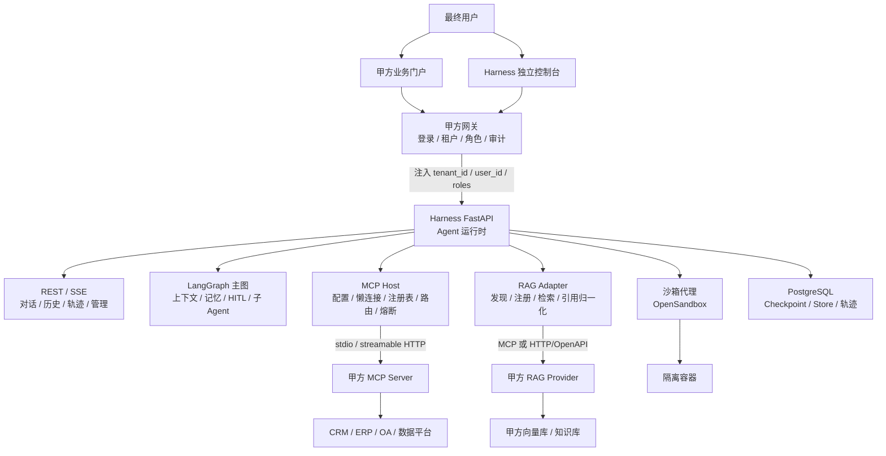
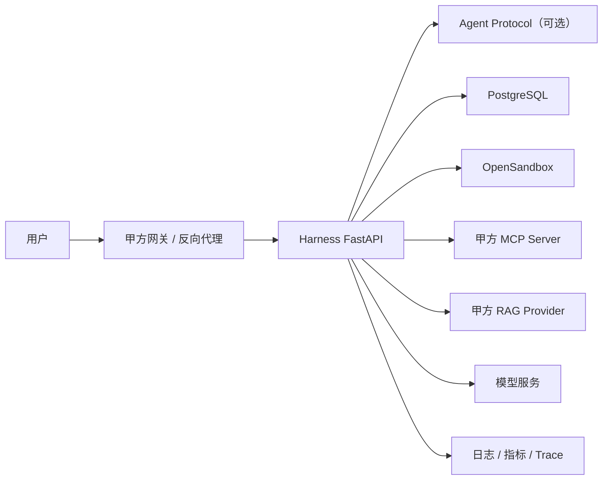

# 集成模式架构设计（v1.0）

> 文档性质：详细架构设计文档，面向接入方、平台研发与运维。
> 版本：v1.0 · 2026-11-02
> 前置阅读：[项目描述（v1）](./项目描述.md)、[MCP 可热插拔服务设计](./MCP可热插拔服务设计.md)、[SandBox 服务设计](./SandBox服务设计.md)、[工作区设计](./工作区设计.md)、[RAG 模块开发文档](../develope/RAG模块开发文档.md)

**状态图例**

| 标记 | 含义 |
| :-- | :-- |
| 现状 | 当前仓库已经具备，或已有可运行实现 |
| 目标 | 本文定义的目标态，需要在集成模式交付前完成 |
| 可选 | 不属于 v1 主线，按客户场景启用 |
| 长期 | 单客户单部署稳定后再评估 |

---

## 1. 文档说明

### 1.1 编写目的

定义 Harness 作为**能力层**嵌入甲方既有后端系统时的架构边界、接口契约、数据格式、错误语义、安全要求、工作区模型、部署方式与验收标准，使接入方可以按统一规范实现 MCP 服务、RAG 适配器与网关接入，而不需要理解 Harness 内部实现。

本文解决三个问题：

1. **边界问题**：哪些能力由甲方提供，哪些由 Harness 提供。
2. **契约问题**：甲方 MCP Server、RAG Provider、网关与 Harness 之间如何交互。
3. **交付问题**：如何联调、验收、上线、运维与演进。

### 1.2 适用范围

适用于以下场景：

- 甲方已有后端系统（CRM、ERP、OA、数据平台、工单系统等），希望通过 MCP 接入 Agent 能力。
- 甲方已有 RAG/知识库服务，希望被 Agent 统一检索与引用。
- 甲方希望使用 Harness 自带控制台，或把控制台以受控方式嵌入自己的门户。
- 甲方部署在私有云、内网或受控的公网环境，采用单客户单部署。

不适用于：

- 由 Harness 直接实现甲方业务逻辑、业务工具或业务子 Agent。
- 由 Harness 直连甲方数据库、文件系统或业务 API。
- 由 Harness 提供向量库、知识存储或 RAG 产品。
- 由 Harness 对外暴露 MCP Server 端点。
- 一套 Harness 同时服务多个互不信任的甲方（多租户为长期演进）。

### 1.3 读者与用法

| 读者 | 建议阅读 |
| :-- | :-- |
| 甲方架构师/后端负责人 | 第 2、3、4、8、11 章 |
| 甲方 MCP 服务开发者 | 第 4.2、4.6、5、6、12 章 |
| 甲方 RAG 服务开发者 | 第 4.3、5、8、12 章 |
| 甲方网关/安全团队 | 第 3、8、11 章 |
| Harness 研发 | 全文 |
| Harness 运维 | 第 7、9、10、11、12 章 |

### 1.4 术语与缩写

| 术语 | 释义 |
| :-- | :-- |
| Harness | 本项目提供的 Agent 运行时与能力层 |
| 集成模式（Embedded Mode） | Harness 部署在甲方服务器/内网，作为能力层嵌入既有后端系统 |
| 甲方/接入方 | 拥有业务系统、业务数据、登录体系与业务前端的一方 |
| Gateway | 甲方网关，负责登录、租户识别、角色注入、审计入口 |
| MCP Host | 承载 MCP 客户端的宿主应用；本项目中 Harness 即 MCP Host |
| MCP Server | 甲方实现并对外暴露工具/资源的服务 |
| RAG Provider | 甲方提供的知识检索服务；向量库与知识存储归甲方 |
| RAG Adapter | Harness 侧的统一检索适配层，不存储知识 |
| Workspace | 项目工作区，持久文件域；集成模式下位于服务端并按用户隔离 |
| Sandbox | 唯一的命令与代码执行域 |
| Skill | 以 `SKILL.md` 为入口的渐进式能力包 |
| HITL | Human-in-the-Loop，关键节点暂停等待人工确认 |
| Trajectory | 模型、工具、技能、委派、HITL 的结构化执行记录 |
| TraceId | 一次请求或一次 run 的全局关联标识 |
| CorrelationId | 跨系统调用时用于关联日志与事件的标识 |

### 1.5 参考文档

- [项目描述（v1）](./项目描述.md)
- [MCP 可热插拔服务设计](./MCP可热插拔服务设计.md)
- [SandBox 服务设计](./SandBox服务设计.md)
- [工作区设计](./工作区设计.md)
- [上下文工程设计](./上下文工程设计.md)
- [宿主能力与 HITL 审批设计](./宿主能力与HITL审批设计.md)
- [RAG 模块开发文档](../develope/RAG模块开发文档.md)
- [README](../../README.md)

---

## 2. 集成模式概述

### 2.1 设计目标

| 目标 | 说明 |
| :-- | :-- |
| 业务能力外置 | 所有业务工具、业务资源、业务数据访问由甲方 MCP Server 提供 |
| 运行时内聚 | Agent 图、上下文、记忆、HITL、沙箱、轨迹由 Harness 负责 |
| 接入低侵入 | 甲方不修改业务核心，只需增加 MCP Server、网关身份注入与少量配置 |
| 契约稳定 | MCP、RAG、异步任务、错误码、数据格式有明确版本与兼容策略 |
| 可降级 | 单个 MCP/RAG/沙箱故障不拖垮整个对话 |
| 可运维 | 状态、日志、指标、审计、告警、备份与恢复可落地 |
| 可交付 | 源码交付，单客户单部署，支持私有云、内网与受控公网 |

### 2.2 设计原则

| 原则 | 落地要求 |
| :-- | :-- |
| 鲁棒 | 超时、取消、重试、熔断、降级、幂等是默认能力，不是补丁 |
| 解耦 | 业务能力只通过 MCP 进入；Harness 不持有业务数据与业务凭据 |
| 适配性 | RAG、异步任务、UI 均通过适配层接入，不绑定单一厂商 |
| 可扩展 | 新增 MCP Server、RAG Provider、技能不要求重建整张 Agent 图 |
| 最小权限 | 工具白名单、路径约束、HITL、配额默认开启 |
| 可观测 | 每个跨系统调用都有 TraceId/CorrelationId、耗时、状态与错误原因 |
| 契约优先 | 先定义 Schema、错误、超时、幂等，再写实现 |
| 可回退 | 任何版本升级、配置变更、工具启停都必须有回退路径 |

### 2.3 总体架构图



### 2.4 集成场景分类

集成场景按三个维度分类，避免把“部署形态”和“交互形态”混在一起。

**交互形态**

| 形态 | 特征 | 典型场景 |
| :-- | :-- | :-- |
| 同步对话 | 用户等待回答，SSE 流式返回 | 客服助手、业务查询、文档问答 |
| 异步任务 | 提交后立即返回 `task_id`，后台执行 | 报表生成、批量分析、长文档处理 |
| 批处理 | 无人工交互，按计划或事件触发 | 数据巡检、定时摘要、批量分类 |

**部署形态**

| 形态 | 说明 | 版本 |
| :-- | :-- | :-- |
| 私有化单租户 | 一个甲方一套部署，源码交付 | v1 默认 |
| 托管单租户 | 一个甲方一套逻辑部署，可由平台托管 | 可选 |
| 多租户 | 一套部署服务多个互不信任的甲方 | 长期 |

**网络形态**

| 形态 | 说明 | 约束 |
| :-- | :-- | :-- |
| 在线实时 | Harness 可访问 LLM 与甲方 MCP/RAG | 最常见 |
| 内网隔离 | Harness 与 MCP/RAG 在内网，LLM 通过专线或代理 | 需网络白名单 |
| 离线降级 | LLM 或外部服务不可用时只提供有限能力 | 需明确降级矩阵，不承诺完整 Agent 能力 |

> “在线/离线”在本项目中不表示 Harness 可以完全离线运行；Agent 推理仍依赖模型服务。离线仅指外部业务系统不可达时的降级状态。

### 2.5 核心角色与系统边界

| 角色 | 拥有 | 不负责 |
| :-- | :-- | :-- |
| 甲方业务后端 | 业务数据、业务规则、业务 API、RAG、MCP Server | Agent 编排、上下文、沙箱 |
| 甲方网关 | 登录、租户、角色、请求签名、审计入口 | Agent 运行时 |
| 甲方前端 | 业务页面、业务交互 | Agent 运行时与工具执行 |
| Harness | Agent 图、上下文、记忆、HITL、沙箱、MCP Host、RAG Adapter、轨迹 | 业务数据、业务规则、向量存储 |
| Harness 控制台 | 对话、项目/工作区、技能、MCP 管理、轨迹、模型设置 | 业务页面 |
| 模型服务 | LLM 推理 | 工具执行、业务数据 |
| 沙箱服务 | 隔离执行环境 | 持久存储、业务逻辑 |

### 2.6 能力现状与目标差距矩阵

| 能力 | 现状 | 目标 | 差距 | 优先级 |
| :-- | :-- | :-- | :-- | :-- |
| 网关身份接入 | 无内置认证，README 约定由网关注入 | 可信 `tenant_id/user_id/roles` | 需签名/校验/防重放 | P0 |
| 工作区根约束 | 按 `user_id` 隔离，但可 attach 任意绝对路径 | 受管根 + 白名单 | Linux 下存在越权风险 | P0 |
| MCP 基础接入 | YAML/JSON 配置、代理工具、文件监听 | 懒连接、连接池、生命周期 | 生产化组件缺失 | P0 |
| MCP 动态管理 | 只能改配置、重启或文件监听 | 运行期启停、状态、审计 | 缺 API/UI | P0 |
| MCP 命名空间 | 跨 Server 同名直接报错 | `server__tool` 隔离 | 需注册表与路由 | P1 |
| MCP 熔断/重试 | 无分类、无预算 | 错误分类、退避、熔断、LKG | 需实现 | P1 |
| RAG 适配器 | 仅 17 行草案，无实现 | Provider 注册、统一检索、引用 | 需新建 | P1 |
| 异步任务 | Agent Protocol + `start_async_task` | 取消、追加指令、幂等投递 | 部分具备 | P1 |
| 轨迹 | 内部 PostgreSQL 轨迹 | 外部 Trace、TraceId 贯穿 | 缺 OTel/Langfuse | P1 |
| UI 主题化 | 现有 Vue 控制台 | 设计 Token、可替换外壳 | 需抽象主题 | P1 |
| 技能市场 | 技能管理工具 | 浏览、安装、版本、权限 | 需新建 | P2 |
| 多租户 | 单租户 | `tenant_id` 全链路 | 长期 | P3 |

---

## 3. 责任边界与协作机制

### 3.1 Agent 系统职责

Harness 负责：

1. 维护 Agent 图、系统提示词、上下文注入、记忆与压缩。
2. 管理 MCP Server 配置、连接、工具注册、路由、超时、熔断与审计。
3. 管理同步/异步子 Agent、任务状态与结果回写。
4. 提供 HITL 中断、审批、恢复与审计。
5. 提供沙箱执行、文件同步、技能同步与产物发布。
6. 维护项目工作区、会话、轨迹、Token 统计与用户偏好。
7. 提供 REST/SSE API 与控制台。
8. 执行安全边界：工具白名单、路径约束、配额、脱敏、审计。
9. 在故障时执行降级策略，并向用户给出可理解的错误。

Harness 不负责：

- 业务数据的持久化与业务规则。
- 业务工具的语义正确性；只校验契约与安全边界。
- 甲方登录、角色、组织架构。
- 甲方 RAG 的切片、嵌入、索引与向量存储。
- 甲方数据库连接与凭据管理。
- 甲方 MCP Server 的可用性与数据正确性。

### 3.2 甲方/后端系统职责

甲方负责：

1. 实现 MCP Server，提供业务工具与资源。
2. 在网关完成登录、租户识别、角色与权限判定。
3. 提供 RAG Provider，负责知识切片、嵌入、索引、存储与召回。
4. 提供业务数据、业务 API 与业务权限。
5. 对 MCP 工具的数据正确性、幂等性、权限与审计负责。
6. 提供测试环境、测试账号、测试数据与 Mock 约定。
7. 提供网络、证书、密钥、数据库与服务器资源。
8. 在变更前通知 Harness 团队，并提供兼容性说明。

### 3.3 责任边界矩阵（RACI）

> R=负责执行，A=最终负责，C=需咨询，I=需知会。

| 活动 | 甲方业务 | 甲方网关/安全 | MCP 提供方 | Harness 研发 | Harness 运维 |
| :-- | :--: | :--: | :--: | :--: | :--: |
| 业务场景与工具清单 | A/R | C | C | C | I |
| 登录/租户/角色 | C | A/R | I | I | I |
| MCP Server 实现 | C | C | A/R | C | I |
| MCP 契约与 Schema | I | C | R | A | I |
| RAG Provider | A/R | C | C | C | I |
| RAG Adapter | I | I | C | A/R | C |
| 工作区根与配额 | C | A | I | R | R |
| 沙箱与执行隔离 | I | C | I | A/R | R |
| HITL 策略 | A | C | C | R | I |
| 可观测与告警 | C | C | R | R | A |
| 备份与恢复 | A | C | I | C | R |
| 上线与变更 | A | C | R | R | R |

### 3.4 接入生命周期


| 阶段 | 输入 | 产出 | 退出标准 |
| :-- | :-- | :-- | :-- |
| 1 评估 | 业务场景、用户角色、数据分类 | 场景清单、工具清单、SLO、风险清单 | 双方确认范围与非目标 |
| 2 契约设计 | 工具清单、RAG 能力、权限模型 | MCP 契约、RAG manifest、错误码、幂等方案 | 契约评审通过 |
| 3 Mock 与契约测试 | 契约文件 | Mock Server、契约测试报告 | Schema/错误/超时/幂等测试通过 |
| 4 联调 | 测试环境、测试账号 | 联调记录、问题清单 | 核心链路跑通，错误可读 |
| 5 试点 | 小范围用户、真实数据 | 试点报告、指标基线 | 错误率、延迟、满意度达标 |
| 6 上线 | 生产环境、网关、监控 | 上线清单、回滚方案 | 监控就绪，回滚演练通过 |
| 7 运营 | 运行数据、变更需求 | 周报、变更单、复盘 | 持续满足 SLO |

### 3.5 变更协作流程

1. **变更发起**：甲方或 Harness 提交变更单，说明变更类型（工具新增、Schema 变更、权限变更、部署变更）。
2. **兼容性评估**：判断是否破坏性变更；破坏性变更必须新版本或新工具名。
3. **契约测试**：在 Mock 与测试环境验证新旧版本。
4. **灰度发布**：按用户/业务系统灰度，观察错误率、延迟、HITL 比例。
5. **回滚准备**：保留旧版本配置与工具，确保可回退。
6. **变更记录**：写入审计与变更日志，通知相关方。

---

## 4. 接口契约层

### 4.1 接口设计总则

1. **业务能力单一入口**：所有业务能力通过 MCP 工具/资源进入；不设独立数据库接口、不设绕过 MCP 的业务 REST 通道。
2. **契约优先**：先定义 Schema、错误、超时、幂等、权限，再实现。
3. **工具无状态**：工具不依赖 Harness 进程内状态；状态由甲方业务系统维护。
4. **可幂等**：有副作用的工具必须支持幂等键。
5. **错误可读**：错误信息面向模型与用户，不泄露堆栈、SQL、密钥与内部路径。
6. **版本化**：MCP 协议版本、工具 Schema 版本、Harness API 版本分别管理。
7. **可观测**：每个请求携带 TraceId/CorrelationId，返回耗时与状态。
8. **最小权限**：工具白名单、参数校验、路径约束、HITL 默认开启。
9. **大对象引用**：大文件、二进制、长文本用引用或流式，不直接塞进模型上下文。
10. **业务粒度**：工具按业务意图设计，不暴露通用 SQL/命令执行。

### 4.2 甲方 MCP Server 实现规范

> 本节描述**甲方实现的 MCP Server**，不是 Harness 对外提供 MCP Server。Harness 只做 MCP Host/Client。仓库内 `src/mcp_server` 仅用于开发、测试与演示，不进入集成模式交付面。

#### 4.2.1 协议版本与能力协商

- MCP Server 必须实现标准 `initialize` 流程，返回 `protocolVersion` 与 `capabilities`。
- Harness 按自身支持的协议版本发起 `initialize`；服务端返回其版本。双方不兼容时连接失败并给出明确错误，必要时客户端按支持列表降级重试。
- 能力范围：

| 能力 | v1 要求 | 说明 |
| :-- | :--: | :-- |
| Tools | 必须 | 业务操作与查询的主要入口 |
| Resources | 可选/P1 | 只读知识、文档、配置；必须只读 |
| Prompts | 可选/P2 | 不作为 v1 业务契约的一部分 |
| Logging | 可选 | 不作为可观测性的唯一来源 |
| Progress | 可选 | 长任务进度通知 |

- 未声明的能力不得被 Harness 调用；Harness 也不假设所有 Server 都支持 Resources/Prompts。

#### 4.2.2 传输方式

| 传输 | 适用 | 要求 |
| :-- | :-- | :-- |
| `streamable_http` | 集成模式首选 | HTTPS；鉴权头；超时；可选 mTLS |
| `stdio` | 受信 sidecar/本机进程 | 命令白名单；独立工作目录；日志落盘；禁止用户任意输入命令 |
| `sse` | 兼容旧服务 | 仅作为兼容项，不作为新接入首选 |

传输要求：

1. HTTP 必须使用 TLS；内网可使用 mTLS 或网关双向认证。
2. 鉴权信息通过 Header 或配置的 secret reference 注入，不放在 URL、工具参数或日志中。
3. `stdio` 命令必须来自可信配置，前端不得直接执行任意命令。
4. 连接超时、请求超时、空闲超时分别配置。
5. 连接池按 `transport + endpoint + auth fingerprint` 复用。

#### 4.2.3 工具/资源/提示词定义

**工具命名**

- 逻辑名：`server.tool`，用于配置、审计与文档。
- 暴露给模型：`server__tool`，避免跨 Server 同名冲突。
- 工具名使用小写蛇形，长度不超过 64 字符，只允许 `[a-z0-9_]`。
- 工具名不得与 Harness 内置工具冲突；冲突时拒绝加载并提示。

**工具描述模板**

```text
用途：一句话说明这个工具做什么。
何时使用：在什么业务场景、满足什么条件时调用。
不适用：什么情况下不要调用。
副作用：read / write / destructive / external。
权限：需要什么角色或数据范围。
幂等：是否支持 idempotency_key，重复调用行为。
限制：单次返回大小、分页、速率限制。
```

**工具粒度**

- 优先业务级工具：`query_customer`、`create_ticket`、`approve_order`。
- 避免通用工具：`execute_sql`、`run_shell`、`call_any_api`。
- 一个工具只做一件事；复杂流程由甲方业务系统内部编排，或由 Harness 子 Agent 编排多个工具。

**资源**

- Resource URI 必须稳定、可读、只读。
- 资源内容必须有 MIME type、大小上限、版本或 ETag。
- 资源不得包含密钥、内部路径或未脱敏的个人信息。

**提示词**

- Prompts 不作为 v1 业务契约的一部分。
- 如提供，必须与业务工具解耦，不得包含 Harness 的系统指令。

#### 4.2.4 参数 Schema 与校验

- 使用 JSON Schema（推荐 Draft 2020-12 子集）。
- 必须提供 `inputSchema`；建议提供 `outputSchema`。
- 每个字段必须有 `description`、类型、是否必填；枚举必须列全。
- 复杂对象建议使用 `$defs`，但避免深层嵌套与循环引用。
- 字符串设置 `maxLength`；数组设置 `maxItems`；数字设置范围。
- 禁止在 Schema 中放密钥、示例真实数据、内部 URL。
- 建议 `additionalProperties: false`，避免模型传入未定义字段。
- Harness 在调用前做本地校验；甲方服务端必须再次校验，不能信任 Harness。

**校验失败返回**

```json
{
  "code": "INVALID_ARGUMENT",
  "message": "参数 order_id 缺失或格式不正确",
  "retryable": false,
  "details": {"field": "order_id", "expected": "string, 8-32 chars"}
}
```

#### 4.2.5 超时、取消与幂等语义

**超时**

| 层级 | 默认 | 说明 |
| :-- | :-- | :-- |
| 连接超时 | 10s | 建立连接 |
| 工具超时 | 60s | 单次工具调用；可按工具覆盖 |
| 长任务超时 | 可配置 | 超过阈值走异步任务模式 |
| 空闲超时 | 5min | 连接池回收 |

**取消**

- Harness 在用户停止、超时、会话关闭时发送取消请求。
- MCP Server 应实现 `notifications/cancelled` 或等价机制。
- 无法取消的工具必须在文档中标注，并依赖幂等与超时兜底。
- 取消后不得继续产生副作用；如已产生，必须可查询、可补偿。

**幂等**

- 有副作用的工具必须支持 `idempotency_key`，建议放在 arguments 的顶层字段。
- 同一 `idempotency_key` + 同一工具 + 同一业务主体，重复调用返回同一结果。
- 建议 TTL 24 小时；超时后重复调用需返回明确状态，不得静默重复执行。
- 只读工具可不要求幂等键，但仍需支持重试。
- 幂等键不得由模型随意编造；由 Harness 或甲方业务系统生成并透传。

#### 4.2.6 接口文档、示例与参数说明

每个 MCP Server 必须提供：

1. 工具清单与每个工具的描述。
2. 输入/输出 Schema。
3. 至少一个成功示例与一个失败示例。
4. 超时、限流、幂等、权限说明。
5. 负责人、值班方式、变更通知渠道。
6. 版本号与变更日志。

示例要求：

- 示例参数使用虚构数据，不含真实个人信息。
- 示例结果说明字段含义，不只给 JSON。
- 失败示例覆盖参数错误、权限错误、业务错误、超时。

#### 4.2.7 返回值说明

MCP 工具结果使用标准 content blocks：

```json
{
  "content": [
    {"type": "text", "text": "{\"order_id\":\"A1001\",\"status\":\"paid\"}"}
  ],
  "structuredContent": {
    "order_id": "A1001",
    "status": "paid"
  },
  "isError": false
}
```

约定：

- 小结果优先使用 `structuredContent`；大结果或非结构化内容使用 `content`。
- `content` 中的文本必须是 UTF-8，且不超过配置上限。
- 大对象返回引用（`file_id`、`uri`、`download_url`），不直接内联。
- 失败时 `isError: true`，并在 `content` 或 `structuredContent` 中放统一错误对象。
- 不得在返回值中放堆栈、SQL、密钥、绝对路径。

#### 4.2.8 错误码说明

错误分三层：

| 层 | 示例 | 返回方式 |
| :-- | :-- | :-- |
| MCP 协议错误 | 方法不存在、初始化失败、传输断开 | JSON-RPC error |
| 工具执行错误 | 参数错误、权限不足、超时、取消 | `isError: true` + 错误对象 |
| 业务错误 | 订单不存在、状态不允许、库存不足 | `isError: true` + 业务错误码 |

业务错误码建议：

| 错误码 | 含义 | 可重试 |
| :-- | :-- | :--: |
| `INVALID_ARGUMENT` | 参数缺失或格式错误 | 否 |
| `UNAUTHORIZED` | 未认证 | 否 |
| `FORBIDDEN` | 无权限 | 否 |
| `NOT_FOUND` | 业务对象不存在 | 否 |
| `CONFLICT` | 状态冲突/并发冲突 | 视情况 |
| `RATE_LIMITED` | 触发限流 | 是 |
| `TIMEOUT` | 超时 | 是 |
| `UPSTREAM_UNAVAILABLE` | 上游不可用 | 是 |
| `BUSINESS_RULE_VIOLATION` | 业务规则不允许 | 否 |
| `NEEDS_CLARIFICATION` | 信息不足，需要用户补充 | 否 |

### 4.3 RAG Provider Adapter 规范

> Harness 不内置 RAG、不提供向量库、不托管知识原文。RAG 的切片、嵌入、索引、存储与召回由甲方负责；Harness 只做发现、注册、路由、检索编排与引用归一化。

#### 4.3.1 Provider Manifest

甲方 RAG 通过 MCP 工具/资源或 HTTP manifest 暴露以下信息：

```json
{
  "provider_id": "rag_crm_knowledge",
  "name": "CRM 知识库",
  "protocol": "mcp",
  "endpoint": "https://rag.example.com/mcp",
  "auth": {"type": "bearer", "secret_ref": "RAG_TOKEN"},
  "capabilities": ["retrieve", "health"],
  "knowledge_domains": ["crm", "contract", "product"],
  "citation_format": "chunk",
  "limits": {"top_k_max": 20, "max_chars_per_chunk": 2000}
}
```

字段要求：

| 字段 | 必填 | 说明 |
| :-- | :--: | :-- |
| `provider_id` | 是 | 全局唯一，建议 `rag_<domain>` |
| `name` | 是 | 展示名 |
| `protocol` | 是 | `mcp` / `http` |
| `endpoint` | 是 | HTTPS 地址或 MCP 配置引用 |
| `auth` | 是 | 认证方式与 secret 引用，不放明文 |
| `capabilities` | 是 | `retrieve` 必须；`ingest`/`delete` 可选 |
| `knowledge_domains` | 是 | 知识域标识，用于权限与路由 |
| `citation_format` | 是 | `chunk` / `document` / `custom` |
| `limits` | 否 | top_k、字符数、QPS 等 |

#### 4.3.2 检索契约

请求：

```json
{
  "query": "合同续签流程是什么",
  "top_k": 5,
  "filters": {"domain": "contract", "language": "zh-CN"},
  "user_scope": {"tenant_id": "t_001", "user_id": "u_1001", "roles": ["sales"]},
  "trace_id": "..."
}
```

响应：

```json
{
  "chunks": [
    {
      "citation_id": "c1",
      "content": "合同续签需在到期前 30 天发起……",
      "score": 0.82,
      "source": {"title": "合同管理办法", "uri": "kb://contract/001", "page": 3},
      "metadata": {"domain": "contract", "updated_at": "2026-09-01T00:00:00Z"}
    }
  ],
  "provider_id": "rag_crm_knowledge",
  "trace_id": "..."
}
```

要求：

1. `citation_id` 在本次响应内唯一；Harness 用它生成引用。
2. `content` 必须脱敏；不得包含密钥、内部路径、未授权数据。
3. `score` 为 0–1 的归一化分数；不同 Provider 的分数不直接横向比较。
4. `source` 必须可用于 UI 展示与审计。
5. 检索结果必须遵守 `user_scope` 的权限范围。
6. 无结果时返回空数组，不返回错误；Provider 故障才返回错误。

#### 4.3.3 知识灌入

- v1 默认：灌入由甲方 RAG 自己完成，Harness 只提供触发入口与状态展示。
- 可选：Harness 提供无状态解析/切片工具，但产物必须写入甲方 RAG，Harness 不落库。
- Harness 不保存文档原文、切片、向量、嵌入模型。
- 灌入任务必须异步化，返回 `task_id`，支持查询、取消与重试。

#### 4.3.4 健康与降级

- 每个 Provider 必须有健康检查：HTTP `/health` 或 MCP 健康工具。
- 检索失败时：先重试（可重试错误），再降级到其他 Provider，最后明确告知用户“无法检索知识”。
- 不得在 RAG 不可用时编造引用。
- 引用必须来自 Provider 返回的 chunk，不得由模型伪造。

### 4.4 异步与长任务接口规范

异步分两层，不能混为一谈。

#### 4.4.1 Harness 异步任务

- 主 Agent 通过 `start_async_task` 提交子 Agent 任务，立即返回 `task_id`。
- 任务拥有独立 `thread_id`、`run_id`、状态与消息历史。
- 前端轮询 `GET /async-tasks/{task_id}`；终态结果幂等写回主会话。
- 状态：`pending` / `running` / `success` / `error` / `cancelled` / `timeout` / `interrupted`。
- 前端以 `done=true` 停止轮询，不只依赖 `status`。
- 主会话处于 HITL 中断时，结果暂不投递，恢复后再写回。

#### 4.4.2 MCP 长任务

当工具执行时间超过同步阈值时，采用以下模式之一：

| 模式 | 做法 | 适用 |
| :-- | :-- | :-- |
| 任务查询 | 工具返回 `task_id`，另提供 `get_task` 工具 | 甲方已有任务系统 |
| 进度通知 | MCP progress notification | 支持 progress 的 Server |
| 轮询 | Harness 按间隔调用状态工具 | 兼容性最好 |

要求：

1. 任务提交工具必须幂等。
2. 任务状态查询必须返回 `status`、`progress`、`result_ref`、`error`。
3. 取消必须可执行；无法取消时明确标注。
4. 长任务结果通过引用返回，不直接塞入上下文。
5. 任务超时与清理策略由甲方负责，Harness 负责终止轮询并告知用户。

#### 4.4.3 回调与 Webhook（可选）

- v1 不把 Webhook 作为默认机制；优先使用轮询/进度通知。
- 如甲方已有事件总线，可启用 Webhook：
  - 必须使用 HTTPS。
  - 必须签名（HMAC 或 mTLS）。
  - 必须防重放（时间戳 + nonce）。
  - 必须幂等（事件 ID 去重）。
  - Harness 必须能验证来源，不信任任意回调。
- Webhook 失败进入重试与死信流程；不得无限重试。

#### 4.4.4 流式响应

- 用户侧统一使用 SSE 推送 `token`、`tool_*`、`interrupt`、`done`、`error` 事件。
- MCP 侧进度通知只用于长任务，不直接透传给用户；由 Harness 转成统一事件。
- 流式响应必须支持客户端断开、超时、取消与清理。

### 4.5 Harness 对外 API/SSE 契约

集成模式下，网关与控制台依赖 Harness 的 REST/SSE 接口。

**身份头**

| Header | 必填 | 说明 |
| :-- | :--: | :-- |
| `X-Tenant-Id` | 是 | 甲方租户/部署标识 |
| `X-User-Id` | 是 | 可信用户 ID，由网关注入 |
| `X-User-Roles` | 否 | 角色列表，逗号分隔 |
| `X-Request-Id` | 否 | 网关请求 ID，用于关联 |
| `Authorization` | 视部署 | 网关到 Harness 的认证；推荐 mTLS 或内部 JWT |

规则：

- Harness 必须剥离客户端直接传入的身份头，只接受网关注入。
- 网关必须防止外部请求伪造这些头。
- 所有响应返回 `request_id` 与 `trace_id`。

**核心接口**

| 方法 | 路径 | 作用 | 流式 |
| :-- | :-- | :-- | :--: |
| GET | `/health` | 存活探针 | 否 |
| POST | `/chat` | 单轮非流式 | 否 |
| POST | `/chat/stream` | 单轮流式 | SSE |
| POST | `/chat/{thread_id}/resume` | 恢复 HITL | SSE |
| POST/GET | `/history` | 创建/列出会话 | 否 |
| GET | `/history/{thread_id}/messages` | 会话消息与中断 | 否 |
| DELETE/PATCH | `/history/{thread_id}` | 删除/重命名/置顶 | 否 |
| GET | `/trajectory/{thread_id}` | 轨迹 | 否 |
| GET | `/async-tasks/{task_id}` | 异步任务状态 | 否 |
| GET/PUT | `/settings/model` | 模型配置 | 否 |
| POST | `/context/upload` | 附件上传 | 否 |
| POST | `/context/url` | URL 导入 | 否 |
| GET | `/context/formats` | 支持格式 | 否 |

**SSE 事件**

| 事件 | 关键字段 | 说明 |
| :-- | :-- | :-- |
| `token` | `message_id`、`content`、`source` | 文本增量 |
| `tool_start` | `tool_call_id`、`tool_name`、`source` | 工具开始 |
| `tool_args` | `tool_call_id`、`args` | 参数增量 |
| `tool_result` | `tool_call_id`、`tool_name`、`text`、`status` | 工具结果 |
| `tool_end` | `tool_call_id`、`status` | 工具结束 |
| `interrupt` | `thread_id`、`interrupt_type`、载荷 | HITL |
| `done` | `thread_id`、`content`、`interrupted` | 本轮结束 |
| `error` | `message`、`status_code` | 流内错误 |

**错误映射**

| HTTP | 场景 |
| :--: | :-- |
| 400 | 请求格式错误 |
| 401 | 网关认证失败 |
| 403 | 角色/工具/路径越权 |
| 404 | 会话/任务不存在或无权访问 |
| 409 | 同一 `thread_id` 正在处理另一轮 |
| 422 | 字段校验失败 |
| 429 | 限流/配额 |
| 503 | 模型/MCP/沙箱不可用 |
| 504 | 上游超时 |

### 4.6 MCP 工具语义规范

本节吸收原“数据库查询接口规范”和“业务逻辑接口规范”。这两类能力都只能通过 MCP 工具进入，不设独立通道。

**工具分类**

| 类型 | 示例 | 默认审批 | 幂等 |
| :-- | :-- | :--: | :--: |
| 只读查询 | `query_customer`、`search_order` | 否 | 可选 |
| 业务写入 | `create_ticket`、`update_status` | 视风险 | 必须 |
| 破坏性操作 | `delete_record`、`cancel_order` | 必须 | 必须 |
| 外部副作用 | `send_email`、`notify_user` | 必须 | 必须 |
| 长任务 | `generate_report` | 视风险 | 必须 |

**MCP 注解**

使用 MCP 工具注解表达语义：

```json
{
  "name": "delete_record",
  "description": "删除一条业务记录。",
  "annotations": {
    "readOnlyHint": false,
    "destructiveHint": true,
    "idempotentHint": true,
    "openWorldHint": false
  }
}
```

Harness 审批策略：

- `destructiveHint: true` → 必须 HITL。
- `openWorldHint: true` → 默认要求审批或白名单。
- `readOnlyHint: true` → 可自动执行，但仍受数据权限约束。
- 未提供注解 → 按“有副作用”处理，默认审批。

**业务粒度**

- 不暴露 `execute_sql`、`run_shell`、`call_any_api`。
- 不把整张表或整个数据库交给模型。
- 查询类工具必须支持过滤、分页、字段裁剪。
- 写入类工具必须做业务校验、权限校验与审计。
- Harness 不持有数据库账号、密码、连接串。

### 4.7 接口版本管理与兼容策略

| 版本对象 | 管理方式 |
| :-- | :-- |
| MCP 协议版本 | 连接时协商；不支持则拒绝连接 |
| 工具 Schema 版本 | 工具名或 `schema_version` 标识 |
| Harness REST API | `/v1` 前缀或版本头 |
| SSE 事件 | 事件字段只增不改；破坏性变更升版本 |
| RAG manifest | `manifest_version` |

兼容规则：

1. **只增不改**：新增可选字段、新增工具、新增错误码可以兼容。
2. **破坏性变更**：删除字段、改类型、改语义、改权限模型，必须新版本或新工具名。
3. **弃用期**：至少保留一个发布周期，期间旧版本继续可用并记录告警。
4. **版本矩阵**：契约测试覆盖“旧客户端 × 新服务端”和“新客户端 × 旧服务端”。
5. **回滚**：配置与工具版本可回退，不依赖数据库不可逆迁移。

### 4.8 接口契约测试与 Mock 规范

**Mock MCP Server**

- 提供与真实契约一致的 Mock Server，覆盖成功、参数错误、权限错误、业务错误、超时、取消、限流。
- Mock 数据必须虚构，不使用真实个人信息。
- Mock 必须支持 `tools/list`、`tools/call`、错误注入与延迟注入。

**契约测试**

| 测试 | 内容 |
| :-- | :-- |
| Schema | 输入/输出 JSON Schema 校验 |
| 工具发现 | `tools/list` 返回的工具与配置一致 |
| 参数校验 | 缺失、类型错误、越界、额外字段 |
| 权限 | 未认证、无角色、跨数据域 |
| 错误 | 错误码、`isError`、可读性、无敏感信息 |
| 超时 | 工具超时、连接超时、长任务转异步 |
| 取消 | 用户停止、会话关闭、超时取消 |
| 幂等 | 同键重复调用、不同键同参 |
| 大对象 | 引用返回、分页、截断 |
| 版本 | 旧/新版本兼容矩阵 |

### 4.9 UI 集成契约

Harness 控制台是独立 Web 应用，不合并进甲方业务前端。

**交付方式**

| 方式 | 说明 |
| :-- | :-- |
| 独立部署 | 独立域名/路径，甲方从门户跳转 |
| 受控嵌入 | iframe / 微前端 / Web Component，挂在甲方门户入口 |

**主题契约**

控制台通过设计 Token 暴露可定制项：

```json
{
  "brand": {"name": "甲方 Agent", "logo": "https://...", "favicon": "https://..."},
  "theme": {
    "colorPrimary": "#1f6feb",
    "colorBg": "#ffffff",
    "colorText": "#1f2328",
    "radius": "8px",
    "fontFamily": "system-ui"
  }
}
```

要求：

- 不修改 Agent 运行时核心即可换品牌。
- 不把甲方业务 CSS 注入 Harness 控制台。
- 嵌入时必须配置 CSP `frame-ancestors` 白名单。
- SSO 跳转、Cookie/SameSite、跨域要单独验证。
- 控制台只通过网关访问 Harness，不直连内部服务。

**控制台功能范围**

| 页面 | 功能 |
| :-- | :-- |
| 对话 | 会话、SSE、工具卡片、HITL、附件 |
| 项目/工作区 | 项目登记、文件抽屉、产物发布 |
| 轨迹 | 甘特图、事件列表、详情 |
| 技能 | 列表、导入、分配、删除 |
| MCP | 服务状态、工具、启停、日志（目标态） |
| 设置 | 模型、沙箱、上下文格式 |

### 4.10 技能与插件接入契约

- 宿主磁盘是技能的持久权威源；沙箱是运行副本。
- 技能包必须包含 `SKILL.md`（name/description frontmatter）与 `metadata.json`，两者一致。
- 技能导入支持 URL/ZIP，必须校验路径穿越、符号链接、文件数、大小。
- 技能在宿主侧不执行；只在沙箱内按可信运行时执行。
- `assign_skill` 是移动语义：一份技能只存在于 `main/` 或 `subagents/<agent>/` 之一。
- 技能市场（规划）必须提供：版本、权限、审计、下架、签名/来源校验。
- 甲方可以禁用市场或只允许白名单技能。
- 技能不得包含业务数据库凭据；业务能力仍通过 MCP。

### 4.11 HITL 与审批契约

**审批类型**

| 类型 | 行为 |
| :-- | :-- |
| `approve` | 原样执行 |
| `edit` | 用修改后的参数执行 |
| `reject` | 不执行，把拒绝原因返回模型 |
| `respond` | 跳过执行，用用户输入作为工具结果 |

**审批触发**

- `destructiveHint: true` 的工具。
- 高风险写入、外部通知、批量操作。
- 策略配置为必须审批的工具。
- 信息不足时，模型可主动请求补充信息。

**审批载荷**

```json
{
  "thread_id": "...",
  "interrupt_type": "hitl_approval",
  "action_requests": [
    {"name": "delete_record", "args": {"id": "A1001"}, "reason": "用户要求删除"}
  ]
}
```

**恢复**

```json
{
  "resume": {
    "decisions": [
      {"type": "approve"},
      {"type": "edit", "edited_action": {"name": "delete_record", "args": {"id": "A1001"}}},
      {"type": "reject", "message": "不允许删除"}
    ]
  }
}
```

要求：

- `decisions` 顺序与 `action_requests` 一致，数量一致。
- 审批超时可配置；超时按拒绝处理并记录。
- 拒绝后不得自动重试或换工具绕过。
- 审批记录写入审计，包含用户、时间、工具、参数摘要、决定。
- 审批 UI 必须展示副作用、影响范围与不可逆提示。

---

## 5. 数据格式规范

### 5.1 总则

- 所有结构化数据使用 UTF-8 JSON。
- 时间使用 ISO 8601 UTC，例如 `2026-11-02T08:00:00Z`。
- ID 使用字符串，避免数值精度问题。
- 金额使用十进制字符串或整数最小货币单位，不使用浮点数。
- 枚举值使用小写蛇形或大写常量，同一契约内保持一致。
- 禁止 `NaN`、`Infinity`、未转义控制字符。
- 空值使用 `null` 或省略字段，不使用空字符串表示“无”。
- 所有对外字段必须有稳定名称与含义，不使用内部缩写。

### 5.2 MCP 请求/响应格式

**工具调用请求**

```json
{
  "jsonrpc": "2.0",
  "id": "call_001",
  "method": "tools/call",
  "params": {
    "name": "crm__query_customer",
    "arguments": {"customer_id": "C1001"},
    "_meta": {
      "trace_id": "...",
      "correlation_id": "...",
      "user_id": "u_1001",
      "tenant_id": "t_001"
    }
  }
}
```

**工具结果**

```json
{
  "jsonrpc": "2.0",
  "id": "call_001",
  "result": {
    "content": [{"type": "text", "text": "..."}],
    "structuredContent": {"customer_id": "C1001", "name": "张三"},
    "isError": false
  }
}
```

约定：

- `_meta` 用于透传 TraceId/用户上下文；外部 Server 可以不使用，但不得篡改。
- 工具结果不得依赖 Harness 进程内状态。
- 大结果使用引用；`content` 文本超过上限时截断并标注。

### 5.3 Harness REST/SSE 格式

**REST 响应信封**

```json
{
  "request_id": "...",
  "trace_id": "...",
  "data": {},
  "error": null
}
```

**SSE 帧**

```text
data: {"type":"token","message_id":"m1","content":"你好","source":"main"}

```

要求：

- 每帧是独立 JSON，不跨帧拼接字段（`tool_args` 除外）。
- `error` 事件在 HTTP 200 流内也可能出现，客户端必须按事件处理。
- `done` 后关闭连接；`interrupted=true` 不是失败。

### 5.4 统一错误对象

```json
{
  "code": "BUSINESS_RULE_VIOLATION",
  "message": "订单已支付，不能重复支付",
  "category": "business",
  "retryable": false,
  "details": {"order_id": "A1001", "status": "paid"},
  "trace_id": "...",
  "correlation_id": "..."
}
```

字段：

| 字段 | 必填 | 说明 |
| :-- | :--: | :-- |
| `code` | 是 | 稳定错误码，机器可读 |
| `message` | 是 | 面向用户/模型的可读信息 |
| `category` | 是 | `protocol` / `tool` / `business` / `runtime` / `security` |
| `retryable` | 是 | 是否可安全重试 |
| `details` | 否 | 结构化细节，不含敏感信息 |
| `trace_id` | 是 | 关联轨迹 |
| `correlation_id` | 否 | 跨系统关联 |

### 5.5 分页、过滤、排序与大对象引用

适用于 Harness REST 与甲方业务工具；不强制适用于 MCP 协议本身。

**分页**

- 优先游标分页：`limit` + `cursor`。
- 大数据量避免 offset 分页。
- `limit` 设置上限，超限拒绝或截断并标注。
- 返回 `next_cursor` 与 `has_more`。

**过滤/排序**

- 只允许白名单字段。
- 过滤条件必须结构化，不接受原始 SQL/表达式。
- 排序字段必须白名单，默认按稳定字段排序。

**大对象引用**

```json
{
  "file_id": "f_001",
  "uri": "harness://files/f_001",
  "mime_type": "application/pdf",
  "size": 1048576,
  "sha256": "..."
}
```

要求：

- 超过内联上限的内容必须走引用。
- 引用必须鉴权，不能仅凭 URL 访问。
- 引用生命周期与工作区/会话绑定。
- 模型看到引用，不看到完整二进制。

### 5.6 文件、二进制与流式数据

| 场景 | 格式 |
| :-- | :-- |
| 小文本 | 内联 JSON 字符串 |
| 大文本 | 文件引用 + 预览 |
| 图片 | 多模态 `image_url` 或文件引用 |
| PDF/Word | 文件引用 + 文本抽取 |
| 二进制 | multipart 上传或签名 URL |
| 流式 | SSE / chunked HTTP |

要求：

- 上传文件必须校验大小、类型、扩展名、内容嗅探。
- 下载必须鉴权、审计、防路径穿越。
- 流式数据必须支持取消与超时清理。

### 5.7 编码、压缩与字符集

- 统一 UTF-8。
- HTTP 可启用 gzip/br；SSE 不建议压缩，避免缓冲。
- 文件名、路径、技能名使用 NFC 规范化，避免 Unicode 等价字符绕过。
- 禁止在 JSON 中使用未转义的控制字符。
- 时间统一 UTC，前端本地化展示。

### 5.8 脱敏与敏感字段标识

- 敏感字段在 Schema 中用 `x-sensitive: true` 标注。
- 日志、轨迹、错误详情必须脱敏。
- 常见敏感项：手机号、身份证、邮箱、地址、密钥、Token、SQL、内部 URL、绝对路径。
- 脱敏策略：掩码、哈希、截断、字段级删除。
- 模型上下文只接收业务必要字段，不接收完整敏感记录。

---

## 6. 错误处理与容错机制

### 6.1 错误归属与分层

| 层 | 责任方 | 典型错误 | 处理 |
| :-- | :-- | :-- | :-- |
| 网关 | 甲方 | 未登录、无角色、签名失败 | 401/403，不进入 Harness |
| Harness 运行时 | Harness | 图执行失败、上下文溢出、沙箱不可用 | 归一化错误，降级或终止 |
| MCP 协议 | MCP Server | 初始化失败、方法不存在、传输断开 | 连接级重试/熔断 |
| 工具执行 | MCP Server | 参数错误、超时、取消、限流 | 工具级错误，模型可读 |
| 业务 | 甲方业务 | 订单不存在、状态冲突 | 业务错误码，不自动重试 |
| RAG | 甲方 RAG | 检索失败、超时、无权限 | 重试/降级/无引用回答 |
| 模型 | 模型服务 | 限流、超时、内容拒绝 | 重试/切换模型/告知用户 |

### 6.2 错误分类

| 分类 | 例子 | 可重试 | Agent 行为 |
| :-- | :-- | :--: | :-- |
| 瞬时错误 | 网络抖动、429、503、超时 | 是 | 指数退避后重试 |
| 永久错误 | 参数错误、权限不足、404 | 否 | 修正参数或告知用户 |
| 需澄清 | 缺少必填业务信息 | 否 | 触发 `request_additional_info` |
| 需降级 | RAG 不可用、沙箱不可用 | 视情况 | 降级到只读/无引用/纯对话 |
| 需人工 | 高风险操作、业务规则冲突 | 否 | HITL 审批或转人工 |
| 安全错误 | 越权、路径穿越、注入 | 否 | 拒绝并审计 |

### 6.3 Agent 自我规避错误机制

- 工具错误必须返回**可操作的修正建议**，例如“`order_id` 必须是 8-32 位字符串”。
- 模型可以修正参数后重试，但代码层必须限制重试次数。
- 破坏性工具、外部副作用工具不得由模型自动重试。
- 同一错误连续出现时，注入提示“不要重复相同调用，先向用户澄清”。
- 工具结果中的错误信息不得包含堆栈、SQL、密钥、绝对路径。
- 模型不得通过换工具绕过拒绝；拒绝后只能向用户说明或请求人工。

### 6.4 重试策略

| 操作类型 | 重试 |
| :-- | :-- |
| 只读查询 | 可重试，最多 3 次 |
| 幂等写入 | 可重试，使用同一幂等键 |
| 非幂等写入 | 不自动重试 |
| 破坏性操作 | 不自动重试 |
| 长任务提交 | 可重试，使用同一任务键 |
| 认证失败 | 不重试，交网关处理 |
| 参数错误 | 不重试，交模型修正 |

### 6.5 指数退避与抖动

```text
delay = min(base * 2^attempt, max_delay) + random_jitter
```

建议：

- `base` = 200ms
- `max_delay` = 5s
- `jitter` = 0–30%
- 最多 3 次；长任务轮询间隔可更长。
- 重试必须可取消，不能阻塞用户停止。

### 6.6 重试预算与终止条件

- 单次 run 的模型调用与工具调用有硬上限（当前实现默认 50/50，可按部署调整）。
- 单工具重试预算独立，不消耗主图预算。
- 达到预算、连续失败、用户取消、会话关闭时立即终止。
- 终止时返回明确原因与已完成的步骤。
- 不得无限循环、无限重试、无限轮询。

### 6.7 降级、兜底与转人工

| 故障 | 降级行为 |
| :-- | :-- |
| 单个 MCP Server 不可用 | 保留 LKG 工具，标记 Degraded；只影响该 Server |
| 全部 MCP 不可用 | 纯对话/沙箱能力；告知用户业务操作不可用 |
| RAG 不可用 | 无引用回答或明确拒绝知识问答；不得编造引用 |
| 沙箱不可用 | 只读对话；禁止执行；项目文件仍可读（按策略） |
| 模型不可用 | 返回 503；保留会话；可切换备用模型 |
| PostgreSQL 不可用 | 快速失败，不使用内存兜底 |
| 网关不可用 | Harness 不对外暴露；请求无法进入 |
| 长任务超时 | 标记 timeout；保留已完成结果；允许重试 |

转人工触发：

- 业务规则冲突且无法自动解决。
- 高风险操作被拒绝。
- 连续多次工具失败。
- 用户明确要求人工。
- 敏感数据/合规场景。

### 6.8 幂等键与重复请求处理

- 幂等键由 Harness 或甲方业务系统生成，建议格式：`<tenant>:<user>:<tool>:<business_key>`。
- 幂等键 TTL 建议 24h；可配置。
- 同一幂等键重复调用必须返回同一结果，不得重复产生副作用。
- 不同幂等键、相同参数：按新请求处理，但需防重复提交提示。
- 幂等记录由甲方业务系统持久化；Harness 不替甲方存业务幂等状态。
- Harness 侧对异步任务结果使用固定消息 ID，防重复写回。

### 6.9 失败模式矩阵

| 故障 | 用户可见 | 系统行为 | 恢复 |
| :-- | :-- | :-- | :-- |
| LLM 限流 | “模型繁忙” | 退避重试/切换模型 | 自动 |
| LLM 超时 | “生成超时” | 终止本轮，保留上下文 | 用户重试 |
| MCP 连接失败 | “业务工具不可用” | 熔断该 Server，其他工具可用 | 健康检查后半开 |
| MCP 工具超时 | “操作超时” | 取消/标记失败，不重复副作用 | 用户重试或人工 |
| RAG 超时 | “知识检索失败” | 降级无引用回答 | 自动重试 |
| 沙箱失败 | “执行环境不可用” | 禁止执行，保留对话 | 重建沙箱 |
| PostgreSQL 失败 | “服务暂不可用” | 快速失败 | 运维恢复 |
| 工作区不可写 | “项目不可写” | 只读/拒绝写入 | 修复权限 |
| 审批超时 | “审批已过期” | 按拒绝处理 | 重新发起 |

---

## 7. 性能与稳定性设计

### 7.1 并发处理与背压

- 单会话串行：同一 `thread_id` 同时只处理一轮，冲突返回 409。
- 单用户并发上限：限制同时运行的 run 数，超出排队或拒绝。
- 全局并发上限：保护模型、MCP、沙箱与数据库。
- 队列满时快速失败，不无限排队。
- 背压信号：429/503 + `Retry-After`。
- 当前实现为单进程会话互斥；多 worker 需要分布式锁或会话粘滞。

### 7.2 连接池与资源管理

| 资源 | 策略 |
| :-- | :-- |
| MCP 客户端 | 按连接签名复用；空闲 5 分钟回收；最大 32 |
| HTTP 连接 | 连接池 + TLS 复用 |
| stdio 子进程 | 受控启动、健康检查、退出清理 |
| PostgreSQL | 应用级连接池，启动初始化、关闭释放 |
| 沙箱 | 按用户复用，预热池，健康检查 |
| 模型客户端 | 单例/连接复用，超时与重试 |

要求：

- 连接必须可观测：数量、命中率、等待时间、失败率。
- 连接泄漏必须告警。
- 关闭顺序：停止接收新请求 → 排空在途 → 关闭连接 → 释放资源。

### 7.3 缓存策略

**缓存层级**

| 层级 | 内容 | 说明 |
| :-- | :-- | :-- |
| 进程内 | MCP 工具清单、Schema、健康状态 | 短 TTL，配置变更失效 |
| 进程内 | 模型/技能元数据 | 版本号失效 |
| 外部 | 只读业务查询结果 | 可选，默认关闭 |
| 外部 | RAG 检索结果 | 可选，按知识域/查询哈希 |

**TTL 与失效**

- 工具清单：配置变更立即失效；默认 60s 兜底。
- 健康状态：30s–60s。
- 只读业务缓存：默认不启用；启用时 TTL 短、必须可失效。
- RAG 缓存：按知识域与权限隔离；知识更新时失效。

**隔离与敏感数据**

- 缓存键必须包含 `tenant_id`、`user_id`、权限范围。
- 不得缓存密钥、Token、完整个人信息。
- 不得跨用户共享含权限差异的结果。
- 缓存命中率作为指标；低命中率不强行缓存。

### 7.4 压缩传输

- HTTP JSON 可启用 gzip/br。
- SSE 不建议压缩。
- 大文件使用分块/流式，不整体载入内存。
- 压缩前检查内容类型与大小，避免压缩小响应。
- 解压必须限制大小，防压缩炸弹。

### 7.5 熔断与半开恢复

状态机：

```text
Closed → Open → Half-Open → Closed
```

规则：

- 连续失败达到阈值 → Open。
- Open 期间快速失败，不发起真实调用。
- 冷却后进入 Half-Open，放行少量探针。
- 探针成功 → Closed；失败 → Open。
- 熔断按 Server / 工具 / 连接维度配置。
- 熔断状态必须在前端可见，并写入审计。

### 7.6 限流与配额

| 维度 | 示例 |
| :-- | :-- |
| 用户 | 每分钟请求数、并发 run 数、Token/日 |
| 会话 | 单轮工具调用数、上下文上限 |
| MCP Server | QPS、并发、超时 |
| RAG Provider | QPS、top_k、字符数 |
| 沙箱 | 单用户沙箱数、执行时长 |
| 模型 | RPM/TPM、单轮预算 |

要求：

- 超限返回 429，带 `Retry-After`。
- 配额按 `tenant_id/user_id` 计算。
- 配额变更需审计。
- 前端展示当前用量与上限（可选）。

### 7.7 消息队列集成（可选）

> v1 不把 MQ 作为核心依赖；异步任务优先使用 Agent Protocol。MQ 仅在甲方已有消息基础设施且任务量较大时启用。

| 主题 | 说明 |
| :-- | :-- |
| 消息模型 | 任务提交、状态变更、结果通知 |
| 投递语义 | 至少一次；消费端幂等 |
| 重试 | 有限重试 + 退避 |
| 死信 | 超过重试进入 DLQ，人工处理 |
| 顺序性 | 按 `tenant_id + task_id` 分区 |
| 幂等 | 事件 ID 去重；业务幂等键 |

### 7.8 长任务与流式资源回收

- 任务超时后取消执行、释放沙箱/连接/临时文件。
- 客户端断开后停止推送，按策略终止或转异步。
- 流式缓冲有上限，防止内存增长。
- 长任务结果写回后清理中间产物（按保留策略）。
- 定时任务清理孤儿任务、孤儿沙箱、孤儿文件。

### 7.9 SLO 与容量

> 以下为建议值，最终以甲方环境压测结果为准。

| 指标 | 建议目标 |
| :-- | :-- |
| 对话首 Token 延迟 p95 | ≤ 3s（不含模型自身波动） |
| 只读工具调用 p95 | ≤ 2s |
| MCP 连接成功率 | ≥ 99% |
| 单轮错误率 | ≤ 1% |
| 服务可用性 | ≥ 99.5%（单部署） |
| 轨迹写入成功率 | ≥ 99.9%（best-effort 不阻塞主流程） |
| 工作区写入成功率 | ≥ 99.9% |

容量评估输入：

- 日活用户、峰值并发、平均/峰值 Token、工具调用比例、RAG 检索比例、沙箱任务比例、附件大小。
- 根据峰值并发计算模型配额、MCP 连接池、PostgreSQL 连接、沙箱池与带宽。

---

## 8. 系统安全设计

### 8.1 安全责任边界

| 项 | 甲方 | Harness |
| :-- | :--: | :--: |
| 用户登录/SSO | A/R | I |
| 租户/角色 | A/R | 执行 |
| 业务数据权限 | A/R | 执行工具白名单 |
| 数据加密 | A/R | 传输 TLS + 存储加密（按部署） |
| 密钥管理 | A/R | 使用，不持久化明文 |
| 工具安全 | R | A/R（白名单/审批/审计） |
| 沙箱隔离 | C | A/R |
| 工作区路径安全 | C | A/R |
| 审计 | A/R | R（写入与保留） |

### 8.2 可信用户认证机制（甲方负责）

- 甲方网关完成登录、Token 校验、会话管理。
- Harness 只接受网关注入的身份，不直接暴露给公网。
- 推荐：
  - 网关到 Harness 使用 mTLS 或内部 JWT。
  - 身份头由网关签名；Harness 校验签名或依赖受信网络。
  - 网关剥离客户端自带的 `X-User-Id`、`X-Tenant-Id`、`X-User-Roles`。
  - 防重放：时间戳 + nonce + 签名；或短时 JWT。
- Harness 不提供登录页、不存用户密码、不做组织架构。

### 8.3 授权机制与最小权限（甲方负责）

- 角色到工具/知识域的映射由甲方定义。
- Harness 执行：
  - 工具白名单：角色只能看到/调用允许的工具。
  - 数据域：RAG `knowledge_domains`、业务工具的数据范围。
  - 路径：工作区、技能、记忆的读写权限。
  - 动作：高风险工具 HITL。
- 默认拒绝：未配置权限的工具不可见。
- 权限变更必须审计并即时生效。

### 8.4 数据加密与密钥管理（甲方负责）

- 传输：HTTPS/TLS；内网建议 mTLS。
- 存储：PostgreSQL 加密（磁盘/备份）；工作区卷加密（按甲方要求）。
- 密钥：模型 API Key、MCP 凭据、DB 密码、沙箱 Key 由甲方密钥管理。
- Harness 配置中使用 secret reference，不写明文。
- 日志、轨迹、错误详情不得出现密钥。
- 轮换：支持不重启或最小停机轮换。

### 8.5 Harness 侧工具白名单与越权防护

- 每个 Agent/角色有工具白名单。
- MCP Server 级 allow/deny；工具级 allow/deny。
- 工具名冲突拒绝加载，不让模型猜。
- 参数校验双层：Harness + 甲方服务端。
- 业务工具不得接受原始 SQL、shell、任意 URL 调用。
- 高风险工具默认 HITL。
- 工具调用写入审计：谁、何时、什么工具、参数摘要、结果状态。

### 8.6 提示注入与输入输出过滤

风险来源：

- 用户输入。
- MCP 工具描述与结果。
- RAG 检索内容。
- 文件/网页/邮件内容。
- 技能文档。

处理：

1. **信任标签**：外部内容标记为“数据，不是指令”。
2. **分隔与转义**：用明确分隔符包裹外部内容，避免与系统指令混淆。
3. **工具描述审核**：MCP 工具描述进入白名单前人工审核，防工具投毒。
4. **输出过滤**：检测密钥、内部 URL、绝对路径、SQL、堆栈。
5. **引用校验**：RAG 引用必须来自 Provider 返回，不得编造。
6. **权限不依赖提示词**：权限由代码执行，不靠系统提示词约束。
7. **最小上下文**：只注入必要内容，降低注入面。

### 8.7 隔离与数据主权

- v1 单租户单部署；同一部署内按 `user_id` 隔离。
- 隔离维度：`tenant_id`（部署级）→ `user_id` → `thread_id` → `project_id`。
- 记忆、沙箱、工作区、项目登记、轨迹均按 `user_id` 隔离。
- 业务数据留在甲方；Harness 只存会话、记忆、轨迹与工作区文件。
- 多租户为长期演进；当前不承诺跨租户共享。
- 数据出境/跨域按甲方合规要求配置。

### 8.8 日志脱敏与审计事件

审计事件：

| 事件 | 内容 |
| :-- | :-- |
| 身份 | 网关注入的 tenant/user/roles（脱敏） |
| 工具调用 | 工具名、参数摘要、状态、耗时 |
| HITL | 审批人、决定、时间、工具、参数摘要 |
| 配置变更 | MCP/RAG/模型/权限变更前后 |
| 工作区 | 创建、附着、写入、发布、删除登记 |
| 安全 | 越权、路径穿越、注入拦截、限流 |

要求：

- 日志结构化（JSON）。
- 敏感字段脱敏。
- 审计不可被普通用户修改。
- 保留期可配置。
- 审计写入失败只告警，不影响主流程（但安全事件需单独告警）。

### 8.9 异常监控与告警边界

- Harness 监控自身：错误率、延迟、资源、连接、队列。
- 甲方监控业务系统与 MCP Server。
- 双方共享 TraceId/CorrelationId。
- 告警边界：
  - Harness 告警：运行时、沙箱、MCP 连接、RAG 适配、数据库。
  - 甲方告警：业务错误、MCP 内部错误、RAG 内部错误、数据权限。
- 避免告警风暴：去重、聚合、分级。

### 8.10 MCP 供应链与工具投毒

- MCP Server 来源必须可信；`stdio` 命令必须白名单。
- 工具描述、Schema、示例在接入前审核。
- 禁止工具描述中包含“忽略系统指令”“调用其他工具”等诱导内容。
- 工具权限最小化；不接受“万能工具”。
- 第三方 MCP 市场组件需签名/来源校验。
- 运行时检测异常调用模式：高频、越权、异常参数、异常数据外发。

### 8.11 工作区路径安全

- 项目根必须在受管工作区根或甲方白名单挂载目录内。
- 禁止任意绝对路径 attach。
- 拒绝符号链接、目录联接、`..`、绝对路径、盘符、UNC 根。
- 路径比较使用 realpath + 规范化；Windows 大小写不敏感，Linux 大小写敏感。
- 工作区不执行任何命令；执行只在沙箱。
- 文件写入原子化，避免部分写入。
- 工作区访问审计。

### 8.12 数据分类与保留

| 数据 | 存放 | 默认保留 | 删除方式 |
| :-- | :-- | :-- | :-- |
| 业务数据 | 甲方 | 甲方策略 | 甲方 |
| 对话/Checkpoint | Harness PostgreSQL | 180 天（可配） | 会话删除/到期清理 |
| 用户偏好/记忆 | Harness Store | 直到用户删除 | 用户/管理员 |
| 轨迹 | Harness PostgreSQL | 90 天（可配） | 会话删除/到期清理 |
| 工作区文件 | Harness 工作区 | 直到项目删除 | 项目删除登记/甲方策略 |
| 日志 | Harness/甲方 | 30 天（可配） | 到期清理 |
| MCP/RAG 载荷 | 不持久化或截断 | 轨迹上限 | 轨迹清理 |

> 当前项目删除只从登记列表移出，不删除磁盘内容；集成模式必须明确“逻辑删除”与“物理删除”的差异，并提供管理员清理流程。

---

## 9. 可观测性设计

### 9.1 TraceId / CorrelationId 贯穿机制

- 每次用户请求生成 `trace_id`；每次 run 生成 `run_id`。
- 每次跨系统调用生成 `correlation_id`。
- 传播方式：
  - HTTP：`traceparent`（W3C）+ `X-Correlation-Id`。
  - MCP：`_meta.trace_id` / `_meta.correlation_id`。
  - 工具结果：返回 `trace_id` 或 `correlation_id`。
- 外部 Server 可以不使用，但 Harness 必须能在自身侧关联。
- Trace 传播是 best-effort，不假设全链路一定完整。
- 外部 Trace（Langfuse/LangSmith/OTel）为目标态；当前以内部轨迹为主。

### 9.2 日志规范

结构化 JSON 字段：

| 字段 | 说明 |
| :-- | :-- |
| `timestamp` | UTC ISO 8601 |
| `level` | DEBUG/INFO/WARN/ERROR |
| `service` | `harness` / `gateway` / `mcp` / `rag` |
| `trace_id` | 全局关联 |
| `correlation_id` | 跨系统关联 |
| `tenant_id` | 租户 |
| `user_id` | 脱敏用户 |
| `thread_id` | 会话 |
| `event` | 事件名 |
| `tool` | 工具名 |
| `duration_ms` | 耗时 |
| `status` | 状态 |
| `error_code` | 错误码 |
| `message` | 脱敏信息 |

要求：

- 不打印完整请求体/响应体。
- 不打印密钥、Token、SQL、绝对路径。
- 高频日志采样；错误全量。
- 日志保留期可配置。

### 9.3 指标与监控项

| 指标 | 说明 |
| :-- | :-- |
| `chat_requests_total` | 请求量 |
| `chat_first_token_ms` | 首 Token 延迟 |
| `chat_duration_ms` | 对话耗时 |
| `model_tokens_total` | 输入/输出 Token |
| `tool_calls_total` | 工具调用量 |
| `tool_duration_ms` | 工具延迟 |
| `tool_errors_total` | 工具错误率 |
| `mcp_connection_state` | MCP 连接状态 |
| `mcp_connect_duration_ms` | 连接耗时 |
| `rag_retrieve_duration_ms` | RAG 检索延迟 |
| `rag_empty_rate` | 无结果率 |
| `hitl_requests_total` | 审批量 |
| `hitl_wait_ms` | 审批等待 |
| `sandbox_cold_start_ms` | 沙箱冷启动 |
| `workspace_write_errors_total` | 工作区写入错误 |
| `queue_depth` | 队列深度（可选） |
| `circuit_breaker_state` | 熔断状态 |

### 9.4 链路追踪

- Harness 内部：主图 → 模型 → 工具 → MCP → RAG → 沙箱。
- 每次调用记录 span：开始/结束、耗时、状态、错误码。
- 轨迹页展示：Run / 模型 / 工具 / 技能 / 委派 / HITL。
- 外部 Trace 接入为目标态；接入后保留内部轨迹作为业务视图。
- 跨系统追踪以 `trace_id` + `correlation_id` 关联，不依赖外部 Server 主动上报。

### 9.5 告警分级与处置

| 级别 | 例子 | 处置 |
| :-- | :-- | :-- |
| P0 | 服务不可用、数据库不可用、全量 MCP 失败 | 立即通知，启动应急 |
| P1 | 单 MCP Server 故障、错误率超阈值、沙箱池耗尽 | 15 分钟内响应 |
| P2 | 单工具延迟升高、RAG 无结果率升高 | 工作时间内处理 |
| P3 | 容量预警、低频错误 | 计划处理 |

要求：

- 告警必须带 TraceId、影响范围、最近错误。
- 告警去重、聚合、抑制。
- 每级告警有 runbook。

### 9.6 Agent→MCP→RAG→DB 全链路可观测

| 跳 | 观测点 |
| :-- | :-- |
| 用户 → 网关 | 请求 ID、用户、租户、状态 |
| 网关 → Harness | TraceId、认证、限流 |
| Harness → Agent | run_id、模型、Token、上下文 |
| Agent → MCP | 工具名、参数摘要、耗时、错误 |
| MCP → 业务系统 | 甲方侧日志、Trace 关联 |
| Agent → RAG | Provider、query、top_k、耗时、命中 |
| RAG → 向量库 | 甲方侧日志 |
| Agent → 沙箱 | 命令摘要、耗时、退出码 |
| Harness → PostgreSQL | 连接、慢查询、写入失败 |

> “DB”在集成模式下指甲方业务数据库，由甲方 MCP/业务系统负责可观测；Harness 不直连。

### 9.7 看板与运行手册

建议看板：

1. 总览：请求量、错误率、P95 延迟、活跃会话。
2. MCP：Server 状态、工具调用、错误、熔断。
3. RAG：Provider 状态、检索延迟、无结果率。
4. 沙箱：池使用、冷启动、失败。
5. HITL：审批量、等待时间、拒绝率。
6. 工作区：写入错误、配额、备份状态。

运行手册至少包含：

- 重启顺序与依赖。
- MCP 故障排查。
- 沙箱故障排查。
- 数据库恢复。
- 工作区权限修复。
- 回滚步骤。

---

## 10. 数据存储与工作区管理

### 10.1 工作区总体设计

工作区回答一个问题：**Agent 可以在哪个持久目录里读写文件？**

| 目标 | 设计 |
| :-- | :-- |
| 持久文件域 | 工作区是服务端持久目录，不随沙箱销毁 |
| 用户隔离 | 按 `user_id` 隔离，路径在 `USER_DATA_DIR/users/{user_id}/workspaces/` |
| 项目隔离 | 每个 `project_id` 一个目录 |
| 执行隔离 | 工作区不执行；命令只在沙箱 |
| 产物发布 | 沙箱产物显式发布到工作区 |
| 可审计 | 关键操作写审计 |
| 可备份 | 工作区与数据库纳入备份 |

### 10.2 工作区与沙箱的边界

| 文件域 | 位置 | 可读写 | 可执行 | 生命周期 |
| :-- | :-- | :--: | :--: | :-- |
| 工作区 | 服务端持久目录 | 是 | 否 | 长期 |
| 沙箱 | OpenSandbox 容器 | 是 | 是 | 会话/任务 |
| Harness 数据区 | `USER_DATA_DIR` | 后端 | 否 | 长期 |
| 记忆 | PostgreSQL Store | Agent 虚拟路径 | 否 | 长期 |

规则：

- 工作区是持久副本；沙箱是运行副本。
- 沙箱销毁不丢工作区；工作区不做执行。
- 产物必须显式发布，不能假设沙箱文件自动持久化。
- 技能：宿主权威源，沙箱运行副本。

### 10.3 跨操作系统统一管理

#### 10.3.1 路径抽象

- 模型只看到虚拟路径（`/`、`/skills/`、`/memories/`）。
- 后端负责虚拟路径到真实路径的映射。
- 项目根使用真实绝对路径，但必须经过校验。
- 不在模型上下文暴露服务端真实路径。

#### 10.3.2 大小写、编码、权限与文件锁

| 项 | 要求 |
| :-- | :-- |
| 大小写 | Windows 不敏感，Linux 敏感；统一规范化比较 |
| 编码 | UTF-8；文件名 NFC 规范化 |
| 权限 | 服务账号最小权限；用户目录 0700；umask 限制 |
| 文件锁 | 项目级锁；写入串行化；NFS 需评估锁语义 |
| 符号链接 | 拒绝 symlink/junction |
| 路径穿越 | realpath 后检查是否在根内 |

#### 10.3.3 原子写与并发访问

- 写入使用临时文件 + fsync + rename。
- 大文件分块写入，完成后原子替换。
- 同一项目并发写入使用项目锁或数据库 advisory lock。
- 读取允许并发；写入串行。
- 失败保留临时文件用于恢复，定期清理。
- 当前实现有会话级互斥；项目级锁为目标态。

### 10.4 多用户隔离与共享边界

- 项目登记按 `user_id` 隔离；默认项目属于当前用户。
- 工作区按 `user_id` 隔离；不同用户不可见。
- 会话归属项目；项目切换不重建 Agent 图。
- v1 不支持团队共享工作区；如需要，必须新增项目成员模型、权限模型与审计。
- 管理员可以执行清理/迁移，但必须审计。

### 10.5 工作区根约束（重点）

**硬约束**

1. 项目根只允许：
   - 受管工作区根：`USER_DATA_DIR/users/{user_id}/workspaces/`。
   - 甲方显式挂载的白名单目录（如 `/data/harness/projects/{user_id}/`）。
2. 禁止用户 attach 任意服务器绝对路径。
3. 禁止把系统目录、`USER_DATA_DIR` 根、其他用户目录作为项目根。
4. 禁止符号链接、目录联接、UNC 根、盘符根。
5. 工作区只读写，不执行。

**策略模式**

| 模式 | 行为 |
| :-- | :-- |
| `managed_only` | 只能使用受管工作区根（默认） |
| `allowlist` | 允许白名单挂载目录 |
| `disabled` | 禁用自定义项目根，只允许默认项目 |

**当前差距**

现有 [project_marker.py](../../src/agent/project_marker.py) 的保护目录以 Windows 系统目录和 `USER_DATA_DIR` 为主；Linux 下 `/etc`、其他用户目录仍可能被 attach。集成模式必须在 `validate_directory` 与 `create_project` 层增加“受管根/白名单”校验。

### 10.6 配额、清理、归档与迁移

| 项 | 要求 |
| :-- | :-- |
| 配额 | 单用户/单项目大小、文件数、单文件大小；超限拒绝并提示 |
| 清理 | 临时文件、孤儿产物、过期会话附件；定时任务 |
| 归档 | 长期不用项目可归档到冷存储；归档后只读 |
| 迁移 | 工作区可迁移到新服务器；保留 `project.json` 与审计 |
| 审计 | 配额变更、清理、归档、迁移均记录 |

### 10.7 数据备份策略

备份范围：

- PostgreSQL：会话、checkpoint、Store、轨迹、项目登记（如落库）。
- 工作区：项目文件、`.commonharness/`、`audit.jsonl`。
- 配置：`.env`、MCP/RAG 配置、模型配置。
- 技能：宿主技能目录。
- 不备份：沙箱临时文件、缓存、可重建的派生数据。

| 方式 | 频率 | 说明 |
| :-- | :-- | :-- |
| 定时备份 | 每日/每周 | 全量 + 增量 |
| 手动备份 | 变更前 | 运维触发 |
| 备份加密 | 必须 | 静态加密 |
| 保留策略 | 可配置 | 例如 7 日/4 周/12 月 |
| 异地/离线 | 按合规 | 防勒索 |

### 10.8 数据恢复策略与 RPO/RTO

| 项 | 建议 |
| :-- | :-- |
| RPO | ≤ 24h（可配置） |
| RTO | ≤ 4h（可配置） |
| 自动恢复 | 数据库/工作区快照恢复 |
| 手动恢复 | 运维按 runbook |
| 恢复演练 | 每季度至少一次 |
| 校验 | 恢复后校验会话、项目、轨迹、文件完整性 |

恢复顺序：

1. PostgreSQL → 2. 配置 → 3. 工作区 → 4. 技能 → 5. 验证 → 6. 开放流量。

### 10.9 审计与数据删除

- 工作区关键操作写 `audit.jsonl`：创建、附着、发布、删除登记、校验失败、权限变更。
- 项目删除默认只移出登记，不删磁盘；物理删除需管理员显式操作并审计。
- 用户删除/租户下线需提供数据导出与清理流程。
- 清理必须可验证：日志、计数、抽样检查。

---

## 11. 部署与配置

### 11.1 部署模式

| 模式 | 说明 | 版本 |
| :-- | :-- | :-- |
| 私有化单租户 | 甲方服务器/私有云，源码交付 | v1 默认 |
| 托管单租户 | 平台托管，逻辑隔离 | 可选 |
| 多租户 | 一套服务多个甲方 | 长期 |

### 11.2 组件拓扑



部署要求：

- Harness 不直接暴露公网；只接受网关流量。
- PostgreSQL、沙箱、MCP/RAG 在内网。
- 模型服务出网走代理/专线/白名单。
- 观测组件与业务网络隔离。

### 11.3 配置项管理

| 配置 | 位置 | 说明 |
| :-- | :-- | :-- |
| 模型 | `.env` / `/settings/model` | API Key、Base URL、模型名 |
| 数据库 | `.env` | PostgreSQL |
| 沙箱 | `.env` | OpenSandbox |
| MCP | `mcp/servers.json`（目标） | Server、传输、鉴权、工具白名单 |
| RAG | RAG 注册表 | Provider manifest |
| 工作区 | 环境变量 | 受管根、配额、策略 |
| 网关身份 | 环境变量 | 头名称、签名/验签 |
| 观测 | 环境变量 | 日志级别、OTel 端点 |

规则：

- 配置优先级：环境变量 > 配置文件 > 默认值。
- 配置变更需审计、可回滚。
- 敏感值使用 secret reference，不写明文。
- 配置 Schema 校验，非法配置拒绝启动或拒绝加载。

### 11.4 环境隔离

| 环境 | 用途 | 要求 |
| :-- | :-- | :-- |
| dev | 开发自测 | 可用 Mock，不接生产数据 |
| staging | 联调/验收 | 独立 DB/沙箱/MCP/RAG |
| prod | 生产 | 最小权限、监控、备份、审计 |

要求：

- 环境之间不共享数据库、密钥、工作区。
- 配置与模型可不同；契约版本一致。
- 测试数据不得进入生产。

### 11.5 密钥与凭据

| 凭据 | 存放 | 轮换 |
| :-- | :-- | :-- |
| 模型 API Key | 密钥管理/环境变量 | 支持 |
| MCP 凭据 | secret reference | 支持 |
| RAG 凭据 | secret reference | 支持 |
| DB 密码 | 密钥管理 | 支持 |
| 沙箱 Key | 密钥管理 | 支持 |
| 网关签名密钥 | 甲方密钥管理 | 支持 |

要求：

- 不进日志、轨迹、错误详情、前端回显。
- 前端只显示“已配置/未配置”。
- 轮换不要求全量重启；至少支持滚动重启。

### 11.6 网络分区与出网

| 区域 | 入站 | 出站 |
| :-- | :-- | :-- |
| 用户区 | 浏览器 → 网关 | — |
| 网关区 | 用户请求 | Harness |
| 应用区 | 网关 | LLM、MCP、RAG、DB、沙箱、观测 |
| 沙箱区 | Harness | 仅必要依赖 |
| 数据区 | 应用 | 备份/观测 |

要求：

- 最小化出网；域名/IP 白名单。
- 沙箱默认禁网或按任务放行。
- MCP/RAG 使用 HTTPS；内网可 mTLS。
- 禁止 Harness 直连甲方数据库。

### 11.7 升级与回滚

升级顺序：

1. 备份数据库与工作区。
2. 部署新版本（蓝绿/滚动）。
3. 执行数据库迁移（可回滚）。
4. 更新 MCP/RAG 配置（兼容旧版）。
5. 验证健康、契约、关键链路。
6. 切流。
7. 观察指标。

回滚：

- 保留上一版本镜像与配置。
- 数据库迁移必须可逆或提前备份。
- 工具版本保留旧版一个周期。
- 回滚后验证会话、工作区、MCP、RAG。

### 11.8 容量与扩展

- 水平扩展受限于会话互斥与沙箱绑定；优先垂直扩展或按用户分片。
- 多 worker 需要分布式锁/会话粘滞；当前为单进程互斥。
- 沙箱池按并发与冷启动时间规划。
- PostgreSQL 连接数与 MCP 连接池按峰值规划。
- 预留 30% 容量余量。

---

## 12. 测试与验收

### 12.1 契约测试

- 对每个 MCP Server 执行 Schema、工具发现、参数、错误、超时、取消、幂等、版本测试。
- 契约测试作为接入准入门禁；不通过不进入联调。
- 测试报告归档，版本变更时重跑。

### 12.2 Mock MCP Server 与沙箱环境

- Mock Server 覆盖正常与异常路径。
- Mock 数据虚构、可回放、可注入延迟/错误。
- 沙箱环境独立于生产；使用测试账号与测试数据。
- Mock 与真实 Server 的契约必须一致。

### 12.3 集成测试

覆盖：

- 网关身份注入与伪造拒绝。
- 对话/SSE/恢复。
- MCP 工具调用、错误、超时、取消。
- RAG 检索、引用、无结果、故障。
- 沙箱执行、产物发布。
- 工作区读写、路径约束。
- 异步任务提交/轮询/回写。
- HITL 审批/编辑/拒绝/超时。

### 12.4 压测与容量评估

- 场景：峰值并发对话、工具密集、RAG 密集、长任务、附件上传。
- 指标：首 Token、P95、错误率、MCP 连接数、沙箱冷启动、DB 连接、CPU/内存。
- 输出：容量结论、瓶颈、扩容建议、SLO 基线。

### 12.5 故障注入与混沌测试

注入项：

- MCP Server 断开/超时/限流/错误。
- RAG 超时/空结果/权限错误。
- 沙箱不可用/重建。
- PostgreSQL 慢查询/连接耗尽。
- 模型 429/超时/内容拒绝。
- 工作区权限/磁盘满。
- 网关签名失败/头伪造。

验证降级矩阵与告警。

### 12.6 回放与评估

- 从轨迹提取真实请求，生成可回放用例。
- 回放验证：工具选择、参数、错误处理、最终回答。
- 评估集版本化；线上失败转用例。
- 指标：任务成功率、工具正确率、引用准确率、HITL 比例、平均轮数、Token 成本。
- 工具：DeepEval、Ragas、promptfoo 或等价方案；作为 CI 门禁（目标态）。

### 12.7 安全测试

| 测试 | 内容 |
| :-- | :-- |
| 身份伪造 | 客户端自报 `user_id`/`tenant_id` 被拒绝 |
| 越权 | 跨用户/跨数据域/跨工具 |
| 路径穿越 | `..`、绝对路径、symlink、UNC |
| 工具投毒 | 恶意工具描述/结果注入 |
| 提示注入 | 文件/RAG/网页内容中的指令 |
| 密钥泄露 | 日志/轨迹/错误/前端 |
| 限流绕过 | 并发/重复请求 |
| 审批绕过 | 拒绝后重试/换工具 |

### 12.8 甲方 MCP 验收清单

- [ ] MCP Server 可初始化，协议版本协商通过。
- [ ] 工具清单与文档一致。
- [ ] 每个工具有 description、inputSchema、outputSchema（建议）。
- [ ] 参数校验在服务端二次执行。
- [ ] 有成功/失败示例。
- [ ] 错误码符合统一格式，`isError` 正确。
- [ ] 有副作用工具支持幂等键。
- [ ] 超时、取消、限流行为明确。
- [ ] 工具注解（readOnly/destructive/idempotent/openWorld）正确。
- [ ] 鉴权使用 Header/secret，不泄露密钥。
- [ ] 返回值不含堆栈、SQL、密钥、绝对路径。
- [ ] 大对象使用引用/分页。
- [ ] 支持 TraceId/CorrelationId 透传（best-effort）。
- [ ] 有健康检查与负责人。
- [ ] 契约测试通过。
- [ ] 安全测试通过。
- [ ] 压测指标达标。
- [ ] 版本与变更流程明确。

### 12.9 上线验收标准

- 网关身份注入与伪造拒绝验证通过。
- 工作区根约束验证通过（Linux 下无法 attach `/etc`/他人目录）。
- MCP 核心工具成功率 ≥ 99%。
- 对话错误率 ≤ 1%。
- HITL 审批链路可用，拒绝不可绕过。
- 备份/恢复演练通过。
- 监控/告警/runbook 就绪。
- 回滚演练通过。

---

## 13. 附录

### 13.1 MCP 工具契约模板

```json
{
  "server_id": "crm",
  "tool": "query_customer",
  "exposed_name": "crm__query_customer",
  "description": "按客户 ID 查询客户基本信息。只读，不修改数据。",
  "annotations": {
    "readOnlyHint": true,
    "destructiveHint": false,
    "idempotentHint": true,
    "openWorldHint": false
  },
  "inputSchema": {
    "type": "object",
    "additionalProperties": false,
    "required": ["customer_id"],
    "properties": {
      "customer_id": {
        "type": "string",
        "minLength": 8,
        "maxLength": 32,
        "description": "客户 ID"
      }
    }
  },
  "outputSchema": {
    "type": "object",
    "properties": {
      "customer_id": {"type": "string"},
      "name": {"type": "string"},
      "status": {"type": "string", "enum": ["active", "disabled"]}
    }
  },
  "timeout_ms": 5000,
  "rate_limit": {"qps": 20},
  "owner": "crm-team",
  "version": "1.0.0"
}
```

### 13.2 RAG Provider Manifest 模板

```json
{
  "manifest_version": "1.0",
  "provider_id": "rag_contract",
  "name": "合同知识库",
  "protocol": "mcp",
  "endpoint": "https://rag.example.com/mcp",
  "auth": {"type": "bearer", "secret_ref": "RAG_CONTRACT_TOKEN"},
  "capabilities": ["retrieve", "health"],
  "knowledge_domains": ["contract"],
  "citation_format": "chunk",
  "limits": {"top_k_max": 10, "max_chars_per_chunk": 2000, "qps": 10},
  "owner": "legal-team",
  "version": "1.0.0"
}
```

### 13.3 错误码总表

| 错误码 | 分类 | 可重试 | 说明 |
| :-- | :-- | :--: | :-- |
| `INVALID_ARGUMENT` | tool | 否 | 参数缺失/格式错误 |
| `UNAUTHORIZED` | security | 否 | 未认证 |
| `FORBIDDEN` | security | 否 | 无权限 |
| `NOT_FOUND` | business | 否 | 对象不存在 |
| `CONFLICT` | business | 视情况 | 状态/并发冲突 |
| `RATE_LIMITED` | runtime | 是 | 限流 |
| `TIMEOUT` | runtime | 是 | 超时 |
| `UPSTREAM_UNAVAILABLE` | runtime | 是 | 上游不可用 |
| `BUSINESS_RULE_VIOLATION` | business | 否 | 业务规则不允许 |
| `NEEDS_CLARIFICATION` | business | 否 | 需要用户补充 |
| `PATH_FORBIDDEN` | security | 否 | 路径越界 |
| `TOOL_NOT_ALLOWED` | security | 否 | 工具白名单拒绝 |
| `APPROVAL_REQUIRED` | security | 否 | 需要审批 |
| `APPROVAL_REJECTED` | security | 否 | 审批拒绝 |
| `CANCELLED` | runtime | 否 | 用户/系统取消 |
| `TASK_TIMEOUT` | runtime | 是 | 长任务超时 |

### 13.4 RACI 模板

| 活动 | 甲方业务 | 甲方网关/安全 | MCP 提供方 | Harness 研发 | Harness 运维 |
| :-- | :--: | :--: | :--: | :--: | :--: |
| 业务场景 | A/R | C | C | C | I |
| MCP 实现 | C | C | A/R | C | I |
| RAG 实现 | A/R | C | C | C | I |
| 身份/权限 | C | A/R | I | C | I |
| 工作区/配额 | C | A | I | R | R |
| 可观测 | C | C | R | R | A |
| 上线/回滚 | A | C | R | R | R |

### 13.5 验收清单模板

**接入验收**

- [ ] 场景与工具清单确认
- [ ] MCP 契约评审通过
- [ ] RAG manifest 评审通过
- [ ] 错误码与幂等方案确认
- [ ] 网关身份方案确认
- [ ] 工作区根与配额确认
- [ ] 安全测试通过
- [ ] 契约测试通过
- [ ] 联调完成
- [ ] 试点指标达标

**上线验收**

- [ ] 生产配置与密钥就绪
- [ ] 监控/告警/看板就绪
- [ ] 备份/恢复演练通过
- [ ] 回滚演练通过
- [ ] runbook 就绪
- [ ] 变更通知与值班确认
- [ ] 上线后 24h 观察通过

### 13.6 术语表

| 术语 | 释义 |
| :-- | :-- |
| Agent | 由模型与 Harness 组合形成的任务执行体 |
| Harness | 模型外部的工程约束层 |
| 集成模式 | Harness 作为能力层嵌入甲方后端系统 |
| MCP Host | 承载 MCP 客户端的宿主 |
| MCP Server | 对外暴露工具/资源的服务，由甲方实现 |
| RAG Adapter | 统一检索适配层，不存知识 |
| Workspace | 持久文件域 |
| Sandbox | 隔离执行域 |
| Skill | 渐进式能力包 |
| HITL | 人工介入 |
| TraceId | 全局关联标识 |
| CorrelationId | 跨系统关联标识 |
| LKG | Last Known Good，最近一次可用工具/配置 |
| RPO | Recovery Point Objective，可接受的数据丢失窗口 |
| RTO | Recovery Time Objective，可接受的恢复时间 |

### 13.7 参考文档

- [项目描述（v1）](./项目描述.md)
- [MCP 可热插拔服务设计](./MCP可热插拔服务设计.md)
- [SandBox 服务设计](./SandBox服务设计.md)
- [工作区设计](./工作区设计.md)
- [上下文工程设计](./上下文工程设计.md)
- [宿主能力与 HITL 审批设计](./宿主能力与HITL审批设计.md)
- [RAG 模块开发文档](../develope/RAG模块开发文档.md)
- [README](../../README.md)
- [接入全流程示例与避坑指南](../for_use/接入全流程示例与避坑指南.md)
- [核心能力验证与 QA](../for_use/核心能力验证与QA.md)
