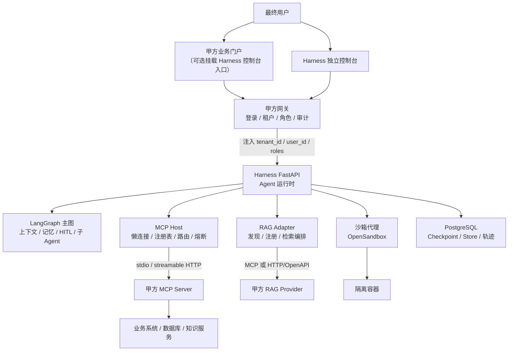
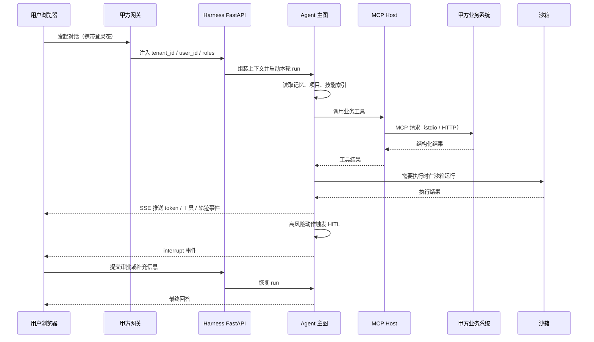

# Harness Agent 项目全景描述（v1）

> 文档性质：产品方案概述 / 项目全景图，不是详细设计文档或 API 手册。  
> 版本：v1 · 2026-11-02  
> 基线：当前仓库已实现能力 + 已确认的产品决策。  
> 关联文档：[README](../../README.md)、[MCP 可热插拔服务设计](./MCP可热插拔服务设计.md)、[SandBox 服务设计](./SandBox服务设计.md)、[工作区设计](./工作区设计.md)、[RAG 模块开发文档](../develope/RAG模块开发文档.md)

---

## 0. 一页话

**Common Harness 是一个业务无关、可源码交付、可嵌入甲方后端系统的通用 Agent 运行时。**

它不提供行业业务功能，也不替甲方存业务数据。它提供的是模型外部的那一层工程约束：上下文怎么组织、工具在哪执行、任务怎么编排、状态怎么恢复、权限怎么收口、过程怎么观测。

交付上分两种形态：

| 形态 | 一句话 | 谁持有 | 业务能力来源 |
| :-- | :-- | :-- | :-- |
| **个人模式** | 跑在用户本机，面向个人项目与日常任务 | 个人用户 | 本地工具、技能、沙箱 |
| **集成模式（Embedded Mode，原 Web 模式）** | 跑在甲方服务器/内网，作为能力层嵌入既有后端系统 | 甲方 | 甲方后端提供的 MCP 工具/资源 |

集成模式的核心不是“再做一个 Web 产品”，而是**把 Agent 能力嵌进甲方已有的业务系统**：甲方继续拥有业务数据、登录体系、业务页面和业务 API；Harness 只负责 Agent 运行时、沙箱、上下文与记忆、技能、MCP 编排、RAG 适配和可观测。

---

## 1. 项目定位

### 1.1 一句话定位

> 用 Harness Engineering 的方法，把大模型的概率性生成能力，约束成可操作、可恢复、可审计、可持续改进的任务执行能力，并以源码形式交付给需要集成 Agent 的团队。

### 1.2 它不是什么

| 不是 | 原因 |
| :-- | :-- |
| 不是行业业务系统 | 不在本项目内编写任何外部项目的业务工具、业务提示词或业务子 Agent |
| 不是 RAG 产品/向量库 | 知识、切片、嵌入、索引与向量存储归甲方 RAG 后端；Harness 只做适配与编排 |
| 不是 MCP Server | 集成模式下甲方实现 MCP Server，Harness 只做 MCP Host / Client |
| 不是账号与权限中心 | 登录、租户、角色由甲方网关负责；Harness 只做权限执行点 |
| 不是低代码平台 | 不提供可视化拖拽编排；编排以代码、YAML、中间件和工具注册为主 |
| 不是个人桌面专属 | 同一套内核既能在个人本机运行，也能部署到 Linux 服务器 |

### 1.3 设计立场

1. **先可观测、再谈优化**：没有轨迹和评估集的改动都是盲改。
2. **业务无关**：内核只保留通用能力，业务工具通过 MCP、子 Agent、技能挂载。
3. **边界清晰**：模型看到的永远是虚拟路径与受控工具，真实执行落在沙箱。
4. **失败可恢复**：中断、恢复、重试、熔断、降级都是运行时的一等公民。
5. **接入方少写代码**：接入方主要提供“MCP 服务 + 子 Agent YAML + 技能”三样东西。

---

## 2. 要解决的问题与 Harness 六层

直接调用大模型 API 只能得到“一次生成”，得不到“一次可靠执行”。差距通常出现在六层：

| 层 | 解决的问题 | 本项目的落点 |
| :-- | :-- | :-- |
| 上下文精细化 | 每轮该看到什么、不该看到什么、太长怎么办 | 上下文注入、渐进式披露、工具结果卸载、自动摘要、主动压缩 |
| 工具系统 | 工具从哪来、在哪执行、怎么隔离 | MCP 工具、内置工具、子 Agent 工具、OpenSandbox 执行 |
| 执行编排 | 先做什么、后做什么、何时委派、何时停 | LangGraph 主图、`write_todos`、同步/异步子 Agent、HITL |
| 记忆与状态 | 会话到哪了、用户偏好是什么、重启后还在不在 | PostgreSQL Checkpointer + Store、用户偏好、项目与会话索引 |
| 评估与观测 | 中间做了什么、为什么失败、质量如何度量 | 轨迹事件、Token 统计、上下文监控；外部 Trace/评估为演进项 |
| 约束与恢复 | 调错工具、越权、循环、沙箱挂掉怎么办 | 调用上限、路径权限、HITL 审批、沙箱代理热替换、熔断与降级 |

这六层共同构成 **Agent = LLM + Harness** 里的 Harness 部分。

---

## 3. 两种工作模式

### 3.1 模式对比

| 维度 | 个人模式 | 集成模式（Embedded Mode） |
| :-- | :-- | :-- |
| 部署位置 | 用户本机（Windows/Linux/macOS） | 甲方服务器、内网或私有云 |
| 信任边界 | 本机环境由用户自己负责 | 甲方网关统一鉴权，Harness 信任网关注入的身份 |
| 工作区 | 用户本机真实项目目录 | 服务端受管工作区，按 `user_id` 隔离 |
| 业务能力来源 | 本地工具、技能、MCP、沙箱 | 甲方后端实现的 MCP Server（工具/资源） |
| RAG | 可接本地或外部 RAG | 只接甲方 RAG，Harness 不建向量库 |
| UI | 自带控制台 | 独立控制台，可主题化，可选嵌入甲方门户 |
| 数据边界 | 数据留在本机 | 业务数据留在甲方后端；Harness 只存会话、记忆、轨迹 |
| 隔离键 | `user_id` | `tenant_id`（部署级）+ `user_id` + `thread_id` + `project_id` |
| 典型场景 | 个人开发、文档处理、日常任务 | CRM/ERP/OA/数据平台等既有系统的 Agent 增强 |

### 3.2 个人模式

个人模式是当前仓库的默认形态：

- 在本机执行沙箱任务、新建项目、在本地目录上执行 Agent 任务、普通 Chat。
- 项目工作区是可以选择的真实本机目录；所有命令执行仍只允许在沙箱。
- 适合单用户、可信环境、快速验证与个人生产力场景。

### 3.3 集成模式（Embedded Mode）

集成模式是本项目下一阶段的主要交付形态。它的定义不是“换一个前端”，而是：

> **Harness 作为能力层，被嵌入到甲方已有的后端系统中；甲方拥有业务系统，Harness 拥有 Agent 运行时。**

在该模式下：

- 沙箱服务、日常对话、技能市场、MCP 模块均可用。
- 业务操作、RAG 知识库连接、数据库查询等能力，全部来自甲方后端提供的 MCP 工具与资源。
- 本项目内不编写任何外部项目的业务工具。
- 甲方可以继续使用自己的业务前端；Harness 提供独立控制台，也支持把控制台以受控方式挂到甲方门户入口。

---

## 4. 集成模式详解

### 4.1 角色与职责边界

| 角色 | 负责 | 不负责 |
| :-- | :-- | :-- |
| 甲方业务后端 | 业务数据、业务 API、RAG 服务、MCP Server、业务权限 | Agent 编排、上下文管理、沙箱执行 |
| 甲方网关 | 登录、租户识别、角色与权限、请求签名、审计入口 | Agent 运行时 |
| Harness | Agent 图、上下文、记忆、HITL、沙箱、MCP Host、RAG 适配、轨迹 | 业务数据、业务规则、向量存储 |
| 甲方前端 | 业务页面、业务交互 | Agent 运行时与工具执行 |
| Harness 控制台 | 对话、项目/工作区、技能、MCP 管理、轨迹、模型设置 | 业务页面 |

### 4.2 接入拓扑



### 4.3 UI 交付方式

Harness 的控制台是**独立 Web 应用**，不把前端代码合并进甲方的业务前端。原因很简单：业务前端和 Agent 控制台的升级节奏、权限模型、依赖树都不同，合并会形成长期耦合。

支持两种交付方式：

| 方式 | 做法 | 适用 |
| :-- | :-- | :-- |
| **独立部署（推荐）** | 独立域名或独立路径部署，甲方从门户跳转或新开页签进入 | 大多数甲方，升级最简单 |
| **受控嵌入** | 通过 iframe、微前端或 Web Component 挂到甲方门户的一个入口 | 希望统一入口、但不希望合并代码 |

样式由甲方自行设计或替换：

- 控制台通过 CSS 变量/主题 Token 暴露颜色、字号、圆角、间距等设计变量。
- 允许替换外壳布局与品牌资源，但不修改 Agent 运行时核心。
- 嵌入时需明确 CSP、`frame-ancestors`、Cookie/SameSite 与 SSO 跳转策略。

### 4.4 身份、权限与隔离

集成模式采用 **网关注入身份**：

- 甲方网关完成登录与鉴权，把可信的 `tenant_id`、`user_id`、`roles` 注入请求。
- Harness 不信任客户端自报身份，不内置账号体系。
- 单客户单部署：一套 Harness 服务一个甲方；同一部署内可以有多个业务系统、多个 MCP Server、多个用户。

隔离维度：

| 维度 | 作用 | 落点 |
| :-- | :-- | :-- |
| `tenant_id` | 部署级租户标识，为未来多租户预留 | 请求上下文、审计、配置 |
| `user_id` | 记忆、沙箱、工作区、项目登记、会话索引的隔离键 | Store 命名空间、`users/{user_id}/` |
| `thread_id` | 一次会话 | Checkpoint、轨迹命名空间 |
| `project_id` | 一个工作区 | 项目登记、文件域、产物 |

权限执行点：

1. **工具级**：按角色决定哪些 MCP Server / 工具可见、可调用。
2. **路径级**：项目工作区、技能目录、`/memories/` 的读写权限。
3. **动作级**：有副作用的工具调用走 HITL 审批，支持批准、编辑参数、拒绝。
4. **配额级**：单轮模型/工具调用上限、单用户沙箱数、MCP 超时与并发限制。
5. **数据级**：会话与记忆的保留期、导出与删除。

### 4.5 一次对话的时序



关键约定：

- 对话默认走 SSE，工具调用与思考过程以事件形式推送。
- 耗时任务通过异步子 Agent 脱离当前请求，前端用 `task_id` 轮询。
- 任何“等待人”的动作都以 checkpoint 落地，不用阻塞线程等待。

### 4.6 工作区模型：服务端部署是否可行

**结论：可行，而且当前代码已经是按用户隔离的；但集成模式必须补一条硬约束。**

现状：

- 项目登记表按用户隔离：`USER_DATA_DIR/users/{user_id}/projects.json`。
- 默认工作区按用户隔离：`USER_DATA_DIR/users/{user_id}/workspaces/default`。
- Linux 部署时 `USER_DATA_DIR` 默认为 `~/.harness`；Windows 为本机 `%LOCALAPPDATA%/CommonHarness`。
- 项目根通过 `ContextVar` 在每次 run 时解析，切换项目不需要重建 Agent 图。
- 文件写工作区，命令只在沙箱执行；沙箱产物通过显式发布回工作区。

因此，甲方把 FastAPI 部署到 Linux 服务器后：

| 问题 | 答案 |
| :-- | :-- |
| 工作区存在哪 | 服务器上的 `USER_DATA_DIR`，不是用户浏览器本地 |
| 是否按用户隔离 | 是，`users/{user_id}/workspaces/` 天然隔离 |
| 对用户是否与个人模式不同 | 项目/会话/文件/发布的 API 语义一致；差异在“谁能选目录”和“服务端如何运维” |
| 是否需要额外开发 | 需要工作区根约束、配额、备份、保留期、上传下载与审计 |

**硬约束（集成模式必须满足）：**

1. 项目根只能落在受管工作区根（`USER_DATA_DIR/users/{user_id}/workspaces/`）或甲方显式挂载的白名单目录。
2. 禁止用户 attach 任意服务器绝对路径。当前路径校验只拒绝盘符根、Windows 系统目录和 `USER_DATA_DIR`；Linux 下 `/etc`、其他用户目录仍可能被登记，这是越权风险。
3. 工作区不做执行；所有命令仍在沙箱。工作区只做持久文件与产物。
4. 需要补齐：单用户配额、备份与恢复、数据保留期、删除审计、上传/下载权限。
5. 需要跨平台复核：路径比较、属主/权限、符号链接与目录联接、挂载卷行为。

```text
服务器 USER_DATA_DIR（示例：/home/harness/.harness）
└── users/
    ├── u_1001/
    │   ├── projects.json          # 该用户的项目登记
    │   └── workspaces/
    │       ├── default/           # 默认项目工作区
    │       └── <project_id>/      # 其他项目工作区
    └── u_1002/
        └── ...
```

### 4.7 MCP：集成模式唯一的业务能力入口

**方向：甲方实现 MCP Server，Harness 只做 MCP Host / Client。**

这意味着：

- 业务工具、业务资源、业务数据访问全部由甲方 MCP Server 提供。
- Harness 不在仓库里编写任何外部业务工具。
- Harness 不对外暴露 MCP Server 端点；管理接口是 REST，不是 MCP 传输端点。

Harness 负责的 MCP 能力：

| 能力 | 说明 |
| :-- | :-- |
| 配置与发现 | 读取甲方 MCP Server 配置，校验传输方式、命令、URL、工具白名单 |
| 懒连接与连接池 | 启动不连接，首次调用才建立；相同连接签名复用客户端 |
| 生命周期 | Pending / Connected / Degraded / Failed / Disabled 等状态 |
| 注册与命名空间 | 工具注册、跨 Server 同名隔离、与内置工具冲突处理 |
| 路由与超时 | 工具名解析、超时、取消、并发限制 |
| 失败回退 | 错误分类、重试、熔断、Last Known Good 工具保留 |
| 热插拔 | 运行期新增、删除、启用、停用，尽量不重建 Agent 图 |
| 安全 | 工具白名单、副作用工具 HITL、密钥脱敏、调用审计 |
| 可观测 | 状态、工具数、延迟、错误原因、调用记录 |

当前实现已经具备“配置声明 + 代理工具 + 文件监听热更新”的基础；生产化仍需补齐懒连接、熔断、动态开关、命名空间、管理 API 与前端页面。

### 4.8 RAG：做适配器，不做向量库

**决策：Harness 不内置 RAG，不提供向量库，不托管知识原文。**

RAG 的主体在甲方后端：

- 文档、切片、嵌入、索引、向量存储、召回策略由甲方 RAG 服务负责。
- Harness 只提供统一的 **RAG Adapter / Registry**，把不同厂商、不同协议的 RAG 服务抽象成同一种检索能力。

Harness 负责：

| 能力 | 说明 |
| :-- | :-- |
| 发现与注册 | 通过 MCP 工具/资源或 HTTP manifest 发现甲方 RAG，写入注册表 |
| 统一检索接口 | 查询、过滤、top_k、引用片段、权限透传、超时与降级 |
| 多 Provider 路由 | 按知识域、用户、业务系统选择 RAG Provider |
| 引用归一化 | 把不同 Provider 的返回统一成带来源、片段、分数的引用结构 |
| 权限与配额 | 哪些用户/角色能访问哪些知识域、单次检索上限 |
| 健康与可观测 | 连接状态、延迟、失败原因、检索轨迹 |
| 管理 UI | 连接/断开、知识源状态、统计信息、灌入任务触发 |

Harness 不负责：

- 不做向量库（不内置 pgvector、Redis Vector、Milvus 等）。
- 不做嵌入模型托管。
- 不长期保存知识原文与切片。
- 不替甲方定义知识权限模型。

如果甲方 RAG 不提供文档解析/切片能力，Harness 可以提供**无状态的解析与切片工具**作为便利能力，但产物必须写入甲方 RAG，Harness 不落库。

### 4.9 安全与治理

| 风险 | 处理 |
| :-- | :-- |
| 甲方 MCP Server 不可信 | 连接白名单、工具白名单、超时、熔断、错误归一化 |
| 工具副作用 | 写操作、删除、支付、外部通知等默认走 HITL 审批 |
| 路径越权 | 工作区根约束、路径穿越校验、符号链接/目录联接拒绝 |
| 命令执行 | 只在沙箱；工作区永不执行 |
| 提示注入 | 外部内容只作为数据；技能内容不执行；工具结果截断与标注 |
| 密钥泄露 | MCP 配置脱敏、日志脱敏、前端不回传密钥 |
| 数据越界 | 业务数据留在甲方；Harness 只存会话、记忆、轨迹；支持保留期与删除 |
| 审计缺失 | 配置变更、启停、工具调用、审批、工作区访问均留结构化记录 |

---

## 5. 能力全景与成熟度

| 能力 | 状态 | 说明 |
| :-- | :-- | :-- |
| 对话与 SSE 流式 | 已具备 | `/chat`、`/chat/stream`、恢复、历史、附件 |
| HITL 中断与审批 | 已具备 | 补充信息、工具审批、参数编辑、拒绝 |
| 沙箱与热替换 | 已具备 | 代理模式、按用户生命周期、预热池、降级模式 |
| 技能管理 | 已具备 | 下载、分配、更新、删除、双端事务、增量同步 |
| MCP 客户端 | 可用待完善 | YAML 配置、代理工具、文件监听；缺生产化生命周期 |
| 同步/异步子 Agent | 已具备 | YAML 注册、独立上下文、Agent Protocol 异步任务 |
| 上下文工程 | 已具备 | 注入、卸载、自动摘要、主动压缩、记忆隔离 |
| 长期记忆 | 已具备 | 用户偏好写回 Store，按 `user_id` 隔离 |
| 项目工作区 | 已具备 | 项目登记、标记、文件域、产物发布 |
| 轨迹与 Token 统计 | 已具备 | 轨迹事件、甘特图、上下文占用、会话 Token |
| 模型热更新 | 已具备 | `/settings/model` 写 `.env` 并重建图 |
| 集成模式接入契约 | 规划中 | 网关身份、工作区根约束、控制台主题化、部署手册 |
| MCP 生产化 | 规划中 | 懒连接、连接池、熔断、命名空间、动态开关、管理 UI |
| RAG 适配器 | 规划中 | Provider 注册、统一检索、引用归一化、管理 UI |
| 技能/插件市场 | 规划中 | 浏览、安装、版本、权限、审计 |
| 评估与外部 Trace | 规划中 | Langfuse/LangSmith、DeepEval、评估集与回放 |
| 多租户 | 长期 | 单客户单部署之后再评估 |

---

## 6. 演进路线

本路线按“能力依赖”组织，不按固定日期排期。每个阶段都以“可验收的能力”为单位。

### 阶段 A：当前基线（已具备）

- 个人模式可运行：对话、项目工作区、沙箱、HITL、技能、MCP、子 Agent、轨迹。
- 集成模式的内核能力已经存在，但缺少面向甲方的接入契约与生产化。

### 阶段 B：集成模式可交付

| 工作项 | 目标 | 验收信号 |
| :-- | :-- | :-- |
| 网关身份接入 | 可信注入 `tenant_id/user_id/roles` | 客户端自报身份被拒绝；越权请求返回 403 |
| 工作区根约束 | 禁止任意绝对路径 attach | Linux 下无法登记 `/etc` 或他人目录 |
| MCP 生产化 | 懒连接、连接池、熔断、命名空间、动态启停 | 启动零连接；单 Server 故障不影响其他工具 |
| MCP 管理 API/UI | 状态、工具、延迟、错误、启停、审计 | 运维可在页面完成启停与排障 |
| 控制台主题化 | 设计 Token 与可替换外壳 | 甲方不改核心代码即可换品牌样式 |
| RAG 适配器 v1 | Provider 注册、统一检索、引用结构 | 接入一个甲方 RAG 并完成一次带引用问答 |
| 部署与运维手册 | Linux 部署、备份、配额、保留期 | 新环境按手册可复现部署 |

### 阶段 C：知识与协作增强

| 工作项 | 目标 |
| :-- | :-- |
| RAG Provider 生态 | 支持多种接入协议与多家 RAG 服务 |
| 检索质量 | 召回评估、引用准确率、失败回退 |
| 评估体系 | 评估集版本化、线上失败转用例、CI 门禁 |
| 外部 Trace | 接入 Langfuse/LangSmith，保留现有轨迹 |
| 异步任务增强 | 取消、追加指令、结果投递幂等、任务恢复 |

### 阶段 D：生态与规模化

| 工作项 | 目标 |
| :-- | :-- |
| 技能/插件市场 | 浏览、安装、版本、权限、审计、下架 |
| 多租户（可选） | 一套部署服务多个甲方；`tenant_id` 贯穿全链路 |
| 多 worker 部署 | 会话互斥、任务投递、沙箱调度跨进程 |
| 高可用 | PostgreSQL、沙箱服务、MCP Host 的故障转移 |

---

## 7. 非目标与当前限制

### 7.1 非目标

- 不做行业业务系统，不内置业务工具。
- 不做 RAG 产品，不提供向量库。
- 不做 MCP Server 托管与对外 MCP 端点。
- 不做账号、租户、角色管理；由甲方网关负责。
- 不做可视化低代码编排。
- 不承诺第三方 MCP Server 的合法性、安全性与稳定性。

### 7.2 当前限制

- 会话互斥目前只在单进程内有效，多 worker 部署需要额外设计。
- 外部 Trace 与评估集尚未接入。
- MCP 管理页仍是占位，生产化生命周期未完成。
- 集成模式的网关身份、工作区根约束、主题化控制台尚未形成正式契约。
- 项目路径校验以 Windows 本机为基线，Linux 服务端场景需要复核与加固。

---

## 8. 术语

| 术语 | 一句话释义 |
| :-- | :-- |
| Harness | 模型外部的工程约束层：上下文、工具、编排、记忆、评估、约束与恢复 |
| 个人模式 | Harness 跑在用户本机，面向单用户的交付形态 |
| 集成模式（Embedded） | Harness 作为能力层部署在甲方服务器，嵌入既有后端系统 |
| MCP Host | 承载 MCP 客户端的宿主应用；本项目中 Harness 即 MCP Host |
| MCP Server | 对外暴露工具/资源的服务；集成模式下由甲方实现 |
| RAG Adapter | 把不同 RAG 服务抽象为统一检索能力的适配层，不存储知识 |
| 项目工作区 | 用户可读写的持久文件域；集成模式下位于服务端并按用户隔离 |
| 沙箱 | 唯一的命令与代码执行域 |
| 技能 | 以 `SKILL.md` 为入口的渐进式能力包 |
| HITL | 在关键节点暂停等待人工确认，通过 checkpoint 恢复 |
| 轨迹 | 模型、工具、技能、委派、HITL 的结构化执行记录 |

---

## 9. v1 已确认决策

| 编号 | 决策 |
| :-- | :-- |
| D1 | 集成模式定位为“嵌入式能力层”，不是独立 Agent 平台，也不是把前端合并进甲方业务页面 |
| D2 | UI 以独立控制台交付，支持主题化与受控嵌入；不支持直接合并进甲方业务前端 |
| D3 | 甲方实现 MCP Server，Harness 只做 MCP Host/Client，不对外暴露 MCP Server 端点 |
| D4 | 单客户单部署；同一部署内支持多用户、多业务系统、多 MCP Server |
| D5 | 身份由甲方网关注入，Harness 不内置账号体系 |
| D6 | 保留项目工作区；集成模式下工作区位于服务端并按 `user_id` 隔离，但必须限制项目根，禁止任意绝对路径 attach |
| D7 | RAG 只做适配器与注册表；不内置 RAG、不提供向量库、不托管知识原文 |
| D8 | 本文档是产品方案概述与全景图；详细接口、时序与实现落在各专项设计文档 |

---

## 附录 A：v0 原始描述（保留）

```text
工作模式
- 个人工作模式
- 连接了外部后端项目的Web模式。

个人模式（现支持）
描述： 即当前项目架构：支持在本机执行沙箱、新建项目或者在本地机器上执行Agent任务、普通的Chat

Web模式
描述：
该系统需要支持通过MCP协议，来嵌入到一个现实中已有的后端项目，这要求这些后端项目，需要依赖本系统架构设计的API，编写MCP服务。
该Agent系统通过统一的接口规范，接入这些后端项目，可以进行一些业务操作、RAG知识库连接、数据库查询等任务（均基于嵌入的后端提供的MCP工具和资源，不在本Agent项目编写任何有关外部项目的工具）。

在该模式中，沙箱服务、日常对话仍正常可用，SKILL市场、MCP模块均可以使用。

```
