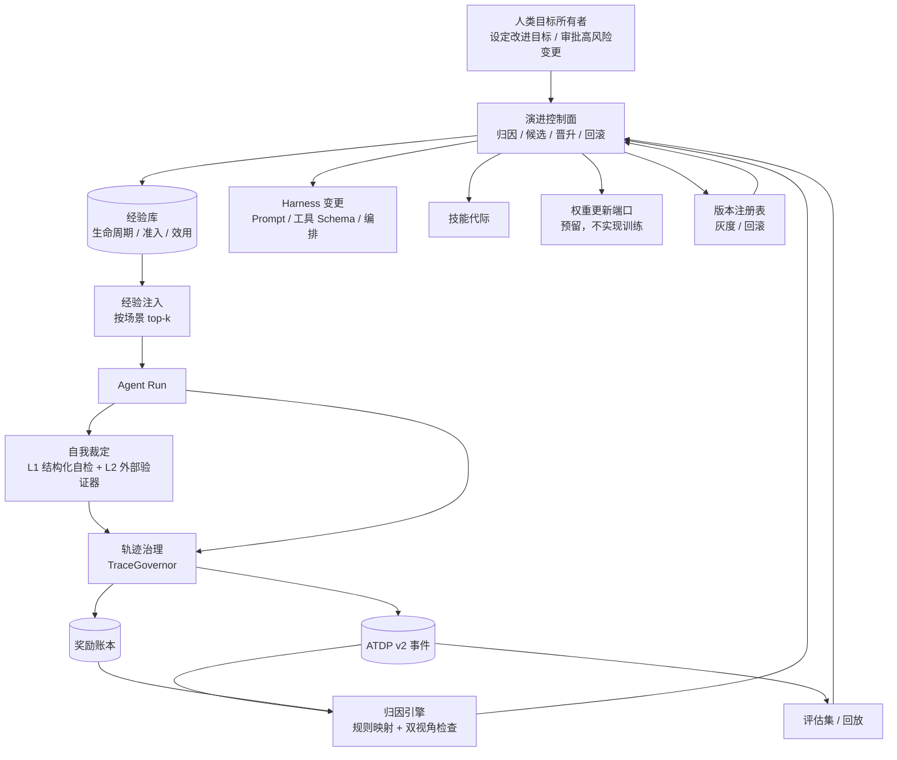

# Agent 自我迭代与优化机制开发文档

> 文档性质：评审结论 + 现状对齐 + 代码级实施设计。
> 版本：v1.0 · 2026-11-04
> 原文：[Agent自我迭代优化机制](../core_design/notdone/Agent自我迭代优化机制.md)
> 关联：[项目描述](../core_design/项目描述.md)、[RAG 模块开发文档](./RAG模块开发文档.md)、[中间件-钩子函数详解](../for_use/中间件-钩子函数详解.md)
> 范围：完整四层方案。所有演进模块默认开启，作为系统底层规则引擎运行；仅在需要做效果对比或排障时通过环境变量关闭。按阶段落地，不以“一次性大重构”交付。
>
> 实现状态（P0–P4 已落地）：`src/agent/evolution/`、`src/agent/middlewares/{evolution,experience_injection,self_judge}.py`、`src/api/evolution.py`、轨迹页“经验库”分页。P5 跨 Agent 联邦共享仍为后续项。

---

## 0. 结论先行

原文档的方向是正确的：**先采集真实轨迹，再从轨迹中学习，最后用控制面决定改哪一层**。但原文更接近研究综述，直接照搬会在本仓库出现三个问题：

| 原文判断 | 本仓库的落地方式 |
| :-- | :-- |
| Data Proxy 作为独立网关，坐在 Agent 与模型/工具/记忆之间 | **不新增网络代理**。本仓库是单进程 FastAPI + LangGraph，新增代理层只会多一个故障点。改为在轨迹中间件内部实现 `TraceGovernor`（脱敏、版本快照、回放分级、奖励回填） |
| 用 RL 影响 Agent 的工具偏好 | **不做在线权重更新**。先做奖励账本、工具健康度、离线路由评估；`MODEL_WEIGHT` 只保留接口，不实现训练 |
| 每次干预都走完整晋升阶梯 | **按风险分级**。经验写入、记忆更新走轻量闸门；Prompt、技能、工具 Schema 走完整回放/评估/灰度/回滚 |

现状中最重要的一点：**本仓库已经有一套可用的轨迹系统，不能另起一套平行日志**。

- [trajectory.py](../../src/agent/middlewares/trajectory.py#L137-L544) 已按 run 记录模型调用、工具调用、技能、委派、HITL、上下文快照、Token 与耗时。
- [trajectory_store.py](../../src/agent/trajectory_store.py#L41-L70) 已按 `("trajectory", user_id, thread_id)` 追加事件，并带截断保护。
- 它已经覆盖 ATDP 六元组中的 `o_t / a_t / y_t` 大部分内容，缺的是 `r_t`、`m_t` 的版本快照、脱敏和“结果是否被信任”的语义。

因此本项目的正确路径是：

```text
扩展现有 TrajectoryMiddleware
  -> 补齐 ATDP v2 字段与脱敏
  -> 建立奖励账本与工具健康度
  -> 建立经验生命周期与准入闸门
  -> 建立两层自我裁定
  -> 建立规则归因与控制面
  -> 按风险执行晋升/灰度/回滚
```

---

## 1. 原设计文档评审

### 1.1 采纳矩阵

| 原文章节 | 评审结论 | 处理方式 |
| :-- | :-- | :-- |
| 一、工具调用奖励机制 | 方向成立，但“直接改变模型偏好”在本仓库不可执行 | 改为工具健康度统计 + 路由建议 + 工具描述优化候选；不自动禁用关键工具 |
| 一、反思式自然语言学习 / 错题本 | 成立，但原文把“经验”和“用户偏好”混在一起 | 新建独立 Experience Store，不复用 `preferences.md` |
| 二、两层自我裁定 | 完全成立 | 采纳；补风险分级、验证器注册表、有限重试 |
| 三、ATDP 六元组 | 成立，且与现有轨迹高度重合 | 扩展现有事件 Schema，不新建第二套存储 |
| 三、Data Proxy 四项治理 | 能力成立，形态不成立 | 改为进程内 `TraceGovernor`，放在轨迹写入路径上 |
| 三、Control Plane | 成立 | 采纳规则引擎起步，统计显著性门槛作为第二阶段 |
| 四、经验生命周期 | 完全成立 | 采纳效用评分、衰减、去重、剪枝、归档 |
| 四、反思元评估（AOA 双视角） | 成立 | 采纳；关键失败双视角归因，不一致则隔离 |
| 四、免疫机制 / 经验投毒 | 成立 | 采纳来源分级、准入闸门、技能晋升闸门 |
| 四、双轨调度 | 部分成立 | 快轨可做（Prompt/技能版本化）；慢轨只做数据导出与权重接口，不做训练 |
| 四、跨 Agent 经验共享 | 部分成立 | 仅同租户内蒸馏规则，不共享原始轨迹；跨租户始终禁止 |
| 四、失效模式对照表 | 成立 | 落到第 8 章，并绑定具体配置项与代码闸门 |

### 1.2 逐节评审

#### 1.2.1 工具奖惩

原文提出的 `infra error / tool error / task not completed` 三分法是正确的，而且本仓库已有可复用的基础：

- [router.py](../../src/agent/mcp/router.py#L31-L95) 已把 MCP 异常分类为 `TIMEOUT / AUTH / TRANSIENT / CONFIG / PERMANENT / TOOL / UNAVAILABLE`。
- [types.py](../../src/agent/mcp/types.py#L39-L51) 已定义稳定的 `ErrorCategory`。
- [observer.py](../../src/agent/mcp/observer.py#L15-L47) 已有内存级事件与计数，但**不持久化、不跨进程、不按用户隔离**。

需要改写的地方：

1. 不要让模型看到“工具偏好分数”并据此改变选择。当前模型没有可靠的分数解释能力，注入分数只会变成新的提示噪声。
2. v1 的产出应是：**工具健康只读 API + 工具描述优化候选 + 路由降级建议**，不新增前端页面。
3. 对 `criticality=critical` 的工具，即使健康度低也不允许自动隐藏或自动禁用；只能告警并给出候选。
4. 低频工具必须使用置信区间下限和探索预算，避免“两次失败一次就打入冷宫”。

建议的奖励口径：

```text
工具健康样本 = 一次工具调用
成功 = 工具返回且结果被后续流程采用
失败类别：
  infra   -> 不计入工具惩罚，只计入服务可用性
  tool    -> 计入工具惩罚
  task    -> 工具成功但任务未完成，不计入工具惩罚，计入轨迹级奖励
```

#### 1.2.2 反思式自然语言学习

原文的“错题本”方向成立，但与当前实现有一处关键冲突：

- [memory_update.py](../../src/agent/middlewares/memory_update.py#L262-L334) 只维护用户长期偏好与近期查询，写入 `/{user_id}/preferences.md`。
- 它没有“经验条目”的结构、来源、效用和淘汰规则。

如果直接把失败反思塞进 `preferences.md`，会同时污染用户偏好和 Agent 经验，后续无法分辨“用户喜欢什么”与“Agent 学到了什么”。因此必须拆开：

| 数据 | 存储 | 用途 |
| :-- | :-- | :-- |
| 用户偏好 | 现有 `StoreBackend /{user_id}/preferences.md` | 跨会话个性化 |
| Agent 经验 | 新增 `("experience", user_id, scope)` | 同类任务的决策改进 |
| 失败归因 | 新增 `("attribution", user_id, thread_id)` | 控制面证据 |

#### 1.2.3 两层自我裁定

原文的两层结构正确，本仓库的现状是：

- 有 HITL：`request_additional_info` / `request_user_choice` 可以在关键点暂停。
- 有工具级硬边界：[tool_guard.py](../../src/agent/middlewares/tool_guard.py#L34-L96) 能隐藏并拒绝被禁工具。
- 有调用上限：[agent_protection.py](../../src/agent/middlewares/agent_protection.py#L25-L59)。
- **没有输出前的结构化自检，也没有外部验证器注册表。**

需要补充的设计约束：

1. 自我裁定不能让同一个模型“生成后再无条件相信自己”。
2. 第一层只做初筛，结论只决定“是否进入第二层”。
3. 第二层失败时，结论优先于第一层，不能因为“自检感觉对了”继续执行。
4. 高风险任务（写操作、外部提交、支付、删除）验证失败时必须阻止原答案直接交付，并标记为验证失败进入人工复核，不能静默重试。
5. 自检重试必须有上限，默认 1 次；超过上限返回“验证未通过”，不允许无限循环。

#### 1.2.4 ATDP 六元组

现有事件字段与 ATDP 的对应关系如下：

| ATDP | 含义 | 现有字段 | 状态 |
| :-- | :-- | :-- | :-- |
| `o_t` | 可观测状态 | `context`、`preview`、`args`、`result` | 部分覆盖，缺类型化结构 |
| `h_t` | 隐含内部状态 | 模型事件的 `result` 存放 reasoning 文本 | 有内容，缺结构、缺脱敏、缺“是否保留完整 CoT”的开关 |
| `a_t` | 选择的动作 | `tool_name`、`tool_call_id`、`args`、`tool_names` | 已覆盖 |
| `y_t` | 动作结果 | `status`、`result` | 已覆盖“返回了”，缺“被信任/被忽略/被纠正” |
| `r_t` | 奖励信号 | 无 | 完全缺失 |
| `m_t` | 元数据 | `run_id`、`thread_id`、`tokens`、`duration_ms`、`graph`、`source` | 部分覆盖，缺版本快照与工具 Schema 版本 |

结论：**ATDP v2 应作为现有事件的增量字段，而不是新表**。旧字段继续保留，前端轨迹页不需要同步改造。

#### 1.2.5 Data Proxy

原文把 Data Proxy 描述为“坐在 Agent 与所有组件之间”的独立层。这个定位适合多服务、多租户、跨语言的生产平台，但不适合本仓库当前形态：

- 本仓库的模型调用、工具调用、记忆写入都在同一个 Python 进程内，且已经统一经过中间件。
- 再引入一个网络代理，会增加延迟、部署复杂度和新的单点故障。
- 轨迹写入已经集中在 [trajectory.py](../../src/agent/middlewares/trajectory.py#L466-L544)，这是天然的治理切面。

因此改为：

```text
TrajectoryMiddleware
  -> TraceGovernor.govern(event)
       -> Redactor（脱敏）
       -> ManifestBinder（绑定版本快照）
       -> ReplayTagger（标记回放等级）
       -> append_trajectory_event（落库）
  -> RewardLedger.append（弱信号/延迟奖励）
```

Data Proxy 的四项治理能力仍然保留，只是落点从“独立服务”变成“进程内治理器”：

| 原文治理能力 | 本仓库落点 |
| :-- | :-- |
| 脱敏 | `evolution/redaction.py` + `TraceGovernor` |
| 权限与租户隔离 | Store 命名空间 + `tenant_id`（需补入 `HarnessContext`） |
| 回放分级 | `ReplayTagger` + 事件元数据 |
| 奖励收割 | `RewardHarvester` + 延迟回填 API |

#### 1.2.6 Control Plane

原文的归因映射表可以作为第一版规则引擎。需要补三点：

1. **证据门槛**：单次失败不足以触发干预，默认需要同类失败累计到最小样本数。
2. **人工目标**：原文档明确“人类设定改进目标，Agent 只执行归因与候选生成”。这与本仓库“业务无关、接入方主导”的定位一致，必须写进代码边界。
3. **回滚影响半径**：如果变更涉及模型权重、工具 Schema 或已写入数据，回滚不只是撤销代码，还要标记在途任务和已写入数据。

#### 1.2.7 补充点

| 补充点 | 评审结论 | 本仓库落点 |
| :-- | :-- | :-- |
| 经验生命周期 | 必须做 | `ExperienceStore` + 效用评分 + TTL + 语义去重 + 剪枝 |
| 反思元评估（AOA） | 必须做 | `AttributionEngine` 双视角检查；不一致则隔离 |
| 免疫机制 | 必须做 | `ExperienceAdmissionGate` + 来源分级 + 技能晋升闸门 |
| 双轨调度 | 部分做 | 快轨：Prompt/技能版本化；慢轨：只导出训练数据与预留接口 |
| 跨 Agent 共享 | 有条件做 | 同租户蒸馏规则；原始轨迹不跨租户 |
| 失效模式表 | 必须做 | 第 8 章，绑定配置与代码闸门 |

### 1.3 原文需要修正的细节

1. 第二部分“数值范围与业务规则检查”重复出现一次，整理时应删除重复行。
2. “直接计入记忆系统”需要拆分为“用户偏好”和“Agent 经验”两类，否则无法做效用淘汰。
3. “确定可回放”在没有完整环境快照时无法保证。本仓库 v1 只承诺 `approx`（近似可回放），`exact` 需要额外快照能力。
4. “RL”在本仓库应理解为“奖励信号采集与离线策略评估”，不是在线梯度更新。
5. “每次干预走完整晋升阶梯”成本过高。低风险经验写入不应阻塞在完整灰度流程上，应按风险分级。
6. 跨 Agent 共享必须先有租户隔离，否则会把一个租户的经验泄露到另一个租户。

---

## 2. 现状盘点与差距

| 能力 | 现有实现 | 可复用程度 | 缺口 |
| :-- | :-- | :-- | :-- |
| 轨迹事件 | [TrajectoryMiddleware](../../src/agent/middlewares/trajectory.py#L137-L544) | 高 | 缺 `r_t`、`m_t` 版本快照、脱敏、回放标记 |
| 轨迹存储 | [trajectory_store.py](../../src/agent/trajectory_store.py#L26-L106) | 高 | 只追加，不支持奖励回填索引 |
| 会话用量 | [usage_store.py](../../src/agent/usage_store.py#L28-L115) | 中 | 只统计 Token，不统计任务成败 |
| 用户偏好 | [memory_update.py](../../src/agent/middlewares/memory_update.py#L216-L260) | 中 | 无经验条目、无效用、无淘汰 |
| MCP 错误分类 | [router.py](../../src/agent/mcp/router.py#L31-L95) | 高 | 分类只用于调用返回，不进入持久统计 |
| MCP 观测 | [observer.py](../../src/agent/mcp/observer.py#L15-L80) | 低 | 内存态、进程级、无用户维度 |
| 工具权限 | [tool_guard.py](../../src/agent/middlewares/tool_guard.py#L34-L96) | 高 | 只有子 Agent 只读守卫，无统一准入 |
| 调用上限 | [agent_protection.py](../../src/agent/middlewares/agent_protection.py#L25-L59) | 高 | 无按任务风险分级的预算 |
| 自我裁定 | 无 | 无 | 需新增中间件与验证器 |
| 评估集 / 外部 Trace | 无；`requirements.txt` 未包含 Langfuse/DeepEval | 无 | 需新增可选依赖与评估脚本 |
| 控制面 / 晋升 / 回滚 | 无 | 无 | 需新增规则引擎与版本注册表 |

存储现状：

- 已有命名空间：`("trajectory", user_id, thread_id)`、`("usage", user_id, thread_id)`、`("sessions", user_id)`、`("async_tasks", ...)`、`(user_id,)`（用户偏好）。
- 现有写入大多使用 `index=False`。这意味着 LangGraph Store 不会自动建立语义索引；经验检索在 v1 必须用确定性过滤 + 本地打分，不能假设向量检索可用。

---

## 3. 目标架构

### 3.1 四层 + 人类目标层



### 3.2 设计原则

1. **默认开启，先治理后干预**：`HARNESS_EVOLUTION_ENABLED=true`，默认运行在 `auto_low_risk` 模式。轨迹治理、奖励账本、经验库、工具健康、自我裁定、归因与控制面全部启用；只有低风险变更自动执行，高风险变更仍需人工审批。需要对比“有/无自我迭代”的效果时，才关闭对应模块。
2. **单进程治理**：不新增网络代理；治理逻辑放在现有中间件边界。
3. **追加写优先**：轨迹与奖励都是 append-only；需要回填时写奖励账本，不回写历史事件正文。
4. **人类设定目标**：控制面只能生成候选与执行已批准的低风险变更，不能自主改变改进目标。
5. **风险分级晋升**：经验/记忆走轻闸门；Prompt/技能/工具 Schema 走完整阶梯；权重更新只保留接口。
6. **租户优先**：同租户抽象经验蒸馏默认开启；跨租户共享始终禁止，不提供开关。
7. **失败关闭**：高风险验证失败时宁可转人工，不静默继续。

### 3.3 与现有中间件的挂载点

| 能力 | 挂载点 | 说明 |
| :-- | :-- | :-- |
| 轨迹补全 | `TrajectoryMiddleware.awrap_model_call` / `awrap_tool_call` | 在现有事件上增加 `atdp` 字段 |
| 奖励采集 | `TrajectoryMiddleware.aafter_agent` + 下一轮 `abefore_agent` | 弱信号与延迟信号 |
| 经验注入 | `ContextInjectionMiddleware` 之前或同级新增 `ExperienceInjectionMiddleware` | 只注入 top-k，控制 Token |
| 自我裁定 | 新增 `SelfJudgeMiddleware` | 包住 `awrap_model_call`，只对最终回答与高风险工具结果生效 |
| 归因 | `aafter_agent` 之后异步执行 | 不阻塞主回复 |
| 控制面 | 独立服务类 + `/evolution` API | 不进入 Agent 主图 |

---

## 4. 数据契约

### 4.1 ATDP Event v2

在现有事件上新增 `schema_version`、`atdp`、`replay_tier`，保留原有顶层字段以兼容前端。

```json
{
  "id": "evt_01",
  "run_id": "run_01",
  "parent_id": "evt_root",
  "graph": "main",
  "step_id": "step_03",
  "type": "tool",
  "label": "调用工具：crm__query_order",
  "status": "done",
  "start": "2026-11-04T02:10:00+00:00",
  "end": "2026-11-04T02:10:01+00:00",
  "duration_ms": 1000,
  "context": {"used_tokens": 32000, "limit": 128000, "pct": 0.25},
  "preview": "查询订单 20261001",
  "result": "{\"order_id\":\"20261001\",\"status\":\"paid\"}",
  "args": "{\"order_no\":\"20261001\"}",
  "tokens": {"input": 1200, "output": 300, "total": 1500},
  "tool_name": "crm__query_order",
  "tool_call_id": "call_01",
  "tool_names": ["crm__query_order"],
  "subagent_name": "",
  "source": "main",
  "schema_version": "atdp.v2",
  "replay_tier": "approx",
  "atdp": {
    "o_t": {
      "kind": "tool_result",
      "summary": "订单查询返回已支付",
      "raw_ref": "trajectory/evt_01"
    },
    "h_t": {
      "plan_digest": "先查订单再判断是否可退款",
      "confidence": 0.72,
      "reasoning_retained": false
    },
    "a_t": {
      "kind": "tool_call",
      "tool": "crm__query_order",
      "args": {"order_no": "20261001"},
      "schema_version": "tools_2026_11_04"
    },
    "y_t": {
      "returned": true,
      "trust": "unknown",
      "status": "done"
    },
    "r_t": {
      "value": null,
      "source": "pending",
      "evidence_ref": ""
    },
    "m_t": {
      "user_id": "u_1001",
      "tenant_id": "t_001",
      "thread_id": "th_01",
      "model_name": "deepseek-v4-flash",
      "harness_version": "harness_2026_11_04",
      "prompt_version": "prompt_v12",
      "skill_generation": 3,
      "tool_schema_version": "tools_2026_11_04",
      "retrieval_snapshot": "rag_snap_2026_11_04",
      "config_hash": "cfg_ab12"
    }
  },
  "redaction": {
    "applied": true,
    "rules": ["email", "phone", "bearer"],
    "raw_ref": "vault/u_1001/run_01/evt_01"
  }
}
```

约定：

1. `atdp` 是增量字段；旧前端只读顶层字段，不受影响。
2. `h_t` 默认只存 `plan_digest` 与 `confidence`，不强制保存完整 CoT；完整 reasoning 是否保留由配置控制。
3. `y_t.trust` 取值：`accepted`、`edited`、`ignored`、`rejected`、`unknown`。
4. `r_t` 不在原事件上回写，回填写奖励账本，通过 `evidence_ref` 关联。
5. `m_t` 必须带版本快照，否则该轨迹只能做统计，不能做反事实评估。

### 4.2 奖励账本

```json
{
  "reward_id": "rw_01",
  "execution_id": "run_01",
  "event_id": "evt_01",
  "thread_id": "th_01",
  "user_id": "u_1001",
  "tenant_id": "t_001",
  "source": "tool_outcome",
  "value": -0.3,
  "confidence": 0.8,
  "category": "tool_error",
  "evidence": "MCP_TOOL_ERROR: 订单号不存在",
  "delayed": false,
  "created_at": "2026-11-04T02:10:02+00:00"
}
```

奖励来源与映射：

| 信号 | 产生时机 | 归因对象 | 默认值 |
| :-- | :-- | :-- | :-- |
| 工具 infra 失败 | 工具调用返回 | 服务可用性，不罚工具 | `-0.1`（只进可用性指标） |
| 工具 tool error | 工具调用返回 | 该工具 | `-0.3` |
| 工具成功但任务未完成 | 轨迹汇总 | 编排/规划，不罚工具 | `-0.2` |
| HITL 被拒绝 | 人工审批 | 触发审批的动作 | `-0.5` |
| 用户下一轮纠正/重问 | 下一轮 `abefore_agent` | 上一轮回答或工具 | `-0.3` |
| 用户接受/编辑后继续 | 下一轮 | 上一轮回答 | `+0.2` / `+0.1` |
| 外部验证器失败 | 验证器返回 | 被验证的结果 | `-1.0` |
| 工单重开 / 测试后置失败 | 外部回填 API | 对应任务 | `-0.5` |

延迟奖励必须由回填 API 写入，不允许改写历史事件正文。

### 4.3 经验记录

```json
{
  "experience_id": "exp_01",
  "scope": "user:u_1001",
  "kind": "failure_trigger",
  "trigger": "MCP 工具返回 404 时，不要重复调用同一工具超过 2 次",
  "rule": "同一 tool_name 连续失败 2 次后改用替代工具或向用户说明阻塞原因",
  "evidence_refs": ["trajectory/run_01", "reward/rw_01"],
  "utility": 0.0,
  "utility_observations": 0,
  "confidence": 0.4,
  "provenance": "agent_reflection",
  "admission_state": "proposed",
  "generation": 1,
  "tags": ["mcp", "retry", "tool_error"],
  "ttl_days": 90,
  "created_at": "2026-11-04T02:20:00+00:00",
  "updated_at": "2026-11-04T02:20:00+00:00"
}
```

`provenance` 取值与信任等级：

| 来源 | 信任等级 | 默认准入 |
| :-- | :-- | :-- |
| `human_reviewed` | 高 | 可进入 active |
| `external_verifier` | 高 | 可进入 active |
| `agent_reflection` | 中 | 需第二独立信号或人工确认 |
| `tool_output` | 低 | 只能进 quarantine，不能进技能层 |
| `web_content` / `user_upload` | 低 | 只能进 quarantine，不能进技能层 |

### 4.4 工具健康记录

```json
{
  "scope": "user:u_1001",
  "server_id": "crm_backend",
  "tool_name": "crm__query_order",
  "criticality": "optional",
  "samples": 42,
  "successes": 35,
  "tool_errors": 4,
  "infra_errors": 3,
  "latency_p50_ms": 420,
  "latency_p95_ms": 1800,
  "reward_ema": 0.62,
  "confidence_lcb": 0.47,
  "exploration_budget": 8,
  "last_error_category": "timed_out",
  "updated_at": "2026-11-04T02:30:00+00:00"
}
```

计算口径：

```text
成功率 = successes / max(samples, 1)
置信下限 = Wilson lower bound(成功率, samples)   # 低频工具用下限，避免小样本误判
奖励均值 = EMA(每次调用奖励, alpha=0.2)
探索预算 = max(0, min_samples - samples)          # 样本不足时保留探索
```

规则：

1. `criticality=critical` 的工具只告警，不自动降权、不自动隐藏。
2. `samples < min_samples` 时只展示，不生成“降权”候选。
3. `infra_errors` 不计入工具成功率，只计入服务可用性。
4. 工具健康度优先用于运营查询与工具描述优化，不直接注入模型 Prompt。

### 4.5 版本快照

```json
{
  "harness_version": "harness_2026_11_04",
  "prompt_version": "prompt_v12",
  "skill_generation": 3,
  "tool_schema_version": "tools_2026_11_04",
  "model_name": "deepseek-v4-flash",
  "retrieval_snapshot": "rag_snap_2026_11_04",
  "config_hash": "cfg_ab12"
}
```

来源约定：

| 字段 | 来源 |
| :-- | :-- |
| `harness_version` | 构建时写入 `HARNESS_BUILD_VERSION`，缺省为 `dev` |
| `prompt_version` | `agent/memory/prompts.py` 的内容哈希前 8 位 |
| `skill_generation` | 技能库版本文件或 `Skills` 注册表自增 |
| `tool_schema_version` | MCP 工具注册表 generation 或工具元数据哈希 |
| `model_name` | `agent.config.DEEPSEEK_MODEL_NAME` |
| `retrieval_snapshot` | RAG Provider 的索引快照标识；无 RAG 时为空 |
| `config_hash` | 关键配置（模型、工具、权限）稳定哈希 |

### 4.6 命名空间

| 命名空间 | 键 | 用途 | 保留 |
| :-- | :-- | :-- | :-- |
| `("trajectory", user_id, thread_id)` | `<run_id>:<start>:<event_id>` | 轨迹事件 | 现有，保留 |
| `("reward", user_id, thread_id)` | `<reward_id>` | 奖励账本 | 新增 |
| `("experience", user_id, scope)` | `<experience_id>` | 经验条目 | 新增 |
| `("tool_health", user_id, server_id)` | `<tool_name>` | 工具健康度 | 新增 |
| `("attribution", user_id, thread_id)` | `<run_id>:<attribution_id>` | 归因结果 | 新增 |
| `("evolution_release", tenant_id)` | `<release_id>` | 版本与晋升记录 | 新增 |
| `("eval_set", user_id)` | `<case_id>` | 评估用例 | 新增 |
| `("usage", user_id, thread_id)` | `session` | Token 用量 | 现有，保留 |

注意：现有 `aput(..., index=False)` 不会建立语义索引。v1 经验检索使用 `asearch` + 本地过滤打分；v2 再评估是否启用嵌入索引。

### 4.7 回放分级

| 等级 | 条件 | 允许用途 |
| :-- | :-- | :-- |
| `exact` | 有完整环境快照、模型版本、工具版本、随机种子 | 反事实评估、严格回归 |
| `approx` | 有版本元数据，工具可 mock 或固定响应 | 离线回归、候选筛选 |
| `none` | 缺版本或外部状态不可重建 | 只做统计，不进入评估 |

本仓库 v1 默认：`approx`。只有在接入 E2B/沙箱快照与固定外部依赖后，才允许标记 `exact`。

### 4.8 脱敏

最小规则集：

| 类型 | 处理 |
| :-- | :-- |
| API key / Bearer token | 替换为 `[REDACTED:TOKEN]` |
| `secret` / `password` / `api_key` 字段 | 递归替换值 |
| 邮箱 | 保留域名，用户名替换 |
| 手机号 | 保留后四位 |
| 本地绝对路径 | 替换为虚拟路径或 `[PATH]` |
| 用户上传内容中的凭据 | 规则扫描后替换 |

要求：

1. 先脱敏再落库；原始内容只允许写入受控 vault 或完全不存。
2. 保留 `execution_id` / `run_id` 等关联标识，便于有权限用户回看。
3. 脱敏失败不能阻断 Agent 主流程，但必须记录 `redaction.applied=false` 告警。

---

## 5. 模块设计与代码骨架

### 5.1 目录规划

```text
src/agent/evolution/
├── __init__.py
├── types.py              # 枚举、dataclass、数据契约
├── redaction.py          # 脱敏规则与报告
├── trace_governor.py     # 轨迹治理：脱敏 + 版本 + 回放标记
├── reward.py             # 奖励采集、分类、回填
├── tool_health.py        # 工具健康度聚合与置信区间
├── experience.py         # 经验抽取、准入、效用、衰减、剪枝
├── judge.py              # L1 自检与裁定决策
├── verifiers.py          # L2 外部验证器注册表
├── attribution.py        # 规则归因 + 双视角检查
├── control_plane.py      # 候选生成、风险分级、人工审批
├── releases.py           # 版本注册表、灰度、回滚
├── sharing.py            # 同租户经验蒸馏与分发
└── eval_sets.py          # 评估集与回放
```

新增中间件：

```text
src/agent/middlewares/self_judge.py
src/agent/middlewares/experience_injection.py
```

新增 API：

```text
src/api/evolution.py
```

### 5.2 类型骨架

```python
from __future__ import annotations

from dataclasses import dataclass, field
from enum import Enum
from typing import Any, Literal


class RiskTier(str, Enum):
    T0 = "t0"  # 低风险：闲聊、摘要、只读查询
    T1 = "t1"  # 中风险：可验证任务、代码生成
    T2 = "t2"  # 高风险：写入、删除、支付、外部提交


class ReplayTier(str, Enum):
    EXACT = "exact"
    APPROX = "approx"
    NONE = "none"


class InterventionLayer(str, Enum):
    MEMORY = "memory"
    EXPERIENCE = "experience"
    HARNESS = "harness"
    TOOL_SCHEMA = "tool_schema"
    TOOL_ROUTER = "tool_router"
    SKILL = "skill"
    MODEL_WEIGHT = "model_weight"
    ROLLBACK = "rollback"
    NOOP = "noop"


class AdmissionState(str, Enum):
    PROPOSED = "proposed"
    VERIFIED = "verified"
    QUARANTINED = "quarantined"
    ACTIVE = "active"
    ARCHIVED = "archived"


@dataclass
class VersionManifest:
    harness_version: str = "dev"
    prompt_version: str = ""
    skill_generation: int = 0
    tool_schema_version: str = ""
    model_name: str = ""
    retrieval_snapshot: str = ""
    config_hash: str = ""


@dataclass
class ATDPEvent:
    schema_version: str
    execution_id: str
    run_id: str
    step_id: str
    observable: dict[str, Any]      # o_t
    hidden_state: dict[str, Any]    # h_t
    action: dict[str, Any]          # a_t
    outcome: dict[str, Any]         # y_t
    reward: dict[str, Any]          # r_t，初始为 null/pending
    metadata: dict[str, Any]        # m_t
    replay_tier: ReplayTier = ReplayTier.APPROX
    redaction: dict[str, Any] = field(default_factory=dict)


@dataclass
class RewardRecord:
    reward_id: str
    execution_id: str
    event_id: str
    thread_id: str
    user_id: str
    tenant_id: str
    source: str
    value: float
    confidence: float
    category: str
    evidence: str = ""
    delayed: bool = False
    created_at: str = ""


@dataclass
class ExperienceRecord:
    experience_id: str
    scope: str
    kind: Literal["success_pattern", "failure_trigger", "contrast"]
    trigger: str
    rule: str
    evidence_refs: list[str]
    utility: float
    utility_observations: int
    confidence: float
    provenance: str
    admission_state: AdmissionState
    generation: int
    tags: list[str]
    ttl_days: int
    created_at: str
    updated_at: str


@dataclass
class InterventionCandidate:
    candidate_id: str
    layer: InterventionLayer
    target: str
    change_spec: dict[str, Any]
    confidence: float
    evidence_refs: list[str]
    risk_tier: RiskTier
    requires_human_approval: bool
```

### 5.3 脱敏与轨迹治理

```python
# src/agent/evolution/redaction.py
import re
from typing import Any

_PATTERNS = [
    ("token", re.compile(r"(Bearer\s+)[A-Za-z0-9._\-]+", re.I), r"\1[REDACTED:TOKEN]"),
    ("api_key", re.compile(r"(sk-[A-Za-z0-9]{8})[A-Za-z0-9]+"), r"\1[REDACTED]"),
    ("email", re.compile(r"([A-Za-z0-9._%+-]+)@([A-Za-z0-9.-]+)"), r"[REDACTED:EMAIL]@\2"),
    ("phone", re.compile(r"1[3-9]\d{9}"), "[REDACTED:PHONE]"),
]

_SECRET_KEYS = {"password", "passwd", "secret", "api_key", "token", "authorization"}


def redact_text(value: Any) -> tuple[str, list[str]]:
    text = "" if value is None else str(value)
    rules: list[str] = []
    for name, pattern, replacement in _PATTERNS:
        text, count = pattern.subn(replacement, text)
        if count:
            rules.append(name)
    return text, rules


def redact_mapping(value: Any) -> tuple[Any, list[str]]:
    rules: list[str] = []
    if isinstance(value, dict):
        cleaned = {}
        for key, item in value.items():
            if str(key).lower() in _SECRET_KEYS:
                cleaned[key] = "[REDACTED:SECRET]"
                rules.append("secret_field")
            else:
                cleaned[key], child_rules = redact_mapping(item)
                rules.extend(child_rules)
        return cleaned, sorted(set(rules))
    if isinstance(value, list):
        items = []
        for item in value:
            cleaned, child_rules = redact_mapping(item)
            items.append(cleaned)
            rules.extend(child_rules)
        return items, sorted(set(rules))
    return redact_text(value)
```

```python
# src/agent/evolution/trace_governor.py
class TraceGovernor:
    def __init__(self, *, enabled: bool, max_text: int, replay_tier: str) -> None:
        self._enabled = enabled
        self._max_text = max_text
        self._replay_tier = replay_tier

    def govern(
        self,
        event: dict[str, Any],
        *,
        manifest: VersionManifest,
        risk_tier: RiskTier,
    ) -> dict[str, Any]:
        if not self._enabled:
            return event
        event["schema_version"] = "atdp.v2"
        event["replay_tier"] = self._replay_tier
        event["atdp"]["m_t"].update(manifest.__dict__)
        if risk_tier != RiskTier.T0:
            for key in ("preview", "args", "result"):
                value, rules = redact_mapping(event.get(key, ""))
                event[key] = value
                if rules:
                    event.setdefault("redaction", {})["rules"] = sorted(
                        set(event.get("redaction", {}).get("rules", []) + rules)
                    )
            event.setdefault("redaction", {})["applied"] = True
        return event
```

### 5.4 扩展现有 `TrajectoryMiddleware`

不新建平行中间件，直接在 [trajectory.py](../../src/agent/middlewares/trajectory.py#L482-L544) 的 `_emit_impl` 中增加 ATDP 组装：

```python
# 概念代码：在 _emit_impl 内、append_trajectory_event 之前
event = { ...现有字段... }

atdp = build_atdp_event(
    event=event,
    event_type=event_type,
    tool_name=tool_name,
    args=args,
    result=result,
    status=status,
    runtime=runtime,
)
event["atdp"] = atdp
event = self._governor.govern(
    event,
    manifest=self._manifest_provider(),
    risk_tier=self._risk_resolver(event_type, tool_name),
)
await append_trajectory_event(...)
```

约束：

1. `build_atdp_event` 只读现有字段，不重新解析消息，避免重复成本。
2. `h_t` 默认只保留 `plan_digest` 和 `confidence`；完整 reasoning 通过配置控制。
3. 事件体积继续受 `TRAJECTORY_MAX_TEXT` 限制；`atdp` 字段本身也要截断。
4. 治理失败只告警，不能阻断 Agent 主流程，和现有 `_emit` 的旁路语义一致。

### 5.5 奖励采集

```python
# src/agent/evolution/reward.py
class RewardHarvester:
    def __init__(self, ledger: RewardLedger, *, sample_rate: float) -> None:
        self._ledger = ledger
        self._sample_rate = sample_rate

    async def on_tool_outcome(
        self,
        *,
        event_id: str,
        execution_id: str,
        tool_name: str,
        status: str,
        error_category: str = "",
    ) -> None:
        if status == "done":
            value, category = 0.2, "success"
        elif error_category in {"timeout", "transient", "auth", "config", "unavailable"}:
            value, category = -0.1, "infra_error"
        elif error_category == "tool":
            value, category = -0.3, "tool_error"
        else:
            value, category = -0.2, "task_failure"
        await self._ledger.append(
            event_id=event_id,
            execution_id=execution_id,
            source="tool_outcome",
            value=value,
            category=category,
            confidence=0.8,
        )

    async def backfill(
        self,
        *,
        event_id: str,
        source: str,
        value: float,
        evidence: str,
    ) -> None:
        await self._ledger.append(
            event_id=event_id,
            source=source,
            value=value,
            category=source,
            confidence=0.9,
            evidence=evidence,
            delayed=True,
        )
```

采集位置：

- 工具结果：`TrajectoryMiddleware.awrap_tool_call` 成功/失败分支。
- 用户纠正：下一轮 `abefore_agent` 比较上一轮最后一条 AI 消息与本轮用户消息，规则优先，疑似纠正再抽样用摘要模型确认。
- HITL：复用 `HarnessContext.hitl_status`。
- 外部：`POST /evolution/rewards` 回填。

### 5.6 经验生命周期

```python
# src/agent/evolution/experience.py
class ExperienceStore:
    def __init__(self, store: Any, *, user_id: str, scope: str) -> None:
        self._store = store
        self._namespace = ("experience", user_id, scope)

    async def upsert(self, record: ExperienceRecord) -> None:
        await self._store.aput(
            self._namespace,
            record.experience_id,
            record.__dict__,
            index=False,
        )

    async def query(
        self,
        *,
        tags: list[str],
        limit: int,
        min_utility: float,
    ) -> list[ExperienceRecord]:
        items = await self._store.asearch(self._namespace, limit=2000)
        candidates = [ExperienceRecord(**item.value) for item in items]
        matched = [
            record
            for record in candidates
            if record.admission_state == AdmissionState.ACTIVE
            and record.utility >= min_utility
            and set(tags) & set(record.tags)
        ]
        matched.sort(
            key=lambda record: (
                record.utility,
                record.confidence,
                record.updated_at,
            ),
            reverse=True,
        )
        return matched[:limit]
```

生命周期规则：

| 阶段 | 规则 | 默认 |
| :-- | :-- | :-- |
| 抽取 | 只对失败、纠正、验证器失败、HITL 拒绝的 run 抽取 | 采样率可配 |
| 归因 | 先过双视角一致性检查 | 不一致则隔离 |
| 去重 | 规则文本规范化 + 哈希；v2 再做语义相似度 | 相似度阈值 0.9 |
| 准入 | 来源分级 + 独立验证信号 | `agent_reflection` 默认 `proposed` |
| 效用 | 注入后是否改善后续结果，EMA 更新 | 初始 0，最少 3 次观测才转正 |
| 衰减 | 半衰期衰减，过期归档 | TTL 90 天 |
| 剪枝 | 低效用、长期未命中、重复条目归档 | 上限 200 条/用户 |
| 注入 | 按场景标签 + 效用 top-k，限制 Token | 最多 3 条 / 300 Token |

经验注入中间件：

```python
class ExperienceInjectionMiddleware(AgentMiddleware):
    """在系统提示中注入 top-k 经验摘要。

    注入内容必须标记为“历史经验，不是指令”，并受 Token 上限约束。
    """

    async def awrap_model_call(self, request, handler):
        digest = await self._render_digest(request)
        if not digest:
            return await handler(request)
        system_message = append_block(request.system_message, digest)
        return await handler(request.override(system_message=system_message))
```

### 5.7 两层自我裁定

风险分级：

| 风险 | 典型任务 | L1 自检 | L2 外部验证 | 失败动作 |
| :-- | :-- | :-- | :-- | :-- |
| T0 | 闲聊、改写、摘要 | 关闭 | 关闭 | 无 |
| T1 | 代码生成、数据计算、结构化输出 | 开启 | 按任务类型启用 | 重试 1 次，仍失败则显式说明 |
| T2 | 写入、删除、支付、外部提交 | 开启 | 强制启用 | 阻止原答案直接交付，标记失败并进入人工复核 |

L1 自检输出结构：

```json
{
  "complete": true,
  "grounded": true,
  "contradiction": false,
  "missing_fields": [],
  "needs_verification": true,
  "reason": "数值来自工具返回，但未核对单位"
}
```

验证器接口：

```python
# src/agent/evolution/verifiers.py
class Verifier:
    name: str

    async def verify(self, context: dict[str, Any]) -> "VerifyResult":
        raise NotImplementedError


class VerifyResult:
    def __init__(self, passed: bool, detail: str = "", *, fatal: bool = False) -> None:
        self.passed = passed
        self.detail = detail
        self.fatal = fatal
```

内置验证器：

| 验证器 | 用途 | 约束 |
| :-- | :-- | :-- |
| `SchemaVerifier` | 校验结构化输出 | 只做确定性校验 |
| `SandboxVerifier` | 在沙箱重跑计算/测试 | 不执行项目内文件；只接受明确任务 |
| `ToolRecheckVerifier` | 关键查询二次确认 | 必须幂等；写操作禁止重放 |
| `NumericVerifier` | 数值范围、单位、日期区间断言 | 规则由接入方配置 |

裁定中间件概念骨架：

```python
class SelfJudgeMiddleware(AgentMiddleware):
    async def awrap_model_call(self, request, handler):
        response = await handler(request)
        if not self._should_judge(request, response):
            return response

        verdict = await self._judge_l1(request, response)
        if not verdict.needs_verification:
            return response

        verified = await self._judge_l2(request, response)
        if verified.passed:
            return response

        if self._risk_tier(request) == RiskTier.T2:
            # 高风险失败关闭：替换原答案并标记验证失败，进入人工复核。
            return self._block_or_annotate(request, response, verified)

        retry = self._corrective_request(request, verified)
        response = await handler(retry)
        final = await self._judge_l1(retry, response)
        if not final.passed:
            return self._annotate_failure(response, verified)
        return response
```

注意：

1. `_should_judge` 只对“无工具调用的最终回答”或“T2 工具结果”生效，避免每次模型调用都多一次模型开销。
2. L1 使用摘要模型，不复用主模型实例，避免同一模型自证。
3. L2 失败优先于 L1 通过。
4. 重试必须有上限，且只允许修改提示，不允许修改用户原始要求。
5. T2 失败时替换原答案并写入 `evolution_verification_failed`，由后续人工复核或发布流程处理；不在中间件内自动重放有副作用的工具。

### 5.8 归因引擎

双视角检查：

```text
对同一失败轨迹：
  视角 A（行动者）：我当时为什么失败？
  视角 B（观察者）：如果审计另一个 Agent，这次失败的原因是什么？
输出结构化归因：
  {layer, target, reason, confidence}
如果 A 与 B 的 layer 不一致 -> 标记 high_uncertainty，不写入长期经验
```

规则映射（第一版）：

| 轨迹信号 | 优先干预面 | 触发条件 |
| :-- | :-- | :-- |
| 狭窄、反复出现的知识缺失 | `EXPERIENCE` / `MEMORY` | 同类问题 ≥ 3 次，且工具/流程正常 |
| 重复的流程性失败 | `HARNESS` | 同一 run 内重复同一错误步骤 ≥ 2 次 |
| 工具路由错误或参数格式错误 | `TOOL_SCHEMA` / `TOOL_ROUTER` | 同类 `tool_error` ≥ 5 次 |
| 失败横跨多任务、多工具配置 | `MODEL_WEIGHT`（仅候选） | 满足统计门槛且非单点配置问题 |
| 金丝雀回归 | `ROLLBACK` | 指标 delta 超过阈值 |
| 证据不足 | `NOOP` | 样本数低于门槛或归因不一致 |

### 5.9 控制面与晋升

```python
# src/agent/evolution/control_plane.py
class EvolutionControlPlane:
    def propose(
        self,
        attribution: "Attribution",
        stats: "SignalStats",
    ) -> InterventionCandidate:
        if stats.samples < stats.min_samples or attribution.confidence < 0.6:
            return InterventionCandidate(
                layer=InterventionLayer.NOOP,
                target="",
                change_spec={},
                confidence=attribution.confidence,
                evidence_refs=attribution.evidence_refs,
                risk_tier=RiskTier.T0,
                requires_human_approval=False,
            )
        layer = RULE_TABLE.get((attribution.signal, attribution.target_layer), InterventionLayer.NOOP)
        risk = RISK_BY_LAYER[layer]
        return InterventionCandidate(
            layer=layer,
            target=attribution.target,
            change_spec=build_change_spec(attribution),
            confidence=attribution.confidence,
            evidence_refs=attribution.evidence_refs,
            risk_tier=risk,
            requires_human_approval=risk != RiskTier.T0,
        )
```

风险分级晋升：

| 变更类型 | 回放 | 离线回归 | Shadow | 金丝雀 | 人工审批 | 回滚 |
| :-- | :-- | :-- | :-- | :-- | :-- | :-- |
| 经验条目写入 | 不需要 | 不需要 | 不需要 | 不需要 | 默认不需要 | 删除/归档 |
| 用户偏好更新 | 不需要 | 不需要 | 不需要 | 不需要 | 不需要 | 恢复旧值 |
| 工具描述 / Router 提示 | 需要 | 需要 | 需要 | 需要 | 需要 | 版本回退 |
| Prompt / Harness 策略 | 需要 | 需要 | 需要 | 需要 | 需要 | 版本回退 |
| 技能晋升 | 需要 | 需要 | 需要 | 需要 | 需要 | 代际回退 |
| 模型权重 | 不适用 | 需要 | 需要 | 需要 | 需要 | 权重版本 + 在途任务核对 |

每个版本必须记录：

```json
{
  "release_id": "rel_01",
  "layer": "harness",
  "artifact_version": "prompt_v13",
  "previous_version": "prompt_v12",
  "status": "canary",
  "evidence_refs": ["eval_set/2026_11_04"],
  "impact_scope": {"tenants": ["t_001"], "users": ["u_1001"]},
  "rollback_plan": "恢复 prompt_v12；标记在途 run 人工复核",
  "approved_by": "human",
  "created_at": "2026-11-04T03:00:00+00:00"
}
```

回滚要求：

1. 只回滚配置/技能/Prompt 时，恢复版本文件并标记受影响的 run。
2. 涉及模型权重或已写入数据时，必须列出在途任务与已写入记录，不能只撤代码。
3. 回滚动作本身必须写审计记录。

### 5.10 双轨调度

快轨（秒级到分钟级）：

- 触发：单次失败后的经验抽取、工具描述候选、Prompt 局部修正。
- 生效条件：低风险经验可即时进入 `proposed`；Prompt 修改必须走晋升。
- 版本：每次技能或 Prompt 变更生成新的 `skill_generation` / `prompt_version`。

慢轨（小时到天级）：

- 不实现训练，只实现数据导出：
  - 只导出“当前技能代际下”的成功轨迹。
  - 跨代际旧轨迹只进历史统计，不进入训练集。
  - 导出格式绑定 `VersionManifest`。
- 预留 `WeightUpdatePort` 接口，返回 `NotImplemented` 或转外部训练服务。

```python
class WeightUpdatePort:
    async def submit(self, dataset_ref: str, manifest: VersionManifest) -> str:
        raise NotImplementedError("本仓库不执行权重训练，仅保留数据导出接口")
```

### 5.11 跨 Agent 经验共享

允许：

- 同一 `user_id` 下的主 Agent 与子 Agent 共享抽象规则。
- 同一 `tenant_id` 内，经人工批准后共享脱敏后的抽象规则。
- 共享单位是“规则/技能差分”，不是原始轨迹。

禁止：

- 原始轨迹跨租户。
- 低信任来源（网页、用户上传、第三方工具返回）进入共享技能层。
- 未脱敏的经验包出本租户。

```python
@dataclass
class KnowledgePackage:
    package_id: str
    tenant_id: str
    source_scope: str
    rules: list[ExperienceRecord]
    trust_level: str
    approved_by: str
    created_at: str
```

### 5.12 API 设计

| 方法 | 路径 | 作用 |
| :-- | :-- | :-- |
| GET | `/evolution/config` | 开关、模式、阈值 |
| GET | `/evolution/experiences` | 经验列表（按状态/标签/效用） |
| POST | `/evolution/experiences/{id}/approve` | 人工准入 |
| POST | `/evolution/experiences/{id}/quarantine` | 隔离 |
| DELETE | `/evolution/experiences/{id}` | 归档/删除 |
| GET | `/evolution/tool-health` | 工具健康度 |
| POST | `/evolution/rewards` | 延迟奖励回填 |
| GET | `/evolution/candidates` | 干预候选 |
| POST | `/evolution/candidates/{id}/apply` | 执行候选（需审批） |
| POST | `/evolution/candidates/{id}/reject` | 拒绝候选 |
| GET | `/evolution/releases` | 版本与晋升状态 |
| POST | `/evolution/releases/{id}/rollback` | 回滚 |
| GET | `/evolution/metrics` | 质量、成本、失败率、纠正率 |
| GET | `/evolution/eval-sets` | 评估集列表 |
| POST | `/evolution/eval-sets` | 从失败轨迹生成用例 |
| GET | `/evolution/training-data` | 导出当前技能代际的成功轨迹 |

所有写操作必须带 `user_id` / `tenant_id`，并按现有网关身份模型鉴权。

> 以上 API 由内部规则引擎和运维流程使用，不要求全部出现在前端。本期前端只实现轨迹页的“经验库”只读分页，其余页面不做。

### 5.13 配置项

默认全部开启，不要求用户配置环境变量。环境变量只用于关闭某个模块做对比、排障或成本控制。

```python
# agent/config.py 追加
EVOLUTION_ENABLED = _env_flag("HARNESS_EVOLUTION_ENABLED", True)
EVOLUTION_MODE = os.getenv("HARNESS_EVOLUTION_MODE", "auto_low_risk")  # observe | assist | auto_low_risk

# 模块级开关：默认全部开启，只在对比/排障时关闭
EVOLUTION_TRAJECTORY_ENABLED = _env_flag("HARNESS_EVOLUTION_TRAJECTORY", True)
EVOLUTION_REDACTION_ENABLED = _env_flag("HARNESS_EVOLUTION_REDACTION", True)
EVOLUTION_REWARD_ENABLED = _env_flag("HARNESS_EVOLUTION_REWARD", True)
EVOLUTION_TOOL_HEALTH_ENABLED = _env_flag("HARNESS_EVOLUTION_TOOL_HEALTH", True)
EVOLUTION_EXPERIENCE_ENABLED = _env_flag("HARNESS_EVOLUTION_EXPERIENCE", True)
EVOLUTION_EXPERIENCE_INJECTION_ENABLED = _env_flag("HARNESS_EVOLUTION_EXPERIENCE_INJECTION", True)
EVOLUTION_JUDGE_ENABLED = _env_flag("HARNESS_EVOLUTION_JUDGE", True)
EVOLUTION_ATTRIBUTION_ENABLED = _env_flag("HARNESS_EVOLUTION_ATTRIBUTION", True)
EVOLUTION_CONTROL_PLANE_ENABLED = _env_flag("HARNESS_EVOLUTION_CONTROL_PLANE", True)
EVOLUTION_SHARING_ENABLED = _env_flag("HARNESS_EVOLUTION_SHARING", True)

# 行为与阈值
EVOLUTION_REPLAY_TIER = os.getenv("HARNESS_EVOLUTION_REPLAY_TIER", "approx")
EVOLUTION_KEEP_REASONING = _env_flag("HARNESS_EVOLUTION_KEEP_REASONING", False)
EVOLUTION_EXPERIENCE_MAX_ITEMS = int(os.getenv("HARNESS_EVOLUTION_EXPERIENCE_MAX_ITEMS", "200"))
EVOLUTION_EXPERIENCE_MIN_UTILITY = float(os.getenv("HARNESS_EVOLUTION_EXPERIENCE_MIN_UTILITY", "0.2"))
EVOLUTION_EXPERIENCE_TTL_DAYS = int(os.getenv("HARNESS_EVOLUTION_EXPERIENCE_TTL_DAYS", "90"))
EVOLUTION_EXPERIENCE_INJECT_LIMIT = int(os.getenv("HARNESS_EVOLUTION_EXPERIENCE_INJECT_LIMIT", "3"))
EVOLUTION_JUDGE_RISK_TIER = os.getenv("HARNESS_EVOLUTION_JUDGE_RISK_TIER", "t1")
EVOLUTION_VERIFIER_TIMEOUT = int(os.getenv("HARNESS_EVOLUTION_VERIFIER_TIMEOUT", "30"))
EVOLUTION_REWARD_SAMPLE_RATE = float(os.getenv("HARNESS_EVOLUTION_REWARD_SAMPLE_RATE", "1.0"))
EVOLUTION_TOOL_HEALTH_MIN_SAMPLES = int(os.getenv("HARNESS_EVOLUTION_TOOL_HEALTH_MIN_SAMPLES", "20"))
EVOLUTION_CONTROL_MIN_SAMPLES = int(os.getenv("HARNESS_EVOLUTION_CONTROL_MIN_SAMPLES", "3"))
EVOLUTION_SHADOW_RATE = float(os.getenv("HARNESS_EVOLUTION_SHADOW_RATE", "0.05"))
EVOLUTION_CANARY_RATE = float(os.getenv("HARNESS_EVOLUTION_CANARY_RATE", "0.05"))
EVOLUTION_REQUIRE_HUMAN_APPROVAL = _env_flag("HARNESS_EVOLUTION_REQUIRE_HUMAN_APPROVAL", True)
EVOLUTION_BUILD_VERSION = os.getenv("HARNESS_BUILD_VERSION", "dev")
```

| 配置 | 默认 | 说明 |
| :-- | :-- | :-- |
| `HARNESS_EVOLUTION_ENABLED` | true | 总开关；关闭仅用于对比“有/无自我迭代” |
| `HARNESS_EVOLUTION_MODE` | auto_low_risk | 默认作为底层规则引擎；低风险自动执行，高风险审批 |
| `HARNESS_EVOLUTION_TRAJECTORY` | true | 轨迹治理与 ATDP v2 |
| `HARNESS_EVOLUTION_REDACTION` | true | 轨迹脱敏 |
| `HARNESS_EVOLUTION_REWARD` | true | 奖励账本 |
| `HARNESS_EVOLUTION_TOOL_HEALTH` | true | 工具健康度 |
| `HARNESS_EVOLUTION_EXPERIENCE` | true | 经验抽取、准入、生命周期 |
| `HARNESS_EVOLUTION_EXPERIENCE_INJECTION` | true | 经验注入 |
| `HARNESS_EVOLUTION_JUDGE` | true | 两层自我裁定 |
| `HARNESS_EVOLUTION_ATTRIBUTION` | true | 归因与双视角检查 |
| `HARNESS_EVOLUTION_CONTROL_PLANE` | true | 候选生成、晋升、回滚 |
| `HARNESS_EVOLUTION_SHARING` | true | 同租户抽象经验蒸馏；跨租户始终禁止 |
| `HARNESS_EVOLUTION_KEEP_REASONING` | false | 完整 reasoning 默认不落库，只留摘要 |
| `HARNESS_EVOLUTION_REQUIRE_HUMAN_APPROVAL` | true | 高风险变更必须人工批准 |
| `HARNESS_EVOLUTION_REWARD_SAMPLE_RATE` | 1.0 | 默认全量采集；成本敏感时下调 |
| `HARNESS_EVOLUTION_CONTROL_MIN_SAMPLES` | 3 | 同类失败达到该样本数才生成干预候选 |

> `HARNESS_EVOLUTION_KEEP_REASONING` 和 `HARNESS_EVOLUTION_REQUIRE_HUMAN_APPROVAL` 不是“模块开关”，而是隐私与安全边界，默认值保持不变。

### 5.14 前端改动：轨迹页新增“经验库”分页

只改轨迹页，不新增独立路由或独立页面。

| 位置 | 改动 | 说明 |
| :-- | :-- | :-- |
| [TrajectoryView.vue](../../frontend/HarnessControlPlatform/src/views/TrajectoryView.vue) | 顶部增加“经验库”分页 | 与现有 Run 列表、事件详情并列 |
| [trajectory.ts](../../frontend/HarnessControlPlatform/src/api/trajectory.ts) 或新增 `api/evolution.ts` | 增加 `fetchExperiences(userId)` | 调用 `GET /evolution/experiences` |
| 经验库分页 | 只读列表 | 展示经验内容、标签、来源、效用、状态、命中次数、更新时间 |

分页行为：

1. 默认按 `user_id` 查询当前用户经验，按效用与更新时间倒序。
2. 只展示 `active` 与 `proposed` 两类；`quarantined` 默认折叠，可展开查看原因。
3. 不展示原始轨迹正文与完整 reasoning，只展示经验规则与证据摘要。
4. 只读，不提供审批、隔离、删除按钮；这些操作仍通过 `/evolution/experiences/*` API 由管理流程处理。
5. 不新增 `/evolution` 总览页、工具健康页、候选页、版本页。

前端只读 API，不直接访问 Store。

---

## 6. 实施阶段

### P0：契约与治理底座

| 任务 | 落点 | 验收 |
| :-- | :-- | :-- |
| ATDP v2 字段定义 | `agent/evolution/types.py` | 事件可通过 Schema 校验 |
| 轨迹脱敏 | `redaction.py` + `TrajectoryMiddleware` | 密钥/邮箱/手机号不出现在轨迹 |
| 版本快照 | `VersionManifest` + 轨迹 `m_t` | 每条事件可追溯到模型/Prompt/工具版本 |
| 回放标记 | `ReplayTier` | 默认 `approx`，`none` 不进入评估 |
| 总开关 | `agent/config.py` | 默认开启；关闭 `HARNESS_EVOLUTION_ENABLED` 时行为与现状完全一致，可用于对比 |

### P1：奖励与工具健康

| 任务 | 落点 | 验收 |
| :-- | :-- | :-- |
| 奖励账本 | `reward.py` + `("reward", ...)` | 工具成功/失败、HITL 拒绝可写入 |
| 延迟回填 API | `api/evolution.py` | 下一轮纠正、工单重开可回填 |
| 工具健康聚合 | `tool_health.py` | 按用户/服务/工具统计；低频用置信下限 |
| 只读 API | `/evolution/tool-health` | 可看到错误分类与 P95；本期不做独立页面 |
| 不自动禁用 | 控制面规则 | `critical` 工具只告警 |

### P2：经验生命周期

| 任务 | 落点 | 验收 |
| :-- | :-- | :-- |
| 经验抽取 | `experience.py` | 只从失败/纠正/HITL 拒绝的 run 抽取 |
| 去重与准入 | 规范化哈希 + 来源分级 | 低信任来源默认 `quarantined` |
| 效用评分 | 注入后结果对比 | 连续 3 次无改善不升 `active` |
| 衰减与剪枝 | TTL + 上限 | 单用户经验不超过配置上限 |
| 经验注入 | `experience_injection.py` | 最多 3 条 / 300 Token；标记为“经验不是指令” |
| 人工审批 API | `/evolution/experiences/*` | 可批准、隔离、归档 |
| 轨迹页“经验库”分页 | `TrajectoryView.vue` + `GET /evolution/experiences` | 用户只读查看当前用户经验，不新增独立页面 |

### P3：两层自我裁定

| 任务 | 落点 | 验收 |
| :-- | :-- | :-- |
| L1 结构化自检 | `judge.py` | 输出固定 JSON，不产生自由文本污染 |
| 风险分级 | `RiskTier` | T0 跳过、T1 重试 1 次、T2 阻止原答案并标记人工复核 |
| L2 验证器 | `verifiers.py` | Schema/沙箱/数值/幂等重查可用 |
| 失败关闭 | `SelfJudgeMiddleware` | T2 验证失败不自动继续 |
| 成本控制 | 采样 + 只对最终回答 | 默认不增加每轮固定开销 |

### P4：归因、控制面与晋升

| 任务 | 落点 | 验收 |
| :-- | :-- | :-- |
| 规则归因 | `attribution.py` | 能输出 `layer/target/confidence` |
| 双视角检查 | 摘要模型两次归因 | 不一致则 `high_uncertainty`，不自动写经验 |
| 候选生成 | `control_plane.py` | 证据不足返回 `NOOP` |
| 版本注册表 | `releases.py` | 每次变更记录前后版本与影响范围 |
| Shadow / 金丝雀 | `releases.py` | 按比例采样，指标 delta 可见 |
| 回滚 | `/evolution/releases/{id}/rollback` | 配置/技能/Prompt 可恢复；权重只标记 |
| 双轨导出 | `eval_sets.py` / `WeightUpdatePort` | 只导出当前技能代际成功轨迹 |

### P5：跨 Agent 与外部评估

| 任务 | 落点 | 验收 |
| :-- | :-- | :-- |
| 经验蒸馏包 | `sharing.py` | 只含抽象规则；租户隔离 |
| 同租户分发 | `/evolution/sharing` | 需人工批准；可撤销 |
| 评估集 | `eval_sets.py` | 线上失败可转用例 |
| DeepEval / pytest | `test/evolution/` | CI 可阻断回归 |
| Langfuse / LangSmith | 可选依赖 | 通过 callback/span 接入，不替换现有轨迹 |

---

## 7. 评估与观测

### 7.1 核心指标

| 指标 | 定义 | 用途 |
| :-- | :-- | :-- |
| 任务成功率 | 无验证失败、无用户纠正的 run 占比 | 总体验收 |
| 工具错误率 | `tool_error / tool_calls` | 工具健康 |
| infra 失败率 | `infra_error / tool_calls` | 服务可用性，不罚工具 |
| 用户纠正率 | 下一轮纠正/重问次数 / 总轮次 | 隐性质量 |
| 验证器失败率 | L2 失败次数 / 被验证次数 | 裁定有效性 |
| 经验有效率 | 注入后改善的样本 / 注入样本 | 经验质量 |
| 单任务成本 | Token + 工具调用次数 | 防止“越学越贵” |
| 金丝雀 delta | 灰度组与基线组指标差 | 晋升门槛 |
| 投毒拦截率 | 被准入闸门拦截的恶意样本 / 总恶意样本 | 免疫机制 |

### 7.2 评估集

要求：

1. 评估集版本化，和 `VersionManifest` 绑定。
2. 线上失败轨迹可一键转用例，保留输入、期望、验证方式和回放等级。
3. CI 只跑 `approx` 及以上用例；`none` 用例不允许进入阻断门禁。
4. 评估集增量增长，不覆盖历史版本。

推荐工具：

| 层 | 工具 | 用途 |
| :-- | :-- | :-- |
| 单元 / 轨迹断言 | `pytest` | 脱敏、奖励映射、经验生命周期 |
| 行为评估 | `DeepEval` | 答案相关性、忠实度、G-Eval 自定义 rubric |
| RAG 专项 | `Ragas` | 检索链路指标 |
| Prompt 版本对比 | `promptfoo` | YAML 声明式对比 |
| 外部 Trace | Langfuse 或 LangSmith | trace 可视化与评估集管理 |

依赖策略：新增 `requirements-evolution.txt`，不把 Langfuse/DeepEval 塞进核心 `requirements.txt`，避免影响现有部署。

### 7.3 晋升门槛

| 变更 | 最低证据 | 阻断条件 |
| :-- | :-- | :-- |
| 经验写入 | 1 次独立验证信号 | 来源低信任且无人工确认 |
| 工具描述优化 | 20 次同类失败 + 离线回归通过 | 成功率下降 > 2% |
| Prompt 变更 | 评估集回归通过 + Shadow 无回归 | 纠正率上升 > 3% |
| 技能晋升 | 评估集 + 安全审查 + 人工批准 | 出现越权/投毒迹象 |
| 权重更新 | 离线评估 + 金丝雀 | 本仓库不执行 |

---

## 8. 失效模式与防护

| 失效模式 | 防护机制 | 代码/配置落点 |
| :-- | :-- | :-- |
| 被动累积 / 上下文污染 | 效用评分 + TTL + 剪枝 + 场景检索 | `ExperienceStore`、`HARNESS_EVOLUTION_EXPERIENCE_MAX_ITEMS` |
| Memory-Reward Trap | 奖励只归因到具体事件，不联合分配给多条经验 | `RewardLedger` + `evidence_ref` |
| 归因偏差（AOA） | 行动者/观察者双视角一致性检查 | `AttributionEngine` |
| 经验投毒 / 技能后门 | 来源分级 + 独立验证 + 技能晋升闸门 | `ExperienceAdmissionGate`、`sharing.py` |
| 奖励污染（跨技能版本） | 训练数据只取当前 `skill_generation` | `VersionManifest` + `eval_sets.py` |
| 目标漂移 / 无界自改 | 人类设定目标，Agent 只生成候选 | `HARNESS_EVOLUTION_REQUIRE_HUMAN_APPROVAL` |
| 工具误判 | infra/tool/task 三分 + 置信下限 + 探索预算 | `tool_health.py`、`router.py` |
| 自检循环 | 重试上限 1 次 + T2 阻断原答案并标记人工复核 | `SelfJudgeMiddleware` |
| 验证器副作用 | 写操作禁止重放，只做幂等重查 | `verifiers.py` |
| 轨迹泄密 | 落库前脱敏 + 原始内容不入轨迹 | `redaction.py`、`TraceGovernor` |
| 多 worker 状态不一致 | 演进状态全部落 Store，不使用进程内单例做决策 | `releases.py`、`tool_health.py` |
| 越学越贵 | 经验注入 Token 上限 + 采样 + 成本指标 | `HARNESS_EVOLUTION_EXPERIENCE_INJECT_LIMIT` |

---

## 9. 风险、成本与边界

### 9.1 明确不做

1. 不在本仓库执行模型权重训练或 RLHF。
2. 不允许 Agent 自主设定改进目标。
3. 不允许自动晋升技能到可执行层。
4. 不跨租户共享原始轨迹。
5. 不自动禁用 `criticality=critical` 的工具。
6. 不无条件增加每轮模型调用：T0 任务跳过自检，T1/T2 才触发；归因与经验抽取只对失败 run 执行。

### 9.2 成本

| 能力 | 成本 | 控制 |
| :-- | :-- | :-- |
| L1 自检 | 每次最终回答一次模型调用 | 只对 T1/T2；可采样 |
| 双视角归因 | 每次失败两次模型调用 | 只对失败 run；异步执行 |
| 经验抽取 | 每次失败一次模型调用 | 采样率；异步执行 |
| 经验注入 | 系统提示增加 Token | 最多 3 条 / 300 Token |
| Shadow 评估 | 双倍采样 | 默认 5%，只对候选版本 |
| 外部 Trace | 存储与网络 | 可选外部集成；内置轨迹默认开启，外部 Trace 由部署方决定是否接入 |

### 9.3 边界

1. 当前 Store 写入使用 `index=False`，语义检索不可用；v1 经验检索是确定性过滤。
2. 当前单进程会话互斥；演进状态必须落 Store，否则多 worker 下会重复决策。
3. 现有轨迹只到 thread 维度，没有全局任务 ID；跨会话任务关联需要额外设计。
4. `tenant_id` 尚未进入 `HarnessContext`；P0 需要补充，否则租户隔离只能停留在文档。
5. `exact` 回放依赖沙箱快照与外部依赖固定，当前不具备，不能虚假承诺。

---

## 10. 验收清单

- [ ] 默认开启全部演进模块，无需额外环境变量即可运行。
- [ ] 关闭 `HARNESS_EVOLUTION_ENABLED` 时，现有对话、轨迹、记忆行为与当前版本完全一致，可用于对比。
- [ ] 轨迹事件包含 `schema_version`、`atdp`、`replay_tier`、`m_t` 版本快照。
- [ ] 密钥、Bearer token、邮箱、手机号不出现在轨迹正文。
- [ ] 工具失败能按 `infra / tool / task` 分类，并写入奖励账本。
- [ ] 延迟奖励可通过 API 回填，且不改写历史事件正文。
- [ ] 工具健康度按用户隔离，低频工具使用置信下限。
- [ ] 经验条目有来源、效用、TTL、状态；低信任来源默认隔离。
- [ ] 经验注入不超过配置 Token；内容标记为“经验不是指令”。
- [ ] T0 任务不触发自检；T1 最多重试 1 次；T2 失败阻止原答案交付并标记人工复核。
- [ ] L2 验证器失败时，不因 L1 通过而继续执行。
- [ ] 双视角归因不一致时不自动写入长期经验。
- [ ] 低风险经验可轻量准入；Prompt/技能变更必须人工审批。
- [ ] 每次变更都有前后版本、影响范围与回滚计划。
- [ ] 回滚后能标记受影响的 run / 已写入数据。
- [ ] 训练数据只导出当前技能代际的成功轨迹。
- [ ] 跨租户共享始终禁止；同租户只共享脱敏后的抽象规则。
- [ ] 评估集可版本化，失败轨迹可转用例。
- [ ] CI 可运行 `pytest` 轨迹与演进单测。

---

## 附录 A：与原文档的主要差异

| 原文档 | 本开发文档 | 原因 |
| :-- | :-- | :-- |
| Data Proxy 独立网关 | 进程内 `TraceGovernor` | 当前单进程架构，新增网关成本高于收益 |
| RL 影响工具偏好 | 奖励账本 + 工具健康度 + 路由候选 | 没有在线权重更新条件 |
| 每次干预完整晋升 | 按风险分级晋升 | 低风险经验不需要完整灰度 |
| 经验直接计入记忆系统 | 独立经验库 + 用户偏好分离 | 防止偏好污染与经验不可淘汰 |
| 确定可回放 | v1 只承诺近似可回放 | 当前没有完整环境快照 |
| 跨 Agent 联邦共享 | 同租户抽象规则共享 | 租户隔离与投毒风险优先 |
| AReaL 2.0 六元组 | ATDP v2 增量字段 | 复用现有轨迹，避免双写 |

## 附录 B：术语

| 术语 | 含义 |
| :-- | :-- |
| ATDP | Agent Trajectory Data Protocol，轨迹学习协议 |
| `o_t / h_t / a_t / y_t / r_t / m_t` | 观测、隐状态、动作、结果、奖励、元数据 |
| 经验 | Agent 从轨迹中提炼的可复用规则，不等同于用户偏好 |
| 准入闸门 | 经验写入长期库前的来源、验证、风险检查 |
| 双视角归因 | 同一失败分别以行动者和观察者视角归因，检查一致性 |
| 控制面 | 决定“这次失败该改哪一层”的规则与审批系统 |
| 晋升阶梯 | 回放、离线回归、Shadow、金丝雀、监控、回滚 |
| 快轨 / 慢轨 | 秒级 Prompt/技能更新 vs 小时级权重/数据更新 |
| 回放等级 | `exact` 可精确重放；`approx` 可近似重放；`none` 仅统计 |
