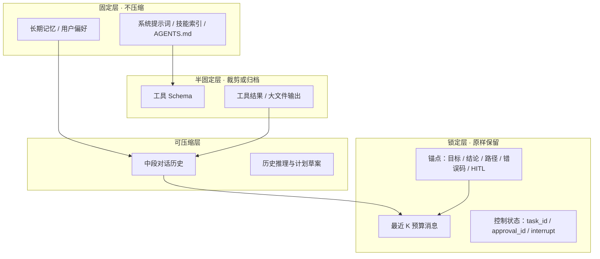
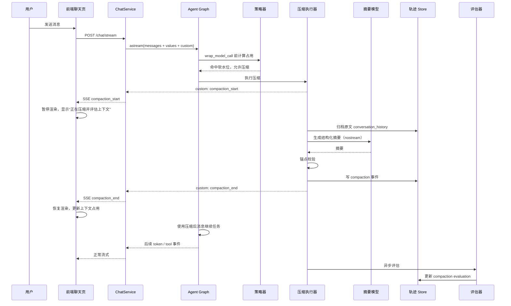
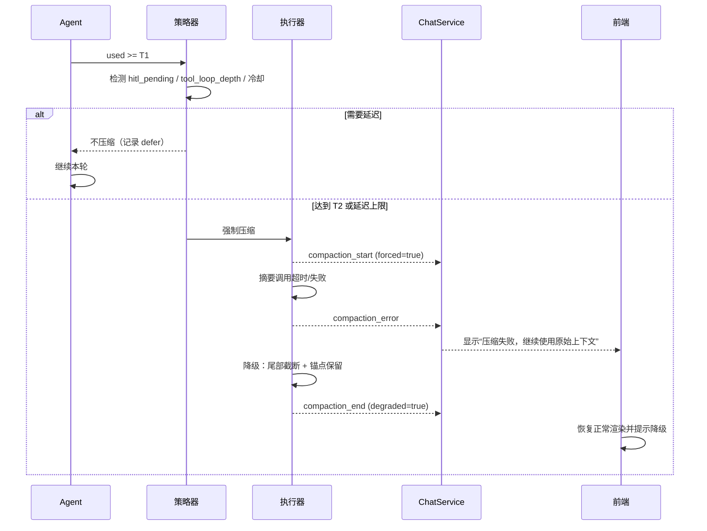
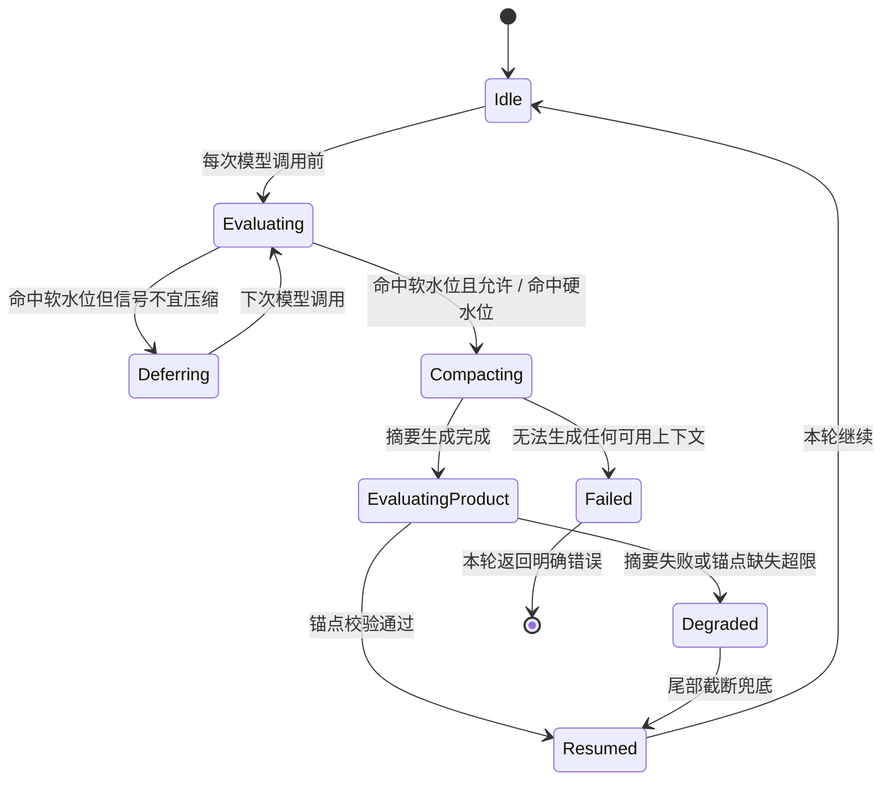
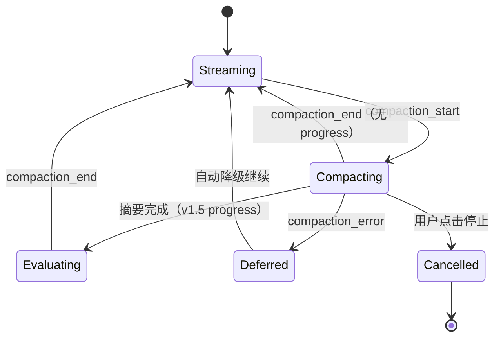

# 上下文管理与压缩设计

Time: 2026/11/05  
状态: 设计稿（待评审）  
适用版本: v1 可落地闭环 / v1.5 增强 / v2 演进  
参考文档:

- [上下文工程参考方案](./上下文工程参考方案.md)
- [上下文工程优化方案](./上下文工程优化方案.md)
- [上下文工程设计](./上下文工程设计.md)（当前实现说明，本文档替代其中“压缩触发与缺口”部分）
- [项目描述](../项目描述.md)
- 现行实现: `src/agent/middlewares/agent_protection.py`、`context_window_monitor.py`、`trajectory.py`、`src/api/chat.py`、`frontend/HarnessControlPlatform/src/views/ChatView.vue`、`TrajectoryView.vue`

---

## 1. 文档说明

### 1.1 编写目的

本文档回答三个问题，并作为下一步开发的直接依据：

1. 当前上下文压缩到底做了什么、为什么没有生效；
2. v1 应该怎样触发、压缩、评估、展示，才能避免“上下文炸了但系统无感知”；
3. 前端在压缩期间如何表现，轨迹页如何查看上下文与压缩记录。

### 1.2 读者与用法

| 读者 | 关注章节 |
| --- | --- |
| 架构/评审 | 2、3、4、23、24 |
| 后端开发 | 7、8、9、10、11、12、14、22 |
| 前端开发 | 13、14、22 |
| 测试/验收 | 16、21 |
| 运维 | 17、19、20 |

### 1.3 术语

| 术语 | 定义 |
| --- | --- |
| 上下文窗口（L） | 当前模型单次调用可容纳的最大 token 数，默认取 `HARNESS_MODEL_CONTEXT_LIMIT=128000` |
| 输出预留（R） | 预留给模型输出、工具参数增量和安全余量的 token，本文取 `max(8000, 0.12L)` |
| 可用预算（B） | `B = L - R`，压缩判定真正使用的分母 |
| 软水位（T1） | 允许压缩的目标占用，v1 取 `0.70B` |
| 硬水位（T2） | 必须压缩的强制占用，v1 取 `0.88B` |
| 保留预算（K） | 压缩后必须原样保留的最近消息预算，v1 取 `0.25B` |
| 压缩单元（Compaction Unit） | 一次压缩所产生的完整记录：触发、范围、产物、评估、状态 |
| 锚点（Anchor） | 压缩后必须存活的事实：目标、结论、文件路径、错误码、ID、HITL 回复、未完成事项 |
| 压缩回执 | 压缩单元的可审计记录，包含输入/输出、保留锚点、原文定位符、评估结论 |
| 时机质量 | 压缩发生时任务是否处于合适阶段（收敛/空闲 vs 推导中/工具链中） |
| 回溯成本 | 压缩后 Agent 为找回细节额外消耗的 token 与步数 |

### 1.4 事实与假设

- 文中代码事实均来自当前仓库（2026-11-05）。
- 标注 `[待确认]` 的条目需要在评审时确认，不得当作已定结论。
- 标注 `[假设]` 的数值需要在基线评估中校准。

---

## 2. 背景与现状

### 2.1 事实核查（现状不是“完全没有”，而是“有骨架、没生效、没评估”）

| 能力 | 现状 | 代码证据 |
| --- | --- | --- |
| 自动摘要中间件 | **已接入** deepagents `create_summarization_middleware` | `src/agent/middlewares/agent_protection.py`、`src/agent/main_agent.py` |
| 手动压缩工具 | **已开启** `compact_conversation` | `main_agent.py` 中 `enable_compaction_tool=True` |
| 压缩触发阈值 | **两套窗口口径冲突**：`ChatDeepSeek`（`deepseek-chat`）profile 的 `max_input_tokens=1,000,000`，deepagents 据此得到 `trigger=("fraction",0.85)`（约 850,000）、`keep=("fraction",0.10)`（约 100,000）；项目展示与监控用的 `HARNESS_MODEL_CONTEXT_LIMIT` 是 128,000 | `langchain_deepseek` profile；deepagents `compute_summarization_defaults`；`src/agent/config.py` |
| 上下文监控 | **只记录日志**，超过 0.82 仅告警，不干预 | `context_window_monitor.py` |
| 压缩事件 | **不存在**：没有 compaction 事件、回执、评估记录 | `trajectory.py`、`src/api/trajectory.py` |
| 压缩评估 | **不存在** | 全仓库无相关实现 |
| 前端压缩状态 | **不存在**：SSE 无压缩事件，输入区无状态 | `src/api/chat.py`、`stores/chat.ts` |
| 轨迹上下文数据 | **部分存在**：每个 model 事件带 `used_tokens/limit/pct`，run 汇总带 `peak_context_tokens`，详情面板有进度条 | `trajectory.py`、`api/trajectory.py`、`TrajectoryView.vue` |
| 轨迹上下文视图 | **缺失**：没有压缩标记、没有时间线、没有全局上下文曲线 | `TrajectoryView.vue` |

### 2.2 现场证据

用户提供的会话截图显示：22 轮后 `当前上下文 118,629 tok / 128,000`，占用约 **92.7%**，系统仍未触发压缩，回答中甚至混入了自检 JSON。对应结论：

1. 摘要器按模型 profile 的 1,000,000 窗口计算，85% 触发点约 850,000；项目展示/监控按 128,000 计算。**两个口径互不相通，118,629 在摘要器看来只用了 11.9%，永远不会触发压缩**；
2. 即便真的触发，`keep=("fraction",0.10)` 会保留约 100,000 token，加上摘要与系统提示后仍可能顶满 128,000，压缩收益接近于零；
3. 监控阈值 0.82（104,960）与压缩触发点完全不一致，告警响了也不会触发任何动作；
4. 若实际供应商窗口确实小于 1,000,000，超过真实窗口时调用会被直接拒绝，表现为任务失败而不是“压缩后继续”。

### 2.3 为什么不能只把阈值改小

即便把阈值改成 100,000，deepagents 目前仍按模型 profile 使用 `keep=("fraction",0.10)`（约 100,000 token）与 `keep=("messages",6)` 的旧回退逻辑：前者一次保留十万 token，压缩几乎没有收益；后者只保留 6 条消息，长任务会瞬间丢失大量工具结果与中间结论。参考方案已经指出：**固定间隔压缩对轨迹结构是盲目的**，可能在推导中途丢弃结果。因此 v1 必须同时解决三件事：

1. **触发与窗口绑定**：软/硬水位按有效预算计算；
2. **有结构的产物**：锚点 + 结构化摘要 + 原文归档引用，而不是一次性截断；
3. **可观测与可评估**：每次压缩都有事件、回执与评估，才谈得上调参。

---

## 3. 设计目标与成功标准

### 3.1 设计目标

| 编号 | 目标 | 说明 |
| --- | --- | --- |
| G1 | 长会话不再撞上下文上限 | 在软水位触发，最迟硬水位强制触发 |
| G2 | 压缩结果可回放 | 原文进入 `conversation_history` 归档，摘要中带定位符 |
| G3 | 压缩过程用户可感知 | 前端明确显示“正在压缩并评估上下文”，任务流暂停渲染 |
| G4 | 压缩质量可评估 | 每次压缩产出回执，包含保真度、时机、成本、回溯成本 |
| G5 | 压缩不破坏任务状态 | HITL、审批、异步 task_id、未完成事项在压缩后仍可用 |
| G6 | 上下文可视化 | 聊天页显示占用与阈值，轨迹页显示上下文时间线与压缩节点 |

### 3.2 成功标准（可度量）

| 指标 | 口径 | v1 目标 |
| --- | --- | --- |
| 触发及时率 | 长会话中在 `used ≥ T1` 后 2 次模型调用内触发压缩的比例 | ≥ 95% |
| 溢出事故 | 因 `context_length_exceeded` 导致本轮失败的比例 | 0（基线集） |
| 压缩后占用 | 压缩后下一次模型调用 `used / B` | ≤ 0.40 |
| 锚点保留率 | 压缩后摘要中可检出锚点比例 | ≥ 95% |
| 评估产出率 | compaction 事件带 `evaluation.status != pending` 的比例 | ≥ 98% |
| 前端提示时延 | `compaction_start` 到 banner 出现 | ≤ 500ms |
| 任务成功率回归 | 10–20 条长任务基线集，压缩开启 vs 关闭 | 不下降（允许 ±1 条） |
| 成本收益 | 触发压缩后的会话总 token | 下降 ≥ 35% |

---

## 4. 范围与非目标

### 4.1 范围

**v1（必须）**

- 修正触发阈值：按 `L / R / B` 计算软硬水位；
- 压缩策略：结构化摘要 + 锚点校验 + 原文归档引用；
- 压缩事件与回执：写入轨迹 Store，可查询；
- 轻量评估：锚点保真、时机标签、成本统计（规则版，不阻塞主流程）；
- SSE 新事件：`compaction_start / compaction_progress / compaction_end / compaction_error`；
- 聊天页：暂停渲染、压缩提示、上下文圆环增强；
- 轨迹页：上下文时间线 + 压缩节点详情。

**v1.5（增强）**

- LLM 时机裁判（`nostream`，异步）；
- 回溯成本统计与展示；
- 设置页可配置阈值/开关；
- 压缩进度心跳与断线恢复提示。

**v2（演进）**

- 分层配额（SCOPE 思路）：系统提示 / 工具 schema / 记忆 / 历史各自独立预算；
- 工具 schema 惰性加载与裁剪；
- Agent 主动调用压缩工具（SelfCompact / Cat 思路）；
- 压缩回执的完整性校验与可选的 Merkle/签名；
- 基于评估结果的自动调参（时机阈值、保留比例）。

### 4.2 非目标

- 不在本项目内实现向量库、知识切片、嵌入与 RAG 索引；
- 不压缩系统提示词、技能索引、长期记忆文件本身（只做大小监控与快照）；
- 不做密码学级不可抵赖回执（v2 可选）；
- 不做“多租户差异化预算”（租户级策略留到集成模式深化阶段）；
- 不做前端全文上下文编辑器（轨迹页只读展示）。

---

## 5. 设计原则与关键约束

1. **先锚点，后摘要**：先提取必须存活的事实，再生成摘要，最后逐条校验。
2. **原文不删除**：被移出上下文的消息写入 `conversation_history/{session_id}.md`，摘要中带路径；找不到原文的压缩视为不合格。
3. **触发与窗口绑定**：任何阈值都必须由当前模型窗口推导，禁止依赖与项目窗口不一致的 profile 默认值，也禁止写死 token 常量。
4. **压缩不改变控制状态**：HITL 待审批、`approval_id`、异步 `task_id`、项目会话绑定必须在压缩后保持。
5. **评估不阻塞主流程**：压缩是同步的，评估是异步的；评估失败只降级为 `unknown`，不能回滚压缩。
6. **前端暂停渲染而不是中止任务**：SSE 连接保持，服务端继续执行压缩；用户看到的是“暂停 + 恢复”而不是“失败重发”。
7. **所有压缩行为可观测**：事件、日志、指标三件套齐全，且与轨迹页同源。
8. **版本可回滚**：压缩开关关闭后行为与当前一致，不产生数据兼容问题。

**关键约束**

| 约束 | 说明 |
| --- | --- |
| 钩子位置 | 压缩发生在 `awrap_model_call` 内，**看不到“工具调用尚未返回”的状态**；v1 信号只能用模型调用点上可观察的信息（工具循环深度、最后消息类型、中断标记） |
| 私有 API | deepagents `SummarizationMiddleware` 依赖 LangChain 私有钩子；必须锁定版本并加守护测试 |
| token 计数 | `count_tokens_approximately` 有 ±10% 误差；优先使用上一轮真实 `usage_metadata.input_tokens` 作为主口径 |
| SSE 静默 | 摘要调用期间没有 token 输出，长连接可能被代理超时；需进度心跳或代理超时配置 |

---

## 6. 角色、边界与协作机制

### 6.1 角色职责

| 角色 | 职责 |
| --- | --- |
| 上下文策略器（Policy） | 计算占用、判定软/硬水位、读取轨迹信号、决定压缩/延迟 |
| 压缩执行器（Executor） | 归档原文、调用摘要模型、生成结构化摘要与锚点清单 |
| 锚点登记器（Anchor Registry） | 压缩前提取锚点，压缩后校验存在性 |
| 压缩评估器（Evaluator） | 异步计算保真、时机、回溯成本、成本收益，写回回执 |
| 轨迹记录器（Recorder） | 把 compaction 事件写入 Store，供轨迹页与评估回放 |
| SSE 投影器（Projector） | 把压缩事件投射为 SSE，维持前端状态机 |
| 前端控制台 | 暂停渲染、展示进度、恢复任务、上下文视图 |
| 模型服务 | 主模型与摘要模型提供方（DeepSeek 兼容端点） |

### 6.2 RACI

| 活动 | 上下文策略器 | 压缩执行器 | 评估器 | 前端 | 运维 |
| --- | :--: | :--: | :--: | :--: | :--: |
| 触发阈值配置 | A/R | C | I | I | C |
| 压缩执行与归档 | C | A/R | I | I | I |
| 锚点规则维护 | A | R | C | I | I |
| 评估指标口径 | C | C | A/R | I | I |
| 压缩 UI 交互 | I | I | I | A/R | I |
| 线上告警与回滚 | I | C | C | I | A/R |

---

## 7. 总体架构

### 7.1 上下文分层



分层结论：

- **v1** 只对 L3 做结构化摘要，对 L2 的工具结果做归档与尾部截断，L1 不动，L4 原样保留。
- **v2** 才引入 L2 的独立配额与工具 schema 惰性加载。

### 7.2 组件图

```mermaid
graph LR
  CHAT[ChatService SSE] --> AGENT[Agent Graph]
  AGENT --> POLICY[ContextBudgetPolicy]
  POLICY --> EXEC[CompactionExecutor]
  EXEC --> ARCH[(conversation_history 归档)]
  EXEC --> SMODEL[摘要模型 nostream]
  EXEC --> ANCHOR[AnchorRegistry]
  EXEC --> REC[TrajectoryRecorder]
  EXEC --> PROJECTOR[SSE Projector]
  PROJECTOR --> CHAT
  REC --> STORE[(LangGraph Store)]
  REC --> EVAL[CompactionEvaluator 异步]
  EVAL --> REC
  STORE --> TAPI[/GET /trajectory]
  TAPI --> FE[前端轨迹页]
  CHAT --> FCHAT[前端聊天页]
```

### 7.3 组件职责与落点

| 组件 | 职责 | v1 落点 |
| --- | --- | --- |
| `ContextBudgetPolicy` | 占用计算、软硬水位、轨迹信号、延迟/冷却 | `src/agent/context/budget.py` |
| `CompactionExecutor` | 继承/包装 deepagents 摘要，负责归档与产物 | `src/agent/middlewares/context_compaction.py` |
| `AnchorRegistry` | 锚点提取与校验 | `src/agent/context/anchors.py` |
| `CompactionEvaluator` | 异步评估与回执填写 | `src/agent/context/evaluator.py` |
| `TrajectoryRecorder` | 复用现有 Store 写入 compaction 事件 | `src/agent/middlewares/trajectory.py` |
| `SSE Projector` | 处理 `stream_mode="custom"` 并转 SSE | `src/api/chat.py` |
| 前端压缩状态 | thread 级压缩状态与渲染暂停 | `src/stores/chat.ts`、`ChatView.vue` |
| 轨迹上下文视图 | 上下文曲线与压缩节点 | `TrajectoryView.vue`、`api/trajectory.ts` |

---

## 8. 核心流程

### 8.1 正常压缩时序（含前端暂停）



### 8.2 延迟与失败恢复时序



### 8.3 压缩状态机



状态进入/退出条件：

| 状态 | 进入 | 退出 | 超时 |
| --- | --- | --- | --- |
| Evaluating | 每次 `awrap_model_call` | 判定完成 | 立即 |
| Deferring | 信号不宜压缩 | 下次模型调用或达到硬水位 | 最多 3 次延迟 |
| Compacting | 允许或强制 | 摘要返回 | 60s |
| EvaluatingProduct | 摘要返回 | 锚点校验完成 | 10s |
| Degraded | 摘要失败/锚点严重缺失 | 尾部截断完成 | 立即 |
| Failed | 降级也不可用 | 本轮错误 | 立即 |

### 8.4 与 HITL / 审批 / 异步任务的兼容

| 场景 | 规则 |
| --- | --- |
| HITL 待用户补充信息 | 禁止压缩，直到 `ResumeChat` 完成 |
| 工具审批待决议 | 禁止压缩；`approval_id`、待审批参数必须原样保留 |
| 异步任务运行中 | 允许压缩，但 `task_id` 必须进入锚点并在摘要中逐条保留 |
| 不可逆工具执行中 | 不压缩。压缩只发生在模型调用前，工具执行期间本来就不会触发；等该工具结果落地、下一次模型调用前再压缩。未来若在 ToolNode 层增加压缩钩子，必须遵守同一规则 |
| 压缩期间用户点停止 | 中止 SSE 与本轮运行；已完成的归档保留，compaction 事件标记 `aborted` |

---

## 9. 触发策略

### 9.1 预算计算

```text
L = 当前模型上下文窗口（settings → HARNESS_MODEL_CONTEXT_LIMIT，默认 128000）
R = max(8000, 0.12 * L)
B = L - R
T1 = HARNESS_CONTEXT_COMPACT_TRIGGER * B      # 默认 0.70
T2 = HARNESS_CONTEXT_COMPACT_HARD * B         # 默认 0.88
K  = HARNESS_CONTEXT_COMPACT_KEEP * B         # 默认 0.25
```

以 `L=128000` 为例：

| 量 | 值 | 占原始窗口 |
| --- | --- | --- |
| R | 15360 | 12.0% |
| B | 112640 | 88.0% |
| T1（软） | 78848 | 61.6% |
| T2（硬） | 99123 | 77.4% |
| K（保留） | 28160 | 22.0% |
| 压缩后目标 | ≤ 0.40B ≈ 45056 | 35.2% |

**占用口径**

1. 优先使用上一轮 AI 消息 `usage_metadata.input_tokens`（真实计费值）；
2. 无真实值时退化为 `count_tokens_approximately(messages + system)`；
3. 两者都包含系统提示词、技能索引、工具 schema 的近似估算（工具 schema 目前不计入，v1 允许 ±10% 误差，用 R 的安全余量吸收）。

### 9.2 v1 轨迹信号（模型调用点可观察）

| 信号 | 计算方式 | 作用 |
| --- | --- | --- |
| `hitl_pending` | runtime context 的 `hitl_status` / state 中的 interrupt 标记 | 命中则禁止压缩 |
| `tool_loop_depth` | 最后一条 human 之后，带 `tool_calls` 的 AI 消息数量 | ≥ 3 视为多步任务进行中 → 延迟 |
| `last_ai_has_tool_calls` | 最后一条 AI 消息是否仍有 `tool_calls`（说明下一步是工具执行） | true → 延迟（除硬水位） |
| `rounds_since_user` | 自最后一条 human 以来的消息数 | > 30 且无新用户输入 → 优先压缩 |
| `last_compaction_age` | 距离上次压缩的模型调用次数 | < 3 → 冷却，不重复压缩 |
| `defer_count` | 本轮已延迟次数 | ≥ 3 → 强制压缩 |

> 说明：`awrap_model_call` 时点上“工具调用尚未返回”不可观察，因此 v1 不把该信号写成必选项；v2 如果需要在 ToolNode 层加钩子再启用。

### 9.3 判定表

| 条件 | 动作 |
| --- | --- |
| `used < T1` | 不压缩 |
| `T1 ≤ used < T2` 且无阻断信号 | 压缩 |
| `T1 ≤ used < T2` 且 `hitl_pending` | 延迟，不设上限（HITL 结束后重新判定） |
| `T1 ≤ used < T2` 且 `tool_loop_depth ≥ 3` 或 `last_ai_has_tool_calls` | 延迟；`defer_count ≥ 3` 时强制 |
| `used ≥ T2` | 强制压缩，记录 `forced=true` |
| 距上次压缩 < 3 次模型调用 | 冷却，不压缩 |
| 用户明确调用 `compact_conversation` | 立即压缩，忽略冷却 |

### 9.4 配置项

| 环境变量 | 默认 | 说明 |
| --- | --- | --- |
| `HARNESS_CONTEXT_COMPACT_ENABLED` | `true` | 总开关，关闭后退化为当前行为 |
| `HARNESS_CONTEXT_COMPACT_TRIGGER` | `0.70` | 软水位（相对 B） |
| `HARNESS_CONTEXT_COMPACT_HARD` | `0.88` | 硬水位（相对 B） |
| `HARNESS_CONTEXT_COMPACT_KEEP` | `0.25` | 压缩后保留预算（相对 B） |
| `HARNESS_CONTEXT_COMPACT_MIN_ROUNDS` | `6` | 少于该轮次不压缩，避免短会话频繁压缩 |
| `HARNESS_CONTEXT_COMPACT_COOLDOWN` | `3` | 冷却的模型调用次数 |
| `HARNESS_CONTEXT_COMPACT_MAX_DEFER` | `3` | 最大延迟次数 |
| `HARNESS_CONTEXT_COMPACT_TIMEOUT` | `60` | 摘要调用超时秒数 |
| `HARNESS_CONTEXT_EVAL_ENABLED` | `true` | 压缩评估开关 |
| `HARNESS_CONTEXT_EVAL_JUDGE` | `false` | LLM 时机裁判（v1.5） |
| `HARNESS_CONTEXT_ALERT_THRESHOLD` | `0.70` | 与软水位对齐，替换当前 0.82 |

> `MODEL_CONTEXT_LIMIT` 的语义将从“只用于展示”变为“压缩判定分母”，设置页说明文案必须同步修改。

---

## 10. 压缩策略与产物

### 10.1 分层策略

| 层 | 内容 | v1 策略 | v1.5/v2 |
| --- | --- | --- | --- |
| 固定层 | 系统提示、技能索引、AGENTS.md、长期记忆 | 不压缩；只记录大小快照 | 预算监控 |
| 工具 Schema | 全部已绑定工具定义 | 不压缩 | 惰性加载/按任务裁剪 |
| 工具结果 | 大输出、长列表、日志 | 原文归档 + 摘要中保留定位符；超长参数按现有 `truncate_args_settings` 截断 | 结构化抽取（表格/错误码） |
| 中段历史 | 早于保留窗口的消息 | 结构化摘要 + 锚点清单 | 分层配额 |
| 近期历史 | 最近 `K` 预算 | 原样保留 | 动态 K |
| 锚点 | 目标、结论、路径、ID、错误码、HITL | 逐条复制进摘要，不依赖模型自由发挥 | 锁定片段校验 |
| 控制状态 | `approval_id`、`task_id`、interrupt | 原样保留，且加入锚点 | 同 v1 |

### 10.2 锚点规则

| 类型 | 提取方式 | 示例 |
| --- | --- | --- |
| 用户目标 | 最后一条 human 消息（截断 400 字） | “把这份日志分析成日报” |
| 任务相关用户消息 | 与当前目标直接相关的用户补充、修订、约束 | 逐字保留，不进入摘要 |
| 已确认结论 | 最近 AI 最终回答中的“结论/决定/确认”句 | “已确认使用 PostgreSQL” |
| 文件路径 | 正则 `/[\w./-]+`、`[A-Za-z]:\\...` | `/workspace/proj/report.md` |
| 命令/错误码 | 反引号内容、`E\d{3,}`、`HTTP \d{3}` | `pytest -k smoke`、`HTTP 500` |
| 标识符 | UUID、32 位 hex、`task_id=`、`approval_id=` | `task_id=abc123` |
| HITL 回复 | 最近 `hitl_summary` | “用户选择：方案 B” |
| 未完成事项 | “TODO/待确认/下一步/尚未”片段 | “待确认：是否覆盖旧文件” |

锚点数量上限 40 条，超出按“控制状态 > 目标 > 路径/ID > 结论 > 未完成”优先级截断。

### 10.3 结构化摘要模板

```text
## 任务目标
<用户原始目标，不转述>

## 已完成
- <可验证的完成项，按时间顺序>

## 关键结论
- <已确认事实，禁止推断>

## 锁定事实
- 文件：<路径>
- 命令/错误码：<原文>
- 标识符：<task_id / approval_id / URL>
- 人工介入：<用户回复原文摘要>

## 工具与原文引用
- 历史归档：<history_file>
- 大结果文件：<file_path>（重读时使用 read_file）

## 未完成与下一步
- <待办 / 待确认>

## 风险与不确定
- [待确认] <无法从原文确认的内容>
```

约束：

- 摘要文本语言不强制，跟随对话主要语言即可；用户口吻、语气不需要复刻；
- **与当前任务相关的用户消息必须逐字保留，不进入摘要**（放入锁定层，见 10.2）；
- 与当前任务无关的用户消息可进入摘要或被丢弃（具体口径见 24 章 Q5）；
- 不得改写锚点原文（路径、ID、错误码必须逐字一致）；
- 不确定内容必须标 `[待确认]`；
- 摘要长度上限 `min(1200 tokens, 0.08B)`。

### 10.4 原文归档与引用（复用现有能力）

- 复用 deepagents 的归档路径：`/conversation_history/{session_id}.md`；
- 摘要中必须写归档路径；
- 归档文件与项目/会话同生命周期，随会话删除进入清理流程；
- 原始消息不写入前端可见消息列表，只在轨迹页以“已归档”标记。

### 10.5 不允许压缩的边界

1. 不可逆工具执行期间不压缩（当前钩子天然满足）；硬水位到达时，等该工具结果落地后的下一次模型调用再压缩；
2. HITL 等待用户输入；
3. 用户最近 2 轮内改写了核心需求（避免把新旧需求压成一条）；
4. 摘要模型不可用且尾部截断会丢掉控制状态。

以上情况优先“延迟 + 硬水位兜底”，不静默丢状态。

---

## 11. 压缩事件与回执

### 11.1 数据模型

| 字段 | 类型 | 说明 |
| --- | --- | --- |
| `id` | string | 事件 ID |
| `type` | `"compaction"` | 轨迹事件类型 |
| `compaction_id` | string | 压缩单元 ID（幂等键） |
| `run_id` / `thread_id` | string | 归属 |
| `status` | `running/degraded/done/failed/aborted` | 状态 |
| `trigger.type` | `soft/hard/manual/overflow` | 触发类型 |
| `trigger.used_tokens` / `limit` / `pct` | int/float | 触发时占用 |
| `trigger.signals` | object | `hitl_pending / tool_loop_depth / defer_count / cooldown` |
| `scope.cutoff_index` | int | 被摘要的消息边界 |
| `scope.messages_before` / `after` | int | 消息条数变化 |
| `scope.layers` | string[] | 本次涉及的上下文层 |
| `result.before_tokens` / `after_tokens` / `saved_tokens` | int | 压缩前后 |
| `result.summary_tokens` | int | 摘要自身消耗 |
| `result.summary_preview` | string | 截断 600 字 |
| `result.history_file` | string | 原文归档定位符 |
| `result.anchors_total` / `anchors_kept` | int | 锚点统计 |
| `evaluation.status` | `pending/done/skipped/failed` | 评估状态 |
| `evaluation.fidelity` | float | 锚点保留率 |
| `evaluation.timing` | `good/deferred/forced/unknown` | 时机标签 |
| `evaluation.retrieval_cost` | object | 后续重读次数与 token（v1.5） |
| `evaluation.reason` | string | 结论说明 |
| `started_at` / `ended_at` | ISO8601 UTC | 时间 |
| `duration_ms` | int | 压缩耗时 |
| `schema_version` | string | 固定 `"1.0"` |

### 11.2 示例

```json
{
  "id": "cp-8f3a1c",
  "type": "compaction",
  "compaction_id": "8f3a1c9d",
  "run_id": "run-7b2c",
  "thread_id": "thread-abc",
  "status": "done",
  "trigger": {
    "type": "soft",
    "used_tokens": 81234,
    "limit": 112640,
    "pct": 0.721,
    "signals": { "hitl_pending": false, "tool_loop_depth": 1, "defer_count": 0 }
  },
  "scope": {
    "cutoff_index": 42,
    "messages_before": 88,
    "after": 31,
    "layers": ["history", "tool_result"]
  },
  "result": {
    "before_tokens": 81234,
    "after_tokens": 34210,
    "saved_tokens": 47024,
    "summary_tokens": 968,
    "summary_preview": "## 任务目标 ...",
    "history_file": "/conversation_history/thread-abc.md",
    "anchors_total": 18,
    "anchors_kept": 18
  },
  "evaluation": {
    "status": "done",
    "fidelity": 1.0,
    "timing": "good",
    "retrieval_cost": { "reads": 0, "tokens": 0 },
    "reason": "压缩发生在工具结果落地后、下一模型调用前，无中断，锚点全部保留"
  },
  "started_at": "2026-11-05T02:13:41Z",
  "ended_at": "2026-11-05T02:13:52Z",
  "duration_ms": 11000,
  "schema_version": "1.0"
}
```

### 11.3 存储与保留

- 复用轨迹 Store key：`("trajectory", user_id, thread_id)`；
- 事件类型新增 `compaction`，与现有事件同生命周期；
- `summary_preview` 受 `TRAJECTORY_MAX_TEXT` 限制；
- 不提供单条压缩事件删除接口；会话删除时随轨迹一起清理。

---

## 12. 压缩评估

### 12.1 评估维度（融合两份参考文档）

| 维度 | 核心问题 | v1 指标 | v1.5 增强 |
| --- | --- | --- | --- |
| 信息保真 | 关键事实是否存活 | 锚点保留率 `anchors_kept/anchors_total` | 摘要事实与原文一致性抽检 |
| 推理可用 | 后续决策是否成立 | 压缩后 3 轮内是否出现“重复询问已知信息” | LLM 裁判判断推理链完整性 |
| 任务成功 | 任务是否完成 | 基线集成功率/返工率 | 人工接管率 |
| 成本收益 | 是否真的省钱 | `saved_tokens`、摘要调用成本、额外轮次 | 综合成本模型 |
| 稳定性 | 多次压缩是否退化 | 连续 3 次压缩后 chat 质量抽检 | 不同任务类型分层统计 |
| 边界 | 哪些场景不能压 | 不压缩规则命中率 | 场景路由策略 |
| **时机质量** | 压缩时机是否合适 | 规则标签：`hitl/tool_loop/forced/cooldown` | LLM 裁判看压缩前后轨迹片段 |
| **回溯成本** | 找回细节的代价 | 统计 `read_file` 对归档路径的访问次数 | 记录额外 token 与步数 |

### 12.2 v1 评估实现（规则版）

```text
fidelity      = anchors_kept / max(anchors_total, 1)
timing        = "forced"   if trigger.type == "hard"
                "deferred" if defer_count > 0
                "good"     if no pending control state and tool_loop_depth <= 1
                "unknown"  if signals incomplete
retrieval     = 压缩后 5 轮内，工具参数命中 history_file 的次数（v1 只记录，不计分）
resource      = saved_tokens, summary_tokens, duration_ms
```

评估函数不得调用主模型；v1 纯规则，零额外 token。

### 12.3 评估执行

- 在 `compaction_end` 之后以 `asyncio.create_task` 执行；
- 失败只写 `evaluation.status=failed`，不影响本轮；
- 所有评估写入轨迹 Store 的同一条 compaction 事件（覆盖式更新）；
- 与 `EvolutionMiddleware` 的后台任务队列隔离，避免互相阻塞。

### 12.4 评估集与回放

| 集合 | 内容 | 用途 |
| --- | --- | --- |
| 长任务集 | 10–20 条 30+ 轮任务，包含大量工具输出；由开发者/测试维护在 `test/context_eval/` | 成功率、轮次、token 对比 |
| 边界集 | 硬约束、不可逆工具、多次需求修订 | 验证“不压缩/延迟”规则 |
| 事故回放集 | 线上 `context_length_exceeded` 或失败轨迹 | 每次事故转成一个新用例 |

评估方法：同一任务跑三种模式（关闭压缩 / 固定 0.85 阈值 / 本文方案），记录成功率、轮次、token、压缩次数、锚点保留率。

### 12.5 调参路径

1. 先固定 `T1=0.70B`、`T2=0.88B`、`K=0.25B` 跑基线；
2. 若成功率下降 → 提高 K 到 0.30B 或增加“延迟”条件；
3. 若压缩次数过多（< 5 轮一次）→ 提高 T1 或增大冷却；
4. 若仍出现溢出 → 降低 T2 或提高输出预留 R。

---

## 13. 前端设计

### 13.1 SSE 事件契约（新增）

| 事件 | 时机 | 关键字段 |
| --- | --- | --- |
| `compaction_start` | 决定压缩后、摘要调用前 | `compaction_id`, `trigger_type`, `used_tokens`, `limit`, `pct`, `reason`, `deferred_count`, `thread_id` |
| `compaction_progress` | 压缩中每 5s（v1.5） | `compaction_id`, `phase`（`archive/summarize/verify`）, `elapsed_ms` |
| `compaction_end` | 摘要与锚点校验完成 | `compaction_id`, `status`, `before_tokens`, `after_tokens`, `saved_tokens`, `anchors_total`, `anchors_kept`, `history_file`, `duration_ms`, `degraded` |
| `compaction_error` | 压缩失败/降级 | `compaction_id`, `message`, `fallback`（`tail_truncate/none`） |

示例：

```text
data: {"type":"compaction_start","compaction_id":"8f3a1c9d","trigger_type":"soft","used_tokens":81234,"limit":112640,"pct":0.721,"reason":"soft_watermark","thread_id":"thread-abc"}

data: {"type":"compaction_end","compaction_id":"8f3a1c9d","status":"done","before_tokens":81234,"after_tokens":34210,"saved_tokens":47024,"anchors_total":18,"anchors_kept":18,"history_file":"/conversation_history/thread-abc.md","duration_ms":11000,"degraded":false}
```

前端状态字段（按 thread 独立）：

```ts
interface CompactionState {
  active: boolean
  compactionId: string
  phase: 'compacting' | 'evaluating'
  startedAt: number
  usedTokens: number
  limit: number
  pct: number
  reason: string
  error?: string
}
```

### 13.2 聊天页交互：暂停渲染、连接保持

**交互原则**

- 不弹全屏模态框，不遮住历史消息；
- 输入区上方出现压缩提示条，输入框暂时禁用；
- SSE 连接不中断，服务端继续执行压缩；
- 压缩期间到达的 token（若有）进入缓冲，`compaction_end` 后按序回放。

**状态机**



**具体规则**

| 情况 | 前端行为 |
| --- | --- |
| 收到 `compaction_start` | `compacting=true`；冻结当前 AI 气泡的流式光标；显示临时提示气泡与输入区提示条；禁用发送与附件按钮；保留“停止”按钮 |
| 压缩中 | 提示文案：`正在压缩并评估上下文 · 已用 81,234 / 112,640（72%）`；圆环进入 `warn/danger` 色 |
| 收到 `compaction_end` | 更新本会话 `contextUsed/contextWindow`；**从聊天区移除临时提示气泡**；清理提示条；恢复光标；回放缓冲 token |
| 收到 `compaction_error` | 提示条转红：`上下文压缩失败，已使用兜底策略继续`；3 秒后自动消失；不中断任务流 |
| 用户点停止 | `abort()` SSE；提示条变为“已取消”；压缩事件由后端标记 `aborted` |
| SSE 意外断开 | 显示“连接中断，压缩未完成”，提供“刷新历史”按钮；不自动重发 |
| HITL 同时存在 | 压缩提示条让位给审批卡片，压缩状态只在小圆环上标记 |

**提示气泡的持久化规则（Q2 决议）**

- “正在压缩与评估上下文”只作为**客户端临时提示**：可以复用 `ChatMsg.kind='system'`，但只存在于当前 thread 的内存状态；
- **不写入 `/history`，不进入 checkpointer，不作为会话历史的一部分**；
- 任务结束后从聊天记录中移除，用户刷新页面或切换会话再回来也不会看到；
- 压缩事实只在轨迹页以一条 `compaction` 事件展示（见 13.4），聊天记录保持干净；
- 压缩失败时的红色提示同样是临时的，不落历史。

**组件与样式**

- 新增 `components/chat/CompactionBanner.vue`：支持 `compacting/degraded/cancelled` 三种状态；
- 位置：`Composer` 上方、`RoundLimitToast` 同级区域；
- 颜色：进行中蓝紫渐变，降级琥珀色，失败红色；不使用弹窗。

### 13.3 上下文圆环增强

现状：`ChatView.vue` 已有圆环，阈值写死 `60/85`。

改造：

| 项 | 现状 | 目标 |
| --- | --- | --- |
| 分母 | `session_usage.context_window`（128000） | 改为后端返回的 `budget_limit=B`，同时展示原始窗口 |
| 阈值色 | 60% / 85% | 与 `T1/T2` 对齐（61.6% / 77.4% 原始窗口） |
| 刻度 | 无 | 在圆环 tooltip 中标注软/硬水位 |
| 压缩标记 | 无 | 圆环旁显示 `已压缩 N 次`，点击跳轨迹上下文视图 |
| 满格文案 | 只显示百分比 | 超过 90% 且未压缩：显示“等待压缩”状态 |

### 13.4 轨迹页上下文视图（框架支持，纳入 v1）

**可行性结论**：支持。理由：

1. 轨迹接口的每个 model 事件已携带 `context{used_tokens,limit,pct}`，run 汇总已有 `peak_context_tokens`；
2. LangGraph 支持 `stream_mode="custom"` 投射压缩事件，压缩事件可直接落入轨迹 Store；
3. 前端轨迹页已有甘特图 + 日志 + 详情三栏结构，可复用。

**设计方案**

- 顶部 Tab 增加第三个：`轨迹` / `上下文` / `经验`；
- 「上下文」视图由三部分组成：

```text
┌─────────────────────────────────────────────────────┐
│ 上下文时间线（折线 + 阈值线 + 压缩竖线）              │
│  y: tokens  x: 模型调用序号 / 时间                    │
│  ── used  ── B  ── T1  ── T2   ● compaction           │
├───────────────┬─────────────────────────────────────┤
│ 压缩事件列表   │ 选中压缩详情                          │
│ #1 soft       │ 触发信号 / 锚点 / 归档路径 / 评估结论  │
│ #2 hard       │ before → after / saved tokens          │
└───────────────┴─────────────────────────────────────┘
```

- 数据来源：`GET /trajectory/{thread_id}`（复用，不新增页面级接口）；
- 类型扩展：

```ts
type TrajectoryEventType = ... | 'compaction'
interface TrajectorySummary {
  // 新增
  compact_count: number
  tokens_saved: number
  min_context_tokens: number
}
```

- 甘特图新增 lane：`compaction`（颜色 `#b07cff`，图标 `layers`），压缩事件在时间轴上显示为独立块；
- 详情面板新增“压缩详情”区块：触发原因、锚点清单、`history_file`、评估结论；
- 没有压缩事件时展示空状态：`本次运行未触发上下文压缩`，仍保留占用曲线。

### 13.5 设置页

v1 只读展示，v1.5 可编辑：

| 区域 | 内容 |
| --- | --- |
| 上下文压缩 | 开关、软水位、硬水位、保留比例、冷却次数（只读展示生效值） |
| 模型窗口 | 复用模型管理页的上下文窗口 chips；修改后提示“需要重建 Agent 图生效” |
| 评估 | 评估开关、LLM 裁判开关（v1.5） |

### 13.6 组件与文件清单

| 文件 | 改动 |
| --- | --- |
| `src/stores/chat.ts` | 新增 `CompactionState`、token 缓冲、4 类事件处理 |
| `src/views/ChatView.vue` | 接入 banner、圆环阈值、压缩次数、禁用输入 |
| `src/components/chat/CompactionBanner.vue` | 新增 |
| `src/views/TrajectoryView.vue` | 新增「上下文」Tab 与时间线视图 |
| `src/components/trajectory/ContextTimeline.vue` | 新增（折线 + 阈值线 + 压缩标记） |
| `src/api/trajectory.ts` | 类型扩展（compaction / 汇总字段） |
| `src/api/chat.ts`（若存在） | SSE 事件类型扩展 |

---

## 14. 接口契约

### 14.1 聊天 SSE

- 协议：`text/event-stream`，沿用现有 `data: {json}\n\n`；
- 新增事件见 13.1；
- 兼容性：前端遇到未知 `type` 必须忽略，不报错；
- 事件顺序约束：
  1. `compaction_start` 必须先于同 ID 的任何 `token`；
  2. `compaction_end/error` 必须恰好一次；
  3. 同一 thread 不允许两个 active `compaction_id`。

### 14.2 轨迹查询

```text
GET /trajectory/{thread_id}?user_id=...
```

响应扩展（向后兼容）：

```json
{
  "thread_id": "...",
  "runs": [
    {
      "run_id": "...",
      "summary": {
        "model_calls": 12,
        "tool_calls": 20,
        "peak_context_tokens": 81234,
        "compact_count": 1,
        "tokens_saved": 47024,
        "min_context_tokens": 34210
      },
      "events": [
        { "type": "compaction", "compaction_id": "...", "trigger": {}, "result": {}, "evaluation": {} }
      ]
    }
  ]
}
```

错误码：

| HTTP | code | 场景 |
| --- | --- | --- |
| 404 | `SESSION_NOT_FOUND` | 会话不存在 |
| 500 | `TRAJECTORY_STORE_ERROR` | Store 读取失败 |

### 14.3 设置接口（v1.5）

```text
GET  /settings/context
PUT  /settings/context
```

请求：

```json
{
  "enabled": true,
  "trigger": 0.70,
  "hard": 0.88,
  "keep": 0.25,
  "cooldown": 3,
  "eval_enabled": true
}
```

约束：`0 < keep < trigger < hard <= 1`；保存后写 `.env` 并调用 `agent_config.reload_model_settings()` 与 `AgentLoader.reset_agents()`。

### 14.4 超时、重试、幂等

| 项 | 约定 |
| --- | --- |
| 摘要调用超时 | 60s；超时后走兜底 |
| 摘要调用重试 | 由 LangChain `with_retry` 处理，最多 3 次；仍失败则兜底 |
| compaction_id | 唯一；前端按 ID 去重；后端重复执行同一 ID 返回已有结果 |
| 并发 | 同一 thread 使用锁；跨 thread 允许并行 |
| SSE 断开 | 服务端收到断开后取消本轮；已归档文件保留，事件标记 `aborted` |

---

## 15. 数据格式与数据模型

### 15.1 约定

| 项 | 约定 |
| --- | --- |
| 时间 | ISO8601 UTC，前端本地化展示 |
| token | 非负整数；比例保留 4 位小数 |
| ID | `compaction_id` 用 16 位 hex；`run_id` 沿用现有 |
| 文本 | `summary_preview` ≤ 600 字；完整摘要落归档文件 |
| 脱敏 | `sk-`/`Bearer`/`api_key` 样式在 preview 与日志中打码 |
| 排序 | 轨迹事件按 `start` 升序；compaction 与触发它的 model 事件相邻 |

### 15.2 数据生命周期

| 数据 | 位置 | 生命周期 |
| --- | --- | --- |
| compaction 事件 | LangGraph Store（trajectory 命名空间） | 随会话删除 |
| 原文归档 | `/conversation_history/{session_id}.md` | 随会话删除 |
| 评估结果 | compaction 事件内 | 同上 |
| 原始消息 | checkpoint | 随会话删除 |
| 压缩临时提示（聊天区） | 前端内存 | 任务结束立即移除，不持久化、不写 `/history` |

---

## 16. 错误处理与容错

### 16.1 失败模式矩阵

| 故障 | 影响 | 降级行为 | 恢复 | 告警 |
| --- | --- | --- | --- | --- |
| 摘要模型超时 | 压缩延迟 | 60s 后尾部截断兜底，保留锚点与最近 K | 自动继续本轮 | P2 |
| 摘要模型 5xx | 无摘要 | 同上，`degraded=true` | 下次再试 | P2 |
| 摘要输出格式非法 | 无法校验锚点 | 使用原始截断，`fidelity=unknown` | 同上 | P2 |
| 归档写失败 | 无法回溯 | 摘要中写“归档失败”，禁止删除原文 | 修复存储后重试 | P2 |
| 锚点缺失 > 5% | 信息风险 | 追加锚点清单到摘要，`fidelity` 标记 | 下轮重新压缩 | P1 |
| 轨迹写失败 | 无回执 | 主流程继续；日志告警 | 重启后不可补写 | P2 |
| 评估失败 | 无评估 | `evaluation.status=failed` | 不回滚压缩 | P3 |
| 压缩中用户停止 | 半成品 | 本轮取消；归档保留；事件 `aborted` | 用户重发 | P2 |
| SSE 断开 | 前端不知结果 | 前端提示刷新历史；后端标记 `aborted` | 重新发起 | P2 |
| HITL 待处理时触发 | 状态丢失风险 | 策略禁止压缩 | HITL 完成后重新判定 | P1 |
| 并发同 thread 压缩 | 状态错乱 | 锁串行化；第二个请求等待或跳过 | 自动 | P2 |
| 压缩后仍超窗口 | 模型拒绝 | 立即再压缩一次（只保留 K），仍失败则返回明确错误 | 用户拆分任务 | P0 |

### 16.2 降级顺序

1. 正常结构化摘要（锚点 + 归档引用）；
2. 摘要失败 → 尾部截断 + 锚点清单（保留控制状态与最近 K）；
3. 尾部截断仍超限 → 只保留最近 2 条 + 锚点清单；
4. 仍超限 → 返回 `CONTEXT_OVERFLOW_UNRESOLVED`，提示用户新建会话或拆分子任务。

---

## 17. 性能与稳定性

| 项 | 预算 | 说明 |
| --- | --- | --- |
| 压缩耗时 | 典型 5–15s，上限 60s | 摘要输入默认裁剪到 4000 tokens |
| 摘要成本 | 单次 ≤ 5000 tokens 计费 | 复用 `get_summary_model()`，温度 0.3 |
| 压缩频率 | 每 ≥ 3 次模型调用最多 1 次 | 冷却 + 硬水位兜底 |
| 额外延迟 | 单轮最多增加 1 次压缩 | 硬水位时才允许二次压缩 |
| 并发 | 同 thread 串行，跨 thread 并行 | 锁粒度 thread |
| SSE 静默 | ≤ 60s | v1.5 增加 5s 心跳 |

容量估算（以 128k 窗口、典型 30 轮任务为例）：

- 不压缩：约 2.5–4 倍窗口消耗后可溢出；
- v1 压缩：预计每 12–18 轮触发一次，单次节省 40–60% 历史 token；
- 摘要调用成本占会话总成本约 3–6%。

---

## 18. 安全与合规

| 项 | 设计 |
| --- | --- |
| 数据外发 | 摘要使用同一模型服务商，不引入第三方；设置页需注明 |
| 原文访问 | 归档文件位于当前用户/项目作用域，遵循现有工作区权限 |
| 敏感信息 | 摘要前做一次脱敏（API Key、Bearer、密码字段）；回执 preview 二次脱敏 |
| 审计 | compaction 事件不可单条删除；记录触发人（系统/手动）、触发原因 |
| 越权 | 压缩事件按 `user_id + thread_id` 隔离；轨迹接口已有归属校验 |
| 供应链 | 不新增第三方压缩服务；摘要模型沿用现有配置 |

---

## 19. 可观测性

### 19.1 日志

```text
[Compaction] thread=... run=... id=... trigger=soft used=81234/112640(72.1%)
  -> archive=/conversation_history/thread-abc.md messages=88->31
  -> summary_tokens=968 anchors=18/18 duration=11000ms
[Compaction][Eval] id=... fidelity=1.0 timing=good status=done
[Compaction][Defer] reason=hitl_pending defer_count=1 used=...
```

### 19.2 指标

| 指标 | 类型 | 说明 |
| --- | --- | --- |
| `context_used_ratio` | gauge | 当前占用 / B |
| `compaction_total{trigger,status}` | counter | 压缩次数 |
| `compaction_deferred_total{reason}` | counter | 延迟次数 |
| `compaction_saved_tokens_total` | counter | 累计节省 |
| `compaction_duration_ms` | histogram | 压缩耗时 |
| `compaction_fidelity_ratio` | gauge | 锚点保留率 |
| `context_overflow_total` | counter | 溢出事故 |

### 19.3 告警

| 级别 | 条件 | 处理 |
| --- | --- | --- |
| P0 | 出现 `context_length_exceeded` | 检查 T2/预留 R，必要时降 T1 |
| P1 | 连续 2 次压缩 `fidelity < 0.9` | 检查锚点规则与摘要模板 |
| P2 | 压缩失败率 > 5%（1 小时） | 检查摘要模型可用性 |
| P2 | 长会话 `used > 0.95B` 且无压缩事件 | 策略未生效，检查配置 |

### 19.4 Runbook

1. 看轨迹页「上下文」Tab，确认是否触发、触发原因、压缩前后；
2. 看 `compaction_error` 与摘要模型日志；
3. 临时回滚：`HARNESS_CONTEXT_COMPACT_ENABLED=false` 并重启/重建图；
4. 若阈值过高：临时降低 `HARNESS_CONTEXT_COMPACT_TRIGGER`；
5. 事故事后：把该会话轨迹加入评估回放集。

---

## 20. 部署与配置

### 20.1 生效方式

- 环境变量修改后需重建 Agent 图：调用 `agent_config.reload_model_settings()` + `agent_loader.reset_agents()`；
- 设置页修改（v1.5）走同一路径；
- 已存在会话无需迁移，压缩事件为新增数据。

### 20.2 回滚

| 场景 | 操作 |
| --- | --- |
| 压缩引发任务失败 | 关闭 `HARNESS_CONTEXT_COMPACT_ENABLED` |
| 摘要成本过高 | 提高 T1 / 降低压缩频率 |
| 评估影响性能 | 关闭 `HARNESS_CONTEXT_EVAL_ENABLED` |
| 前端异常 | 前端忽略未知事件即可；事件类型向后兼容 |

### 20.3 个人模式 / 集成模式差异

| 项 | 个人模式 | 集成模式 |
| --- | --- | --- |
| 窗口来源 | 本地设置 | 甲方模型配置下发或环境变量 |
| 原文归档 | 本机用户目录 | 服务端按用户隔离目录 |
| 评估数据 | 本地 Store | 服务端 Store，可按租户聚合 |
| 评估集 | 本地维护 | 由甲方提供代表性任务集 |

---

## 21. 测试与验收

### 21.1 测试矩阵

| 类型 | 用例 | 判定 |
| --- | --- | --- |
| 单元 | 预算计算（不同 L）、软硬水位、冷却、延迟上限 | 边界值全部覆盖 |
| 单元 | 锚点提取（路径/ID/错误码/HITL） | 召回率 ≥ 95%（测试集） |
| 单元 | 摘要校验（缺锚点判定） | 注入缺失锚点必须判失败 |
| 契约 | SSE 事件字段快照 | 字段缺失即失败 |
| 契约 | 轨迹接口向后兼容 | 旧字段不变，新字段可选 |
| 集成 | 30 轮 + 大工具输出会话 | 在 `used ≥ T1` 后 2 次调用内压缩 |
| 集成 | 压缩后继续任务 | 不出现重复询问已知信息 |
| 集成 | HITL 等待中命中水位 | 不压缩；恢复后压缩 |
| 故障注入 | 摘要模型超时/500 | 走兜底，前端显示 degraded |
| 故障注入 | 轨迹 Store 写入失败 | 主流程不受影响 |
| 故障注入 | 压缩中停止 | 事件 `aborted`，无脏状态 |
| 回放 | 线上溢出轨迹 | 压缩后成功完成 |
| 前端 | 压缩提示与恢复 | 提示 ≤ 500ms，恢复后 token 不丢 |
| 前端 | 轨迹上下文视图 | 曲线、阈值线、压缩节点正确 |
| 安全 | 摘要不含明文密钥 | 脱敏测试通过 |

### 21.2 验收清单

- [ ] 长会话在软水位触发压缩，最迟硬水位触发；
- [ ] 压缩后占用 ≤ 0.40B；
- [ ] 每次压缩都有 `compaction_start/end` 与轨迹事件；
- [ ] 锚点保留率 ≥ 95%；
- [ ] HITL、审批、异步任务 ID 在压缩后仍有效；
- [ ] 前端压缩提示 ≤ 500ms 出现，恢复后消息不丢；
- [ ] 轨迹页可查看上下文曲线与压缩详情；
- [ ] 关闭开关后行为与当前版本一致；
- [ ] 10–20 条长任务基线成功率不下降；
- [ ] 现有后端测试全部通过；

---

## 22. 实施计划

### 22.1 v1（必须）

| 序号 | 任务 | 文件 | 验收 |
| --- | --- | --- | --- |
| 1 | 新增压缩配置与预算计算 | `src/agent/config.py`、`src/agent/context/budget.py` | 单测覆盖 128k/64k/256k |
| 2 | 上下文策略中间件 | `src/agent/middlewares/context_policy.py` | 延迟/冷却/强制用例通过 |
| 3 | 压缩执行器（继承 deepagents 摘要） | `src/agent/middlewares/context_compaction.py` | 压缩+归档+锚点 |
| 4 | 锚点提取与校验 | `src/agent/context/anchors.py` | 规则测试集 ≥ 95% |
| 5 | 替换现有摘要装配 | `src/agent/middlewares/agent_protection.py`、`main_agent.py` | 阈值生效 |
| 6 | SSE custom 事件投影 | `src/api/chat.py` | 事件顺序契约 |
| 7 | 轨迹 compaction 事件与汇总 | `src/agent/middlewares/trajectory.py`、`src/api/trajectory.py` | 接口返回新字段 |
| 8 | 评估器（规则版） | `src/agent/context/evaluator.py` | 回执写入 |
| 9 | 前端压缩状态与 banner | `stores/chat.ts`、`ChatView.vue`、`CompactionBanner.vue` | 提示与恢复 |
| 10 | 轨迹上下文视图 | `TrajectoryView.vue`、`ContextTimeline.vue`、`api/trajectory.ts` | 曲线与节点 |
| 11 | 日志/指标/告警 | `context_compaction.py` | 指标可查 |
| 12 | 建立基线任务集（10–20 条，三类任务） | `test/context_eval/` | 可自动回放对比 |
| 13 | 文档与 runbook | 本文档、README | 评审通过 |

### 22.2 v1.5

| 序号 | 任务 |
| --- | --- |
| 1 | SSE 进度心跳与断线提示 |
| 2 | 回溯成本统计（归档路径读取次数） |
| 3 | LLM 时机裁判（`nostream`） |
| 4 | 设置页可编辑阈值 |
| 5 | 评估集自动化回放脚本 |

### 22.3 v2

| 序号 | 任务 |
| --- | --- |
| 1 | 分层配额（系统提示 / 工具 schema / 记忆 / 历史） |
| 2 | 工具 schema 惰性加载与裁剪 |
| 3 | Agent 主动压缩工具（SelfCompact） |
| 4 | 压缩回执完整性校验与可选签名 |
| 5 | 基于评估结果的自动调参 |

---

## 23. 决策记录（ADR）

**ADR-001 阈值以项目配置的有效预算计算，不再使用模型 profile 的 fraction 阈值**

- 背景：`ChatDeepSeek`（`deepseek-chat`）profile 报告 `max_input_tokens=1,000,000`，deepagents 因此使用 85% 触发（约 850,000）与 10% 保留（约 100,000）；项目展示与监控却按 `HARNESS_MODEL_CONTEXT_LIMIT=128,000`。两套口径导致压缩永不触发，且触发后保留量也过大。
- 选项：A 继续依赖模型 profile 的 fraction 阈值；B 项目自行按 `L/R/B` 计算 token 阈值；C 覆盖 profile 为 128000 后仍用 fraction。
- 结论：B。显式 `trigger=("tokens", T1)`、`keep=("tokens", K)`，并明确 `HARNESS_MODEL_CONTEXT_LIMIT` 是唯一窗口事实源。
- 代价：模型窗口变化时必须同步配置；设置页需提示重建图。

**ADR-002 压缩时前端暂停渲染，不中止任务**

- 背景：用户要求压缩时先中断任务流；若真正中止，会丢当前工具现场并需要重发。
- 选项：A 暂停渲染保持连接；B 中止本轮后重发；C 仅提示。
- 结论：A。
- 代价：需要处理压缩期间无 token 的 SSE 静默与缓冲。

**ADR-003 评估异步、不阻塞、不阻塞 UI**

- 背景：评估若同步执行会增加压缩时延。
- 结论：压缩完成后异步评估；失败只降级。
- 代价：回执可能出现短暂 `pending`。

**ADR-004 复用 deepagents 摘要与归档，不重写摘要链路**

- 背景：deepagents 已提供原文归档、参数截断、溢出兜底。
- 选项：A 子类化并覆写触发判定；B 完全 fork；C 用 LangChain 原生摘要。
- 结论：A（v1），并加私有 API 守护测试；若版本升级破坏，再切 B。
- 代价：依赖私有方法 `_should_summarize` 等，需要锁定 `deepagents==0.7.13`。

**ADR-005 轨迹页复用 `/trajectory`，不新增上下文页面接口**

- 背景：轨迹事件已携带 context 快照。
- 结论：扩展事件类型与汇总字段即可。
- 代价：接口响应体略增大；`context` 只保留 token 统计，不保留完整上下文文本。

**ADR-006 摘要模型固定使用 `get_summary_model()`**

- 背景：摘要需要稳定输出，主模型思考模式会引入额外 token。
- 结论：摘要模型温度 0.3，内部调用 `nostream`。
- 代价：摘要质量受摘要模型能力限制，可在 v2 允许配置。

**ADR-007 不引入向量库**

- 背景：项目定位为 Harness 能力层，RAG 归甲方。
- 结论：压缩只做原文归档 + 路径引用，不建语义索引。
- 代价：回溯依赖文件读取，v1.5 需要评估回溯成本。

---

## 24. 开放问题

| 编号 | 问题 | 影响 | 状态 |
| --- | --- | --- | --- |
| Q1 | 硬水位时正在执行不可逆工具，是否允许中断压缩？ | 数据安全 vs 上下文溢出 | **已确认**：不中断工具；等结果落地后的下一次模型调用再压缩（当前钩子天然满足） |
| Q2 | 压缩事件是否要作为“系统消息”出现在聊天记录里？ | 用户理解 vs 界面噪音 | **已确认**：聊天区只显示临时提示，任务结束后移除；压缩事实只进轨迹，不写 `/history` |
| Q3 | 原文归档是否需要在项目 `.commonharness` 下留审计副本？ | 审计要求 | **已确认**：不写审计副本；压缩元数据只进轨迹 Store，原文只留在会话归档文件 |
| Q4 | 多模型场景窗口取全局值还是按模型分别配置？ | 阈值准确性 | **暂缓**：当前只考虑单模型，按全局 `HARNESS_MODEL_CONTEXT_LIMIT` |
| Q5 | 摘要语言是否强制跟用户语言？ | 摘要质量 | **已确认**：摘要语言不强制，跟随对话主语言即可；**相关性口径已确认**：以最后任务目标为准，相关用户消息逐字保留，无关用户消息不进摘要、可丢弃 |
| Q6 | 评估指标基线（20 条任务集）由谁维护？ | 调参可执行性 | **已确认**：v1 由开发者/测试维护 10–20 条脱敏任务，放 `test/context_eval/` |

### 24.1 原文归档是什么（Q3 背景说明）

“原文归档”指 deepagents 在压缩时把**被挤出上下文的消息原文**追加写入一个 Markdown 文件：

- 路径：`/conversation_history/{session_id}.md`（按当前后端的 workspace 根解析，可能位于沙箱或本机用户工作区）；
- 内容：每条被压缩消息的完整文本，用 XML 结构序列化；每次压缩追加一段 `## Summarized at <时间>`；
- 大工具结果可能另存到 `/large_tool_results/`，媒体只保留路径引用；
- 用途：Agent 后续需要细节时用 `read_file` 回查；它是**运行时回溯材料，不是审计日志**。

因此 Q3 实际是“要不要把聊天原文再复制一份到项目 `.commonharness`”：

| 方案 | 内容 | 结论 |
| --- | --- | --- |
| A 只保留轨迹回执 | 压缩元数据进轨迹 Store；原文只在会话归档文件 | **采用（Q3 已确认）** |
| B 审计精简回执 | 在 `.commonharness/audit.jsonl` 追加：时间、thread、compaction_id、before/after、归档路径、锚点统计、sha256（不含原文） | 暂不采用，甲方有审计要求时再开 |
| C 审计原文副本 | 把归档原文再复制到 `.commonharness` | 不采用：体积与敏感风险高，且自由会话没有项目目录 |

### 24.2 “无关的就不压缩”口径（Q5 已确认）

最终口径：**以最后一条用户消息所表达的任务目标为准**。

- 与该目标直接相关的用户消息（补充、修订、约束、确认）**逐字保留**，放入锁定层，不进入摘要；
- 与当前任务无关的用户消息**不进入摘要**，可以随历史一起被丢弃或归档；
- 判断“相关”的默认信号：消息是否在最近任务链内、是否含目标关键词/路径/参数、是否被后续消息引用；无法判断时按“相关”保守处理；
- 其余方案（最近 N 轮全部保留、全部进摘要）不采用。

### 24.3 基线任务集（Q6 已确认）

v1 由本项目开发者/测试维护 **10–20 条脱敏长任务**，放在 `test/context_eval/`，覆盖三类：

1. 工具密集型：多轮 `read_file` / `run_in_sandbox` / MCP 调用，单轮工具结果很大；
2. 约束密集型：多条硬约束、不可逆操作、审批流程；
3. 多轮修订型：用户多次改需求，存在新旧约束冲突。

评估方法见 12.4：同一任务跑“关闭压缩 / 固定阈值 / 本文方案”，比较成功率、轮次、token、锚点保留率。集成模式由甲方提供业务任务，本项目只提供模板与口径。

---

## 附录 A：前端事件处理伪代码

```ts
// chat.ts
function handleCompactionEvent(evt: SseEvent, state: ThreadChat) {
  switch (evt.type) {
    case 'compaction_start':
      state.compaction = {
        active: true,
        compactionId: evt.compaction_id,
        phase: 'compacting',
        startedAt: Date.now(),
        usedTokens: evt.used_tokens,
        limit: evt.limit,
        pct: evt.pct,
        reason: evt.reason,
      }
      state.paused = true
      break
    case 'compaction_progress':
      if (state.compaction) state.compaction.phase = evt.phase === 'verify' ? 'evaluating' : 'compacting'
      break
    case 'compaction_end':
      state.compaction = null
      state.paused = false
      state.sessionTokens = {
        ...state.sessionTokens,
        contextUsed: evt.after_tokens,
        contextWindow: evt.limit,
      }
      flushBufferedTokens(state)
      break
    case 'compaction_error':
      state.compaction = { ...state.compaction!, error: evt.message }
      break
  }
}
```

## 附录 B：错误码

| code | category | retryable | 说明 |
| --- | --- | --- | --- |
| `COMPACTION_SUMMARY_TIMEOUT` | runtime | true | 摘要模型超时，已走兜底 |
| `COMPACTION_SUMMARY_FAILED` | upstream | true | 摘要模型失败 |
| `COMPACTION_ARCHIVE_FAILED` | runtime | false | 原文归档失败 |
| `COMPACTION_ANCHOR_MISSING` | business | false | 锚点缺失超阈值 |
| `CONTEXT_OVERFLOW_UNRESOLVED` | runtime | false | 压缩后仍超窗口 |
| `COMPACTION_ABORTED` | runtime | true | 用户中止 |

## 附录 C：摘要模板（完整版）

```text
你是上下文压缩器。把以下对话历史压缩为结构化摘要，供后续 Agent 继续执行任务。
必须遵守：
1. 不得改写任何路径、命令、错误码、task_id、approval_id 的原文；
2. 无法从原文确认的内容标注 [待确认]；
3. 输出使用 {user_language}；
4. 总长度不超过 {max_tokens} tokens；
5. 只输出以下结构，不要额外解释。

## 任务目标
{goal}

## 已完成
{completed}

## 关键结论
{conclusions}

## 锁定事实
{anchors}

## 工具与原文引用
- 历史归档：{history_file}

## 未完成与下一步
{todos}

## 风险与不确定
{risks}
```

## 附录 D：验收数据记录模板

| 压缩 ID | 会话 | 轮次 | 触发 | before | after | saved | 锚点 | 时机 | 回溯 | 任务结果 |
| --- | --- | --- | --- | --- | --- | --- | --- | --- | --- | --- |
| | | | | | | | | | | |

---

## 25. v1 实现状态（2026-11-05）

| 能力 | 状态 | 落点 |
| --- | --- | --- |
| 预算计算（软/硬水位/保留） | 已实现 | `src/agent/context/budget.py` |
| 锚点提取与校验 | 已实现 | `src/agent/context/anchors.py` |
| 自动压缩触发策略（含延迟/冷却/强制） | 已实现 | `src/agent/middlewares/context_compaction.py` |
| 结构化摘要 + 锚点注入 + 原文归档 | 已实现（复用 deepagents 摘要与归档） | 同上、`agent_protection.py` |
| 压缩 SSE 事件 | 已实现 | `src/api/chat.py`（`stream_mode="custom"`） |
| 压缩回执写入轨迹 | 已实现 | `context_compaction.py`、`trajectory.py`、`api/trajectory.py` |
| 规则评估（保真/时机/成本） | 已实现 | `src/agent/context/evaluator.py` |
| 聊天页临时提示 + 暂停输入 + 圆环阈值 | 已实现 | `stores/chat.ts`、`ChatView.vue`、`CompactionBanner.vue` |
| 轨迹页「上下文」视图 | 已实现 | `TrajectoryView.vue`、`ContextTimeline.vue` |
| 基线任务集与回放脚本 | 已实现（未执行） | `test/context_eval/` |
| 单元自检 | 已实现并通过 | `test/context_eval/test_units.py` |

**与文档的差异（需评审确认）**

1. v1 评估为同步规则评估（零模型调用、毫秒级），未使用后台任务；LLM 时机裁判仍在 v1.5。
2. “任务相关用户消息逐字保留”通过两层实现：摘要末尾确定性追加锚点块（跨轮次持久），并在本次模型调用中随摘要消息注入；未直接改写 deepagents 的 `_summarization_event` 状态结构，避免破坏历史归档与回放。
3. Q3 决议不写 `.commonharness` 审计副本，已按此实现。
4. 基线任务集已建立 10 条（工具密集 / 约束密集 / 多轮修订），回放脚本需显式 `--execute`，尚未在本环境执行。

**待完成（进入 v1.5）**

- SSE 压缩进度心跳与断线提示；
- 回溯成本统计（归档路径读取次数）；
- LLM 时机裁判；
- 设置页可编辑阈值；
- 真实模型环境下的基线回放与阈值校准。

### 25.1 v1.1 UI 调整（2026-11-05）

1. **压缩动画**：提示条改为「压缩历史 → 评估锚点」两阶段动画，左侧双环旋转、阶段间轨道填充、底部扫描条；进入用 `cp-slide` 缓动入场，退场淡出并收起高度。
2. **修复压缩后内容突现**：`compaction_end` 改为在「摘要完成、主模型开始生成之前」发出（`observing_handler` 内），前端不再把整段回答当成压缩期缓冲；退场动画开始瞬间才回放缓冲并恢复流式输出。后端时序已用流程测试锁定：`start → progress(summarize) → progress(verify) → end → handler`。
3. **轨迹上下文图交互**：引入 Adorner——鼠标悬停显示定位虚线、当前点高亮与数据卡片（模型调用序号、时间、已用 token、占窗口比例、距软水位、本步标签）；靠近软水位/硬水位/窗口上限时显示阈值说明；压缩节点可悬停查看前后占用并点击选中详情。底部图例移除，阈值以图内标签呈现。
4. **压缩详情卡片**：标题字号加大，每行加分隔线，行首（`k`）加粗。
5. **新建会话**：点击新建时自动展开「对话组」，创建后滚动到底部并把焦点放回输入框。

### 25.2 v1.5 实现状态（2026-11-05）

| 能力 | 状态 | 落点 |
| --- | --- | --- |
| 压缩进度心跳 | 已实现：摘要期间每 `heartbeat_seconds` 推送 `compaction_progress` | `context_compaction.py` |
| 前端断线检测 | 已实现：20s 无进度则提示“连接可能已断开” | `chat.ts` |
| 回溯成本统计 | 已实现：轨迹接口按归档路径扫描后续工具事件，统计读取次数与结果 token | `api/trajectory.py` |
| LLM 时机裁判 | 已实现：压缩后异步调用摘要模型（`nostream`），结果覆盖规则时机并回写轨迹 | `context/evaluator.py`、`context_compaction.py` |
| 设置页阈值配置 | 已实现：`GET/PUT /settings/context`，写 `.env` → 重载配置 → 重建 Agent 图 | `api/settings.py`、`SettingsView.vue`、`api/settings.ts` |
| 基线回放脚本 | 已实现：`test/context_eval/run_eval.py` + `compare.py` | `test/context_eval/` |

**v1.5 行为说明**

- 心跳事件复用 `compaction_progress`，阶段字段区分 `summarize/verify`；进度事件不改变阶段状态，只用于保活与断线检测。
- LLM 裁判默认关闭（`HARNESS_CONTEXT_EVAL_JUDGE=false`）；开启后每次压缩多一次摘要模型调用，结果写入 `evaluation.timing`，规则标签保存在 `evaluation.rule_timing`。
- 设置页保存会重置用户级 Agent 图；正在运行的一轮不受影响，下一轮按新阈值判断。
- 回溯成本是查询时计算（不落库），统计窗口为压缩后最多 5 次工具读取。

### 25.3 v2 实现状态（2026-11-05）

按评审决议，v2 跳过“分层配额”和“工具 Schema 惰性加载”两项高风险重构，其余落地：

| 能力 | 状态 | 落点 |
| --- | --- | --- |
| Agent 主动压缩（SelfCompact 口径） | 已实现：`compact_conversation` 系统提示补齐“应收敛后调用 / 推导中不调用”的判据 | `agent_protection.py` |
| 回执完整性校验 | 已实现：稳定字段 sha256；配置密钥时追加 HMAC；接口查询时重算校验 | `context_compaction.py`、`api/trajectory.py` |
| 可选签名 | 已实现：`HARNESS_COMPACTION_SIGNING_KEY` 为空则只做摘要 | `agent/config.py` |
| 评估驱动自动调参 | 已实现：累计 N 次评估后按“过早/强制/保真低”小步调整 keep/trigger/hard，自动写入 `.env` 并重建 Agent 图 | `context/autotune.py`、`api/settings.py` |
| 轨迹展示 | 已实现：压缩详情新增“回溯成本”“回执完整性/是否签名” | `ContextTimeline.vue` |
| 分层配额 | 未做（评审决定跳过） | — |
| 工具 Schema 惰性加载 | 未做（评审决定跳过） | — |

**自动调参规则（硬边界）**

- 过早压缩占比 ≥ 30%：keep +0.05（上限 0.35），trigger −0.05（下限 0.50）；
- 强制触发占比 ≥ 50%：hard −0.05，trigger −0.03；
- 平均锚点保真 < 0.90：keep +0.05；
- 最终强制满足 `keep < trigger < hard`，每步最多 0.05，避免震荡；
- 触发条件：`HARNESS_CONTEXT_AUTOTUNE_ENABLED=true` 且累计 `HARNESS_CONTEXT_AUTOTUNE_INTERVAL`（默认 20）次评估；
- 生效方式：写 `.env` → 重载配置 → 重建用户 Agent 图；正在运行的一轮不受影响。
