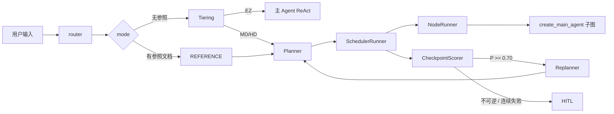

# 任务调度策略开发文档

| 项目 | 内容 |
| :-- | :-- |
| 版本 | v0.1 |
| 日期 | 2026-11-14 |
| 关联设计 | [任务调度模块设计](./任务调度模块设计.md)、[分档函数标定实验报告](./任务调度分档函数标定实验报告.md) |
| 目标读者 | 负责调度模块实现的工程师 |
| 默认状态 | 关闭。`HARNESS_SCHEDULER_ENABLED=0`，先影子运行再接管执行 |

---

## 1. 目标与非目标

### 1.1 目标

1. 把"分档 → 计划 → 执行 → 检查点 → 重规划"做成一个可观测、可回放的模块。
2. 分档与检查点触发用可标定的数学模型，不靠提示词里的形容词。
3. 与现有 `task_flow`、`create_work_plan`、`RunSupervisor`、HITL、事件流复用，不另起一套 Agent 运行时。

### 1.2 非目标

- 不实现通用工作流引擎（DAG 能力只覆盖 fork/join + 依赖）。
- 不做跨用户的全局优先级队列与抢占。
- 不在 P0 引入训练管线；P0 只落影子模式和数据采集。
- 不把 Brick 数据集或其模型直接接入在线链路（非商用许可 + 领域不匹配）。

---

## 2. 现状与改造点

| 能力 | 现状 | 改造 |
| :-- | :-- | :-- |
| 任务划分 | `create_work_plan` 产出 `WorkItem` + 波次，最多 24 项 | 新增两级 `Phase/Item` 计划，保留原工具不动 |
| 静态流程 | `task_flow` 编译出 `ExecutionPlan` | 新增 `REFERENCE` 模式，把 `ExecutionPlan` 映射为调度计划 |
| 执行 | `ExecutionPlan` 无消费者，执行靠模型自觉 | 新增 `SchedulerRunner`，按依赖就绪顺序驱动节点 |
| 检查点 | 只有步骤状态上报，无评分与触发 | 新增 `checkpoints.py`，输出 `P(replan)` 与重规划范围 |
| 重规划 | 无 | 新增 `replanner.py`，支持 reorder / subtree / full |
| 分档 | 6 特征硬规则 + LLM 三选一 | 改为 7 维几何聚合 + 有序 logistic（见 §5） |
| 观测 | 无调度层指标 | 新增 `scheduler_*` 事件与四张表 |

---

## 3. 架构



### 3.1 模块划分

```
src/scheduler/
├── __init__.py
├── models.py        # Pydantic 数据模型
├── features.py      # 7 维特征归一化与缺失处理
├── tiering.py       # S 聚合 + 有序 logistic + 滞回决策
├── graph.py         # 依赖拓扑、波次、写冲突（复用现有实现）
├── planner.py       # DYNAMIC 计划生成（层次表）
├── runner.py        # 波次调度、并发上限、节点执行
├── checkpoints.py   # 检查点评分 P(replan) 与硬门控
├── replanner.py     # 重规划范围判定与候选选择
├── store.py         # Postgres 持久化（复用 TaskFlowStore 连接方式）
├── events.py        # 事件封装，复用 custom stream writer
└── config.py        # HARNESS_SCHEDULER_* 常量
```

`graph.py` 的 P0 实现直接调用 `src/agent/tools/planning_tools.py` 里的 `_topological_waves`，P2 再抽成公共函数，避免一次改动两个模块。

---

## 4. 数据模型

```python
from enum import Enum
from typing import Optional
from pydantic import BaseModel, Field


class Tier(str, Enum):
    EZ = "EZ"
    MD = "MD"
    HD = "HD"


class PlanMode(str, Enum):
    REFERENCE = "reference"
    DYNAMIC = "dynamic"


class ItemStatus(str, Enum):
    PENDING = "pending"
    READY = "ready"
    RUNNING = "running"
    DONE = "done"
    FAILED = "failed"
    SKIPPED = "skipped"


class FeatureVector(BaseModel):
    complexity: float = 0.5
    uncertainty: float = 0.5
    impact: float = 0.5
    scale: float = 0.5
    dep_depth: float = 0.5
    tool_diversity: float = 0.5
    acceptance: float = 0.5
    missing: list[str] = Field(default_factory=list)   # 缺失维度名
    source: dict[str, str] = Field(default_factory=dict)  # 每维来源：text/repo/session/llm
    evidence: dict[str, str] = Field(default_factory=dict)  # 打分理由，便于审计


class TierDecision(BaseModel):
    tier: Tier
    s: float
    probs: dict[str, float]          # p_EZ / p_MD / p_HD
    rule_override: Optional[str] = None
    upgraded: bool = False
    reason: str = ""


class Item(BaseModel):
    id: str
    phase_id: str
    goal: str
    depends_on: list[str] = Field(default_factory=list)
    reads: list[str] = Field(default_factory=list)
    writes: list[str] = Field(default_factory=list)
    agent_role: Optional[str] = None
    acceptance: list[str] = Field(default_factory=list)
    status: ItemStatus = ItemStatus.PENDING
    attempt: int = 0


class Phase(BaseModel):
    id: str
    goal: str
    items: list[Item] = Field(default_factory=list)
    status: ItemStatus = ItemStatus.PENDING


class SchedulePlan(BaseModel):
    run_id: str
    mode: PlanMode
    tier: Tier
    version: int = 1
    phases: list[Phase] = Field(default_factory=list)
    pending_phases: list[str] = Field(default_factory=list)  # 未展开的阶段
    budget: "Budget" = None


class Budget(BaseModel):
    max_tokens: int = 120_000
    max_tool_calls: int = 200
    max_wall_seconds: int = 1800


class Delta(BaseModel):
    d1_progress: str = ""
    d2_remaining: str = ""
    d3_user_intervention: bool = False
    d4_new_requirements: list[str] = Field(default_factory=list)
    d5_budget_used_ratio: float = 0.0
    flags: list[str] = Field(default_factory=list)   # irreversible / conflict / repeated_failure


class SchedulerState(BaseModel):
    run_id: str
    plan_version: int
    current_phase: Optional[str] = None
    completed_items: list[str] = Field(default_factory=list)
    delta: Delta = Field(default_factory=Delta)
    last_tier: Optional[Tier] = None
    last_s: Optional[float] = None
    replan_count: int = 0
    ledger: list[str] = Field(default_factory=list)   # S：只增不改的事实账本
```

---

## 5. 分档器

### 5.1 接口

```python
def decide_tier(
    x: FeatureVector,
    cfg: TierConfig,
    prev_tier: Tier | None = None,
    hard_override: str | None = None,
) -> TierDecision: ...
```

### 5.2 归一化

| 维度 | 来源 | 归一化 |
| :-- | :-- | :-- |
| `complexity` | 文本 + 规划结果 | `1 - exp(-n_subgoals / 5)` |
| `uncertainty` | 文本模糊度 + 有无参照 | 等级 / 3 |
| `impact` | 会话/仓库探针 | `1 - exp(-n_paths / 6)` |
| `scale` | 计划项数 / 预估轮次 | `1 - exp(-n_items / 8)` |
| `dep_depth` | 计划依赖 | `1 - exp(-depth / 4)` |
| `tool_diversity` | 工具集 | `1 - exp(-n_tool_types / 5)` |
| `acceptance` | 测试/发布门/不可逆 | 等级 / 3 |

缺失维度处理：

- 缺 1–2 维：填 `0.5`，在 `missing` 记录，最终 `max(p)` 乘以 `0.85^missing`；
- 缺 3 维及以上：不输出 EZ，最低 MD，并标记 `needs_hitl=True`。

### 5.3 聚合与分档

```python
def complexity_score(x: FeatureVector, w: dict[str, float], eps: float = 1e-3) -> float:
    keys = list(w)
    num = sum(w[k] * math.log(max(getattr(x, k), eps) + eps) for k in keys)
    return math.exp(num / sum(w.values()))


def memberships(s: float, theta1: float, theta2: float, alpha: float) -> dict[str, float]:
    s1 = sigmoid(alpha * (s - theta1))
    s2 = sigmoid(alpha * (s - theta2))
    return {"EZ": 1 - s1, "MD": s1 - s2, "HD": s2}
```

数值约束：

- `theta2 > theta1 + 0.05`，否则配置校验失败；
- `alpha > 2 * math.log(2) / (theta2 - theta1)`，否则启动时报错；
- `s` 与概率全部 `clamp(0, 1)`。

### 5.4 决策顺序

```
1. hard_override（用户指定 / 不可逆 / 强约束）→ 直接返回
2. tier = argmax(probs)
3. 若 max(probs) < tau：升一档
4. 若 prev_tier 存在：只有越过 theta±delta 才允许切换
5. 连续两次升档 → 标记 needs_hitl
```

`prev_tier` 只在一个 run 内有效，来自 `SchedulerState`，不跨会话。

### 5.5 参数

| 参数 | 默认值 | 来源 |
| :-- | :-- | :-- |
| `w` | 专家先验，和为 1 | 待采集 7 维样本后拟合 |
| `theta1` | 自有 `S` 的 32.7% 分位 | Brick 先验 |
| `theta2` | 自有 `S` 的 84.0% 分位 | Brick 先验 |
| `alpha` | 7.2 | 真实数据拟合 |
| `tau` | 0.55 | 准确率/严重低估权衡 |
| `delta` | 0.03 | 抖动实验 |

边界必须在部署环境用历史 `S` 重新取分位，不能写死成 `0.265/0.759`。

---

## 6. 计划与执行

### 6.1 REFERENCE 模式

触发：router 命中已有 `TaskFlow` 且 `schema_hash` 一致。

映射规则：

| TaskFlow | SchedulePlan |
| :-- | :-- |
| `Step` | `Item`，`id=step.id` |
| `Step.depends_on` | `Item.depends_on` |
| 子流 | `Phase`，阶段内步骤作为 `Item` |
| `fork` | 同一波次，并发受 `HARNESS_SCHEDULER_MAX_PARALLEL` 限制 |

不做语义改写，只做结构转换；`acceptance` 为空时继承 flow 的 `done_when`。

### 6.2 DYNAMIC 模式

- EZ：不进调度器，直接主 Agent ReAct（现有路径）。
- MD：生成"阶段 + 当前阶段条目"，只展开 `P0`、`P1`，其余留在 `pending_phases`。
- HD：生成完整两级表，允许跨阶段依赖；阶段边界作为强制检查点。

计划生成约束（复用现有 `MAX_TASKS=24` 的上限，两级合计不超过 32）：

- 每个 `Item` 必须可独立验收；
- `writes` 不能在同一波次重叠，冲突直接报错并要求拆分；
- 依赖必须无环，深度超过 6 时提示重新划分阶段。

### 6.3 执行器

```python
class SchedulerRunner:
    async def run(self, plan: SchedulePlan, state: SchedulerState) -> RunResult: ...

    async def _run_wave(self, items: list[Item]) -> None:
        sem = asyncio.Semaphore(self.cfg.max_parallel)
        await asyncio.gather(*(self._run_item(i, sem) for i in items))
```

节点执行：

- 每个节点通过 `create_main_agent` 构造独立子图，`thread_id = f"{run_id}:{item.id}"`；
- **不复用同一编译图跨线程**，P1 前必须验证 LangGraph 的并发假设；
- 单节点超时、重试交给 `RunSupervisor`，调度器只决定"是否重试"和"重试哪个节点"，不叠加退避；
- 节点结束后写 `scheduler_node` 与 `scheduler_checkpoint`，再推进游标。

P0 只支持顺序执行（`max_parallel=1`）；P2 才开并发。

---

## 7. 状态、检查点与恢复

### 7.1 表结构（草案）

```sql
CREATE TABLE IF NOT EXISTS scheduler_run (
    run_id        TEXT PRIMARY KEY,
    user_id       TEXT NOT NULL,
    mode          TEXT NOT NULL,
    tier          TEXT NOT NULL,
    status        TEXT NOT NULL,
    state         JSONB NOT NULL,
    created_at    TIMESTAMPTZ DEFAULT now(),
    updated_at    TIMESTAMPTZ DEFAULT now()
);

CREATE TABLE IF NOT EXISTS scheduler_plan (
    run_id        TEXT NOT NULL,
    version       INT  NOT NULL,
    plan          JSONB NOT NULL,
    created_at    TIMESTAMPTZ DEFAULT now(),
    PRIMARY KEY (run_id, version)
);

CREATE TABLE IF NOT EXISTS scheduler_checkpoint (
    id            BIGSERIAL PRIMARY KEY,
    run_id        TEXT NOT NULL,
    item_id       TEXT,
    plan_version  INT NOT NULL,
    score         REAL NOT NULL,
    scope         TEXT,
    decision      JSONB NOT NULL,
    created_at    TIMESTAMPTZ DEFAULT now()
);

CREATE TABLE IF NOT EXISTS scheduler_sample (
    id            BIGSERIAL PRIMARY KEY,
    run_id        TEXT NOT NULL,
    features      JSONB NOT NULL,
    tier_chosen   TEXT NOT NULL,
    outcome       JSONB NOT NULL,
    label_source  TEXT,
    label_confidence REAL,
    created_at    TIMESTAMPTZ DEFAULT now()
);
```

沿用 `TaskFlowStore` 的惰性连接与 `setup()` 模式，不新建连接池。

### 7.2 检查点时机

| 时机 | 是否评分 |
| :-- | :-- |
| 阶段（Phase）完成 | 是，强制 |
| 单个 `Item` 完成 | 仅当 `writes` 非空或 `attempt > 0` |
| 用户新消息到达 | 是，只算 `d4` 与 `d3` |
| 节点失败 | 是，附带 `irreversible` 标记 |
| 每 N 个条目 | N=3 时兜底评分 |

节流：同一 run 两次评分至少间隔 1 个节点，且 `replan_count ≤ 3`。

### 7.3 恢复

```
load state → 校验 plan_version → 重算就绪集合 → 校验最后一个 checkpoint 的 acceptance
→ 通过则继续；不通过则标记该节点 FAILED 并局部重规划
```

`S` 账本只追加；`R` 由 `plan_version` 对应的计划重建；`D` 从最后一次 checkpoint 还原。

---

## 8. 检查点打分

```python
z = [
    0.0 if impact == "low" else 0.5 if impact == "mid" else 1.0,
    0.0 if uncertainty == "low" else 0.5 if uncertainty == "mid" else 1.0,
    0.0 if not user_delta else 0.5 if scope == "local" else 1.0,
    min(1.0, budget_used_ratio),
]
p = sigmoid(dot(beta, z) + bias[tier])
```

- `beta` 初值 `[0.35, 0.25, 0.20, 0.20]`，`bias = {EZ: -0.8, MD: 0, HD: 0.5}`；
- 硬门控优先：`irreversible` → HITL；`user_delta.scope == "global"` → 直接 full replan；
- `p >= 0.70` → 重规划；`0.45 <= p < 0.70` → 只允许 reorder；否则继续；
- 连续两次 `p >= 0.70` 且计划无变化 → HITL。

---

## 9. 重规划

### 9.1 范围判定

| 条件 | 范围 |
| :-- | :-- |
| 用户新要求影响目标/验收 | `full` |
| 单节点失败或有写冲突 | `subtree`（该节点及其下游） |
| 仅顺序不合理 | `reorder`（不动依赖结构） |

### 9.2 候选与选择

候选固定五种：保持、合并、拆分、换执行者、推迟。用确定性规则打分，不做蒙特卡洛采样：

```
cost = 预计剩余 tokens / 剩余预算
risk = 下游节点数 * 不可逆系数
gain = 解除阻塞的节点数
选 gain 最大、cost + risk 最小者
```

### 9.3 提交

- `plan_version += 1`，旧版本保留；
- 发 `plan_revised` 事件，带 `changed_items` 与理由；
- 重规划不重置已完成节点的状态；
- 触发 HITL 时，等待用户选择 `accept / modify / abort`，超时按 `abort` 处理。

---

## 10. 与现有系统的接入点

| 位置 | 用途 | 改动 |
| :-- | :-- | :-- |
| `src/task_flow/compiler.py:compile()` | 生成 `ExecutionPlan` | 只读，REFERENCE 模式消费 |
| `src/task_flow/store.py:TaskFlowStore` | 任务流存储 | 只读，复用连接方式 |
| `src/agent/tools/planning_tools.py:create_work_plan` | 波次与冲突算法 | 复用 `_topological_waves`，不改签名 |
| `src/agent/tools/task_flow_tools.py:_emit` | 事件格式 | 新增 `scheduler_progress`，沿用 writer 模式 |
| `src/api/chat.py` | 事件分发 | 增加 `scheduler_progress` 分支 |
| `src/agent/runtime/supervisor.py:RunSupervisor` | 节点内重试 | 直接复用，不重复实现退避 |
| `src/agent/tools/hitl_tool.py` | `request_user_choice` | 重做/终止确认复用 |
| `src/agent/agent_team/runner.py` | 并发信号量 | 参考其上限与忙则拒绝策略 |
| `src/agent/config.py` | 配置风格 | 新增模块级 `HARNESS_SCHEDULER_*` 常量 |
| `frontend/HarnessControlPlatform/src/stores/chat.ts` | 事件展示 | 增加调度卡片状态 |

新增工具：`scheduler_plan`（生成两级计划）、`scheduler_replan`（手动触发，调试用）。**不修改** `create_work_plan` 的 schema，避免影响现有调用方。

---

## 11. 配置项

| 环境变量 | 默认 | 说明 |
| :-- | :-- | :-- |
| `HARNESS_SCHEDULER_ENABLED` | `0` | 总开关 |
| `HARNESS_SCHEDULER_SHADOW` | `1` | 只算档位和计划，不接管执行 |
| `HARNESS_SCHEDULER_ALPHA` | `7.2` | 有序 logistic 陡峭度 |
| `HARNESS_SCHEDULER_THETA1_Q` | `0.327` | θ1 分位 |
| `HARNESS_SCHEDULER_THETA2_Q` | `0.840` | θ2 分位 |
| `HARNESS_SCHEDULER_TAU` | `0.55` | 低置信度阈值 |
| `HARNESS_SCHEDULER_DELTA` | `0.03` | 滞回宽度 |
| `HARNESS_SCHEDULER_MAX_PARALLEL` | `1` | P0 固定顺序 |
| `HARNESS_SCHEDULER_MAX_REPLAN` | `3` | 单 run 重规划上限 |
| `HARNESS_SCHEDULER_BUDGET_TOKENS` | `120000` | 默认预算 |

配置加载时做三项校验：`alpha` 下限、`theta` 顺序、权重非负且和为正。

---

## 12. 事件协议

```json
{
  "type": "scheduler_progress",
  "run_id": "r-...",
  "phase": "tiering | planning | running | checkpoint | replan | done | failed",
  "tier": "MD",
  "plan_version": 1,
  "item_id": "p0.2",
  "status": "started | done | failed | skipped",
  "score": 0.72,
  "scope": "subtree",
  "reason": "写冲突：两个节点同时修改 config.py",
  "ts": "2026-11-14T10:00:00Z"
}
```

前端只消费 `phase / tier / item_id / status / reason`，其余字段用于调试与回放。

---

## 13. 测试与验收

### 13.1 单元测试

| 用例 | 断言 |
| :-- | :-- |
| 单调性 | 任一维增大，`S` 不下降 |
| 概率合法 | 三者非负、和为 1（误差 1e-9） |
| `alpha` 下限 | 低于 `2ln2/(θ2-θ1)` 时启动失败 |
| 中间档可达 | 给定 `S=(θ1+θ2)/2`，`MD` 的隶属度最大 |
| 滞回 | EZ→MD 需 `S>θ1+δ`，MD→EZ 需 `S<θ1-δ` |
| 缺失维度 | 缺 3 维时最低返回 MD |

### 13.2 集成测试

1. REFERENCE：`schema_hash` 命中后，计划条目与 `TaskFlow` 一一对应；
2. DYNAMIC-MD：只展开前两个阶段，条目数 ≤ 32；
3. 写冲突：同波次两个 `writes` 重叠时拒绝计划；
4. 恢复：杀掉进程后从最后 checkpoint 继续，不重复执行已完成节点；
5. 重规划：注入"用户新增全局要求"，`plan_version` 增加且已完成节点不变；
6. HITL：不可逆节点必须先弹确认，拒绝后状态为 `aborted`。

### 13.3 验收指标

| 指标 | 目标 |
| :-- | :-- |
| 档位重复评估稳定性 | ≥ 95% |
| 严重低估率（HD→EZ） | ≤ 5% |
| 重规划率 | 10%–25%（过低说明检查点太钝，过高说明抖动） |
| 调度额外 token 占比 | ≤ 15% |
| 与人工档位一致率 | ≥ 80%（30 条真实任务） |

Brick 数据集只用于离线校准，不进入在线评测。

---

## 14. 开发任务拆分

### P0：影子模式

- 新增 `models.py`、`features.py`、`tiering.py`、`config.py`；
- 在 router 后计算档位，只写 `scheduler_sample` 与日志，不改变执行；
- 用 30 条真实任务对比人工档位，输出混淆矩阵；
- 验收：零行为变更，档位一致率 ≥ 75%。

### P1：MD 顺序执行

- `planner.py` 生成两级计划，`scheduler_plan` 工具上线；
- `runner.py` 顺序执行 + `scheduler_run/plan/checkpoint` 落库；
- 断点恢复；
- 验收：MD 任务可完整跑完，恢复不重复执行。

### P2：HD 并发与重规划

- 波次并发（先压测图复用问题）、`checkpoints.py`、`replanner.py`；
- HITL 决策卡、前端 `scheduler_progress` 展示；
- 验收：§13.3 全部指标达标。

---

## 15. 风险与回滚

| 风险 | 影响 | 应对 |
| :-- | :-- | :-- |
| 同图多 `thread_id` 并发不符合 LangGraph 假设 | 状态串扰 | P1 前压测；不通过则每节点建图 |
| 7 维特征抽取成本高 | 入口延迟 | P0 只抽文本维，其余用默认值并标 `missing` |
| 计划过度细化 | token 反而增加 | 两级上限 + 额外 token 占比监控 |
| 重规划抖动 | 反复改计划 | 滞回 + `max_replan=3` + 连续触发转 HITL |
| 数据集许可 | 合规 | 仅离线，结果不进入生产模型 |
| 新模块影响现有流程 | 回归 | 默认关闭 + 影子模式 + 事件旁路 |

回滚：`HARNESS_SCHEDULER_ENABLED=0` 即恢复现有路径；调度数据表保留，不影响 `task_flow`。
