# 架构图与核心时序

> 目标：用图把本项目的**模块边界、调用方向、状态归属**讲清楚。
> 读完后你应该能回答三个问题：
> 1. 一个 HTTP 请求进来后，经过了哪些模块？
> 2. 沙箱、PostgreSQL、Agent Protocol 分别在哪一步被使用？
> 3. 中断、异步任务、技能同步失败时，状态最终落在哪里？

---

## 0. 一页纸总览

```text
浏览器 / Java 网关
        │  HTTP + SSE
        ▼
┌──────────────────────────────────────────────┐
│ FastAPI（api/chat.py）                        │
│  /chat  /chat/stream  /resume                 │
│  /history  /async-tasks  /health              │
└──────────────────┬───────────────────────────┘
                   │
                   ▼
┌──────────────────────────────────────────────┐
│ AgentLoader（api/agent_loader.py）            │
│  user_id → 缓存的 Agent 图                    │
│  thread_id → 独立 checkpoint                  │
└───────┬───────────────────────┬──────────────┘
        │                       │
        ▼                       ▼
┌──────────────────┐   ┌────────────────────────┐
│ DeepAgents 图     │   │ SandboxManager          │
│ main_agent.py     │   │ 按 user_id 管理沙箱代理  │
│  ├ 中间件          │   └──────────┬─────────────┘
│  ├ 工具            │              │
│  └ 子 Agent        │              ▼
└───────┬───────────┘   ┌────────────────────────┐
        │               │ SandboxBackendProxy     │
        │               │  └ OpenSandboxBackend   │
        │               │      └ OpenSandbox      │
        │               └────────────────────────┘
        │
        ├──────────────► PostgreSQL（Store + Checkpointer）
        └──────────────► 模型服务
                          │
                          └─ 异步工具 → Agent Protocol（async_subagent）
```

**四个“唯一”**

| 唯一 | 落点 | 含义 |
|:--|:--|:--|
| 唯一请求入口 | `api.chat.app` | 所有对话、历史、异步任务都从这里进 |
| 唯一 Agent 缓存 | `AgentLoader._user_groups` | 同一用户复用一张图，不同用户隔离 |
| 唯一沙箱引用 | `SandboxBackendProxy` | 图里持有代理，沙箱实例可替换 |
| 唯一持久化口径 | PostgreSQL | Checkpoint、用户记忆、会话索引、任务归属 |

---

## 1. 总体分层架构

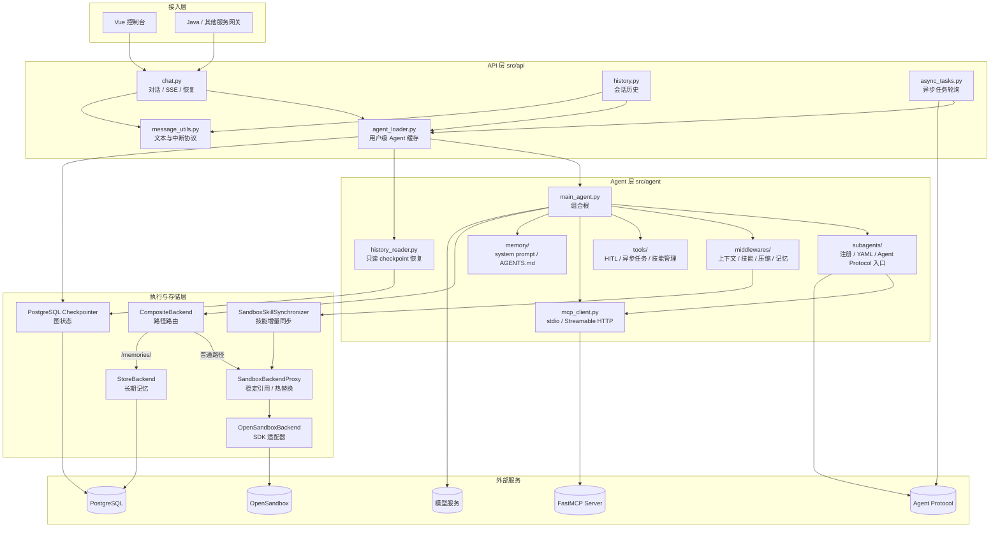

**看图要点**

1. API 层**不直接构图**：它只通过 `AgentLoader` 拿“某用户已缓存的图”。
2. Agent 层**不直接连数据库**：它只通过 `backend` 读写，路由由 `CompositeBackend` 决定。
3. 沙箱和 PostgreSQL 是**并列的两个后端**，不是包含关系。
4. 异步子 Agent 是**另一个进程/服务**，主图只负责提交任务和轮询结果。

---

## 2. 核心模块职责与依赖

| 模块 | 核心对象 | 职责 | 上游 | 下游 |
|:--|:--|:--|:--|:--|
| `api/chat.py` | `app`、`_stream_response` | HTTP/SSE 协议、流内事件、中断 canonical 化 | 客户端 | `AgentLoader`、`message_utils` |
| `api/agent_loader.py` | `AgentLoader` | 用户级图缓存、会话锁、会话索引、异步结果回写 | `chat/history/async_tasks` | `main_agent`、`SandboxManager`、`history_reader`、Store/Saver |
| `api/history.py` | `serialize_messages` | checkpoint 消息 → 前端消息模型 | 客户端 | `AgentLoader`、`history_reader` |
| `api/async_tasks.py` | `get_async_task_status` | 查询远程 run、提取结果、幂等投递 | 客户端 | `AgentLoader`、Agent Protocol SDK |
| `agent/main_agent.py` | `create_main_agent` | 装配 backend、工具、子 Agent、中间件 | `AgentLoader` | 所有 Agent 子模块 |
| `agent/subagents/` | `register_async_subagent`、`async_subagent_graph` | 子 Agent 注册、YAML 加载、远程图构建 | `main_agent` / Agent Protocol | `load_subagent`、中间件、沙箱代理 |
| `agent/backends/` | `SandboxManager`、`SandboxBackendProxy`、`OpenSandboxBackend` | 沙箱生命周期、热替换、SDK 适配、技能同步 | `main_agent` | OpenSandbox |
| `agent/middlewares/` | 4 个自定义中间件 | 身份注入、技能同步、摘要/限额、记忆更新 | `main_agent` | 模型、Store、沙箱 |
| `agent/tools/` | `start_async_task`、`request_additional_info`、技能工具 | 通用工具能力 | 模型 | Agent Protocol、沙箱 |
| `agent/tools/mcp_client.py` | `load_mcp_tools_for_servers`、`load_main_mcp_tools` | 按配置加载 stdio / HTTP MCP 工具 | `main_agent` / `aload_subagent` | FastMCP Server |
| `mcp_server/` | `FastMCP`、`register_all_tools` | 把项目工具暴露为标准 MCP 服务 | 外部 Agent / 客户端 | 工具实现 |
| `agent/history_reader.py` | `ThreadHistoryReader` | 只读重建消息与中断 | `AgentLoader` | Checkpointer |
| `agent/config.py` | 配置与模型单例 | 环境变量、模型、路径、PostgreSQL 连接 | 全项目 | 模型服务、PostgreSQL |
| `agent/schema.py` | `HarnessContext`、`ChatRequest`、`Session` | 公共数据契约 | API 层 | 无 |

---

## 3. 服务启动时序

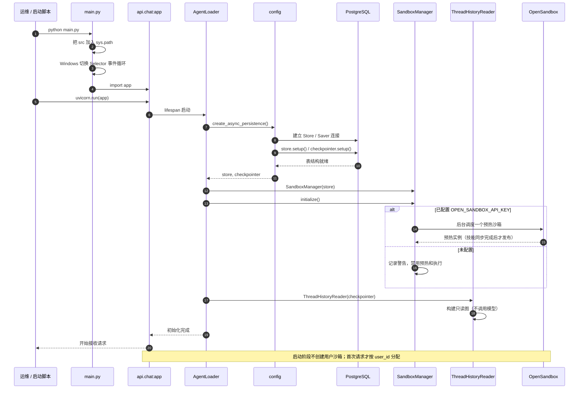

**看图要点**

- 启动只做三件事：连 PostgreSQL、调度预热、构建只读历史图。
- 预热沙箱是**无主的**：没有写用户绑定；分配时才和 `user_id` 关联。
- 没有 `OPEN_SANDBOX_API_KEY` 时服务仍能启动，但 `/chat` 会失败；`/health` 和只读接口不受影响。

---

## 4. 一次 SSE 对话的完整时序

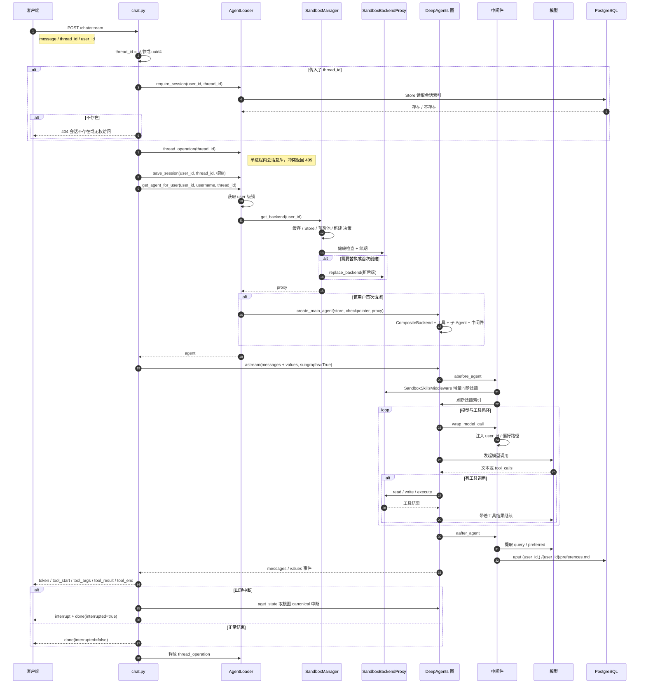

**看图要点**

1. **会话锁先于 Agent 调用**：同一 `thread_id` 的并发请求会在入口被拒绝（409）。
2. **沙箱探测每次请求都做**：不是“构图时探测一次”。这样沙箱失效后，已缓存图仍能拿到新后端。
3. **图只构建一次**：`AgentLoader` 按 `user_id` 缓存；`thread_id` 只是 checkpoint 的 key。
4. **SSE 过滤子 Agent 事件**：`source != main` 的消息不发给前端，子 Agent 的内部过程不泄露。
5. **中断在流结束后 canonical 化**：从根图 `aget_state()` 取最终中断，避免子图中间 ID 导致恢复重放。

---

## 5. HITL 中断与恢复时序

### 5.1 补充信息中断

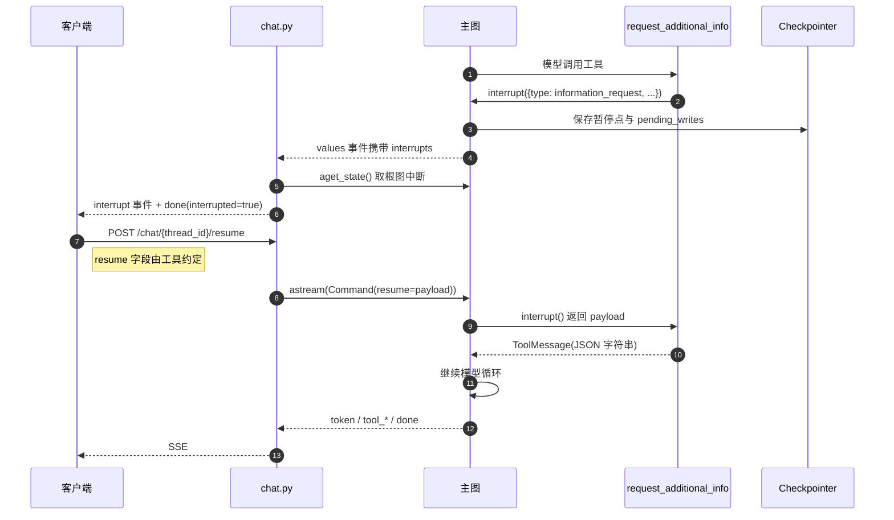

### 5.2 工具审批中断

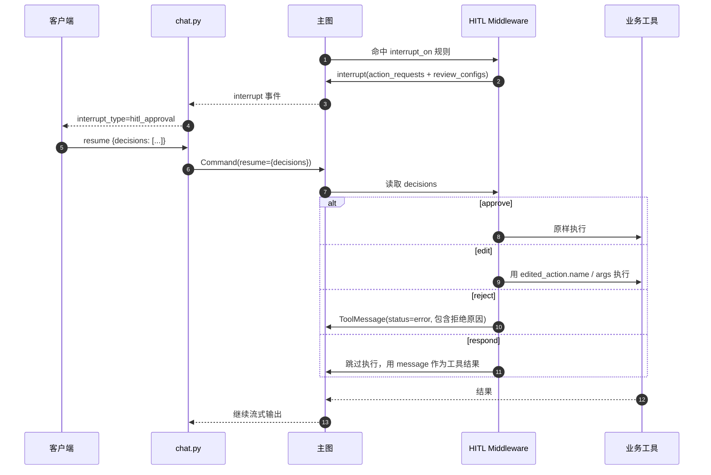

**看图要点**

- `decisions` 的顺序和数量必须与 `action_requests` 一致。
- 恢复必须用**根图 checkpoint 的 canonical interrupt ID**；流里先出现的子图中断 ID 可能不是最终可恢复 ID。
- 暂停期间会话锁已释放；恢复时重新获取。

---

## 6. 异步子 Agent

### 6.1 提交任务时序

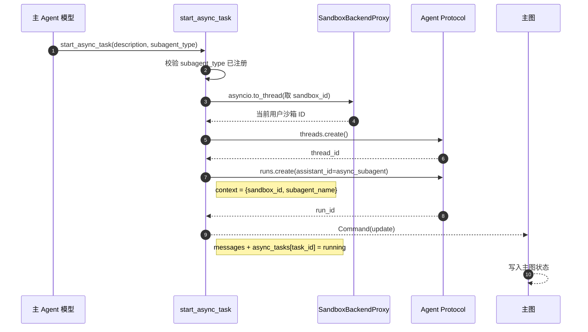

### 6.2 远程执行时序

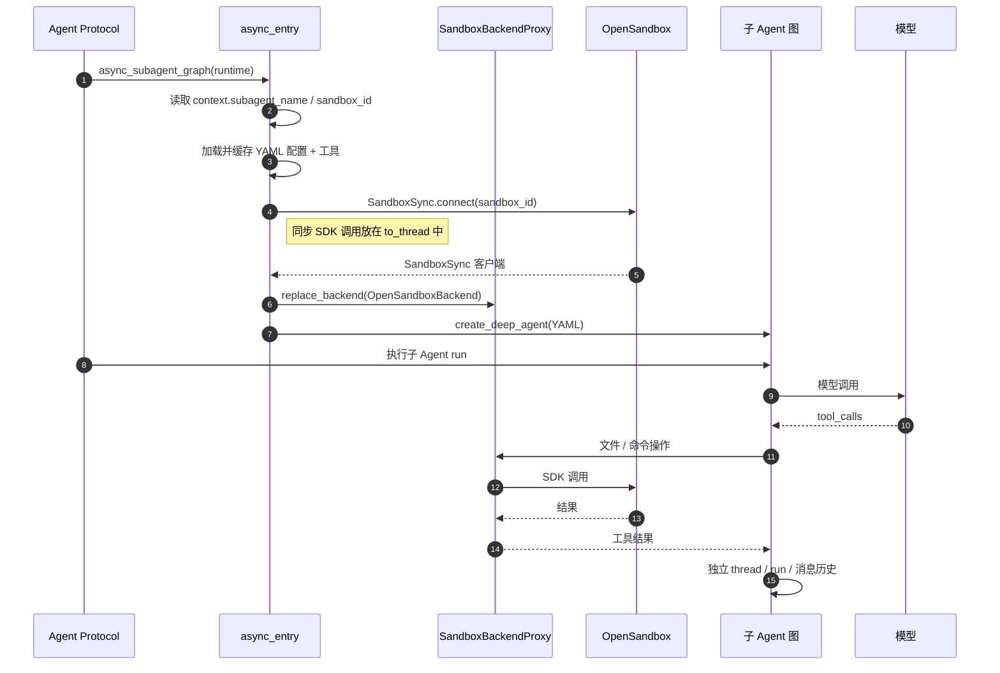

### 6.3 结果轮询与回写

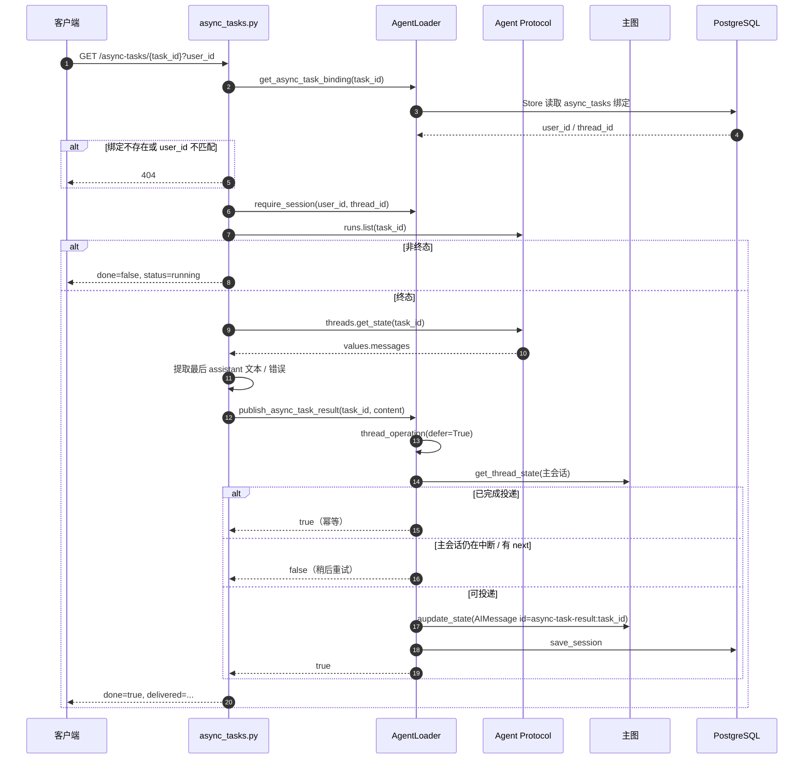

**看图要点**

- 主 Agent 与异步子 Agent **共享沙箱**，但不共享 thread/run/消息历史。
- 结果投递使用固定消息 ID，因此重复轮询不会产生重复消息。
- 主会话正在中断时拒绝投递，避免覆盖暂停状态。
- Agent Protocol 只有一个图入口 `async_subagent`；新增子 Agent 只改注册表，不改 `langgraph.json`。

---

## 7. 沙箱管理与热替换

### 7.1 `get_backend(user_id)` 决策树

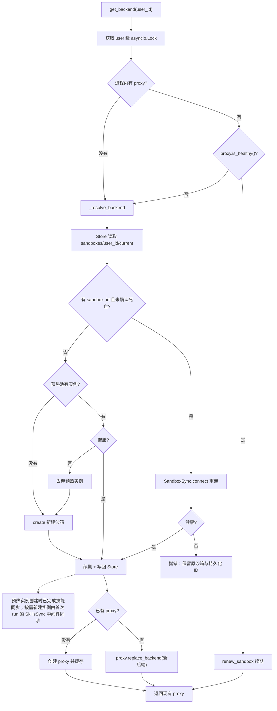

**判定原则**

- 只有 **404 / TERMINATED / FAILED** 才算“确认死亡”，允许新建。
- 传输超时、健康检查失败不等于工作区丢失；优先重连并保留持久化 ID。
- 续期失败只告警，不触发换沙箱。
- 预热实例未分配，可直接丢弃；已分配实例只关闭客户端，不终止远端沙箱。

### 7.2 热替换时序

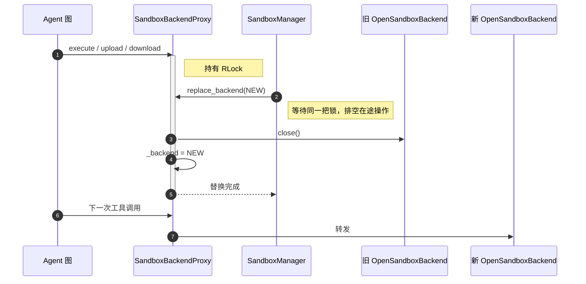

**看图要点**

- 图里只持有 proxy，不持有具体 backend；因此替换不需要重建图。
- 替换是“排空在途操作后替换”，不是打断式替换。
- `close()` 关闭的是旧客户端，不是远端持久化沙箱。

---

## 8. 文件系统路由与技能同步

### 8.1 `CompositeBackend` 路由

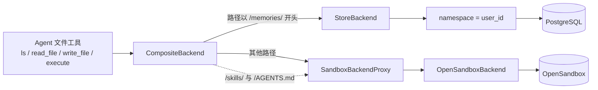

**路由语义**

| 虚拟路径 | 真实落点 | 生命周期 |
|:--|:--|:--|
| `/memories/{user_id}/preferences.md` | PostgreSQL Store | 跨会话 |
| `/skills/main/...` | 宿主磁盘 → 同步到沙箱 | 宿主持久 |
| `/skills/subagents/<agent>/...` | 宿主磁盘 → 同步到沙箱 | 宿主持久 |
| `/AGENTS.md` | 宿主文件 → 同步到沙箱 | 宿主持久 |
| 其他工作文件 | 沙箱文件系统 | 沙箱生命周期 |

### 8.2 技能增量同步时序

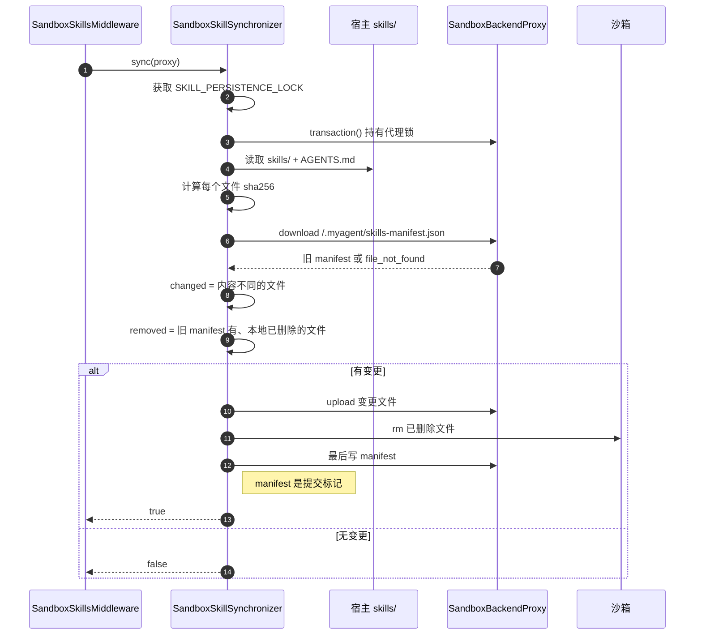

**为什么 manifest 最后写**

如果先写 manifest 再传文件，中途失败会留下“索引认为已同步、实际文件缺失”的状态。
最后写 manifest，失败时下次仍会检测到差异并重传。

---

## 9. 技能分配的双端事务

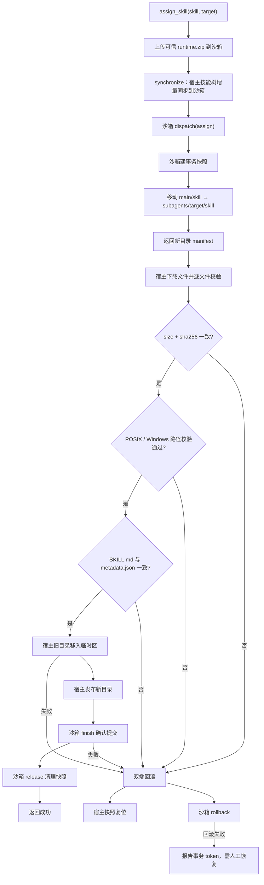

**看图要点**

- `download` 只在沙箱发生，不写宿主；此时还没有持久化。
- `assign / update / delete` 才是双端事务。
- 任一步失败先尝试两端回滚；`release` 失败只告警，因为两端已经提交，不能单边撤销。
- `skill-management` 是保留技能，不能 assign 或 delete。

---

## 10. 记忆更新与上下文压缩

### 10.1 用户偏好写回时序

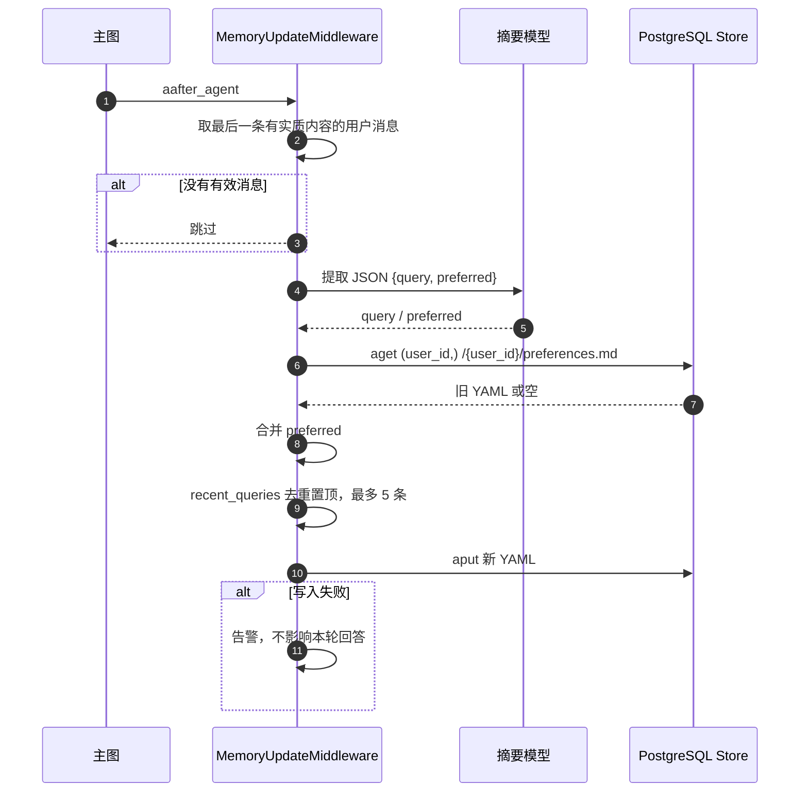

### 10.2 上下文压缩的三条路径

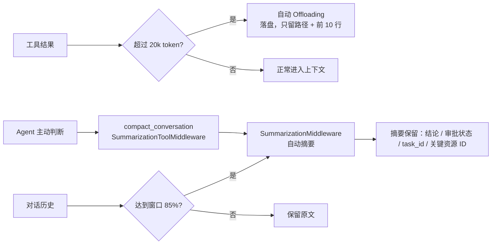

**看图要点**

- 自动摘要与主动压缩共享同一个 summarizer 实例，避免两套摘要上下文产生偏差。
- 压缩不是“丢历史”：完整历史仍在 checkpoint，摘要只是模型当前看到的部分。
- 记忆只写 `/memories/`，压缩摘要不写用户偏好文件。

---

## 11. 中间件钩子顺序

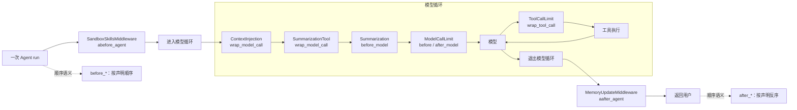

**记住三条规则**

1. `before_*` 按中间件声明顺序执行。
2. `after_*` 按声明反序执行。
3. `wrap_model_call` / `wrap_tool_call` 是洋葱模型：先声明的最外层，后执行内层。

这也是为什么 `MemoryUpdateMiddleware` 放在最后声明：它需要在本轮回答完成后才执行。

---

## 12. 数据归属与隔离

| 数据 | 存储位置 | Key / Namespace | 隔离维度 |
|:--|:--|:--|:--|
| 图执行状态 / 消息历史 | PostgreSQL Checkpointer | `thread_id` | 会话 |
| 用户偏好 | PostgreSQL Store | `(user_id,)` + `/{user_id}/preferences.md` | 用户 |
| 会话索引（侧边栏） | PostgreSQL Store | `("sessions", user_id)` + `thread_id` | 用户 |
| 异步任务归属 | PostgreSQL Store | `("async_tasks",)` + `task_id` | 任务 |
| 沙箱 ID | PostgreSQL Store | `("sandboxes", user_id)` + `current` | 用户 |
| 技能权威副本 | 宿主磁盘 | `src/agent/skills/` | 项目 |
| 技能运行副本 | 沙箱 | `/skills/` | 用户沙箱 |
| Agent 图缓存 | 进程内存 | `user_id` | 用户 / 单进程 |

**边界**

- 同一用户多会话：共享 Agent 图与沙箱代理，但 checkpoint 按 `thread_id` 隔离。
- 不同用户：Store namespace、沙箱、Agent 图都隔离。
- 多进程：进程内缓存与会话锁不共享；当前只支持单 worker。

---

## 13. 推荐阅读顺序

如果你想快速吃透代码，按这个顺序读：

1. [config.py](../src/agent/config.py)：模型、PostgreSQL、沙箱、路径从哪来。
2. [schema.py](../src/agent/schema.py)：`HarnessContext`、`ChatRequest`、`Session` 这些契约。
3. [main_agent.py](../src/agent/main_agent.py)：一张图是怎么被装配出来的。
4. [agent_loader.py](../src/api/agent_loader.py)：图怎么按用户缓存、会话怎么隔离。
5. [chat.py](../src/api/chat.py)：HTTP 和 SSE 怎么把图包装成接口。
6. [async_entry.py](../src/agent/subagents/async_entry.py) + [async_tasks.py](../src/api/async_tasks.py)：异步子 Agent 的完整闭环。
7. [sandbox_manager.py](../src/agent/backends/sandbox_manager.py) + [sandbox_proxy.py](../src/agent/backends/sandbox_proxy.py)：沙箱生命周期与热替换。
8. [skill_sync.py](../src/agent/backends/skill_sync.py) + [sandbox_skill_management.py](../src/agent/tools/sandbox_skill_management.py)：技能同步与双端事务。
9. [memory_update.py](../src/agent/middlewares/memory_update.py) + [history_reader.py](../src/agent/history_reader.py)：长期记忆与历史恢复。
10. [mcp_client.py](../src/agent/tools/mcp_client.py) + [mcp_server/](../src/mcp_server/)：MCP 客户端与服务端闭环。

---

## 14. 常见理解误区

| 误区 | 实际 |
|:--|:--|
| “每个 Agent 一个沙箱” | 按 `user_id` 一个沙箱；多个会话共用 |
| “换沙箱要重建 Agent 图” | 图持有 proxy，只替换内部 backend |
| “异步子 Agent 是 Python 协程” | 它是独立 thread/run/status 的远程任务 |
| “`assign` 是复制技能” | 是移动语义，宿主上只保留一份 |
| “`/memories/` 是宿主文件” | 是虚拟路径，真实落点是 PostgreSQL Store |
| “工具结果超过上下文就直接截断” | 先 offload 到文件，再保留路径与预览 |
| “中断恢复用流里的第一个 interrupt id” | 必须用根图 checkpoint 的 canonical id |
| “沙箱重启后要重新同步全部技能” | 按 manifest 增量同步，只传变更文件 |
| “异步任务结果由前端负责保存” | 服务端幂等写回主会话，前端只负责展示 |
